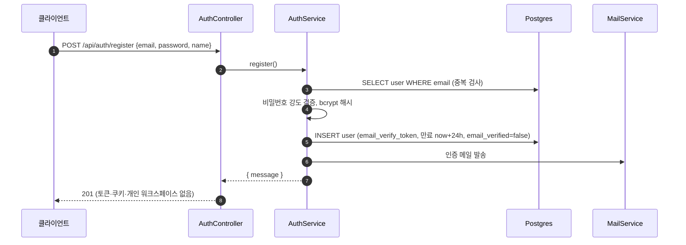
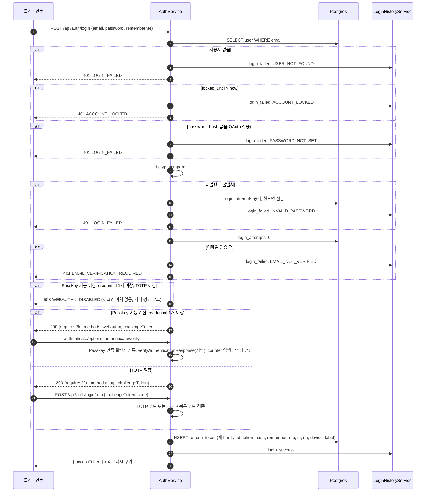
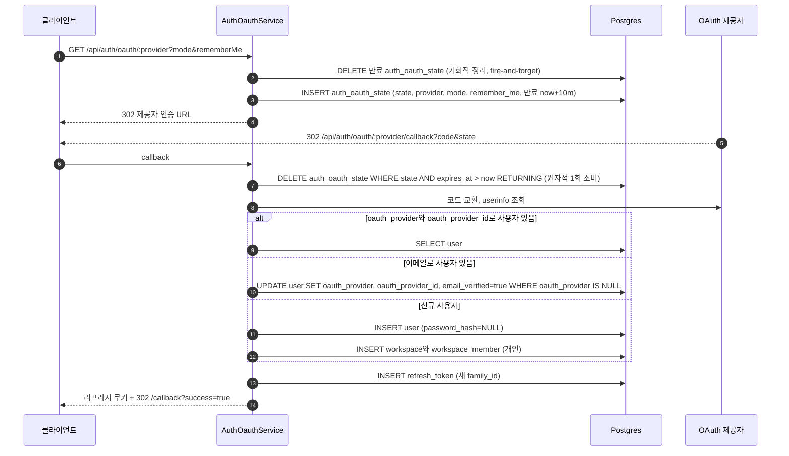
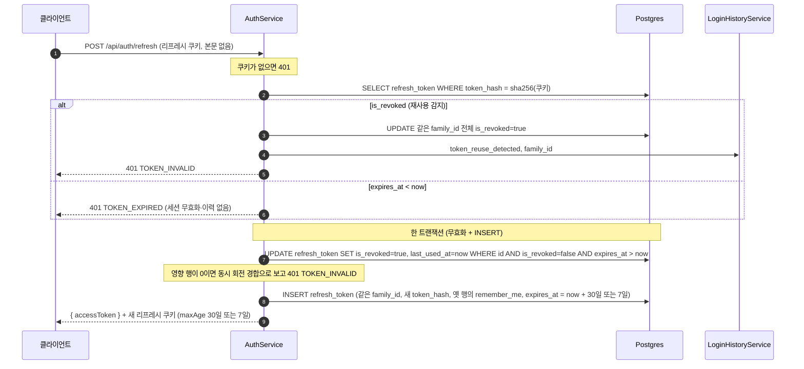
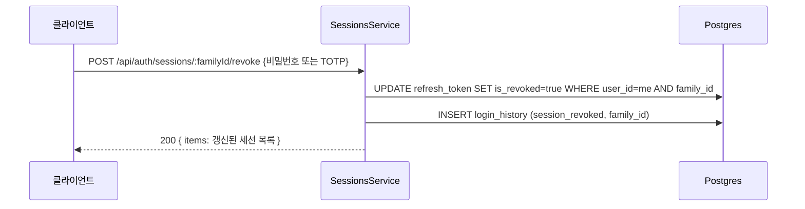
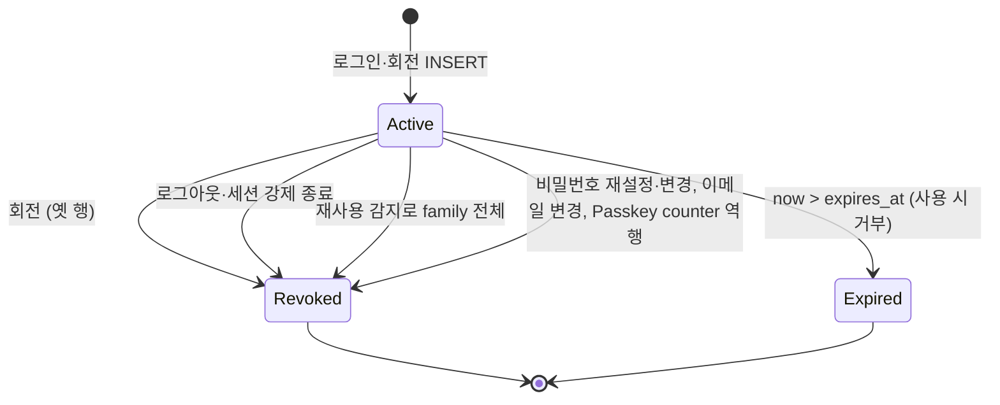

## 개요

이 문서는 [계정과 워크스페이스 데이터 흐름](CLE-ACCT-DATA.md) 의 하위 문서로 인증 동작(가입 · 로그인과 2단계 인증 · 소셜 로그인 · 토큰 회전 · 세션 종료 · 비밀번호 재설정 · 이메일 변경)이 어느 테이블을 어떤 순서로 읽고 쓰는지와 인증 상태의 전이를 정한다. 컬럼 정의는 [사용자 · 인증 엔티티](CLE-ACCT-DATA-MODEL.md), 흐름별 쓰기 컬럼 표와 요청 빈도 제한은 [테이블 쓰기 · 배치 · 외부 의존](CLE-ACCT-DATA-OPS.md) 에 있다. 동작 규칙은 [가입과 로그인](CLE-ACCT-SIGNIN.md) 과 [세션과 토큰](CLE-ACCT-SESSION.md) 이 정한다.

## 회원가입 (로컬)

- 로컬 가입은 두 단계다. `register` 는 사용자 행과 인증 메일만 만들고 토큰을 발급하지 않는다. 개인 워크스페이스 생성과 토큰·`Set-Cookie` 는 `POST /api/auth/verify-email` 단계에서 한다. `auth.service.ts` 의 `verifyEmail` 트랜잭션이 `createPersonalWorkspace` 를 부르고 `generateTokens` 로 토큰을 만든다.
- 예외: `invitationToken` 을 담은 가입은 인증 메일 없이 한 트랜잭션에서 사용자와 초대받은 팀의 `workspace_member` 를 만들고 바로 로그인한다. 응답은 `{ message, accessToken }` 과 리프레시 쿠키이고 개인 워크스페이스는 만들지 않는다([초대 가입](CLE-ACCT-DATA-WS.md#초대-가입-미가입자)).

## 로그인과 2단계 인증

- 2단계 검증에서 인증에 실패하면 Passkey 는 `webauthn_failed`, TOTP 는 `totp_failed` 를 기록하고 401 을 준다. Passkey 인증 챌린지를 기록하지 못해 판정까지 가지 못한 503 은 이 규칙 밖이다(아래 503 불릿).
- 성공 응답 본문은 `{ accessToken }` 뿐이다. 리프레시 토큰은 httpOnly 쿠키로만 내려가고 `user` 객체는 없다(`auth.controller.ts` 의 `login`).
- Passkey 를 쓸 수 없는 사용자는 `POST /api/auth/2fa/webauthn/recovery` 로 등록 때 받은 복구 코드를 내 2단계를 통과한다(`webauthn/webauthn.controller.ts`).
- 이메일 인증 여부는 비밀번호 확인 뒤에 보므로 비밀번호가 틀린 인증 전 계정은 `INVALID_PASSWORD` 로 기록된다. 다이어그램의 `EMAIL_VERIFICATION_REQUIRED` 와 `WEBAUTHN_DISABLED` 두 경우 모두 비밀번호가 맞았으므로 `login_attempts` 는 0 으로 되돌린다. 규칙은 [가입과 로그인 「로그인 처리」](CLE-ACCT-SIGNIN.md#로그인-처리) 에 있다.
- 이미 쓴 Passkey 인증 챌린지로 온 요청과 서명이 틀린 응답은 credential 과 리프레시 토큰을 건드리지 않고 401 `WEBAUTHN_INVALID` 다. 로그인 이력에 `webauthn_failed`(`failure_reason='WEBAUTHN_INVALID'`)를 남긴다. 계정 잠금 카운터(`login_attempts`)는 바꾸지 않는다. 규칙은 [가입과 로그인 「Passkey 등록·인증 흐름」](CLE-ACCT-SIGNIN.md#passkey-등록인증-흐름) · [「sign counter 역행과 동시성」](CLE-ACCT-SIGNIN.md#sign-counter-역행과-동시성) 에 있다.
- Passkey 인증 챌린지를 기록하지 못하면 서명과 counter 를 판정하지 않고 503 `SERVICE_UNAVAILABLE` 이다. credential · 리프레시 토큰 · 로그인 이력을 바꾸지 않는다. 기록하지 못하는 조건과 규칙은 [가입과 로그인 「Passkey 등록·인증 흐름」](CLE-ACCT-SIGNIN.md#passkey-등록인증-흐름) 에 있다.
- 처음 쓰는 챌린지로 온 응답이 서명 검증을 통과했는데 counter 역행(복제 징후)이 감지되면 `webauthn/webauthn.service.ts` 의 `verifyAuthentication` 이 한 트랜잭션에서 그 credential 행을 지우고 사용자의 활성 리프레시 토큰을 모두 무효화한다. 응답은 401 `WEBAUTHN_COUNTER_REGRESSION` 이다. `login_history.event=webauthn_failed` 는 트랜잭션 밖에서 남긴다. 마지막 credential 이 지워져도 `webauthn_recovery_codes` 는 비우지 않는다. 이유는 [가입과 로그인 「counter 역행이면 credential 을 지운다」](CLE-ACCT-SIGNIN.md#counter-역행이면-credential-을-지운다-suspend-기각) 에 있다.

## 소셜 로그인

- state 행이 없으면(없음·만료·이미 소비) 서비스는 400 `OAUTH_STATE_MISMATCH` 예외를 던진다. 행의 `provider` 가 경로의 `:provider` 와 달라도 거부한다. 현재 구현은 컨트롤러가 이 예외를 `{frontendUrl}/callback?error=invalid_state` 리다이렉트로 바꾼다. 다른 실패도 `{frontendUrl}/callback?error={code}` 로 보낸다.
- 콜백은 액세스 토큰을 URL 에 싣지 않는다. 리프레시 토큰만 쿠키로 설정하고 프론트 `/callback` 페이지가 `POST /api/auth/refresh` 로 액세스 토큰을 받는다.
- 이메일 매칭 연결은 `oauth_provider IS NULL` 조건부 UPDATE 라 이미 다른 제공자에 묶인 계정을 덮어쓰지 않는다. 연결할 때 `email_verified=true` 와 아바타 URL 도 함께 설정한다(`auth-oauth.service.ts` 의 `resolveUser`).
- 신규 사용자 경로에서 첫 콜백이 동시에 와 unique index 충돌(23505)이 나면 이긴 쪽이 만든 행을 다시 조회해 복구한다.
- `OAUTH_STUB_MODE` 는 개발·테스트에서만 제공자 토큰·userinfo 호출을 stub 으로 바꾼다. 운영에서 켜면 부팅을 거부한다([세션과 토큰](CLE-ACCT-SESSION.md)).

## 토큰 회전

- 재사용 감지(같은 `family_id` 전체 무효화와 `token_reuse_detected` 기록)는 `is_revoked=true` 인 토큰이 다시 쓰일 때만 동작한다. 단순 만료는 부작용 없이 401 `TOKEN_EXPIRED` 만 준다(`auth.service.ts` 의 `refresh`). 현재 구현에서 워크스페이스 JWT 층의 `TOKEN_EXPIRED` 발행처는 이 갱신 경로 하나다. 만료된 액세스 토큰에 전용 코드를 줄지는 별도 제품 결정이다([에러 코드 규약과 카탈로그](../CLE-API/CLE-API-ERRCODES.md#token_expired-설명을-리프레시-토큰-만료로-맞춘-이유) 의 Rationale 「`TOKEN_EXPIRED` 설명을 리프레시 토큰 만료로 맞춘 이유」).
- 재사용 분기의 전체 무효화는 단일 UPDATE 라 그 자체로 원자적이고 로그인 이력 기록은 트랜잭션 밖에 둔다. 정상 회전은 로그인 이력에 남기지 않는다.
- 새 행은 옛 행의 `remember_me` 를 이어받는다. `expires_at` 은 회전한 시점부터 다시 잡는다. 로그인 유지면 30일이고 아니면 7일이다. 갱신 응답의 리프레시 쿠키 `maxAge` 도 같은 값이다. 규칙은 [세션과 토큰 「로그인 유지」](CLE-ACCT-SESSION.md#로그인-유지) 가 정한다.

## 세션 강제 종료

- 세션 라우트 세 개(목록, 개별 종료, 일괄 종료)는 `/api/auth/sessions` 아래에 있다. 현재 로그인 세션은 요청의 리프레시 쿠키로 가리는데 그 쿠키의 Path 가 `/api/auth` 라서 그 아래 경로에만 쿠키가 실린다(`sessions.controller.ts`). 경로를 옮긴 이유는 Rationale 「세션 API 를 리프레시 쿠키 경로 아래로 옮겼다」 에 있다.
- 응답은 204 가 아니라 200 과 갱신된 세션 목록이다. 일괄 종료 `POST /api/auth/sessions/revoke-others` 는 요청의 리프레시 쿠키가 없거나 그 쿠키로 현재 로그인 세션을 찾지 못하면 400 `CURRENT_SESSION_REQUIRED` 로 거부한다.
- 세부 규칙(`sessions.service.ts`): 현재 요청의 리프레시 쿠키와 맞는 로그인 세션은 스스로 종료할 수 없다(400 `CANNOT_REVOKE_CURRENT_SESSION`, 로그아웃을 쓰게 한다). 계정 재인증 수단이 없는 사용자(비밀번호도 TOTP 도 없음. Passkey 만 등록한 계정 포함)는 403 `REAUTH_NOT_AVAILABLE`. 다른 사용자의 로그인 세션과 없는 로그인 세션은 똑같이 404 다(정보 누출 방지).
- 읽기 경로 `GET /api/auth/sessions` 는 활성 세션을 로그인 세션 단위로 돌려주고 요청 쿠키와 맞는 세션에 `isCurrent=true` 를 표시한다.
- 로그인 이력 조회 `GET /api/users/me/login-history` 는 쿠키가 필요 없어 `/api/users/me` 아래에 그대로 둔다. 같은 컨트롤러가 받는다.
- 로그아웃은 요청 쿠키의 `family_id` 전체를 무효화하고 `login_history.event=logout` 을 남긴다. 절차는 [세션과 토큰](CLE-ACCT-SESSION.md).

## 비밀번호 재설정과 이메일 보조 엔드포인트

`auth.controller.ts`·`auth.service.ts` 의 `forgotPassword`·`resetPassword`·`resendVerification`·`checkEmail` 이다.

1. `POST /api/auth/forgot-password`(IP 당 분당 5회): 사용자가 있으면 30분짜리 재설정 토큰을 만들어 `password_reset_token`(SHA-256 해시)으로 저장하고 SMTP 로 보낸다. DB·메일 에러를 포함한 모든 실패를 드러내지 않고 존재 여부와 상관없이 같은 응답을 준다.
2. `POST /api/auth/reset-password`: 토큰과 비밀번호 강도를 검증한 뒤 `password_hash` 를 바꾸고 재설정 토큰 필드를 지운다. 그 사용자의 `refresh_token` 을 모두 무효화한다.
3. `POST /api/auth/resend-verification`(IP 당 분당 5회): 미인증 계정에 24시간짜리 인증 토큰을 다시 발급해 보낸다. 재설정 요청과 같은 방식으로 항상 같은 응답을 준다.
4. `POST /api/auth/check-email`(IP 당 분당 5회): 가입 전 이메일 사용 가능 여부 `{ available }` 을 돌려준다.

## 이메일 변경

모두 JWT 인증이 필요하다. `users.controller.ts` 가 받아 `AuthService` 로 넘긴다. 규칙과 이유는 [가입과 로그인](CLE-ACCT-SIGNIN.md) 에 있다.

1. `POST .../request { newEmail, password? | totpCode? }`(request·resend 사용자당 분당 5회): `SessionsService.reauthenticate`(내부 `verifyReauth`)로 비밀번호 또는 TOTP 로 계정 재인증을 하고 새 이메일을 검증(현재와 같음, 중복)한다. `pending_email` 과 `email_change_token`(SHA-256, 1시간)을 저장하고 새 이메일로 확인 메일을 보낸다. 발송이 실패하면 대기 필드 3개를 되돌리고(`clearPendingEmailChange`) 에러를 전파한다.
2. `POST .../verify { token }`(로그인한 본인 세션): 토큰 SHA-256 이 `email_change_token` 과 같고 만료되지 않았는지 확인한다. 트랜잭션에서 선점을 다시 검사하고 `email = pending_email`, `email_verified=true`, 대기 필드 3개 NULL 로 바꾼다. 이어서 모든 로그인 세션을 무효화(`revokeAllFamilies`)하고 현재 기기에 다시 발급한다(`{ accessToken }` 과 리프레시 쿠키 회전). 옛 이메일 통지(best-effort, 실패하면 `logger.warn`), 감사 로그 `user.email_changed`, `login_history` `session_revoked`(일괄, `family_id=null`)가 뒤따른다.
3. `POST .../resend`: 토큰을 다시 발급한다. 발송이 실패해도 토큰을 유지하고 재시도로 복구한다.
4. `POST .../cancel`: 대기 필드 3개를 NULL 로 지운다. 재인증이 필요 없고 멱등이다.

## 상태 전이

### `refresh_token.is_revoked`

### `user.locked_until` (계정 잠금)

| 조건 | 동작 |
| --- | --- |
| 연속 로그인 실패 5회(`login_attempts >= 5`) | `locked_until = now + 10분` (`users.service.ts`) |
| `locked_until > now` 인 상태에서 로그인 | 401(`UnauthorizedException`) `ACCOUNT_LOCKED`, `login_history.event=login_failed`, `failure_reason=ACCOUNT_LOCKED` |
| 로그인 성공 | `login_attempts = 0`, `locked_until = NULL` |

### TOTP 대기 secret (`user.two_factor_setup_started_at`)

대기 secret 은 TOTP 설정 시작이 `two_factor_secret` 에 쓰고 활성화 검증 전까지 남아 있는 값이다. 뜻은 [가입과 로그인 「TOTP 켜기」](CLE-ACCT-SIGNIN.md#totp-켜기) 가 정한다. 수명은 `two_factor_setup_started_at` 으로 잰다.

| 상태 | 요청 | 결과 |
| --- | --- | --- |
| 없음 (`two_factor_enabled = false`, `two_factor_secret` NULL) | 설정 시작 | 대기. `two_factor_secret` 과 `two_factor_setup_started_at = now` 를 한 조건부 UPDATE 로 쓴다 |
| 대기 | 설정 시작 | 대기. 새 secret 과 시각으로 덮어쓴다 |
| 대기 | 설정 시작 뒤 10분 안에 활성화 검증 성공 | 켜짐. `two_factor_enabled=true` 와 `totp_recovery_codes` 를 쓰고 `two_factor_setup_started_at` 을 NULL 로 비운다 |
| 대기 | 시각이 NULL 이거나 10분이 지난 뒤 활성화 검증 | 없음. 코드를 확인하지 않고 `two_factor_secret` 과 `two_factor_setup_started_at` 을 NULL 로 비운 뒤 400 `TOTP_NOT_INITIALIZED` |
| 켜짐 | 설정 시작 · 활성화 검증 | 켜짐 그대로. 409 `TOTP_ALREADY_ENABLED` 이고 컬럼을 쓰지 않는다 |
| 켜짐 | TOTP 끄기 | 없음. `two_factor_enabled` 를 `false` 로, 나머지 세 컬럼을 NULL 로 바꾼다 |

만료된 대기 secret 을 비우는 정기 배치는 없다. 다음 활성화 검증이 비우거나 다음 설정 시작이 덮어쓴다. 비우기는 `two_factor_enabled = false` 이고 `two_factor_secret` 이 읽은 값 그대로일 때만 쓰는 조건부 UPDATE 다.

### OAuth state 수명

| 단계 | 동작 |
| --- | --- |
| 시작 | INSERT `expires_at = now + 10분`. 한 번만 쓴다. 호출마다 만료 행을 fire-and-forget `purgeExpired()` 로 기회적으로 지운다 |
| 콜백 | 단일 원자 쿼리 `DELETE ... WHERE state=? AND expires_at > now RETURNING *`. 만료·이미 소비된 state 는 같은 쿼리에서 거부되고 동시 콜백은 한쪽만 행을 얻는다 |
| 수명 경과 | 별도 정기 배치는 없다. 다음 시작의 기회적 정리나 콜백 때 거부로 정리된다 |

## Rationale

### 토큰 회전은 트랜잭션과 조건부 UPDATE 로 원자화한다

회전(정상 분기)은 옛 토큰 무효화와 새 토큰 INSERT 를 한 DB 트랜잭션으로 묶는다. 따로 하면 그 사이에 크래시가 날 때 옛 토큰만 무효가 되고 새 토큰이 없어 세션이 통째로 사라진다. 트랜잭션으로 묶으면 중간 실패 때 둘 다 되돌아가 옛 토큰이 `is_revoked=false` 로 남는다. 가입 인증 `verifyEmail` 트랜잭션(사용자, 개인 워크스페이스, 토큰 발급을 한 번에)과 같은 원자성 정책이다.

무효화는 단순 `WHERE id` UPDATE 가 아니라 조건부 UPDATE(`is_revoked=false AND expires_at>now`)다. 조회, 검증, UPDATE 사이에는 TOCTOU 창이 있어 같은 토큰으로 동시에 온 두 갱신 요청이 모두 회전하려 할 수 있다. 조건부 UPDATE 의 영향 행이 0이면 다른 요청이 먼저 회전한 것이라 새 토큰을 주지 않고 `TOKEN_INVALID` 로 거부해 이중 회전을 막는다. 경합 판정을 DB 단일 UPDATE 의 원자성에 맡기는 것이다.

JWT 서명은 DB I/O 가 없는 순수 연산이라 트랜잭션의 커밋·롤백에 참여하지 않는다. 트랜잭션 범위를 무효화와 INSERT 로 좁게 두려는 개념상 분리다. 로그인 이력 기록도 회전 원자성과 무관해 트랜잭션 밖에 둔다. 정상 회전은 보안 이벤트가 아니라서 재사용 분기와 달리 기록하지 않는다.

### `login_history` 와 `audit_log` 를 나눈다

`audit_log` 는 워크스페이스 컨텍스트가 있는 변경을 기록한다. 로그인·로그아웃·2단계 인증 실패는 워크스페이스 없이도 일어나므로 별도 `login_history` 에 두고 사용자 본인이 직접 조회한다(180일 보존). 비밀번호 변경·2단계 인증 켜기와 끄기·이메일 변경처럼 로그인한 세션에서 일어나는 사용자 보안 동작은 그 세션의 현재 워크스페이스에 귀속해 `audit_log` 에 남긴다. 귀속 규칙은 [감사 로그](../CLE-OBS/CLE-OBS-AUDIT.md) 가 정한다.

### OAuth state 를 한 번의 DELETE 로 소비한다

CSRF 와 재전송을 막기 위해 `auth_oauth_state` 는 콜백 한 번에 소비한다. 조회와 삭제 두 쿼리 트랜잭션이 아니라 단일 원자 쿼리(`DELETE ... RETURNING`)를 쓰는 이유는 동시 콜백 경합에서도 정확히 한 요청만 state 를 얻게 하기 위해서다. 별도 정기 배치를 두지 않는 이유는 행 수가 아주 적고(10분 수명 × 동시 OAuth 시도 수) 매 시작의 기회적 정리만으로 충분하기 때문이다.

`DELETE … RETURNING` 결과를 읽을 때의 두 불변식(결과는 `[rows, affectedCount]` 튜플이고 raw 행의 키는 `remember_me` 같은 snake_case 다)은 [raw SQL 결과 읽기 규약](../CLE-ENG/CLE-ENG-RAWQUERY.md) 이 정하고 발견형 가드가 집행한다. 이 경로가 두 불변식을 어겨 정상 콜백과 로그인 유지가 깨진 적이 있다.

### 세션 API 를 리프레시 쿠키 경로 아래로 옮겼다

2026-10-10 결정이다(NERV Task `CLE-T-ERAJ7P`). 세션 목록과 종료는 요청의 리프레시 쿠키로 현재 로그인 세션을 가린다. 그런데 쿠키의 Path 가 `/api/auth` 라서 브라우저는 예전 경로 `/api/users/me/sessions*` 에 쿠키를 싣지 않았다. 그 결과 목록의 `isCurrent` 는 늘 false 였고 다른 세션 일괄 종료는 늘 400 `CURRENT_SESSION_REQUIRED` 였다. 현재 세션을 스스로 종료하지 못하게 막는 검사도 동작하지 않았다.

| 안 | 채택·기각 이유 |
| --- | --- |
| 쿠키 Path 를 `/api` 로 넓히기 | 기각. 리프레시 토큰이 모든 API 요청에 실려 노출 범위가 넓어진다 |
| 예전 경로를 별칭으로 남기기 | 기각. 별칭 경로에는 여전히 쿠키가 실리지 않아 같은 결함이 남는다. 핸들러를 따로 두면 요청 빈도 제한 카운터도 경로마다 갈린다 |
| 컨트롤러 접두를 통째로 `auth` 로 바꾸기 | 기각. 쿠키가 필요 없는 로그인 이력까지 함께 옮겨진다 |
| 세션 라우트 세 개만 `/api/auth/sessions` 아래로 옮기기 | 채택 |

로그인 이력 `GET /api/users/me/login-history` 는 그대로 둔다. 쿠키 정책과 현재 세션 식별 규칙은 [세션과 토큰](CLE-ACCT-SESSION.md) 이 정하고, 경로 명명 규칙의 예외는 [HTTP API 규약](../CLE-API/CLE-API-CONV.md) 이 정한다.

### 2단계 인증 끄기에 코드 확인을 더했다

2026-10-10 변경이다(NERV Task `CLE-T-75TDTN`). `POST /api/auth/2fa/disable` 은 예전에 비밀번호만 받았다. 이제 `{ password, code }` 를 받고 둘 다 맞아야 `two_factor_enabled`·`two_factor_secret`·`totp_recovery_codes` 를 지운다. `code` 는 6자리 TOTP 코드나 TOTP 복구 코드이고 로그인 2단계와 같은 검증을 쓴다(`TotpService.verifyForDisable`). 틀리면 401 `TOTP_INVALID` 다.

비밀번호만 받던 방식은 비밀번호와 로그인 세션을 함께 빼앗기면 2단계 인증까지 꺼질 수 있어 바꿨다. 이 변경 때는 켜진 계정에서도 setup/verify 로 secret 을 바꿀 수 있어서 효과가 부분적이었다. 2026-11-01 에 NERV Task `CLE-T-94FTMV` 가 그 길을 닫았다([TOTP 켜기 쓰기를 조건부 UPDATE 로 바꾸고 설정 시작에 요청 한도를 걸었다](CLE-ACCT-DATA-OPS.md#totp-켜기-쓰기를-조건부-update-로-바꾸고-설정-시작에-요청-한도를-걸었다-2026-11-01)). 복구 코드를 받지 않는 안은 기각했다. 기기를 잃고 복구 코드로 로그인한 사용자가 2단계 인증을 끌 방법이 없어진다. 규칙의 정본은 [가입과 로그인](CLE-ACCT-SIGNIN.md) 이다.

### Passkey 인증 챌린지 기록을 Redis 키에 둔다 (2026-10-30)

NERV Task `CLE-T-GK9J2B` 에서 Passkey 인증 챌린지 기록을 테이블이 아니라 Redis 키에 두기로 정했다. 근거와 기각한 안은 [가입과 로그인 「Passkey 인증 챌린지는 한 번만 쓴다」](CLE-ACCT-SIGNIN.md#passkey-인증-챌린지는-한-번만-쓴다-2026-10-17) 에 있다. 같은 문서의 [OAuth state 를 한 번의 DELETE 로 소비한다](#oauth-state-를-한-번의-delete-로-소비한다) 와 저장소가 다른 것은 OAuth state 는 시작할 때 만든 행을 콜백에서 지워 소비하지만 이 기록은 검증할 때마다 새로 쓰고 TTL 로 사라지기만 하면 되기 때문이다.
