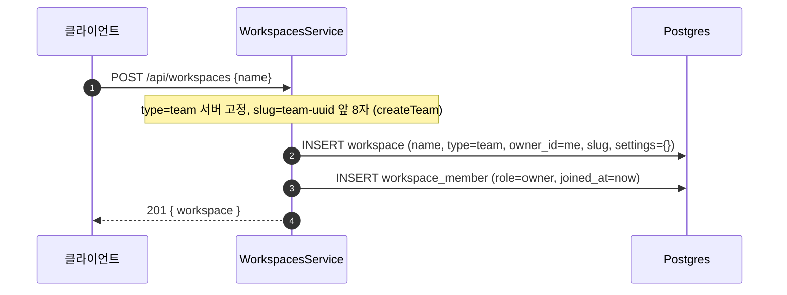
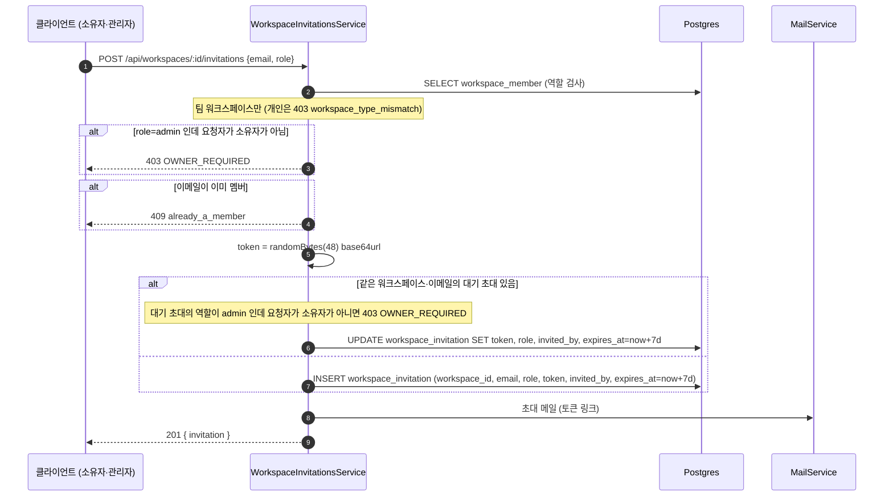
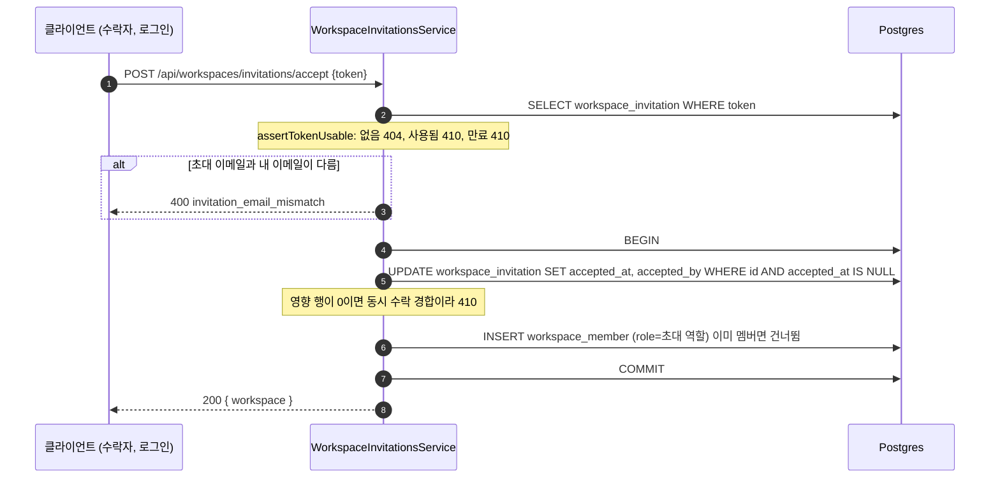
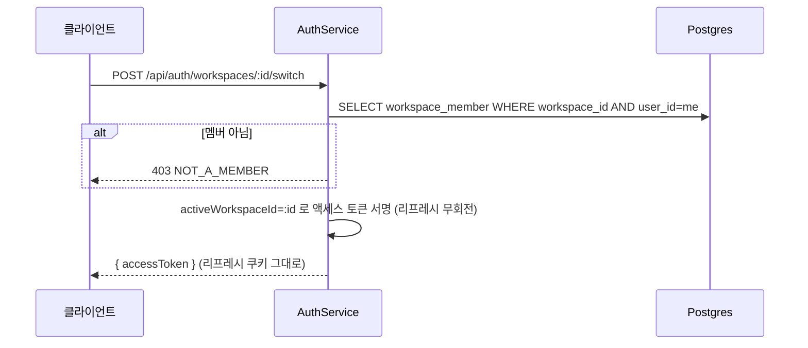
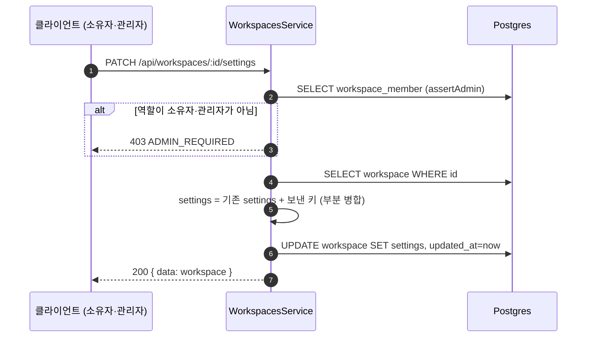
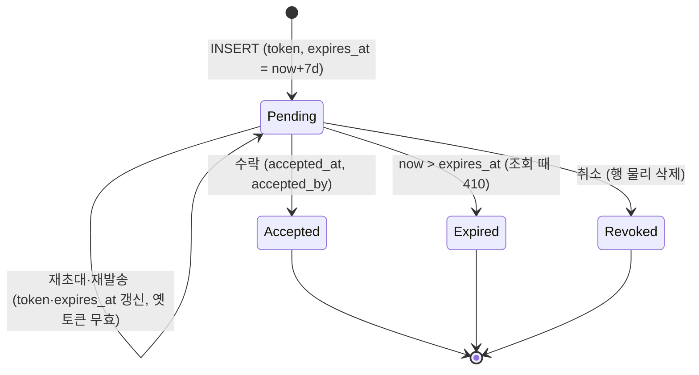

## 개요

이 문서는 [계정과 워크스페이스 데이터 흐름](CLE-ACCT-DATA.md) 의 하위 문서로 워크스페이스 엔티티 3개(Workspace, WorkspaceMember, WorkspaceInvitation)의 컬럼 · 제약과 워크스페이스 동작(팀 생성 · 초대 · 전환 · 설정 변경 · 멤버 변경 · 삭제와 나가기)이 어느 테이블을 어떤 순서로 읽고 쓰는지를 정한다. 흐름별 쓰기 컬럼 표와 정리 배치는 [테이블 쓰기 · 배치 · 외부 의존](CLE-ACCT-DATA-OPS.md) 에 있다.

## 엔티티

### Workspace

| 필드 | 타입 | 설명 |
| --- | --- | --- |
| id | UUID | PK |
| name | String | 워크스페이스 이름 |
| type | Enum | `personal` / `team` |
| owner_id | UUID | FK → User (CASCADE) |
| slug | String | URL 슬러그. `UNIQUE`(V001). 만든 뒤 바꾸지 않는다 |
| settings | JSONB | 워크스페이스 설정. 알려진 키 `timezone`, `interactionAllowedOrigins`, `maxConcurrentExecutions` 의 뜻과 편집 경로는 [워크스페이스와 멤버](CLE-ACCT-WS.md) |
| created_at | Timestamp | 생성 시각 |
| updated_at | Timestamp | 수정 시각 |

개인 워크스페이스는 owner 당 하나다. 부분 유니크 인덱스 `uq_workspace_personal_owner ON workspace (owner_id) WHERE type='personal'`(V109, V108 사전 검증 가드가 먼저)로 DB 에서 강제하고 앱의 `findOrCreatePersonalWorkspace` 가 함께 막는다. 팀 워크스페이스는 한 사용자가 여러 개 소유할 수 있어 `(owner_id, type)` 전체 UNIQUE 는 두지 않는다.

### WorkspaceMember

| 필드 | 타입 | 설명 |
| --- | --- | --- |
| id | UUID | PK. 멤버 ID. 멤버 API 와 소유자 이양이 받는 식별자이고 사용자 ID 와 다르다 |
| workspace_id | UUID | FK → Workspace (CASCADE) |
| user_id | UUID | FK → User (CASCADE) |
| role | Enum | `owner` / `admin` / `editor` / `viewer` |
| invited_at | Timestamp | 초대 시각 |
| joined_at | Timestamp? | 합류 시각 |

제약과 인덱스: `(workspace_id, user_id) UNIQUE`, `(user_id)`(V129, 사용자별 워크스페이스 목록과 FK 조회).

### WorkspaceInvitation

컬럼은 흐름이 읽고 쓰는 컬럼이다. 타입·NULL 허용·FK·CHECK 는 현재 구현(마이그레이션 `V017__workspace_invitations.sql`)을 따른다.

| 필드 | 타입 | 설명 |
| --- | --- | --- |
| id | UUID | PK. 재발송·취소 API 의 `:invitationId` 이고 수락의 조건부 UPDATE 대상이다 |
| workspace_id | UUID | 초대한 팀 워크스페이스. DB FK → Workspace (CASCADE). 코드 엔티티에는 관계가 선언돼 있지 않다 |
| email | String(255) | 초대 대상 이메일 |
| role | String(20) | `admin` / `editor` / `viewer`. `CHECK (role IN ('admin', 'editor', 'viewer'))`. 소유자는 초대 역할로 줄 수 없다. `admin` 초대는 소유자만 발급한다([초대 발급](#초대-발급)) |
| token | String(64) | 64자 base64url 초대 토큰. 원래 값으로 저장한다. `UNIQUE`(V017) |
| invited_by | UUID? | 초대한 사용자. FK → User (SET NULL). 재발송·재초대 때 갱신 |
| expires_at | Timestamp | 발급 시점 + 7일. 재발송·재초대 때 다시 잡는다 |
| accepted_at | Timestamp? | 수락 시각. NULL 이면 대기 중 |
| accepted_by | UUID? | 수락한 사용자. FK → User (SET NULL) |
| created_at | Timestamp | 생성 시각 |

인덱스: `token UNIQUE`(V017), `idx_workspace_invitation_email (email)`, `idx_workspace_invitation_workspace (workspace_id)`, 부분 UNIQUE `idx_workspace_invitation_pending_unique (workspace_id, email) WHERE accepted_at IS NULL`(대기 초대 중복 방지).

## 흐름

코드 진입점은 `workspaces.service.ts`(워크스페이스 CRUD·멤버 관리), `workspace-invitations.service.ts`(초대 발급·수락·재발송·취소), `workspaces.controller.ts`(`@Controller('workspaces')`), `invitations.controller.ts`(`@Controller('invitations')`, 공개 토큰 메타 조회)다. 규칙과 에러 코드는 [워크스페이스와 멤버](CLE-ACCT-WS.md) 가 정한다.

### 팀 워크스페이스 생성

### 초대 발급

- 조회와 쓰기는 한 트랜잭션이다. 부분 UNIQUE 경합은 500 대신 409 `invitation_already_pending` 으로 바꾼다(`workspace-invitations.service.ts` 의 `invite`).
- 관리자 역할 초대와 대기 중인 관리자 초대를 덮어쓰는 재초대는 소유자만 한다. 소유자가 아니면 403 `OWNER_REQUIRED` 이고 메시지는 «관리자 역할은 소유자만 주거나 뺄 수 있습니다.» 다(`common/constants/workspace-roles.ts` 의 `ADMIN_ROLE_CHANGE_REQUIRES_OWNER`). 대기 초대 검사는 트랜잭션 안에서 행을 읽은 뒤에 한다. 규칙은 [워크스페이스와 멤버](CLE-ACCT-WS.md) 가 정한다.
- 초대 재발송과 취소는 초대 역할을 보지 않는다. 관리자 이상이면 할 수 있다.
- 메일 발송이 실패해도 초대 행을 되돌리지 않고 에러 로그만 남긴다. 관리자가 재발송할 수 있다(`MailService.sendWorkspaceInvitationEmail`).

### 초대 수락 (가입자)

수락은 초대 행의 `role` 만 읽고 발급자의 지금 역할을 다시 보지 않는다. 초대 가입도 같다.

### 초대 가입 (미가입자)

`auth.service.registerWithInvitation()` 이 한 트랜잭션에서 다음을 한다.

1. `INSERT INTO "user"`. 초대 메일을 받은 주소로 가입하므로 `email_verified=true` 로 만든다.
2. `invitationsService.consumeForRegistration()` 이 초대받은 팀의 `workspace_member`(`role=invitation.role`)를 넣고 초대 수락(`accepted_at`, `accepted_by`)을 함께 처리한다.

이 경로에서는 개인 워크스페이스를 만들지 않는다. 초대받은 팀 워크스페이스가 가입 때 현재 워크스페이스의 기준이고, JWT `activeWorkspaceId` 도 그 팀으로 발급한다(`auth.service.ts` 의 `resolveTokenWorkspaceContext`).

### 워크스페이스 전환

### 설정 변경

설정 변경은 `UPDATE workspace SET settings = settings || :patch` 형태의 부분 병합이다. origin 은 형식 검증 뒤 끝 슬래시를 정규화한다.

### 멤버 변경과 직접 추가

| 동작 | 테이블 쓰기 | 거부 (현재 구현) |
| --- | --- | --- |
| 역할 변경 `PATCH .../members/:memberId` | `UPDATE workspace_member.role` | 대상 없음 404 `MEMBER_NOT_FOUND`. 대상이나 새 역할이 소유자면 403 `OWNER_ROLE_PROTECTED`. 대상의 지금 역할이나 새 역할이 관리자인데 요청자가 소유자가 아니면 403 `OWNER_REQUIRED`. 관리자가 자기 역할을 바꾸는 요청도 여기에 걸린다 |
| 소유자 이양 `POST .../transfer-ownership` | 한 트랜잭션에서 현재 소유자 `role='admin'`, 대상 `role='owner'`, `workspace.owner_id = 대상 userId` | 소유자가 아닌 요청 403 `OWNER_REQUIRED`, 개인 워크스페이스 403 `CANNOT_TRANSFER_PERSONAL`, 자기 자신 400 `TARGET_IS_SELF`, 대상 없음 404 `MEMBER_NOT_FOUND`, 대상이 이미 소유자 409 `TARGET_ALREADY_OWNER` |
| 멤버 제거 `DELETE .../members/:memberId` | 한 트랜잭션에서 `DELETE workspace_member`(소유자가 아닌 행)를 하고 1행을 지웠을 때만 그 멤버의 개인 통합을 지운다(조건은 [통합 데이터와 흐름](../CLE-INT/CLE-INT-DATA.md#멤버가-나가거나-제거될-때)). 자기 자신은 나가기로 넘긴다 | 대상 없음 404 `MEMBER_NOT_FOUND`. 대상이 소유자면 403 `CANNOT_REMOVE_OWNER`. 대상이 관리자여도 소유자 확인은 하지 않는다 |
| 직접 추가 `POST .../members`(`addMemberByEmail`) | 메일 없이 `INSERT workspace_member` | 새 역할이 소유자면 403 `CANNOT_ASSIGN_OWNER`. 새 역할이 관리자인데 요청자가 소유자가 아니면 403 `OWNER_REQUIRED`. 나머지는 [워크스페이스와 멤버 §직접 추가](CLE-ACCT-WS.md#직접-추가) |
| 초대 재발송 | 새 `token`, `expires_at = now+7d`, `invited_by` 갱신과 메일 재발송(`resend`) | [워크스페이스와 멤버 §초대 에러 코드](CLE-ACCT-WS.md#초대-에러-코드). 초대 역할은 보지 않는다 |
| 초대 취소 | 대기 초대 행 물리 삭제(`revoke`, repository `remove`) | 초대 재발송과 같다 |

거부 열의 상태 코드 가운데 `TARGET_IS_SELF`·`TARGET_ALREADY_OWNER` 말고는 현재 구현(`workspaces.service.ts`)에서 옮겼다. `OWNER_REQUIRED` 는 소유자 이양 가드가 쓰던 코드를 다시 쓴 것이고 정의는 [에러 코드 규약과 카탈로그](../CLE-API/CLE-API-ERRCODES.md) 에 있다. 가드 층의 역할 부족·비멤버 거부는 [워크스페이스와 멤버 §가드 거부 에러 코드](CLE-ACCT-WS.md#가드-거부-에러-코드) 에 있다.

### 워크스페이스 삭제와 나가기

워크스페이스 삭제(`DELETE /api/workspaces/:id`, `deleteWorkspace`)는 이 순서로 한다.

1. 권한 검사(소유자, 팀 워크스페이스)를 트랜잭션 밖에서 먼저 한다. 거부될 요청이 트리거 외부 자원부터 뜯지 않게 하기 위해서다.
2. 워크스페이스 트리거의 외부 자원(스케줄 job, 채팅 채널 해제, 리스너 레지스트리)을 해제한다([트리거 관리](../CLE-TRIG/CLE-TRIG-MANAGE.md)).
3. 한 트랜잭션에서 잠금 대기 상한(5초)을 건다. 워크스페이스 행을 비관적 잠금(`pessimistic_write`)으로 잡고 트리거를 열거한다. 워크스페이스, 멤버십 순으로 잠근 채 권한을 다시 검사한다.
4. 코드 엔티티에 관계가 선언되지 않은 `workspace_invitation` 을 명시적으로 DELETE 하고, `workspace_member` 를 DELETE 한 뒤, `workspace` 를 지운다. 트리거는 FK CASCADE 로 지워진다.
5. 커밋 뒤, 트랜잭션 안에서 열거한 트리거마다 `secret_store` 비밀을 지운다(`ref LIKE 'secret://triggers/<id>/%'`, `deleteByPrefix`). `secret_store` 는 FK 가 없어(V063) `workspace_id` 로 지우지 않으므로, 참조가 다른 워크스페이스 트리거의 prefix 아래에 있는데 `workspace_id` 가 삭제한 워크스페이스인 행(교차 행)은 이 단계에서 지워지지 않고 참조의 트리거가 삭제될 때 지워진다. 그 전에 지우는 일회성 운영 SQL(시크릿 저장소 「규칙」 13 의 대상이 아니다)과 점검 순서는 [시크릿 저장소 「교차 행 점검과 정리」](../CLE-INT/CLE-INT-SECRET.md#교차-행-점검과-정리) 에 있다. 이어서 그 트리거들의 트리거 단위 토큰(`itk_*`)으로 연 SSE 스트림을 모든 서버 인스턴스에서 닫는다(best-effort). 순서와 이유는 [트리거 데이터와 흐름 「트리거 삭제와 자원 해제」](../CLE-TRIG/CLE-TRIG-DATA.md#트리거-삭제와-자원-해제) 가 정한다.
6. 트랜잭션이 실패하면(재검사 거부 포함) 외부 해제가 이미 끝났다는 사실을 서버 로그에 남긴다.

잠금 순서(워크스페이스, 멤버십)는 소유자 이양과 같다. 둘이 겹칠 때 교착하지 않게 하기 위해서다.

나가기(`POST /api/workspaces/:id/leave`, `leaveWorkspace`)는 유일 소유자 판정과 멤버십 DELETE 를 비관적 잠금 트랜잭션 안에서 해 TOCTOU 를 막는다. 같은 트랜잭션에서 멤버십 DELETE 다음 그 멤버의 개인 통합을 지운다.

나가기와 멤버 제거(`DELETE /api/workspaces/:id/members/:memberId`)는 트랜잭션을 열자마자 잠금 대기 상한을 5초로 건다(`SET LOCAL lock_timeout`, 코드 상수 `MEMBER_DEPARTURE_LOCK_TIMEOUT_MS`). 이 상한은 멤버십 행 잠금과 개인 통합 DELETE, 그 통합의 CASCADE 자식 행 잠금에 모두 걸린다. 토큰 갱신 같은 짧은 쓰기와 겹쳐 5초 안에 잠금을 잡지 못하면 트랜잭션을 롤백하고 에러로 끝낸다(PostgreSQL `55P03`, 따로 매핑하지 않아 일반 500 `INTERNAL_ERROR`). 멤버십 · 개인 통합 · 감사 로그는 그대로이고 커밋 뒤 정리(통합 삭제 감사와 자격 증명 캐시 무효화)도 일어나지 않는다. 사용자는 다시 시도하면 된다. 워크스페이스 삭제와 워크플로우 삭제도 트리거 삭제 잠금 한도(`TRIGGER_DELETE_LOCK_TIMEOUT_MS`, 5초)를 넘기면 에러로 끝난다([트리거 관리 「결과와 에러」](../CLE-TRIG/CLE-TRIG-MANAGE.md#결과와-에러)). 그 에러에도 따로 정한 코드가 없어 응답은 같은 일반 500 이다. 따로 매핑하지 않는 이유는 Rationale 「나가기와 멤버 제거의 잠금 대기 초과는 따로 매핑하지 않는다 (2026-10-30)」 에 있다.

통합을 만들거나 개인으로 바꾸는 트랜잭션은 워크스페이스, 멤버십, 통합 순으로 잠근다. 멤버십은 개인 통합일 때만 잠근다. 잠금 방식과 범위는 [통합 관리](../CLE-INT/CLE-INT-MANAGE.md#나간-멤버의-개인-통합은-나갈-때-지운다-2026-10-29) 가 정한다. 멤버 제거와 나가기는 워크스페이스 행을 잠그지 않는다. 멤버십을 지운 다음 개인 통합을 지우므로 이 순서를 어기지 않는다. 삭제 조건은 [통합 데이터와 흐름 「멤버가 나가거나 제거될 때」](../CLE-INT/CLE-INT-DATA.md#멤버가-나가거나-제거될-때) 가 정한다.

## 초대 상태 전이

### `workspace_invitation.accepted_at`

만료는 조회 시점 판정(`assertTokenUsable` 이 410 `invitation_expired`)일 뿐 바로 지우지 않는다. 만료되고 수락되지 않은 행은 `workspace-invitations-pruner` 가 주기적으로 지운다. 감사 보존이 필요하면 별도 감사 기록으로 다루고, 이 정리는 운영 위생 목적이다.

## Rationale

### 개인 워크스페이스 유일성은 부분 유니크 인덱스로 강제한다

지키려는 불변식은 "한 사용자가 개인 워크스페이스를 두 개 이상 가질 수 없다" 뿐이다. 팀 워크스페이스는 여러 개 소유할 수 있다. 과거의 `@Unique(['ownerId', 'type'])` 엔티티 데코레이터는 뜻이 틀렸다. `(owner_id, type)` 전체 UNIQUE 는 팀 다중 소유까지 막는다. 대응 마이그레이션도 없어(엔티티 synchronize 비활성) DB 에서 강제되지도 않았다. 이 데코레이터는 지웠다.

개인 유일성은 부분 유니크 인덱스 `uq_workspace_personal_owner`(V109)로 DB 에서 강제하고, 앱 계층 `WorkspacesService.findOrCreatePersonalWorkspace`(find-or-create 와 충돌 시 재조회 폴백)가 함께 막는다. 무결성 불변식이라 앱 단독 방어보다 DB 이중 방어가 맞다고 판단했다(2026-07-07 결정).

마이그레이션 안전: 인덱스는 `CREATE UNIQUE INDEX CONCURRENTLY`(트랜잭션 밖, V109 `.conf` 의 `executeInTransaction=false`)로 만든다. `.conf` 가 실제로 적용되는지는 NERV Task `CLE-T-NYFE78` 결과에 따라 고친다. 그 직전 V108 은 사전 검증 가드다. 소유자 당 개인 워크스페이스가 중복이면 `RAISE EXCEPTION` 으로 배포를 바로 멈출 뿐 어떤 행도 자동으로 지우거나 옮기지 않는다. 중복이 나오면 운영자가 안내된 `array_agg` 조회로 확인해 손으로 병합하거나 지운 뒤 다시 배포해야 V109 인덱스가 만들어진다. 자동 정리를 뺀 이유는 `workspace(id)` 를 참조하는 `ON DELETE CASCADE` FK 가 약 20개 테이블에 걸쳐 있기 때문이다. 중복 개인 워크스페이스를 자동으로 지우면 하위 데이터가 함께 사라지고, 모든 자식 행을 남길 워크스페이스로 옮기는 것은 테이블 열거 누락이나 멤버십 중복 같은 새 위험을 만든다. 중복은 애초에 앱이 막는 불변식 위반이므로 자동 파괴보다 운영자 수동 처리가 안전하다.

### `workspace.deleted` 는 감사하지 않는다

감사 확대 결정은 워크스페이스 CRUD 전체를 감사하려 했지만 `workspace.deleted` 는 일부러 기록하지 않는다. `audit_log.workspace_id` 는 `REFERENCES workspace(id) ON DELETE CASCADE`(V001)라, 삭제 감사 행은 (a) 삭제 전에 쓰면 워크스페이스와 함께 cascade 로 지워지고 (b) 삭제 뒤에 쓰면 FK 대상이 없어 INSERT 가 실패한다. 어느 쪽이든 남길 수 없다. 워크스페이스 범위로 쌓이고 워크스페이스와 함께 사라지는 현재 감사 모델의 구조적 결과다. 그 모델에서는 `workspace.created`·`workspace.updated` 감사도 워크스페이스가 지워지면 함께 사라진다. 감사는 워크스페이스가 살아 있는 동안의 포렌식이다. 삭제 이력 자체를 남기려면 워크스페이스에 매이지 않는 별도 저장소가 필요하고, 이것은 이 결정 범위 밖이다. 자동 정리 대신 V108 사전 검증 가드를 택한 이유(「개인 워크스페이스 유일성은 부분 유니크 인덱스로 강제한다」)와 같은 계열의 제약이다.

### 관리자 역할을 주고 빼는 일은 소유자만 한다

2026-10-10 결정이다(NERV Task `CLE-T-0W7CA7`). 규칙과 권한 매트릭스는 [워크스페이스와 멤버](CLE-ACCT-WS.md) 가 정한다. 이 문서는 어느 쓰기가 막히는지만 적는다. 막는 쓰기는 네 가지다.

1. 역할 변경에서 대상의 지금 역할이나 새 역할이 관리자인 경우. 관리자가 자기 역할을 바꾸는 요청도 포함한다.
2. 직접 추가의 `role=admin`.
3. 초대 발급의 `role=admin`.
4. 대기 중인 관리자 초대를 다른 역할로 덮어쓰는 재초대.

거부 코드는 `OWNER_REQUIRED` 다. 가드의 소유자 역할 미달과 같은 코드를 서비스 계층에서도 쓴다. 뜻이 같아서(소유자 역할이 필요하다) 새 코드를 만들지 않았다. 메시지는 이 규칙에 맞는 문구를 따로 둔다([초대 발급](#초대-발급)). 이 코드로 갈리는 프론트엔드 분기는 [워크스페이스와 멤버](CLE-ACCT-WS.md) 의 Rationale 에서 확인했다.

멤버 제거와 초대 재발송·취소는 바꾸지 않았다. 관리자 이상이면 할 수 있다. [워크스페이스와 멤버](CLE-ACCT-WS.md) 의 Rationale 「멤버 관리에서 관리자는 삭제(D)까지 할 수 있다」 를 그대로 따른다.

관리자가 다른 관리자를 제거한 뒤 낮은 역할로 다시 추가하거나 초대하면 결과는 강등과 같다. 제거는 멤버 목록에서 사라지고 감사 로그(`member.removed`)에 남아 소유자가 알아챌 수 있으므로 이 경로는 2026-07-28 결정(관리자도 멤버를 제거할 수 있다)대로 둔다.

이 검사는 쓰기 시점에만 돈다. 규칙 전에 생긴 관리자 멤버십과 대기 중인 관리자 초대는 그대로 남는다. 수락 경로는 초대 행의 `role` 만 읽으므로 그런 초대를 수락하면 관리자로 합류한다. [워크스페이스와 멤버](CLE-ACCT-WS.md) 가 소급하지 않기로 정했다.

### 멤버 제거와 나가기가 개인 통합도 지운다 (2026-10-29)

NERV Task `CLE-T-TGZGM9` 에서 정했다. 멤버십을 지우는 트랜잭션이 그 멤버의 개인 통합도 지운다. 규칙과 근거는 [통합 관리](../CLE-INT/CLE-INT-MANAGE.md#나간-멤버의-개인-통합은-나갈-때-지운다-2026-10-29) 가, 테이블 쓰기는 [통합 데이터와 흐름](../CLE-INT/CLE-INT-DATA.md#멤버가-나가거나-제거될-때) 가 정한다. 이 문서에는 멤버 제거를 한 트랜잭션으로 묶는 것만 적고 잠금 방식과 삭제 조건은 링크한다.

같은 날 잠금 순서를 고쳤다(NERV Task `CLE-T-G56XCH`). 처음에는 «멤버십, 통합 순이라 교착하지 않는다» 고 적었다. 그런데 멤버십만 먼저 잠그는 개인 통합 생성은 통합 INSERT 의 외래 키 확인이 워크스페이스 행을 그 뒤에 잠근다. 워크스페이스, 멤버십 순으로 잠그는 워크스페이스 삭제·소유자 이양과 순서가 엇갈려 교착할 수 있었다. 그래서 워크스페이스, 멤버십, 통합의 전역 순서로 고쳤다. 2026-10-30 에 사용자가 잠금 규칙을 통합 행을 만들 수 있는 쓰기 전체(조직 공개 범위의 begin 포함)로 넓혔다. 기각한 안과 잠금 방식은 [통합 관리 「나간 멤버의 개인 통합은 나갈 때 지운다」](../CLE-INT/CLE-INT-MANAGE.md#나간-멤버의-개인-통합은-나갈-때-지운다-2026-10-29) 한 곳에만 두고 「워크스페이스 삭제와 나가기」 에는 순서만 남긴다. 멤버 제거와 나가기는 워크스페이스 행을 잠그지 않는다.

### 나가기와 멤버 제거의 잠금 대기 초과는 따로 매핑하지 않는다 (2026-10-30)

NERV Task `CLE-T-PS7JQY` 의 코드 리뷰가 나가기와 멤버 제거의 잠금 대기 상한을 새 실패 경로로 짚었다. 상한을 넘긴 요청은 매핑되지 않은 500 으로 끝나는데 스펙에 그 동작과 재시도 안내가 없었다. 같은 날 이 에러에 응답 코드를 따로 두지 않고 동작을 스펙에 적기로 정했다. 한도를 넘기면 트랜잭션이 롤백되므로 데이터가 상하지 않는다. 겹칠 상대가 짧은 쓰기라 다시 시도하면 대개 통과한다. 워크스페이스 삭제와 워크플로우 삭제도 트리거 삭제 잠금 한도(`TRIGGER_DELETE_LOCK_TIMEOUT_MS`, 5초)를 걸고 이 에러를 따로 매핑하지 않는다. 나가기와 멤버 제거만 503 이나 409 로 바꾸면 같은 원인의 실패가 엔드포인트마다 다른 코드로 나간다. 그래서 한도 초과의 응답 코드는 이 동작들을 함께 다룰 때 정한다. 두 엔드포인트의 API 문서 설명에도 잠금 대기가 5초를 넘으면 롤백되니 다시 시도하라는 안내를 넣었다. 잠금 대기 상한을 거는 경로들의 응답 코드를 함께 정하는 일은 NERV Task `CLE-T-1C2JE0` 가 맡는다([미결 사항](CLE-ACCT-DATA.md#미결-사항)).
