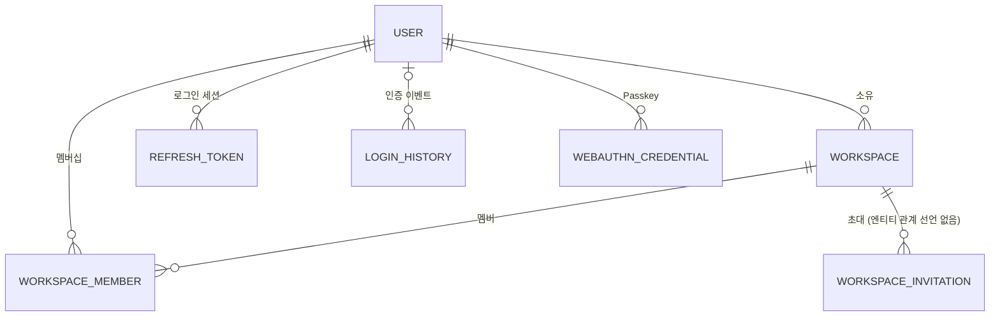

> 구현 상태: 구현됨 · 원문: `spec/data-flow/2-auth.md`, `spec/data-flow/12-workspace.md` (흐름·Schema 매핑·상태 전이·Rationale 중 데이터 부분), `spec/1-data-model.md` (§2.1~§2.3, §2.18.1, §2.18.2, §2.21, Rationale «User 민감 컬럼 방어»), `spec/5-system/1-auth.md` (Rationale 1.4.G) · 용어: [용어 사전](../CLE-GLOSSARY.md)

## 개요

이 문서는 계정과 워크스페이스 영역의 엔티티와 데이터 흐름의 입구다. 사용자(User, `user`), 워크스페이스, 워크스페이스 멤버, 워크스페이스 초대, 리프레시 토큰, 로그인 이력, Passkey credential, 소셜 로그인 state 의 컬럼과 제약, 그리고 가입·로그인·토큰 회전·초대·전환 같은 동작이 어느 테이블을 어떤 순서로 읽고 쓰는지가 범위다.

이 영역은 사용자 신원 확인과 세션 발급을 맡는다. 로컬 이메일·비밀번호, 소셜 로그인, 2단계 인증(Passkey 가 있으면 Passkey, 없으면 TOTP. Passkey 기능이 꺼진 경우는 [가입과 로그인](CLE-ACCT-SIGNIN.md#2단계-인증-방식-선택) 참조), 초대 토큰 가입을 한 진입점에서 처리한다. JWT 액세스 토큰과 회전하는 리프레시 토큰(`family_id` 단위 로그인 세션) 모델을 쓰고, 인증 이벤트 7종은 `login_history` 에 시간순으로 남는다. 워크스페이스는 모든 리소스의 격리 단위이고, 사용자는 개인 워크스페이스 1개와 팀 워크스페이스 여러 개에 멤버로 속한다. 멤버십은 `workspace_member` join 테이블이 N:M 으로 나타내고, 새 멤버 초대는 토큰 기반 일회용 링크로 한다.

동작 규칙과 화면은 기능 문서가 정하고 이 문서와 하위 문서는 그 규칙을 데이터 관점에서 풀어 쓴다. 이 문서가 정하지 않는 것은 아래와 같다.

- 가입·로그인·2단계 인증·소셜 로그인·비밀번호 재설정·이메일 변경 규칙: [가입과 로그인](CLE-ACCT-SIGNIN.md)
- 토큰 수명·쿠키·세션 정책·재인증 코드: [세션과 토큰](CLE-ACCT-SESSION.md)
- 워크스페이스·멤버·초대 규칙, 권한 매트릭스, 서버 인가: [워크스페이스와 멤버](CLE-ACCT-WS.md)
- 로그인 이력 이벤트의 뜻·조회 API·180일 보존 정책과 `audit_log`: [감사 로그](../CLE-OBS/CLE-OBS-AUDIT.md)
- 전체 엔티티 관계 지도와 공통 컬럼 규칙: [데이터 모델 개요](../CLE-PLAT/CLE-PLAT-DATA.md)

## 엔티티 관계

`auth_oauth_state` 는 다른 테이블과 FK 관계가 없는 단명 행이다. `workspace_invitation` 은 워크스페이스를 가리키지만 코드 엔티티(`WorkspaceInvitation`)에 관계가 선언되지 않아 워크스페이스 삭제 때 명시적으로 지운다. DB 에는 마이그레이션 V017 이 만든 FK(`workspace_id → workspace(id) ON DELETE CASCADE`)가 있다.

## 하위 문서

이 문서에는 요구사항 줄이 없어서 하위 문서마다 맡는 요구사항 번호도 없다.

- [사용자 · 인증 엔티티](CLE-ACCT-DATA-MODEL.md): User, RefreshToken, LoginHistory, WebAuthnCredential, AuthOauthState 의 컬럼 · 제약 · 인덱스, 응답에 싣지 않는 민감 컬럼, 이메일 정규화, 스키마 마이그레이션 결정
- [인증 흐름](CLE-ACCT-DATA-AUTH.md): 가입 · 로그인과 2단계 인증 · 소셜 로그인 · 토큰 회전 · 세션 강제 종료 · 비밀번호 재설정 · 이메일 변경의 읽기 · 쓰기 순서와 리프레시 토큰 · 계정 잠금 · TOTP 대기 secret · OAuth state 의 상태 전이
- [워크스페이스 데이터와 흐름](CLE-ACCT-DATA-WS.md): Workspace, WorkspaceMember, WorkspaceInvitation 엔티티와 팀 생성 · 초대 · 전환 · 설정 변경 · 멤버 변경 · 삭제와 나가기 흐름, 초대 상태 전이
- [테이블 쓰기 · 배치 · 외부 의존](CLE-ACCT-DATA-OPS.md): 흐름별 테이블 쓰기 컬럼 매핑, BullMQ 배치 · Redis 키 · 요청 빈도 제한, SMTP · OAuth 제공자 · 감사 로그 의존

## 엔티티

### User

→ [사용자 · 인증 엔티티](CLE-ACCT-DATA-MODEL.md#user)

#### 응답에 싣지 않는 민감 컬럼 7개

→ [사용자 · 인증 엔티티](CLE-ACCT-DATA-MODEL.md#응답에-싣지-않는-민감-컬럼-7개)

## 인증 데이터 흐름

→ [인증 흐름](CLE-ACCT-DATA-AUTH.md)

### 세션 강제 종료

→ [인증 흐름](CLE-ACCT-DATA-AUTH.md#세션-강제-종료)

## 워크스페이스 데이터 흐름

→ [워크스페이스 데이터와 흐름](CLE-ACCT-DATA-WS.md#흐름)

### 초대 발급

→ [워크스페이스 데이터와 흐름](CLE-ACCT-DATA-WS.md#초대-발급)

### 멤버 변경과 직접 추가

→ [워크스페이스 데이터와 흐름](CLE-ACCT-DATA-WS.md#멤버-변경과-직접-추가)

### 워크스페이스 삭제와 나가기

→ [워크스페이스 데이터와 흐름](CLE-ACCT-DATA-WS.md#워크스페이스-삭제와-나가기)

## 인가

요청마다 현재 워크스페이스와 역할을 판정하는 규칙(헤더 우선, 토큰 클레임, 가드의 멤버십 검증, 경로 파라미터 워크스페이스, 가드 거부 코드, UUID 검사 강도)과 그 결정 이유는 [워크스페이스와 멤버](CLE-ACCT-WS.md) 의 API 인가 절이 정한다. 권한 매트릭스도 그 문서에 있다.

## 미결 사항

- **잠금 대기 초과의 응답 코드**: 나가기 · 멤버 제거와 워크스페이스 삭제 · 워크플로우 삭제는 잠금 대기 상한 5초를 넘기면(PostgreSQL `55P03`) 롤백하고 일반 500 으로 끝난다([워크스페이스 삭제와 나가기](CLE-ACCT-DATA-WS.md#워크스페이스-삭제와-나가기)). 트리거 · 스케줄 화면 삭제도 같다([트리거 관리 「결과와 에러」](../CLE-TRIG/CLE-TRIG-MANAGE.md#결과와-에러)). 다시 시도하면 대개 통과하는 일시적 실패인데 500 이라 [HTTP API 규약 §6](../CLE-API/CLE-API-CONV.md#6-http-상태-코드) 의 500 · 503 구분과 잘 맞지 않는다. 이 경로들의 응답 코드는 NERV Task `CLE-T-1C2JE0` 가 함께 정한다. 지금 따로 매핑하지 않는 이유는 [워크스페이스 데이터와 흐름 「나가기와 멤버 제거의 잠금 대기 초과는 따로 매핑하지 않는다 (2026-10-30)」](CLE-ACCT-DATA-WS.md#나가기와-멤버-제거의-잠금-대기-초과는-따로-매핑하지-않는다-2026-10-30) 에 있다.

2026-10-10 에 «`User.theme` 에 `system` 을 둘 수 있는가» 와 «전역 요청 한도의 집계 기준» 을 닫았다. 결정은 [사용자 · 인증 엔티티 「`user.theme` CHECK 확장은 두 단계 마이그레이션으로 했다」](CLE-ACCT-DATA-MODEL.md#usertheme-check-확장은-두-단계-마이그레이션으로-했다) 와 [테이블 쓰기 · 배치 · 외부 의존 「요청 한도의 집계 기준을 코드에 맞췄다」](CLE-ACCT-DATA-OPS.md#요청-한도의-집계-기준을-코드에-맞췄다) 에 있다.

## 구현 위치

- `codebase/backend/src/modules/auth/auth.controller.ts`, `codebase/backend/src/modules/auth/auth.service.ts` (가입·로그인·갱신·로그아웃, TOTP 설정 시작과 끄기의 비밀번호 재확인)
- `codebase/backend/src/modules/auth/auth-oauth.service.ts` (OAuth state 발급과 콜백)
- `codebase/backend/src/modules/auth/sessions.controller.ts`, `codebase/backend/src/modules/auth/sessions.service.ts` (세션 목록과 강제 종료 `/api/auth/sessions*`, 로그인 이력 조회 `/api/users/me/login-history`)
- `codebase/backend/src/modules/auth/login-history.service.ts`, `codebase/backend/src/modules/auth/jobs/login-history-pruner.service.ts`
- `codebase/backend/src/modules/auth/totp.service.ts`, `codebase/backend/src/modules/auth/dto/totp.dto.ts` (TOTP 켜기·끄기, 설정 시작 · 활성화 검증의 조건부 UPDATE, 대기 secret 의 10분 만료와 비우기, 끄기의 코드 확인 `verifyForDisable`)
- `codebase/backend/src/modules/auth/webauthn/webauthn.controller.ts`, `codebase/backend/src/modules/auth/webauthn/webauthn.service.ts`
- `codebase/backend/src/modules/auth/webauthn/webauthn-auth-challenge.service.ts` (Passkey 인증 챌린지 기록)
- `codebase/backend/src/modules/auth/webauthn/entities/webauthn-credential.entity.ts`, `codebase/backend/src/modules/auth/webauthn/dto/webauthn.dto.ts` (`webauthn_credential` 엔티티, 표시 이름을 확인하는 등록 검증 · 이름 변경 DTO)
- `codebase/backend/src/modules/auth/entities/*.entity.ts`, `codebase/backend/src/modules/users/entities/user.entity.ts`
- `codebase/backend/src/modules/auth/entities/refresh-token.entity.ts` (`rememberMe`. `refresh_token.remember_me` 컬럼)
- `codebase/backend/src/modules/users/utils/normalize-email.ts` (`normalizeEmail`. 새로 저장하는 이메일의 앞뒤 공백 제거와 소문자 변환)
- `codebase/backend/src/modules/users/users.service.ts` (`lookupByEmail` · `emailExists` · `emailTakenByOther`. 대소문자를 무시한 이메일 조회와 중복 확인)
- `codebase/backend/src/modules/users/users.controller.ts`, `codebase/backend/src/modules/users/dto/update-me.dto.ts` (프로필 수정과 테마 값 `USER_THEMES`, 이메일 변경 진입)
- `codebase/backend/migrations/V149__user_theme_allow_system.sql`, `codebase/backend/migrations/V150__user_theme_allow_system_validate.sql` (`chk_user_theme` 을 `NOT VALID` 로 건 뒤 검증하고 옛 제약 `user_theme_check` 를 지운다)
- `codebase/backend/migrations/V152__webauthn_device_name_empty_to_null.sql` (이름 변경이 남긴 빈 문자열 `device_name` 을 NULL 로 바꾼다)
- `codebase/backend/migrations/V*__user_two_factor_setup_started_at.sql` (`user.two_factor_setup_started_at` 컬럼 추가. 기존 행은 바꾸지 않는다. NULL 허용 컬럼 추가라 NOT VALID 단계는 없고 `lock_timeout` 은 V149 와 같은 3초다)
- `codebase/backend/migrations/V156__refresh_token_remember_me.sql` (`refresh_token.remember_me` 컬럼 추가와 배포 시점 백필. `lock_timeout` 은 3초다)
- `codebase/backend/src/modules/workspaces/workspaces.service.ts`, `codebase/backend/src/modules/workspaces/workspace-invitations.service.ts`
- `codebase/backend/src/modules/workspaces/workspaces.controller.ts`, `codebase/backend/src/modules/workspaces/invitations.controller.ts`
- `codebase/backend/src/modules/workspaces/member-personal-integrations.port.ts`, `codebase/backend/src/modules/integrations/member-personal-integrations-purger.service.ts` (멤버 제거 · 나가기 트랜잭션이 개인 통합을 지우는 포트 `MEMBER_PERSONAL_INTEGRATIONS_PURGER` 와 그 구현)
- `codebase/backend/migrations/V153__purge_departed_member_personal_integrations.sql` (통합 소유자가 멤버가 아닌 개인 통합을 한 번 지운다)
- `codebase/backend/src/common/constants/workspace-roles.ts` (`ADMIN_ROLE_CHANGE_REQUIRES_OWNER`)
- `codebase/backend/src/app.module.ts`, `codebase/backend/src/common/guards/user-throttler.guard.ts`, `codebase/backend/src/common/utils/http-context.ts`, `codebase/backend/src/common/constants/throttle.ts` (요청 빈도 제한과 집계 키, HTTP 요청만 세는 판정 `isHttpContext`, 전역 가드가 세지 않고 라우트 가드에 넘기는 `@DeferGlobalThrottle()`, `SENSITIVE_ACTION_THROTTLE`)
- `codebase/backend/src/modules/hooks/hook-trigger-throttler.guard.ts`, `codebase/backend/src/modules/hooks/hooks.controller.ts` (`POST /api/hooks/:endpointPath` 의 전역 요청 빈도 제한. `HookTriggerThrottlerGuard` 가 서명 참조가 있는 채팅 채널 트리거를 빼고 센다), `codebase/backend/src/modules/chat-channel/chat-channel-secret-refs.ts` (면제 판정 `isSignedChatChannelTrigger`), `codebase/backend/src/modules/hooks/hooks-throttle.wire.spec.ts` (이 라우트의 가드 체인 테스트)
- `codebase/backend/src/modules/auth/password-recheck-throttle.spec.ts` (`verifyPasswordForUser` 로 비밀번호를 다시 확인하는 라우트의 목록을 고정하고 핸들러마다 `SENSITIVE_ACTION_THROTTLE` 이 걸렸는지 확인하는 단위 테스트)
- `codebase/backend/src/modules/mail/mail.service.ts`, `codebase/backend/src/modules/mail/mail.module.ts`, `codebase/backend/src/modules/mail/mail.transporter.ts` (SMTP 전송기와 TLS 강제)
- `codebase/backend/src/common/config/mail.config.ts` (`MAIL_*` 해석과 운영 경고 판정), `codebase/backend/src/main.ts` (운영 경고)
- `codebase/backend/src/modules/mail/mail.transporter.spec.ts`, `codebase/backend/src/common/config/mail.config.spec.ts` (TLS 강제 · 설정 기본값 · 운영 경고 판정 테스트)
- `codebase/backend/src/shared/testing/user-secret-absence.ts` (`USER_SECRET_KEYS`)
- `codebase/backend/test/users-theme.e2e-spec.ts` (테마 저장과 거부), `codebase/backend/test/session-revocation.e2e-spec.ts` (세션 경로와 현재 세션 식별)
- `codebase/backend/test/totp-enable-guard.e2e-spec.ts` (TOTP 설정 시작 · 활성화 검증이 켜진 계정을 거부한 뒤의 `user` 컬럼 상태)
- `codebase/backend/test/totp-setup-expiry.e2e-spec.ts` (TOTP 대기 secret 의 10분 만료, 시각이 없는 대기 secret, 만료 뒤 `user` 컬럼 상태)

## Rationale

결정 항목은 주제마다 하위 문서 끝 `## Rationale` 에 있다. 다른 문서가 링크하는 항목은 아래에서 옮겨 간 곳을 가리킨다.

### OAuth state 를 한 번의 DELETE 로 소비한다

→ [인증 흐름](CLE-ACCT-DATA-AUTH.md#oauth-state-를-한-번의-delete-로-소비한다)

### 개인 워크스페이스 유일성은 부분 유니크 인덱스로 강제한다

→ [워크스페이스 데이터와 흐름](CLE-ACCT-DATA-WS.md#개인-워크스페이스-유일성은-부분-유니크-인덱스로-강제한다)
