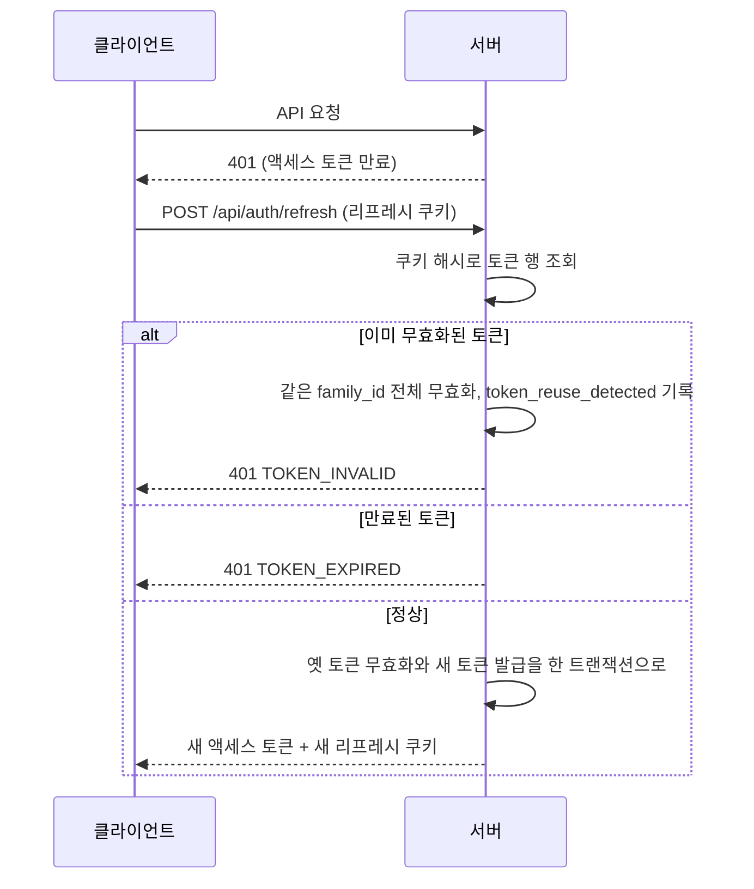

> 구현 상태: 구현됨 · 상위: [세션과 토큰](CLE-ACCT-SESSION.md)

## 개요

이 문서는 [세션과 토큰](CLE-ACCT-SESSION.md) 의 하위 문서로 토큰의 종류와 수명, 로그인 유지, 액세스 토큰 payload, 토큰 갱신과 재사용 감지, 클라이언트의 갱신 재시도, 로그아웃을 정한다. 리프레시 쿠키 속성과 세션 목록은 [세션과 토큰 — 세션 정책과 세션 관리](CLE-ACCT-SESSION-POLICY.md) 가 정한다.

## 토큰

| 토큰 | 저장 위치 | 유효 기간 | 용도 |
| --- | --- | --- | --- |
| 액세스 토큰 | 메모리(JS 변수) | 15분 | API 요청 인증 |
| 리프레시 토큰 | HttpOnly·Secure 쿠키. SameSite 와 Path 는 [세션 정책](CLE-ACCT-SESSION-POLICY.md#세션-정책) | 7일. 로그인 유지를 켜면 30일 | 액세스 토큰 갱신 |

액세스 토큰은 `JWT_SECRET` 으로 서명한다. `NODE_ENV=production` 에서 `JWT_SECRET` 이 쓸 수 없는 값이면 부팅을 거부한다. 무엇을 거부하는지는 [운영 환경 가드](CLE-ACCT-SESSION-GUARD.md#운영-환경-가드) 에 있다. 개발·테스트·e2e(`NODE_ENV≠production`)는 개발용 기본값을 허용한다.

리프레시 토큰은 워크스페이스와 무관한 opaque UUID 다. 클레임을 담지 않는다.

### 로그인 유지

로그인 유지(remember me, `rememberMe`)는 로그인 화면의 "Remember me" 체크박스다.

| 체크 | 리프레시 토큰 유효 기간 |
| --- | --- |
| 체크 안 함 | 7일 (기본) |
| 체크 | 30일 |

소셜 로그인은 시작 요청의 `rememberMe` 쿼리를 OAuth state 와 함께 저장해 같은 규칙을 적용한다.

로그인 유지 여부는 리프레시 토큰 행의 `refresh_token.remember_me` 칸(boolean, 기본 false)에 저장한다. 칸 정의의 정본은 [계정과 워크스페이스 데이터 흐름](CLE-ACCT-DATA.md) 이다. 토큰을 새로 발급하는 경로(로그인 · 소셜 로그인 · Passkey 로그인 · 초대 가입)가 이 값을 정한다. 초대 가입의 자동 로그인과 비밀번호 변경 · 이메일 변경의 재발급은 false 로 발급하므로 7일이다.

갱신(`POST /api/auth/refresh`, `AuthService.refresh`)으로 토큰을 회전하면 새 토큰이 옛 행의 `remember_me` 를 이어받는다. 유효 기간은 회전한 시점부터 다시 센다. 로그인 유지를 켰으면 30일이고 껐으면 7일이다. 갱신 응답의 리프레시 쿠키 `maxAge` 도 같은 값이다. 그래서 로그인 유지를 켠 로그인 세션은 마지막 갱신 뒤 30일 동안 쓰지 않으면 만료된다. 끈 로그인 세션은 7일이다. 첫 로그인 시각을 기준으로 한 고정 만료는 두지 않는다. 이유는 「[토큰 회전이 로그인 유지 여부를 이어받는다 (2026-11-05)](#토큰-회전이-로그인-유지-여부를-이어받는다-2026-11-05)」 에 있다.

한계가 하나 남는다. 비밀번호 변경과 이메일 변경 확인은 성공하면 모든 로그인 세션을 무효화하고 현재 기기에 새 로그인 세션을 발급한다. 이 새 로그인 세션은 로그인 유지 여부를 이어받지 않고 7일이다. 두 요청은 `/api/users/me/*` 경로라 리프레시 쿠키(`Path=/api/auth`)가 붙지 않는다. 액세스 토큰에도 로그인 세션(`family_id`) 식별자가 없다. 그래서 서버는 요청한 기기의 `remember_me` 를 알 수 없다. 로그인 유지 여부를 잇는 방법은 NERV Task `CLE-T-XF3WMA` 가 정한다.

### 액세스 토큰 payload

```json
{
  "sub": "user-uuid",
  "email": "user@example.com",
  "activeWorkspaceId": "workspace-uuid",
  "role": "editor",
  "iat": 1711406400,
  "exp": 1711407300
}
```

- 현재 워크스페이스(active workspace, `activeWorkspaceId`) 클레임은 토큰을 서명할 때 `activeWorkspaceId` 로만 발행한다(`auth.service.generateTokens`).
- 읽는 쪽(`jwt.strategy`, `websocket.gateway`)은 `activeWorkspaceId ?? workspaceId` 로 옛 클레임 이름의 토큰도 받는다. 옛 토큰이 사라지는 기간은 액세스 토큰 수명인 15분이고, 그 뒤 별도 정리 작업에서 옛 이름 폴백을 없앤다.
- 현재 워크스페이스를 바꾸는 `POST /api/auth/workspaces/:id/switch` 는 이 클레임만 바꾼 액세스 토큰을 재발급한다. 전환 규칙과 `X-Workspace-Id` 헤더 우선 규칙은 [워크스페이스와 멤버](CLE-ACCT-WS.md) 가 정한다.

## 토큰 갱신



1. 클라이언트가 API 의 401 로 액세스 토큰 만료를 감지한다.
2. 리프레시 쿠키로 `POST /api/auth/refresh` 를 호출한다. 본문은 없다. 쿠키가 없으면 401 이다.
3. 서버가 새 액세스 토큰과 새 리프레시 토큰을 발급한다. 새 토큰은 같은 `family_id` 를 이어받는다.
4. 옛 리프레시 토큰은 바로 무효가 된다.
5. 무효화된 리프레시 토큰이 다시 쓰이면 탈취로 보고 그 로그인 세션 전체를 끝낸다.

- 재사용 감지는 `is_revoked=true` 인 토큰이 다시 쓰일 때만 동작한다. 단순 만료는 부작용 없이 401 `TOKEN_EXPIRED` 만 준다.
- 정상 회전은 조건부 UPDATE(`is_revoked=false AND expires_at>now`)로 옛 토큰을 무효화한다. 매칭 행이 0건이면 다른 요청이 먼저 회전한 것이라 새 토큰을 주지 않고 `TOKEN_INVALID` 로 거부한다.
- 정상 회전은 보안 이벤트가 아니라서 로그인 이력에 남기지 않는다.
- 현재 구현에서 인증 도메인의 `TOKEN_EXPIRED` 는 이 갱신 경로에서만 나온다. 만료된 액세스 토큰은 `JwtAuthGuard` 가 코드 없이 거부해 전역 필터 기본값 `AUTH_REQUIRED` 가 나간다. 에러 코드의 뜻은 [에러 코드 규약과 카탈로그](../CLE-API/CLE-API-ERRCODES.md) 가 정한다.
- 갱신 요청의 `Origin` 검증은 [세션 정책](CLE-ACCT-SESSION-POLICY.md#세션-정책) 표의 「갱신 CSRF」 행이 정한다.

시퀀스와 트랜잭션 범위는 [계정과 워크스페이스 데이터 흐름](CLE-ACCT-DATA.md) 에 있다.

### 클라이언트 갱신 재시도

클라이언트 axios 인터셉터(`lib/api/client.ts`)는 401 을 받으면 `POST /api/auth/refresh` 로 액세스 토큰을 갱신하고 원래 요청을 한 번 다시 보낸다. 여러 요청이 동시에 401 을 받아도 갱신은 한 번만 한다.

- URL 에 `/auth/` 가 든 요청의 401 은 갱신하지 않는다(`skipsRefreshRetry`). 로그인이나 코드 확인의 401 은 자격 증명 실패라 갱신해도 결과가 같다. 갱신 요청 자신의 401 에서 다시 갱신하지 않기 위해서이기도 하다.
- 예외는 `/auth/sessions` 와 그 하위 경로다. 세션 API 는 쿠키 Path 때문에 `/auth` 아래에 있을 뿐 일반 JWT API 라서 다른 API 처럼 갱신하고 다시 보낸다.
- 세션 강제 종료의 재인증 실패(비밀번호·TOTP 불일치)도 401 이다. 이 경우는 갱신 뒤 한 번 더 보내고 같은 401 로 끝난다.
- `/auth/` 아래 다른 JWT 라우트는 아직 갱신하지 않는다. [미결 사항](CLE-ACCT-SESSION.md#미결-사항) 에 있다.

## 로그아웃

서버 동작(`auth.controller.ts` 의 `logout`, `auth.service.ts` 의 `logout`)은 다음과 같다.

1. 요청의 리프레시 쿠키를 SHA-256 으로 조회한다. 쿠키가 없어도 200 이다(멱등).
2. 행이 있으면 그 토큰 하나가 아니라 같은 `family_id` 전체를 무효화한다.
3. 로그인 이력에 `logout`(`family_id` 포함)을 남긴다.
4. 응답에서 리프레시 쿠키를 지운다(`clearRefreshTokenCookie`).

로그아웃 라우트는 `@Public()` 이라 Bearer 액세스 토큰을 요구하지 않는다. 리프레시 쿠키만으로 그 로그인 세션 전체를 끊는다. 갱신과 달리 `Origin` 은 검사하지 않는다. 이유는 [리프레시 쿠키를 읽는 라우트가 늘었다](CLE-ACCT-SESSION-POLICY.md#리프레시-쿠키를-읽는-라우트가-늘었다) 에 있다.

클라이언트 동작은 다음과 같다.

1. `POST /api/auth/logout` 을 호출한다.
2. 메모리의 액세스 토큰을 지우고 쿠키를 지운다. 로그인 힌트 쿠키 `has_session` 도 지운다.
3. `/login` 으로 이동한다. 사이드바의 로그아웃이 이 경우다.

로그아웃 요청이 실패해도 2번과 3번을 그대로 한다. 사이드바의 로그아웃과 초대 수락 페이지의 «다른 계정으로 로그인» 이 같게 동작한다. 이유는 「[로그아웃 요청이 실패해도 클라이언트를 정리하고 이동한다 (2026-10-18)](#로그아웃-요청이-실패해도-클라이언트를-정리하고-이동한다-2026-10-18)」 에 있다.

복귀 경로를 지정한 로그아웃은 3번의 예외다. 초대 수락 페이지의 «다른 계정으로 로그인» 버튼은 로그아웃한 뒤 `/login?redirect=<인코딩한 /invitations/accept?token=…>` 로 보낸다. 수락 페이지는 슬러그 경로(`/w/<slug>/invitations/accept`)에 있지만 복귀 경로에는 슬러그 없는 경로를 담는다. 다른 계정으로 로그인하면 같은 초대 수락 페이지로 돌아온다([워크스페이스와 멤버](CLE-ACCT-WS.md#이미-가입한-사용자의-수락-경로)).

## API

| 메서드 | 경로 | 설명 |
| --- | --- | --- |
| POST | `/api/auth/refresh` | 토큰 갱신. 리프레시 쿠키 사용, 본문 없음. 응답 `{ data: { accessToken } }` 과 새 리프레시 쿠키. 쿠키 없음 401, 재사용·동시 회전 401 `TOKEN_INVALID`, 단순 만료 401 `TOKEN_EXPIRED`, 허용 목록 밖 `Origin` 403 |
| POST | `/api/auth/logout` | 로그아웃. `@Public()` 이라 Bearer 액세스 토큰 없이 리프레시 쿠키로 호출한 기기의 로그인 세션 전체를 무효화한다. 쿠키가 없어도 200. `Origin` 은 검사하지 않는다 |

세션 목록과 강제 종료 API 는 [세션과 토큰 — 세션 정책과 세션 관리](CLE-ACCT-SESSION-POLICY.md#api) 에 있다.

## 구현 위치

- `codebase/backend/src/modules/auth/auth.controller.ts`, `codebase/backend/src/modules/auth/auth.service.ts` (refresh, logout, 토큰 발급)
- `codebase/backend/src/modules/auth/entities/refresh-token.entity.ts` (로그인 유지 여부 칸 `rememberMe`)
- `codebase/backend/migrations/V156__refresh_token_remember_me.sql` (`remember_me` 칸 추가와 배포 시점 백필)
- `codebase/backend/src/common/guards/*.ts` (`JwtAuthGuard`)
- `codebase/frontend/src/lib/stores/auth-store.ts`
- `codebase/frontend/src/lib/api/client.ts`, `codebase/frontend/src/lib/api/sessions.ts` (갱신 재시도 규칙 `skipsRefreshRetry`, 세션 API 호출)
- `codebase/frontend/src/lib/api/__tests__/client.test.ts` (`skipsRefreshRetry` 와 `/auth/sessions` 갱신 재시도)

## Rationale

### 현재 워크스페이스 클레임 이름을 `activeWorkspaceId` 로 바꿨다

2026-07-07 결정이다. 근거 계획의 권장안은 기존 이름 `workspaceId` 유지였다. 기존 코드와 문서가 모두 그 이름이라 이름을 바꾸는 이득은 문서로 메울 수 있고, 토큰 호환과 dual-read 과도기 비용은 실제로 든다는 이유였다. 사용자는 이름 변경을 명시적으로 골랐다. 전환이 곧 토큰 재발급인 모델에서는 "현재(active) 워크스페이스" 라는 뜻을 필드 이름이 바로 드러내는 편이 낫다고 판단했고, 과도기 비용은 dual-read 로 흡수한다. 읽는 곳은 정규화 지점인 `jwt.strategy` 와 독립적으로 디코드하는 `websocket.gateway` 두 곳이다.

### 클라이언트는 `/auth/sessions` 의 401 에서 갱신한다

2026-10-10 결정이다. 클라이언트는 URL 에 `/auth/` 가 든 요청의 401 에서 갱신과 재시도를 하지 않는다. 세션 API 를 `/auth/sessions` 로 옮기자 이 규칙에 걸려 액세스 토큰(15분)이 만료된 뒤 세션 목록이나 강제 종료를 부르면 갱신 없이 401 로 끝났다. 그래서 `/auth/sessions` 와 그 하위 경로만 예외로 두었다(`skipsRefreshRetry`).

제외 조건을 갱신이 필요 없는 라우트의 명시 목록으로 바꾸는 안도 있었다. 그 안은 `/auth/` 아래 다른 JWT 라우트의 동작까지 바꾼다. 이번 변경은 세션 API 로 범위를 좁혔고 나머지는 [미결 사항](CLE-ACCT-SESSION.md#미결-사항) 에 남겼다.

### 30일 비활동 만료를 지우고 동시 세션 제한을 미구현으로 적는다

2026-10-10 결정이다. 세션 정책 표는 동시 세션 기본 5개, 초과 시 가장 오래된 세션 종료, 30일 비활동 만료를 약속했다. 코드(`auth.service.ts`, `sessions.service.ts`)를 확인한 결과 세 동작 모두 없었다. 머리말의 "구현 여부 미확인" 은 표준 구현 상태 값이 아니어서 부분 구현으로 고쳤다.

30일 비활동 만료는 지운다(요구 번호도 지우고 다시 쓰지 않는다).

- 리프레시 토큰은 회전할 때마다 그 시점부터 수명을 다시 센다(`AuthService.generateTokens`). 2026-11-05 부터 회전한 토큰도 로그인 유지 여부를 이어받는다(「[토큰 회전이 로그인 유지 여부를 이어받는다 (2026-11-05)](#토큰-회전이-로그인-유지-여부를-이어받는다-2026-11-05)」). 그래서 어떤 토큰도 마지막으로 쓴 뒤 30일 안에 만료된다. 로그인 유지를 끈 로그인 세션은 7일 안에 만료된다.
- 30일 비활동 규칙이 토큰 만료보다 먼저 걸리는 경우가 없다. 구현해도 막는 것이 없다.

동시 세션 제한은 지우지 않고 미구현으로 적는다.

- [비기능 요구사항](../CLE-PLAT/CLE-PLAT-NFR.md) 의 필수 요구(NF-SC-07, 번호는 [상위 문서 「하위 문서」](CLE-ACCT-SESSION.md#하위-문서))라 약속을 거둘 수 없다.
- 한도 값(지금 적힌 5개)과 설정 주체(운영자 환경 변수인지 워크스페이스 관리자인지)가 정해지지 않았다. 후속 Task CLE-T-VBQV4H 가 둘을 정하고 구현한다.

기각한 대안은 두 가지다.

- 두 항목을 "계획" 으로 표시하는 안. "계획" 은 구현 상태 어휘(구현됨·부분 구현·미구현)에 없다. 30일 비활동 만료처럼 효과가 없는 약속은 영구 계획 표기로 남는다.
- 30일 비활동 만료를 미구현으로 남기는 안. 효과가 없는 요구가 미구현 목록에 남아 구현 대상처럼 보인다.

### 토큰 회전이 로그인 유지 여부를 이어받는다 (2026-11-05)

로그인 유지를 켜고 로그인하면 첫 리프레시 토큰과 쿠키만 30일이었다. 갱신(`AuthService.refresh`)으로 회전한 토큰과 쿠키는 로그인 유지 여부와 상관없이 7일이었다. `refresh_token` 행에 로그인 유지 여부를 담는 칸이 없어 회전할 때 이어받을 수 없었다. 액세스 토큰이 15분이라 첫 갱신은 곧 일어난다. 그래서 로그인 유지 체크박스는 사실상 효과가 없었다.

- 로그인 유지 여부를 `refresh_token.remember_me` 칸에 저장하고 회전한 새 토큰이 이 값을 이어받게 했다([로그인 유지](#로그인-유지)).
- 7일 세션은 이미 회전할 때마다 그 시점부터 수명을 다시 센다. 30일 세션도 같은 규칙을 쓴다. 그래서 만료는 늘 마지막 갱신 시각에서 센다.
- 액세스 토큰 수명, 리프레시 쿠키 Path, 재사용 감지(로그인 세션 전체 무효화), 동시 세션 제한(NERV Task `CLE-T-VBQV4H`)은 바꾸지 않았다.
- **기각: 지금 동작을 규칙으로 받아들이고 로그인 유지 요구를 고친다.** 로그인 화면의 "로그인 유지" 약속이 로그인한 뒤 첫 15분만 뜻하게 된다.
- **기각: 첫 로그인 시각부터 30일 뒤에 끝나는 고정 만료를 둔다.** 로그인 시각을 따로 저장해야 한다. 쓰고 있는 세션도 30일째에 끊긴다. 7일 세션의 회전 규칙과도 갈린다. 「[30일 비활동 만료를 지우고 동시 세션 제한을 미구현으로 적는다](#30일-비활동-만료를-지우고-동시-세션-제한을-미구현으로-적는다)」 는 회전할 때마다 수명을 다시 센다는 전제로 비활동 만료를 지웠다. 고정 만료는 그 전제를 바꾼다.
- **기각: 로그인 유지 여부를 클라이언트 쿠키나 액세스 토큰에 싣는다.** 클라이언트 쿠키는 클라이언트가 바꿀 수 있다. 그러면 클라이언트가 고른 값으로 서버 토큰 수명이 늘어난다. 갱신 요청은 리프레시 쿠키만으로 동작하고 그때 액세스 토큰은 이미 만료됐을 수 있다. 수명을 정하는 값은 서버의 토큰 행이 정본이어야 한다.
- **배포 시점의 백필**: 마이그레이션 `V156__refresh_token_remember_me.sql` 이 칸을 NOT NULL, 기본 false 로 더한다. 이어서 배포 시점에 살아 있는 행 가운데 30일로 발급된 행을 `remember_me = true` 로 채운다. 조건은 `is_revoked = false AND expires_at > now() AND expires_at - created_at > interval '8 days'` 다. 이 조건에는 로그인 유지를 켜고 로그인한 뒤 아직 회전하지 않은 행만 든다.
- **백필의 한계**: 이미 한 번 회전한 행은 7일로 발급됐다. 그래서 그 행만 보고는 로그인 유지 여부를 알 수 없고 false 로 남는다. 그 사용자는 다음 로그인부터 30일을 받는다.
- **비밀번호 변경 · 이메일 변경의 재발급은 잇지 않는다**: 두 재발급은 로그인 유지 여부를 이어받지 않고 7일이다([로그인 유지](#로그인-유지)). 쿠키 Path 를 넓혀 두 요청이 현재 로그인 세션을 알게 하는 방법은 리프레시 쿠키가 붙는 인증 표면을 넓힌다. 그래서 이 작업에서 택하지 않았다. 잇는 방법은 NERV Task `CLE-T-XF3WMA` 가 정한다.

### 로그아웃 요청이 실패해도 클라이언트를 정리하고 이동한다 (2026-10-18)

사이드바의 로그아웃과 초대 수락 페이지의 «다른 계정으로 로그인» 은 로그아웃 요청이 실패해도 클라이언트의 액세스 토큰, 로그인 힌트 쿠키, 인증 상태를 지우고 이동한다. 사용자가 나가려는 의도를 막지 않으려는 것이다.

비용이 있다. 요청이 서버에서 처리되지 않았으면 서버의 로그인 세션(리프레시 토큰 `family_id`)과 브라우저의 리프레시 쿠키가 만료될 때까지 남을 수 있다. 완화 수단은 둘이다.

- 로그인 힌트 쿠키가 지워진다. 그래서 보호 경로로 가면 proxy 가 로그인 화면으로 보낸다.
- 남은 로그인 세션은 활성 세션 목록(`/profile/sessions`, [세션 화면](CLE-ACCT-SESSION-POLICY.md#세션-화면))에서 끊을 수 있다. 이 화면은 [내 프로필](CLE-ACCT-PROFILE.md) 의 보안 카드에서 들어간다.

로그아웃 요청이 실패하면 이동하지 않고 에러를 보여 주는 방식은 채택하지 않은 선택지다.
