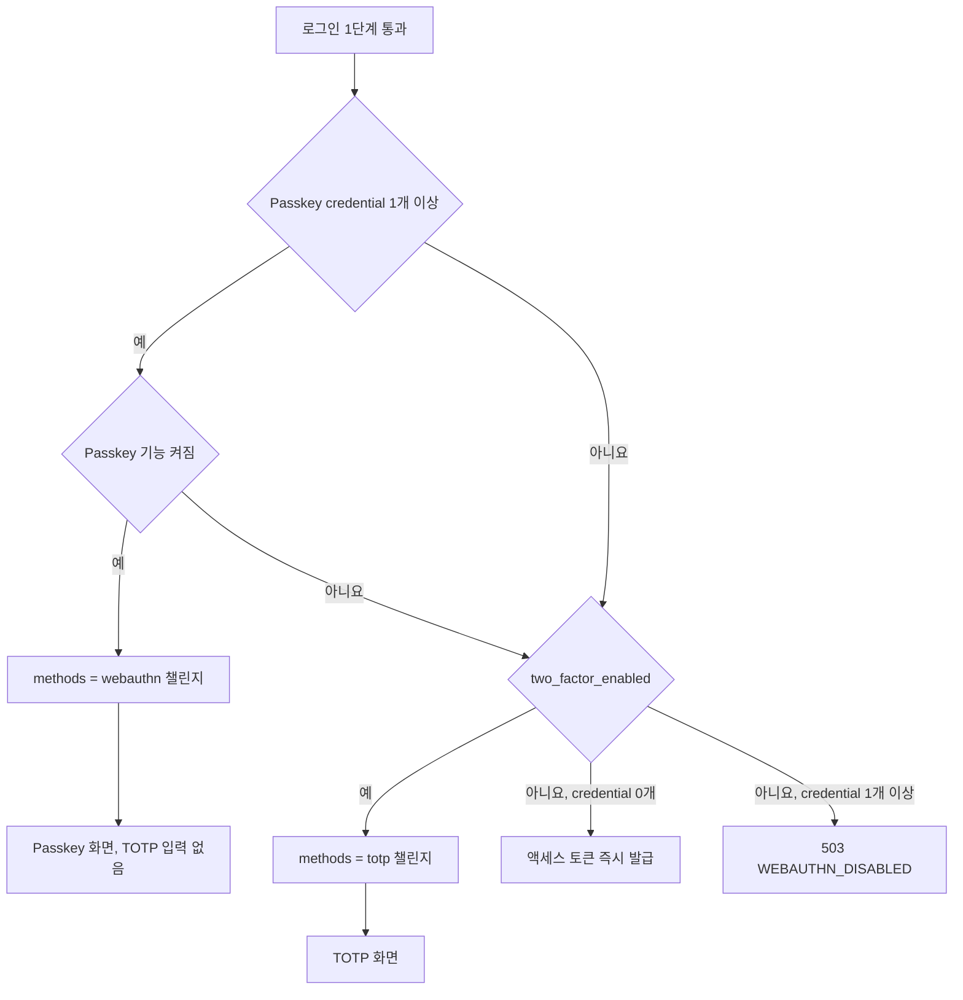
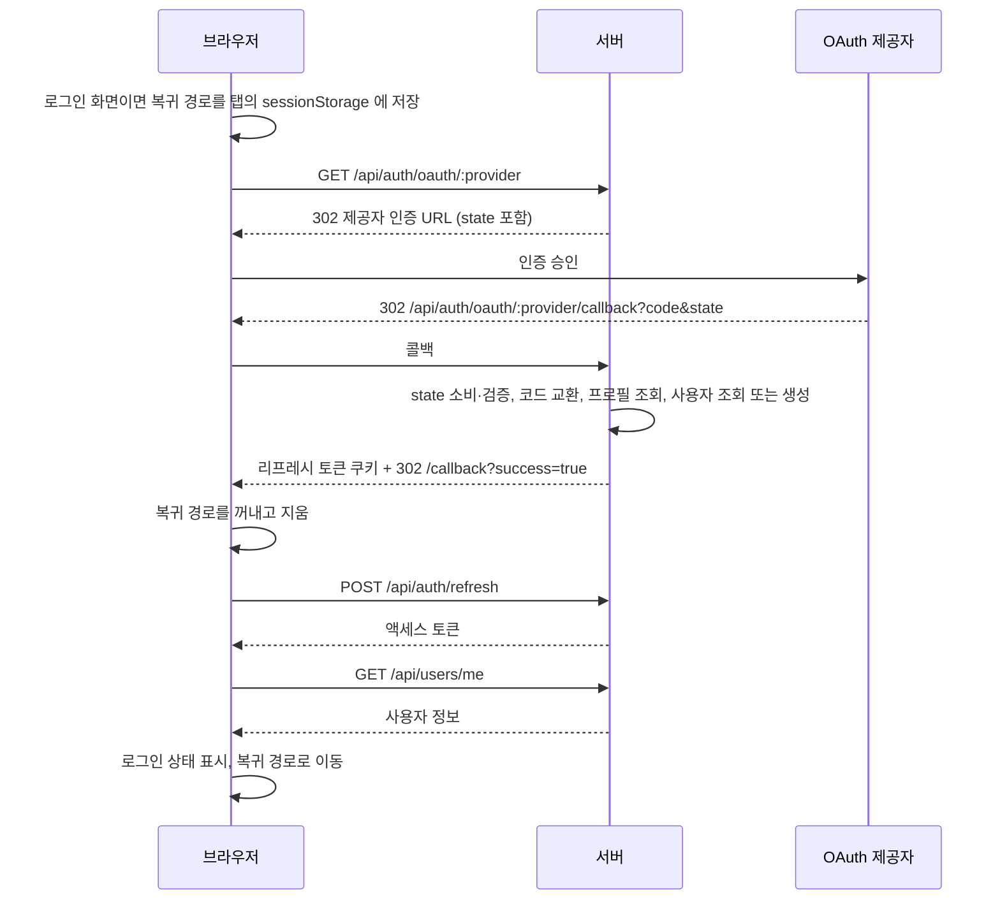

## 개요

이 문서는 [가입과 로그인](CLE-ACCT-SIGNIN.md) 의 하위 문서로 로그인 화면과 로그인 처리 순서, 로그인 2단계 인증 방식 선택과 2단계 화면(TOTP · Passkey), 소셜 로그인 흐름을 정한다. Passkey 인증 검증의 서버 규칙은 [Passkey 로그인 인증](CLE-ACCT-SIGNIN-PKAUTH.md), 엔드포인트 표와 에러 코드 표는 [API 와 에러 코드](CLE-ACCT-SIGNIN-API.md) 에 있다. 로그인 뒤 이동할 곳은 [세션과 토큰 「로그인 뒤 이동」](CLE-ACCT-SESSION.md#로그인-뒤-이동) 이 정한다.

## 로그인 화면

| 영역 | 위치 | 들어가는 요소 | 동작 |
| --- | --- | --- | --- |
| 제목 | 카드 상단 | "Sign in to your account" | 없음 |
| 안내 | 제목 아래 | "Welcome back! Sign in to your account." | 복귀 경로(post-login return path)가 초대 수락 페이지면 초대 안내 문구로 바뀐다. 한국어는 "로그인하면 초대 수락 화면으로 이동해요.", 영어는 "Sign in to continue to the invitation." 이다. 복귀 경로는 [세션과 토큰 「로그인 뒤 이동」](CLE-ACCT-SESSION.md#로그인-뒤-이동) 이 정한다 |
| 입력 폼 | 안내 아래 | Email, Password 입력란 | 이메일 형식과 빈 비밀번호 검사 |
| 로그인 유지 | 입력 폼 아래 | "Remember me" 체크박스 | 리프레시 토큰 수명을 7일에서 30일로 늘린다. 토큰을 회전해도 로그인 유지 여부를 이어받아 회전한 때부터 30일 또는 7일이다([세션과 토큰 「로그인 유지」](CLE-ACCT-SESSION.md#로그인-유지)) |
| 비밀번호 분실 링크 | 체크박스 옆 | "Forgot password?" | 비밀번호 재설정 화면으로 이동 |
| 로그인 버튼 | 폼 아래 | "Sign In" | 로그인 요청 |
| 소셜 로그인 | 버튼 아래 | "or continue with" 구분선, Google·GitHub 버튼 | [소셜 로그인](#소셜-로그인) |
| 가입 링크 | 카드 하단 | "Don't have an account? → Create account" | 가입 화면(`/register`)으로 이동한다. 로그인 화면이 받은 `redirect` 는 넘기지 않는다. 그래서 초대 수락 페이지에서 온 사용자가 이 링크로 가면 초대 문맥을 잃는다. 이 링크로 만든 계정은 이메일이 초대 이메일과 다르면 그 초대를 수락할 수 없기 때문이다([워크스페이스와 멤버 「초대 수락·가입 때 이메일 일치를 강제한다」](CLE-ACCT-WS.md#초대-수락가입-때-이메일-일치를-강제한다)) |

## 로그인 처리

1. 이메일 형식과 비밀번호가 비어 있지 않은지 검사한다.
2. `POST /api/auth/login { email, password, rememberMe }` 을 호출한다.
3. 서버는 없는 이메일 → 계정 잠금 → 비밀번호 없음(OAuth 전용) → 비밀번호 불일치 → 이메일 인증 전 순서로 확인한다. 여기까지가 로그인 1단계다. 이메일 인증 여부는 비밀번호가 맞을 때만 알린다.
4. 2단계 인증이 없으면 서버는 `{ accessToken }` 과 리프레시 토큰 쿠키를 돌려준다. 응답 본문에 `user` 객체는 없다. 화면은 [세션과 토큰 「로그인 뒤 이동」](CLE-ACCT-SESSION.md#로그인-뒤-이동) 이 정한 곳으로 이동한다.
5. 2단계 인증이 있으면 서버는 `{ requires2fa, methods, challengeToken }` 을 돌려주고 화면은 2단계 인증 화면으로 이동한다.
6. 없는 이메일 · 비밀번호가 없는 계정 · 틀린 비밀번호면 "Invalid email or password" 를 보여 준다. 어느 경우인지는 드러내지 않는다.
7. 비밀번호가 맞는 이메일 인증 전 계정이면 서버는 401 `EMAIL_VERIFICATION_REQUIRED` 와 "Please verify your email before logging in" 을 돌려준다. 화면은 이 코드를 보고 이메일 인증을 먼저 하라는 안내를 보여 준다.
8. 5회 실패로 잠기면 "Account locked. Try again in 10 minutes." 를 보여 준다.
9. Passkey 기능이 꺼진 서버에서 Passkey 만 등록하고 TOTP 가 꺼진 계정이 로그인 1단계를 통과하면 서버는 503 `WEBAUTHN_DISABLED` 를 돌려준다. 2단계 인증 챌린지를 발급할 때와 같이 로그인 이력을 남기지 않고 서버 경고 로그를 남긴다. 비밀번호가 맞았으므로 실패 횟수(`login_attempts`)는 0 으로 되돌린다. 화면은 지금 Passkey 로 로그인할 수 없으니 운영자에게 문의하라는 안내를 보여 준다. 로그인 폼이 이 응답을 직접 처리한다. 컴포넌트가 처리한 에러는 화면 전체를 덮지 않으므로 서버 에러 페이지로 넘어가지 않는다([오류 화면과 빈 상태 「감지를 Next.js 에러 바운더리로 구현한 이유」](../CLE-UI/CLE-UI-ERRORS.md#감지를-nextjs-에러-바운더리로-구현한-이유)). 그 문서의 5xx 전체 화면 처리는 페이지까지 전파된 에러에 쓴다. API 5xx 를 토스트로 보일지 전체 화면 오류 페이지로 보일지가 [에러 응답과 클라이언트 처리 「미결 사항」](../CLE-API/CLE-API-ERROR.md#미결-사항) 에서 정해지면 로그인 폼도 그 결정을 따른다. 규칙은 [Passkey 기능 켜기와 환경 변수](CLE-ACCT-SIGNIN-PASSKEY.md#passkey-기능-켜기와-환경-변수) 에 있다.

화면은 에러 응답 봉투 `{ error: { code, message } }` 의 `error.code` 로 문구를 고른다. 코드별 문구가 없는 코드는 `error.message` 를 그대로 보여 준다. 서버는 처리하지 못한 예외와 라이브러리 원문을 상태별 고정 문구로 바꿔 보내므로 이 폴백에 예외 원문은 나오지 않는다. 응답을 받지 못하면(네트워크 에러) 일반 실패 문구를 보여 준다. 에러 응답 형식은 [에러 응답과 클라이언트 처리](../CLE-API/CLE-API-ERROR.md) 가 정한다. 코드로 문구를 고르는 방식은 [다국어와 화면 문구](../CLE-UI/CLE-UI-I18N.md) 규칙 5 의 취지를 따른다. 인증 화면 행은 아직 규칙 5 의 매핑 표에 없고 NERV Task `CLE-T-1K5CWP` 가 올린다.

| 단계 | 응답 코드 | 화면 문구 |
| --- | --- | --- |
| 로그인 1단계 | `LOGIN_FAILED` | 이메일이나 비밀번호가 틀렸다는 문구(6번) |
| 로그인 1단계 | `ACCOUNT_LOCKED` | 계정이 잠겼으니 10분 뒤 다시 시도하라는 안내(8번) |
| 로그인 1단계 | `EMAIL_VERIFICATION_REQUIRED`, `WEBAUTHN_DISABLED` | 코드별 안내(7번 · 9번) |
| 로그인 1단계 | 그 밖의 코드 | 응답의 `error.message` |
| 로그인 1단계 | 응답 없음 | 일반 실패 문구 |
| 로그인 2단계(TOTP · Passkey · 복구 코드) | `CHALLENGE_INVALID` | 인증 시간이 지났으니 로그인을 처음부터 다시 하라는 안내 |
| 로그인 2단계 | `TOTP_INVALID`, `WEBAUTHN_INVALID`, `RECOVERY_CODE_INVALID` | 수단별 실패 문구 |
| 로그인 2단계 | 그 밖의 코드 | 응답의 `error.message` |
| 로그인 2단계 | 응답 없음 | 수단별 일반 문구 |

로그인 화면에서 시작한 로그인은 2단계 인증과 복구 코드를 거쳐도 모두 [세션과 토큰 「로그인 뒤 이동」](CLE-ACCT-SESSION.md#로그인-뒤-이동) 이 정한 곳으로 이동한다. 소셜 로그인은 [콜백 처리](#콜백-처리) 를 함께 본다.

## 2단계 인증 방식 선택

로그인 1단계를 통과하면 서버가 등록 상태를 보고 2단계를 고른다. Passkey·보안 키(WebAuthn, `WebAuthnCredential`)가 있으면 그것만 쓰고, 없을 때만 TOTP 를 쓴다. TOTP 로 자동 전환하지 않는 것이 핵심 규칙이다. 예외는 Passkey 기능이 꺼진 경우 하나다. 그때는 TOTP 가 켜진 사용자가 TOTP 로 로그인하고 Passkey 만 등록한 사용자는 503 `WEBAUTHN_DISABLED` 로 막힌다.

| 사용자 상태 | 응답 | 로그인 2단계 화면 |
| --- | --- | --- |
| Passkey 기능 켜짐, Passkey credential 1개 이상 | `{ requires2fa: true, methods: ['webauthn'], challengeToken }` | Passkey 인증 화면. TOTP 코드 입력란은 숨긴다 |
| Passkey 0개이고 `two_factor_enabled = true` | `{ requires2fa: true, methods: ['totp'], challengeToken }` | TOTP 입력 화면 |
| Passkey 기능 꺼짐, Passkey credential 1개 이상, `two_factor_enabled = true` | `{ requires2fa: true, methods: ['totp'], challengeToken }` | TOTP 입력 화면 |
| Passkey 기능 꺼짐, Passkey credential 1개 이상, `two_factor_enabled = false` | 503 `WEBAUTHN_DISABLED` | 없음. 로그인 화면에 안내를 보여 준다 |
| 둘 다 없음 | `{ accessToken }` (즉시 로그인) | 없음 |

- Passkey 기능이 켜져 있으면 Passkey 가 하나라도 등록된 사용자에게 로그인 화면에서 TOTP 입력을 주지 않는다. TOTP 로 로그인하려면 보안 설정에서 Passkey 를 먼저 모두 삭제해야 한다.
- Passkey 인증이 실패하면 같은 화면의 "복구 코드 사용" 링크로 Passkey 전용 복구 코드 입력란을 연다. TOTP 화면으로 자동 전환하지 않는다.
- 클라이언트는 `requires2fa` 와 `methods` 만 본다. `requires2fa=true` 이면 챌린지 단계이고 `methods[0]` 으로 화면을 가른다. 로그인 응답에 `requiresTotp` 필드는 없다.
- 챌린지 토큰(`challengeToken`)은 로그인 1단계를 통과한 뒤 2단계 검증을 부를 때 쓰는 단기 토큰(`mfa_challenge` JWT)이다.
- 로그인(`AuthService.login`)과 TOTP 로그인(`AuthService.loginWithTotp`)은 저장된 credential 수(`WebAuthnService.countStoredCredentials()`, 기능이 꺼져도 저장된 수를 센다)와 켜짐 여부(`isEnabled()`)를 `AuthService.passkeyState()` 한 곳에서 판정한다.
- TOTP 로그인은 기능이 켜져 있을 때만 `WEBAUTHN_REQUIRED` 로 막는다. Passkey 가 있는 계정이 TOTP 로 2단계를 넘지 못하게 하는 백스탑이다.

## TOTP 입력 화면

| 영역 | 위치 | 들어가는 요소 | 동작 |
| --- | --- | --- | --- |
| 제목·안내 | 카드 상단 | "Two-factor authentication", 인증 앱의 6자리 코드를 넣으라는 안내 | 없음 |
| 코드 입력 | 안내 아래 | 6칸 숫자 입력 | 한 칸을 채우면 다음 칸으로 포커스 이동 |
| 복구 코드 링크 | 입력 아래 | "Use a recovery code" | 단일 입력 필드로 바뀐다 |
| 버튼 | 카드 하단 | "Verify", "← Back" | 검증 요청, 로그인 화면으로 돌아가기 |

- `POST /api/auth/login/totp { challengeToken, code }` 로 검증한다. `code` 에는 6자리 코드나 TOTP 복구 코드를 넣는다.
- 성공하면 액세스 토큰과 리프레시 토큰을 발급하고 이동한다.
- 실패하면 "Invalid code. Please try again." 를 보여 주고 로그인 이력에 `totp_failed` 를 남긴다.

## Passkey 인증 화면

| 영역 | 위치 | 들어가는 요소 | 동작 |
| --- | --- | --- | --- |
| 제목·안내 | 카드 상단 | "Two-factor authentication", Passkey 나 보안 키로 로그인하라는 안내 | 없음 |
| 인증 버튼 | 안내 아래 | "Use Passkey / Key" | 브라우저 인증기 호출 |
| 복구 코드 링크 | 버튼 아래 | "Use a recovery code" | Passkey 복구 코드 입력란 표시 |
| 뒤로 | 카드 하단 | "← Back" | 로그인 화면으로 돌아가기 |

- 페이지가 열리면 자동으로 `navigator.credentials.get()` 흐름에 들어간다.
- `POST /api/auth/2fa/webauthn/authenticate/options { challengeToken }` 로 `optionsToken` 과 요청 옵션을 받는다.
- 사용자가 인증기를 쓰면 `POST /api/auth/2fa/webauthn/authenticate/verify { challengeToken, optionsToken, response }` 를 호출한다.
- 실패하면 같은 화면의 "Use a recovery code" 링크로 입력란을 열고 `POST /api/auth/2fa/webauthn/recovery { challengeToken, code }` 를 호출한다.
- 브라우저가 WebAuthn 을 지원하지 않거나 인증기에 접근할 수 없으면 안내문과 복구 코드 입력 링크만 보여 준다.
- 인증을 다시 시도할 때마다 옵션(새 Passkey 인증 챌린지)을 새로 받는다. 검증 응답을 기다리는 동안에는 인증 버튼을 잠근다("Authenticating..." 비활성, `auth.login.webauthnConfirming`). 같은 챌린지로 다시 보내면 서버가 401 `WEBAUTHN_INVALID` 로 거부하기 때문이다([Passkey 로그인 인증 흐름](CLE-ACCT-SIGNIN-PKAUTH.md#passkey-로그인-인증-흐름)). 버튼 잠금은 서버 기록을 보조할 뿐이고 대신하지 않는다. 화면을 거치지 않는 재전송은 서버가 막는다.

## 소셜 로그인

| 제공자 | 설명 |
| --- | --- |
| Google | Google OAuth 2.0 |
| GitHub | GitHub OAuth Apps |

- 소셜 로그인 이메일이 기존 이메일 계정과 같으면 그 계정에 자동으로 연결한다. 이메일은 [이메일 비교 규칙](CLE-ACCT-SIGNIN-SIGNUP.md#이메일-비교-규칙) 대로 대소문자를 구분하지 않고 비교한다. 연결은 `oauth_provider IS NULL` 조건부 갱신이라 이미 다른 제공자에 묶인 계정을 덮어쓰지 않는다. 연결할 때 `email_verified=true` 와 아바타 URL 도 함께 설정한다.
- 처음 소셜 로그인하면 자동으로 가입시키고 개인 워크스페이스를 만든다.
- 소셜 로그인은 2단계 인증 없이 토큰을 발급한다.
- 소셜 로그인은 통합의 OAuth 연결과 다른 흐름이다. 통합 쪽은 [OAuth 연결과 토큰 갱신](../CLE-INT/CLE-INT-OAUTH.md) 이 정한다.

### 제공자 노출

가입·로그인 화면을 열면 `GET /api/auth/oauth/providers` 로 자격 증명이 설정된 제공자 목록을 받는다.

| 응답 | UI 동작 |
| --- | --- |
| `{ providers: ["google", "github"] }` | "Or continue with" 구분선과 두 버튼을 모두 보여 준다 |
| 일부만 포함 (예: `["google"]`) | 해당 버튼만 한 칸으로 보여 준다 |
| 빈 배열 `[]` | 구분선과 버튼을 모두 숨기고 이메일·비밀번호 폼만 보여 준다 |

- 제공자는 `OAUTH_STUB_MODE=true`(개발) 이거나 `{PROVIDER}_CLIENT_ID` 환경 변수가 설정됐을 때 켜진다.
- 응답은 `Cache-Control: private, max-age=300` 으로 5분 캐시한다. Next.js Server Component `fetch` 의 `revalidate: 300` 과 맞췄다. 공유 캐시에 저장되지 않게 `private` 을 쓴다(`auth.controller.ts` 의 `@Header`).
- 이 API 호출이 실패하면 안전한 기본값인 빈 배열로 처리해 소셜 로그인 UI 를 숨긴다. 이메일·비밀번호 로그인은 그대로 된다.

### 흐름

| 단계 | 동작 |
| --- | --- |
| 1 | 사용자가 "Continue with Google/GitHub" 버튼을 누른다. 로그인 화면에서 누르면 복귀 경로를 이 탭의 sessionStorage 에 먼저 저장한다. 가입 화면에서 누르면 남은 값을 지운다([세션과 토큰 「소셜 로그인의 복귀 경로」](CLE-ACCT-SESSION.md#소셜-로그인의-복귀-경로)) |
| 2 | `GET /api/auth/oauth/:provider`. 로그인 화면은 `mode=login`, 가입 화면은 `mode=register` 를 붙인다. 서버가 `state` 를 담은 OAuth URL 을 만든다 |
| 3 | 브라우저를 같은 탭에서 제공자의 인증 페이지로 보낸다 |
| 4 | 사용자가 제공자에서 승인한다 |
| 5 | 제공자가 `GET /api/auth/oauth/:provider/callback?code=...&state=...` 로 보낸다 |
| 6 | 서버가 `code` 로 토큰을 교환하고 프로필을 조회한 뒤 사용자를 찾거나 만든다 |
| 7 | 리프레시 토큰을 쿠키로 설정하고 프론트엔드 콜백 URL 로 보낸다 |
| 8 | 프론트엔드 `/callback` 에서 액세스 토큰을 받고 복귀 경로로 이동한다([콜백 처리](#콜백-처리)) |

### 콜백 처리

| 단계 | 처리 |
| --- | --- |
| state 검증 | 서버가 발급한 state 인지 확인한다(CSRF 방지). state 는 10분 동안 유효하고 콜백에서 한 번만 소비한다 |
| 코드 교환 | `code` 를 제공자 토큰 엔드포인트에서 `access_token` 으로 바꾼다 |
| 프로필 조회 | `access_token` 으로 이메일·이름·아바타를 조회한다 |
| 사용자 매칭 | 제공자 ID 로 먼저 찾고, 없으면 이메일로 기존 사용자를 찾는다. 이메일은 [이메일 비교 규칙](CLE-ACCT-SIGNIN-SIGNUP.md#이메일-비교-규칙) 대로 비교한다. 연결할 계정을 하나로 정하지 못하면 [에러 처리](#에러-처리) 의 `server_error` 로 끝난다 |
| 기존 사용자 | OAuth 제공자 정보를 연결하고 로그인 처리한다 |
| 신규 사용자 | 자동 가입하고 개인 워크스페이스를 만든 뒤 로그인 처리한다 |
| 토큰 발급 | 리프레시 토큰만 HttpOnly 쿠키로 발급한다. 액세스 토큰은 콜백 페이지가 따로 받는다 |
| 리다이렉트 | `{frontend_url}/callback?success=true`. 액세스 토큰은 URL 에 싣지 않는다. 콜백 페이지가 리프레시 쿠키로 `POST /api/auth/refresh` 를 불러 액세스 토큰을 받아 메모리에 둔다. 복귀 경로도 URL 에 싣지 않는다. 콜백 페이지는 로그인 화면이 탭의 sessionStorage 에 저장해 둔 복귀 경로로 이동한다([세션과 토큰 「소셜 로그인의 복귀 경로」](CLE-ACCT-SESSION.md#소셜-로그인의-복귀-경로)) |

서버 시퀀스와 `auth_oauth_state` 테이블 동작은 [계정과 워크스페이스 데이터 흐름](CLE-ACCT-DATA.md) 에 있다.

### 에러 처리

| 에러 | 리다이렉트 |
| --- | --- |
| state 불일치(없음 · 만료 · 이미 소비 · 제공자 불일치) | `{frontend_url}/callback?error=invalid_state` |
| 코드 교환 실패 | `{frontend_url}/callback?error=token_exchange_failed` |
| 이메일 미제공 (GitHub 비공개 이메일 등) | `{frontend_url}/callback?error=email_required` |
| 이메일이 대소문자만 다른 기존 계정 여럿과 맞고 대소문자까지 같은 계정이 없음([이메일 비교 규칙](CLE-ACCT-SIGNIN-SIGNUP.md#이메일-비교-규칙)) | `{frontend_url}/callback?error=server_error` |
| 서버 에러 | `{frontend_url}/callback?error=server_error` |

state 행이 없거나 만료됐거나 이미 소비됐으면 서비스는 400 `OAUTH_STATE_MISMATCH` 예외를 던진다. state 를 발급한 제공자와 콜백의 제공자가 달라도 같다. 로그인 콜백에서는 컨트롤러가 이 예외를 `?error=invalid_state` 리다이렉트로 바꾸므로 사용자는 400 응답을 받지 않는다.

`error=` 값은 응답 봉투의 `error.code` 가 아니라 리다이렉트 URL 쿼리 파라미터라서 `lower_snake_case` 다. 이 예외는 [에러 코드 규약과 카탈로그](../CLE-API/CLE-API-ERRCODES.md) 의 예외 등록 코드 목록에 올라 있다.

연결할 계정을 정하지 못한 경우는 새 `error=` 값을 두지 않고 `server_error` 를 쓴다. 서버 내부 코드 `OAUTH_ACCOUNT_AMBIGUOUS` 는 컨트롤러가 리다이렉트로 바꾸므로 응답 봉투로 나가지 않고 카탈로그에도 올리지 않는다. 이유는 [가입 · 재설정 · 이메일 변경 Rationale](CLE-ACCT-SIGNIN-SIGNUP.md#대소문자만-다른-기존-계정은-대소문자까지-같은-계정만-쓰고-나머지는-모호로-거부한다-2026-11-05) 에 있다.

프론트엔드 `/callback` 페이지는 다음처럼 동작한다.

- 페이지가 열리면 저장해 둔 복귀 경로를 꺼내고 바로 지운다. 성공과 실패에 상관없이 지운다. 저장과 검사 규칙은 [세션과 토큰 「소셜 로그인의 복귀 경로」](CLE-ACCT-SESSION.md#소셜-로그인의-복귀-경로) 가 정한다.
- `success=true` 이면 `refreshAccessToken()`(`POST /api/auth/refresh`)으로 액세스 토큰을 받아 메모리에 둔다. refresh 가 실패하면 에러를 보여 준다.
- 이어서 비밀번호 로그인과 같은 진입점(`establishSession`)으로 로그인 힌트 쿠키(`has_session`)를 두고 `GET /api/users/me` 로 사용자를 받아 로그인 상태로 표시한다([세션과 토큰 「로그인 힌트 쿠키」](CLE-ACCT-SESSION.md#로그인-힌트-쿠키)).
- 그다음 복귀 경로로 이동한다. 복귀 경로가 없거나 쓸 수 없을 때 갈 곳은 [세션과 토큰 「로그인 뒤 이동」](CLE-ACCT-SESSION.md#로그인-뒤-이동) 이 정한다.
- `error=*` 이면 에러 메시지, "다시 시도" 버튼, 로그인 화면 링크를 보여 준다. 둘 다 `/login` 으로 간다.
- 사용자 조회만 실패한 경우, 이 탭에서 sessionStorage 를 쓸 수 없는 경우, 실패 화면에서 다시 로그인하는 경우의 복귀 경로 처리는 [세션과 토큰 「소셜 로그인의 복귀 경로」](CLE-ACCT-SESSION.md#소셜-로그인의-복귀-경로) 를 따른다.

## 미결 사항

- **로그인 응답 시간으로 계정이 드러나는 문제**: 없는 이메일, 잠긴 계정, 비밀번호가 없는 계정은 bcrypt 비교 없이 바로 401 을 받는다. 비밀번호가 있는 계정은 bcrypt 비교(cost 12)를 거친다. 그래서 응답 시간 차이로 비밀번호가 있는 계정이 있는지 알 수 있다. 인증 메일 재발송(`POST /api/auth/resend-verification`)도 같다. 응답 문구는 늘 같지만 인증 전 계정일 때만 메일 발송을 기다린 뒤 응답한다. 더미 비교와 기다리지 않는 메일 발송으로 응답 시간을 맞출지 정해야 한다.

## 구현 위치

- `codebase/backend/src/modules/auth/**` (로그인·OAuth)
- `codebase/frontend/src/app/(auth)/**` (`callback/callback-content.tsx` 의 소셜 로그인 복귀 포함)
- `codebase/frontend/src/components/auth/**` (`login-form.tsx` 포함)
- `codebase/frontend/src/components/auth/__tests__/login-form-webauthn.test.tsx` (검증 중 버튼 잠금, 실패 뒤 새 옵션)
- `codebase/frontend/src/lib/auth/post-login-redirect.ts` (로그인 뒤 이동할 곳, 소셜 로그인의 복귀 경로 저장과 꺼내기, 초대 수락 페이지로 돌아오는 로그인 경로 `buildInvitationLoginHref`. 규칙은 [세션과 토큰](CLE-ACCT-SESSION.md) 이 정한다)
- `codebase/frontend/src/lib/api/auth.ts`, `codebase/frontend/src/lib/api/auth-providers.ts`
- `codebase/frontend/src/lib/api/errors.ts` (`axiosMessage` · `extractApiMessage`, 에러 응답 봉투의 `error.message` 읽기)

## Rationale

### 로그인에서 TOTP 로 자동 전환하지 않는다

Passkey 는 피싱에 강하고 TOTP 는 코드를 입력하는 순간 피싱에 약하다. 강한 수단을 등록한 사용자가 약한 수단으로 자동 우회할 수 있으면 등록한 의미가 약해진다. TOTP 로 바꾸고 싶으면 보안 설정에서 Passkey 를 모두 지우거나 Passkey 복구 코드를 쓴 뒤 다시 로그인한다. 의식적인 하향만 허용한다. 분실로 잠길 위험은 별도 복구 코드로 줄인다. 복구 코드까지 잃은 경우의 계정 복구는 이 문서 범위 밖이고 운영자 개입 경로다.

예외는 Passkey 기능이 꺼진 경우다(2026-10-17). 기능이 꺼지면 Passkey 로 인증할 수 없으므로 TOTP 가 켜진 사용자는 TOTP 로 로그인한다. 사용자가 등록한 수단 가운데 남은 것을 쓰므로 2단계 인증을 건너뛰지 않는다. 이 근거는 비밀번호 로그인에만 해당한다. 소셜 로그인은 기능이 켜져 있을 때도 2단계 인증 없이 토큰을 발급한다([콜백 처리](#콜백-처리)). TOTP 가 없는 사용자를 막는 이유는 아래 「Passkey 기능이 꺼지면 Passkey 만 등록한 계정의 로그인을 막는다」 에 있다. 기능이 켜져 있을 때 Passkey 인증이 실패해도 TOTP 로 넘기지 않는 규칙은 그대로다.

### Passkey 기능이 꺼지면 Passkey 만 등록한 계정의 로그인을 막는다 (2026-10-17)

NERV Task `CLE-T-D331TT` 에서 사람 결정으로 정했다. 구현은 기능이 꺼지면 credential 수를 0 으로 보고 Passkey 만 등록한 계정을 비밀번호만으로 로그인시켰다. 그러면 환경 변수 하나가 빠질 때 Passkey 로 2단계 인증을 등록한 계정이 모두 비밀번호만으로 들어온다. 그래서 막는 쪽으로 정했다. TOTP 가 켜진 사용자는 TOTP 로 로그인한다.

- **기각: 지금 동작을 문서에 적는다.** 아무도 잠기지 않는다. 하지만 설정 실수 하나로 2단계 인증이 꺼지고 사용자는 그 사실을 알 수 없다.
- **기각: 기능이 꺼진 동안 Passkey 복구 코드로만 로그인을 연다.** 2단계 인증이 유지되고 바로 잠기지 않는다. 하지만 로그인 응답에 새 `methods` 값과 화면이 필요해 바뀌는 곳이 가장 많다. 복구 코드는 10개뿐이라 설정이 꺼진 동안 매번 쓰면 곧 바닥난다.
- **비용**: 운영자가 변수를 되돌릴 때까지 Passkey 만 등록한 사용자는 비밀번호로 로그인하지 못한다. 그래서 운영자가 설정을 바꿔야 풀리는 상태에 쓰는 `503` 을 쓴다([HTTP API 규약](../CLE-API/CLE-API-CONV.md) 규칙 11).
- **바뀐 계약**: `WebAuthnService.countCredentials()` 는 기능이 꺼지면 0 을 돌려줬다. NERV Task `CLE-T-RFSJXQ` 에서 기능이 꺼져도 저장된 credential 수를 세게 바꾸고 이름도 `countStoredCredentials()` 로 바꿨다. 켜짐 여부는 `isEnabled()` 로 따로 묻는다.
- **로그인 이력 없이 경고 로그만 남긴다(2026-11-05 구현).** 503 `WEBAUTHN_DISABLED` 는 로그인 실패가 아니라 서버 설정 문제라서 2단계 인증 챌린지를 발급할 때처럼 로그인 이력을 남기지 않는다. 운영자는 서버 경고 로그(warn)로 차단이 일어난 것을 안다.

### 이메일 인증 전 계정은 비밀번호가 맞을 때만 알린다 (2026-10-17)

NERV Task `CLE-T-D331TT` 에서 사람 결정으로 정했다. 구현은 비밀번호를 확인하기 전에 이메일 인증 여부를 보고 인증 전 계정에 다른 메시지를 줬다. 그래서 비밀번호를 몰라도 그 이메일로 가입한 인증 전 계정이 있는지 알 수 있었다. 확인을 비밀번호 뒤로 옮기면 비밀번호를 아는 본인만 계정 상태를 알게 된다. 인증 메일을 놓친 사용자는 왜 로그인이 안 되는지 알 수 있다.

- **기각: 인증 전 계정도 같은 메시지로 숨긴다.** 인증 메일을 놓친 사용자가 이유를 알 수 없다.
- **기각: 지금 동작을 문서에 적는다.** 계정 존재와 인증 상태가 비밀번호 없이 드러난다.
- **잠금 순서는 그대로 둔다**: `ACCOUNT_LOCKED` 는 비밀번호 확인 전에 알린다. 그래서 잠긴 계정의 존재는 드러난다. 지금은 이 응답으로 사용자가 잠금을 안다([계정 잠금에 이메일 알림을 두지 않는다](CLE-ACCT-SIGNIN-SIGNUP.md#계정-잠금에-이메일-알림을-두지-않는다)). 이 결정이 숨기는 것은 계정의 존재가 아니라 이메일 인증 상태다.
- **새 코드로 알린다**: 비밀번호가 맞는 인증 전 계정은 401 `EMAIL_VERIFICATION_REQUIRED` 로 거부한다. 사용자가 할 일(인증 메일 확인)이 자격 증명을 고치는 것과 달라서 [에러 코드 규약과 카탈로그](../CLE-API/CLE-API-ERRCODES.md) 규칙 6 의 새 조건이다. 규칙 6 의 단서는 같은 표면 안에서 구분하면 리소스가 다른 워크스페이스에 있다는 것이 드러나는 조건만 같은 코드로 묶는데 이 응답은 그 조건에 들지 않는다. 화면은 메시지가 아닌 코드로 안내 문구를 고르고(같은 문서 규칙 4) 코드를 키로 한국어 문구를 매핑한다([다국어와 화면 문구](../CLE-UI/CLE-UI-I18N.md) 규칙 5). 401 은 같은 로그인 1단계의 `ACCOUNT_LOCKED` 를 따랐다. 이름은 로그인 이력 사유값 `EMAIL_NOT_VERIFIED` 와 겹치지 않게 골랐다.
- **기각: `LOGIN_FAILED` 에 메시지만 다르게 둔다.** 화면이 코드로 인증 안내를 고를 수 없어 안내가 영문 서버 메시지에만 남는다. 위 두 규칙과 어긋난다.
- **기각: `LOGIN_FAILED` 의 `error.details` 에 하위 사유를 싣는다.** 로그인 응답에 하위 사유 형식이 새로 생기고 화면이 `details` 로 분기해야 한다.
- **잠금 카운터(2026-11-05 구현)**: 비밀번호가 맞으면 이메일 인증을 확인하기 전에 `login_attempts` 를 0 으로 되돌린다. 잠금은 비밀번호를 틀린 횟수를 세는 장치라서 비밀번호를 아는 인증 전 사용자는 인증 메일을 찾는 동안 다시 시도해도 잠기지 않는다.

### 로그인 응답에서 `requiresTotp` 필드를 없앴다

로그인 2단계 챌린지 응답에는 `requiresTotp?: boolean` 이 없다. 백엔드 `LoginChallengeDto`·`AuthService.login()`·프론트엔드 `TwoFactorChallengeResponse` 모두 그렇다. 클라이언트는 `requires2fa` 와 `methods` 만으로 가른다(`lib/api/auth.ts` 의 `isTwoFactorChallenge()`). 같은 뜻을 두 필드로 표현하면 Swagger·클라이언트 타입·DTO·테스트 mock 에 잡음이 생기고 "두 필드가 다르면 무엇을 따르나" 같은 규칙을 유지해야 한다.

### 로그인 · 2단계 · 재설정 화면이 거부 코드별 문구와 서버 문구를 보여 준다 (2026-11-05)

NERV Task `CLE-T-MFWBE1` 에서 고쳤다. 그 전에는 이 화면들이 에러 응답 봉투를 읽지 못해 거부 이유와 상관없이 일반 실패 문구만 보였다.

- **화면은 `error.code` 로 문구를 고른다.** 코드별 문구가 없는 코드는 서버의 `error.message` 를 보여 주고, 응답이 없으면 일반 문구를 보여 준다. 규칙은 [로그인 처리](#로그인-처리) 와 [재설정 화면](CLE-ACCT-SIGNIN-SIGNUP.md#재설정-화면) 에 있다. 봉투를 읽는 함수는 `codebase/frontend/src/lib/api/errors.ts` 한 곳에 둔다.
- **비밀번호 강도 위반의 `details[].field` 를 요청 필드 이름에 맞췄다.** 가입은 `password`, 재설정과 비밀번호 변경은 `newPassword` 다.
- **기각: 모든 거부에 서버의 `error.message` 를 그대로 보인다.** 코드별 문구가 있는 코드까지 서버 문구로 보이면 [다국어와 화면 문구](../CLE-UI/CLE-UI-I18N.md) 규칙 5 의 취지와 어긋난다.
- **기각: 코드별 문구가 없는 코드도 일반 문구로 보인다.** 사용자가 거부 이유를 알 수 없다.
- **후속**: 다른 화면의 같은 문제와 소셜 로그인 콜백 화면의 문구는 NERV Task `CLE-T-PRB4D3` 가 맡는다.

### 로그인 뒤 이동할 곳은 세션과 토큰 문서가 정한다 (2026-10-18)

이동 규칙은 [세션과 토큰 「로그인 뒤 이동」](CLE-ACCT-SESSION.md#로그인-뒤-이동) 한 곳에 두고 이 문서는 그 절을 링크한다. 두 문서에 규칙을 함께 적으면 한쪽만 고쳐지기 쉽다. 이 문서가 늘 대시보드로 간다고 적어 초대 링크에서 온 기존 가입자를 초대 수락 페이지로 돌려보내는 규칙과 어긋났던 것이 그 경우다.

- 로그인 화면의 초대 안내 문구와 「계정 만들기」 링크 동작은 화면 요소라서 이 문서의 [로그인 화면](#로그인-화면) 표가 정한다. 세션과 토큰 문서와 워크스페이스와 멤버 문서는 그 표를 링크한다.
- 소셜 로그인은 제공자를 거쳐 `/callback` 으로 돌아오므로 로그인 화면의 `redirect` 쿼리가 이어지지 않는다. 시작 요청의 `mode` 와 `rememberMe` 는 로그인 OAuth state(`auth_oauth_state`) 행에 실어 콜백까지 나른다. 복귀 경로는 백엔드 인증 API 를 바꾸지 않으려고 탭의 sessionStorage 로 넘긴다. 다른 탭에서 돌아오거나 팝업 로그인이 필요해지면 state 행으로 옮긴다. 이유와 비용은 [세션과 토큰 「소셜 로그인의 복귀 경로는 sessionStorage 로 넘긴다 (2026-10-18)」](CLE-ACCT-SESSION.md#소셜-로그인의-복귀-경로는-sessionstorage-로-넘긴다-2026-10-18) 에 있다. 화면이 팝업을 쓰지 않고 같은 탭에서 제공자 페이지로 가는 것도 이 결정이 기대는 동작이다.
- 콜백은 이동하기 전에 `GET /api/users/me` 를 불러 로그인 상태를 표시한다. 이때 로그인 힌트 쿠키(`has_session`)가 심어진다. 쿠키 없이 보호 경로로 가면 proxy 가 다시 로그인 화면으로 보내기 때문이다. 이메일 인증 링크와 초대 토큰 가입의 자동 로그인도 같은 진입점(`establishSession`)으로 힌트 쿠키를 심는다(NERV Task `CLE-T-1X7DMR`).
- 이메일 인증 링크를 연 뒤의 자동 로그인은 복귀 경로의 범위가 아니다. 지금처럼 대시보드로 보낸다.
- 초대 가입 화면의 가입 여부 확인 규칙은 [워크스페이스와 멤버 「초대 가입 화면」](CLE-ACCT-WS.md#초대-가입-화면) 에만 둔다. 가입 폼 이메일 입력란의 중복 확인은 읽기 전용 입력란에서 건너뛰고 그 절을 링크한다([가입 「필드 검증」](CLE-ACCT-SIGNIN-SIGNUP.md#필드-검증)).

### OAuth 콜백에서 액세스 토큰을 URL 에 싣지 않는다

2026-05-31 결정이다. URL 에 액세스 토큰을 실으면 브라우저 기록·Referer·프록시 로그에 남는다. 그래서 리프레시 토큰만 HttpOnly 쿠키로 설정하고 콜백 페이지가 `POST /api/auth/refresh` 로 액세스 토큰을 받는다.
