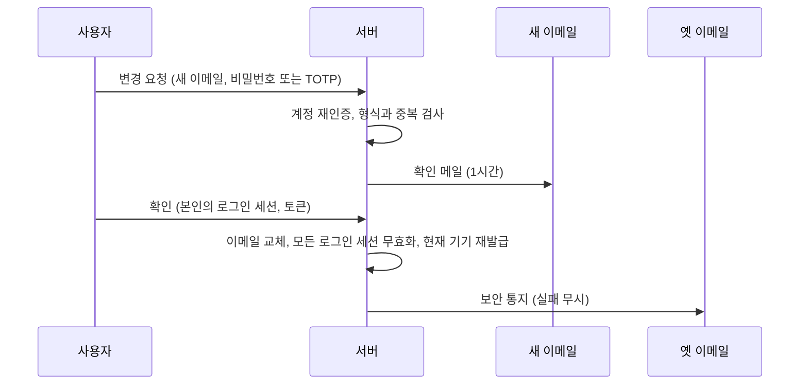

## 개요

이 문서는 [가입과 로그인](CLE-ACCT-SIGNIN.md) 의 하위 문서로 인증 화면 공통 레이아웃, 이메일·비밀번호 가입과 이메일 인증, 이메일·비밀번호 인증 규칙, 이메일 비교 규칙, 비밀번호 재설정, 이메일 변경의 화면과 동작을 정한다. 엔드포인트 표와 에러 코드 표는 [가입과 로그인 — API 와 에러 코드](CLE-ACCT-SIGNIN-API.md) 에 있다.

## 인증 화면 공통

인증 화면은 사이드바 없는 전체 화면 레이아웃에 가운데 카드 하나를 둔다.

| 영역 | 위치 | 들어가는 요소 | 동작 |
| --- | --- | --- | --- |
| 배경 | 화면 전체 | 제품 브랜드 색상 또는 그래디언트 | 현재 구현은 Shadcn neutral 그래디언트다 |
| 카드 | 화면 가운데 | 최대 너비 400px 카드 | 모바일에서는 전체 너비로 늘어난다 |
| 로고 | 카드 상단 | Full logo 변종 | 변종과 라이트·다크 선택은 [브랜드](../CLE-UI/CLE-UI-BRAND.md) 의 매트릭스를 따른다 |
| 폼 | 카드 본문 | 화면별 입력 폼 | 아래 각 절 |

인증 페이지는 Next.js route group `(auth)` 로 묶여 URL 에 `/auth` 접두사가 붙지 않는다. 실제 경로는 `/login`, `/register`, `/verify-email`, `/forgot-password`, `/reset-password`, `/callback` 이다. `/api/auth/...` 는 백엔드 API 경로이고 `/login` 같은 경로는 화면 경로다. 라우트 가드와 공개 경로 목록은 [세션과 토큰](CLE-ACCT-SESSION.md) 이 정한다.

## 가입

### 가입 화면

| 영역 | 위치 | 들어가는 요소 | 동작 |
| --- | --- | --- | --- |
| 제목 | 카드 상단 | "Create your account" | 없음 |
| 입력 폼 | 제목 아래 | Name, Email, Password 입력란과 비밀번호 강도 바 | 아래 필드 검증 표 |
| 약관 동의 | 입력 폼 아래 | "I agree to Terms of Service" 체크박스 | 체크하지 않으면 가입 버튼 비활성 |
| 가입 버튼 | 약관 아래 | "Create Account" | 가입 요청 |
| 소셜 로그인 | 가입 버튼 아래 | "or continue with" 구분선, Google·GitHub 버튼 | [소셜 로그인](CLE-ACCT-SIGNIN-LOGIN.md#소셜-로그인) 의 제공자 노출 규칙 |
| 로그인 링크 | 카드 하단 | "Already have an account? → Sign in" | 로그인 화면으로 이동. 초대 가입 화면에서는 초대 수락 페이지를 `redirect` 로 넘긴다([워크스페이스와 멤버 「초대 가입 화면」](CLE-ACCT-WS.md#초대-가입-화면)) |

### 필드 검증

| 필드 | 검증 규칙 | 실시간 피드백 |
| --- | --- | --- |
| Name | 필수, 2~50자 | 입력 즉시 |
| Email | 필수, 이메일 형식 | 포커스가 빠질 때 형식 검증과 `POST /api/auth/check-email` 중복 확인(가입 폼 `onBlur` 가 `checkEmailAvailability` 를 부른다). 초대 가입 화면은 이메일 입력란이 읽기 전용이라 이 확인을 하지 않는다. 그 화면의 가입 여부 확인은 [워크스페이스와 멤버 「초대 가입 화면」](CLE-ACCT-WS.md#초대-가입-화면) 이 정한다 |
| Password | 필수, 8자 이상 100자 이하, 대문자·소문자·숫자·특수문자 중 3가지 이상 | 입력 중 강도 바 표시 |
| Terms | 필수 체크 | 체크하지 않으면 버튼 비활성 |

### 비밀번호 강도 바

8자 이상·소문자·대문자·숫자·특수문자 다섯 기준을 1점씩 더한 `score`(0~5)로 다섯 단계 라벨을 보여 준다(`codebase/frontend/src/lib/utils/password.ts`).

| 강도 라벨 (i18n key) | score | 색상 |
| --- | --- | --- |
| 약함 (`auth.register.strengthWeak`) | 0~1 | 빨강 (`bg-red-500`) |
| 보통 (`auth.register.strengthFair`) | 2 | 주황 |
| 양호 (`auth.register.strengthGood`) | 3 | 노랑 |
| 강함 (`auth.register.strengthStrong`) | 4 | 연초록 (`green-400`) |
| 매우 강함 (`auth.register.strengthVeryStrong`) | 5 | 진초록 (`green-600`) |

### 가입 처리

1. 클라이언트가 입력을 검증한다.
2. `POST /api/auth/register { name, email, password, termsAccepted, invitationToken? }` 을 호출한다. 서버는 `termsAccepted` 가 `true` 가 아니면 400 `VALIDATION_ERROR` 로 거부한다.
3. 초대 토큰 없는 가입이 성공하면 이메일 인증 안내 화면으로 이동한다. 서버는 사용자 행과 인증 메일만 만들고 토큰·쿠키·개인 워크스페이스는 만들지 않는다.
4. 실패하면 이메일 중복 같은 에러를 인라인으로 보여 준다.

`invitationToken` 을 담은 가입은 인증 메일 없이 한 트랜잭션에서 사용자와 멤버십을 만들고 바로 로그인한다. 이 경로의 화면과 규칙, 로그인하지 않은 기존 가입자가 초대 링크를 열면 가입 화면 대신 로그인 화면으로 보내는 규칙은 [워크스페이스와 멤버 「초대 가입 화면」](CLE-ACCT-WS.md#초대-가입-화면) 이 정한다. 초대 토큰 가입이 409 `RESOURCE_CONFLICT` 로 끝나면 4번처럼 에러를 보여 주지 않고 같은 로그인 화면으로 보낸다. 가입 여부 확인이 실패해 가입 폼을 띄운 기존 가입자가 이 경우다.

### 이메일 인증 안내 화면

| 영역 | 위치 | 들어가는 요소 | 동작 |
| --- | --- | --- | --- |
| 제목 | 카드 상단 | "Verify your email" | 없음 |
| 안내 | 제목 아래 | 인증 링크를 보낸 이메일 주소 | 없음 |
| 재발송 버튼 | 안내 아래 | "Resend Email" | `POST /api/auth/resend-verification` 호출, 60초 쿨다운(`RESEND_COOLDOWN_SECONDS = 60`, `verify-email-content.tsx`) |
| 로그인 링크 | 카드 하단 | "Back to login" | 로그인 화면으로 이동 |

- 인증 링크는 `?token=` 쿼리로 토큰을 전달한다. 인증 페이지는 그 토큰을 요청 본문에 담아 `POST /api/auth/verify-email { token }` 을 호출한다.
- 인증에 성공하면 자동 로그인하고 개인 워크스페이스를 만든 뒤 대시보드(`/dashboard`)로 보낸다. 개인 워크스페이스 생성 규칙은 [워크스페이스와 멤버](CLE-ACCT-WS.md) 가 정한다.
- 인증 토큰은 24시간 동안 유효하다.
- 인증 메일 재발송 API 는 IP 당 분당 5회로 제한하고 이메일 존재 여부를 드러내지 않는 같은 응답을 준다.
- 인증 페이지의 요청이 실패하면 응답 봉투의 `error.message` 를 보여 준다. 응답을 받지 못하면 일반 실패 문구를 보여 준다.

## 이메일·비밀번호 인증 규칙

| 항목 | 규칙 |
| --- | --- |
| 가입 | 이메일과 비밀번호로 가입한다. 이메일 인증이 필수다 |
| 비밀번호 정책 | 8자 이상, 대문자·소문자·숫자·특수문자 중 3가지 이상 조합 |
| 비밀번호 저장 | bcrypt(cost factor 12 이상). `user.password_hash` 는 nullable 이고 OAuth 전용 계정(OAuth-only account, `password_hash IS NULL`)은 NULL 이다 |
| 로그인 | 이메일과 비밀번호를 검증한 뒤 JWT 를 발급한다. 토큰 형태는 [세션과 토큰](CLE-ACCT-SESSION.md) |
| 비밀번호 분실 | 이메일로 30분짜리 재설정 링크를 보낸다. 이메일이 있는 모든 사용자에게 발급한다([비밀번호 재설정](#비밀번호-재설정)) |
| 로그인 실패 | 5회 연속 실패하면 10분 잠금. 이메일 알림은 없다 |
| 토큰 저장 | 이메일 인증 토큰(`emailVerifyToken`)·비밀번호 재설정 토큰(`passwordResetToken`)·이메일 변경 토큰(`emailChangeToken`)은 SHA-256 해시로만 저장한다. 원래 토큰은 메일 링크로만 전달하고 DB 에 두지 않는다. 검증할 때는 입력 토큰을 같은 해시로 바꿔 비교한다 |
| 인증 메일 재발송 | `POST /api/auth/resend-verification`. IP 당 분당 5회, 이메일 존재·인증 여부와 상관없이 같은 응답. 인증 전 계정에만 새 인증 토큰(24시간 유효)을 보낸다 |

계정 잠금(account lock, `ACCOUNT_LOCKED`)은 `login_attempts` 가 5에 이르면 `locked_until = now + 10분` 으로 건다. 잠긴 동안 로그인하면 401 `ACCOUNT_LOCKED` 를 돌려주고 로그인 이력에 `login_failed`(`failure_reason=ACCOUNT_LOCKED`)를 남긴다. 로그인이 성공하면 카운터와 잠금을 지운다. 상태 전이는 [계정과 워크스페이스 데이터 흐름](CLE-ACCT-DATA.md) 에 있다. IP 단위 요청 한도는 계정 잠금과 별개의 방어다. 한 IP 가 여러 계정을 도는 credential stuffing 은 요청 한도가 먼저 막고, 여러 IP 에서 한 계정을 노리는 공격은 계정 잠금이 막는다.

## 이메일 비교 규칙

이메일은 로그인 식별자다. 대소문자만 다른 이메일은 같은 이메일로 본다. 컬럼 제약과 조회 방식은 [계정과 워크스페이스 데이터 흐름 「User」](CLE-ACCT-DATA.md#user) 에 있다.

- **저장**: 새로 저장하는 이메일은 앞뒤 공백을 지우고 소문자로 바꾼다. 일반 가입, 초대 가입, 소셜 로그인의 새 계정, 이메일 변경의 새 이메일이 여기에 든다.
- **비교**: 로그인, 비밀번호 재설정 요청, 인증 메일 재발송, 소셜 로그인의 이메일 연결, 워크스페이스 멤버 직접 추가와 초대는 입력의 앞뒤 공백을 지운 뒤 대소문자를 구분하지 않고 계정을 찾는다. 가입 중복 검사, `POST /api/auth/check-email`, 이메일 변경의 중복 검사도 대소문자를 구분하지 않는다.
- **기존 값**: 이미 저장된 이메일 값은 바꾸지 않는다. 그래서 정규화 전에 가입한 계정 가운데 대소문자만 다른 계정이 둘 이상 있을 수 있다.

계정을 찾을 때 대소문자만 다른 계정이 둘 이상 맞으면 입력과 대소문자까지 같은 계정을 쓴다. 그런 계정이 없으면 어느 계정인지 정할 수 없다. 이 경우는 모호한 입력으로 보고 거부한다.

| 동작 | 대소문자까지 같은 계정이 없을 때 |
| --- | --- |
| 로그인 | 없는 계정과 같은 401 `LOGIN_FAILED` |
| 비밀번호 재설정 요청, 인증 메일 재발송 | 계정이 없을 때와 같은 응답을 주고 메일을 보내지 않는다 |
| 워크스페이스 멤버 직접 추가, 초대 | 가입하지 않은 이메일과 같게 다룬다. 직접 추가는 404 `USER_NOT_FOUND` 이고 초대는 인앱 알림 없이 초대 메일만 보낸다([워크스페이스와 멤버 「직접 추가」](CLE-ACCT-WS.md#직접-추가), [「초대」](CLE-ACCT-WS.md#초대)) |
| 소셜 로그인 | 계정을 연결하지도 새로 만들지도 않고 `{frontend_url}/callback?error=server_error` 로 보낸다. 서버 내부 코드는 `OAUTH_ACCOUNT_AMBIGUOUS` 이고 서버 에러 로그를 남긴다. 운영자가 그 계정들을 정리해야 풀린다([에러 처리](CLE-ACCT-SIGNIN-LOGIN.md#에러-처리)) |

가입 중복 검사와 `check-email` 은 대소문자만 다른 계정이 하나라도 있으면 이미 쓰는 이메일로 본다. 가입은 409 `RESOURCE_CONFLICT`, `check-email` 은 `available: false` 다. 이메일 변경도 다른 계정이 대소문자만 다른 이메일을 쓰면 409 `RESOURCE_CONFLICT` 다.

근거와 기각한 안은 Rationale 「[대소문자만 다른 기존 계정은 대소문자까지 같은 계정만 쓰고 나머지는 모호로 거부한다](#대소문자만-다른-기존-계정은-대소문자까지-같은-계정만-쓰고-나머지는-모호로-거부한다-2026-11-05)」 에 있다. 대소문자를 무시하는 유일 인덱스는 NERV Task `CLE-T-6QZCYD` 가 맡는다.

## 비밀번호 재설정

`POST /api/auth/forgot-password` 와 `POST /api/auth/reset-password` 는 가입 경로(이메일·비밀번호, OAuth, Passkey 보유)와 상관없이 같게 동작한다.

| 사용자 상태 | 재설정 요청 | 재설정 실행 |
| --- | --- | --- |
| 이메일·비밀번호 가입 | 재설정 토큰 발급과 메일 발송 | `password_hash` 갱신, 모든 리프레시 토큰 무효화 |
| OAuth 전용 계정 | 같은 방식으로 토큰과 메일을 보낸다. 이메일 존재 노출을 막으면서 "비밀번호 추가" 경로 역할도 한다 | NULL 이던 `password_hash` 가 채워진다. 이후 이메일·비밀번호 로그인이 된다 |
| Passkey 보유 | 같음 | `password_hash` 만 바꾼다. credential 과 복구 코드는 보존한다. 다음 로그인은 비밀번호 뒤에 Passkey 2단계 인증(`methods: ['webauthn']`)을 거친다 |
| Passkey 보유, 복구 코드와 비밀번호 분실 | 재설정 뒤 비밀번호 단계는 통과하지만 Passkey 단계를 못 넘으면 로그인할 수 없다 | 운영자가 credential 을 지워 주는 개입 경로가 필요하다 |
| 토큰 만료(30분 경과) | 다시 요청할 수 있다 | 400 `VALIDATION_ERROR` |
| 없는 이메일 | 같은 응답("If an account exists...") | 없음 |

설계 원칙은 다음과 같다.

- 재설정 요청은 사용자 존재와 가입 경로에 상관없이 같은 응답(200 `{ message }`)을 준다. DB·메일 에러를 포함한 모든 실패를 드러내지 않는다.
- 비밀번호 재설정으로 Passkey credential 을 끄지 않는다. 비밀번호는 1단계 인증일 뿐이고 2단계의 신뢰 기반인 개인 키를 흔드는 사건이 아니다. 잃어버린 기기를 끄려면 사용자가 `/profile/security` 의 Passkey 카드에서 직접 삭제한다. credential 과 복구 코드를 모두 잃었으면 로그인할 수 없으므로 운영자 개입이 필요하다.
- 재설정이 성공하면 모든 활성 로그인 세션을 끝낸다. 탈취된 비밀번호 시나리오를 막기 위해서다. 새 로그인 세션은 발급하지 않고 로그인 화면으로 보낸다.
- 재설정 요청 API 는 IP 당 분당 5회로 제한한다.

### 재설정 화면

| 단계 | 화면 요소 | 동작 |
| --- | --- | --- |
| 1. 이메일 입력 | "Reset your password" 제목, 계정 이메일 입력란, "Send Reset Link" 버튼, "← Back to Sign In" 버튼 | `POST /api/auth/forgot-password { email }`. 성공과 실패 모두 같은 안내 화면으로 간다 |
| 2. 안내 | "Check your email" 제목, "If an account exists for {이메일}, we sent a password reset link." 안내, "Resend Email" 버튼, "← Back to Sign In" 버튼 | 재발송 버튼은 60초 쿨다운을 두고 `POST /api/auth/forgot-password` 를 다시 부른다(`forgot-password-form.tsx`) |
| 3. 새 비밀번호 입력 | 메일 링크로 연다. "Set new password" 제목, New Password 입력과 강도 바, Confirm Password 입력, "Reset Password" 버튼 | `POST /api/auth/reset-password { token, newPassword }` |

- 재설정이 성공하면 "Password updated. Sign in with your new password." 를 보여 주고 로그인 화면으로 이동한다.
- 메일 링크 URL 에 토큰이 없으면 입력 폼 대신 "Invalid Link" 카드를 보여 준다. 카드에는 링크가 무효하거나 만료됐다는 안내("This password reset link is invalid or has expired.")와 "Request New Link" 버튼이 있다. 이 버튼은 재설정 요청 화면(`/forgot-password`)으로 간다.
- 제출한 재설정 실행을 서버가 거부하면 응답 봉투의 `error.message` 를 토스트로 보여 준다. 봉투에 문구가 없으면 일반 실패 문구를 보여 준다. 이어서 폼 아래에 "Request New Link" 링크(`/forgot-password`)를 보여 준다. 토큰 무효 · 만료와 새 비밀번호 규칙 위반이 모두 400 `VALIDATION_ERROR` 라서 코드로 원인을 가를 수 없기 때문이다. 그래서 비밀번호 규칙 위반으로 거부돼도 링크가 함께 보인다. 응답을 받지 못하면(네트워크 오류) 일반 실패 문구 토스트만 보여 주고 링크는 보여 주지 않는다.
- 재설정 토큰은 30분 동안 유효하고 쓰면 바로 무효가 된다.

로그인한 상태에서 현재 비밀번호를 알고 바꾸는 비밀번호 변경은 [내 프로필](CLE-ACCT-PROFILE.md) 이 정한다.

## 이메일 변경

로그인한 사용자가 자기 로그인 이메일을 바꾸는 별도 절차다. `/profile` 화면은 이메일을 읽기 전용으로 보여 주고 [변경하기 →] 로 전용 페이지 `/profile/change-email` 에 들어간다. 변경은 세 단계다.

1. 계정 재인증을 한다.
2. 새 이메일로 확인 메일을 보낸다.
3. 새 이메일의 링크를 눌러 확정한다.

### 핵심 규칙

- 계정 재인증(reauthentication, `verifyReauth`)을 거친 뒤 새 이메일만 확인한다. 변경을 시작할 때 세션 강제 종료와 같은 계정 재인증을 요구한다. 비밀번호가 있으면 비밀번호, 없으면 등록된 TOTP 코드로 확인한다. 확인 링크는 새 이메일로만 보낸다. 옛 이메일에는 막지 않는 보안 통지만 보낸다.
- 이메일 OTP 는 계정 재인증 수단으로 쓰지 않는다. 바꾸려는 메일함과 순환되기 때문이다. Passkey 로 하는 계정 재인증도 현재 지원하지 않는다.
- 계정 재인증 수단이 없는 계정은 막는다. 비밀번호도 TOTP 도 없는 OAuth 전용 계정은 Passkey 를 등록했어도 `REAUTH_NOT_AVAILABLE` 로 변경할 수 없다. 이 계정은 [비밀번호 재설정](#비밀번호-재설정) 으로 비밀번호를 설정한 뒤 이메일을 바꿀 수 있다. TOTP 를 켜려면 비밀번호가 먼저 있어야 한다([TOTP 켜기](CLE-ACCT-SIGNIN-TOTP.md#totp-켜기)). Passkey 를 새로 등록할 때도 비밀번호가 필요하므로 이런 계정의 Passkey 는 Passkey 등록에 비밀번호 재확인이 생기기 전에 등록한 것이다([Passkey 등록 흐름](CLE-ACCT-SIGNIN-PASSKEY.md#passkey-등록-흐름)).
- 변경 확인 토큰(`emailChangeToken`)은 SHA-256 해시로만 저장하고 원래 토큰은 메일 링크로만 전달한다. 유효 시간은 1시간이다.
- 확인은 인증이 필요하다. 새 이메일의 확인 토큰은 본인의 로그인 세션에서 부른 `POST /api/users/me/email-change/verify` 로만 소비한다. 토큰이 사용자에 묶여 있어 새어 나간 링크만으로는 쓸모가 없다. 가입 인증 `verify-email`(`@Public`)보다 강한 가드다.
- 확인이 성공하면 비밀번호 변경과 같이 모든 로그인 세션을 무효화하고 현재 기기에 새 로그인 세션을 발급한다. 로그인 이력 `session_revoked`(일괄, `familyId=null`) 1건과 감사 로그 `user.email_changed` 1건이 함께 남는다. 로그인 세션 처리 이유는 [세션과 토큰](CLE-ACCT-SESSION.md) 에 있다.
- 기존 OAuth 제공자 연결은 제공자 계정 ID 기준이라 이메일 변경과 독립이다.

### 동작 표

| 사용자 상태 | 변경 요청 | 확인 |
| --- | --- | --- |
| 비밀번호 있음 | 비밀번호 재확인 뒤 `pending_email` 저장, 새 이메일로 1시간짜리 확인 메일 | `email = pending_email`, `email_verified=true`, 모든 로그인 세션 무효화, 현재 기기 재발급(`{ accessToken }`) |
| 비밀번호 없음, TOTP 있음 | TOTP 코드 재확인 뒤 같음 | 같음 |
| 비밀번호와 TOTP 모두 없음(Passkey 등록에 비밀번호 재확인이 생기기 전에 Passkey 만 등록한 OAuth 전용 계정 포함) | 403 `REAUTH_NOT_AVAILABLE`. 변경할 수 없고 안내만 한다 | 없음 |
| 새 이메일이 현재 이메일과 같거나 형식이 틀림 | 400 `VALIDATION_ERROR` | 없음 |
| 새 이메일을 다른 계정이 씀 | 409 `RESOURCE_CONFLICT` (가입 중복과 같은 코드) | 트랜잭션 안에서 UNIQUE 를 다시 검사한다. 선점됐으면 409 를 주고 대기 정보를 NULL 로 지운다 |
| 토큰 만료(1시간 경과)나 무효 | 없음 | 400 `VALIDATION_ERROR` |

- 확정 뒤 옛 이메일 통지는 best-effort 이고 실패는 무시한다. 통지에는 "본인이 아니면 비밀번호 재설정으로 보안 조치" 안내가 들어간다.
- 대기 중 변경이 있을 때 다시 요청하면 기존 토큰을 덮어쓴다. 유효한 토큰은 항상 0~1개다.
- 취소(`email-change/cancel`)는 대기 중 변경이 없어도 멱등이다.
- 시작 단계(`request`)의 확인 메일 발송이 실패하면 대기 중 세 필드(`pending_email`, `email_change_token`, `email_change_expires_at`)를 NULL 로 되돌리고 에러를 전파한다. 사용자가 대기 정보 없이 깨끗하게 다시 시작하게 하기 위해서다.
- 재발송(`resend`)의 발송이 실패하면 새로 만든 토큰을 유지한다. 이미 진행 중인 변경을 발송 실패로 지우면 사용자 경험이 더 나빠지기 때문이다. 사용자는 재발송을 다시 불러 복구한다.

### 이메일 변경 화면

| 영역 | 위치 | 들어가는 요소 | 동작 |
| --- | --- | --- | --- |
| 제목·안내 | 상단 | "이메일 변경", 새 이메일로 확인 메일을 보내 변경을 마친다는 안내 | 없음 |
| 입력 | 안내 아래 | New email 입력, 계정 재인증 입력. 비밀번호 입력란과 TOTP 코드 입력란(선택)을 계정 상태와 상관없이 늘 함께 보여 준다 | 없음 |
| 버튼 | 입력 아래 | [취소], [확인 메일 보내기] | 변경 요청 |
| 대기 표시 | 발송 뒤 | "new@example.com 으로 확인 메일을 보냈어요. 메일 링크로 변경을 완료하세요.", [재발송], [취소] | 재발송·취소 요청 |

이메일 변경 페이지는 `/profile/change-password` 와 같은 sub-route 진입형이다. 대기 중 상태는 이 페이지와 `/profile` 의 사용자 정보 카드에 [재발송]·[취소] 와 함께 보인다. `/profile` 이 대기 상태를 표시할 때 쓰는 `GET /api/users/me` 의 `pendingEmail` 필드는 [내 프로필](CLE-ACCT-PROFILE.md) 이 정한다.

## 미결 사항

- **비밀번호 재설정 실패의 에러 코드**: 토큰 무효 · 만료와 새 비밀번호 규칙 위반이 모두 400 `VALIDATION_ERROR` 다. 사용자가 할 일은 다르다. 토큰 무효면 재설정 메일을 다시 받아야 하고 규칙 위반이면 비밀번호만 고치면 된다. 규약대로 가르려면 코드가 달라야 한다([에러 코드 규약과 카탈로그](../CLE-API/CLE-API-ERRCODES.md) 규칙 6). 응답이 바뀌는 일이라 후속 NERV Task `CLE-T-DTVTM9` 에서 정한다.

## 구현 위치

- `codebase/backend/src/modules/auth/**` (가입·로그인)
- `codebase/backend/src/modules/mail/**` (인증·재설정·이메일 변경 메일)
- `codebase/backend/src/modules/users/utils/normalize-email.ts` (새로 저장하는 이메일의 정규화, [이메일 비교 규칙](#이메일-비교-규칙))
- `codebase/backend/src/modules/users/users.service.ts` (`lookupByEmail` · `emailExists` · `emailTakenByOther`, 대소문자를 구분하지 않는 이메일 조회)
- `codebase/frontend/src/app/(auth)/**`, `codebase/frontend/src/components/auth/**` (`register-form.tsx` 포함)
- `codebase/frontend/src/lib/utils/password.ts`
- `codebase/frontend/src/app/(main)/w/[slug]/profile/change-email/**`

## Rationale

### 계정 잠금에 이메일 알림을 두지 않는다

원문 표가 한때 "5회 실패 시 10분 잠금, 이메일 알림" 이라고 적었지만 구현에는 알림이 없었다(2026-08-31 정정). 되살릴 요구사항이 아니라 표 문구가 틀린 것으로 판단했다. 근거는 다음 실측이다.

| 확인한 것 | 결과 |
| --- | --- |
| 인증 데이터 흐름의 잠금 절 | 잠금 동작을 자세히 적지만 알림 언급이 없다 |
| `users.service.ts` 잠금 설정부 | `MailService` 를 주입받지 않는다 |
| `MailService` 발송 메서드 6종 | verification·workspaceInvitation·passwordReset·emailChangeVerification·emailChangedNotice·notification. 잠금 알림이 없다 |
| 백엔드 전체의 잠금과 메일 연결 | 0건 |

사용자 통지는 로그인 이력과 `ACCOUNT_LOCKED` 에러 코드로 이미 설계돼 있다. 알림을 더하는 것은 별개 제품 결정이다.

### 이메일 변경: 옛 주소와 새 주소를 모두 확인하는 방식을 기각했다

옛 이메일 링크 클릭을 차단 조건으로 두면 옛 메일함을 잃은 사용자가 영원히 이메일을 바꾸지 못한다. 퇴사로 회사 메일을 잃거나 메일 서비스가 끝나는 경우가 이메일 변경의 주된 이유다. 옛 이메일의 두 역할 중 "통제 증명" 은 비밀번호나 TOTP 로 하는 계정 재인증이 메일함 소유보다 강하게 대신한다. 그래서 옛 이메일은 막지 않는 통지 채널로만 둔다.

기각한 대안은 두 가지다. (a) 옛 주소와 새 주소를 모두 링크로 확인하는 방식은 위 잠김 문제가 있다. (b) 계정 재인증 없이 새 주소만 확인하는 방식은 로그인 세션 탈취만으로 로그인 식별자를 바꿀 수 있게 한다.

### 이메일 변경 확인은 인증이 필요하다

가입 인증 `verify-email` 은 아직 로그인 세션이 없는 계정 활성화라 `@Public` 이다. 이메일 변경은 이미 로그인한 계정의 식별자를 바꾸는 동작이다. 확인 토큰을 인증된 사용자에 묶으면 새어 나간 링크만으로는 변경할 수 없다. 공격자가 그 사용자로 로그인해 있어야 한다. 비용은 다른 기기에서 링크를 열 때 옛 이메일로 한 번 로그인하는 것뿐이다. `@Public` 확인은 링크가 새면 제3자가 피해자 이메일을 바꿀 수 있어 기각했다.

### 이메일 변경 토큰은 1시간 동안 유효하다

가입 인증 24시간(가입 직후 여유)과 비밀번호 재설정 30분(탈취 시나리오라 짧게) 사이로 정했다. 로그인한 상태에서 스스로 하는 동작이라 짧게 두되 새 메일함을 확인할 여유를 준다.

### 이메일 변경 재인증에서 이메일 OTP 를 뺀다

이메일 변경에서는 바꾸려는 메일함의 소유 자체가 증명 대상이다. 이메일 OTP 로 본인을 증명하면 공격자가 지정한 새 메일함의 OTP 로 통과하는 모순이 생긴다. 그래서 계정 재인증을 비밀번호나 TOTP 로 좁히고, 세션 강제 종료와 같은 `SessionsService.verifyReauth` 를 재사용한다. Passkey 로 하는 계정 재인증은 challenge·response 형태의 추가 인증 흐름이 필요해 `verifyReauth` 가 아직 지원하지 않는다. 그 일반화는 별도 계획이 필요하다.

### 계정 재인증 수단이 없는 계정은 이메일 변경을 막는다

비밀번호도 TOTP 도 없는 OAuth 전용 계정은 본인을 다시 확인할 수단이 없다. Passkey 만 등록한 계정도 Passkey 로 하는 계정 재인증을 지원하지 않으므로 같다. 이런 계정에 이메일 변경을 허용하면 로그인 세션 탈취만으로 로그인 식별자를 바꿔 계정을 빼앗을 수 있다. 그래서 `REAUTH_NOT_AVAILABLE` 로 막고 안내만 한다. 이 조건은 구현(`SessionsService.verifyReauth`)이 비밀번호와 TOTP 만 보는 것에 맞춰 "비밀번호도 TOTP 도 없는 계정" 으로 적는다(2026-10-17). 강제 2단계 인증과 계정 복구 흐름은 별개 결정이다.

### `user.email_changed` 감사 details 에 이메일 값을 싣지 않는다

`user.email_changed` 는 변경을 확정한 요청의 현재 워크스페이스 관리자가 조회할 수 있다. 바꾸기 전후 주소를 details 에 넣으면 필요 이상으로 개인정보가 드러난다. 그래서 변경이 일어났다는 사실과 포렌식용 `ipAddress` 만 남긴다. 액션 이름 규칙은 [감사 action 명명](../CLE-OBS/CLE-OBS-AUDITNAME.md) 을 따른다.

### 대소문자만 다른 기존 계정은 대소문자까지 같은 계정만 쓰고 나머지는 모호로 거부한다 (2026-11-05)

NERV Task `CLE-T-SFWX84` 에서 사람 결정으로 정했다. 그 전에는 가입 · 로그인 · 이메일 확인 · 소셜 로그인 연결이 이메일을 대소문자까지 같아야 같은 이메일로 봤다. 그래서 대문자를 섞어 가입한 사용자가 소문자로 입력하면 없는 계정으로 거부됐고 대소문자만 다른 이메일로 계정을 하나 더 만들 수도 있었다.

- **새로 저장하는 값은 소문자로 바꾸고 비교는 대소문자를 무시한다.** 규칙은 [이메일 비교 규칙](#이메일-비교-규칙) 에 있다.
- **이미 저장된 값은 바꾸지 않는다.** 대소문자만 다른 계정 묶음에서는 입력과 대소문자까지 같은 계정만 쓴다. 그 사용자들은 지금까지 쓰던 이메일 그대로 로그인한다.
- **대소문자까지 같은 계정이 없으면 모호로 보고 거부한다.** 서버는 입력이 어느 계정의 것인지 정할 수 없다. 로그인과 재설정 요청 · 인증 메일 재발송은 없는 계정과 같은 응답을 줘서 이런 묶음이 있다는 사실도 드러내지 않는다.
- **기각: 기존 행을 모두 소문자로 바꾼다.** 대소문자만 다른 묶음이 `email UNIQUE` 에 걸려 바꿀 수 없다. 묶음마다 어느 계정을 남길지는 사람이 정해야 한다.
- **기각: 묶음을 자동으로 합치거나 지운다.** 한쪽 계정의 데이터를 잃을 수 있다.
- **기각: 가장 먼저 가입한 계정을 쓴다.** 로그인이나 재설정 메일이 입력한 사람과 다른 계정으로 갈 수 있다.
- **기각: 소셜 로그인에 새 `error=` 값을 둔다.** 콜백의 `error=` 값은 [에러 코드 규약과 카탈로그](../CLE-API/CLE-API-ERRCODES.md) §3 의 예외 등록 목록에 오른 `lower_snake_case` 예외다. 같은 문서 규칙 7 은 새 코드가 예외를 선례로 삼지 않게 한다. 값을 더하려면 그 예외 등록 목록을 개정해야 한다. 이 경우는 운영자가 정리해야 풀리고 사용자가 따로 할 일이 없다. 그래서 기존 `server_error` 를 쓴다. 서버 내부 코드 `OAUTH_ACCOUNT_AMBIGUOUS` 는 컨트롤러가 리다이렉트로 바꿔 응답 봉투로 나가지 않으므로 카탈로그에 올리지 않는다.
- **후속**: 대소문자를 무시하는 유일 인덱스(`LOWER(email)`)는 NERV Task `CLE-T-6QZCYD` 가 맡는다. 워크스페이스 멤버 직접 추가와 초대의 기존 사용자 조회는 2026-11-06 에 이 규칙으로 맞췄다([워크스페이스와 멤버 Rationale](CLE-ACCT-WS.md#직접-추가와-초대는-어느-계정인지-정할-수-없으면-가입하지-않은-이메일처럼-다룬다-2026-11-06)).

### 인증 화면 배경과 로고 자리

인증 화면 배경은 "제품 브랜드 색상 또는 그래디언트" 다. 현재 `codebase/frontend/src/app/(auth)/layout.tsx` 는 `bg-gradient-to-br from-[hsl(var(--background))] via-[hsl(var(--muted))] to-[hsl(var(--background))]` 패턴의 Shadcn neutral 그래디언트를 쓴다. 로고는 `<Logo theme="auto">` 로 배경 박스 없이 그래디언트 위에 바로 놓는다. 이 문서는 로고가 놓이는 자리만 정한다. 자리에 들어갈 변종과 라이트·다크 자산 선택은 [브랜드](../CLE-UI/CLE-UI-BRAND.md) 의 매트릭스와 노출 자리 규정을 따른다.
