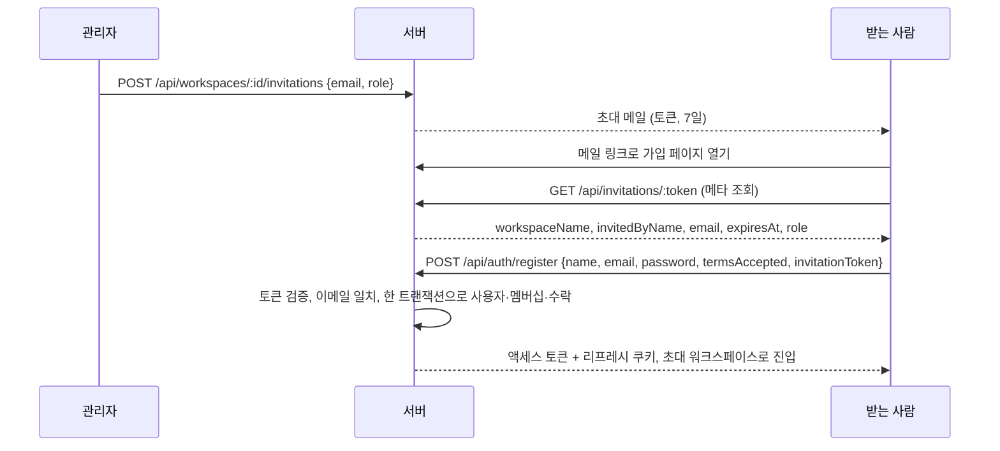

## 개요

이 문서는 [워크스페이스와 멤버](CLE-ACCT-WS.md) 의 하위 문서로 팀 워크스페이스 초대의 토큰 정책, 미가입자 가입 경로, 이미 가입한 사용자의 수락 경로, 초대 가입 화면, 초대 에러 코드를 정한다.

## 초대

초대는 관리자 이상이 이메일로 보내는 팀 워크스페이스 합류 요청이다. 관리자 역할로 초대하는 것은 소유자만 한다([관리자 역할 규칙](CLE-ACCT-WS-MEMBER.md#관리자-역할-규칙)). 받는 사람이 가입했는지와 상관없이 같은 초대 API 를 쓴다. 미가입자는 초대 링크로 가입하면서 합류하고, 이미 가입한 사용자는 수락 페이지에서 합류한다. 이미 가입한 사용자를 메일 없이 바로 넣는 것은 [직접 추가](CLE-ACCT-WS-MEMBER.md#직접-추가) 다.

### 토큰 정책

| 항목 | 값 | 비고 |
| --- | --- | --- |
| 토큰 생성 | `crypto.randomBytes(48)` 를 base64url 로 인코딩한 64자 | 추측할 수 없다 |
| 저장 | DB 에 토큰 원래 값을 저장한다(`WorkspaceInvitation.token`, UNIQUE) | URL 로 조회할 때 바로 찾는다 |
| 만료 | 발급 시점 + 7일 | 만료되면 410 |
| 사용 횟수 | 1회. 수락 트랜잭션이 `acceptedAt` 을 채우면서 사용 처리한다 | 동시 수락 경쟁은 `UPDATE … WHERE accepted_at IS NULL RETURNING …` 으로 직렬화한다. 진 쪽은 410 이다 |
| 재발송 | 같은 행의 토큰을 새 값으로 바꾸고 만료를 다시 7일로 잡는다 | 한 초대 행은 항상 유효 토큰이 0~1개다. 옛 토큰은 더 이상 조회되지 않아 `invitation_not_found`(404)가 된다. 관리자 역할 초대도 관리자 이상이 재발송하고 초대에 적힌 역할은 바뀌지 않는다 |
| 같은 이메일 중복 초대 | 새 초대가 들어오면 기존 대기 중 행의 토큰·역할·초대자·만료를 바꾼다. 대기 행의 역할이 관리자면 소유자만 바꿀 수 있다 | 여러 토큰이 동시에 살아 있지 않게 한다. 대기 중 초대 목록에도 한 이메일에 한 줄만 있다. 소유자가 아닌 요청자는 403 `OWNER_REQUIRED` 이고 대기 행은 그대로다 |
| 이메일 일치 강제 | 수락·가입 때 `토큰.email == 로그인·가입 사용자 이메일` 을 강제한다. 다르면 400 | 토큰이 새도 다른 사용자가 워크스페이스에 들어오지 못한다 |
| 초대 역할 | `admin`·`editor`·`viewer`. 소유자는 초대 역할로 줄 수 없다. `admin` 은 소유자만 지정한다 | 소유자가 아닌 요청자가 `admin` 을 지정하면 403 `OWNER_REQUIRED`. [관리자 역할 규칙](CLE-ACCT-WS-MEMBER.md#관리자-역할-규칙) |
| 발송 채널 | 시스템 SMTP(`codebase/backend/src/modules/mail/`)만 쓴다. 워크스페이스 SMTP 통합은 쓰지 않는다 | 이유는 [Rationale](#초대-메일은-시스템-smtp-만-쓴다) |
| 발송 실패 | 초대 행을 되돌리지 않고 에러 로그만 남긴다 | 관리자가 재발송할 수 있다 |
| 요청 한도 | 초대 발급·재발송 분당 10건(`INVITATION_THROTTLE`, `workspaces.controller.ts`). 공개 토큰 메타 조회 분당 30건 | 이메일 폭탄과 토큰 열거를 막는다 |
| 만료 초대 정리 | 매일 04:00(Asia/Seoul) BullMQ 반복 작업(`WorkspaceInvitationsPrunerService`)이 만료되고 수락되지 않은 행을 지운다 | 운영 위생 목적 |

초대 발급은 대상 이메일이 이미 멤버인지 확인하지만 가입자인지는 확인하지 않는다. 기존 가입자(비멤버)를 초대하면 초대 링크 메일과 함께 인앱 알림 `team_invite` 가 간다. 알림 쪽은 [알림](../CLE-OBS/CLE-OBS-NOTIFY.md) 이 정한다.

기존 가입자는 [가입과 로그인 「이메일 비교 규칙」](CLE-ACCT-SIGNIN.md#이메일-비교-규칙)대로 찾는다(`UsersService.lookupByEmail`). 관리자가 입력한 이메일의 앞뒤 공백을 지우고 대소문자를 구분하지 않고 비교한다. 대소문자만 다른 계정이 둘 이상 맞으면 입력과 대소문자까지 같은 계정을 쓴다. 그런 계정이 없으면 어느 계정인지 정할 수 없다. 이때는 가입하지 않은 이메일처럼 다룬다. 멤버 여부를 확인하지 않고 인앱 알림 없이 초대 메일만 보낸다. 수락은 로그인 이메일을 소문자로 바꿔 토큰 이메일과 비교하므로 그 계정들 가운데 어느 계정으로든 수락할 수 있다. 이미 멤버인 계정으로 수락하면 멤버십과 역할은 그대로이고 초대만 소비된다([이미 가입한 사용자의 수락 경로](#이미-가입한-사용자의-수락-경로) 3단계). 토큰 이메일은 이 조회와 따로 앞뒤 공백을 지우고 소문자로 바꿔 저장한다. 근거는 Rationale 「[직접 추가와 초대는 어느 계정인지 정할 수 없으면 가입하지 않은 이메일처럼 다룬다](CLE-ACCT-WS-MEMBER.md#직접-추가와-초대는-어느-계정인지-정할-수-없으면-가입하지-않은-이메일처럼-다룬다-2026-11-06)」 에 있다.

### 미가입자 가입 경로

1. 관리자 이상이 `POST /api/workspaces/:id/invitations { email, role }` 을 보낸다. `role=admin` 은 소유자만 보낼 수 있다. 서버는 토큰을 만들고 `expiresAt = now + 7일` 로 메일을 보낸다.
2. 받는 사람이 메일 링크를 누르면 프론트엔드 가입 페이지가 초대 토큰 쿼리와 함께 열린다. 메일 링크는 `/register?invitationToken=<초대 토큰>` 이다(`mail.service.ts` 의 `sendWorkspaceInvitationEmail`). 이미 발송된 옛 링크 `/auth/register?invitationToken=…` 은 로그인 여부와 상관없이 프론트엔드 proxy 가 쿼리를 그대로 둔 채 `/register` 로 리다이렉트한다([세션과 토큰](CLE-ACCT-SESSION.md#공개-경로와-가드)). 가입 페이지의 메타 조회와 입력란 고정은 아래 [초대 가입 화면](#초대-가입-화면) 에 있다.
3. 가입을 제출받으면 서버가 (a) 토큰이 있고 만료되지 않았고 쓰이지 않았는지, (b) 토큰 이메일과 가입 이메일이 같은지 본다. 가입 이메일은 앞뒤 공백을 지우고 대소문자를 구분하지 않고 비교한다. (c) 맞으면 사용자 생성, 멤버십 추가, `invitation.acceptedAt` 갱신을 한 트랜잭션에서 한다. 실패하면 모두 되돌린다. (d) 불일치나 만료면 가입 자체를 거부하고 사용자 행을 만들지 않는다.
4. 가입에 성공하면 인증 메일 없이 자동 로그인하고 초대받은 워크스페이스로 들어간다. 개인 워크스페이스 자동 생성은 일어나지 않는다.

### 이미 가입한 사용자의 수락 경로

1. 메일 링크를 누르면 프론트엔드가 토큰 메타를 조회한다.
2. 로그인해 있고 본인 이메일이 토큰 이메일과 같으면 수락 페이지에 [수락] 버튼을 보여 준다.
3. `POST /api/workspaces/invitations/accept { token }`. 서버는 토큰이 유효하고 본인 이메일이 토큰 이메일과 같은지 확인한 뒤 멤버십 추가와 `acceptedAt` 갱신을 한 트랜잭션에서 한다. 이미 멤버면 멤버십 추가는 건너뛴다.
4. 응답(200, `data` 는 `{ workspaceId, role }`)을 받으면 프론트엔드가 그 워크스페이스로 전환한다.

수락 페이지는 로그인 이메일과 토큰 이메일을 대소문자를 구분하지 않고 비교한다. 두 값을 소문자로 바꿔 비교하고 앞뒤 공백은 지우지 않는다. 서버 수락과 같은 규칙이다. 서버는 로그인 이메일을 소문자로 바꿔 비교하고 토큰 이메일은 소문자로 저장돼 있다.

두 이메일이 다르면 수락 페이지에 "이 초대는 {토큰.email} 에게 발송되었습니다. 해당 계정으로 로그인하세요" 안내와 «다른 계정으로 로그인» 버튼만 보여 준다. 이 버튼을 누르면 로그아웃한 뒤 `/login?redirect=<인코딩한 /invitations/accept?token=…>` 로 간다. 다른 계정으로 로그인하면 이 수락 페이지로 돌아온다. 복귀 경로를 지정한 로그아웃 규칙은 [세션과 토큰 「로그아웃」](CLE-ACCT-SESSION.md#로그아웃) 이 정한다.

수락 페이지 경로는 `/invitations/accept?token=<초대 토큰>` 이다(쿼리 파라미터 `token`). 화면은 슬러그 경로 `app/(main)/w/[slug]/invitations/accept/**` 에 있다. 슬러그 없는 `/invitations/accept` 로 들어오면 옛 경로 흡수 라우트가 쿼리를 그대로 둔 채 현재 워크스페이스의 슬러그 경로로 넘긴다([레이아웃과 내비게이션](../CLE-UI/CLE-UI-LAYOUT.md)).

수락 페이지에 닿는 경로는 로그인 상태에 따라 다르다. 분기는 [초대 가입 화면](#초대-가입-화면) 에 있다.

- 이미 로그인한 사용자가 초대 가입 링크로 들어오면 가입 페이지가 로그인 힌트 쿠키를 보고 이 수락 페이지로 보낸다.
- 로그인하지 않은 기존 가입자는 가입 페이지에서 로그인 화면으로 간다. 로그인하면 이 수락 페이지로 돌아온다. 수락은 자동으로 되지 않는다. 사용자가 [수락] 을 누른다.
- 로그인하지 않은 미가입자는 위 가입 경로를 따른다.

이메일 인증을 마치지 않은 기존 계정은 로그인이 막힌다. 비밀번호가 맞으면 401 `EMAIL_VERIFICATION_REQUIRED` 를 받는다([가입과 로그인 「로그인 처리」](CLE-ACCT-SIGNIN.md#로그인-처리)). 인증 메일 링크의 자동 로그인은 `redirect` 를 넘기지 않고 `/dashboard` 로 간다. 그래서 이 사용자는 인증을 마친 뒤 초대 메일 링크를 다시 연다.

### 초대 가입 화면

초대 메일 링크를 누르면 가입 페이지는 `?invitationToken=…` 쿼리를 받아 아래처럼 처리한다. 가입 화면 자체의 필드와 검증은 [가입과 로그인](CLE-ACCT-SIGNIN.md) 이 정한다.

먼저 이미 로그인한 사용자를 가려낸다. 초대 메일 링크는 미가입자를 기준으로 한다. 그래도 다른 계정으로 이미 로그인한 사용자가 같은 브라우저의 새 탭에서 누를 수 있다. 이때는 가입 폼 대신 초대 수락 페이지 `/invitations/accept?token=…` 로 바로 보낸다. 토큰 메타와 가입 여부는 묻지 않는다. 그래서 이 판정이 아래 표의 메타 조회와 입력란 고정보다 먼저 적용된다. `(auth)` 라우트 그룹에는 세션 하이드레이션(AuthProvider)이 없어 클라이언트 스토어로 로그인을 알 수 없다. 그래서 로그인 힌트 쿠키 `has_session` 으로 판정한다([세션과 토큰](CLE-ACCT-SESSION.md)). 힌트가 낡았으면(쿠키만 남고 리프레시 토큰은 만료) 수락 페이지의 라우트 가드가 로그인 화면으로 돌려보낸다.

로그인 힌트가 없으면 아래 표대로 처리한다. 로그인하지 않은 기존 가입자는 2~3단계와 11단계에서 로그인 화면으로 보낸다. 나머지는 5단계부터 미가입자 가입으로 이어진다.

| 단계 | 처리 |
| --- | --- |
| 1. 토큰 메타 미리 조회 | `GET /api/invitations/:token` 로 워크스페이스 이름·초대자·이메일·만료를 받는다. 404·410 같은 실패면 에러 화면으로 보낸다 |
| 2. 가입 여부 확인 | 메타 조회가 성공한 뒤에만 공개 API `POST /api/auth/check-email` 에 토큰 이메일을 보내 가입 여부를 묻는다. 응답이 `available=false` 면 이미 가입된 이메일이다 |
| 3. 기존 가입자 분기 | 이미 가입된 이메일이면 «이미 가입된 이메일이에요. 로그인하면 초대를 수락할 수 있어요.» 안내를 띄운다. 그리고 현재 페이지를 `/login?redirect=<인코딩한 /invitations/accept?token=…>` 로 바꾼다. 로그인하면 수락 페이지로 돌아온다. 수락은 자동으로 되지 않고 사용자가 [수락] 을 누른다 |
| 4. 확인 실패 | 요청 한도 초과(429)나 네트워크 에러로 가입 여부를 확인하지 못하면 가입되지 않은 것으로 보고 가입 폼을 보여 준다. 5초(`REGISTERED_EMAIL_CHECK_TIMEOUT_MS`) 안에 응답이 없어도 같다. 공용 `apiClient` 에는 기본 시간 제한이 없어서 이 호출에만 시간 제한을 건다. 시간 제한이 없으면 응답이 오지 않을 때 화면이 로딩 상태에 머문다. 요청 한도는 [HTTP API 규약](../CLE-API/CLE-API-CONV.md#7-요청-빈도-제한) 이 정한다 |
| 5. 이메일 채우기와 고정 | 응답의 `email` 을 입력란에 채우고 읽기 전용으로 고정한다. 다른 이메일로는 가입할 수 없다. 입력란이 고정돼 있어 입력란의 이메일 중복 확인(`onBlur`)은 하지 않는다. 가입 여부는 2단계가 확인한다 |
| 6. 헤더 안내 | "**{workspace}** 에 초대받으셨어요" 와 초대자 이름을 보여 준다 |
| 7. 가입 제출 | `POST /api/auth/register { name, email, password, termsAccepted, invitationToken }`. 고정한 입력란의 이메일을 함께 보낸다. 서버는 이 이메일을 토큰 이메일과 비교하고 다르면 400 `invitation_email_mismatch` 로 거부한다 |
| 8. 트랜잭션 처리 | 서버가 사용자 생성, 멤버십 추가, `invitation.acceptedAt` 갱신을 한 트랜잭션에서 한다. 실패하면 모두 되돌린다 |
| 9. 가입 성공 뒤 | 이메일 인증 안내 화면 대신 초대받은 워크스페이스로 들어간다. 개인 워크스페이스 자동 생성은 일어나지 않는다 |
| 10. 초대 에러 분기 | `invitation_email_mismatch`(입력란을 고정해 화면에서는 거의 나지 않는다. 요청을 직접 만든 경우를 막는 서버 검사다), `invitation_expired`, `invitation_already_used` 면 "이 초대는 더 이상 유효하지 않아요. 워크스페이스 관리자에게 재발송을 요청하세요" 안내를 보여 준다 |
| 11. 이메일 중복 분기 | 가입 제출이 토큰 이메일 중복으로 거부되면 3단계와 같은 안내를 띄우고 같은 로그인 경로로 보낸다. 4단계에서 가입 여부를 확인하지 못한 기존 가입자가 여기에 든다. 지금은 409 `RESOURCE_CONFLICT` 로 중복을 가려낸다. 지금 가입 요청에서 `RESOURCE_CONFLICT` 는 이메일 중복 하나뿐이다. 그래서 화면은 메시지가 아니라 `error.code` 로 가른다. 다만 `RESOURCE_CONFLICT` 는 409 의 기본 코드다([에러 코드 규약과 카탈로그](../CLE-API/CLE-API-ERRCODES.md)). 그래서 이 판별은 전용 코드가 생기기 전까지 쓰는 임시 분기다. NERV Task `CLE-T-2M6Q02` 가 가입 이메일 중복 전용 에러 코드를 만들고 이 분기를 그 코드로 바꾼다 |

- 초대 흐름의 가입 폼 아래 «로그인» 링크도 같은 로그인 경로로 보낸다. 주소 형식과 인코딩은 [세션과 토큰 「로그인 뒤 이동」](CLE-ACCT-SESSION.md#로그인-뒤-이동) 이 정한다.
- 로그인 화면의 초대 안내 문구와 «계정 만들기» 링크는 [가입과 로그인 「로그인 화면」](CLE-ACCT-SIGNIN.md#로그인-화면) 이 정한다. 로그인 뒤 이동은 [세션과 토큰 「로그인 뒤 이동」](CLE-ACCT-SESSION.md#로그인-뒤-이동) 이 정한다.

### 초대 에러 코드

| 상황 | HTTP | 코드 |
| --- | --- | --- |
| 토큰 없음·잘못된 형식 | 404 | `invitation_not_found` |
| 만료 | 410 | `invitation_expired` |
| 이미 사용됨 (동시 수락에서 진 쪽 포함) | 410 | `invitation_already_used` |
| 이메일 불일치 (수락 또는 가입) | 400 | `invitation_email_mismatch` |
| 개인 워크스페이스에서 초대 | 403 | `workspace_type_mismatch` |
| 이미 멤버인 이메일 초대 | 409 | `already_a_member` |
| 대기 초대 부분 UNIQUE 경합 | 409 | `invitation_already_pending` |
| 수락된 초대의 재발송·취소 | 409 | `invitation_already_accepted` |
| 권한 부족 (발송·재발송·취소) | 403 | `ADMIN_REQUIRED`. 비멤버는 `NOT_A_MEMBER` |
| 소유자가 아닌 요청자의 관리자 역할 초대, 관리자 역할 대기 초대 덮어쓰기 | 403 | `OWNER_REQUIRED` |
| 요청 한도 초과 | 429 | 원문은 `rate_limited`. 정의가 갈린다. [미결 사항](CLE-ACCT-WS.md#미결-사항) 참조 |

초대 흐름 코드는 표기 규칙(`UPPER_SNAKE_CASE`)과 달리 `lower_snake_case` 다. v1 에서 굳었고 프론트엔드(`invitations.ts` 의 `INVITATION_ERROR_CODES`)가 `code` 값으로 분기해 이름을 바꾸면 API 호환이 깨진다. "이름을 더 정확하게 하려고 바꾸지는 않는다" 는 규칙에 따라 예외 등록 코드로 유지한다. 새 코드는 이 예외를 선례로 삼지 않고 처음부터 `UPPER_SNAKE_CASE` 를 쓴다. 권한 부족 `ADMIN_REQUIRED`(`RolesGuard`)와 서비스 계층의 `OWNER_REQUIRED` 는 대문자라 이 예외에 들지 않는다. 예외 목록과 근거는 [에러 코드 규약과 카탈로그](../CLE-API/CLE-API-ERRCODES.md) 가 관리한다.

## 구현 위치

- `codebase/backend/src/modules/workspaces/workspace-invitations.service.ts`, `codebase/backend/src/modules/workspaces/invitations.controller.ts` (초대 발급·수락·재발송·취소, 공개 메타 조회)
- `codebase/backend/src/modules/mail/**` (초대 메일)
- `codebase/frontend/src/app/(main)/w/[slug]/invitations/accept/**` (수락 페이지. 대소문자를 구분하지 않는 이메일 비교, «다른 계정으로 로그인»)
- `codebase/frontend/src/app/(main)/[...rest]/page.tsx` (슬러그 없는 `/invitations/accept` 를 쿼리를 둔 채 슬러그 경로로 넘긴다)
- `codebase/frontend/src/components/auth/register-form.tsx` (초대 토큰 가입 제출, 이메일 중복으로 끝난 제출의 기존 가입자 분기, 초대 흐름의 로그인 링크)
- `codebase/frontend/src/components/auth/use-invitation-gate.ts` (초대 가입 화면의 진입 판정 `useInvitationGate`: 이미 로그인한 사용자, 기존 가입자를 로그인 화면으로 보내는 분기, 가입 폼 열기)
- `codebase/frontend/src/components/auth/__tests__/use-invitation-gate.test.ts` (진입 판정 순서와 한 번만 이동하는지)
- `codebase/frontend/src/components/auth/login-form.tsx` (복귀 경로가 초대 수락 페이지일 때의 안내 문구)
- `codebase/frontend/src/lib/auth/post-login-redirect.ts` (수락 페이지 경로 `invitationAcceptPath`, 로그인 경로 `buildLoginHref`, 초대 흐름의 로그인 경로 `buildInvitationLoginHref`)
- `codebase/frontend/src/lib/auth/registered-email.ts` (초대 가입 화면의 가입 여부 확인 `isRegisteredEmail` 과 5초 제한 `REGISTERED_EMAIL_CHECK_TIMEOUT_MS`)
- `codebase/frontend/src/lib/auth/__tests__/registered-email.test.ts` (가입 여부 판정과 확인 실패 처리)
- `codebase/frontend/src/lib/auth/session-hint.ts` (가입 화면이 이미 로그인한 사용자를 알아보는 `hasSessionHint`. 쿠키 규약과 테스트는 [세션과 토큰 「로그인 힌트 쿠키」](CLE-ACCT-SESSION.md#로그인-힌트-쿠키) 에 있다)
- `codebase/frontend/src/proxy.ts` (옛 초대 링크 `/auth/register` 리다이렉트)
- `codebase/frontend/src/lib/api/invitations.ts`

## Rationale

### 초대 수락·가입 때 이메일 일치를 강제한다

토큰 이메일과 가입·로그인 사용자 이메일이 다르면 가입과 수락을 모두 막는다.

- 토큰은 길고 무작위지만 URL·메일을 거쳐 샐 수 있다. 일치 검증이 없으면 샌 토큰만으로 워크스페이스에 들어갈 수 있어 권한 상승 위험이 크다. 초대받지 않은 사용자가 토큰을 가로채도 이메일이 다르면 거부된다.
- 가입 페이지에서 이메일을 채우고 읽기 전용으로 고정하면 정상 사용자에게는 마찰이 거의 없다. 이메일을 고를 필요가 없어진다.
- 비교는 대소문자를 구분하지 않는다. 세부 규칙은 [미가입자 가입 경로](#미가입자-가입-경로) 3단계와 [이미 가입한 사용자의 수락 경로](#이미-가입한-사용자의-수락-경로) 에 있다. 토큰 이메일은 초대할 때 앞뒤 공백을 지우고 소문자로 바꿔 저장한다.
- 다른 이메일로 가입하고 싶으면 초대 토큰 없는 일반 가입을 따로 거치면 되므로 안내가 단순하다.
- 수락 페이지의 이메일 비교는 2026-10-18 에 대소문자를 무시하게 바꿨다. 화면이 두 값을 그대로 비교하면 대문자를 섞어 가입한 초대 대상자가 서버가 받아 줄 초대인데도 화면에서 불일치 안내를 본다.
- 불일치 안내의 버튼은 요구사항에도 화면 문구대로 «다른 계정으로 로그인» 으로 적는다. 요구사항은 «로그아웃 버튼» 이라 적었지만 화면 문구는 2026-07 부터 «다른 계정으로 로그인» 이었다. 이 버튼은 로그아웃한 뒤 로그인 화면을 거쳐 같은 수락 페이지로 돌아온다. 그래서 화면 문구가 동작을 더 잘 나타낸다. 이동 규칙의 이유는 아래 「[로그인하지 않은 기존 가입자는 로그인 뒤 수락 페이지로 보낸다 (2026-10-18)](#로그인하지-않은-기존-가입자는-로그인-뒤-수락-페이지로-보낸다-2026-10-18)」 에 있다.

### 초대 메일은 시스템 SMTP 만 쓴다

메일 모듈은 현재 시스템 전역 SMTP 만 지원한다. 워크스페이스 SMTP 통합을 초대 메일에 쓸지 검토했지만 시스템 SMTP 만 쓰기로 했다.

- 초대는 워크스페이스에 들어오기 전 단계의 시스템 진입 동작에 가깝다. 워크스페이스의 업무용 SMTP 가 끊겨도 초대는 계속 돼야 한다.
- 워크스페이스 SMTP 통합은 워크스페이스 안 워크플로우의 알림·메일 발송용으로 설계됐다. 초대 같은 시스템 메시지를 그쪽으로 보내면 책임 경계가 흐려진다.
- 운영과 디버깅이 한 채널로 단순해진다. 초대 메일 누락을 추적할 때 시스템 SMTP 로그만 보면 된다.

### 초대 토큰 만료는 7일이다

7일은 업계 표준이고 "주말을 끼고 가입" 같은 행동도 충분히 흡수한다. 24~48시간처럼 짧으면 재발송이 잦아 운영 부담이 늘고, 14일 이상으로 길면 토큰이 샜을 때 노출 기간이 길어진다. 재발송하면 만료가 새 토큰 발급 시점부터 다시 7일이므로 특수한 경우는 재발송으로 해결한다.

### 초대 토큰은 해시가 아니라 원래 값으로 저장한다

이메일 인증·비밀번호 재설정 토큰은 계정 자체를 탈취할 수 있는 자격 증명이라 DB 가 유출되면 피해가 직접적이다. 그래서 SHA-256 해시로만 저장한다. 초대 토큰은 사정이 다르다.

- 토큰만으로는 권한을 얻을 수 없다. 수락할 때 서버가 로그인 사용자 이메일과 토큰 이메일의 일치를 강제하므로 샌 토큰은 그 이메일 계정의 인증 없이는 쓸모가 없다.
- 한 번 쓰면 사라지고 7일이면 만료돼 노출 창이 좁다.
- 초대 관리 화면이 대기 중 초대의 재발송·취소를 위해 토큰을 조회한다.

해시로 바꾸는 보안 이득이 위협 모델에 비해 작아 원래 값 저장을 유지한다. DB 유출을 전제한 방어는 이메일 일치 강제(1차)와 만료(2차)가 맡는다.

### 초대 메일 링크는 `/register` 로 보내고 옛 경로는 리다이렉트한다

2026-10-10 결정이다. 초대 메일 링크가 없는 라우트 `/auth/register?invitationToken=…` 으로 나가서 로그인하지 않은 받는 사람을 proxy 가 `/login` 으로 보냈다. 가입 화면은 `(auth)` 라우트 그룹이라 실제 경로가 `/register` 다. 두 선택지(링크를 `/register` 로 고친다, 옛 경로를 호환 리다이렉트한다)를 모두 채택했다.

메일 링크를 실제 경로 `/register` 로 고치고 옛 경로 리다이렉트도 둔다. 두 조치는 서로 배타적이지 않다. 새 메일은 바로 가입 화면으로 간다. 이미 발송된 메일도 초대가 만료되기 전까지 쓸 수 있다. 다른 인증 메일(`/verify-email`, `/reset-password`)도 접두사가 없어 초대 메일 링크가 같은 형식이 된다.

받는 사람은 대개 로그인하지 않은 상태다. 그래서 리다이렉트를 `has_session` 검사 뒤에 두면 `/login` 으로 먼저 간다. 로그인한 사용자는 `/register` 로 간 뒤 가입 화면의 기존 `has_session` 판정에 따라 수락 페이지에 닿는다([초대 가입 화면](#초대-가입-화면)).

기각한 대안은 하나다.

- 메일 링크만 고친다: 이미 발송된 메일의 링크가 계속 `/login` 으로 간다.

채택하지 않은 선택지도 하나 있다.

- `/auth/register` 라우트를 새로 만든다: 가입 화면은 `(auth)` 라우트 그룹의 `/register` 하나인데 같은 화면에 진입점이 하나 더 생긴다. 로그인하지 않은 받는 사람이 그 경로에 닿으려면 `proxy.ts` 의 공개 경로 목록 `publicPaths` 에도 경로를 더해야 한다. 리다이렉트는 화면 라우트를 늘리지 않는 URL 별칭이다.

### 초대 가입 요청 본문을 구현에 맞췄다 (2026-10-17)

초대 가입 요청을 `{ name, password, invitationToken }` 으로 적고 서버가 이메일을 토큰에서 가져온다고 했던 서술을 구현에 맞췄다. 구현은 일반 가입과 같은 본문을 받는다(`register-form.tsx`, `AuthService.registerWithInvitation`). 서버는 입력 이메일을 토큰 이메일과 비교하고 다르면 400 `invitation_email_mismatch` 로 거부한다. 동작은 바뀌지 않았다.

### 로그인하지 않은 기존 가입자는 로그인 뒤 수락 페이지로 보낸다 (2026-10-18)

2026-10-10 에 사용자가 아래 선택지 (a) 를 승인했고 2026-10-18 에 구현했다.

초대 메일 링크는 받는 사람이 가입했는지와 상관없이 `/register?invitationToken=…` 이다. 전에는 로그인하지 않은 기존 가입자가 이 링크를 열면 읽기 전용으로 잠긴 초대 이메일의 가입 폼이 보였다. 제출하면 서버가 이메일 중복을 초대 처리보다 먼저 확인해 409 `RESOURCE_CONFLICT`(`Email already registered`)로 거부했다(`auth.service.ts` 의 `register`). 가입 폼 아래 로그인 링크는 초대 토큰과 `redirect` 없이 `/login` 으로만 가서 로그인한 뒤에도 수락 페이지로 돌아오지 못했다.

지금은 가입 화면이 토큰 이메일의 가입 여부를 확인해 로그인 화면으로 보낸다. 로그인 뒤에는 수락 페이지로 돌아온다([초대 가입 화면](#초대-가입-화면)). 수락은 자동으로 되지 않고 사용자가 수락 페이지에서 [수락] 을 누른다.

선택지는 세 가지였다.

- (a) 가입 화면이 로그인 화면으로 보낸다: 토큰 이메일이 이미 가입된 이메일이면 가입 화면이 로그인 화면으로 보낸다. 로그인 뒤에는 `/invitations/accept?token=…` 로 돌아온다. 이 선택지를 채택했다.
- (b) 기존 가입자에게는 처음부터 수락 페이지 링크를 보낸다: 메일 링크가 두 형식으로 갈린다. 어느 링크를 보낼지는 발송 시점의 가입 여부로 정해진다. 메일을 보낸 뒤 가입하면 받은 링크가 맞지 않게 된다. 기각했다.
- (c) 현행을 유지한다: 기존 가입자의 가입 시도가 늘 409 로 끝난다. 기각했다.

채택하지 않은 선택지도 있다.

- 토큰 메타 응답에 가입 여부를 싣는다: 초대 API 응답을 바꿔야 한다. 이번 변경은 프론트엔드만 바꾸는 범위라 넣지 않았다.
- 가입 제출이 409 로 끝날 때만 로그인 화면으로 보낸다: 기존 가입자가 이름과 비밀번호를 입력해 제출한 뒤에야 로그인 화면으로 간다. 이 분기는 가입 여부를 확인하지 못했을 때의 안전망으로만 둔다([초대 가입 화면](#초대-가입-화면) 11단계).
- 로그인 뒤 초대를 자동으로 수락한다: 이미 로그인한 사용자는 수락 페이지에서 워크스페이스 이름을 보고 [수락] 을 누른다. 자동 수락을 넣으면 두 경로의 동작이 갈린다.

수락 페이지의 «다른 계정으로 로그인» 도 이때 바꿨다. 전에는 로그아웃한 뒤 `/login` 으로 가서 다른 계정으로 로그인해도 `/dashboard` 에 닿았다. 사용자는 초대 메일 링크를 다시 열어야 했다. 지금은 `/login?redirect=<인코딩한 /invitations/accept?token=…>` 로 가서 로그인 뒤 같은 수락 페이지로 돌아온다. 새로 로그인한 계정의 이메일도 초대 이메일과 다르면 같은 불일치 안내가 다시 보인다. `/login` 으로만 보내는 전의 동작은 가입 폼 아래 로그인 링크와 같은 이유로 버렸다. 돌아온 뒤 자동으로 수락하는 안은 위 자동 수락과 같은 이유로 넣지 않았다.

한계가 하나 남는다.

- 가입 여부 확인이 실패하면(429 · 네트워크 에러 · 5초 초과) 기존 가입자도 가입 폼을 본다. 이 사용자는 이름과 비밀번호를 입력해 제출하고 409 를 받은 뒤에야 로그인 화면으로 간다. `check-email` 은 IP 단위 요청 한도 안에서 불린다([HTTP API 규약](../CLE-API/CLE-API-CONV.md#7-요청-빈도-제한)). 그래서 같은 IP 를 쓰는 사무실에서 여러 사람이 초대 링크를 열거나 새로고침을 되풀이하면 429 가 날 수 있다.

대문자가 섞인 이메일로 가입한 기존 계정이 가입되지 않은 것으로 판정되던 한계는 2026-11-05 에 `check-email`, 가입의 이메일 중복 확인, 로그인이 이메일을 대소문자 구분 없이 비교하게 되면서 풀렸다([가입과 로그인 「이메일 비교 규칙」](CLE-ACCT-SIGNIN.md#이메일-비교-규칙)). 그 전에는 이 사용자가 가입 폼을 제출하면 409 없이 소문자 이메일 계정이 새로 생겨 워크스페이스에 들어갔다. 2026-11-06 에는 멤버 직접 추가와 초대도 같은 규칙으로 기존 사용자를 찾게 했다([직접 추가](CLE-ACCT-WS-MEMBER.md#직접-추가), [초대](#초대)). 그 전에는 두 경로가 이메일을 대소문자까지 그대로 비교했다. 직접 추가는 입력의 대소문자가 저장된 이메일과 다르면 가입한 사용자여도 404 `USER_NOT_FOUND` 였다. 초대는 정규화 전에 대문자를 섞어 가입한 계정을 찾지 못했다. 그 계정이 이미 멤버여도 409 `already_a_member` 로 막히지 않았다. 멤버가 아니면 인앱 알림 `team_invite` 가 가지 않았다. 수락은 그때도 로그인 이메일을 소문자로 바꿔 비교해서 그 계정도 초대를 수락할 수 있었다.

### 가입 여부 확인은 이메일 존재를 새로 노출하지 않는다 (2026-10-18)

초대 가입 화면에서는 로그인하지 않은 사용자도 토큰 이메일의 가입 여부를 알 수 있다. 그래도 이 흐름 때문에 이메일 존재가 새로 노출되지는 않는다. 이유는 다음과 같다.

- `POST /api/auth/check-email` 은 원래 공개 API 다. 일반 가입 화면의 이메일 중복 확인이 이미 쓰고 있다. 이 흐름도 같은 API 를 같은 IP 요청 한도 안에서 부른다. 한도를 우회하는 경로가 없다.
- 가입 화면은 토큰 메타 조회가 성공한 뒤에만 이 API 를 부른다. 그래서 이 흐름으로 가입 여부를 알 수 있는 사람은 토큰을 가진 사람뿐이다.
- 토큰 메타 응답은 이미 토큰 이메일을 보여 준다.
- 로그인 URL 의 `redirect` 에 담긴 토큰은 이미 메일 링크와 수락 페이지 URL 에 있다. 수락은 이메일 일치를 강제하므로 토큰만으로는 합류할 수 없다.

이 확인으로 드러나는 것은 가입 여부뿐이다. 응답에는 `available` 하나만 있어 인증 상태나 잠금 여부는 드러나지 않는다. 그래서 이메일 인증 전 상태를 비밀번호가 맞을 때만 알리는 로그인 규칙과 어긋나지 않는다([가입과 로그인](CLE-ACCT-SIGNIN.md) Rationale 「이메일 인증 전 계정은 비밀번호가 맞을 때만 알린다」). 계정이 있는지는 `check-email` 이 이미 공개한 정보다. 인용한 로그인 규칙이 지키는 것은 계정의 인증 상태다.

`check-email` 은 2026-11-05 부터 이메일을 대소문자 구분 없이 비교한다([가입과 로그인 「이메일 비교 규칙」](CLE-ACCT-SIGNIN.md#이메일-비교-규칙)).

### 초대 가입 뒤 도착 화면에 세션과 토큰 문서의 미결 사항을 이었다 (2026-10-22)

초대 토큰 가입의 자동 로그인이 로그인 힌트 쿠키를 심지 않아 가입 뒤 보호 경로에서 로그인 화면이 다시 나왔다. 이 사실이 [세션과 토큰 「미결 사항」](CLE-ACCT-SESSION.md#미결-사항) 에만 있어서 「초대 가입 화면」 9단계와 「미가입자 가입 경로」 4단계에 지금 동작과 미결 사항 링크를 더했다. 동작 규칙은 바뀌지 않았다. 그 뒤 로그인 세션을 만드는 진입점을 `establishSession` 으로 모으면서 두 문장을 지웠다. 이 문서의 요구사항은 모두 구현됐고 로그인 힌트 쿠키 요구는 세션과 토큰 문서가 정한다.

### 초대 가입 화면의 진입 판정을 한 훅에 모았다 (2026-10-22)

가입 폼 컴포넌트에 진입 판정이 effect 세 개와 제출 실패 분기로 흩어져 있었다. 기존 가입자 상태를 만드는 곳이 두 곳이었고 로그인 화면으로 보내는 일은 그 상태를 지켜보는 세 번째 effect 가 했다. 그래서 router 참조가 바뀌어 effect 가 다시 돌 때를 막는 가드가 따로 있어야 했다. 로그인 힌트도 두 번 읽었다.

판정을 `use-invitation-gate.ts` 의 훅 하나에 모았다. 이 훅은 토큰마다 한 번 판정하고 로그인 힌트도 한 번만 읽는다. 판정과 제출 실패는 기존 가입자를 같은 함수로 로그인 화면에 보낸다. 가입 여부 확인은 토큰 메타 조회가 성공한 뒤에만 한다는 규칙은 그대로다. 이미 로그인한 사용자는 이제 토큰 메타도 조회하지 않고 수락 페이지로 간다. 그 메타는 쓰이지 않았고 수락 페이지가 다시 조회한다. 나머지 동작은 바뀌지 않았다.

effect 를 그대로 두고 이동 가드만 보강하는 안은 택하지 않았다. 기존 가입자 상태를 만드는 곳이 두 곳으로 남는다. 그러면 안내 문구와 로그인 경로를 두 곳에서 따로 맞춰야 한다.

### 초대 가입 화면의 «로그인» 링크를 요구사항으로 올렸다 (2026-11-13)

2026-11-13 에 사람이 정했다. 초대 가입 화면의 «로그인» 링크는 3단계 · 11단계와 같은 로그인 경로로 보낸다. 그런데 요구사항은 그 두 분기에만 있었다. 같은 주소 형식을 쓰는 세 곳을 같은 꼴로 두려고 «로그인» 링크의 요구사항을 더했다. 동작은 바뀌지 않았다.

로그인 화면의 초대 안내 문구와 «계정 만들기» 링크는 요구사항으로 올리지 않았다. 화면 요소는 [가입과 로그인 「로그인 화면」](CLE-ACCT-SIGNIN.md#로그인-화면) 표가 정한다는 그 문서의 원칙을 따른다.
