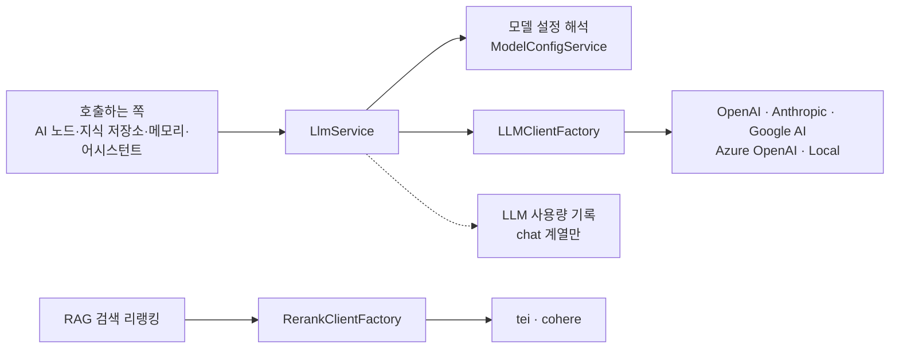

> 구현 상태: 구현됨 · 원문: `spec/5-system/7-llm-client.md`, `spec/4-nodes/3-ai/_product-overview.md` (§3.1), `spec/data-flow/7-llm-usage.md` (§1.1·§1.2 호출 계약), `spec/3-workflow-editor/4-ai-assistant.md` (harmony 제어 토큰 대응), `spec/4-nodes/3-ai/1-ai-agent.md` (§12.16 SDK 타임아웃과의 관계) · 용어: [용어 사전](../CLE-GLOSSARY.md)

## 개요

LLM 클라이언트(`LLMClient`, `LlmService`)는 여러 모델 프로바이더(model provider, `provider`)를 한 인터페이스로 부르는 계층이다. AI 에이전트 노드·텍스트 분류기 노드·정보 추출기 노드, 지식 저장소(Knowledge Base, `KnowledgeBase`)의 임베딩과 그래프 추출, 에이전트 메모리, 워크플로우 AI 어시스턴트가 모두 이 계층으로 모델을 부른다. 호출하는 쪽은 `chat`·`chatStream`·`embed` 세 가지 표면만 알면 되고, 프로바이더별 차이는 팩토리 한 곳에서 흡수한다.

이 문서는 지원 프로바이더, SSRF 가드, API 키 보안, LLM 스텁 모드를 정하고 인터페이스 · 팩토리 · 프로바이더별 매핑, 에러 매핑 · 스트리밍, 서비스 계층(`LlmService`) · 모델 목록 미리보기는 [하위 문서](#하위-문서) 에서 정한다. 리랭킹용 클라이언트(`RerankClient`)도 이 문서 묶음에서 다룬다.

범위 밖 문서는 다음과 같다.

- 모델 설정(Model settings, `ModelConfig`) 화면·API·권한: [모델 설정](CLE-AI-MODELS.md). 프로바이더 관리 제품 요구사항(LLM-01~07)도 그 문서의 요구사항에 모았다.
- 모델 설정 엔티티와 LLM 사용량 기록·비용 계산: [LLM 사용량 기록](CLE-AI-USAGE.md)
- 비대칭 임베딩 입력 규칙과 지식 저장소 임베딩 파이프라인: [문서 임베딩](../CLE-KB/CLE-KB-EMBED.md)
- 리랭킹 적용 순서와 동적 점수 컷: [RAG 검색](../CLE-KB/CLE-KB-SEARCH.md)
- 취소 신호 전파 규약: [노드 취소](../CLE-EXEC/CLE-EXEC-CANCEL.md)

아래 그림은 호출 경로를 보여 준다. Chat·Embedding 호출은 `LlmService` 를 거쳐 `LLMClientFactory` 가 만든 클라이언트로 가고, 리랭킹은 `LlmService` 를 거치지 않는 별도 팩토리로 간다.

## 지원 프로바이더

| 프로바이더 | Chat | Embedding | 인증 | 비고 |
|-----------|------|-----------|------|------|
| OpenAI | ✅ | ✅ | API Key | GPT-4o, text-embedding-3-small 등 |
| Anthropic | ✅ | ❌ | API Key | Claude 4.x, Messages API |
| Google AI | ✅ | ✅ | API Key | Gemini 시리즈 |
| Azure OpenAI | ✅ | ✅ | API Key + Endpoint | OpenAI 호환, 커스텀 배포 |
| Local (Ollama/vLLM) | ✅ | ✅ | 없음 (선택) | OpenAI 호환 API |

위 표는 Chat·Embedding 종류(`kind=chat`, `kind=embedding`)의 프로바이더다. `local` 은 설정 값으로는 독립된 `provider` 값이다. 구현 클래스 `LocalClient` 가 `OpenAIClient` 를 상속해 OpenAI 호환 엔드포인트(Ollama·vLLM 등)를 `base_url` 로 부른다.

### 리랭커 프로바이더

리랭킹은 전용 `/rerank` 엔드포인트를 쓰므로 프로바이더 집합·설정 종류(`kind=rerank`)·팩토리를 Chat·Embedding 과 따로 둔다.

| 프로바이더 | 상태 | 인증 | 비고 |
|-----------|------|------|------|
| TEI (자가호스팅) | 구현됨 | 없음 (선택) | HuggingFace Text-Embeddings-Inference 가 서빙하는 `bge-reranker-v2-m3` / `dragonkue/bge-reranker-v2-m3-ko`. 자가호스팅 우선 경로 |
| Cohere | 구현됨 | API Key | `rerank-3.5` 등. 외부 API 경로 |

지원 범위는 `tei` 와 `cohere` 두 가지로 끝낸다. `jina`·`voyage`·`local`·`builtin` 은 지원하지 않는다(2026-06-05 결정, [Rationale](CLE-AI-LLM-IFACE.md#리랭커-프로바이더를-두-가지로-끝낸-이유)). 리랭커 모델 설정 엔티티는 [LLM 사용량 기록](CLE-AI-USAGE.md), 리랭킹 적용은 [RAG 검색](../CLE-KB/CLE-KB-SEARCH.md) 에서 정한다.

## 하위 문서

요구사항 줄은 이 문서에 없으므로 하위 문서가 맡는 요구사항 번호도 없다. 프로바이더 관리 제품 요구사항은 [모델 설정](CLE-AI-MODELS.md) 이 가진다.

- [LLM 클라이언트 — 인터페이스와 프로바이더 매핑](CLE-AI-LLM-IFACE.md): `LLMClient`·`ChatParams`·`embed`·`ToolDef`·`ModelInfo`·`RerankClient` 인터페이스, 두 팩토리와 리랭커 설정 에러 코드 층, 프로바이더별 API 매핑
- [LLM 클라이언트 — 에러 처리와 스트리밍](CLE-AI-LLM-STREAM.md): 클라이언트 계층 에러 코드, harmony 제어 토큰 거르기, 스트림 이벤트와 스트리밍 에러 매핑
- [LLM 클라이언트 — 서비스 계층과 모델 목록](CLE-AI-LLM-SERVICE.md): `LlmService` 호출 신뢰성 계약 · 설정 해석과 캐시 · 모델 설정 기본 파라미터 채우기 · testConnection, 모델 목록 미리보기

## SSRF 가드

모델 설정의 `baseUrl` 과 미리보기 요청의 `baseUrl` 은 SSRF 가드를 거친다. 모델 설정을 만들고 고칠 때와 미리보기에서 같은 규칙을 쓴다.

- 차단 대상: loopback(`127.0.0.0/8`, `::1`), RFC1918(`10/8`·`172.16/12`·`192.168/16`), link-local(`169.254/16`, `fe80::/10`), IPv6 ULA(`fc00::/7`), IPv4-mapped IPv6, `0.0.0.0/8`. 걸리면 `MODEL_CONFIG_INVALID` 로 거부한다.
- 도메인 hostname 은 `dns.lookup` 으로 먼저 해석한 뒤 같은 규칙을 다시 적용한다(DNS rebinding 1차 방어).
- 예외: 자가호스팅 프로바이더는 사설망·localhost 를 허용한다. Chat·Embedding 에서는 `local`(자가호스팅 Ollama·vLLM), Rerank 에서는 `tei` 가 해당한다. Rerank 에는 `local` 프로바이더가 없다.
- 외부 프로바이더(`cohere` 등)의 `baseUrl` 로는 복호화한 Bearer 키가 전송되므로 사설망·loopback 주소를 막는다.
- 한계: TTL 이 지난 뒤 다시 해석하는 DNS rebinding 2차 공격은 연결 시점에 개입해야 막을 수 있어 지금은 차단하지 않는다. 실제 차단이 필요하면 나가는 트래픽을 막는 방화벽이나 클라우드 네트워크 정책으로 보완한다.

현재 구현은 `LlmPreviewService` 의 `isPrivateHost`·`resolvesToPrivate` 와 `ModelConfigService` 의 생성·수정 경로가 이 가드를 적용한다.

## API 키 보안

- 저장: AES-256-GCM 으로 암호화한다(기존 `encrypt`/`decrypt` 유틸리티). 암호화 위치와 복호화 시점은 [LLM 사용량 기록](CLE-AI-USAGE.md) 의 모델 설정 엔티티 절에서 정한다.
- 암호화 키: 마스터키(`ENCRYPTION_KEY`). 시크릿 저장소와 같은 키다([시크릿 저장소 「마스터키」](../CLE-INT/CLE-INT-SECRET.md#마스터키)).
- API 응답: 필드 마스킹(`***<last4>`)을 적용한다. 현재 구현은 `****` 뒤에 마지막 4자를 붙인다.
- 로그: API 키를 절대 로깅하지 않는다.

### LLM 스텁 모드

LLM 스텁 모드(`LLM_STUB_MODE`)는 dockerized e2e(`execution-park-resume.e2e-spec.ts`)가 실제 LLM 키와 외부 호출 없이 멀티턴 AI 노드의 park·재개·rehydration 경로를 늘 같은 결과로 검증하게 하는 환경 변수 게이트 스텁 클라이언트다(`OAUTH_STUB_MODE` 선례).

- `LlmService.createClient` 는 ConfigService 의 `llm.stubMode`(env `LLM_STUB_MODE` 유래, `registerAs('llm')` 네임스페이스)가 켜져 있으면 캐시·복호화 경로보다 먼저 `StubLlmClient` 를 돌려준다. 스텁이 항상 먼저 잡히므로 실제 클라이언트가 먼저 캐시된 상태에서 생기는 오염을 막는다. 이 경로에서는 모델 설정의 `apiKey` 를 쓰지 않는다.
- 운영 차단: `NODE_ENV=production` 에서 `LLM_STUB_MODE` 가 켜져 있으면 운영 환경 가드가 fail-closed 로 throw 한다. 그래서 운영 환경에서는 절대 켜지지 않는다. 가드는 `main.ts` 가 부르는 `assertProductionConfig`(`common/config/production-guards.ts`)에 있다. 이 함수가 검사하는 대상의 전체 목록과 플래그를 켜진 것으로 보는 값은 [세션과 토큰 「운영 환경 가드」](../CLE-ACCT/CLE-ACCT-SESSION.md#운영-환경-가드) 에 있다.
- 스텁 응답 계약(`StubLlmClient`, `codebase/backend/src/modules/llm/clients/stub.client.ts`): `chat` 은 마지막 user 메시지를 `[stub] received: <msg>` 로 되돌려 주고 도구 호출을 만들지 않는다. 멀티턴 AI 노드가 응답을 내보낸 뒤 다시 park 하므로 매 턴의 cold rehydration 경로를 반복해서 검증할 수 있다. `embed` 는 0 벡터, `listModels` 는 `stub-model` 1건을 돌려준다.

## 하위 문서로 옮긴 절

다른 문서가 링크하는 절의 위치다.

### ToolDef / ToolCall

→ [LLM 클라이언트 — 인터페이스와 프로바이더 매핑](CLE-AI-LLM-IFACE.md#tooldef--toolcall)

### RerankClientFactory

→ [LLM 클라이언트 — 인터페이스와 프로바이더 매핑](CLE-AI-LLM-IFACE.md#rerankclientfactory)

### Anthropic

→ [LLM 클라이언트 — 인터페이스와 프로바이더 매핑](CLE-AI-LLM-IFACE.md#anthropic)

### 호출 신뢰성 계약

→ [LLM 클라이언트 — 서비스 계층과 모델 목록](CLE-AI-LLM-SERVICE.md#호출-신뢰성-계약)

### 스트리밍

→ [LLM 클라이언트 — 에러 처리와 스트리밍](CLE-AI-LLM-STREAM.md#스트리밍)

### 스트리밍 에러 매핑

→ [LLM 클라이언트 — 에러 처리와 스트리밍](CLE-AI-LLM-STREAM.md#스트리밍-에러-매핑)

## 미결 사항

- **Gemini `v1` 이전**: Google 클라이언트는 지금 `v1beta` 로 고정돼 있다. `v1` 로 옮길지는 [Rationale](CLE-AI-LLM-IFACE.md#gemini-api-버전을-v1beta-로-고정한다-2026-11-12) 에 적은 기능이 `v1` 에서 되는지 실제 키로 확인한 뒤 정한다. 담당 NERV Task `CLE-T-752NN3`.

## 구현 위치

- `codebase/backend/src/modules/llm/clients/*.ts` (프로바이더별 클라이언트, `stub.client.ts` 포함)
- `codebase/backend/src/modules/llm/llm-client.factory.ts`
- `codebase/backend/src/modules/llm/interfaces/llm-client.interface.ts`
- `codebase/backend/src/modules/llm/llm.service.ts`
- `codebase/backend/src/modules/llm/model-default-params.ts`
- `codebase/backend/src/modules/llm/embedding-input-type.ts`
- `codebase/backend/src/modules/llm/llm-preview.service.ts`
- `codebase/backend/src/modules/llm/llm-model-config.controller.ts`
- `codebase/backend/src/modules/llm/list-models-cap.ts`
- `codebase/backend/src/modules/llm/llm-usage-log.service.ts`
- `codebase/backend/src/modules/llm/pricing.ts`
- `codebase/backend/src/modules/llm/rerank/rerank-client.factory.ts`
- `codebase/backend/src/modules/llm/rerank/rerank-client.interface.ts`
- `codebase/backend/src/modules/llm/rerank/clients/*.ts`
- `codebase/backend/src/modules/llm/utils/*.ts`

## Rationale

### 모든 호출을 LlmService 한 곳으로 모은 이유

프로바이더마다 SDK 와 API 규격이 다르지만 호출하는 쪽(노드·지식 저장소·어시스턴트)은 같은 표면(`chat`, `chatStream`, `embed`)만 알면 된다. 프로바이더 분기는 `LLMClientFactory` 한 곳에 모이므로 새 프로바이더를 더해도 호출하는 쪽은 바뀌지 않는다.

### SSRF 가드를 재사용하는 이유

자가호스팅 `tei` 리랭커는 사설망 엔드포인트를 받으므로 LLM 과 같은 SSRF 공격 면이 있다. Chat·Embedding 의 `local` 에 쓰는 사설망 예외 규칙을 그대로 적용해 인프라를 두 번 만들지 않는다. 시크릿 암호화 인프라도 같은 이유로 공유한다.

### 운영 환경 가드 대상은 세션과 토큰 문서를 가리킨다 (2026-10-31)

가드 대상이 늘 때마다(예: 통합 암호화 키 `INTEGRATION_ENCRYPTION_KEY`) 다른 문서에 둔 사본은 낡는다. 그래서 이 문서에는 스텁 모드를 막는 사실과 가드 위치만 적고 전체 목록은 세션과 토큰 문서를 가리킨다(NERV Task `CLE-T-KQ37NJ`). 목록은 [세션과 토큰 「운영 환경 가드」](../CLE-ACCT/CLE-ACCT-SESSION.md#운영-환경-가드) 절에 있다(NERV Task `CLE-T-NAT45Z`). 가드는 `LLM_STUB_MODE` 의 `true` 와 `1` 을 모두 켜짐으로 본다. 켜짐 판정은 그 절을 따른다. 스텁을 실제로 켜는 설정(`llm.config.ts` 의 `stubMode`)은 `true` 만 본다. 가드가 막는 값이 더 넓어서 운영 환경에서 스텁이 켜진 채 기동하는 일은 없다.

### Anthropic 에 샘플링 파라미터를 보내지 않는다 (2026-11-12)

→ [LLM 클라이언트 — 인터페이스와 프로바이더 매핑](CLE-AI-LLM-IFACE.md#anthropic-에-샘플링-파라미터를-보내지-않는다-2026-11-12)

### 스트림 오류 `message` 는 진단용으로 둔다 (2026-11-13)

→ [LLM 클라이언트 — 에러 처리와 스트리밍](CLE-AI-LLM-STREAM.md#스트림-오류-message-는-진단용으로-둔다-2026-11-13)

### 스트림 열기 실패를 모든 프로바이더에서 `error` 이벤트로 낸다 (2026-11-14)

OpenAI 계열(OpenAI · Azure · Local) 클라이언트의 `stream()` 은 스트림을 열 때의 실패(429, SDK 요청 타임아웃, 그 밖의 실패)를 예외로 던졌다. Anthropic · Google 클라이언트는 같은 실패를 `error` 이벤트로 냈다. 그래서 [워크플로우 AI 어시스턴트](../CLE-WF/CLE-WF-ASSIST.md) 는 같은 429 를 Anthropic · Google 이면 `LLM_RATE_LIMIT` 로, OpenAI 계열이면 `ASSISTANT_STREAM_FAILED` 로 냈다. 2026-11-14 에 사람이 다음과 같이 정했다(NERV Task `CLE-T-0R5SYN`, 질문 `01a1d93a-cb58-7714-9af6-56974232f95e` 의 답).

- 세 클라이언트(OpenAI 계열 · Anthropic · Google) 모두 스트림을 열 때의 실패를 `error` 이벤트로 낸다. OpenAI 계열은 도중 실패와 같은 분류를 쓴다.
- 스트림을 여는 중에 취소되면 도중 취소와 같은 `done`(finishReason=`aborted`)으로 끝낸다. 전에는 Anthropic · Google 이 이 경우를 `LLM_CONNECTION_ERROR` 로 냈다.
- `chatStream` 에는 앱 재시도를 두지 않는다.
- OpenAI · Anthropic SDK 생성자에 `maxRetries` 2 를 적는다. SDK 기본값과 같은 값이다. 생성자에 적어 두면 SDK 기본값이 바뀌어도 재전송 횟수가 그대로다.
- 어시스턴트 턴의 시간 제한은 이 결정에서 다루지 않는다. 2026-10-10 에 기각한 안이다([AI 노드 공통 Rationale](../CLE-NODE-AI/CLE-NODE-AI-COMMON.md#llm-호출-타임아웃을-호출-경로별-현행-값으로-적는다-2026-10-10)).

이제 어시스턴트는 같은 429 를 모델 프로바이더와 상관없이 `LLM_RATE_LIMIT` 로 낸다. 계약은 [스트리밍 에러 매핑](CLE-AI-LLM-STREAM.md#스트리밍-에러-매핑) 에 있다.

기각한 대안은 둘이다.

- **OpenAI 계열의 예외를 그대로 둔다**: 같은 실패가 프로바이더에 따라 예외와 이벤트로 갈린다. 호출하는 쪽이 두 경로를 모두 처리해야 해서 프로바이더 차이가 클라이언트 계층 밖으로 샌다. [모든 호출을 LlmService 한 곳으로 모은 이유](#모든-호출을-llmservice-한-곳으로-모은-이유) 와 맞지 않는다.
- **`chatStream` 에 앱 재시도를 둔다**: OpenAI · Anthropic SDK 가 이미 429 와 요청 타임아웃을 두 번 더 보낸다. 앱 재시도를 더하면 두 재시도가 곱해져 한 턴의 요청 수와 대기 시간이 불어난다.

### LLM 호출의 공통 상한을 정한다 (2026-11-14)

2026-10-10 결정은 문서를 코드에 맞추는 데까지였고 앱 타임아웃이 없는 호출의 상한은 정하지 않았다. Google 클라이언트에는 SDK 요청 타임아웃도 없어서 `timeoutMs` 를 주지 않은 Google `chat` 호출에는 상한이 없었다. 2026-11-14 에 사람이 다음과 같이 정했다(NERV Task `CLE-T-0R5SYN`, 질문 `01a1d93a-cd66-73ab-a2e9-37ffa7ee1312` 의 답).

- `LlmService.chat` 은 `timeoutMs` 를 주지 않은 호출에 공통 안전망 10분(`LLM_CHAT_DEFAULT_TIMEOUT_MS`)을 건다. `0` 을 주면 끈다.
- `chatStream` 과 `embed` 에는 공통 기본값을 걸지 않는다.
- Google SDK 에는 따로 타임아웃을 걸지 않는다.
- 스트림 유휴 감지는 하지 않는다.
- AI 에이전트 롤링 요약에는 취소 신호와 `AI_AGENT_LLM_CALL_TIMEOUT_MS`(기본 10분)를 넘긴다.

계약은 [서비스 계층 「호출 신뢰성 계약」](CLE-AI-LLM-SERVICE.md#호출-신뢰성-계약) 에 있다. 호출 경로별 값은 [AI 노드 공통 「LLM 호출 경로별 타임아웃」](../CLE-NODE-AI/CLE-NODE-AI-COMMON.md#llm-호출-경로별-타임아웃) 이 모아 적는다. 롤링 요약과 AI 노드 호출에서 본 배경은 [AI 노드 공통 「앱 타임아웃이 없던 호출의 상한을 정한다」](../CLE-NODE-AI/CLE-NODE-AI-COMMON.md#앱-타임아웃이-없던-호출의-상한을-정한다-2026-11-14) 에 있다. 정상 응답이 10분을 넘는 일은 드물다. OpenAI 계열과 Anthropic 은 SDK 요청 타임아웃(재전송 포함 최대 약 6분)이 먼저 걸린다. 그래서 공통 기본값은 주로 Google 호출과 SDK 가 멈춘 경우에 걸린다.

기각한 대안은 둘이다.

- **스트림 유휴 감지**: 응답 헤더가 온 뒤 일정 시간 조각이 오지 않으면 스트림을 끊는 안이다. 추론 모델은 첫 토큰 전에 몇 분씩 조각 없이 기다리는 일이 정상이다. 유휴 감지를 두면 이런 정상 응답을 끊는다.
- **Google SDK 에 개별 타임아웃을 건다**: `chat` 의 공통 기본값으로 Google `chat` 호출에도 상한이 생긴다. 그래서 따로 걸 필요가 없다.

AI 에이전트의 앱 기본값 10분을 120초로 낮추는 안과 어시스턴트 턴에 시간 제한을 두는 안은 2026-10-10 에 기각했다. 근거는 [AI 노드 공통 Rationale](../CLE-NODE-AI/CLE-NODE-AI-COMMON.md#llm-호출-타임아웃을-호출-경로별-현행-값으로-적는다-2026-10-10) 에 있다.
