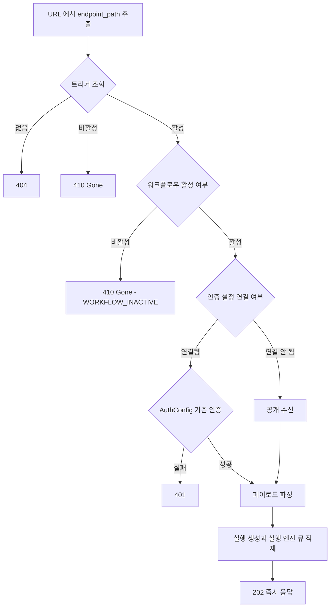

## 개요

이 문서는 [HTTP API 규약](CLE-API-CONV.md) 의 하위 문서로 HTTP API 와 같은 서버가 여는 WebSocket 채널의 요약과 웹훅 수신 엔드포인트를 일반 API 규약 관점에서 정한다. 절 번호(§)와 「규칙 n」 은 부모 문서의 번호를 그대로 쓴다. WebSocket 의 상세는 [WebSocket 연결과 채널 구독](CLE-API-WS.md), 웹훅 수신의 상세 계약은 [웹훅](../CLE-TRIG/CLE-TRIG-WEBHOOK.md) 이 정한다.

## 10. WebSocket

HTTP API 와 같은 서버가 실시간 채널을 함께 연다. 전송 계층은 Socket.IO(namespace `/ws`)다. 연결·인증·메시지 형식·재연결은 [WebSocket 연결과 채널 구독](CLE-API-WS.md), 이벤트와 명령 목록은 [WebSocket 이벤트와 명령](CLE-API-WS-EVENTS.md) 이 정한다.

| 용도 | 방향 | 이벤트 |
|------|------|--------|
| 워크플로우 실행 상태 | Server → Client | `execution.*`, `execution.node.*` |
| 실행 제어 | Client → Server | 재개 명령(`execution.submit_form` 등)과 `execution.retry_last_turn`. 실행 시작·중단(`execution.start`·`execution.stop`)은 비채택이고 REST 가 대신한다. `execution.continue` 는 브레이크포인트 로드맵의 계획이며 미구현이다 |
| 지식 저장소 문서 상태 (임베딩·그래프 추출) | Server → Client | `document:embedding_*`, `document:graph_*` (구독 채널 `kb:{documentId}`) |

재연결 요약:

- **자동 재연결은 Socket.IO 클라이언트에 내장돼 있다.** 지수 백오프와 지터로 제한 없이 다시 시도한다. 구체 파라미터는 구현이 단일 기준이므로 여기에 숫자를 두지 않는다.
- **놓친 이벤트는 다시 구독할 때 받는 1회성 실행 스냅샷 이벤트(`execution.snapshot`)로 맞춘다.** native WebSocket 에는 이벤트 순번(`seq`) 기반 재전송 버퍼가 없다. 그 버퍼는 EIA SSE 용 Redis Stream(`eia:sse:buf:<executionId>`)이다. SSE 클라이언트는 `Last-Event-Id` 로 그 버퍼에서 놓친 이벤트를 받는다. 자세한 흐름은 [EIA 데이터와 흐름 「Redis 와 BullMQ」](../CLE-IX/CLE-EIA-DATA.md#redis-와-bullmq) 에 있다. 두 전송은 같은 `seq` 공간만 공유하고 버퍼는 공유하지 않는다.
- **자동 재연결이 되지 않는 경우**: 서버가 스스로 `disconnect()` 하면(토큰 만료 종료) Socket.IO 는 재연결을 시도하지 않는다. 클라이언트가 명시적으로 다시 연결해야 한다. 갈리는 것은 재연결 시작 여부뿐이고 복구 방식은 두 경우가 같다(위 스냅샷). 상세와 근거는 [WebSocket 연결과 채널 구독](CLE-API-WS.md) 에 있다.

## 11. 웹훅 수신 엔드포인트

외부 시스템이 워크플로우를 시작하려고 부르는 웹훅 수신 엔드포인트의 요점이다. URL·인증·입력 데이터·에러의 상세 계약은 [웹훅](../CLE-TRIG/CLE-TRIG-WEBHOOK.md) 이 단일 기준이고 이 절은 일반 API 규약 관점의 요약만 둔다.

### 11.1 URL 구조

```
POST {base_url}/api/hooks/{endpoint_path}
```

- `base_url`: SaaS 는 서비스 도메인(예: `https://api.example.com`), 셀프 호스팅은 설정한 도메인이다. 프론트엔드가 base 를 정하는 규칙은 [웹훅](../CLE-TRIG/CLE-TRIG-WEBHOOK.md) 이 정한다.
- `endpoint_path`: 트리거(Trigger) 엔티티의 `endpoint_path` 값이고 라우팅 식별자로 쓴다. 클라이언트가 CSPRNG 로 v4 UUID(`crypto.randomUUID()`)를 만들어 요청 본문의 `endpointPath` 로 보낸다. 서버는 트리거를 만들거나 경로를 바꿀 때 v4 형식만 검증한다([웹훅](../CLE-TRIG/CLE-TRIG-WEBHOOK.md)).
- 예시: `POST https://api.example.com/api/hooks/3f6c2a1e-8b4d-4e2f-9a7c-1d5e8f0b2c64`

### 11.2 지원 메서드

| 메서드 | 지원 | 설명 |
|--------|------|------|
| POST | ✓ | 표준 웹훅 수신 (유일하게 지원하는 메서드) |

웹훅 수신(워크플로우 트리거) 메서드는 POST 만 지원하고 그 밖의 메서드는 `405 Method Not Allowed` 다. GET·PUT 트리거 수신은 v1 에서 지원하지 않는다([웹훅](../CLE-TRIG/CLE-TRIG-WEBHOOK.md)). 같은 라우터에 웹채팅 위젯 부팅용 공개 읽기 엔드포인트 `GET /api/hooks/{endpoint_path}/embed-config` 가 따로 있다. 이것은 웹훅 수신이 아니라 임베드 허용 목록 조회용이다([웹채팅 보안](../CLE-WEBCHAT/CLE-WEBCHAT-SECURITY.md)).

### 11.3 요청 처리 흐름



1. URL 에서 `endpoint_path` 를 뽑아 트리거를 찾는다. 없으면 `404`, 비활성이면 `410 Gone` 이다. 트리거가 활성이어도 그 워크플로우가 비활성이면 `410 Gone`(`WORKFLOW_INACTIVE`)이다([트리거 데이터와 흐름 「워크플로우 활성 관문」](../CLE-TRIG/CLE-TRIG-DATA.md#워크플로우-활성-관문)).
2. `Trigger.auth_config_id` 가 가리키는 인증 설정(AuthConfig)으로 인증한다. 연결된 인증 설정이 없으면 공개 수신이고 인증에 실패하면 `401` 이다.
3. 페이로드를 파싱한다(`application/json`, `application/x-www-form-urlencoded`).
4. 실행(Execution)을 만들고 실행 엔진 큐에 넣는다.
5. 바로 `202` 를 돌려준다(비동기 실행).

인증 분기·파라미터 추출을 포함한 상세 처리 흐름은 [웹훅](../CLE-TRIG/CLE-TRIG-WEBHOOK.md) 의 처리 흐름 절이 정한다.

### 11.4 응답 형식

비동기 단일 모드다. 실행 큐에 넣은 뒤 바로 `202 Accepted` 를 돌려준다. 동기 `?wait=true` 모드는 지원하지 않는다. 모든 응답은 전역 `TransformInterceptor` 가 `{ data: ... }` 로 감싼다([§5](CLE-API-CONV-RESP.md#5-응답-형식)).

```json
{
  "data": {
    "executionId": "550e8400-e29b-41d4-a716-446655440000",
    "message": "Webhook received, workflow execution started"
  }
}
```

`interaction.enabled=true` 트리거의 응답 확장 필드는 [웹훅](../CLE-TRIG/CLE-TRIG-WEBHOOK.md) 과 [External Interaction API](../CLE-IX/CLE-EIA.md) 의 웹훅 호출 응답 확장 절이 정한다.

**예외: 채팅 채널 트리거의 handshake · 인터랙션 ack · Slack 슬래시 명령 응답.** `config.chatChannel` 트리거가 받은 Slack `url_verification` 과 Discord PING 의 handshake 응답, Slack · Discord 의 인터랙션 ack(네이티브 모달 열기와 제출 응답, Discord 슬래시 명령의 즉시 응답 포함), Slack 슬래시 명령의 응답은 `{ data }` 로 감싸지 않는다. 프로바이더가 정한 본문을 `200 OK` 로 그대로 보낸다. 프로바이더가 그 형식만 성공으로 인정하기 때문이다. 인터랙션 요청에는 트리거가 꺼져 있거나 처리를 건너뛰어도 같은 ack 를 보낸다. 경우별 본문은 [채팅 채널 「인바운드 HTTP 응답 계약」](../CLE-CHAT/CLE-CHAT-CORE.md#인바운드-http-응답-계약) 이 정한다. Slack 슬래시 명령의 본문 `{ response_type: 'ephemeral', text }` 는 [Slack 어댑터 「Slash Commands」](../CLE-CHAT/CLE-CHAT-SLACK.md#slash-commands) 가 정한다. 채팅 채널 트리거의 `202` 응답은 이 절의 봉투를 그대로 따른다. [§6](CLE-API-CONV-RESP.md#6-http-상태-코드) · [§7](CLE-API-CONV-RATE.md#7-요청-빈도-제한) 과 채팅 채널 문서의 `{ executionId: 'ignored' }` 는 `{ data }` 감싸기와 `message` 를 뺀 줄임 표기다.

### 11.5 인증 방식

웹훅 트리거는 인증 설정을 연결하지 않으면 공개로 받고 연결하면 그 인증 설정으로 인증한다(`api_key`, `bearer_token`, `basic_auth`, `hmac`). 인증 없음은 `AuthConfig.type` 의 값이 아니라 `auth_config_id IS NULL` 로 나타낸다([트리거 데이터와 흐름](../CLE-TRIG/CLE-TRIG-DATA.md)). 헤더·기본값·검증 방식의 단일 기준은 [웹훅](../CLE-TRIG/CLE-TRIG-WEBHOOK.md) 의 인증 방식 절이다. 예: HMAC 은 `AuthConfig.config.header`(기본 `X-Hub-Signature-256`) 헤더를, API Key 는 `AuthConfig.config.headerName`(기본 `X-API-Key`) 헤더를 검증한다.

### 11.6 워크플로우 실행 입력 데이터

웹훅 수신 데이터가 워크플로우 입력으로 들어가는 구조(`parameters`, `body`, `headers`, `query`, `method`)는 [웹훅](../CLE-TRIG/CLE-TRIG-WEBHOOK.md) 의 입력 데이터 구조 절이 단일 기준이다.

### 11.7 요청 빈도 제한

웹훅 수신은 전역 요청 빈도 제한(100 req/min)을 받는다([§7](CLE-API-CONV-RATE.md#7-요청-빈도-제한)). 넘으면 `429 Too Many Requests` 다. 공개 웹훅에는 IP 단위 추가 한도가 걸린다. 채팅 채널 트리거는 `auth_config_id IS NULL` 이어도 공개 웹훅 추가 한도를 받지 않는다. 서명 참조가 있는 채팅 채널 트리거는 전역 한도도 받지 않는다([§7 머리 콜아웃](CLE-API-CONV-RATE.md#7-요청-빈도-제한)). 수치는 §7 표에 있고 버킷·IP 식별 규칙은 [웹훅](../CLE-TRIG/CLE-TRIG-WEBHOOK.md) 이 정한다.

## 구현 위치

- `codebase/backend/src/modules/hooks/hooks.controller.ts`
- `codebase/backend/src/modules/hooks/hooks.service.ts`
- 웹훅 수신의 요청 빈도 제한 가드는 [요청 빈도 제한](CLE-API-CONV-RATE.md#구현-위치) 에 있다.

## Rationale

### WebSocket 재연결 요약에 예외를 복제하지 않고 위임한 이유 (2026-09-02, 2026-09-10 갱신)

§10 은 재연결을 요약만 하고 상세는 [WebSocket 연결과 채널 구독](CLE-API-WS.md) 에 맡긴다. 한때 요약의 두 줄(백오프 수치 · 마지막 이벤트 ID 재전송)은 틀렸다. Socket.IO 는 서버가 보낸 `disconnect()` 에 자동 재연결을 시작하지 않고 native WebSocket 의 복구는 끊긴 원인과 무관하게 늘 실행 스냅샷 이벤트다.

- 처음에는 "요약에 예외를 복제하면 두 곳이 갈릴 자리를 새로 만든다" 는 이유로 이 절을 고치지 않았다. 그 논리는 지금도 맞다.
- 바뀐 것은 전제다. 토큰 만료 종료가 구현되면서 그 예외가 access token 수명(15분)마다 늘 발동하게 됐다. 드물게 나는 예외를 요약에서 빼는 것과 늘 도는 경로를 요약이 반대로 적는 것은 다르다.
- 그래서 복제가 아니라 위임이다. 예외가 있다는 사실만 한 줄로 알리고 내용과 근거는 WebSocket 문서에 둔다. 위임 대상은 예외 하나에 그치지 않고 재연결 · 복구 서술 전체다.
- 백오프 수치는 WebSocket 문서도 초안 값이라고 부인한 값이라 요약에 숫자를 두지 않는다. `seq` 기반 재전송 버퍼는 EIA SSE 쪽(Redis Stream `eia:sse:buf:<executionId>`)에만 있다. WebSocket 문서 Rationale 「재연결 복구: native WS 는 snapshot, seq 버퍼 재전송은 SSE 전송」이 2026-05-31 에 native WS 버퍼 재전송을 폐기 대안으로 기록했다.
- **폐기한 대안**: 재연결 규칙 전체를 이 절에 펼치는 안. §10 의 위임 구조를 깨고 WebSocket 문서의 재연결 · 복구 절과 이중 관리가 된다.

### 웹훅 수신 절을 웹훅 문서로 위임하고 정합화한 이유

§11 은 웹훅 도메인 문서와 중복 서술돼 어긋남이 쌓였다. 코드(`hooks.controller.ts`, `hooks.service.ts`, `app.module.ts` 의 ThrottlerModule)를 기준으로 맞추고 상세는 [웹훅](../CLE-TRIG/CLE-TRIG-WEBHOOK.md) 으로 위임했다. 바로잡은 내용은 아래와 같다.

- URL `{base_url}/hooks/` 를 `{base_url}/api/hooks/` 로 고쳤다(코드: `@Controller('hooks')` 와 전역 prefix `api`). "`/hooks/*` 는 `/api/*` 와 분리" 라는 메모는 사실과 반대여서 지웠다.
- GET·PUT 메서드 행을 지웠다. 코드는 `@Post(':endpointPath')` 하나다(POST 전용).
- 동기 `?wait=true` 모드를 지웠다. 코드에 wait 파라미터와 동기 경로가 없다(옛 설계의 잔재).
- 응답 형태를 `{ data: { executionId, message } }` 로 고쳤다. 전역 `TransformInterceptor` 가 `{ data }` 로 감싼다. 옛 표기의 `status`·`triggeredAt` 필드는 실제 응답에 없다.
- HMAC 헤더 `X-Webhook-Signature` 고정을 `AuthConfig.config.header`(기본 `X-Hub-Signature-256`)로 고쳤고 API Key 의 `?api_key=` 쿼리 옵션을 지웠다(헤더 전용). 상세는 웹훅 문서로 위임했다.
- 입력 데이터의 `path` 필드를 지웠다. 웹훅 입력 구조에 없다.
- Content-Type `text/plain` 을 지웠다. 코드는 json·form 파라미터만 뽑는다.
- 요청 빈도 제한 `1000 req/min(워크스페이스)` 를 `100 req/min(전역 throttler default)` 로 고쳤다(§7 표 포함).

### 채팅 채널 handshake 와 인터랙션 ack 를 §11.4 의 봉투 예외로 적었다 (2026-10-17)

NERV Task `CLE-T-EMB0YG` 에서 더했다. §11.4 는 웹훅 수신의 모든 응답을 `{ data }` 로 감싼다고만 적었다. 코드(`hooks.controller.ts`)는 채팅 채널 트리거의 handshake 와 인터랙션 ack 를 `TransformInterceptor` 를 거치지 않고 `200 OK` 로 바로 보낸다. 이 본문은 프로바이더가 정한 형식이고 프로바이더는 그 형식만 성공으로 인정한다. 그래서 §11.4 에 예외 한 줄과 채팅 채널 문서 링크를 더했다.

같은 자리에 채팅 채널 `202` 본문의 줄임 표기도 밝혔다. [§6](CLE-API-CONV-RESP.md#6-http-상태-코드) · [§7](CLE-API-CONV-RATE.md#7-요청-빈도-제한) 과 채팅 채널 문서는 그 본문을 `{ executionId: 'ignored' }` 로 적는다. 실제 응답은 `{ data }` 로 감싸이고 `message` 도 실린다.

기각한 대안: 경우별 본문을 §11.4 에 표로 옮기는 안. 프로바이더를 더할 때마다 두 문서를 함께 고쳐야 하고 한쪽만 고쳐지면 두 표가 갈린다. 본문의 기준은 채팅 채널 문서 한 곳에 둔다.

2026-11-13 에 Slack 슬래시 명령의 응답을 같은 예외에 더했다(NERV Task `CLE-T-MGZRRP`, [Slack 어댑터 「R-S-14」](../CLE-CHAT/CLE-CHAT-SLACK.md#r-s-14-슬래시-명령은-본인에게만-보이는-문구와-200-으로-답한다)). Slack 은 슬래시 명령 요청의 HTTP 응답 본문을 사용자에게 보이는 메시지로 쓴다. 그래서 이 응답은 `{ data }` 로 감싸지 않고 프로바이더 형식 그대로 보내야 한다.

### 채팅 채널 인터랙션 응답을 §6 · §11.4 에 적었다 (2026-11-13)

NERV Task `CLE-T-GNTWP9` 에서 고쳤다. 채팅 채널 문서가 Discord 인터랙션 · Slack Interactivity 는 트리거가 꺼져 있어도 `200` 과 인터랙션 응답을 받고 Discord 슬래시 명령에는 즉시 응답을 보낸다고 정했다([채팅 채널 「인바운드 HTTP 응답 계약」](../CLE-CHAT/CLE-CHAT-CORE.md#인바운드-http-응답-계약), NERV Task `CLE-T-TSEP9G`). [§6](CLE-API-CONV-RESP.md#6-http-상태-코드) `410` 행과 §11.4 봉투 예외를 그 계약에 맞췄다.

### 공개 웹훅 추가 한도에서 채팅 채널 트리거를 뺐다 (2026-11-12)

NERV Task `CLE-T-GNTWP9` 에서 고쳤다. 사람 결정(2026-11-12, NERV 질문 `01a1cd72-1888` 1안)으로 [웹훅](../CLE-TRIG/CLE-TRIG-WEBHOOK.md) v10 이 공개 웹훅의 IP 단위 한도와 본문 크기 한도의 대상에서 채팅 채널 트리거를 뺐다. 채팅 채널 트리거는 `auth_config_id IS NULL` 이어도 공개 웹훅의 IP 단위 한도와 32KB 본문 한도를 받지 않고 `/api/hooks/*` 본문 파서 한도(기본 1MB)만 받는다. 채널 프로바이더는 적은 수의 발신 IP 에서 모든 사용자의 update 를 보내고 `429` · `413` 을 받으면 재전송하거나 웹훅을 끌 수 있기 때문이다. 근거의 기준은 [웹훅 「본문 크기를 공개와 인증으로 나눈 이유」](../CLE-TRIG/CLE-TRIG-WEBHOOK.md#본문-크기를-공개와-인증으로-나눈-이유) 다. 이 규약은 본문 크기 정책을 [§6](CLE-API-CONV-RESP.md#6-http-상태-코드) `413` 행에서 웹훅 문서에 맡기므로 본문 크기 서술은 고치지 않았다.

### 채팅 채널 인바운드를 전역 요청 빈도 제한에서 뺐다 (2026-11-12)

NERV Task `CLE-T-GNTWP9` 에서 고쳤다. 사람 결정(2026-11-12, NERV 질문 `01a1d025-94b3-7448-b9dc-4165d0b6ed5f`)으로 채팅 채널 트리거의 인바운드 요청을 전역 요청 빈도 제한(`UserThrottlerGuard`, 분당 100건)에서 뺐다. 채널 프로바이더는 적은 수의 발신 IP 에서 모든 사용자의 update 를 보내므로 트래픽이 많은 봇은 IP 단위 전역 한도에 닿기 쉽다. 그때 나가는 `429` 는 프로바이더의 재전송과 웹훅 비활성화를 부른다([채팅 채널 「R-CC-12」](../CLE-CHAT/CLE-CHAT-CORE.md#r-cc-12-인바운드-응답은-202-로-고정하고-401404-만-예외로-둔다)). 이 결정은 R-CC-12 의 2026-11-12 결정(NERV Task `CLE-T-XKK9KH`) 가운데 채팅 채널 인바운드에도 전역 한도를 건다는 부분을 바꾼다.

NERV Task `CLE-T-ZC34Y0` 에서 구현했다. 채팅 채널 트리거인지는 트리거를 조회해야 알 수 있는데 전역 `APP_GUARD` 인 `UserThrottlerGuard` 는 트리거를 조회하는 라우트 가드 `PublicWebhookThrottleGuard` 보다 먼저 돈다. 그래서 웹훅 수신 라우트에 `@DeferGlobalThrottle()` 을 붙여 전역 가드가 건너뛰게 하고 그 뒤에 둔 라우트 가드 `HookTriggerThrottlerGuard` 가 앞 가드가 조회한 트리거로 전역 한도를 센다. 면제 판정 함수는 `isSignedChatChannelTrigger` 이고 인바운드 인증기가 서명을 검증하는 조건과 같다. 면제 대상이 아니면 전역 가드와 같은 한도 · 같은 저장소 · 같은 키(`req.ip`)로 세므로 채팅 채널 트리거가 아닌 웹훅은 전과 같은 버킷을 쓴다. 트리거가 없거나(`404` 로 끝날 요청) 조회에 실패한 요청은 센다. 판정할 수 없는 요청을 면제하지 않으려는 것이다.

2026-11-13 에 면제를 서명 참조가 있는 채팅 채널 트리거로 좁혔다(NERV 질문 `01a1d322-7833-756b-a20d-2e3e247411f3` 답 A). 서명 참조가 없는 트리거는 서명 검증을 건너뛰어 서명 검증 실패 한도도 걸리지 않는다. 그런 트리거까지 전역 한도에서 빼면 IP 단위 한도가 하나도 남지 않는다. 공개 웹훅 추가 한도는 그대로 채팅 채널 트리거 전부를 뺀다.

순서를 바꾼 대가는 둘이다.

- 이 라우트는 전역 한도를 넘은 요청도 트리거를 한 번 조회(`endpointPath` 인덱스)한 뒤에 `429` 로 거절한다. 컨트롤러가 그 조회 결과를 다시 쓰므로 요청마다 늘어나는 DB 왕복은 없다.
- 공개 웹훅은 본문 크기 한도(`413`)와 IP 단위 시작 한도(`429`)를 전역 한도의 `429` 보다 먼저 받는다.

e2e 는 `NODE_ENV=test` 에서 돌아 전역 한도가 꺼져 있으므로 가드 순서는 wire 테스트(`hooks-throttle.wire.spec.ts`)로 확인한다.

### 채팅 채널의 전역 한도 예외를 §7 머리 콜아웃 한 곳에 모았다 (2026-11-13)

NERV Task `CLE-T-ZC34Y0` · `CLE-T-WGNJWE` 에서 고쳤다. 채팅 채널 트리거 요청이 전역 한도를 받지 않고 채팅방 단위 한도를 넘어도 `202` 를 받는다는 사실이 규칙 12, §7 머리 콜아웃, §7 표의 「웹훅 수신」 · 「공개 웹훅 추가 한도」 행, §11.7 에 거의 같은 문장으로 있었다. 한 곳만 고치면 나머지와 어긋나므로 정본을 [§7 머리 콜아웃](CLE-API-CONV-RATE.md#7-요청-빈도-제한) 에 두고 나머지 자리에는 한 문장과 그 콜아웃 링크만 남겼다. 서명 검증 실패 한도는 콜아웃에 한 줄을 두고 수치는 §7 표에 행으로 더했다. §7 표가 수치의 단일 기준이기 때문이다. 쇼핑몰 앱 설치 진입점의 실패 잠금도 같은 이유로 표에 수치가 있다. 동작 규칙은 [채팅 채널 「인바운드 관문 순서」](../CLE-CHAT/CLE-CHAT-CORE.md#인바운드-관문-순서) 가 정한다.

기각한 대안: 다른 자리의 문장을 지우고 콜아웃만 남기는 안. 규칙 12 나 §11.7 만 읽는 사람은 예외가 있다는 것조차 알 수 없다.
