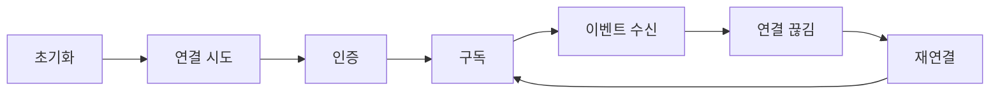

> 구현 상태: 구현됨 (raw WebSocket 전제 항목 일부는 비채택) · 원문: `spec/5-system/6-websocket-protocol.md` (§2 · §5 · §6 · §9, Rationale 일부) · 용어: [용어 사전](../CLE-GLOSSARY.md)

## 개요

이 문서는 [WebSocket 연결과 채널 구독](CLE-API-WS.md) 의 하위 문서로 WebSocket 연결의 엔드포인트, 핸드셰이크 인증, 토큰 만료와 갱신, heartbeat, 재연결과 놓친 이벤트 복구, 클라이언트 구현 지침을 정한다. 전송 계층(§1)은 부모 문서, 메시지 형식 · 채널 구독 · 에러(§3 · §4 · §7 · §8)는 [WebSocket 연결과 채널 구독 — 메시지 · 구독 · 에러](CLE-API-WS-MSG.md) 가 정한다. 절 번호는 부모 문서의 번호를 그대로 쓴다.

## 2. 연결

### 2.1 엔드포인트

```
wss://{base_url}/ws        (Socket.IO namespace '/ws')
```

- 프로토콜은 `wss://`(TLS 필수)다. 개발 환경에서만 `ws://` 를 허용한다.
- 서버는 Socket.IO 게이트웨이로 핸드셰이크를 처리한다(transport: `websocket` 에서 `polling` 으로 폴백). 클라이언트 기본 transport 는 `['websocket', 'polling']` 이다.

### 2.2 인증

연결할 때 JWT access token 을 넘긴다. 구현은 아래 두 핸드셰이크 위치를 받고 (1), (2) 순서로 본다(`handleConnection` 의 `handshake.query.token || handshake.auth.token`).

| 방식 | 형태 | 예시 |
|------|------|------|
| (1) 쿼리 파라미터 | `?token={access_token}` | Socket.IO `io(url, { query: { token } })` 또는 URL 쿼리 |
| (2) Socket.IO auth payload | `handshake.auth.token` | 클라이언트 `io(url, { auth: { token } })` (프론트엔드 기본 경로) |

raw WebSocket 의 `Sec-WebSocket-Protocol: bearer, {token}` 서브프로토콜 인증은 **비채택**이다. Socket.IO 전송은 서브프로토콜 협상을 애플리케이션에 드러내지 않아 이 경로가 구조적으로 적용되지 않고 위 두 위치가 인증을 마친다. 전송을 raw WebSocket 으로 바꾸지 않는 한 도입하지 않는다.

`handleConnection` 은 토큰의 서명과 `exp` 만 검증한다(`jwtService.verify`). 소켓의 워크스페이스는 토큰의 `activeWorkspaceId`(없으면 `workspaceId`)를 그대로 쓰고 멤버십을 DB 에서 다시 확인하지 않는다.

**인증 실패 시**

- **핸드셰이크 단계**: 토큰이 없거나 무효면 서버가 `error` 이벤트(`{ message }`)를 보낸 뒤 `disconnect()` 로 연결을 끊는다. raw HTTP `401` 이 아니라 Socket.IO 연결 에러 경로다.
- **연결 중 토큰 만료**: 소켓 수명은 토큰 수명에 묶인다. 서버는 핸드셰이크에서 검증한 토큰의 `exp` 로 소켓별 타이머를 걸어 만료 **60초 전**에 `auth.token_expired` 를 1회 보내고 `exp` 에 `disconnect()` 한다(`handleDisconnect` 에서 타이머를 푼다). 구현됨(2026-09-02).
  - **클라이언트 계약(필수)**: 서버 동작만으로는 성립하지 않는다. 클라이언트는 `auth.token_expired` 를 구독해 통지 창(60초) 안에 REST `/api/auth/refresh` 로 새 토큰을 받고 `socket.auth.token` 을 바꾼 뒤 **명시적으로 `socket.connect()`** 한다. 통지를 놓친 경우의 폴백은 §9.2 를 따른다.
  - **자동 재연결에 기대지 않는다.** Socket.IO 는 서버가 `disconnect()` 를 부른 경우 자동 재연결을 시작하지 않는다(§6.1 예외).
  - **닫는 범위**: 이 모델은 토큰 자연 만료 경로만 닫는다. 명시적 폐기(비밀번호 변경, `token_reuse_detected` 로 refresh family 폐기, [세션과 토큰](../CLE-ACCT/CLE-ACCT-SESSION.md))는 이미 발급된 access token 을 무효로 만들지 않으므로 그 소켓은 자연 `exp` 까지(최대 15분) 산다. 멤버 제거도 소켓에 바로 전파되지 않고 액세스 토큰 `exp` 까지 간다([미결 사항](CLE-API-WS.md#미결-사항)). "즉시 종료" 가 필요하면 소켓에 폐기를 전파하는 별도 장치가 필요하며 이 결정은 그것을 약속하지 않는다.

`auth.token_expired` 이벤트의 페이로드는 [WebSocket 이벤트와 명령](CLE-API-WS-EVENTS.md) 의 시스템 이벤트 절에 있다.

### 2.3 토큰 갱신 (연결 유지)

별도의 in-band WebSocket 갱신 메시지(`auth.refresh`·`auth.refreshed`)는 **비채택**이다. 클라이언트는 토큰이 만료되거나 `connect_error` 가 나면 REST `/api/auth/refresh` 로 새 access token 을 받아 Socket.IO `auth.token` 을 바꾸고 **다시 연결**해 세션을 유지한다(`ws-client.ts` 의 `connect_error` 핸들러). 이 REST 와 재연결 모델이 정식 채택안이다. 근거는 [「raw WebSocket 전제·REST 대체 항목 비채택 (2026-07-08)」](CLE-API-WS.md#raw-websocket-전제rest-대체-항목-비채택-2026-07-08) 에 있다.

비채택한 in-band 갱신 프로토콜은 참고로만 남긴다. backend 에 이 메시지 핸들러와 발행이 없다.

```js
// 클라이언트 → 서버
{ "type": "auth.refresh", "payload": { "token": "{new_access_token}" } }
// 서버 → 클라이언트
{ "type": "auth.refreshed", "payload": { "expiresAt": "2026-03-29T14:30:00Z" } }
```

연결 중 만료의 구체 동작은 §2.2 와 §9.2 를 따른다.


## 5. Heartbeat

### 5.1 전송 계층 heartbeat (Socket.IO 내장)

전송 계층 heartbeat 는 **Socket.IO/Engine.IO 내장 ping/pong** 이 맡는다. 서버가 Engine.IO ping 을 보내고 클라이언트가 pong 으로 답한다. 기본값은 `pingInterval` 25s, `pingTimeout` 20s 이고 게이트웨이에서 따로 바꾸지 않는다.

초안의 "서버 30s 간격, 10s pong 타임아웃, 미응답 시 close 1001" 은 raw WebSocket 전제 수치이고 구현에 없다. Socket.IO 자체 transport ping 이 대신한다.

### 5.2 애플리케이션 수준 ping

구현에는 **클라이언트 → 서버 방향** app 수준 `ping` 핸들러가 있다(`@SubscribeMessage('ping')`, `handlePing`). 서버는 `pong` 이벤트로 답한다.

```js
// 클라이언트 → 서버
socket.emit("ping");
// 핸들러 반환(논리 형태)
{ "event": "pong", "data": { "timestamp": 1711706400000 } }
// wire: Socket.IO 이벤트 "pong", payload { "timestamp": 1711706400000 }
```

서버가 주기적으로 app `ping` 을 보내는 경로는 **비채택**이다. §5.1 의 내장 heartbeat 가 그 자리를 채운다. 근거는 아래 Rationale 에 있다.


## 6. 재연결

### 6.1 클라이언트 재연결 (Socket.IO 내장)

재연결은 **Socket.IO 클라이언트 내장 reconnection** 이 맡는다(`ws-client.ts`: `reconnection: true`, `reconnectionDelay: 1000`, `reconnectionDelayMax: 30000`, `reconnectionAttempts: Infinity`).

| 항목 | 값 (구현) |
|------|-----|
| 재연결 시도 | 자동 (Socket.IO Manager) |
| 백오프 전략 | Socket.IO 내장 지수 백오프 (`reconnectionDelay` 1s 에서 `reconnectionDelayMax` 30s 까지) |
| 지터 | Socket.IO 내장 randomizationFactor (기본 0.5). 초안의 "±500ms" 는 비율 기반 지터로 바뀌었다 |
| 최대 재시도 | 제한 없음 (`reconnectionAttempts: Infinity`) |

- 클라이언트는 첫 `connect_error` 때 REST `/api/auth/refresh` 로 토큰을 한 번 받아 `auth.token` 을 바꾸고 명시적으로 다시 연결해 낡은 토큰 인증 경합을 막는다(`ws-client.ts`).
- 초안의 구체 백오프 순서(1/2/4/8/16s)는 초안 값이고 실제는 Socket.IO Manager 의 내장 알고리즘을 따른다.

**예외: 서버가 보낸 `disconnect()` 는 자동 재연결 대상이 아니다.** 서버가 `disconnect()` 를 부르면 클라이언트는 reason `"io server disconnect"` 를 받고 Socket.IO 는 재연결을 시도하지 않는다. 클라이언트가 명시적으로 `socket.connect()` 를 불러야 한다. 토큰 만료 종료(§2.2)가 이 경로이므로 그 처리는 §9.2 의 재연결 패턴을 따른다. 이 예외를 모르면 소켓이 조용히 끊긴 채 남는다.

### 6.2 놓친 이벤트 복구

**native WebSocket 의 복구 모델은 실행 스냅샷 이벤트다.** 다시 연결한 뒤 채널을 다시 구독하면 서버는 그 실행의 **현재 전체 상태**를 1회성 `execution.snapshot` 이벤트로 보낸다(`ExecutionEventType.EXECUTION_SNAPSHOT`, `websocket.gateway.ts`). 클라이언트는 이 스냅샷으로 노드별 최종 상태와 종결 상태를 맞춘다. 끊긴 동안의 중간 이벤트를 모두 순서대로 재생하는 대신 재구독 시점의 권위 있는 현재 상태를 한 번에 받는 방식이다.

```js
// 재구독 — 누락 복구 트리거 (payload 는 channel 만 필요)
socket.emit("subscribe", { channel: "execution:550e8400..." });

// 서버 응답 (1회성 현재 상태 스냅샷 — Socket.IO 이벤트)
// event: "execution.snapshot"
{ "executionId": "550e8400...", "execution": { "status": "running", "nodeExecutions": [ /* ... */ ] }, "timestamp": "2026-..." }
```

- 스냅샷 페이로드는 `{ executionId, execution, timestamp }` 이고 `status`·`nodeExecutions[]` 는 `execution` 객체(`ExecutionsService.findById` 반환) 안에 중첩된다(`emitExecutionSnapshot`). 페이로드 정의는 [WebSocket 이벤트와 명령](CLE-API-WS-EVENTS.md) 에 있다.
- **소켓의 첫 구독에서만 1회 보낸다.** 같은 소켓이 이미 구독한 채널을 다시 구독해도 중복으로 보내지 않는다(`isNewSubscription` 가드). 연결 자체가 아니라 구독이 발행 시점이다.
- **`seq` 기반 정밀 재전송은 SSE 표면의 장치다.** 끊긴 구간의 개별 이벤트를 `seq > lastSeq` 단위로 손실 없이 재생하는 경로(5분 SSE 재전송 버퍼)는 native WebSocket 구독이 아니라 SSE 어댑터(`sse-adapter.service.ts`)가 `Last-Event-Id` 헤더로 제공한다([EIA 수신 API와 SSE](../CLE-IX/CLE-EIA-INBOUND.md)). 두 전송은 같은 `seq` 공간만 공유하고 버퍼는 공유하지 않는다.
- **`execution.replay_unavailable` 은 SSE 에만 있다.** SSE 는 버퍼가 요청 범위를 채우지 못하면(만료, 폐기) 이 신호를 1회 보내고 클라이언트는 REST 로 다시 조회한다. native WebSocket 은 `seq` 버퍼 자체가 없어 만료 신호가 구조적으로 필요 없으므로 대응 이벤트를 두지 않는다.


## 9. 클라이언트 구현 지침

### 9.1 연결 생명 주기

클라이언트는 초기화, 연결 시도, 인증, 구독, 이벤트 수신을 거친다. 연결이 끊기면 재연결한 뒤 다시 구독해 이벤트 수신으로 돌아온다.



### 9.2 권장 구현 패턴

아래는 Socket.IO 클라이언트 기준 권장 패턴이다(프론트엔드 `ws-client.ts`).

1. **연결**: `io(url + '/ws', { auth: { token } })` 로 Socket.IO 인스턴스를 만들고 토큰을 넘긴다.
2. **인증 확인**: `connect` 이벤트로 확인한다. 실패는 `connect_error` 로 온다.
3. **구독**: `socket.emit('subscribe', { channel })` 을 보내고 `subscribed` ack 이벤트 payload 의 `success` 를 확인한다(`socket.on('subscribed', …)`, [§1](CLE-API-WS.md#1-전송-계층)).
4. **이벤트 처리**: `socket.on('<event>', handler)` 로 이벤트별로 나눈다(이벤트 이름 = 논리 구조의 `type`).
5. **Heartbeat**: Socket.IO 내장 transport ping/pong 이 자동으로 처리한다(§5). app 수준 `ping` 은 클라이언트가 보내고 서버의 `pong` 이벤트를 받는 선택 경로다.
6. **토큰 갱신**: `connect_error` 때 REST `/api/auth/refresh` 로 새 토큰을 받아 `socket.auth.token` 을 바꾸고 다시 연결한다(§2.3). in-band `auth.refresh` 메시지는 비채택이다.
7. **재연결**: Socket.IO 내장 reconnection(`reconnection: true`)에 맡기고 다시 구독할 때 한 번 받는 `execution.snapshot`(현재 상태)으로 맞춘다(§6.2). raw `onclose` 처리는 필요 없다.
8. **토큰 만료 종료 대응(§2.2)**: 7 의 자동 재연결은 **서버가 보낸 `disconnect()` 에는 시작되지 않는다**(§6.1 예외). 두 경로를 모두 구현한다.
   - **사전 통지(정상)**: `socket.on('auth.token_expired', …)` 로 구독하고 `expiresAt` 까지의 창(60초) 안에 REST `/api/auth/refresh` 로 새 토큰을 받아 `socket.auth.token` 을 바꾼 뒤 **명시적으로 `socket.connect()`** 한다. 성공하면 사용자에게 끊김이 보이지 않는다.
   - **폴백(통지를 놓친 경우)**: `socket.on('disconnect', reason => …)` 에서 `reason === 'io server disconnect'` 이면 같은 재발급과 명시적 재연결을 한다. 백그라운드 탭이나 일시 정지로 통지를 못 받을 수 있으므로 이 경로가 없으면 소켓이 끊긴 채 남는다.
9. **정리**: 페이지를 떠날 때 `unsubscribe` 를 보내고 `socket.disconnect()` 한다(raw close code 1000 은 쓰지 않는다).


## 구현 위치

- `codebase/backend/src/modules/websocket/websocket.gateway.ts` (핸드셰이크 인증, `armExpiryTimers`, `ping`, 스냅샷 발행)
- `codebase/backend/src/modules/external-interaction/sse-adapter.service.ts` (SSE 구독자 관리와 재전송 판정, 비교 대상)
- `codebase/backend/src/modules/external-interaction/sse-fanout.service.ts` (SSE 재전송 버퍼 Redis Stream 과 인스턴스 사이 전달, 비교 대상)
- `codebase/frontend/src/lib/websocket/ws-client.ts` (재연결 설정, 토큰 갱신, 토큰 만료 대응)

## Rationale

### `system.maintenance` 발행과 서버 발신 app ping 비채택 (2026-09-02)

[2026-07-08 결정](CLE-API-WS.md#raw-websocket-전제rest-대체-항목-비채택-2026-07-08)이 범위 밖으로 남긴 셋 중 둘을 정식 비채택으로 종결했다. 그 결정이 이 둘을 다루지 않은 이유는 "트리거 소스 설계가 필요하다" 였는데 2026-08-31 착수 시도에서 설계가 필요한 것이 아니라 **대상이 없다**는 것이 실측됐다.

- **`system.maintenance` 발행: 발화 주체가 없다.**
  - 실측(2026-09-02): `system.maintenance` 는 문서에만 있고 백엔드 코드에는 0건이다. 유지보수를 선언하는 관리자 API·설정·스케줄이 어디에도 없고 계획에도 없다.
  - 페이로드의 `scheduledAt` 은 사람이 미래 시점을 선언해야 성립한다. 그 표면을 만드는 것은 문서와 구현의 틈을 메우는 일이 아니라 새 제품 기능이다.
  - 유일한 기존 후보인 `onApplicationShutdown(signal)`(SIGTERM)에 연결하는 안은 **기각**한다. SIGTERM 은 사전 예고가 없어 `scheduledAt`("예정된")이 뜻하는 사건과 다르다. 거기 묶으면 페이로드가 약속하는 것보다 좁은 보장을 넓은 이름으로 내보내게 된다.
- **서버 발신 app ping: 전송 계층이 이미 그 자리를 채운다.** §5.1 이 전송 계층 heartbeat 를 Socket.IO/Engine.IO 내장 ping/pong 으로 정했다. 그 위의 앱 수준 서버 발신 ping 은 소비처도 주기도 정의되지 않은 주기적 브로드캐스트를 하나 더 만든다. 이 항목은 2026-07-08 에 종결한 raw WebSocket 둘과 같은 초안 전제에서 왔고 다시 물어도 답이 같다.
- **폐기한 대안**
  - 두 항목을 계속 "계획" 으로 두는 안: 주인 없는 계획 배지는 언젠가 구현한다는 잘못된 기대를 남긴다. 2026-07-08 에 넷에 대해 이미 같은 판단을 했다.
  - `system.maintenance` 를 위해 관리자 API 부터 만드는 안: 순서가 뒤집힌다. 운영상 필요가 생겨 관리자 표면이 만들어지면 그때 이 이벤트를 다시 등재하는 비용은 작다. 페이로드 형태를 시스템 이벤트 표에 남겨 두는 이유가 그것이다.
- 이때 서버 발신 `auth.token_expired` 는 "트리거 부재" 가 아니라 실재하는 인가 틈(만료된 토큰으로도 소켓이 이벤트를 계속 받음)으로 보고 계획으로 남겼다. 소켓 수명을 토큰 수명에 묶을지는 제품 결정이라 별도로 다뤘고 아래 결정으로 확정돼 같은 날 구현됐다.

### 소켓 수명을 토큰 수명에 묶는다 (2026-09-02)

`auth.token_expired` 를 **보내고 끊는다.** 서버는 핸드셰이크에서 검증한 토큰의 `exp` 로 소켓별 타이머를 걸어 만료 **60초 전**에 1회 알리고 `exp` 에 `disconnect()` 한다.

- **왜 필요한가(실측 2026-09-02)**: `modules/websocket/` 의 `jwtService.verify` 호출부는 **1곳**(`handleConnection`)뿐이고 게이트웨이에 `exp` 참조·타이머·인증 가드가 **모두 0건**이었다(NestJS 12 상향 뒤의 상태는 [2026-10-22 절](CLE-API-WS.md#ack-이벤트-wire-와-http-전용-전역-enhancer-를-바로잡은-경위-2026-10-22)). access token 수명은 **900초**인데 한 번 연결된 소켓은 만료 뒤에도 무기한 인가된 채 이벤트를 받았다. 옛 복구 서술(`connect_error` → REST refresh → 재연결)은 새 연결 시도에서만 시작돼 살아 있는 소켓을 다루지 않았다.
- **기각한 대안**
  - 알리기만 하고 끊지 않음: "만료됐다" 고 알리고도 그 소켓을 인가된 채로 둔다. 틈을 문서화할 뿐 닫지 않는다.
  - 명령마다 다시 검증(가드): 명령은 막지만 **수신을 못 막는다.** WebSocket 은 push 중심이라 구독만 하는 소켓은 만료된 토큰으로 계속 데이터를 받는다.
  - 비채택: 인가 틈을 알고도 두는 것이다.
- **왜 60초 앞서 알리나**: 끊기만 하면 살아 있던 소켓이 예고 없이 끊기는 동작 변경이 된다. 사전 통지가 있으면 클라이언트가 만료 전에 재발급과 재연결을 마쳐 끊김이 보이지 않는다. 60초는 900초의 약 6.7% 로, 재발급·재연결에 드는 시간(수백 ms 규모)의 넉넉한 배수이면서 유효 창을 크게 줄이지 않는다.
- **클라이언트 계약이 결정의 일부다**: Socket.IO 는 서버가 보낸 `disconnect()` 에 자동 재연결을 시작하지 않는다(§6.1 예외). 착수 시점 실측으로 프론트엔드에 `auth.token_expired` 구독이 0건이었고 `disconnect` 재연결 경로도 없었다. 서버만 바꾸면 사용자가 조용히 연결을 잃는다. 그래서 §9.2 에 사전 통지 경로와 통지를 놓친 경우의 폴백을 함께 정했다.
- **닫지 않는 것(범위 명시)**: 이 결정은 토큰 자연 만료 경로만 닫는다. 명시적 폐기 뒤의 소켓 수명은 §2.2 「닫는 범위」 에 있다.
  - **EIA SSE 의 예외(2026-10-17)**: 이 결정은 WebSocket 소켓의 규칙이다. EIA SSE 스트림 가운데 실행 단위 토큰(`iext_*`)으로 연 스트림은 토큰이 만료돼도 닫지 않는다([EIA 데이터와 흐름 「실행 단위 토큰」](../CLE-IX/CLE-EIA-DATA.md#실행-단위-토큰)). 인증 설정이 연결된 웹훅이 시작한 실행이면 그 스트림에는 연결 시간 상한이 없다. 이 틈은 받아들인 잔여 위험이고 대응은 실행 취소다. «만료 때 스트림을 닫는다» 를 택하지 않은 이유는 그 문서의 Rationale 에 있다.
  - **멤버 제거(2026-10-22 관측)**: HTTP 와 WebSocket 이 멤버십을 다르게 다룬다. 이것은 관측된 현재 동작이고 사람이 승인한 수용이 아니다.
    - HTTP 는 `jwt.strategy.ts` 가 요청마다 토큰 클레임이 가리키는 워크스페이스의 멤버십을 DB 에서 다시 읽는다(`getMemberRole`). 멤버가 아니면 개인 워크스페이스(없으면 첫 멤버십)로 내려가므로 제거된 워크스페이스에는 다음 요청부터 접근하지 못한다.
    - WebSocket 은 핸드셰이크에서 토큰 클레임만 쓴다(§2.2). 구독 채널 인가기와 명령 핸들러는 그 워크스페이스가 리소스를 소유하는지만 본다. 그래서 워크스페이스에서 제거된 멤버도 액세스 토큰 `exp`(최대 15분)까지 그 워크스페이스의 구독 채널을 구독하고 이벤트를 받는다. 명령도 보낼 수 있다.
    - 즉시 재검증을 둘지는 사람이 정한다(후속 NERV Task `CLE-T-KYPH36`). [미결 사항](CLE-API-WS.md#미결-사항) 에 올렸다.
- **타이머가 견디는 범위**: 이 타이머는 소켓을 들고 있는 프로세스에 로컬이다. 프로세스가 죽으면 소켓 자체가 끊겨 클라이언트가 새 핸드셰이크로 새 타이머를 받으므로 다중 인스턴스 사이의 상태 불일치 문제에 해당하지 않는다.
- **구현됨(2026-09-02)**: 백엔드 소켓별 타이머(`armExpiryTimers`)와 프론트엔드 구독·명시 재연결. 서버만으로 성립하지 않는 계약이라 양쪽이 다 들어간 뒤 구현됨으로 표시했다.
- **페이로드 `expiresAt`**: ISO 8601 문자열이고 이 소켓이 강제로 끊기는 시각이다. 선례는 구현된 `_retryState.expiresAt` 이고 `auth.refreshed.expiresAt`(§2.3 비채택)과는 이름만 같다. 발행 전이던 이벤트라 wire 호환 부담 없이 그때 정의하는 것이 가장 쌌다.

### 재연결 복구: native WebSocket 은 스냅샷, `seq` 버퍼 재전송은 SSE (§6.2, 2026-05-31)

초기 §6.2 초안은 native WebSocket `subscribe.lastSeq` 로 5분 버퍼에서 `seq > lastSeq` 를 다시 보내고 만료되면 `replay.unavailable` 을 보낸다고 약속했다. 구현은 native WebSocket 에 버퍼를 두지 않고 재구독 때 `execution.snapshot`(현재 전체 상태)을 1회 보내는 방식으로 모였다. 문서를 구현에 맞췄다.

- **결정**: native WebSocket 복구는 스냅샷 모델이다. `seq` 단위 정밀 재전송(5분 버퍼)은 SSE 표면(`Last-Event-Id`, `sse-adapter.service.ts`)이 맡는다. 두 전송은 같은 `seq` 공간만 공유하고 버퍼 인스턴스는 공유하지 않는다.
- **근거**: WebSocket 채널의 실제 쓰임은 에디터와 실행 모니터링 화면이다. 스냅샷은 노드별 최종 상태와 종결 상태를 권위 있게 맞추므로 재연결 뒤 화면 복구에 충분하다. 잃는 것은 끊긴 짧은 창의 중간 이벤트(`node.started`, 진행, 도구 진행) 입자뿐이고 다음 이벤트나 스냅샷으로 곧 수렴한다. native WebSocket 버퍼 재전송을 따로 배선하는 비용(WebSocket room 단위 `seq` 버퍼 신설, 다중 인스턴스 fan-out 미해결. SSE 어댑터도 같은 한계)은 그 한계 이득에 비해 크다.
- **폐기한 대안**: native WebSocket lastSeq 버퍼 재전송 전면 구현. 분산 환경 미해결과 낮은 ROI 로 보류했다. 외부 클라이언트에 손실 없이 다시 보내야 한다는 요구는 SSE 버퍼 재전송으로 이미 충족된다([EIA 수신 API와 SSE 「스트림 규칙」](../CLE-IX/CLE-EIA-INBOUND.md#스트림-규칙)).
- **버퍼 만료 신호는 SSE 에만 둔다**: SSE 의 `execution.replay_unavailable` 에 대응하는 신호를 native WebSocket 에 두지 않는 이유는 §6.2 와 같다. 초기 초안의 "두 전송에 함께 도입" 문구는 WebSocket 에 버퍼가 있다는 폐기된 전제였으므로 철회했다([EIA 수신 API와 SSE 「버퍼 만료를 명시 신호로 알린다」](../CLE-IX/CLE-EIA-INBOUND.md#버퍼-만료를-명시-신호로-알린다)).
- **2026-10-17 보강**: 위 근거의 «SSE 어댑터도 같은 한계» 는 그날까지의 사실이다. SSE 재전송 버퍼는 이제 Redis Stream 이라 다른 인스턴스로 다시 연결해도 5분 재전송을 받는다. 키와 실패 정책은 [EIA 데이터와 흐름](../CLE-IX/CLE-EIA-DATA.md) 이 정한다. native WebSocket 쪽 판단은 바뀌지 않았다.
