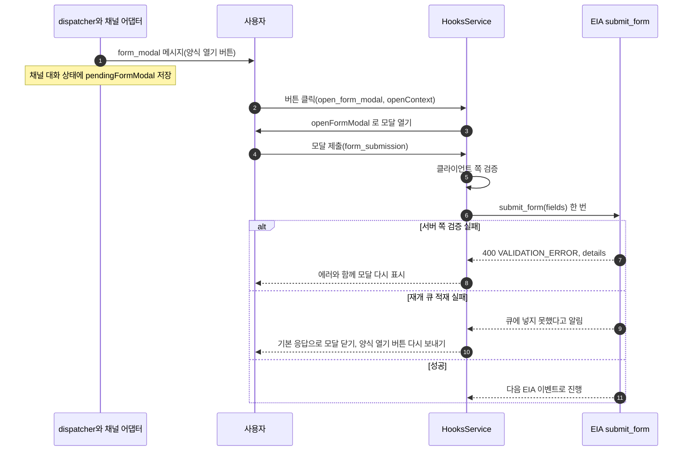

## 개요

이 문서는 [채팅 채널 어댑터 규약](CLE-CHAT-ADAPTER.md) 의 하위 문서로 Form 입력 대기를 받는 두 경로(네이티브 모달과 다단계 질문)와 네이티브 모달이 쓰는 타입을 정한다.

## Form 입력 흐름

Form 입력 대기(`execution.waiting_for_input` form)가 오면 채널 어댑터는 `uiMapping.formMode`, `supportsNativeForm`, 필드 구성으로 두 경로 중 하나를 고른다.

- **네이티브 모달**: `supportsNativeForm === true`, `formMode !== "multi_step"`, 모든 필드가 그 프로바이더의 모달 수용 타입(프로바이더 문서가 정한다), `formConfig.fields.length <= 5` 를 모두 만족할 때.
- **다단계 질문**: 그 밖의 모든 경우(Telegram 처럼 모달 미지원, 필드 6개 이상, 모달이 받지 않는 타입 포함, 사용자가 `multi_step` 선택).

진입 조건은 채널 어댑터가 판단한다. 판정은 공용 순수 함수 `decideFormMode`(`shared/form-mode.ts`)가 한다. 필드 하나가 모달에 들어가는지는 프로바이더 렌더러가 넘기는 판정 함수 `isFieldModalCompatible` 이 정한다. Slack 은 `file` 을 뺀 모든 타입을 받고, Discord 는 `text`·`textarea`·`email`·`number`·`date`·`phone` 만 받는다(R-CCA-8 (a)).

사용자가 버튼을 누르지 않거나 모달을 닫아도 실행은 입력 대기를 유지한다. 채널 어댑터는 다단계 질문으로 자동 강등하지 않고 버튼 메시지를 남겨 다시 누를 수 있게 한다. 입력 대기 시간 초과는 EIA 정책을 따르고 따로 만들지 않는다.

### 네이티브 모달 경로

프로바이더가 네이티브 폼 UI(Slack `views.open`, Discord MODAL)를 지원하면 필드 5개 이하 폼을 모달 하나로 받는다. `trigger_id`(Slack 3초)와 interaction token(Discord 15분)은 사용자 클릭 때만 생기므로 버튼으로 먼저 받아야 한다.



1. 폼이 오면 `renderNode` 가 `form_modal` 메시지 1건(`openLabel` 버튼과 `formConfig`)을 만든다. 채널 대화 상태에 `pendingFormModal`(`fields`, 모드 `native_modal`)을 저장한다.
2. 사용자가 버튼을 누르면 `parseUpdate` 가 `open_form_modal` 명령을 돌려준다(`openContext` 는 Slack `{ triggerId }` 3초, Discord `{ interactionId, interactionToken }` 15분). `HooksService` 가 `openFormModal` 로 곧바로 모달을 연다(Slack `views.open(trigger_id, view)`, Discord interaction 응답 `type: 9` MODAL). view 는 `fields[]` 를 프로바이더 입력 요소로 바꾼다. `block_id`·`custom_id` 는 필드 이름이다.
3. 제출(Slack `view_submission`, Discord `MODAL_SUBMIT`)하면 `parseUpdate` 가 `{ kind: "form_submission", fields }` 로 한 번에 편다.
4. 클라이언트 쪽 검증(모든 필드의 `type`, `pattern`, `minLength`·`maxLength`, 숫자 `min`·`max`)을 한다. 프로바이더 네이티브 검증을 먼저 쓰고 나머지는 채널 어댑터의 schema 검증이다. 통과하면 EIA `submit_form(data: fields)` 을 한 번 부른다.
5. 서버 쪽 검증이 실패하면(`400 VALIDATION_ERROR` + `error.details[{field, message, code}]`) 에러와 함께 모달을 다시 보여 준다. Slack 은 `view_submission` 응답으로 `{ response_action: "errors", errors: { <block_id>: <msg> } }` 를 돌려줘 모달을 유지한다. Discord 는 같은 interaction 에 모달을 다시 보낼 수 없어 후속 메시지의 버튼으로 다시 열게 한다([Discord 어댑터](CLE-CHAT-DISCORD.md)).
6. 성공하면 다음 EIA 이벤트로 넘어간다.
7. 검증을 통과한 제출을 재개 큐에 넣지 못하면(`queued:false`) 입력이 실행에 닿지 않은 것이다. `HooksService` 는 `pendingFormModal` 을 지우지 않고 「양식 작성하기」 버튼을 다시 보낸다. 검증 실패 때 버튼을 다시 보내는 경로와 같다. `buildFormSubmissionResponse` 를 부르지 않으므로 웹훅 응답은 그 채널 어댑터의 기본 응답(`defaultInteractionResponse?`, Discord `{ type: 6 }`, Slack `{}`)이다. 모달은 닫히고 제출했다는 문구는 보이지 않는다. 사용자는 버튼을 다시 눌러 같은 양식을 다시 낸다. 경고 로그와 채널 건강도 `degraded` 는 [채팅 채널 「인바운드 HTTP 응답 계약」](CLE-CHAT-CORE.md#인바운드-http-응답-계약) 의 재개 명령 큐 적재 실패 규칙을 따른다(R-CCA-8 (e)).

모달에서도 프로바이더 네이티브 검증(Slack input `min_length`·`max_length`, Discord `TEXT_INPUT` `min_length`·`max_length`·`required`)을 먼저 쓰고, `pattern`·email 같은 나머지 schema 검증은 제출 직후 채널 어댑터가 한다. 실패하면 5단계의 재표시 경로를 탄다. "틀린 필드만 다시" 라는 다단계 질문의 원칙은 모달에서도 같다(모달 전체를 유지하고 틀린 필드만 에러로 강조한다).

### 다단계 질문

모달을 쓰지 않는 폼은 모든 채널 어댑터가 필드별 질문을 차례로 보내는 같은 흐름으로 받는다.

1. `formConfig.fields[0]` 의 `form_prompt` 를 보낸다. 채널 대화 상태에 현재 필드 인덱스를 저장한다(`currentFieldIdx=0`).
2. 사용자가 답하면(`text_message`, `contact_share` 등) 채널 어댑터는 EIA `submit_form` 을 바로 부르지 않고 자체 버퍼에 채운다(`partialFormData[fields[0].name] = value`).
3. 필드 단위 클라이언트 쪽 검증(`type`, `pattern`, `minLength`·`maxLength`, 숫자 `min`·`max` 같은 schema 수준)을 한다. 실패하면 같은 필드의 `form_prompt` 를 다시 보낸다. `parseUpdate` 는 순수 계약을 지키므로 채널 어댑터가 `sendMessage` 를 직접 부르지 않고, 재질문 메시지 생성과 발송은 호출자(`ChatChannelDispatcher`·`HooksService`)가 한다. 성공하면 `currentFieldIdx` 를 올리고 다음 필드를 묻는다.
4. 마지막 필드의 답이 검증을 통과하면 EIA `submit_form(data: partialFormData)` 을 부른다.
5. EIA 가 서버 쪽 검증 실패(`400 VALIDATION_ERROR` + `error.details[{field, message, code}]`)로 답하면 `details[0].field` 로 `currentFieldIdx` 를 되돌리고 그 필드를 다시 묻는다. 실행은 입력 대기를 유지한다([EIA 수신 API와 SSE](../CLE-IX/CLE-EIA-INBOUND.md) 의 `submit_form` 검증 실패 요구사항).
6. 성공하면 다음 입력 대기, `ai_message`, `completed` 이벤트가 온다.

서버 쪽 검증이 실패해도 인덱스를 되돌리므로 사용자는 처음부터가 아니라 틀린 필드만 다시 답한다.

각 필드 질문의 본문은 세 프로바이더가 같다.

```text
{field.label}{required ? " *" : ""}
{field.description || ""}
```

`field.description` 은 Form 노드의 필드 정의에 없다. [미결 사항](CLE-CHAT-ADAPTER.md#미결-사항) 참조.

## 네이티브 모달 타입

`openFormModal` 과 `buildFormSubmissionResponse` 가 쓰는 타입이다. 프로바이더마다 모달을 여는 방식이 달라 결과 타입이 그 차이를 흡수한다.

```typescript
interface FormModalField {
  name: string;                       // 모달 입력 요소의 block_id·custom_id
  label: string;
  type: string;                       // Form 노드 필드 타입
  required?: boolean;
  description?: string;               // Form 노드 필드 정의에는 없다(미결 사항)
  options?: Array<{ label: string; value: string }>;  // select·radio 선택지
  minLength?: number;                 // text·textarea 길이 제약. 모달 입력 요소에 싣는다
  maxLength?: number;
  min?: number;                       // number 범위. 모달 UI 에는 싣지 않는다
  max?: number;
  pattern?: string;                   // 정규식. 모달 UI 에는 싣지 않는다
  allowedMimeTypes?: string[];        // file 필드 전용 제약. 모달은 file 을 받지 않아 모달 UI 에는 싣지 않는다
  maxFileSize?: number;               // MB
  maxTotalSize?: number;              // MB
  maxFiles?: number;
}

interface OpenFormModalParams {
  config: ChatChannelConfig;
  /** parseUpdate 가 뽑은 프로바이더 토큰. Slack { triggerId }, Discord { interactionId, interactionToken }. */
  openContext: Record<string, string>;
  fields: FormModalField[];           // modalKind "reply" 면 빈 배열
  conversationKey: string;
  nodeId: string;                     // modalKind "reply" 면 빈 문자열
  title?: string;                     // formConfig.title. 없으면 채널 어댑터가 languageHints·기본 문구를 쓴다
  modalKind?: "form" | "reply";       // 기본 "form"
}

interface OpenFormModalResult {
  /** Discord 는 웹훅 HTTP 응답 본문({ type: 9, data })을 여기 담는다. Slack 은 views.open 을 부르고 비운다. */
  httpResponse?: unknown;
}

interface FormSubmissionResult {
  /** 웹훅 HTTP 응답 본문(Slack response_action: errors, Discord ack). 비우면 일반 ack 다. */
  httpResponse?: unknown;
}
```

## Rationale

### R4 다단계 질문을 규약 수준에서 강제한다

모든 채널 어댑터가 같은 흐름을 따라야 채널 프로바이더가 달라도 사용자 경험이 같다. 프로바이더마다 네이티브 폼 UI(Telegram Mini App, Slack Block Kit 등)가 있을 수 있지만 1차 범위의 기본은 다단계 질문으로 통일한다. 일반적인 네이티브 UI 분기는 후속 범위의 옵션이었고, "지원 프로바이더, 필드 5개 이하, 모든 필드가 모달 수용 타입" 인 경우만 1차 범위에서 예외로 모달을 허용한다(R-CCA-8).

이 예외(R-CCA-8)는 R4 가 기각한 대안을 되살린 것이 아니라 R4 가 적어 둔 미래 경로를 연 것이다. R4 의 핵심 가치(채널 프로바이더 간 다단계 질문의 일관성)는 (a) `formMode: "multi_step"` 선택, (b) 모달 미지원 프로바이더(Telegram)의 자동 다단계, (c) 필드 6개 이상이나 모달 미수용 타입일 때의 다단계 fallback 으로 지켜진다.

### R-CCA-8 네이티브 폼 모달 예외: 필드 5개 이하 모달 하나

R4 가 예고한 "네이티브 UI 분기" 를 실현한 것이다. capability(`supportsNativeForm`)로 프로바이더 능력을 드러내고 `uiMapping.formMode`(`auto`·`native_modal`·`multi_step`)로 사용자가 제어한다. 모달을 곧바로 열 수 없는 문제는 `form_modal` 버튼으로 해결하고, Telegram 은 `supportsNativeForm=false` 라 다단계를 유지해 R4 의 일관성을 지킨다. 모든 프로바이더에 모달을 강제하지 않는 이유는 Telegram 이 네이티브 모달을 지원하지 않아(Mini App 은 별도의 큰 작업) 채널 프로바이더 간 UX 가 너무 갈리기 때문이다. 필드 6개 이상을 여러 페이지 모달로 받지 않는 이유는 Discord 모달이 `ACTION_ROW` 5개 × `TEXT_INPUT` 1개로 5개가 한계이기 때문이다. Slack 이 더 많은 input block 을 받더라도 공통 분모를 5로 맞춰 프로바이더 간 동작을 같게 한다. 버튼 없이 폼 도착 즉시 모달을 열 수 없는 이유는 입력 대기 이벤트가 서버가 먼저 보내는 push 라 그 시점에 `trigger_id`(Slack)·interaction token(Discord)이 없기 때문이다. 반드시 사용자 인터랙션으로 토큰을 얻은 뒤 연다.

- (a) 모달 수용 필드 타입은 프로바이더마다 다르다. Slack 모달은 `plain_text_input`·`static_select`·`datepicker`·`checkboxes` 를 input block 으로 받고, Discord 모달은 `TEXT_INPUT` 만 받는다(`SELECT_MENU`·datepicker 는 모달 밖 요소). 그래서 진입 조건에 "모든 필드가 모달 수용 타입" 이 들어간다. date 는 Slack 이 `datepicker` 로, Discord 가 `TEXT_INPUT` 으로 받는다. Discord 는 select·radio·checkbox·file 이 하나라도 있으면 필드가 5개 이하여도 다단계다(file 은 Discord 의 1차 범위 미지원과 같은 결론).
- (b) 모달 열기는 선택 함수 `openFormModal?`(와 `buildFormSubmissionResponse?`)로 둔다. `ackInteraction(update, config)` 시그니처는 모달 합성에 필요한 폼 필드(채널 대화 상태의 `pendingFormModal.fields`)를 받지 못한다. 모달 합성에는 필드와 프로바이더 토큰이 둘 다 필요한데 ack 시점에는 토큰만 있다. "함수 추가 = 모든 프로바이더 계약 변경" 이라는 우려는 선택(`?`) 시그니처로 피한다. 모달 미지원 프로바이더는 구현하지 않고 기존 필수 계약은 그대로다.
- (c) 서버 쪽 검증 재표시는 "틀린 필드만 다시" 를 모달에서도 지킨다(Slack `response_action: errors`, Discord 모달 다시 열기).
- (d) 운영 데이터가 없어 `formMode` 기본값을 `auto` 로 바꿔도 옛 `"multi_step"` 값의 뜻은 같고 마이그레이션이 필요 없다.
- (e) 모달 제출을 재개 큐에 넣지 못하면(`queued:false`) 폼 제출 성공 응답 대신 그 채널 어댑터의 기본 응답으로 답하고, `pendingFormModal` 을 남긴 채 「양식 작성하기」 버튼을 다시 보낸다. 2026-11-13 사람 결정(NERV 질문 `01a1d2f3-df05-7334-88a9-e745d4a668dc`)이고 출처는 NERV Task `CLE-T-6ZTPZ8` 2번이다. 입력이 실행에 닿지 않았는데 성공 응답을 보내면 사용자는 제출이 끝났다고 믿는다. `pendingFormModal` 을 지우면 같은 양식을 다시 열 길이 없다. 검증 실패 때 쓰는 버튼 재발송 경로를 그대로 쓰므로 새 경로가 생기지 않는다. 채널 건강도를 `degraded` 로 바꾸는 2026-10-17 결정은 바꾸지 않았다.
