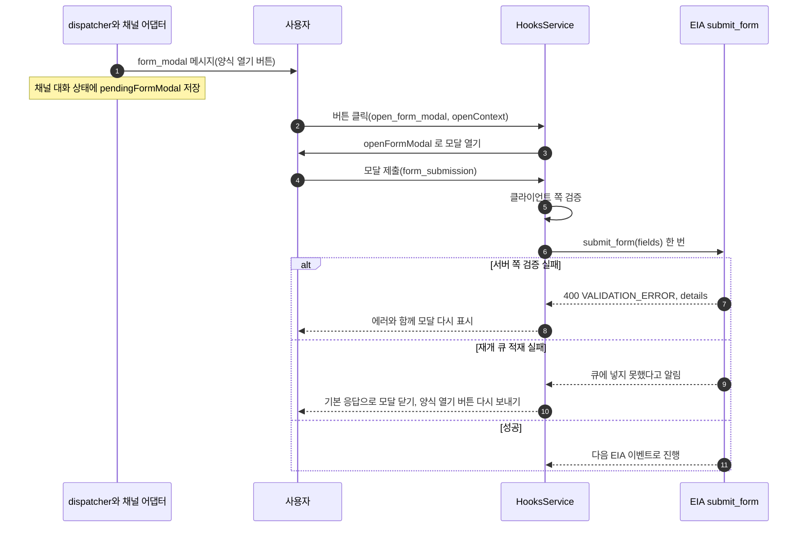

> 구현 상태: 부분 구현 · 원문: `spec/conventions/chat-channel-adapter.md` · 용어: [용어 사전](../CLE-GLOSSARY.md)

## 개요

이 규약은 외부 메신저(Telegram, Slack, Kakao 등)마다 있는 채널 어댑터(`ChatChannelAdapter`)가 구현해야 하는 함수 시그니처와 데이터 타입 계약을 정한다. 모든 채널 어댑터가 이 인터페이스를 지키면 [채팅 채널](CLE-CHAT-CORE.md) 의 시스템 동작과 저절로 맞는다.

채널 어댑터가 여러 채널 프로바이더에 공통으로 따르는 동작도 여기서 정한다. 이벤트별 렌더 매핑, 실행 실패 안내 분류 알고리즘, Form 입력 흐름(네이티브 모달과 다단계 질문)이다. 프로바이더별 API 호출, 길이 한도, escape, 모달 수용 필드 타입 같은 세부는 [Telegram 어댑터](CLE-CHAT-TELEGRAM.md), [Slack 어댑터](CLE-CHAT-SLACK.md), [Discord 어댑터](CLE-CHAT-DISCORD.md) 가 정한다. 이 문서에서 단독으로 쓴 「프로바이더」 는 채널 프로바이더를 뜻한다.

다음은 다른 문서가 정한다. `Trigger.config.chatChannel` 필드 계약과 안내 문구 기본값은 [채팅 채널 데이터와 흐름](CLE-CHAT-DATA.md) 이, 요구사항·봇 토큰 재발급 API·인바운드 응답 계약은 [채팅 채널](CLE-CHAT-CORE.md) 이, External Interaction API(EIA) 이벤트 페이로드는 [EIA 알림 웹훅](../CLE-IX/CLE-EIA-NOTIFY.md) 이 정한다.

## 규칙

1. 모든 채널 어댑터는 [채널 어댑터 인터페이스](#채널-어댑터-인터페이스) 의 필수 함수를 구현한다. 선택 함수(`revokeBotToken?`, `enrichInbound?`, `defaultInteractionResponse?`, `ackDroppedUpdate?`, `openFormModal?`, `buildFormSubmissionResponse?`)는 프로바이더가 해당 기능을 지원할 때만 구현한다.
2. `parseUpdate`, `renderNode`, `escapeControlText`, `defaultInteractionResponse`, `buildFormSubmissionResponse` 는 순수 함수다. DB 에 접근하지 않고 외부 API 를 부르지 않는다. 부수 효과는 `setupChannel`, `teardownChannel`, `sendMessage`, `ackInteraction`, `ackDroppedUpdate`, `revokeBotToken`, `enrichInbound`, `openFormModal` 이 맡는다. 외부 API 로 알아내야 하는 update 정보는 `parseUpdate` 뒤에 `enrichInbound` 가 채운다.
3. `parseUpdate` 는 해석할 수 없거나 무시할 update 에 `null` 을 돌려준다. `null` 의 뜻은 "채널 어댑터가 해석하지 않음" 하나뿐이다. 안내 메시지를 보낼지는 호출자(`HooksService`)가 raw body 의 프로바이더 메타(예: Telegram `chat.type`, `from.is_bot`)를 보고 정한다.
4. `setupChannel` 은 같은 설정으로 다시 불러도 등록이 깨지지 않아야 한다(멱등). 이 멱등은 발급 시크릿 값이 그대로라는 뜻이 아니다([setupChannel 멱등의 뜻](#setupchannel-멱등의-뜻)).
5. `setupChannel`·`teardownChannel` 이 자격 증명 거부로 실패하면 던지는 `Error` 에 `code: 'BOT_TOKEN_INVALID'` 를 싣는다. 호출자는 `err.code === 'BOT_TOKEN_INVALID'` 정확 일치로만 분류하고 `message` 를 해석하지 않는다([setupChannel 실패 판별](#setupchannel-실패-판별)).
6. `renderNode` 의 입력은 `EiaEvent | ChatChannelInternalEvent` union 이다. 구현체는 `event.type` 으로 나눈다. 새 이벤트를 받으려면 새 함수가 아니라 union variant 를 더한다(R-CCA-7).
7. 제어 안내(control-plane message)를 `renderNode` 를 거치지 않고 보낼 때 호출자는 발송 직전 `escapeControlText` 로 escape 한다. `renderNode` 출력은 렌더러가 이미 escape 했으므로 `sendMessage` 가 다시 escape 하지 않는다.
8. 실행 실패 안내는 프로바이더와 무관한 순수 함수 `classifyExecutionFailure` 하나로 분류한다. 입력은 `error.code` 와 `error.details.statusCode` 뿐이다([실행 실패 안내 분류](#실행-실패-안내-분류)).
9. Form 입력 대기는 [Form 입력 흐름](#form-입력-흐름) 을 따른다. 네이티브 모달 조건에 맞지 않으면 모든 채널 어댑터가 같은 다단계 질문을 쓴다.
10. 봇 토큰과 인바운드 서명 자료는 시크릿 저장소 참조로만 들고 다닌다. 평문을 설정 JSON, 로그, metric 에 내놓지 않는다. `SetupResult.issuedInboundSigning` 한 번만 예외다. 클라이언트가 만든 실패 문장은 `chat_channel_last_error` 에 저장되고 로그에도 남는다. 그래서 프로바이더 API 클라이언트(`providers/<프로바이더>/<프로바이더>-client.ts`)는 그 문장(fetch 예외, API 호출 재시도 소진 사유)을 돌려주거나 로그에 남기기 전에 그 호출에 쓴 봇 토큰을 지운다(알려진 비밀 치환, `replaceKnownSecret`, [응답 자격 증명 마스킹](../CLE-API/CLE-API-EGRESS.md) §1.1). 지우는 대상은 토큰과 글자 그대로 같은 부분과 양끝 공백을 뗀 토큰이다(fetch 는 헤더 값 양끝 공백을 떼고 원문에 싣는다). 프로바이더가 돌려준 4xx 본문은 실패 판별(규칙 5, 「setupChannel 실패 판별」)의 입력이라 바꾸지 않는다. 호출자가 `message` 를 해석하지 않는다는 규칙과는 다른 층이다(클라이언트가 `code` 를 정하는 단계다).
11. `sendMessage` 는 프로바이더별 고정 URL 만 부른다. 사용자가 정하는 URL 은 쓰지 않는다(SSRF(Server-Side Request Forgery) 차단).
12. 채널 프로바이더 식별자(`provider`)는 소문자 kebab-case 이고 [채널 어댑터 레지스트리](#채널-어댑터-레지스트리) 에 등록한다.
13. 인터페이스를 바꾸면 [채팅 채널](CLE-CHAT-CORE.md) 과 영향받는 모든 프로바이더 문서를 함께 고친다. 채널 프로바이더 목록이나 지원 상태가 바뀌면 채널 프로바이더 카탈로그도 고친다([변경 관리](#변경-관리)).
14. 프로바이더 API 클라이언트는 실패를 `ok: false` 표지로 돌려준다. 프로바이더가 돌려준 4xx 본문이든 클라이언트가 API 호출 재시도를 다 쓰고 만든 합성 실패든 같다. 채널 어댑터는 이 표지로 실패를 판정하고 프로바이더 원본 응답 필드(Discord 숫자 `code`)가 있는지로 판정하지 않는다. 실패한 `sendMessage` 는 throw 한다. `setupChannel` 이 부르는 하위 호출이 실패하면 `setupChannel` 실패다([클라이언트 실패 판정](#클라이언트-실패-판정), R-CCA-11).

## 채널 어댑터 인터페이스

```typescript
interface ChatChannelAdapter {
  /** 채널 프로바이더 식별자. config.chatChannel.provider 와 1:1. 소문자 kebab-case. */
  readonly provider: string;

  /**
   * 프로바이더가 네이티브 폼 UI(Slack `views.open` 모달, Discord MODAL)를 지원하는가.
   * true 이고 uiMapping.formMode 가 auto·native_modal 이며, 모든 필드가 그 프로바이더의
   * 모달 수용 타입이고 fields.length <= 5 면 네이티브 모달 경로를 탄다.
   * false(Telegram 등)면 늘 다단계 질문이다.
   * 값은 채널 어댑터 구현체가 선언한다. 모달 수용 타입 범위는 프로바이더 문서가 정한다(R-CCA-8).
   */
  readonly supportsNativeForm: boolean;

  /**
   * 트리거 생성, chatChannel 이 실린 PATCH, 봇 토큰 재발급 때 부른다. 트리거를 켤 때는 부르지 않는다. 외부 메신저의 webhook·long-poll 등록.
   * @returns 채널 어댑터별 setup 결과(예: bot identity). 일부는 config 에 캐시한다.
   */
  setupChannel(config: ChatChannelConfig, callbackUrl: string): Promise<SetupResult>;

  /** 트리거 행을 없앨 때 부른다(트리거 · 워크플로우 · 워크스페이스 삭제, 등록하는 사이 행이 사라졌을 때의 보상). 트리거를 끌 때는 부르지 않는다. 외부 hook 해제. 부분 실패는 허용한다. */
  teardownChannel(config: ChatChannelConfig): Promise<void>;

  /**
   * 외부 메신저 update → 워크플로우 입력. 웹훅 진입점이 부른다.
   * 순수 함수(DB 미접근, 외부 API 미호출). 무시 대상(그룹 대화, 봇 자기 메시지 등)은 null.
   * 외부 API 로 알아내야 하는 정보는 enrichInbound 가 채운다.
   */
  parseUpdate(raw: unknown, config: ChatChannelConfig): Promise<ChannelUpdate | null>;

  /**
   * EIA 이벤트와 채팅 채널 내부 이벤트 → 외부 메신저 메시지. 순수 함수.
   * 단일 sink WebsocketService.executionEvents$ 를 구독하는 ChatChannelDispatcher 가 부른다.
   * 구현체는 event.type 판별 union 으로 나눈다(R-CCA-7).
   */
  renderNode(
    event: EiaEvent | ChatChannelInternalEvent,
    config: ChatChannelConfig,
  ): Promise<ChannelMessage[]>;

  /** 외부 메신저 API 호출(sendMessage, sendPhoto 등). API 호출 재시도·rate limit·에러 처리 책임. */
  sendMessage(message: ChannelMessage, config: ChatChannelConfig): Promise<SendResult>;

  /**
   * 인터랙션 후처리. HooksService 가 인바운드 명령 처리(interact 호출, /cancel, 새 실행 시작)를 마친 뒤 부른다.
   * Telegram 은 처리한 버튼 탭에 answerCallbackQuery(버튼 탭 수신 확인 의무)를 부르고 원본 메시지의 인라인 키보드를 지운다.
   * Slack 은 response_url 로 원본 메시지를 "선택 완료" 문구로 바꾼다.
   * 버린 update 에는 부르지 않는다. 버린 버튼 탭의 수신 확인은 ackDroppedUpdate 가 하고 키보드는 남긴다.
   * Slack·Discord 의 3초 안 수신 확인은 웹훅 HTTP 응답(defaultInteractionResponse)이 맡고 이 함수는 하지 않는다.
   * 할 일이 없으면 빈 구현이어도 된다(Discord).
   */
  ackInteraction(update: ChannelUpdate, config: ChatChannelConfig): Promise<void>;

  /**
   * 제어 안내 텍스트를 프로바이더 표면에 맞게 escape 한다. 순수 함수.
   * HooksService 가 renderNode 를 거치지 않고 sendMessage 로 바로 보내는 문구
   * (surfaceMismatch, executionStillRunning, groupChatRefusal, unsupportedMessageKind,
   * help, formValidationFailed, formNextField)에 발송 직전 적용한다.
   *   - telegram → MarkdownV2 escape(escapeMarkdownV2, renderNode 와 같은 규칙)
   *   - slack → mrkdwn escape(<, >, & 만)
   *   - discord → 그대로(렌더러도 escape 하지 않는다)
   * 그래서 languageHints 기본값과 덮어쓰기는 모두 평문으로 쓴다.
   */
  escapeControlText(text: string): string;

  /**
   * (선택) 봇 토큰 재발급과 관련해 이전 토큰을 외부 프로바이더에서 revoke 한다.
   * Slack auth.revoke 처럼 revoke API 가 있는 프로바이더만 구현하고 Telegram·Discord 는 구현하지 않는다(undefined).
   * 호출자는 존재 여부를 type-guard 로 확인하고 실패해도 흐름을 막지 않는다.
   * 호출자는 둘이다(R-CCA-10).
   *   - 24시간 유예가 끝난 정리 작업(TriggersService.cleanupRotatedChatChannelTokens): v2 참조(bot-token.v2)에 백업해 둔 이전 토큰을 폐기한다.
   *   - 재발급(TriggersService.rotateBotToken): 유예 안에 다시 교체해 v2 백업에서 덮인 토큰을 폐기한다.
   *     교체가 끝까지 성공한 뒤(설정 컬럼 갱신과 감사 기록 뒤)에만 부른다. 덮인 값이 비었거나 지금 토큰·새 토큰과 같으면 부르지 않는다.
   * 재발급이 방금 v2 로 백업한 이전 토큰은 재발급 시점에 폐기하지 않는다.
   * @param oldBotToken 폐기할 봇 토큰 평문. 유예가 끝난 v2 백업이거나 유예 중 재교체로 v2 에서 덮인 값이다.
   * @returns 외부 API 응답과 무관하게 void. 내부 에러는 호출자에 전파하지 않고 흡수한다(logger.warn).
   */
  revokeBotToken?(oldBotToken: string): Promise<void>;

  /**
   * (선택) parseUpdate 가 순수 함수라 부르지 못하는 외부 API 로 update 를 보강한다. 순수 함수가 아니다.
   * HooksService 가 parseUpdate, 인바운드 중복 제거, 분당 한도 검사를 마친 뒤 부른다.
   * Slack 은 file_upload 의 mimeType·filename·urlPrivate 를 files.info 한 번으로 채운다.
   * 받은 update 를 바꾸지 않고 보강한 새 객체를 돌려준다. 보강할 정보가 없는 프로바이더는 구현하지 않는다.
   */
  enrichInbound?(update: ChannelUpdate, config: ChatChannelConfig): Promise<ChannelUpdate>;

  /**
   * (선택) 인터랙션에 3초 안에 200 으로 돌려줄 기본 응답을 만든다. 순수 함수.
   * Discord 는 컴포넌트·모달 제출에 { type: 6 }, 슬래시 명령에 본인에게만 보이는 { type: 4 } 를 돌려준다.
   * Slack 은 Interactivity payload 에 빈 본문({})을, 슬래시 명령에 본인에게만 보이는
   * { response_type: 'ephemeral', text } 를 돌려준다. text 는 help 하위 명령이면 도움말, 그 밖에는 수신 문구다.
   * 인터랙션이 아니면 undefined 이고 웹훅 응답은 202 다.
   * HooksService 가 서명 검증 직후, 트리거 활성 관문보다 먼저 부른다. 그래서 트리거가 비활성이어도 이 응답으로 답한다.
   * 경로가 따로 만든 응답 본문(openFormModal 의 httpResponse, buildFormSubmissionResponse)이 있으면 그것이 먼저다.
   * parseUpdate 보다 먼저 불리고 버린 update 에도 답해야 해서 raw body 를 받는다(R-CCA-14).
   */
  defaultInteractionResponse?(raw: unknown, config: ChatChannelConfig): InboundInteractionResponse | undefined;

  /**
   * (선택) 버린 update 의 수신 확인. 순수 함수가 아니다.
   * HooksService 가 update 를 버리는 여섯 경로(파싱 실패, 중복, 분당 한도 초과, 입력 대기가 아닌 실행 중,
   * 워크플로우 비활성, 워크플로우 없음)에서 부른다. 트리거가 비활성일 때는 부르지 않는다.
   * Telegram 은 본문이 callback_query 면 answerCallbackQuery 만 보내고 인라인 키보드는 남긴다.
   * 실패는 HooksService 가 경고 로그만 남기고 삼키며 웹훅 HTTP 응답은 바뀌지 않는다.
   * 파싱하지 못한 update 에도 불러야 해서 raw body 를 받는다(R-CCA-14).
   */
  ackDroppedUpdate?(raw: unknown, config: ChatChannelConfig): Promise<void>;

  /**
   * (선택, supportsNativeForm=true 만) 네이티브 모달을 연다. 타입은 네이티브 모달 타입 절.
   * open_form_modal 명령이 오면 HooksService 가 부른다. modalKind 가 "form"(기본)이면 채널 대화 상태의
   * pendingFormModal(fields, nodeId, title)과 openContext(trigger_id·interaction token)로 모달을 만든다.
   * "reply" 는 AI 답장용 텍스트 입력 하나짜리 모달(Discord)이고 pendingFormModal 없이 fields 를 비워 부른다.
   * Slack 은 views.open 을 부르고 httpResponse 를 비운다. Discord 는 모달을
   * 웹훅 HTTP 응답 본문({ type: 9 })으로 돌려준다(OpenFormModalResult.httpResponse).
   * ackInteraction 에 넣지 않는 이유는 R-CCA-8 (b).
   */
  openFormModal?(params: OpenFormModalParams): Promise<OpenFormModalResult>;

  /**
   * (선택, supportsNativeForm=true 만) 모달 제출의 프로바이더 HTTP 응답을 만든다. 순수 함수.
   * EIA submit_form 호출은 HooksService 가 한다. 이 함수는 ack 나 검증 실패 재표시 본문만 만든다.
   */
  buildFormSubmissionResponse?(params: {
    config: ChatChannelConfig;
    validationError?: { field?: string; message: string };
  }): FormSubmissionResult;
}
```

### 함수 책임

| 함수 | 책임 | 부수 효과 | 멱등성 |
|---|---|---|---|
| `setupChannel` | 외부 메신저의 인바운드 hook 등록(Telegram `setWebhook`)과 bot identity 조회. 실패 사유를 `code` 로 선언한다 | 외부 API 호출 1회 이상 | 같은 설정으로 다시 불러도 된다. 뜻은 [setupChannel 멱등의 뜻](#setupchannel-멱등의-뜻) |
| `teardownChannel` | 외부 메신저의 hook 해제. 부분 실패 허용 | 외부 API 호출 | 멱등 |
| `parseUpdate` | raw body → `ChannelUpdate \| null`. `null` 은 "해석하지 않음" 하나의 뜻이다. 안내 발송 여부는 호출자가 정한다 | 없음 | 순수 |
| `renderNode` | `EiaEvent \| ChatChannelInternalEvent` → `ChannelMessage[]` | 없음 | 순수 |
| `sendMessage` | 외부 API 호출. API 호출 재시도·rate limit 책임 | 외부 API 호출 | 옛 규약은 "중복 제거는 호출자가 EIA `seq` 와 `X-Clemvion-Delivery` 로 한다" 고 적었다. 정의가 갈린다([미결 사항](#미결-사항)) |
| `ackInteraction` | 인바운드 명령을 처리한 뒤의 인터랙션 후처리. 처리한 Telegram 버튼 탭에는 `answerCallbackQuery` 를 보내고 인라인 키보드를 지운다. Slack 은 `response_url` 로 메시지를 갱신한다. 버린 update 에는 부르지 않는다(버린 탭은 `ackDroppedUpdate?`). Slack·Discord 의 3초 안 수신 확인은 웹훅 HTTP 응답(`defaultInteractionResponse?`)이 맡고 이 함수는 하지 않는다. 함수는 필수지만 빈 구현이어도 된다(Discord) | 프로바이더에 따라 외부 API 호출 | 멱등 |
| `escapeControlText` | 제어 안내 텍스트를 프로바이더 표면에 맞게 escape | 없음 | 순수 |
| `revokeBotToken?` | 이전 봇 토큰의 외부 revoke(Slack `auth.revoke`). API 가 없으면 구현하지 않는다. 실패는 흡수한다. 24시간 유예가 끝난 정리 작업(`cleanupRotatedChatChannelTokens`)이 v2 백업의 이전 토큰에 부른다. 재발급(`rotateBotToken`)은 방금 백업한 이전 토큰에는 부르지 않는다. 유예 안에 다시 교체해 v2 백업에서 덮인 토큰에만 교체가 성공한 뒤 부른다(R-CCA-10) | 프로바이더에 따라 외부 API 호출 | 멱등 |
| `enrichInbound?` | `parseUpdate` 결과를 외부 API 로 보강한다(Slack `files.info` 로 파일 이름·MIME·다운로드 URL). 호출자는 `HooksService` 이고 인바운드 중복 제거와 분당 한도 검사 뒤에 부른다. 보강할 정보가 없으면 구현하지 않는다 | 프로바이더에 따라 외부 API 호출 | 멱등 |
| `defaultInteractionResponse?` | 인터랙션의 3초 안 기본 응답 본문을 raw body 로 만든다(Discord `{ type: 6 }`·`{ type: 4 }` ephemeral, Slack Interactivity 빈 본문과 슬래시 명령 `{ response_type: 'ephemeral', text }`). `undefined` 면 `202` 다. 서명 검증 직후, 트리거 활성 관문보다 먼저 불려 비활성 트리거에도 쓴다. 경로가 만든 응답 본문이 있으면 그것이 먼저다([인터랙션 기본 응답과 수신 확인](#인터랙션-기본-응답과-수신-확인)) | 없음 | 순수 |
| `ackDroppedUpdate?` | 버린 update 의 수신 확인을 raw body 로 보낸다(Telegram 버린 버튼 탭에 `answerCallbackQuery` 만, 키보드는 남긴다). 버리는 여섯 경로에서 부르고 비활성 트리거에서는 부르지 않는다. 실패는 호출자가 삼키고 웹훅 HTTP 응답은 바뀌지 않는다 | 프로바이더에 따라 외부 API 호출 | 요구하지 않는다(실패해도 결과에 영향이 없다) |
| `openFormModal?` | `form_modal` 버튼 클릭(`open_form_modal` 명령) 때 모달을 연다. Slack 은 `views.open(trigger_id, view)`, Discord 는 웹훅 응답 본문 `{ type: 9 }`. 모달 합성에 채널 대화 상태의 `pendingFormModal.fields` 가 필요해 호출자는 `HooksService` 다. Discord 의 AI 답장 모달(`modalKind: "reply"`)도 이 함수로 열고, 이때는 `pendingFormModal` 없이 부른다 | 외부 API 호출 또는 HTTP 응답 본문 합성 | 멱등 |
| `buildFormSubmissionResponse?` | 모달 제출(`form_submission`)의 HTTP 응답 합성. ack(Slack 빈 200, Discord `{ type: 4 }` ephemeral)나 검증 실패 재표시(Slack `response_action: errors`)만 만든다. 제출을 재개 큐에 넣지 못하면 호출자는 이 함수를 부르지 않고 기본 응답으로 답한다([네이티브 모달 경로](#네이티브-모달-경로)) | 없음 | 순수 |

### 인터랙션 기본 응답과 수신 확인

인터랙션의 웹훅 HTTP 응답과 수신 확인은 세 함수가 나눠 맡는다. `defaultInteractionResponse?` 는 3초 안에 돌려줄 응답 본문을 만들고, `ackInteraction` 은 처리한 인터랙션의 후처리를, `ackDroppedUpdate?` 는 버린 update 의 수신 확인을 한다.

| 프로바이더 | `defaultInteractionResponse?` | `ackInteraction`(처리한 인터랙션) | `ackDroppedUpdate?`(버린 update) |
|---|---|---|---|
| Telegram | 구현하지 않는다. 웹훅 응답은 늘 `202` 다 | 처리한 버튼 탭에 `answerCallbackQuery` 를 보내고 원본 메시지의 인라인 키보드를 지운다 | 본문에 `callback_query.id`(비어 있지 않은 문자열)가 있으면 `answerCallbackQuery` 만 보낸다. 인라인 키보드는 남겨 잠시 뒤 다시 누를 수 있다. 그 밖의 update 에는 아무것도 하지 않는다 |
| Slack | 본문에 문자열 `payload` 필드가 있으면(Interactivity: `block_actions`·`view_submission`) `{}` 를 돌려줘 `200` 빈 본문으로 답한다. 슬래시 명령은 본인에게만 보이는 `{ response_type: 'ephemeral', text }` 다. `help` 하위 명령이면 도움말을, 그 밖의 하위 명령이면 수신 문구를 싣는다. `text` 는 mrkdwn 으로 렌더되므로 `&` `<` `>` 를 escape 한다. `help` 는 실행으로 보내지 않고 이 응답 하나로 끝난다. Events API 와 URL Verification 은 `undefined`(`202`)다 | `response_url` 이 있으면 원본 메시지를 "선택 완료" 문구로 바꾼다 | 구현하지 않는다. 3초 응답이 수신 확인이다 |
| Discord | 컴포넌트·모달 제출은 `{ type: 6 }`, 슬래시 명령은 본인에게만 보이는 `{ type: 4 }`(도움말이나 수신 문구)다. PING, 자동완성, 알 수 없는 `type` 은 `undefined` 다 | 빈 구현 | 구현하지 않는다. 3초 응답이 수신 확인이다 |

- 웹훅 HTTP 응답은 이 순서로 정한다. (1) 경로가 만든 응답 본문(`openFormModal` 의 `httpResponse`, `buildFormSubmissionResponse`), (2) `defaultInteractionResponse?` 의 기본 응답, (3) 그 밖은 `202` 와 `{ data: { executionId } }`. 기본 응답에 `body` 가 있으면 `200` 과 그 본문을 `{ data }` 봉투 없이 보내고, `body` 가 없으면 `200` 빈 본문을 보낸다.
- 트리거가 비활성이면 `HooksService` 는 실행을 시작하지 않고 외부 API 도 부르지 않는다. `defaultInteractionResponse?` 는 외부 호출이 없어 이때도 쓰고, `ackDroppedUpdate?` 는 부르지 않는다.
- 핸드셰이크(Slack URL Verification, Discord PING)는 이 함수들이 아니라 `HooksService` 가 트리거 활성 관문 뒤에서 답한다. 그래서 트리거가 비활성이면 핸드셰이크는 `202` 다.
- 기본 응답이 있는 update 로 새 실행을 시작하면 그 실행의 `response_code` 는 실제로 보낸 응답 코드인 `'200'` 이고, 없으면 `'202'` 다.
- 응답 코드 계약은 [채팅 채널 「인바운드 HTTP 응답 계약」](CLE-CHAT-CORE.md#인바운드-http-응답-계약) 이 정한다. 프로바이더별 응답 본문은 각 프로바이더 문서가 정한다. Slack 은 [Slack 어댑터 「인바운드 응답」](CLE-CHAT-SLACK.md#인바운드-응답), Discord 는 [Discord 어댑터 「인바운드 응답」](CLE-CHAT-DISCORD.md#인바운드-응답) 이다.

### setupChannel 멱등의 뜻

`setupChannel` 의 멱등은 "같은 설정으로 다시 불러도 등록이 깨지지 않는다" 는 뜻이다. 발급되는 시크릿 값이 그대로라는 뜻이 아니다. Telegram 어댑터는 부를 때마다 `randomBytes` 로 새 `secret_token` 을 만들어 `setWebhook` 에 등록하고, 호출자가 그것을 `inboundSigningRef` 에 다시 저장한다. 이것이 정상 동작이며 저장을 건너뛰면 인바운드 서명 검증이 모두 깨진다([Telegram 어댑터](CLE-CHAT-TELEGRAM.md), [채팅 채널](CLE-CHAT-CORE.md) 의 인바운드 서명 자료 변경).

이 구분은 표현 정리가 아니라 등록과 값 두 층을 가르는 규약이다. 2026-09-10(`#1313`)에 "PATCH 는 비밀을 쓰지 않는다" 결정이 멱등을 값 불변으로 읽고 Telegram 재저장까지 막으려 했다. 그대로 구현했다면 모든 Telegram 인바운드가 401 이 됐다.

### setupChannel 실패 판별

`setupChannel` 이 자격 증명 거부로 실패하면 던지는 `Error` 에 `code: 'BOT_TOKEN_INVALID'` 를 실어 사유를 선언한다. 옛 규약은 `teardownChannel` 과 `revokeBotToken` 도 같이 적었으나 `revokeBotToken` 은 에러를 흡수한다고도 적어 어긋난다([미결 사항](#미결-사항)). 호출자는 `code` 로만 분류하고 `message` 를 해석하지 않는다. `code` 가 없는 에러는 일반 실패로 다룬다. 응답 분류(`400 BOT_TOKEN_INVALID`, `502 CHAT_CHANNEL_SETUP_FAILED`)는 [채팅 채널](CLE-CHAT-CORE.md) 의 봇 토큰 재발급 API 가 정한다(근거 R-CCA-9).

`code` 라는 이름은 이 호출 스택에서 네 가지 뜻으로 쓰인다. 섞으면 조용히 잘못 분기한다.

| 무엇 | 소유 | 값 |
|---|---|---|
| 이 절의 `code` | 채널 어댑터가 새로 던지는 `Error` 의 프로퍼티 | 우리 문자열(`'BOT_TOKEN_INVALID'`) |
| 실행 실패 안내 분류의 `event.error.code` | EIA 이벤트 페이로드 | 실행 실패 분류용, 다른 네임스페이스 |
| `app.code`·`res.code` | 프로바이더 원본 API 응답 필드(Discord) | 숫자. 실패 판별에 쓰지 않는다(클라이언트가 만든 합성 실패에는 없다) |
| Node·undici 시스템 에러의 `code` | 런타임이 붙인다 | `'ENOTFOUND'`, `'ECONNREFUSED'`, `'UND_ERR_*'` |

세 번째는 이름이 가깝다. 이 필드는 프로바이더가 돌려준 4xx 본문에만 있고 클라이언트가 API 호출 재시도를 다 쓰고 만든 합성 실패에는 없다. 그래서 채널 어댑터는 이 필드가 있는지로 실패를 판정하지 않는다([클라이언트 실패 판정](#클라이언트-실패-판정)). 네 번째는 판별을 뒤집는다. DNS 가 죽은 `Error` 도 `.code` 가 있으므로 `if (err.code)` 같은 참거짓 판별은 네트워크 단절을 "토큰이 잘못됐다" 로 보고한다. 그래서 판별은 허용 목록 정확 일치(`err.code === 'BOT_TOKEN_INVALID'`)여야 한다. `telegram-client.ts` 주석이 이미 적고 있듯 undici 는 `ENOTFOUND` 를 이 자리로 보낸다. 구현은 `ENOTFOUND → 502` 테스트로 이 오분류를 막는다.

호출자가 프로바이더 신호 방식을 추측하지 않는 이유는 방식이 서로 다르기 때문이다. Slack 은 HTTP 200 과 `{ok:false, error:'invalid_auth'}`, Discord 는 `verify_key` 불일치(상태 코드 자체가 없다), Telegram 은 `HTTP 401` 로 알린다. 문자열에서 상태 숫자를 찾는 방식은 세 프로바이더 중 두 곳에서 원리적으로 실패한다(2026-09-12 실측).

**한시 예외: 호출자의 401/403 fallback.** `code` 가 없는 에러에 대해 호출자는 message 의 401/403 을 보고 `BOT_TOKEN_INVALID` 로 분류한다. "message 원문으로 분기하지 않는다"(R-CCA-5, [채팅 채널 「R-CC-15 실행 실패 안내의 입력과 자리표시자를 허용 목록으로 제한한다」](CLE-CHAT-CORE.md#r-cc-15-실행-실패-안내의-입력과-자리표시자를-허용-목록으로-제한한다), 실행 엔진 보안 게이트, 에러 코드 카탈로그의 `FILE_REQUIRED` 주석)에 대한 의도적 예외다. `code` 를 아직 붙이지 않은 경로가 조용히 502 로 빠지는 것보다 400 이 사용자에게 낫다.

처음 적은 제거 조건은 1차 범위의 세 채널 프로바이더(Telegram·Slack·Discord)가 모두 `code` 를 붙이는 것이었다. 2026-09-12 에 세 프로바이더 모두 부착을 마쳤지만 실측 판정은 "아직 지우지 말 것" 이다. 부착은 각 프로바이더의 주 경로에 한정되고, fallback 이 유일한 방어인 경로가 남아 있다. 대표적으로 Slack 4xx 응답이 JSON 이 아닐 때 클라이언트가 만드는 `error: 'HTTP 401'` 은 자격 증명 값 허용 목록에 없다. 즉 `code` 부착은 제거의 충분조건이 아니다. 조건만 보고 지우면 그 경로들이 조용히 502 로 바뀐다. 그래서 제거할 수 있는 때는 fallback 이 유일한 방어인 경로가 하나도 남지 않았을 때다.

조건만 적고 추적하지 않으면 한시 예외가 영구 예외가 된다. 남은 경로에 `code` 를 붙이고 제거를 다시 판정하는 일은 NERV Task `CLE-T-PDWFV8` 이 맡는다.

#### 클라이언트 실패 판정

이 절의 앞부분은 채널 어댑터가 호출자에게 실패 사유를 알리는 층이다. 그보다 한 층 아래에서 채널 어댑터는 프로바이더 API 클라이언트(`providers/<프로바이더>/<프로바이더>-client.ts`)의 결과를 보고 실패인지 판정한다.

- 클라이언트는 실패를 `ok: false` 표지로 돌려준다. 프로바이더가 돌려준 4xx 본문이든 클라이언트가 API 호출 재시도를 다 쓰고 만든 합성 실패(fetch 예외, 429 소진, 5xx)든 같다.
- 채널 어댑터는 이 `ok: false` 로 실패를 판정한다. 프로바이더 원본 응답 필드(Discord 숫자 `code`)가 있는지로 판정하지 않는다. 합성 실패에는 그 필드가 없어 실패가 성공으로 처리된다.
- 실패한 `sendMessage` 는 throw 한다. 호출자는 그 실패를 받아 채널 건강도를 `degraded` 로 둔다([채팅 채널 「채널 건강도」](CLE-CHAT-CORE.md#채널-건강도)).
- `setupChannel` 이 안에서 부르는 하위 호출이 실패해도 `setupChannel` 실패다. [Discord 어댑터](CLE-CHAT-DISCORD.md) 의 slash command 일괄 등록(`PUT /applications/{app_id}/commands`)이 그 예다. 결과를 보지 않으면 등록 실패가 정상 설정으로 보인다.
- 자격 증명 거부 판정 방식은 바꾸지 않는다. Discord 는 클라이언트가 실어 준 HTTP `status`(401/403)로 가린다. slash command 일괄 등록이 401/403 으로 실패해도 `code: 'BOT_TOKEN_INVALID'` 를 싣는다(규칙 5).

Slack·Telegram 클라이언트와 채널 어댑터는 이미 `ok` 로 판정한다. 근거는 R-CCA-11 이다.

## 입력 이벤트

### EiaEvent

`EiaEvent` 는 [EIA 알림 웹훅](../CLE-IX/CLE-EIA-NOTIFY.md) 이 정한 아웃바운드 이벤트 다섯 가지의 union 이다. 새 타입을 만들지 않고 EIA 페이로드 모양을 그대로 쓴다(R3).

```typescript
type EiaEvent =
  | { type: "execution.waiting_for_input"; executionId: string; triggerId: string; workflowId: string;
      node: { id: string; type: string; interactionType: "form" | "buttons" | "ai_conversation" | "ai_form_render" };
      interaction: { /* ... */ };
      context: { formConfig?: unknown; buttonConfig?: unknown; conversationConfig?: unknown; conversationThread?: unknown };
      timestamp: string; seq: number }
  | { type: "execution.ai_message"; executionId: string; triggerId: string; workflowId: string;
      message: string; turnCount: number; messages: unknown[]; metadata?: unknown;
      /** AI 에이전트 render_* 표시 도구 턴에만 실린다. */
      presentations?: PresentationPayload[];
      timestamp: string; seq: number }
  | { type: "execution.completed"; executionId: string; triggerId: string; workflowId: string; status: "completed";
      result?: { outputs?: unknown }; durationMs?: number | null; timestamp: string; seq: number }
  | { type: "execution.failed"; executionId: string; triggerId: string; workflowId: string; status: "failed";
      error: { code: string | null; message: string; nodeId: string | null; details?: unknown } | string;
      durationMs?: number | null; timestamp: string; seq: number }
  | { type: "execution.cancelled"; executionId: string; triggerId: string; workflowId: string; status: "cancelled";
      result: { cancelledBy: "user" | "system" | "timeout" }; error?: { code: string; message?: string };
      durationMs?: number | null; timestamp: string; seq: number };
```

- 필드의 기준은 EIA 페이로드다. 종결 세 가지(`completed`·`failed`·`cancelled`)의 필드 집합과 행동 계약도 EIA 가 기준이다. 위 variant 는 그것을 TypeScript 로 옮긴 것이고, 어긋나면 EIA 가 맞다. 필드 집합 표와 행동 계약은 두 곳에 적었다가 실제로 어긋난 적이 있어 여기서 다시 나열하지 않는다. 이벤트 봉투는 평평한 WebSocket 계열이고 `result` 중첩은 유지된다.
- `waiting_for_input` 의 `node`·`interaction`·`context` 는 EIA 의 논리 표기다. 실제 wire 는 `waitingNodeId`·`waitingNodeType`·`interactionType`·`nodeOutput` 같은 평평한 필드이고, dispatcher 가 `toChatChannelEvent` 로 바꿔 채널 어댑터에 넘긴다. `node.type` 은 `waitingNodeType` 에서 온다. `interactionType` 이 `buttons` 인 노드는 Template·Carousel·Table·Chart 가운데 하나라 시각형 메시지를 붙일지는 `interactionType` 만으로 정할 수 없고 `node.type` 을 본다. `interaction` 블록은 EIA 에서 아직 보내지 않는다(미구현).
- 입력 대기 표면(`interactionType`)은 네 값이다([인터랙션 타입 레지스트리](../CLE-IX/CLE-IX-TYPES.md)). `ai_form_render` 는 AI 에이전트 `render_form` 의 블로킹 하위 상태이고 채팅 채널에서는 `ai_conversation` 과 같은 경로다. 채널 어댑터는 서버 안 소비자라 네 값을 받는다. 현재 구현(dispatcher)도 그대로 넘기고, 레지스트리가 이 위치들을 값별 분기 위치로 등록한다([인터랙션 타입 레지스트리 §서버 안 소비자: 채팅 채널](../CLE-IX/CLE-IX-TYPES.md#서버-안-소비자-채팅-채널)). EIA 외부 경로에서 `ai_form_render` 가 어떻게 보이는지는 [인터랙션 타입 레지스트리 §미결 사항](../CLE-IX/CLE-IX-TYPES.md#미결-사항) 에서 다룬다.
- 디버그 전용 `llmCalls` 는 fanout 단계에서 지워져 채널 어댑터에 오지 않는다([WebSocket 이벤트와 명령](../CLE-API/CLE-API-WS-EVENTS.md)).
- `presentations` 의 기준은 [AI 에이전트 노드 출력과 디버그](../CLE-NODE-AI/CLE-NODE-AGENT-OUTPUT.md) 다.
- `completed` 의 `result` 가 선택인 이유: 현재 발행은 `status` 와 `durationMs` 를 채우고 `result.outputs` 만 미구현이다. `cancelled` 의 `result.cancelledBy` 는 발행 타입이 필수로 강제한다([EIA 알림 웹훅 「종결 이벤트 필드 집합」](../CLE-IX/CLE-EIA-NOTIFY.md#종결-이벤트-필드-집합)). `durationMs` 는 2026-08-15 에 종결 세 가지 모두 구현됐고, 모르면 `null` 이다.
- `failed` 의 `error` 가 `| string` 을 품는 이유는 따로 있다. 발행은 2026-08-14 부터 모든 경로가 object(`toTerminalErrorPayload`)다. union 은 배포 경계에서 재생되는 옛 이벤트를 받으려고 일부러 남겼다. 지우면 그 창 동안 실행 실패 안내가 조용히 빠진다.

### ChatChannelInternalEvent

채널 어댑터가 EIA 다섯 가지 밖에 더 받는 서버 안 이벤트다. EIA 클라이언트 SDK 에 드러나지 않고 EIA 알림 웹훅 허용 목록과도 별개다. 구독 원천은 단일 sink `WebsocketService.executionEvents$` 다.

```typescript
type ChatChannelInternalEvent =
  | {
      type: "execution.node.completed";   // 내부 union 판별자. WebSocket 이벤트와 이름은 같고 모양은 다르다. 채팅 채널 안에서만 소비
      executionId: string;
      triggerId: string;
      workflowId: string;
      node: { id: string; type: "carousel" | "table" | "chart" | "template"; label?: string };
      /**
       * 노드 출력(NodeHandlerOutput) 전체(= NodeExecution.outputData)다.
       * 도메인 값은 한 겹 아래 output.output 에 있다(예: Template 의 {rendered, …}, Carousel 의 {items, …}).
       * dispatcher 가 wire 의 p.output 을 그대로 넘기기 때문이다.
       */
      output: Record<string, unknown>;
      meta?: Record<string, unknown>;
      timestamp: string;
      seq: number;
    };
```

- `type` 은 이 union 의 판별자다. 같은 이름의 WebSocket 이벤트([WebSocket 이벤트와 명령](../CLE-API/CLE-API-WS-EVENTS.md))는 `nodeId`·`nodeType`·`nodeLabel` 이 평평한 wire 모양이고 `triggerId`·`workflowId` 가 없다. dispatcher 가 `toChatChannelEvent` 에서 이 모양으로 바꾼다.
- 필드 대응: `nodeId` → `node.id`, `nodeType` → `node.type`, `nodeLabel` → `node.label`(있을 때만)이고 `output`·`meta` 는 그대로 옮긴다. `triggerId`·`workflowId` 는 fan-out 이벤트 payload 의 같은 이름 필드에서 읽고, 없으면 이벤트를 버린다. `seq` 는 fan-out 이벤트의 순번이다. `timestamp` 는 payload 값이고 없으면 변환 시각이다.
- `output` 주석은 한때 이 필드를 `NodeHandlerOutput.output` 이라 적어 한 겹 얕았다. 렌더러가 여러 위치를 훑어 실제 파손은 없었지만, 그 주석을 믿고 `output.rendered` 를 바로 읽으면 `undefined` 다. 노드 출력과 wire 의 구분 기준은 [노드 출력 규약](../CLE-NODE/CLE-NODE-OUTPUT.md) 이다.
- `node.type` 은 표시 전용 Presentation 네 가지뿐이다. Form, AI 에이전트, LLM, Code 같은 다른 노드는 받지 않는다.
- 버튼 때문에 입력 대기로 들어간 경우(`nodeExec.outputData.status === 'waiting_for_input'`)는 미리 걸러 낸다. 그 경우는 `execution.waiting_for_input`(buttons)이 따로 나간다. 현재 구현은 dispatcher 가 이벤트를 바꿀 때(`toChatChannelEvent`) 이 거름을 한다.

## 데이터 타입

### ChannelUpdate

채널 어댑터 입력 쪽 공통 타입이다.

```typescript
interface ChannelUpdate {
  conversationKey: string;        // 대화 키(Telegram: chat_id)
  channelUserKey: string;         // 채널 사용자 키(Telegram: user_id)
  command:
    | { kind: "start" }                                          // /start
    | { kind: "cancel" }                                         // /cancel
    | { kind: "text_message"; text: string }                     // 일반 텍스트
    | { kind: "button_callback"; callbackData: string; callbackQueryId: string; messageId?: string }
        // 인라인 키보드 탭. callbackQueryId 는 ackInteraction(answerCallbackQuery) 대상(Telegram).
        // ack 의무가 없는 프로바이더(Slack·Discord)는 빈 문자열.
        // messageId(선택)는 버튼이 달린 원본 메시지 id. ack 뒤 키보드를 지워 중복 클릭을 막는다(Telegram callback_query.message.message_id)
    | { kind: "file_upload"; fileId: string; mimeType: string; filename?: string; urlPrivate?: string }
        // 파일 첨부. filename·urlPrivate(선택)는 enrichInbound 가 채운다(Slack files.info)
    | { kind: "contact_share"; phone: string }                   // 연락처 공유
    | { kind: "open_form_modal"; openContext: Record<string, string> }
        // 네이티브 모달 게이팅, "양식 작성하기" 버튼 클릭. openContext 는 이 시점에만 쓸 수 있는
        // trigger_id(Slack)·interaction token(Discord). HooksService 가 openFormModal 로 모달을 연다
    | { kind: "form_submission"; fields: Record<string, string> }; // 네이티브 모달 일괄 제출(Slack view_submission, Discord MODAL_SUBMIT)
  idempotencyKey: string;         // 중복 제거 키. 프로바이더 update id 등에서 만든다(Telegram: update_id)
  receivedAt: string;             // ISO8601
  responseUrl?: string;           // 선택. Slack 인터랙션 payload 의 response_url. ackInteraction 이 원본 메시지 갱신에 쓴다
}
```

`form_submission` 평탄화는 `parseUpdate` 안에서 한다. 프로바이더별 모달 제출 payload(Slack `view.state.values`, Discord `data.components[].components[]`)를 `{ [fieldName]: rawValue }` 로 편다. 순수 계약은 지키고 payload 변환만 한다. 선택 필드가 비어 있으면 그 키를 뺀다(다단계 질문에서 선택 필드를 답하지 않은 경우와 같이 `submit_form(data)` 에 넣지 않는다). 서버 쪽 필수·형식 검증은 EIA `submit_form` 계약이 기준이다.

### ChannelMessage

채널 어댑터 출력 쪽 공통 타입이다.

```typescript
interface ChannelMessage {
  conversationKey: string;
  body:
    | { kind: "text"; text: string; chunked?: boolean }
    | { kind: "buttons"; text: string; buttons: ChannelButton[] }
    | { kind: "form_prompt"; fieldName: string; label: string; hint?: KeyboardHint }
    | { kind: "form_modal"; openLabel: string; formConfig: unknown }  // "양식 열기" 버튼 메시지. 클릭하면 채널 어댑터가 formConfig 로 모달을 만든다
    | { kind: "image"; bytes: Buffer; caption?: string; fallbackText: string }
    | { kind: "typing" };                // sendChatAction 등
  replyToExternalId?: string;            // 선택. 프로바이더별 답장·스레드
}

interface ChannelButton {
  id: string;                            // EIA click_button 의 buttonId
  label: string;
  type: "callback" | "link";             // callback → click_button, link → 외부 URL
  url?: string;                          // type=link
  style?: "primary" | "danger" | "none"; // 선택. 시각 강조. 프로바이더별 매핑(Discord PRIMARY·DANGER, Telegram ✅·⚠️ 라벨 접두). 없으면 프로바이더 기본
}

type KeyboardHint =
  | "text"
  | "number"
  | "email"
  | "phone"
  | "date"
  | "file_upload"
  | "share_contact";
```

`form_modal` 은 Form 입력 대기가 네이티브 모달 경로로 갈 때 `renderNode` 가 만드는 "양식 작성하기" 버튼 메시지 1건이다. 서버가 먼저 보내는 시점에는 `trigger_id`·interaction token 이 없어 모달을 바로 열 수 없으므로(R-CCA-8), 버튼으로 사용자 클릭을 받고 그 클릭을 `open_form_modal` 명령으로 해석해 `HooksService` 가 `openFormModal` 로 연다.

- `openLabel`: 버튼 라벨. `languageHints.formOpenLabel` 덮어쓰기 → `languageLocale` 기본값(KO "양식 작성하기", EN "Open form") → `ko` 순서로 찾는다.
- `formConfig`: `execution.waiting_for_input.context.formConfig` 원본(`fields[]` 포함). 타입은 EIA 가 기준이라 `unknown` 으로 둔다(R3). 채널 어댑터가 클릭 때 [Form 노드](../CLE-NODE-PRES/CLE-NODE-FORM.md) 의 fields 모양으로 읽어 프로바이더 모달 view(Slack input block, Discord `TEXT_INPUT`)로 바꾼다.

### ChatChannelConfig

`Trigger.config.chatChannel` 의 메모리 표현이다. 필드 계약은 [채팅 채널 데이터와 흐름](CLE-CHAT-DATA.md) 이 기준이고 여기서는 타입 시그니처만 둔다.

채널 어댑터가 받는 설정은 저장된 값 그대로가 아니다. 읽기 관문(`chat-channel-secret-refs.ts` 의 `readTriggerChatChannelConfig`)이 시크릿 참조를 트리거 id 로 다시 만든 사본이다([시크릿 저장소 「규칙」](../CLE-INT/CLE-INT-SECRET.md#규칙) 24). 읽기 관문은 저장값에서 참조의 있음 · 없음만 읽는다. 없는 참조를 붙이지 않고 있는 참조를 지우지 않는다. 채널 어댑터는 받은 참조를 그대로 `resolve` 한다.

```typescript
interface ChatChannelConfig {
  provider: string;
  /**
   * 시크릿 참조(secret://triggers/{id}/bot-token). 평문은 채널 어댑터의 부수 효과 함수가 SecretResolver 로 푼다.
   * 선택: 트리거 최초 생성 시점(setupChannel·rotate-bot-token 이전)에는 undefined.
   * 옛 행은 웹훅 수신 때 botTokenRef === undefined 면 건너뛴다.
   */
  botTokenRef?: string;
  /**
   * 인바운드 서명 자료 참조(secret://triggers/{id}/inbound-signing). 프로바이더 공통 단일 슬롯이고,
   * 검증 알고리즘과 발급 주체는 백엔드가 프로바이더별로 나눈다(아래 표).
   * 선택: 서명 자료 없이 URL 무작위성만으로 인증하는 프로바이더가 생길 수 있어 ? 로 둔다.
   * 1차 범위의 세 채널 프로바이더는 규약상 모두 이 참조가 있어야 한다. 그러나 지금 구현은 이 참조가 없는 행에서
   * 서명 검증을 건너뛴다. 규약과 구현이 어긋난 알려진 상태이고 CLE-T-AAGZRW 가 정할 때까지의 임시 동작이다(미결 사항).
   */
  inboundSigningRef?: string;
  /**
   * setupChannel 결과 캐시. botId·username 은 공통이고 teamId 는 workspace·team 개념이 있는
   * 프로바이더(Slack workspace, Discord guild 등)만 채운다.
   * publicKey(선택)는 Discord GET /applications/@me 의 verify_key 캐시(ed25519 공개키, 비민감).
   */
  botIdentity?: { botId: number; username: string; teamId?: string; publicKey?: string };
  uiMapping?: {
    /** Form 입력 표면. 기본 "auto". 뜻은 Form 입력 흐름. 옛 DB 값 "multi_step" 은 뜻이 같다(상위 호환). */
    formMode?: "multi_step" | "native_modal" | "auto";
    /**
     * 시각형 노드 표시 모드. 기본 "auto". KeyboardHint 의 "text"(입력 힌트)와 ChannelMessage.body.kind 의
     * "text"(메시지 종류)와 뜻이 다르다. "photo" 로 보내는 이미지는 body.kind "image" 메시지가 된다.
     * 1차 범위에서는 photo 를 골라도 텍스트로 대신 보내고 warning 로그를 남긴다.
     * DB 의 옛 "text_only" 는 채널 어댑터가 읽을 때 "text" 로 바꾼다(마이그레이션 전 과도기).
     */
    visualNode?: "text" | "photo" | "auto";
    buttonLayout?: "auto" | "vertical" | "horizontal";
  };
  rateLimitPerMinute?: number;
  /**
   * languageHints 가 비어 있는 키의 기본 문구 locale. 기본 "ko".
   * 찾는 순서: (1) languageHints[key] → (2) 이 locale 의 기본 문구 → (3) "ko".
   * 이 조회는 채널 어댑터 책임이다. classifyExecutionFailure 는 key 만 정한다.
   */
  languageLocale?: "ko" | "en";
  /**
   * 안내 문구 덮어쓰기. 키와 기본 문구는 채팅 채널 데이터와 흐름의 안내 문구 기본값이 정한다.
   * 메시지로 보내는 문구 말고 웹훅 HTTP 응답 본문에 싣는 문구도 있다
   * (defaultInteractionResponse 가 쓰는 Discord · Slack 슬래시 명령의 commandReceived·help).
   */
  languageHints?: Record<string, string>;
}
```

`inboundSigningRef` 의 프로바이더별 성격은 다음과 같다. 동작 기준은 각 프로바이더 문서의 보안 절이다.

| 프로바이더 | 자원 성격 | 발급 주체 | 검증 알고리즘 |
|---|---|---|---|
| Telegram | shared secret(서버 발급) | 채널 어댑터 `setupChannel` 의 `randomBytes` | `X-Telegram-Bot-Api-Secret-Token` 헤더 동일성 |
| Slack | HMAC-SHA256 signing secret | Slack 앱 설치 때 발급, 사용자가 직접 입력 | `X-Slack-Signature` = HMAC-SHA256(secret, "v0:" + ts + ":" + body) |
| Discord | ed25519 application public key | Discord Developer Portal 발급, 사용자가 직접 입력 | `X-Signature-Ed25519` ed25519 검증(raw body + timestamp) |

1차 범위의 세 채널 프로바이더는 규약상 모두 서명 자료가 필수다. 그러나 지금 구현은 저장된 `inboundSigningRef` 가 없는 행(옛 행 등)에서 인바운드 서명 검증을 건너뛴다. 규약과 구현이 어긋난 알려진 상태이고 `CLE-T-AAGZRW` 가 정할 때까지의 임시 동작이다([미결 사항](#미결-사항)). 그런 행이 생기는 길은 [채팅 채널 데이터와 흐름 §인바운드 서명 자료 참조가 없는 행](CLE-CHAT-DATA.md#인바운드-서명-자료-참조가-없는-행) 에 적었다.

`languageHints` 의 키 가운데 웹훅 HTTP 응답 본문에 싣는 문구(슬래시 명령의 `commandReceived` 와 `help`)는 `sendMessage` 로 보내지 않으므로 `escapeControlText` 를 거치지 않는다. Discord 는 이 문구를 그대로 싣는다. Slack 은 응답 `text` 가 mrkdwn 으로 렌더되므로 채널 어댑터가 `escapeControlText` 와 같은 규칙(`&` `<` `>`)으로 escape 해 싣는다. 기본값과 찾는 순서는 다른 키와 같다([채팅 채널 데이터와 흐름 「안내 문구 기본값」](CLE-CHAT-DATA.md#안내-문구-기본값)).

### SetupResult와 SendResult

```typescript
interface SetupResult {
  registeredAt: string;               // ISO8601
  externalHookUrl?: string;           // 채널 어댑터별 디버깅용(Telegram getWebhookInfo 결과)
  identity?: Record<string, unknown>; // botId, username 등(config.botIdentity 에 캐시)
  /** setupChannel 동안 확정한 config 갱신분(botIdentity 등). issuedInboundSigning 평문은 여기 넣지 않는다. */
  configUpdates?: Partial<ChatChannelConfig>;
  /**
   * setupChannel 직후 한 번만 드러나는 인바운드 서명 자료 평문. 서버 발급만 해당한다
   * (1차 범위에서는 Telegram 이 setWebhook.secret_token 을 randomBytes 로 만든다).
   * 호출자(ChatChannelBinderService.setupChatChannel, TriggersService 가 생성·수정 경로에서 부른다)가
   * 곧바로 SecretResolver.rotate(secret://triggers/{id}/inbound-signing, ...) 로 저장하고
   * 참조를 inboundSigningRef 에 넣는다. 평문이 config 로 흘러가지 않게 분리한다(시크릿 저장소 규칙 14).
   * Slack·Discord 처럼 사용자가 직접 입력하는(프로바이더 발급) 경우는 채우지 않는다.
   */
  issuedInboundSigning?: string;
}

interface SendResult {
  externalMsgId: string;              // 프로바이더가 붙인 메시지 id(Telegram message_id)
  sentAt: string;                     // ISO8601
}
```

### 네이티브 모달 타입

`openFormModal` 과 `buildFormSubmissionResponse` 가 쓰는 타입이다. 프로바이더마다 모달을 여는 방식이 달라 결과 타입이 그 차이를 흡수한다.

```typescript
interface FormModalField {
  name: string;                       // 모달 입력 요소의 block_id·custom_id
  label: string;
  type: string;                       // Form 노드 필드 타입
  required?: boolean;
  description?: string;               // Form 노드 필드 정의에는 없다(미결 사항)
  options?: Array<{ label: string; value: string }>;  // select·radio 선택지
  minLength?: number;                 // text·textarea 길이 제약. 모달 입력 요소에 싣는다
  maxLength?: number;
  min?: number;                       // number 범위. 모달 UI 에는 싣지 않는다
  max?: number;
  pattern?: string;                   // 정규식. 모달 UI 에는 싣지 않는다
  allowedMimeTypes?: string[];        // file 필드 전용 제약. 모달은 file 을 받지 않아 모달 UI 에는 싣지 않는다
  maxFileSize?: number;               // MB
  maxTotalSize?: number;              // MB
  maxFiles?: number;
}

interface OpenFormModalParams {
  config: ChatChannelConfig;
  /** parseUpdate 가 뽑은 프로바이더 토큰. Slack { triggerId }, Discord { interactionId, interactionToken }. */
  openContext: Record<string, string>;
  fields: FormModalField[];           // modalKind "reply" 면 빈 배열
  conversationKey: string;
  nodeId: string;                     // modalKind "reply" 면 빈 문자열
  title?: string;                     // formConfig.title. 없으면 채널 어댑터가 languageHints·기본 문구를 쓴다
  modalKind?: "form" | "reply";       // 기본 "form"
}

interface OpenFormModalResult {
  /** Discord 는 웹훅 HTTP 응답 본문({ type: 9, data })을 여기 담는다. Slack 은 views.open 을 부르고 비운다. */
  httpResponse?: unknown;
}

interface FormSubmissionResult {
  /** 웹훅 HTTP 응답 본문(Slack response_action: errors, Discord ack). 비우면 일반 ack 다. */
  httpResponse?: unknown;
}
```

### 인터랙션 기본 응답 타입

`defaultInteractionResponse?` 가 돌려주는 타입이다.

```typescript
interface InboundInteractionResponse {
  /**
   * 웹훅 HTTP 응답 본문. 있으면 200 과 이 본문을 { data } 봉투 없이 보낸다(Discord { type: 6 } 등).
   * 없으면 200 빈 본문이다(Slack Interactivity).
   */
  body?: unknown;
}
```

## 이벤트별 렌더 매핑

`renderNode(event)` 가 처리하는 EIA 이벤트 다섯 가지와 채팅 채널 내부 이벤트, 그리고 출력 `ChannelMessage[]` 는 다음과 같다. EIA 알림 웹훅 표면은 다섯 가지 그대로이고 마지막 행은 내부 이벤트다.

| 이벤트 | 입력 | 출력 메시지 |
|---|---|---|
| `execution.waiting_for_input`(form) | `formConfig.fields[]` | 폼 모드 분기([Form 입력 흐름](#form-입력-흐름)). 네이티브 모달이면 `form_modal` 1건(양식 열기 버튼) → 클릭 때 모달을 열고 → 제출 때 `form_submission` 을 한 번에 모아 → EIA `submit_form` 한 번 호출. 다단계 질문이면 첫 필드 `form_prompt` 1건, 이후 답할 때마다 다음 필드 |
| `execution.waiting_for_input`(buttons) | `buttonConfig.buttons[]`, `buttonConfig.nodeOutput` | `buttons` 1건. 노드가 시각형(carousel·table·chart)이면 그 앞에 시각 메시지를 붙인다. `uiMapping.visualNode`(`text`·`photo`·`auto`, 기본 `auto`)에 따라 나누고, 1차 범위는 프로바이더별 텍스트 fallback, 후속 범위는 SSR PNG 다. 1차 범위에서 `photo` 를 고르면 텍스트로 대신 보내고 warning 로그를 남기며 채널 건강도는 바꾸지 않는다. 버튼 달린 Template 의 처리는 [미결 사항](#미결-사항) 참조 |
| `execution.waiting_for_input`(ai_conversation) | 없음 | 빈 배열(조용히 넘김). 이유는 R-CCA-6 |
| `execution.waiting_for_input`(ai_form_render) | 없음 | `ai_conversation` 과 같이 빈 배열. 채팅 채널의 인라인 폼 처리는 후속 범위다 |
| `execution.ai_message` | `message`(필수), `presentations?[]` | `text` 1건 이상(나눠 보낼 수 있다). `presentations` 가 있으면 표시물마다 1차 범위의 텍스트 fallback 으로 렌더해 텍스트 뒤에 하나씩 `await` 하며 보낸다(`Promise.all` 금지, rate limit 과 표시 순서). 표시 전용 네 가지(`carousel`·`table`·`chart`·`template`)는 시각형 fallback 을 다시 쓴다. `render_form`(`type === 'form'`)은 필드 목록과 답변 안내를 담은 1차 범위의 임시 텍스트다(R-CCA-13). 기준은 [AI 에이전트 노드 출력과 디버그](../CLE-NODE-AI/CLE-NODE-AGENT-OUTPUT.md) 와 [EIA 알림 웹훅](../CLE-IX/CLE-EIA-NOTIFY.md) |
| `execution.completed` | 없음(`status` 만). `result.outputs` 는 EIA 에서 미구현 | `text` 1건. `languageHints.executionCompleted` |
| `execution.failed` | `error.code`, `error.details.statusCode`(다른 필드 금지) | `text` 1건. [실행 실패 안내 분류](#실행-실패-안내-분류) 결과 `(key, placeholders)` 로 `languageHints[key]` 를 찾고 자리표시자를 채운다. 시스템 의무는 [채팅 채널](CLE-CHAT-CORE.md) 이 정한다 |
| `execution.cancelled` | `cancelledBy`, `error?.code` | `text` 1건. `error.code` 가 `RESUME_*` 접두 코드면 무엇이든(재개 실패 시스템 취소, [장애 복구와 안전 종료](../CLE-EXEC/CLE-EXEC-RECOVERY.md)) 대화 세션 만료 안내 `languageHints.sessionExpired` 를 보내고, 그 밖은 일반 취소 안내를 보낸다. 이 안내 범위(`RESUME_*` 전부)의 기준은 이 규약이다 |
| `execution.node.completed`(내부, 표시 전용 Presentation 만) | `node.type ∈ {template, carousel, table, chart}`, `output` | `template` 은 `output.output.rendered` 를 `text` 1건으로(MarkdownV2 escape). 실제 `extractRendered` 는 `rendered` → `payload.rendered` → `output.rendered` 를 훑어 옛 평평한 모양도 받는다. `carousel`·`table`·`chart` 는 시각형 텍스트 fallback(`renderCarouselFallback`·`renderTableFallback`·`renderChartFallback`)을 그대로 쓴다. 버튼 있는(블로킹) 경우는 버튼 입력 대기 행이 처리하므로 미리 거른다. Form 노드는 늘 블로킹이라 대상이 아니다 |

`execution.completed` 행은 옛 규약이 `result.outputs` 나 result summary 를 쓴다고 적었다. 그러나 EIA 가 `result.outputs` 를 아직 보내지 않아(미구현) 지금은 `executionCompleted` 문구만 쓴다.

### 시각형 렌더 입력

시각형 텍스트 fallback 은 세 진입점에서 함께 쓴다. 버튼 입력 대기(`execution.waiting_for_input` buttons), 표시 전용 완료(`execution.node.completed`), AI 표시물(`execution.ai_message.presentations[]`)이다. 노드 유형 × `visualNode` × 범위(1차 · 후속) 매트릭스, 길이 한도, 분할 규칙은 프로바이더 문서가 정한다.

`visualNode` 의 `photo` 와 메시지 종류 `image`(`ChannelMessage.body.kind`)는 같은 것을 가리킨다. 후속 범위의 SSR PNG 는 `body.kind: "image"` 메시지로 나간다. 1차 범위에서는 이 메시지를 만들지 않는다.

프로바이더 매트릭스에 적힌 `output.payload.*`, `output.items[]`, `output.{rows, columns}`, `output.rendered` 는 노드가 무엇을 만드는지를 적은 것이다(노드 출력의 `output` 기준). 렌더러가 읽는 경로가 아니다. wire 로 실릴 때는 한 겹이 더 붙어 `nodeOutput.output.<field>` 가 된다. 렌더러(`renderPresentationByType`, `extractRendered`, `extractVisualPayload`)는 다음 순서로 찾고 처음 찾은 값을 쓴다.

1. `nodeOutput.payload.<field>`: AI 에이전트 `presentations[i]` 포장
2. `nodeOutput.output.<field>`: 그래프 노드 핸들러 반환
3. `nodeOutput.config.<field>`: Carousel 정적 모드처럼 config 에만 있는 값
4. `nodeOutput.<field>`: 평평한 옛 모양

노드 출력과 wire 의 구분 기준은 [노드 출력 규약](../CLE-NODE/CLE-NODE-OUTPUT.md) 이다. 프로바이더 매트릭스가 적은 Chart·Carousel 입력 모양이 노드 출력([Chart 노드](../CLE-NODE-PRES/CLE-NODE-CHART.md), [Carousel 노드](../CLE-NODE-PRES/CLE-NODE-CAROUSEL.md))과 다르다. [미결 사항](#미결-사항) 참조.

## 실행 실패 안내 분류

`execution.failed` 를 안내 메시지로 바꾸기 전에 프로바이더와 무관한 순수 함수가 `(key, placeholders)` 를 정한다. 채널 어댑터(`renderNode`)는 그 결과로 `languageHints` 문구를 찾아 채우고 `text` 메시지 1건을 만든다.

```typescript
interface ExecutionFailureClass {
  /** languageHints 조회 키. 실행 실패 안내 키 여섯 개 가운데 하나. */
  key:
    | "executionFailedThirdParty4xx"
    | "executionFailedThirdParty5xx"
    | "executionFailedThirdParty"
    | "executionFailedTimeout"
    | "executionFailedRateLimit"
    | "executionFailedInternal";
  /** 자리표시자 값. 허용 목록은 {statusCode} 하나(정수). */
  placeholders: { statusCode?: number };
}

/**
 * 순수 함수. 부수 효과 없음. 프로바이더 무관.
 * 입력 허용 목록(채팅 채널 문서의 실행 실패 안내 요구사항): event.error.code 와 event.error.details?.statusCode 만.
 * details 는 unknown 이므로 statusCode 를 읽기 전에 런타임 type-guard 를 한다:
 * typeof details === 'object' && details !== null && 'statusCode' in details
 *   && typeof (details as any).statusCode === 'number'.
 * 가드가 실패하면 placeholders.statusCode 를 뺀다.
 */
function classifyExecutionFailure(event: Extract<EiaEvent, { type: "execution.failed" }>): ExecutionFailureClass;
```

분류 매핑은 다음과 같다. `error.code` enum 의 기준은 [에러 코드 규약과 카탈로그](../CLE-API/CLE-API-ERRCODES.md) 다.

| `error.code` | 추가 조건 | 결과 `key` | placeholders |
|---|---|---|---|
| `HTTP_4XX` | `details.statusCode` ∈ [400, 499], 있을 때만 | `executionFailedThirdParty4xx` | `{ statusCode }`(없으면 뺀다) |
| `HTTP_5XX` | `details.statusCode` ∈ [500, 599], 있을 때만 | `executionFailedThirdParty5xx` | `{ statusCode }`(없으면 뺀다) |
| `HTTP_TIMEOUT`(발행 안 됨) | 없음 | `executionFailedTimeout` | `{}` |
| `HTTP_TRANSPORT_FAILED` | 없음 | `executionFailedThirdParty` | `{}` |
| `LLM_RATE_LIMIT` | 없음 | `executionFailedRateLimit` | `{}` |
| `LLM_TIMEOUT`(발행 안 됨) | 없음 | `executionFailedTimeout` | `{}` |
| `LLM_CALL_FAILED` · `LLM_RESPONSE_INVALID` · `MAX_COLLECTION_RETRIES_EXCEEDED` | 없음 | `executionFailedThirdParty` | `{}` |
| `EMAIL_SEND_FAILED` | 없음 | `executionFailedThirdParty` | `{}` |
| `EXECUTION_TIMEOUT`(Code 노드 스크립트) · `EXECUTION_TIME_LIMIT_EXCEEDED`(엔진 누적 실행 시간) · `CODE_TIMEOUT` | 없음 | `executionFailedTimeout` | `{}` |
| `CODE_EXECUTION_FAILED` · `CODE_MEMORY_LIMIT` · `HTTP_BLOCKED`(SSRF 차단) · `SUB_WORKFLOW_FAILED` · `WORKFLOW_FORBIDDEN_WORKSPACE`(워크스페이스 격리 차단) · `DB_*` · `RECURSION_DEPTH_EXCEEDED` · `MAX_ITERATIONS_EXCEEDED` · `CYCLE_DETECTED` · `INVALID_EXPRESSION` · `VARIABLE_NOT_FOUND` · `TYPE_MISMATCH` · `ERROR_PORT_FALLBACK` | 없음 | `executionFailedInternal` | `{}` |
| `WORKER_HEARTBEAT_TIMEOUT` | 분류 미정([미결 사항](#미결-사항)) | 현재는 아래 행과 같이 `executionFailedInternal` | `{}`(백엔드 `warn` 로그) |
| 그 밖의 모든 code(`error.code === null` 포함) | 알 수 없음 | `executionFailedInternal` | `{}`(백엔드 `warn` 로그. 요구사항은 [채팅 채널 「실행 실패 안내」](CLE-CHAT-CORE.md#실행-실패-안내)) |

- **`HTTP_TIMEOUT`(발행 안 됨)**: HTTP Request 노드 핸들러는 timeout reject 를 `HTTP_TRANSPORT_FAILED` 로 합쳐 발행하므로 EIA 페이로드에 `HTTP_TIMEOUT` 이 올 경로는 지금 없다. enum 보존과 방어를 위해 행을 둔다.
- **`LLM_TIMEOUT`(발행 안 됨)**: 어느 LLM 호출 경로도 이 코드를 내지 않는다([에러 코드 규약과 카탈로그](../CLE-API/CLE-API-ERRCODES.md)). LLM 타임아웃이 `LLM_CALL_FAILED` 로 오면 `executionFailedThirdParty` 로 안내된다. 단일 턴 AI 에이전트는 LLM 호출이 실패하면 노드의 `error` 포트로 에러를 낸다. `error` 포트에 연결선이 있으면 워크플로우가 계속되므로 실행 실패 안내가 생기지 않는다. 연결선이 없으면 엔진이 `ERROR_PORT_FALLBACK` 으로 실행을 멈추므로([노드 에러 처리 정책](../CLE-NODE/CLE-NODE-ERROR.md)) `ERROR_PORT_FALLBACK` 행의 `executionFailedInternal` 로 안내된다. 경로별 결과는 [AI 노드 공통 「LLM 호출 경로별 타임아웃」](../CLE-NODE-AI/CLE-NODE-AI-COMMON.md#llm-호출-경로별-타임아웃) 이 모아 적는다. `HTTP_TIMEOUT` 과 같은 이유로 행을 둔다.
- **timeout 행의 층 구분**: 입력은 엔진 수준의 `execution.failed.error.code` 다. Code 노드 스크립트가 시간을 넘기면 엔진은 `EXECUTION_TIMEOUT` 을 발행한다. 노드 출력 층의 `output.error.code` 는 같은 상황을 `CODE_TIMEOUT` 으로 정규화하며, 이 토큰이 EIA 페이로드로 오는 경우까지 방어적으로 함께 매핑한다(두 층의 구분 기준은 에러 코드 카탈로그). `EXECUTION_TIME_LIMIT_EXCEEDED` 는 엔진 누적 실행 시간 초과로 다른 코드다. 세 코드 모두 `executionFailedTimeout` 으로 모이므로 사용자 영향은 같다.
- **`statusCode` 생략**: `details.statusCode` 가 없거나 정수가 아니면 4xx·5xx 분기는 `error.code` 만으로 정한다(HTTP Request 노드 핸들러는 두 값을 일관되게 넣는다고 가정한다). 자리표시자가 빠지면 채널 어댑터는 `{statusCode}` 를 `"?"` 로 바꾸거나 `({statusCode})` 괄호 구간을 통째로 지운다(채널 어댑터 재량). 사용자 영향은 거의 없다.
- **위치**: `codebase/backend/src/modules/chat-channel/shared/execution-failure-classifier.ts` 한 파일이다. 채널 어댑터는 부르기만 하고 프로바이더별 분기는 없다.
- **locale**: 함수는 `key` 만 정한다. locale 별 기본 문구 조회는 채널 어댑터 책임이고 순서는 `languageHints[key]` → `languageLocale` 기본값 → `ko` 다([채팅 채널 데이터와 흐름](CLE-CHAT-DATA.md) 의 기본 문구 표).

## Form 입력 흐름

Form 입력 대기(`execution.waiting_for_input` form)가 오면 채널 어댑터는 `uiMapping.formMode`, `supportsNativeForm`, 필드 구성으로 두 경로 중 하나를 고른다.

- **네이티브 모달**: `supportsNativeForm === true`, `formMode !== "multi_step"`, 모든 필드가 그 프로바이더의 모달 수용 타입(프로바이더 문서가 정한다), `formConfig.fields.length <= 5` 를 모두 만족할 때.
- **다단계 질문**: 그 밖의 모든 경우(Telegram 처럼 모달 미지원, 필드 6개 이상, 모달이 받지 않는 타입 포함, 사용자가 `multi_step` 선택).

진입 조건은 채널 어댑터가 판단한다. 판정은 공용 순수 함수 `decideFormMode`(`shared/form-mode.ts`)가 한다. 필드 하나가 모달에 들어가는지는 프로바이더 렌더러가 넘기는 판정 함수 `isFieldModalCompatible` 이 정한다. Slack 은 `file` 을 뺀 모든 타입을 받고, Discord 는 `text`·`textarea`·`email`·`number`·`date`·`phone` 만 받는다(R-CCA-8 (a)).

사용자가 버튼을 누르지 않거나 모달을 닫아도 실행은 입력 대기를 유지한다. 채널 어댑터는 다단계 질문으로 자동 강등하지 않고 버튼 메시지를 남겨 다시 누를 수 있게 한다. 입력 대기 시간 초과는 EIA 정책을 따르고 따로 만들지 않는다.

### 네이티브 모달 경로

프로바이더가 네이티브 폼 UI(Slack `views.open`, Discord MODAL)를 지원하면 필드 5개 이하 폼을 모달 하나로 받는다. `trigger_id`(Slack 3초)와 interaction token(Discord 15분)은 사용자 클릭 때만 생기므로 버튼으로 먼저 받아야 한다.



1. 폼이 오면 `renderNode` 가 `form_modal` 메시지 1건(`openLabel` 버튼과 `formConfig`)을 만든다. 채널 대화 상태에 `pendingFormModal`(`fields`, 모드 `native_modal`)을 저장한다.
2. 사용자가 버튼을 누르면 `parseUpdate` 가 `open_form_modal` 명령을 돌려준다(`openContext` 는 Slack `{ triggerId }` 3초, Discord `{ interactionId, interactionToken }` 15분). `HooksService` 가 `openFormModal` 로 곧바로 모달을 연다(Slack `views.open(trigger_id, view)`, Discord interaction 응답 `type: 9` MODAL). view 는 `fields[]` 를 프로바이더 입력 요소로 바꾼다. `block_id`·`custom_id` 는 필드 이름이다.
3. 제출(Slack `view_submission`, Discord `MODAL_SUBMIT`)하면 `parseUpdate` 가 `{ kind: "form_submission", fields }` 로 한 번에 편다.
4. 클라이언트 쪽 검증(모든 필드의 `type`, `pattern`, `minLength`·`maxLength`, 숫자 `min`·`max`)을 한다. 프로바이더 네이티브 검증을 먼저 쓰고 나머지는 채널 어댑터의 schema 검증이다. 통과하면 EIA `submit_form(data: fields)` 을 한 번 부른다.
5. 서버 쪽 검증이 실패하면(`400 VALIDATION_ERROR` + `error.details[{field, message, code}]`) 에러와 함께 모달을 다시 보여 준다. Slack 은 `view_submission` 응답으로 `{ response_action: "errors", errors: { <block_id>: <msg> } }` 를 돌려줘 모달을 유지한다. Discord 는 같은 interaction 에 모달을 다시 보낼 수 없어 후속 메시지의 버튼으로 다시 열게 한다([Discord 어댑터](CLE-CHAT-DISCORD.md)).
6. 성공하면 다음 EIA 이벤트로 넘어간다.
7. 검증을 통과한 제출을 재개 큐에 넣지 못하면(`queued:false`) 입력이 실행에 닿지 않은 것이다. `HooksService` 는 `pendingFormModal` 을 지우지 않고 「양식 작성하기」 버튼을 다시 보낸다. 검증 실패 때 버튼을 다시 보내는 경로와 같다. `buildFormSubmissionResponse` 를 부르지 않으므로 웹훅 응답은 그 채널 어댑터의 기본 응답(`defaultInteractionResponse?`, Discord `{ type: 6 }`, Slack `{}`)이다. 모달은 닫히고 제출했다는 문구는 보이지 않는다. 사용자는 버튼을 다시 눌러 같은 양식을 다시 낸다. 경고 로그와 채널 건강도 `degraded` 는 [채팅 채널 「인바운드 HTTP 응답 계약」](CLE-CHAT-CORE.md#인바운드-http-응답-계약) 의 재개 명령 큐 적재 실패 규칙을 따른다(R-CCA-8 (e)).

모달에서도 프로바이더 네이티브 검증(Slack input `min_length`·`max_length`, Discord `TEXT_INPUT` `min_length`·`max_length`·`required`)을 먼저 쓰고, `pattern`·email 같은 나머지 schema 검증은 제출 직후 채널 어댑터가 한다. 실패하면 5단계의 재표시 경로를 탄다. "틀린 필드만 다시" 라는 다단계 질문의 원칙은 모달에서도 같다(모달 전체를 유지하고 틀린 필드만 에러로 강조한다).

### 다단계 질문

모달을 쓰지 않는 폼은 모든 채널 어댑터가 필드별 질문을 차례로 보내는 같은 흐름으로 받는다.

1. `formConfig.fields[0]` 의 `form_prompt` 를 보낸다. 채널 대화 상태에 현재 필드 인덱스를 저장한다(`currentFieldIdx=0`).
2. 사용자가 답하면(`text_message`, `contact_share` 등) 채널 어댑터는 EIA `submit_form` 을 바로 부르지 않고 자체 버퍼에 채운다(`partialFormData[fields[0].name] = value`).
3. 필드 단위 클라이언트 쪽 검증(`type`, `pattern`, `minLength`·`maxLength`, 숫자 `min`·`max` 같은 schema 수준)을 한다. 실패하면 같은 필드의 `form_prompt` 를 다시 보낸다. `parseUpdate` 는 순수 계약을 지키므로 채널 어댑터가 `sendMessage` 를 직접 부르지 않고, 재질문 메시지 생성과 발송은 호출자(`ChatChannelDispatcher`·`HooksService`)가 한다. 성공하면 `currentFieldIdx` 를 올리고 다음 필드를 묻는다.
4. 마지막 필드의 답이 검증을 통과하면 EIA `submit_form(data: partialFormData)` 을 부른다.
5. EIA 가 서버 쪽 검증 실패(`400 VALIDATION_ERROR` + `error.details[{field, message, code}]`)로 답하면 `details[0].field` 로 `currentFieldIdx` 를 되돌리고 그 필드를 다시 묻는다. 실행은 입력 대기를 유지한다([EIA 수신 API와 SSE](../CLE-IX/CLE-EIA-INBOUND.md) 의 `submit_form` 검증 실패 요구사항).
6. 성공하면 다음 입력 대기, `ai_message`, `completed` 이벤트가 온다.

서버 쪽 검증이 실패해도 인덱스를 되돌리므로 사용자는 처음부터가 아니라 틀린 필드만 다시 답한다.

각 필드 질문의 본문은 세 프로바이더가 같다.

```text
{field.label}{required ? " *" : ""}
{field.description || ""}
```

`field.description` 은 Form 노드의 필드 정의에 없다. [미결 사항](#미결-사항) 참조.

## 채널 어댑터 레지스트리

```typescript
interface ChannelAdapterRegistry {
  register(adapter: ChatChannelAdapter): void;
  get(provider: string): ChatChannelAdapter;
  has(provider: string): boolean;
}
```

`provider` 문자열은 소문자 kebab-case 다(예: `"telegram"`, `"slack"`, `"kakao-talk"`). 새 채널 어댑터를 더하는 절차는 다음과 같다.

1. 프로바이더 문서를 만든다(구체 명세).
2. `codebase/backend/src/modules/chat-channel/providers/<name>/<name>.adapter.ts` 에 `ChatChannelAdapter` 를 구현한다.
3. `ChatChannelModule` 생성자에서 `registry.register(adapter)` 로 레지스트리에 등록한다.
4. [채팅 채널](CLE-CHAT-CORE.md) 의 채널 프로바이더 카탈로그에 행을 더한다.
5. 채널 어댑터 구현체에 `supportsNativeForm` 값을 선언한다. 지원하면 모달 수용 필드 타입 범위를 프로바이더 문서에 적는다.

## 보안

- `botTokenRef`·`inboundSigningRef` 같은 자격 증명은 [시크릿 저장소](../CLE-INT/CLE-INT-SECRET.md) 참조만 둔다([채팅 채널 「신뢰성과 보안」](CLE-CHAT-CORE.md#신뢰성과-보안) 의 자격 증명 저장 요구사항). 평문은 설정 JSON, 로그, metric 에 절대 드러내지 않는다(실패 원문 속 토큰은 규칙 10 이 정한다). `SetupResult.issuedInboundSigning` 한 번 외에는 어떤 경로로도 평문이 채널 어댑터 밖으로 나가지 않는다.
- `sendMessage` 의 외부 API 호출은 프로바이더별 고정 URL 만 쓴다. 사용자가 정한 URL 은 쓰지 않는다(SSRF 차단).
- `parseUpdate` 는 raw body 의 출처를 검증한 뒤에 부른다. 진입점 핸들러가 프로바이더별 인바운드 서명(Telegram `X-Telegram-Bot-Api-Secret-Token` 등)을 먼저 검증한다. 지금 구현은 저장된 `inboundSigningRef` 가 없는 행에서 이 검증을 건너뛴다. 규약과 어긋난 알려진 상태이고 `CLE-T-AAGZRW` 가 정할 때까지의 임시 동작이다([ChatChannelConfig](#chatchannelconfig), [미결 사항](#미결-사항)).

## 변경 관리

이 규약은 [채팅 채널](CLE-CHAT-CORE.md) 의 시스템 동작과 함께 바뀐다. 인터페이스를 바꾸면 [채팅 채널](CLE-CHAT-CORE.md) 과 영향받는 모든 프로바이더 문서([Telegram 어댑터](CLE-CHAT-TELEGRAM.md), [Slack 어댑터](CLE-CHAT-SLACK.md), [Discord 어댑터](CLE-CHAT-DISCORD.md))를 함께 고친다. 채널 프로바이더 목록이나 지원 상태가 바뀌면 [채팅 채널](CLE-CHAT-CORE.md) 의 채널 프로바이더 카탈로그도 고친다. "영향받는 모든" 의 해석은 R-CCA-9 를 본다.

## 미결 사항

- **시각형 렌더러 입력 모양과 노드 출력의 불일치**: 세 프로바이더 문서의 시각형 매트릭스는 Chart 입력을 `output.payload.{title, series, labels}`, Carousel 카드를 `imageUrl` 로 적고 "노드가 무엇을 만드나" 기준이라고 못박았다. 그러나 [Chart 노드](../CLE-NODE-PRES/CLE-NODE-CHART.md) 출력은 `output.data`(`{ x, y? }[]`, 제목은 `config.title`)이고, [Carousel 노드](../CLE-NODE-PRES/CLE-NODE-CAROUSEL.md) 출력은 `output.items[].image`(동적 모드, 정적 모드는 `config.items`)다. 현재 구현(렌더러)도 `series`·`labels`·`imageUrl` 을 찾으므로 그래프의 Chart 노드 출력이 채팅 채널에서 비어 보일 수 있다. 노드 출력 계약에 맞춰 매트릭스와 렌더러를 고칠지, 렌더러 앞에 변환 층을 둘지 정해야 한다. 같은 충돌이 [Presentation 노드 공통 §미결 사항](../CLE-NODE-PRES/CLE-NODE-PRES-COMMON.md#미결-사항) 에도 올라 있다.
- **버튼 달린 Template 의 입력 대기 처리**: Template 도 버튼이 있으면 입력 대기로 들어간다([Template 노드](../CLE-NODE-PRES/CLE-NODE-TEMPLATE.md)). 그런데 위 버튼 입력 대기 행과 [채팅 채널 「노드와 채널 UI 매핑」](CLE-CHAT-CORE.md#노드와-채널-ui-매핑) 의 시각형 노드 요구사항은 시각형 앞 메시지를 carousel·table·chart 로만 열거한다. 현재 구현(Telegram 렌더러)은 template 도 처리한다. 두 곳에 template 을 더할지 정해야 한다. 같은 충돌이 [Template 노드 §미결 사항](../CLE-NODE-PRES/CLE-NODE-TEMPLATE.md#미결-사항) 에도 올라 있다.
- **Form 필드 `description`**: 다단계 질문의 둘째 줄과 Discord 모달 placeholder 가 `field.description` 을 쓰지만 [Form 노드](../CLE-NODE-PRES/CLE-NODE-FORM.md) 의 필드 정의와 `formFieldSchema` 에는 없다. 현재 구현은 스키마 passthrough 로 통과한 값을 `form-mode.ts` 가 읽는다. 설정 화면에서 넣을 방법도 없다. 정식 필드로 둘지 프로바이더 문서에서 뺄지 정해야 한다.
- **`revokeBotToken` 이 `code` 를 던지는지**: 실패 판별 절은 `revokeBotToken` 도 `BOT_TOKEN_INVALID` 를 실어 던진다고 적었고, 인터페이스와 함수 책임 표는 내부 에러를 흡수해 호출자에 전파하지 않는다고 적었다. 흡수로 정리해 판별 대상에서 뺄지 정해야 한다.
- **`sendMessage` 의 중복 제거 책임**: 옛 규약은 "호출자가 EIA `seq` 와 `X-Clemvion-Delivery` 로 중복을 거른다" 고 적었다. 채널 어댑터는 서버 안 `executionEvents$` 를 받아 웹훅 헤더가 없다. 현재 구현(chat-channel 모듈)에서 해당 헤더 참조는 0건이고 `seq` 는 전달만 된다. 중복 제거는 [채팅 채널 「R-CC-20 인바운드 중복 제거는 전용 서비스로 한다」](CLE-CHAT-CORE.md#r-cc-20-인바운드-중복-제거는-전용-서비스로-한다) 가 인바운드 쪽만 정했다. [채팅 채널](CLE-CHAT-CORE.md) 의 미결 사항과 함께 정해야 한다.
- **`WORKER_HEARTBEAT_TIMEOUT` 등 분류 표에 없는 코드**: EIA 는 `execution.failed` 가 `WORKER_HEARTBEAT_TIMEOUT` 을 실을 수 있다고 적었다. 그런데 분류 표에 행이 없어 매번 알 수 없는 코드(`executionFailedInternal` 과 warn 로그)로 처리된다. 이 코드는 stalled 재배달을 모두 소진한 워커 쪽 최종 실패다([장애 복구와 안전 종료 「운영 중 stalled 재배달」](../CLE-EXEC/CLE-EXEC-RECOVERY.md#운영-중-stalled-재배달)). [에러 코드 규약과 카탈로그](../CLE-API/CLE-API-ERRCODES.md) 의 `SUB_WORKFLOW_NOT_FOUND`·`SUB_WORKFLOW_TIMEOUT`·`SUB_WORKFLOW_QUEUE_FAILED`·`EMAIL_HOST_BLOCKED` 도 분류 표에 없어 같은 경로를 탄다. 지금 구현(`execution-failure-classifier.ts`)도 이 다섯 코드를 따로 매핑하지 않는다. 행을 더할지와 어느 키로 보낼지(`SUB_WORKFLOW_TIMEOUT` 은 시간 초과 안내 후보) 정해야 한다.
- **인바운드 서명 자료 참조가 없는 행의 검증 생략**: 1차 범위의 세 채널 프로바이더는 규약상 모두 서명 자료가 필수다. 그런데 지금 구현은 저장된 `inboundSigningRef` 가 없는 행에서 인바운드 서명 검증을 건너뛴다. 현행 동작은 [채팅 채널 데이터와 흐름 §인바운드 서명 자료 참조가 없는 행](CLE-CHAT-DATA.md#인바운드-서명-자료-참조가-없는-행) 에 적었다. 401 로 막을지는 NERV Task `CLE-T-AAGZRW` 가 운영 데이터에서 그런 행 수를 잰 뒤 정한다. 0건이면 401(fail-closed)로 바꾼다. 1건이라도 있으면 현행 유지를 스펙 결정으로 올린다.
- **`render_form` 임시 텍스트의 답변 안내**: 임시 텍스트는 "답변을 메시지로 보내주세요." 로 끝난다. 이 안내를 따른 답은 늘 폼 호출 취소 경로를 탄다([AI 에이전트 노드 「멀티턴」](../CLE-NODE-AI/CLE-NODE-AGENT.md#멀티턴)). LLM 이 취소를 보고 폼을 다시 부르는 반복도 생길 수 있다. 안내 문구를 이 의미에 맞출지 정해야 한다(R-CCA-13 (b)).

## 구현 위치

- `codebase/backend/src/modules/chat-channel/**`
- `codebase/backend/src/modules/chat-channel/types.ts`: 채널 어댑터 인터페이스와 데이터 타입(`InboundInteractionResponse` 포함)
- `codebase/backend/src/modules/hooks/hooks.service.ts`: 인터랙션 기본 응답 적용(`withDefaultInteractionResponse`), 버린 update 의 수신 확인(`dropChatChannelUpdate`), 처리한 인터랙션의 `ackInteraction` 호출
- `codebase/backend/src/modules/hooks/hooks.controller.ts`: 인터랙션 응답 본문과 빈 본문의 `200` 전송

관련 후속 계획(미구현): 401/403 message fallback 제거 판정(NERV Task `CLE-T-PDWFV8`), Discord Gateway, Slack Socket Mode, 시각형 SSR PNG.

## Rationale

### R1 채널 어댑터 인터페이스의 책임 분리

`parseUpdate`·`renderNode` 는 순수 함수, `setupChannel`·`teardownChannel`·`sendMessage`·`ackInteraction` 은 부수 효과가 있는 함수로 나눈다. 이 분리가 테스트 가능성을 정한다. 순수 함수는 fixture 기반 단위 테스트로, 부수 효과 함수는 HTTP 클라이언트 mock 통합 테스트로 검증한다. Cafe24 메타데이터 규약([Cafe24 operation 메타데이터](CLE-C24-META))과 같은 층 분리다.

### R2 필수 함수에 ack 와 escapeControlText 를 따로 둔다

인터페이스 함수는 최소로 둔다. 함수를 하나 더하면 모든 프로바이더의 계약이 바뀌기 때문이다. 프로바이더 본질이라 공용 순수 helper 로 나누지 못하고 함수 안쪽 분기로도 흡수하지 못하는 동작만 함수로 둔다. 일부 프로바이더만 지원하는 기능은 선택(`?`) 함수로 두어 기존 필수 계약을 바꾸지 않는다(R-CCA-8 (b)).

인터랙션 후처리는 프로바이더마다 다르다(Telegram 은 `callback_query` 에 `answerCallbackQuery` 가 의무, Slack 은 `response_url` 로 원본 메시지를 갱신, Discord 는 할 일이 없다). Slack · Discord 의 3초 안 수신 확인은 웹훅 HTTP 응답이 맡으므로 이 함수의 일이 아니다. 그 응답 본문은 선택 함수 `defaultInteractionResponse?` 가 만든다(R-CCA-14). `ackInteraction` 을 따로 두면 프로바이더가 구체 동작을 드러낼 수 있고 빈 구현도 된다. `sendMessage` 에 흡수하면 채널 어댑터마다 `sendMessage` 책임이 늘고, 옵션 플래그로 처리하면 시그니처가 여러 관심사를 섞는다.

`escapeControlText` 도 같은 이유로 따로 둔 순수 함수다. 제어 안내(`/help`, Form 검증 실패, 표면 불일치 등)는 `renderNode` 를 건너뛰고 raw 텍스트를 바로 `sendMessage` 로 보내는데, escape 규칙(Telegram MarkdownV2, Slack mrkdwn, Discord 평문)이 프로바이더마다 달라 발송 직전 escape 가 필요하다. `sendMessage` 에 넣으면 `renderNode` 가 이미 escape 한 출력을 다시 escape 해 이중 escape 가 된다("`renderNode` 출력은 `sendMessage` 가 escape 하지 않는다" 는 계약과 부딪친다). `renderNode` 에 넣으면 그것을 거치지 않는 제어 안내 경로가 escape 를 받지 못한다. 그래서 "발송 직전 raw 텍스트 escape" 만 하는 순수 함수를 인터페이스에 두고 우회 경로 호출자(`hooks.service`)가 명시적으로 쓴다. 위 최소주의의 정당한 예외다. escape 규칙이 프로바이더 본질이라 공용 순수 helper 로 나눌 수 없고, 함수 안쪽 분기로도 흡수할 수 없다.

선택 함수 `enrichInbound?` 도 이 최소주의를 지킨다. Slack 파일 첨부는 `files.info` 외부 호출로 보강해야 하는데, 그 호출을 `parseUpdate` 에 넣으면 순수 함수 계약(규칙 2)이 깨진다. 그래서 외부 API 보강만 떼어 선택 함수로 두었다. 지금은 Slack 만 구현하고, 다른 프로바이더의 필수 계약은 바뀌지 않는다(R-CCA-8 (b)). 선택 함수 `defaultInteractionResponse?`·`ackDroppedUpdate?` 도 같은 방식으로 더했다(R-CCA-14).

### R3 EiaEvent 를 별도 타입으로 정의하지 않고 EIA 에 맡긴다

EIA 페이로드가 기준이다. 이 규약의 `EiaEvent` 는 union 모양을 정하고 필드는 EIA 를 TypeScript 로 옮겨 적은 사본이다. 어긋나면 EIA 가 맞다. 새 타입을 따로 정의하지 않는 것은 두 문서 사이의 타입 어긋남을 피하려는 것이다. 필드를 바꿀 때는 늘 EIA 가 먼저다.

### R4 다단계 질문을 규약 수준에서 강제한다

모든 채널 어댑터가 같은 흐름을 따라야 채널 프로바이더가 달라도 사용자 경험이 같다. 프로바이더마다 네이티브 폼 UI(Telegram Mini App, Slack Block Kit 등)가 있을 수 있지만 1차 범위의 기본은 다단계 질문으로 통일한다. 일반적인 네이티브 UI 분기는 후속 범위의 옵션이었고, "지원 프로바이더, 필드 5개 이하, 모든 필드가 모달 수용 타입" 인 경우만 1차 범위에서 예외로 모달을 허용한다(R-CCA-8).

이 예외(R-CCA-8)는 R4 가 기각한 대안을 되살린 것이 아니라 R4 가 적어 둔 미래 경로를 연 것이다. R4 의 핵심 가치(채널 프로바이더 간 다단계 질문의 일관성)는 (a) `formMode: "multi_step"` 선택, (b) 모달 미지원 프로바이더(Telegram)의 자동 다단계, (c) 필드 6개 이상이나 모달 미수용 타입일 때의 다단계 fallback 으로 지켜진다.

### R-CCA-5 실행 실패 분류 함수를 규약에 둔다

분류는 프로바이더가 달라도 같은 알고리즘이라(입력은 EIA 페이로드, 출력은 안내 키와 자리표시자) 규약의 순수 함수로 둔다. Form 다단계 질문과 같은 층이고 채널 어댑터별 중복 구현을 피한다. 인터페이스에 `renderError(event)` 를 새로 만들면 R2 의 인터페이스 최소주의에 어긋나 인터페이스가 흔들리고, 분류가 프로바이더와 무관하니 함수를 나눌 이득도 없다. 알고리즘 상세(입력 타입, fallback, 자리표시자 정책)는 형식 규약이라 시스템 문서보다 규약이 자연스럽다(Cafe24 형식 규약과 노드 정의를 나눈 방식과 같다). `error.message` 를 가려서라도 넘기지 않는 이유는 노드 핸들러가 URL, query, DB 컬럼명, stack, API 키 일부를 흘릴 수 있고, 가림 지침을 문서로 강제하려면 모든 핸들러를 감사해야 해 현실적이지 않기 때문이다. 그래서 미리 검증한 일반 문구만 노출한다. 위험 평가 상세는 [채팅 채널 「R-CC-15 실행 실패 안내의 입력과 자리표시자를 허용 목록으로 제한한다」](CLE-CHAT-CORE.md#r-cc-15-실행-실패-안내의-입력과-자리표시자를-허용-목록으로-제한한다) 에 있다.

- (a) `renderNode` 시그니처는 그대로다. 분류 결과는 채널 어댑터 안에서 `renderNode` 가 직접 받아 조회·치환한다. dispatcher 가 밖에서 분류와 렌더를 잇지 않는다. 프로바이더별 mrkdwn·MarkdownV2·평문 차이를 채널 어댑터 안에서 흡수해야 하기 때문이다.
- (b) 프로바이더별 텍스트 합성 차이는 각 프로바이더 문서의 실행 실패 절이 기준이다. 분류 결과 자체는 프로바이더와 무관하다.

### R-CCA-6 ai_conversation·ai_form_render 입력 대기는 채팅 채널에서 조용히 넘긴다

빈 배열을 돌려준다. AI 에이전트 멀티턴은 턴마다 (a) `ai_message` 로 응답 본문을 내고 (b) 바로 뒤 `waiting_for_input(ai_conversation).conversationConfig.message` 가 같은 본문을 되풀이한다(프론트엔드 조정용). 둘 다 보내면 사용자에게 같은 메시지가 두 번 간다. `ai_message` 가 본문을 보내고 입력 대기 이벤트는 다음 입력을 기다린다는 신호로만 쓴다. 메신저에서는 텍스트 입력 자체가 기본 프롬프트라 따로 안내하지 않는다. `conversationConfig.message` 를 그대로 보내면 늘 중복이 된다. dispatcher 에 내용 기반 중복 제거 캐시를 두면 의도한 중복 발송까지 막는다. AI 에이전트가 `conversationConfig.message` 를 비우게 바꾸면 프론트엔드 조정·복원과 EIA SSE(Server-Sent Events) 외부 소비자가 그 값을 다르게 쓰고 있을 수 있어 영향이 크다. `ai_form_render` 입력 대기도 빈 배열을 돌려준다. `render_form` 의 폼은 앞선 `ai_message` 의 표시물로 이미 임시 텍스트가 되어 나갔기 때문이다(R-CCA-13).

- (a) 정상 AI 에이전트 노드는 첫 턴에 `ai_message` 를 내고 입력 대기에 들어간다. `ai_message` 없이 입력 대기 이벤트만 오는 경우는 정상 흐름이 아니고, 생기더라도 사용자가 바로 텍스트를 입력하면 된다.
- (b) 메신저에서는 텍스트 입력이 기본 프롬프트라 "메시지를 보내 주세요" 같은 안내는 소음이다.
- (c) 버튼·폼 입력 대기는 영향이 없다. 인라인 키보드와 폼 질문은 AI 응답과 다른 자원이라 그대로 보낸다.

### R-CCA-7 renderNode 시그니처를 union 으로 넓혀 내부 이벤트를 받는다

표시 전용 Presentation 노드(버튼 없는 Template·Carousel·Table·Chart)의 본문이 채팅 채널로 나가야 해서 채널 어댑터가 `execution.node.completed` 도 받아야 한다. 입력 union 을 `renderNode(event: EiaEvent | ChatChannelInternalEvent)` 로 넓힌다. 새 함수를 더하지 않아 R2 의 인터페이스 최소주의를 지킨다. union 패턴은 이미 EIA 다섯 가지로 자리 잡았으므로 variant 하나를 더하는 셈이고, 구현체는 기존과 같이 `event.type` 분기를 더한다. `renderPresentationNode` 를 따로 만들면 R2 가 피하려는 "함수가 늘어 모든 프로바이더 계약이 바뀜" 패턴이 되돌아온다. R-CCA-5 가 `renderError` 를 기각한 이유와 같다. `EiaEvent` 에 `execution.node.completed` 를 넣으면 R3 의 "EIA 가 기준" 에 어긋나고 `EiaEvent` 라는 이름의 뜻(EIA 다섯 가지)이 무너지므로 `ChatChannelInternalEvent` 로 따로 둔다. EIA SSE 에는 비차단 Presentation 노드용 표시 메시지 이벤트 `execution.message` 가 따로 있다. 위젯과 EIA 클라이언트는 그 이벤트만 받고, 채널 어댑터는 `execution.node.completed` 를 계속 받는다. 그래서 두 경로가 같은 내용을 두 번 보내지 않는다([EIA 수신 API와 SSE 「표시 메시지 이벤트」](../CLE-IX/CLE-EIA-INBOUND.md#표시-메시지-이벤트)). EIA 알림 웹훅 허용 목록을 여섯 가지로 늘리지 않는 이유는 EIA 클라이언트 SDK 에 깨지는 변경이고 이 공백이 채팅 채널 전용 UX 이기 때문이다. `escapeControlText` 는 나중에 제어 안내 escape 를 근본적으로 고치면서 따로 생긴 필수 함수다. escape 규칙이 프로바이더마다 본질적으로 달라 함수 안쪽 분기로 흡수할 수 없어 R2 최소주의의 예외로 받아들였다.

- (a) 구독 원천은 단일 sink `executionEvents$` 그대로다. 표시 전용 거름만 더한다. 새 sink 가 아니라 기존 sink 의 소비자다.
- (b) 발행 함수 `WebsocketService.emitToExecution` 은 트랜잭션 커밋 뒤 불리고 그 값이 `executionEvents$` 로 나간다([External Interaction API 「신뢰성과 이벤트 순번」](../CLE-IX/CLE-EIA.md#신뢰성과-이벤트-순번) 의 커밋 뒤 발행 요구사항). EIA 알림 웹훅 발송기와 같은 fan-out 경로라 `execution.node.completed` 도 같은 보장을 받는다.
- (c) 트리거 단위 레지스트리 가드([채팅 채널 「R8 트리거 단위 listener 정책」](CLE-CHAT-CORE.md#r8-트리거-단위-listener-정책))가 그대로 적용된다.
- (d) 버튼 때문에 블로킹으로 들어간 경우는 버튼 입력 대기 이벤트가 처리하므로 미리 걸러 중복을 막는다.
- (e) Form 노드는 늘 블로킹이라 대상이 아니고 `node.type` 은 네 가지로 한정한다.
- (f) Telegram 은 시각형 MarkdownV2 fallback, Slack·Discord 도 같은 fallback 정책이다. SSR PNG 는 후속 범위다.

### R-CCA-8 네이티브 폼 모달 예외: 필드 5개 이하 모달 하나

R4 가 예고한 "네이티브 UI 분기" 를 실현한 것이다. capability(`supportsNativeForm`)로 프로바이더 능력을 드러내고 `uiMapping.formMode`(`auto`·`native_modal`·`multi_step`)로 사용자가 제어한다. 모달을 곧바로 열 수 없는 문제는 `form_modal` 버튼으로 해결하고, Telegram 은 `supportsNativeForm=false` 라 다단계를 유지해 R4 의 일관성을 지킨다. 모든 프로바이더에 모달을 강제하지 않는 이유는 Telegram 이 네이티브 모달을 지원하지 않아(Mini App 은 별도의 큰 작업) 채널 프로바이더 간 UX 가 너무 갈리기 때문이다. 필드 6개 이상을 여러 페이지 모달로 받지 않는 이유는 Discord 모달이 `ACTION_ROW` 5개 × `TEXT_INPUT` 1개로 5개가 한계이기 때문이다. Slack 이 더 많은 input block 을 받더라도 공통 분모를 5로 맞춰 프로바이더 간 동작을 같게 한다. 버튼 없이 폼 도착 즉시 모달을 열 수 없는 이유는 입력 대기 이벤트가 서버가 먼저 보내는 push 라 그 시점에 `trigger_id`(Slack)·interaction token(Discord)이 없기 때문이다. 반드시 사용자 인터랙션으로 토큰을 얻은 뒤 연다.

- (a) 모달 수용 필드 타입은 프로바이더마다 다르다. Slack 모달은 `plain_text_input`·`static_select`·`datepicker`·`checkboxes` 를 input block 으로 받고, Discord 모달은 `TEXT_INPUT` 만 받는다(`SELECT_MENU`·datepicker 는 모달 밖 요소). 그래서 진입 조건에 "모든 필드가 모달 수용 타입" 이 들어간다. date 는 Slack 이 `datepicker` 로, Discord 가 `TEXT_INPUT` 으로 받는다. Discord 는 select·radio·checkbox·file 이 하나라도 있으면 필드가 5개 이하여도 다단계다(file 은 Discord 의 1차 범위 미지원과 같은 결론).
- (b) 모달 열기는 선택 함수 `openFormModal?`(와 `buildFormSubmissionResponse?`)로 둔다. `ackInteraction(update, config)` 시그니처는 모달 합성에 필요한 폼 필드(채널 대화 상태의 `pendingFormModal.fields`)를 받지 못한다. 모달 합성에는 필드와 프로바이더 토큰이 둘 다 필요한데 ack 시점에는 토큰만 있다. "함수 추가 = 모든 프로바이더 계약 변경" 이라는 우려는 선택(`?`) 시그니처로 피한다. 모달 미지원 프로바이더는 구현하지 않고 기존 필수 계약은 그대로다.
- (c) 서버 쪽 검증 재표시는 "틀린 필드만 다시" 를 모달에서도 지킨다(Slack `response_action: errors`, Discord 모달 다시 열기).
- (d) 운영 데이터가 없어 `formMode` 기본값을 `auto` 로 바꿔도 옛 `"multi_step"` 값의 뜻은 같고 마이그레이션이 필요 없다.
- (e) 모달 제출을 재개 큐에 넣지 못하면(`queued:false`) 폼 제출 성공 응답 대신 그 채널 어댑터의 기본 응답으로 답하고, `pendingFormModal` 을 남긴 채 「양식 작성하기」 버튼을 다시 보낸다. 2026-11-13 사람 결정(NERV 질문 `01a1d2f3-df05-7334-88a9-e745d4a668dc`)이고 출처는 NERV Task `CLE-T-6ZTPZ8` 2번이다. 입력이 실행에 닿지 않았는데 성공 응답을 보내면 사용자는 제출이 끝났다고 믿는다. `pendingFormModal` 을 지우면 같은 양식을 다시 열 길이 없다. 검증 실패 때 쓰는 버튼 재발송 경로를 그대로 쓰므로 새 경로가 생기지 않는다. 채널 건강도를 `degraded` 로 바꾸는 2026-10-17 결정은 바꾸지 않았다.

### R-CCA-9 실패 사유를 message 가 아니라 code 로 선언한다

채널 어댑터가 자격 증명 거부를 `Error.code` 로 선언하고 호출자는 `message` 를 해석하지 않는다. 기각한 대안은 둘이다.

| 대안 | 기각 이유 |
|---|---|
| 호출자가 `message` 에서 상태 숫자를 찾는다(예전 구현) | 프로바이더가 숫자를 주지 않으면 원리적으로 실패한다. 1차 범위의 세 채널 프로바이더 중 두 곳이 그랬다. 규칙이 조용히 틀리고 다음 프로바이더에서도 같은 일이 난다 |
| 채널 어댑터가 `message` 를 `'BOT_TOKEN_INVALID:'` 접두로 시작한다 | Discord 어댑터가 실제로 쓰던 방식이라 관례를 승격하자는 제안이었다. 여전히 문자열 해석으로 제어 흐름을 가르고, 이 저장소는 같은 문제에서 이미 세 번 반대로 결정했다(R-CCA-5 와 [채팅 채널 「R-CC-15 실행 실패 안내의 입력과 자리표시자를 허용 목록으로 제한한다」](CLE-CHAT-CORE.md#r-cc-15-실행-실패-안내의-입력과-자리표시자를-허용-목록으로-제한한다), 실행 엔진 보안 게이트, 에러 코드 카탈로그의 `FILE_REQUIRED` 주석). 그 접두는 관례가 아니라 규칙이 없던 흔적이었다 |

`code` 가 나은 이유는 컴파일러와 리팩터링 도구가 볼 수 있어서다. 문자열 접두는 오타, 번역, 문구 정리에 조용히 깨지고 깨졌다는 신호도 없다.

변경 관리의 옛 문구 "모든 구체 어댑터 문서를 함께 고친다" 는 "영향받는 모든" 으로 읽는다. 지금 문구가 그 해석이다. 이 결정은 프로바이더 문서 가운데 Slack 만 고쳤다. Slack 의 실패 응답 모양(HTTP 200 과 `{ok:false}`)이 이 결정의 실질 동기인데 문서에 없었기 때문이다. [setupChannel 멱등의 뜻](#setupchannel-멱등의-뜻) 도 Telegram 문서 하나만 고친 선례가 있다. 채널 프로바이더 카탈로그는 프로바이더 목록이나 지원 상태가 바뀔 때만 고친다. R-CCA-12 는 enum 필드 하나의 변경이라 카탈로그를 고치지 않았다.

### R-CCA-10 이전 봇 토큰은 24시간 유예가 끝난 정리 작업이 폐기한다

이전 봇 토큰의 외부 폐기(`revokeBotToken`, Slack `auth.revoke`)는 24시간 유예가 끝난 정리 작업 `TriggersService.cleanupRotatedChatChannelTokens` 가 부른다. 이 작업은 `ChatChannelTokenRotatorService` 가 매시간 돌린다. 폐기 대상은 재발급 때 v2 참조(`bot-token.v2`)에 백업해 둔 이전 토큰이다. 재발급(`TriggersService.rotateBotToken`) 시점에는 방금 백업한 이전 토큰을 폐기하지 않는다. 유예 안에 다시 교체한 경우의 예외는 이 절 끝에 적었다.

유예를 두는 목적은 재발급 직후에도 이전 토큰으로 진행 중인 요청이 끝까지 처리되게 하는 것이다. 이 목적과 맞는 폐기 시점은 유예가 끝난 뒤뿐이다.

기각한 대안은 재발급 즉시 폐기다. 그러면 24시간 유예 동안 이전 토큰으로 진행 중이던 요청이 실패한다. 유예를 둔 의미가 없어진다.

옛 인터페이스 규약은 호출자를 `TriggersService.rotateBotToken` 으로, v2 참조(`bot-token.v2`)의 토큰을 새 토큰으로 적었다. 그래서 재발급 시점에 이전 토큰을 즉시 폐기한다고 읽혔다. [채팅 채널 데이터와 흐름](CLE-CHAT-DATA.md) 과 현재 구현(`cleanupRotatedChatChannelTokens` → `tryRevokeBotToken`)은 유예가 끝난 정리 작업에서 폐기한다. 2026-11-06 에 구현 쪽으로 정하고 미결 항목을 닫았다. 코드 동작은 바꾸지 않았다. 출처는 NERV Task `CLE-T-D41BY6` 와 리뷰 발견 `01a0e596-b8dd-74bb-904b-76b68a4177a6` 이다.

유예 안에 다시 교체하면 재발급이 폐기를 부르는 경우가 하나 생긴다. 2026-11-13 사람 결정(NERV 질문 `01a1d2f3-e056-744a-a58f-76fe3a46c612`)이고 출처는 NERV Task `CLE-T-6ZTPZ8` 4번이다. 토큰을 A 에서 B 로 바꾸고 24시간 안에 B 에서 C 로 다시 바꾸면 v2 백업 칸(`bot-token.v2`)의 A 가 B 로 덮인다. 그 뒤로는 A 를 가리키는 기록이 우리 쪽에 남지 않아 유예 종료 정리 작업도 A 를 폐기하지 못한다. 그래서 재발급이 끝까지 성공한 뒤(설정 컬럼 갱신과 감사 기록 뒤) 덮인 A 를 `revokeBotToken` 으로 best-effort 폐기한다. 실패해도 재발급은 성공이고 경고 로그만 남긴다. 대가로 A 의 유예는 두 번째 교체 시점에 끝난다. 덮인 값이 비었거나 지금 토큰(B)·새 토큰(C)과 같으면 폐기하지 않는다. 같은 토큰으로 되돌리는 교체에서 쓰고 있는 토큰을 끊지 않기 위해서다. 재발급이 실패해 v2 를 A 로 되돌리면 폐기하지 않는다. B 는 위 원칙대로 유예가 끝난 뒤 정리 작업이 폐기한다.

### R-CCA-11 클라이언트 실패는 ok:false 표지로 판정한다

프로바이더 API 클라이언트는 실패를 `ok: false` 표지로 돌려주고 채널 어댑터는 그 표지로 실패를 판정한다. 프로바이더 원본 응답 필드(Discord 숫자 `code`)가 있는지로 판정하지 않는다. 실패한 `sendMessage` 는 throw 하고 `setupChannel` 의 하위 호출 실패는 `setupChannel` 실패다([클라이언트 실패 판정](#클라이언트-실패-판정)).

결함은 Discord 에서 드러났다. Discord 클라이언트(`discord-client.ts` `call()`)는 3회 시도를 다 쓴 실패(fetch 예외, 429 소진, 5xx)를 `{ ok: false, message }` 로 돌려주고 Discord 원본 숫자 `code` 를 싣지 않는다. Discord 어댑터는 `code` 가 있는지로 실패를 판정했다. 그래서 네트워크 단절이나 5xx 뒤의 `sendMessage` 가 성공으로 처리되고 `chat_channel_health` 가 `degraded` 가 되지 않았다. [채팅 채널](CLE-CHAT-CORE.md) 의 REQ-CHAT-031 · 032 위반이다. `setupChannel` 은 실제 원인 대신 고정 문구 `Discord application 응답에 id 누락` 을 던졌다. slash command 일괄 등록은 결과를 보지 않아 등록 실패가 정상 설정으로 보였다.

기각한 대안은 클라이언트가 합성 실패에 가짜 숫자 `code` 를 싣는 것이다. 채널 어댑터의 판정을 그대로 두고 결함을 막을 수는 있다. 하지만 Discord 원본 `code` 네임스페이스에 우리가 만든 값이 섞인다. 그러면 「setupChannel 실패 판별」 의 `code` 네 가지 뜻 가운데 세 번째(프로바이더 원본 응답 필드)의 뜻이 흐려진다. `ok` 는 Slack·Telegram 클라이언트가 이미 쓰는 표지라 세 프로바이더의 판정 방식도 하나로 맞는다.

출처는 NERV Task `CLE-T-KX2Q2N` 과 점검 Task `CLE-T-H0GF4K` 다.

### R-CCA-12 uiMapping.visualNode 를 세 값으로 바꾼다

`"text" | "photo" | "auto"`(기본 `"auto"`)를 택했다. 기본값이 합리적인 휴리스틱(Chart·Table 은 텍스트, Carousel 은 이미지 URL 이 있으면 이미지)이라 사용자가 고르지 않아도 알맞게 동작한다. `text_only` 를 `text` 로 바꿔 `photo`·`auto` 와 같은 급의 단어로 맞췄다. 두 값(`"photo" | "text_only"`)을 유지하면 기본값이 모호하다(1차 범위에서 `photo` 를 텍스트로 대신 보내야 해서). `auto` 하나만 두면 데이터 가독성이나 시각적 인상을 우선하려는 사용자가 텍스트나 이미지를 강제할 수 없다.

- (a) `text_only` → `text`: 영문 표기를 맞춘다. 운영 영향은 채널 어댑터가 읽을 때 바꿔 흡수한다.
- (b) `auto` 신설: 1차 범위에서도 사용자가 미리 판단하지 않아도 합리적 기본 동작을 받게 한다.
- (c) Chart·Table 의 `auto` 가 후속 범위에서도 텍스트 우선인 이유: 수치를 정확히 보여 주는 데는 PNG 보다 monospace 텍스트가 더 읽기 쉽다.
- (d) 1차 범위의 `photo` fallback 이 채널 건강도를 바꾸지 않는 이유: `degraded` 가 되는 원인은 [채팅 채널 「채널 건강도」](CLE-CHAT-CORE.md#채널-건강도) 가 정하고 fallback 은 그 원인이 아니다. 옛 근거 «`degraded` 는 외부 API 실패 신호다» 는 원인이 늘어 낡아 2026-10-05 에 고쳐 적었다(NERV Task `CLE-T-K9S0TE`). 1차 범위에 인프라가 없는 것은 사용자 에러가 아니라 정상 fallback 이다.
- (e) `text` 에서 Carousel 이미지 URL 을 무시하는 이유: 사용자가 "텍스트만" 을 명시했으므로 이미지 URL 이 있어도 텍스트만 보낸다. `auto` 는 이미지 URL 이 있으면 이미지로 나눈다.

이 변경은 이 규약, [채팅 채널](CLE-CHAT-CORE.md), 프로바이더 문서를 함께 고쳤다. 카탈로그는 프로바이더 목록이 아니라 enum 필드 하나의 변경이라 고치지 않았다. [채팅 채널](CLE-CHAT-CORE.md) 의 Rationale 에도 이 결정을 가리키는 항목이 있고, 근거는 이 절에 둔다.

### R-CCA-13 render_form 1차 범위 임시 텍스트와 렌더러 입력 모양

1. Form 표시물: AI 에이전트 `render_form` 도 1차 범위의 임시 텍스트로 보낸다. AI 에이전트가 `render_form` 을 부르고 응답 텍스트가 비어 있는 정상 패턴에서 폼을 건너뛰면, 빈 텍스트가 `isEmptyTextBody` 가드에 걸려 사용자에게 메시지가 0건 간다. 1차 범위의 임시 텍스트와 후속 범위의 네이티브 UI 두 단계로 나눈다.
2. 렌더러 입력 모양: Template·Carousel 핸들러는 `{config, output: {rendered/items/...}}` 모양으로 돌려주는데 `nodeOutput.payload` 만 보면 본문과 항목을 찾지 못해 "(카드가 없습니다.)" 가 잘못 보였다. 그래서 렌더러가 [시각형 렌더 입력](#시각형-렌더-입력) 의 순서로 여러 위치를 훑는다. 본문 규칙은 바꾸지 않고 R-CCA-7 의 union 입력 처리 안에서 렌더러를 강화한 것이다.

AI 에이전트 핸들러가 빈 `ai_message` 를 내지 못하게 막는 안은 `render_form` 턴에 텍스트가 없을 수 있는 정상 동작을 막아 UX 가 퇴행한다. `isEmptyTextBody` 가드를 없애는 안은 다른 경로의 빈 텍스트 발송(Telegram 400 "message text is empty")이 되살아날 위험이 있다. 그래서 가드는 두고 표시물만 따로 보낸다.

- (a) 폼 fallback 모양: "📝 입력이 필요해요:" 한 줄, 필드마다 한 줄(라벨, 필수 표시, 타입), 마지막 "답변을 메시지로 보내주세요." 안내. 1차 범위 한정이다.
- (b) 사용자는 자연 텍스트로 답하고 그 답은 `submit_message` 로 간다. AI 에이전트는 대기 중인 폼 호출을 `user_sent_message_instead` 사유로 취소하고 텍스트를 일반 사용자 턴으로 처리한다([AI 에이전트 노드 「멀티턴」](../CLE-NODE-AI/CLE-NODE-AGENT.md#멀티턴)). 이 결정은 발송 표면만 다룬다. 안내 문구가 이 취소 경로와 맞는지는 [미결 사항](#미결-사항) 에 올렸다.
- (c) 이 임시 텍스트는 AI 에이전트 `render_form` 표시물(표시 도구 턴) 표면이다. 모달 격상은 블로킹 Form 노드(`execution.waiting_for_input` form) 표면이라 경로가 다르다. 블로킹 Form 노드는 폼 모드 분기(모달 또는 다단계)를 타고, `render_form` 표시물은 이 임시 텍스트를 유지한다. `ai_message` 표시물 경로의 네이티브 UI 격상은 후속 작업이다.

[채팅 채널](CLE-CHAT-CORE.md) 의 Rationale 에도 이 결정을 가리키는 항목이 있고, 근거는 이 절에 둔다.

### R-CCA-14 인터랙션 기본 응답과 버린 update 의 수신 확인은 선택 함수 둘로 둔다

2026-11-12 사람 결정 두 건을 구현하면서 정했다. 하나는 트리거가 비활성이어도 인터랙션에는 인터랙션 응답으로 답하고 외부 호출은 하지 않는다는 결정이다(NERV 질문 `01a1d025-8baf-773f-95fd-201820c7cd5f`). 다른 하나는 버린 Telegram 버튼 탭에 `answerCallbackQuery` 만 보내고 인라인 키보드는 남긴다는 결정이다(NERV 질문 `01a1d025-92b9-7782-8c6e-09705b4a117f`). 출처는 NERV Task `CLE-T-TSEP9G` · `CLE-T-FCBG91` · `CLE-T-K8Z2W0` 이다.

Slack · Discord 는 인터랙션에 3초 안에 정해진 모양으로 답해야 한다. 그 모양이 아니면 사용자 화면에 실패가 뜬다. 모양은 프로바이더마다 달라 공용 helper 로 나눌 수 없다(R2). 이 응답은 인터랙션을 버린 경로와 트리거가 비활성인 경우에도 같아야 한다. 그래서 `parseUpdate` 결과가 아니라 raw body 만 보고 외부 호출 없이 만드는 순수 함수 `defaultInteractionResponse?` 로 둔다. `HooksService` 는 서명 검증 직후, 트리거 활성 관문보다 먼저 이 값을 구한다. 외부 호출이 없으므로 비활성 트리거에서 외부 호출을 하지 않는다는 결정과 맞는다.

Telegram 은 웹훅 응답과 별개로 버튼 탭마다 `answerCallbackQuery` 를 보내야 버튼의 로딩 표시가 사라진다. 버린 탭에도 보내야 하는데 `ackInteraction` 은 처리를 마친 update(`ChannelUpdate`)를 받으므로 파싱하지 못한 update 에는 부를 수 없다. 그래서 버린 경로에서만 부르는 `ackDroppedUpdate?` 를 따로 둔다. 키보드를 남기는 이유는 분당 한도 초과나 실행 중이라 버린 탭을 잠시 뒤 다시 누를 수 있어야 하기 때문이다. 이 함수의 실패는 호출자가 삼키고 웹훅 HTTP 응답은 바꾸지 않는다. 비활성 트리거에서는 부르지 않는다.

두 함수 모두 선택(`?`)이라 다른 프로바이더의 필수 계약은 바뀌지 않는다(R-CCA-8 (b)). 지금은 Slack · Discord 가 `defaultInteractionResponse?` 를, Telegram 이 `ackDroppedUpdate?` 를 구현한다.

기각한 대안은 다섯이다.

- Discord 응답 판단을 `HooksService` 의 프로바이더 분기(`discordDeferredUpdateAck`)로 두는 안: 프로바이더 본질이 호출자로 새고 프로바이더를 더할 때마다 분기가 는다. 지금 구현은 이 분기를 지웠다.
- `ackInteraction` 이 응답 본문을 돌려주게 하는 안: 이 함수는 처리를 마친 뒤 부르므로 버린 경로와 비활성 트리거에서는 불리지 않는다. 필수 함수의 시그니처도 모든 프로바이더에서 바뀐다.
- 버린 탭에도 `ackInteraction` 을 부르는 안: Telegram 구현이 키보드를 지운다. 파싱하지 못한 update 에는 `ChannelUpdate` 도 없다.
- 버린 Telegram 탭의 키보드도 지우는 안: 잠시 뒤 다시 누를 수 없다.
- 비활성 트리거에서도 버린 탭에 `answerCallbackQuery` 를 보내는 안: 비활성 트리거에서는 수신 확인을 포함해 외부 호출을 하지 않는다는 결정과 어긋난다.

Slack 슬래시 명령의 기본 응답은 2026-11-13 사람 결정(NERV 질문 `01a1d2f3-e188-7354-8298-243092419a3c`)으로 더했다. 출처는 NERV Task `CLE-T-MGZRRP` 다. Slack 슬래시 명령도 3초 안에 HTTP `200` 을 받아야 사용자 화면에 오류가 보이지 않는다. 전에는 슬래시 명령에 기본 응답이 없어 `202` 로 답했다. 응답 모양은 Discord 슬래시 명령 결정(2026-11-12)을 따랐다. 본인에게만 보이는 메시지(`response_type: 'ephemeral'`)이고 `help` 면 도움말을, 그 밖에는 수신 문구를 싣는다. 이 `text` 는 mrkdwn 으로 렌더되므로 `escapeControlText` 와 같은 규칙으로 escape 한다. Discord 응답 본문은 평문이라 escape 하지 않는다.
