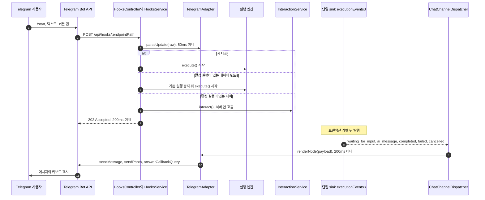
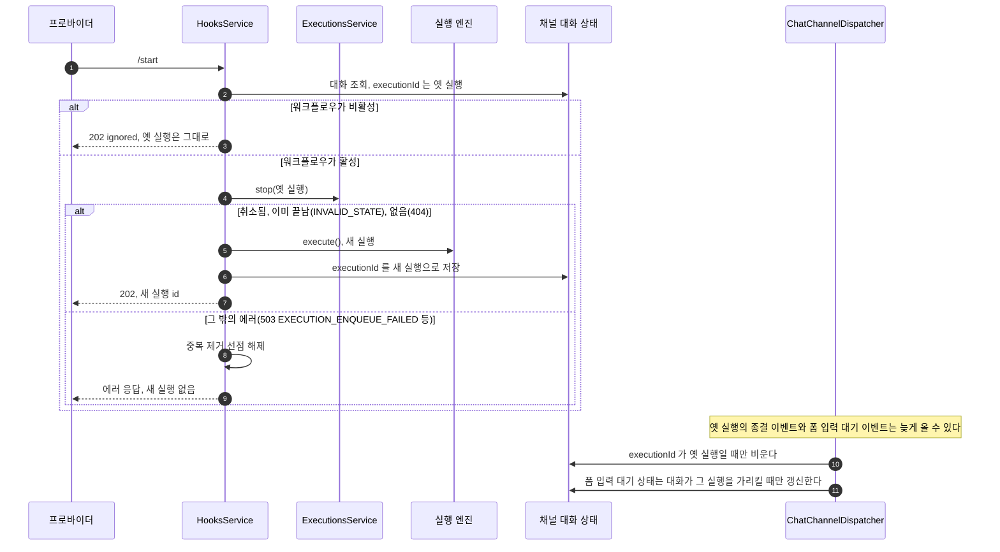

## 개요

이 문서는 [채팅 채널](CLE-CHAT-CORE.md) 의 하위 문서로 채팅 채널의 처리 흐름, 대화와 실행의 매핑, 활성 실행 중 `/start`, 단일 sink 구독, 인증 경계, [EIA](../CLE-IX/CLE-EIA.md) 와의 관계를 정한다. 관문 순서는 [인바운드 관문](CLE-CHAT-CORE-GATE.md#인바운드-관문-순서) 이 정한다.

## 사용 시나리오

| 시나리오 | 설명 |
|---|---|
| Telegram 봇 위의 AI 어시스턴트 | 사용자가 `/start` 를 보내면 워크플로우가 시작된다. 멀티턴 AI 노드와 자연스럽게 대화한 뒤 결과를 안내한다 |
| Telegram 봇 위의 결재 흐름 | 사용자가 메시지를 보내면 워크플로우가 Form 노드로 필드마다 질문하고 마지막에 결과를 알린다 |
| Telegram 봇 위의 데이터 시각화 | 사용자 명령에 워크플로우가 Chart·Table·Carousel 을 렌더한다. 1차 범위는 MarkdownV2 monospace 텍스트와 선택 버튼이고 후속 범위는 SSR PNG `sendPhoto` 다 |

## 전체 시퀀스

Telegram 을 예로 든 전체 흐름이다. 인바운드는 웹훅 요청을 받자마자 `202` 로 답하고, 아웃바운드는 트랜잭션 커밋 뒤 단일 sink 에서 나온 이벤트를 받아 보낸다.

새 대화로 실행을 시작할 때 채팅 채널 경로는 트리거 파라미터 해석(`resolveTriggerParameters`)을 거치지 않고 `parameters: {}` 와 `chatChannel` 키(`provider`·`conversationKey`·`channelUserKey`)로 실행한다(현재 구현, `hooks.service.ts`). 필수 파라미터를 요구하는 워크플로우에서 이 동작을 정책으로 둘지는 [트리거 노드 공통 §미결 사항](../CLE-NODE-TRIG/CLE-NODE-TRIG-COMMON.md#미결-사항) 에서 다룬다.

`execution.failed` 는 실행 실패 안내 분류로 키를 고른 뒤 다른 이벤트와 같이 `renderNode()` → `sendMessage()` 경로를 탄다([실행 실패 안내](CLE-CHAT-CORE-RENDER.md#실행-실패-안내)).

## 대화와 실행

- **실행 중 메시지**: 같은 대화의 다음 메시지가 왔는데 활성 실행이 `running`·`pending` 이면 `languageHints.executionStillRunning` 안내를 보낸다. 기본 문구는 "워크플로우가 처리 중입니다. 잠시만 기다려 주세요." 이고 한국어 기본값만 있다. 현재 구현은 `HooksService.getActiveExecutionStatus` 가 종결 전 상태를 돌려주고, 입력 대기일 때만 전달한다. `running`·`pending` 이면 `sendExecutionStillRunningNotice` 로 안내하고 `{ executionId: 'ignored' }` 로 끝낸다. 입력 대기 · 실행 중 · 종결 세 갈래 모두 구현됐다. 근거는 [R9](#r9-처리-중-메시지는-큐에-쌓지-않고-바로-안내한다) 에 있다.
- **그룹 대화 거부**: 안내 발송 책임은 채널 어댑터가 아니라 호출자(`HooksService`)에 있다. `parseUpdate` 는 부수 효과 없는 계약을 지킨다. 근거는 [R3](#r3-1차-범위는-11-dm-만-지원한다) 에 있다.
- **종결 이벤트의 대화 상태 정리**: 채널 대화 상태의 키는 `chat-channel:{triggerId}:{conversationKey}` 다. `executionId` 를 비우는 것은 읽은 값과 저장된 값을 비교해 바꾸는 compare-and-set 이고 다른 쓰기에 밀리면 최대 3회 다시 읽는다. Redis 를 쓸 수 없거나 끝내 비우지 못하면 `executionId` 는 이미 끝난 실행을 가리키므로 다음 메시지는 새 실행을 시작한다. `/cancel` 도 취소한 실행을 가리킬 때만 같은 방식으로 비운다.
- **폼 입력 대기 상태 갱신**: 대화 상태가 없거나, `executionId` 가 비어 있거나, 다른 실행을 가리키면 `pendingFormModal`·`formState` 를 갱신하지 않는다. 렌더한 메시지의 발송은 이 조건과 관계없다. 조회한 값을 그대로 고쳐 다시 저장하므로 compare-and-set 이 아니다. 조회와 저장 사이에 `/start` 가 대화를 새 실행에 이으면 이 저장이 덮어쓸 수 있다. 이 한계는 [R-CC-27](#r-cc-27-활성-실행-중-start-는-기존-실행을-취소하고-새로-시작한다) 의 미룬 문제에 있다.

## 활성 실행 중 다시 시작

활성 실행이 있는 대화에 `/start` 가 오면 명령이 실행 상태 분기보다 먼저다. 입력 대기 실행이어도 그 실행에 전달하지 않고, `running`·`pending` 이어도 실행 중 안내로 끝내지 않는다. Slack 과 Discord 에서는 `/<prefix> start` 가 이 명령이다. `/start` 가 아닌 메시지는 실행 상태 분기를 그대로 따른다. 명령 이름과 안내 문구는 프로바이더 문서가 정한다. 워크플로우가 비활성이면 취소하기 전에 버리고 기존 실행은 그대로 둔다.

활성 실행은 `HooksService.getActiveExecutionStatus` 가 종결 전 상태(`running`·`pending`·`waiting_for_input`)를 돌려준 실행이다. 취소는 EIA `cancel`([EIA 수신 API와 SSE](../CLE-IX/CLE-EIA-INBOUND.md))과 사용자 실행 중지(`POST /api/executions/:id/stop`)가 쓰는 REST 취소 경로 `ExecutionsService.stop` 을 부른다([노드 취소 「신호를 만드는 쪽」](../CLE-EXEC/CLE-EXEC-CANCEL.md#신호를-만드는-쪽) 7). `running`·`pending` 은 원자 UPDATE 로 바로 `cancelled` 가 된다. `waiting_for_input` 은 continuation bus 에 취소를 넣어 비동기로 `cancelled` 가 된다. 새 실행은 그 취소가 끝나기를 기다리지 않는다.

이미 끝난 실행의 취소는 `stop` 이 `INVALID_STATE`([에러 코드 규약과 카탈로그 §6.4](../CLE-API/CLE-API-ERRCODES.md#64-유효성-검증), `422`)로 거부하고 지워진 실행은 `RESOURCE_NOT_FOUND`(`404`)로 거부한다. 취소를 큐에 넣지 못했을 때의 `503` `EXECUTION_ENQUEUE_FAILED` 는 [에러 코드 규약과 카탈로그 §6.7](../CLE-API/CLE-API-ERRCODES.md#67-websocket-명령-재개-명령과-마지막-턴-재시도-도메인-문서-참조) 에 있다. `/start` 는 이 셋을 HTTP 상태가 아닌 에러 코드로 가른다. `INVALID_STATE`·`RESOURCE_NOT_FOUND` 면 새로 시작하고 `EXECUTION_ENQUEUE_FAILED` 면 새 실행 없이 그 에러로 답한다. 지금 `stop` 은 `INVALID_STATE` 를 `400` 으로 던져 카탈로그의 `422` 와 다르다(부분 구현, NERV Task `CLE-T-B9CRCF`). 판정이 에러 코드라 이 차이로 `/start` 의 동작이 바뀌지는 않는다. 시작 안내(`languageHints.executionStarted`)와 재시작 안내는 아직 보내지 않는다(부분 구현, NERV Task `CLE-T-0400J6`).

옛 실행의 `execution.cancelled` 는 새 실행을 대화에 이은 뒤에 올 수 있다. `waiting_for_input` 취소는 continuation bus 를 거쳐 비동기로 끝난다. `running`·`pending` 도 `stop()` 이 이벤트를 바로 내지 않고 실행이 취소로 마감될 때 나간다([노드 취소 「DB 관측 취소 가드」](../CLE-EXEC/CLE-EXEC-CANCEL.md#db-관측-취소-가드) 15). 종결 이벤트가 `executionId` 를 무조건 비우면 새 실행의 매핑이 지워진다. 그러면 다음 메시지가 입력 대기 실행인 새 실행에 가지 않고 또 다른 실행을 시작한다. 그래서 그 실행을 가리킬 때만 비운다.

옛 실행의 폼 입력 대기 이벤트(`execution.waiting_for_input`)도 새 실행을 이은 뒤에 올 수 있다. dispatcher 는 조회한 대화 상태가 그 이벤트의 실행을 가리킬 때만 `pendingFormModal`·`formState` 를 갱신한다. 이 갱신이 새 실행의 폼 입력 대기 상태를 덮어쓰면 다음 폼 제출이 옛 실행의 노드를 가리키게 된다.

취소를 큐에 넣지 못하면(`503 EXECUTION_ENQUEUE_FAILED`) 새 실행을 시작하지 않고 에러로 응답한다. 프로바이더는 non-2xx 를 받으면 같은 update 를 다시 보낼 수 있다. 그 재전송이 30초 중복 제거에 걸리지 않도록 에러로 응답하기 전에 그 update 의 중복 제거 선점을 푼다(`ChatChannelDedupService.release`). 선점을 풀지 못하면 30초 뒤 만료로 풀린다. 새 실행 시작(`execute()`)이 실패하는 경로는 선점을 풀지 않는다.

## 단일 sink 구독

`ChatChannelDispatcher` 는 `onModuleInit` 에서 실행 엔진의 단일 sink `WebsocketService.executionEvents$`(RxJS Subject)를 직접 구독한다. 이 Subject 에 값을 넣는 발행 함수는 `WebsocketService.emitToExecution` 이다. dispatcher 는 EIA 알림 웹훅 발송기(`NotificationDispatcher`), SSE 어댑터와 같은 facade 계층의 형제 listener 이고 그 하위 소비자가 아니다. 같은 프로세스 안에서는 Redis pub/sub 을 거치지 않는다. EIA 알림 웹훅과 채팅 채널 발송은 같은 단일 sink 에서 커밋 뒤 fan-out 되므로 둘 다 트랜잭션 커밋 뒤 발송([External Interaction API 「트랜잭션과 발송 순서」](../CLE-IX/CLE-EIA.md#트랜잭션과-발송-순서))을 지킨다. 채널 어댑터는 엔진 내부 코드를 부르지 않는다. 이 추가 facade 사용은 [External Interaction API 「단일 싱크와 외부 facade」](../CLE-IX/CLE-EIA.md#단일-싱크와-외부-facade) 가 허용한다. SSE 어댑터의 구독 방식(현재 서버 안 직접 구독, Redis pub/sub 경유는 미구현)도 같은 절이 정한다. 트리거 단위로 이벤트를 거르는 레지스트리는 [어댑터 라이프사이클과 listener 레지스트리](CLE-CHAT-CORE-LISTENER.md) 가 정한다.

## 인증과 보안

- **웹훅 진입점**: 채팅 채널 경로는 [외부 호출 인증 설정](../CLE-TRIG/CLE-TRIG-AUTHCFG.md)(AuthConfig) 인증 대신 프로바이더별 인바운드 서명을 검증한다. Telegram 은 HMAC(Hash-based Message Authentication Code)을 지원하지 않아 `setWebhook` 때 `secret_token` 을 등록하고 `X-Telegram-Bot-Api-Secret-Token` 헤더로 검증한다. Slack 은 `X-Slack-Signature`, Discord 는 `X-Signature-Ed25519` 다. 세부는 프로바이더 문서가 정한다.
- **EIA 인바운드 facade**: 채널 어댑터는 EIA 외부 토큰(`iext_*`, `itk_*`) 발급을 건너뛰고 `InteractionService.interact(ctx: InteractionRequestContext, dto: InteractDto)` 를 서버 안에서 직접 부른다. 근거는 [External Interaction API 「내부 신뢰 호출」](../CLE-IX/CLE-EIA.md#내부-신뢰-호출) 의 내부 신뢰 호출(`in_process_trusted`) 예외다. EIA HTTP API 는 외부 클라이언트 전용이다.
- **접근 제어**: 이 우회는 서버 안 신뢰 호출자에게만 열리고 외부 HTTP 경로는 구조상 닿을 수 없다. `InteractionRequestContext` 판별 union(`isInternalCtx()`)과 "HTTP guard 의 ctx 는 `scope === undefined`" 불변식은 [External Interaction API](../CLE-IX/CLE-EIA.md) 가 정하고 컴파일러가 강제하므로 여기 다시 적지 않는다. `scope` 는 신뢰 영역을 나타내며 토큰 종류(`tokenFamily`)와 뜻이 다르다.
- **SSRF(Server-Side Request Forgery)**: 아웃바운드 URL 은 프로바이더마다 고정(예: `api.telegram.org`)이라 사용자가 정하는 URL 이 아니다. [EIA 알림 웹훅 「SSRF 방지」](../CLE-IX/CLE-EIA-NOTIFY.md#ssrf-방지) 의 허용 목록과 따로 간다.
- **외부 WebSocket 보류**: 채널 어댑터는 외부 HTTP · WebSocket 경로를 더하지 않는 서버 안 구독자라 [EIA 수신 API와 SSE 「외부 WebSocket 채널은 보류한다」](../CLE-IX/CLE-EIA-INBOUND.md#외부-websocket-채널은-보류한다) 의 재논의 조건과 관계없다.

## EIA 와의 관계

| EIA 영역 | 채팅 채널에서의 해석 |
|---|---|
| [EIA 알림 웹훅](../CLE-IX/CLE-EIA-NOTIFY.md) | 채널 어댑터는 서버 안 구독자다. HTTP POST 와 HMAC 검증 단계를 거치지 않는다(네트워크 왕복 없음). `seq` 정렬과 `X-Clemvion-Delivery` 중복 제거를 채널 어댑터가 하는지는 정의가 갈린다. [미결 사항](CLE-CHAT-CORE-RENDER.md#미결-사항) 을 본다 |
| 인바운드 인터랙션([EIA 수신 API와 SSE](../CLE-IX/CLE-EIA-INBOUND.md)) | 채널 어댑터는 서버 안 호출자다. `submit_form`·`click_button`·`submit_message`·`end_conversation`·`cancel` 다섯 명령은 같다. 예외로 `/start` 의 기존 실행 취소와 `/cancel` 은 facade(`InteractionService`)를 거치지 않고 `ExecutionsService.stop` 을 직접 부른다. EIA `cancel` 도 같은 REST 취소 경로로 가므로 살아 있는 실행을 취소한 결과는 같다([EIA 데이터와 흐름 「인바운드 명령과 재개」](../CLE-IX/CLE-EIA-DATA.md#인바운드-명령과-재개) 의 `cancel` 위임). 이유는 [R2](#r2-채팅-채널을-eia-의-소비자로만-둔다) 에 있다 |
| 인증([External Interaction API 「내부 신뢰 호출」](../CLE-IX/CLE-EIA.md#내부-신뢰-호출)) | 채널 어댑터는 외부 토큰(`iext_*`, `itk_*`) 발급·검증을 건너뛴다. 내부 신뢰 호출 예외를 쓴다. EIA HTTP API 는 외부 클라이언트 전용이다 |
| 신뢰성([External Interaction API 「신뢰성과 이벤트 순번」](../CLE-IX/CLE-EIA.md#신뢰성과-이벤트-순번)) | 그대로 적용한다. 특히 `submit_form` 검증이 실패하면 실행을 입력 대기로 유지하는 규칙([EIA 수신 API와 SSE](../CLE-IX/CLE-EIA-INBOUND.md))이 틀린 필드만 다시 묻는 동작의 바탕이다 |
| 비기능([External Interaction API](../CLE-IX/CLE-EIA.md)) | 채널 어댑터 단계가 하나 더 붙는다(변환 평균 50ms, 발송 시작 평균 200ms). 채널 프로바이더 API 호출이 더해지므로 EIA 비기능 위에 채널 어댑터 비기능이 쌓인다 |

## 구현 위치

- `codebase/backend/src/modules/chat-channel/chat-channel.dispatcher.ts`: 종결 이벤트에서 대화 상태 정리, 폼 입력 대기 상태 갱신 가드
- `codebase/backend/src/modules/chat-channel/channel-conversation.service.ts`: 채널 대화 상태, compare-and-set 정리 `clearExecutionIdIfMatches`
- `codebase/backend/src/modules/chat-channel/chat-channel-dedup.service.ts`: 선점 해제 `release`
- `codebase/backend/src/modules/hooks/hooks.service.ts`: 활성 실행 중 `/start` 의 기존 실행 취소(`stopForRestart`)
- 테스트: `codebase/backend/test/chat-channel-telegram-start.e2e-spec.ts`, `codebase/backend/src/modules/hooks/hooks.service.spec.ts`(세 프로바이더의 `/start`), `codebase/backend/src/modules/chat-channel/channel-conversation.service.spec.ts`, `codebase/backend/src/modules/chat-channel/chat-channel.dispatcher.spec.ts`

## Rationale

### R2 채팅 채널을 EIA 의 소비자로만 둔다

EIA HTTP API 를 새로 만들지 않고 서버 안 facade 호출만 쓴다. HTTP 왕복을 하나 줄여야 발송 시작 200ms 에 들어가고, 신뢰 호출자라 토큰 발급·검증을 건너뛴다. 인바운드 명령 facade 하나가 외부 HTTP 와 서버 안 호출을 모두 받는다. 채널 어댑터가 EIA HTTP 엔드포인트를 부르는 안은 같은 프로세스 안의 의미 없는 왕복과 토큰 부담이라 택하지 않았다.

예외는 `/start` 의 기존 실행 취소와 `/cancel` 이다. 둘은 facade(`InteractionService`)를 거치지 않고 `ExecutionsService.stop` 을 직접 부른다. EIA `cancel` 도 같은 REST 취소 경로로 가므로([EIA 데이터와 흐름 「인바운드 명령과 재개」](../CLE-IX/CLE-EIA-DATA.md#인바운드-명령과-재개)) 살아 있는 실행을 취소한 결과는 같다. `/cancel` 은 이 절이 facade 하나만 적던 때에도 `stop` 을 직접 불렀고 문서를 코드에 맞춰 이 예외를 적었다. `/start` 가 facade 대신 `stop` 을 부르는 이유는 [R-CC-27](#r-cc-27-활성-실행-중-start-는-기존-실행을-취소하고-새로-시작한다) 에 있다.

### R3 1차 범위는 1:1 DM 만 지원한다

그룹 대화는 누가 답했는지 가려야 하는데 채널 대화 상태의 `channelUserKey` 는 사용자 한 명을 가정한다. 1차 범위는 1:1 DM 만 받고 그룹은 명시적으로 거부한다. 후속 범위에서 여러 사용자 대화를 도입할 때 다시 논의한다.

### R4 단일 sink 를 직접 구독한다

같은 프로세스 안에서는 외부 인프라 없이 가장 단순하고 단일 sink 가 이미 커밋 뒤 fan-out 진입점이다(`executionEvents$.subscribe(adapter.handle)`). Redis pub/sub 은 같은 프로세스 안에서 왕복 낭비이고, 커밋 뒤 hook 을 따로 두면 엔진의 단일 sink 정책을 어겨 채널 어댑터가 엔진 코드를 알아야 한다. [External Interaction API 「단일 싱크와 외부 facade」](../CLE-IX/CLE-EIA.md#단일-싱크와-외부-facade) 의 "엔진 밖 facade 한 곳, 단일 sink" 원칙을 지킨다. 서버 인스턴스 사이에 레지스트리 변경을 알리는 pub/sub 는 실행 이벤트가 아니므로 이 결정과 따로 [R-CC-30](CLE-CHAT-CORE-LISTENER.md#r-cc-30-트리거-단위-listener-레지스트리의-변경을-redis-pubsub-로-모든-서버-인스턴스에-알린다) 이 다룬다.

### R9 처리 중 메시지는 큐에 쌓지 않고 바로 안내한다

실행이 도는 중에 메시지가 오는 경우만 다룬다(분당 한도 초과는 [R-CC-19](CLE-CHAT-CORE-GATE.md#r-cc-19-분당-한도-초과분은-재발송-큐-대신-건너뛰고-degraded-로-표시한다)). `running`·`pending` 은 보통 짧고 다음 입력은 대개 입력 대기 뒤에 온다. 큐에 쌓았다가 다시 보내면 (a) 노드가 기대하지 않은 시점에 입력이 들어오고 (b) 같은 메시지를 두 번 보낸 경우의 중복 제거 책임이 모호하다. 큐 TTL·폐기·순서 정렬도 필요해 1차 범위의 단순성과 맞지 않는다. 입력 대기까지 HTTP 연결을 잡아 두면 200ms 응답 시한과 부딪치고 Telegram 이 재전송을 쏟아낸다. "실행 중에 보낸 메시지는 다시 보낸다" 가 봇 UX 의 일반적 기대다. 입력 대기 직전 노드가 오래 걸릴 때 `sendChatAction(typing)` 을 주기적으로 보내는 방안은 후속 범위에서 검토한다.

### R-CC-27 활성 실행 중 /start 는 기존 실행을 취소하고 새로 시작한다

2026-10-10 결정이다. 그전에는 이어지는 메시지 요구사항이 두 번째 이후 메시지를 실행 상태로만 나눴고 `/start` 예외가 없었다. 세 프로바이더 문서의 명령 처리 표는 기존 실행을 취소하고 새로 시작한다고 적었고, 구현은 취소 없이 새 실행을 시작했다. 이 결정으로 미결 사항 «활성 실행 중 `/start`·일반 메시지 처리» 를 닫았다.

기각한 대안: 현행(취소 없이 새 실행)을 정본으로 삼는 안. 대화 상태가 새 실행을 가리키게 되므로 입력 대기로 남은 옛 실행에는 더 이상 입력이 닿지 않는다. 그런 실행이 `/start` 마다 하나씩 쌓인다.

명령 우선 규칙은 프로바이더마다 다르지 않아 이 문서에 둔다. Slack DM 일반 텍스트는 명령이 아니므로 실행 상태 분기대로 처리한다([Slack 어댑터 「R-S-10 취소 후 새로 시작은 start 명령에만 적용한다」](CLE-CHAT-SLACK.md#r-s-10-취소-후-새로-시작은-start-명령에만-적용한다)).

취소는 EIA `cancel` 과 같은 REST 취소 경로인 `ExecutionsService.stop` 을 쓴다. 상태별 전이와 continuation bus 처리를 다시 만들지 않으려는 것이다. `/start` 와 `/cancel` 은 `InteractionService` 를 거치지 않고 `stop` 을 바로 부른다. EIA `cancel` 은 실행이 살아 있는지 확인한 뒤 같은 `stop` 을 부르므로 취소 동작은 같다. 바로 부르면 이미 끝났거나 지워진 실행이 `stop` 의 `INVALID_STATE`·`404` 로만 온다. `InteractionService` 를 거치면 같은 경우가 `EXECUTION_TERMINATED`·`EXECUTION_NOT_FOUND` 로도 와서 `/start` 가 가려야 할 코드가 늘어난다. 이 직접 호출도 서버 안 호출이라 [R2](#r2-채팅-채널을-eia-의-소비자로만-둔다) 와 어긋나지 않는다.

상태를 읽은 뒤 취소하기 전에 실행이 끝났거나(`INVALID_STATE`) 지워졌으면(`404`) 취소할 것이 없으므로 그대로 새로 시작한다. `stop` 의 그 밖의 에러는 [R-CC-12](CLE-CHAT-CORE-RESPONSE.md#r-cc-12-인바운드-응답은-202-로-고정하고-401404-만-예외로-둔다) 의 `202` 고정 정책과 달리 그대로 돌려주고 새 실행을 시작하지 않는다. 코드에서 `stop` 이 `503 EXECUTION_ENQUEUE_FAILED` 를 내는 경우는 `waiting_for_input` 실행의 취소를 continuation bus 큐에 넣지 못했을 때(`queued=false`) 하나다.

- 이 에러를 삼키고 새로 시작하면 옛 실행이 입력 대기로 남아 기각한 대안과 같은 결과가 된다.
- 삼키고 새로 시작하지 않으면 사용자의 `/start` 가 말없이 사라진다.
- 에러로 응답하면 새 실행은 생기지 않는다. 응답하기 전에 그 update 의 중복 제거 선점을 풀므로 프로바이더가 다시 보낸 같은 update 는 다시 처리된다. 풀지 않으면 30초 안에 온 재전송이 중복 제거에 걸려 `/start` 가 사라진다.

non-2xx 응답이 이어지면 프로바이더가 웹훅을 끌 수 있다. 어느 프로바이더가 몇 번, 얼마 동안 실패하면 웹훅을 끄는지는 프로바이더 문서로 확인하지 않았다. 그래도 이 위험을 받아들인다. 에러로 답하면 큐가 회복된 뒤 오는 재전송이나 사용자의 재입력으로 같은 `/start` 가 다시 처리된다. 삼키면 큐가 회복돼도 옛 실행이 입력 대기로 남는다.

이 취소는 웹훅 응답 전에 동기로 돈다. 실행 조회 한 번에 더해 `running`·`pending` 이면 원자 UPDATE 한 번, `waiting_for_input` 이면 continuation bus 큐 추가 한 번이 붙고 끝에 다시 조회한다. 이것이 200ms 응답 시한에 얼마를 더하는지는 재지 않았다.

종결 이벤트가 `executionId` 를 그 실행을 가리킬 때만 비우는 것은 옛 실행의 `execution.cancelled` 가 새 실행을 이은 뒤에 올 수 있어서다. 무조건 비우면 새 실행의 매핑이 지워져 다음 메시지가 또 다른 실행을 시작한다. 읽은 값과 저장된 값을 비교해 바꾸므로 읽은 뒤 다른 요청이 새 실행을 이어도 덮어쓰지 않는다. `/cancel` 의 정리도 같은 이유로 같은 방식을 쓴다. 폼 입력 대기 이벤트의 대화 상태 갱신도 같은 이유로 그 실행을 가리킬 때만 한다. 옛 실행의 늦은 폼 입력 대기 이벤트가 `pendingFormModal`·`formState` 를 덮어쓰면 새 실행의 다음 폼 제출이 옛 실행의 노드 id 를 싣고 간다.

시작 안내와 재시작 안내는 아직 보내지 않는다. 취소와 새 시작을 먼저 맞췄고 안내는 NERV Task `CLE-T-0400J6` 가 맡는다.

미룬 문제가 셋이다. 셋 모두 후속 NERV Task 가 다룬다.

- 대화의 어느 참여자가 보낸 `/start` 든 기존 실행을 취소하고 대화를 이어받는다. 보낸 사람이 대화를 시작한 사용자(`channelUserKey`)인지 확인하지 않는다. `/start` 와 `/cancel` 의 소유 확인은 그룹 대화에서 다른 구성원이 활성 실행을 취소하는 위협 모델과 함께 NERV Task `CLE-T-G2JRMF` 에서 정한다.
- 같은 대화에 `/start` 두 개가 거의 동시에 오면 경합한다. 둘 다 같은 옛 실행을 읽고 각자 새 실행을 시작할 수 있다. 채널 대화 상태는 나중에 저장한 실행을 가리키고 먼저 시작한 실행에는 입력이 닿지 않는다. 재시작(취소, 새 실행, 대화 상태 저장)을 대화 단위로 직렬화하지 않기 때문이다. 분당 한도와 update id 중복 제거(같은 update 의 재전송)가 경합 창을 좁힌다. NERV Task `CLE-T-QZ8RFC` 가 다룬다.
- 폼 입력 대기 이벤트의 상태 갱신은 조회한 값을 고쳐 그대로 다시 저장한다. compare-and-set 이 아니다. 대화 상태가 다른 실행을 가리키면 저장하지 않는 가드가 들어간 뒤 남은 경합은 조회와 저장 사이의 창뿐이다. 그 사이에 `/start` 가 대화를 새 실행에 이으면 이 저장이 대화 상태의 `executionId` 를 옛 실행으로 되돌릴 수 있다. 이 창의 크기는 재지 않았다. NERV Task `CLE-T-QZ8RFC` 가 다룬다.
