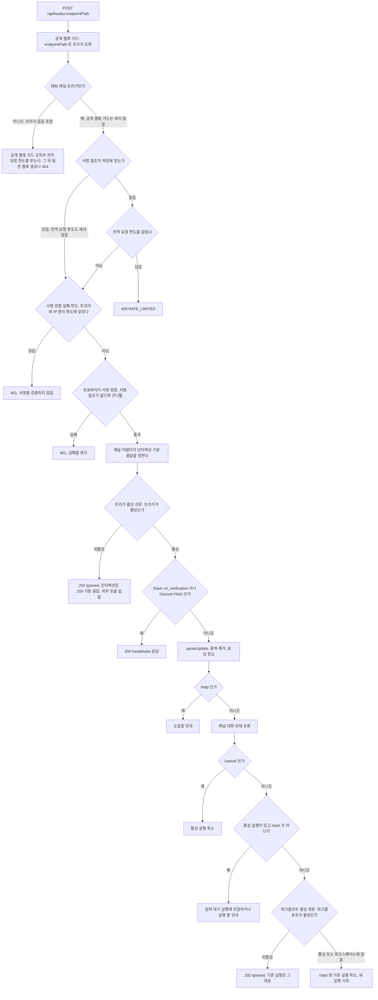

## 개요

이 문서는 [채팅 채널](CLE-CHAT-CORE.md) 의 하위 문서로 채팅 채널 웹훅 요청이 지나는 관문의 순서, 핸들러 앞 라우트 가드, 중복 제거와 대화 단위 분당 한도, 서명 검증 실패 한도, 워크플로우 활성 관문을 정한다. HTTP 응답은 [인바운드 HTTP 응답 계약](CLE-CHAT-CORE-RESPONSE.md) 이, 키와 카운터의 저장 형식은 [채팅 채널 데이터와 흐름](CLE-CHAT-DATA.md) 이 정한다.

## 인바운드 관문 순서

채팅 채널 경로의 웹훅 요청은 아래 순서로 관문을 지난다. 채팅 채널 인바운드 관문의 순서를 정한 목록은 이 절 하나다. 다른 문서는 이 순서를 다시 적지 않고 이 절을 링크한다. 앞 관문에서 끝난 요청은 뒤 관문에 닿지 않는다.

### 핸들러 앞 라우트 가드

핸들러 앞에서는 라우트 가드 둘이 차례로 돈다. 공개 웹훅 가드의 한도는 채팅 채널 트리거 요청에 걸지 않는다. 전역 요청 한도는 서명 참조가 저장된 채팅 채널 트리거 요청에만 걸지 않는다. 두 가드 모두 트리거를 조회한 뒤에 판정한다.

- **공개 웹훅 가드**(`PublicWebhookThrottleGuard`): `endpointPath` 로 트리거를 조회해 요청에 붙인다. 컨트롤러는 이 조회 결과를 다시 쓴다. 이 가드의 IP 단위 시작 한도와 본문 32KB 상한은 채팅 채널 트리거를 통과시킨다. 서명 참조가 있는지는 보지 않는다.
- **전역 요청 한도 가드**(`HookTriggerThrottlerGuard`): 공개 웹훅 가드가 붙인 트리거가 서명 참조가 저장된 채팅 채널 트리거면 세지 않는다. 서명 참조가 저장된 채팅 채널 트리거는 `config.chatChannel` 에 `provider` 와 `inboundSigningRef` 가 함께 있는 트리거다. 인바운드 인증기가 서명을 검증하는 조건과 같은 판정이고 저장된 참조만 보며 시크릿을 읽지 않는다. 서명 참조가 없는 채팅 채널 트리거(옛 트리거, 채널 연결 전 트리거)의 요청과 그 밖의 요청은 전역 요청 빈도 제한(`UserThrottlerGuard`, 로그인 없는 요청은 IP 단위 분당 100건)과 같은 한도 · 같은 저장소 · 같은 키로 세고, 한도를 넘으면 서명 검증 전에 `429` 로 거부한다. 트리거가 없거나 조회에 실패한 요청도 센다. 전역 가드는 이 라우트를 세지 않는다(`@DeferGlobalThrottle()`). 그래서 이 라우트에서는 전역 한도를 넘은 요청도 트리거 조회 한 번을 거친 뒤 `429` 로 거절된다. 공개 웹훅은 본문 크기(`413`)와 IP 시작 한도(`429`)를 전역 `429` 보다 먼저 받는다.

남용은 1번 관문의 서명 검증과 서명 검증 실패 한도, 4번 관문의 대화 단위 분당 한도가 막는다. 서명 참조가 없는 채팅 채널 트리거는 서명을 검증하지 않아 앞의 둘이 걸리지 않는다. 그래서 그 요청에는 전역 요청 한도가 남는다. 근거는 [R-CC-12](CLE-CHAT-CORE-RESPONSE.md#r-cc-12-인바운드-응답은-202-로-고정하고-401404-만-예외로-둔다) 에 있다.

### 관문 목록

1. **서명 검증**: 먼저 [서명 검증 실패 한도](#서명-검증-실패-한도) 를 본다. 같은 트리거와 같은 클라이언트 IP 쌍의 실패가 60초 창 안에서 20번에 닿았으면 시크릿 조회와 서명 계산 없이 `401` 이다. 닿지 않았으면 프로바이더 서명을 검증한다. 틀리면 `401` 이고 그 실패를 센다. 통과하면 채널 어댑터의 `defaultInteractionResponse` 로 인터랙션 기본 응답을 먼저 정한다([인터랙션 기본 응답](CLE-CHAT-CORE-INTERACT.md#인터랙션-기본-응답)). 외부 호출이 없는 계산이라 트리거가 비활성이어도 한다. 저장된 `inboundSigningRef` 가 없는 행의 현행 동작은 [채팅 채널 데이터와 흐름 「인바운드 서명 자료 참조가 없는 행」](CLE-CHAT-DATA.md#인바운드-서명-자료-참조가-없는-행) 에 적는다. 그런 행의 요청은 핸들러 앞에서 전역 요청 한도로 센다.
2. **트리거 활성 관문**: 트리거가 비활성이면 `202`·`{ executionId: 'ignored' }` 다. 인터랙션이면 1번에서 정한 기본 응답과 `200` 으로 답한다. handshake 에도 답하지 않고 진행 중인 대화의 입력도 전달하지 않는다. 실행을 시작하지 않고 수신 확인을 포함한 외부 호출도 하지 않는다.
3. **핸드셰이크 응답**: Slack `url_verification` 과 Discord PING 에 답한다. 워크플로우가 비활성이어도 답한다.
4. **파싱과 중복 제거, 분당 한도**: `parseUpdate` 뒤 [중복 제거와 분당 한도](#중복-제거와-분당-한도) 를 지난다. 그룹 대화와 지원하지 않는 update 는 여기서 버린다. 분당 한도를 지난 update 는 채널 어댑터의 선택 함수 `enrichInbound` 로 첨부 정보를 보강한다(지금은 Slack 만. [채팅 채널 어댑터 규약](CLE-CHAT-ADAPTER.md)).
5. **도움말**: `/help` 면 도움말을 보낸다. Discord 와 Slack 슬래시 명령의 `help` 는 파서가 update 를 만들지 않아 4번에서 끝난다. 그 도움말은 HTTP 응답의 기본 응답에만 실린다([인터랙션 기본 응답](CLE-CHAT-CORE-INTERACT.md#인터랙션-기본-응답)).
6. **대화 조회와 취소 명령**: 채널 대화 상태를 조회한다. `/cancel` 이면 활성 실행을 취소한다. 취소를 재개 큐에 넣지 못해도 `202` 로 답하고 채널 건강도를 `degraded` 로 바꾼다. 실행이 이미 끝났으면 건강도를 바꾸지 않는다([큐 적재 실패](CLE-CHAT-CORE-INTERACT.md#큐-적재-실패)).
7. **진행 중인 대화의 전달**: 네이티브 폼 모달 열기와 제출, 활성 실행이 있는 대화의 `/start` 가 아닌 메시지는 입력 대기 실행에 전달하거나 실행 중 안내로 끝낸다. 새 실행을 시작하지 않는다. 재개 명령을 재개 큐에 넣지 못해도 `202` 로 답하고 채널 건강도를 `degraded` 로 바꾼다. 네이티브 폼 모달 제출이면 모달 대기를 남기고 「양식 작성하기」 버튼을 다시 보낸다. 응답은 폼 제출 결과가 아니라 기본 응답이다.
8. **워크플로우 활성 관문**: 남은 update 는 새 실행을 시작할 update 다. 워크플로우가 비활성이면 여기서 `202`·`{ executionId: 'ignored' }` 다. `/start` 의 기존 실행 취소보다 앞이라 기존 실행은 그대로 남는다. 워크플로우가 트리거의 워크스페이스에 없으면 이 관문을 지나 [R-CC-25](#r-cc-25-워크플로우가-다른-워크스페이스에-있으면-202-ignored-와-degraded-로-답한다) 의 처리에서 걸린다. 자세한 규칙은 [워크플로우 활성 관문](#워크플로우-활성-관문) 에 있다.
9. **재시작과 새 실행**: `/start` 이고 활성 실행이 있으면 기존 실행을 취소한 뒤 새 실행을 시작한다([활성 실행 중 다시 시작](CLE-CHAT-CORE-FLOW.md#활성-실행-중-다시-시작)). 그 밖의 update 는 새 실행을 시작한다.

4번부터 9번까지의 관문에서 update 를 실행 없이 버리면(파싱 결과 없음, 중복 update, 분당 한도 초과, 실행 중 안내, 워크플로우 비활성, 워크플로우 없음) 채널 어댑터의 `ackDroppedUpdate` 로 수신 확인을 보낸다([버린 update 의 수신 확인](CLE-CHAT-CORE-INTERACT.md#버린-update-의-수신-확인)). 5번의 도움말 경로는 수신 확인을 보내지 않는다.

4번부터 9번까지에서 예상하지 못한 오류(DB · Redis 장애 등)가 나면 에러 로그를 남기고 버린 update 로 끝낸다. 응답은 `202`·`{ executionId: 'ignored' }` 이고 인터랙션이면 `200` 과 기본 응답이다. 수신 확인도 보낸다. 채널 건강도는 바꾸지 않는다. `/start` 의 기존 실행 취소 실패는 이 처리에 들지 않고 그 에러로 답한다.

### 비활성 트리거와 비활성 워크플로우

둘은 막는 범위가 다르다. 버리는 경우의 응답은 모두 `202`·`{ executionId: 'ignored' }` 이고 인터랙션이면 둘 다 `200` 과 기본 응답이다. 이 문서에 적은 `202` 본문은 핸들러 반환값이고 실제로는 `{ data: { executionId, message } }` 로 감싸 나간다([인바운드 HTTP 응답 계약](CLE-CHAT-CORE-RESPONSE.md#인바운드-http-응답-계약)).

| 입력 | 트리거가 비활성 | 워크플로우가 비활성 |
|---|---|---|
| Slack `url_verification`, Discord PING | 답하지 않고 `202` 로 버린다 | 답한다(`200`) |
| 활성 실행이 있는 대화의 답장 · 버튼 · 폼 제출 | 버린다 | 입력 대기 실행에 전달하거나 실행 중 안내 |
| `/cancel` · `/help` | 버린다 | 활성일 때와 같다 |
| 활성 실행이 없는 대화의 메시지, `/start` | 버린다 | 버린다 |
| 활성 실행이 있는 대화의 `/start` | 버린다 | 버린다. 기존 실행을 취소하지 않는다 |
| 인터랙션(Discord 슬래시 명령 · 컴포넌트 클릭 · 모달 제출, Slack 슬래시 명령 · Interactivity)의 HTTP 응답 | `200` 과 기본 응답. 실행은 시작하지 않는다 | `200` 과 기본 응답이나 처리 경로가 정한 응답 |
| 버린 update 의 수신 확인(Telegram 버튼 클릭의 `answerCallbackQuery`) | 보내지 않는다 | 보낸다 |

## 서명 검증 실패 한도

같은 채팅 채널 트리거와 같은 클라이언트 IP 쌍의 서명 검증이 60초 고정 창 안에서 20번 `401` 로 실패하면 그 창이 끝날 때까지 그 쌍의 요청을 시크릿 조회와 서명 계산 없이 `401`(`AUTH_FAILED`)로 거부한다.

- 서명이 맞는 요청과 `401` 이 아닌 오류는 세지 않는다. 거부한 요청도 세지 않으므로 창이 늘어나지 않는다.
- 클라이언트 IP 는 공개 웹훅 IP 한도와 같은 규칙(`X-Forwarded-For` 첫 값, 신뢰 설정이면 `CF-Connecting-IP`)으로 헤더에서 읽는다. IP 를 읽지 못한 요청은 세지도 막지도 않는다.
- 트리거 조회는 이 판정보다 먼저 끝나 있다. 그래서 한도에 닿은 요청에서 아끼는 것은 시크릿 조회와 서명 계산이다.
- 카운터는 Redis 고정 창이고 키는 `cc:sigfail:<triggerId>:<ip>` 다. 첫 실패에서만 60초 TTL 을 건다. Redis 가 없으면 세지도 막지도 않는다. Redis 오류면 막지 않고 경고 로그를 남긴다.
- 응답은 서명이 틀린 요청과 같은 `401`(`AUTH_FAILED`)이고 `429` 로 바꾸지 않는다.

근거와 알려진 한계는 [R-CC-34](#r-cc-34-서명-검증-실패는-트리거와-ip-쌍으로-세고-한도에-닿으면-401-로-답한다) 에 있다.

## 중복 제거와 분당 한도

- **중복 제거**: 서비스는 `ChatChannelDedupService` 다. 키 · TTL(Time To Live) · 게이트 순서는 [채팅 채널 데이터와 흐름](CLE-CHAT-DATA.md) 이 정한다. Redis 가 없는 동안에는 중복 처리가 생길 수 있다. 근거는 [R-CC-20](#r-cc-20-인바운드-중복-제거는-전용-서비스로-한다) 에 있다.
- **대화 단위 분당 한도**: 카운터는 대화 단위 fixed-window 다. `PublicWebhookQuotaService` 와 같은 `INCR`+`EXPIRE` pipeline 을 별도 키에 써서 여러 서버 인스턴스에서도 정확하다. 기본값 60 은 Telegram group rate limit 과 맞춘 값이고, 초과 안내 메시지는 1차 범위 밖이다. 현재 구현은 `ChatChannelRateLimiterService.consume` 이 세고 `HooksService.handleChatChannelWebhook` 이 `parseUpdate` · 중복 제거 게이트 뒤에 확인하며, 이미 `degraded` 면 다시 쓰지 않는다(`markChatChannelRateLimited`). 근거는 [R-CC-19](#r-cc-19-분당-한도-초과분은-재발송-큐-대신-건너뛰고-degraded-로-표시한다) 에 있다.

## 워크플로우 활성 관문

워크플로우 활성 관문의 규칙(무엇을 막고 무엇을 통과시키는지, 버릴 때 남기지 않는 기록, 워크플로우 조회 범위)은 [트리거 데이터와 흐름 「워크플로우 활성 관문」](../CLE-TRIG/CLE-TRIG-DATA.md#워크플로우-활성-관문) 이 정한다. 채팅 채널 경로에서 이 관문이 놓이는 자리는 [인바운드 관문 순서](#인바운드-관문-순서) 의 8번이다. 이 절은 채팅 채널만의 차이를 정한다.

- 버리는 응답은 `202`·`{ executionId: 'ignored' }` 다.
- handshake 에는 답한다.
- 진행 중인 대화의 입력과 `/cancel`·`/help` 는 관문에 닿지 않는다.
- 트리거의 워크스페이스에 워크플로우가 없으면 이 관문은 통과시키고 [R-CC-25](#r-cc-25-워크플로우가-다른-워크스페이스에-있으면-202-ignored-와-degraded-로-답한다) 대로 처리한다.
- 이미 진행 중인 실행은 취소하지 않고 채널 건강도도 바꾸지 않는다.

## 구현 위치

- `codebase/backend/src/modules/hooks/hooks.service.ts`, `hooks.controller.ts`: `config.chatChannel` 분기, 인바운드 관문 순서(새 실행 시작 앞의 워크플로우 활성 관문 포함), 서명 검증과 서명 검증 실패 한도(`verifyChatChannelSignature`), 컨트롤러의 `@DeferGlobalThrottle()` 과 라우트 가드 순서
- `codebase/backend/src/modules/hooks/public-webhook-throttle.guard.ts`: 공개 웹훅 가드. 트리거를 조회해 요청에 붙이고 채팅 채널 트리거는 서명 참조와 상관없이 통과시킨다
- `codebase/backend/src/modules/hooks/hook-trigger-throttler.guard.ts`, `codebase/backend/src/common/guards/user-throttler.guard.ts`: `POST /hooks/:endpointPath` 의 전역 요청 한도. 서명 참조가 저장된 채팅 채널 트리거는 세지 않는다(판정은 `isSignedChatChannelTrigger`). 전역 가드는 `@DeferGlobalThrottle()` 이 붙은 라우트를 세지 않는다
- `codebase/backend/src/modules/chat-channel/`: 인바운드 서명 검증(`chat-channel-inbound-authenticator.ts`), 서명 검증 실패 한도(`chat-channel-signature-failure-limiter.service.ts`), 서명 참조가 저장된 채팅 채널 트리거 판정(`chat-channel-secret-refs.ts` 의 `isSignedChatChannelTrigger`), 중복 제거(`chat-channel-dedup.service.ts`), 분당 한도(`chat-channel-rate-limiter.service.ts`)
- `codebase/backend/src/modules/execution-engine/utils/is-workflow-inactive.ts`: 워크플로우 활성 관문 `isWorkflowInactive`(트리거의 워크스페이스 안에서만 찾는다)
- 테스트: `codebase/backend/test/workflow-inactive-gate.e2e-spec.ts`, `codebase/backend/src/modules/hooks/hooks-throttle.wire.spec.ts`(라우트 가드 체인. 종단 간 테스트는 `NODE_ENV=test` 에서 전역 한도가 꺼져 있어 이 파일이 확인한다), `codebase/backend/src/modules/hooks/hook-trigger-throttler.guard.spec.ts`, `codebase/backend/src/modules/chat-channel/chat-channel-signature-failure-limiter.service.spec.ts`, `codebase/backend/src/modules/execution-engine/utils/is-workflow-inactive.spec.ts`

## Rationale

### R-CC-19 분당 한도 초과분은 재발송 큐 대신 건너뛰고 degraded 로 표시한다

[R9](CLE-CHAT-CORE-FLOW.md#r9-처리-중-메시지는-큐에-쌓지-않고-바로-안내한다) 는 한도 초과용 큐를 기각하지 않았고 두 경우를 나눴을 뿐이다. 이 결정은 한도 초과 안에서 큐와 건너뛰기를 고른다. (a) 200ms 응답 시한 때문에 인바운드를 동기로 쌓거나 잡아 둘 수 없고 Telegram 은 늦은 응답에 재전송을 쏟아낸다. (b) 재발송 버퍼는 입력 순서, 중복 제거, TTL·정렬 장치를 요구해 1차 범위에 비해 이득이 적다. 그래서 건너뛰고(`202 { executionId: 'ignored' }`) 가시성은 `degraded` 로 확보한다. fixed-window 와 Redis 는 `PublicWebhookQuotaService` 패턴을 다시 써서 일관되고 여러 인스턴스에서 정확하다. 분 경계 몰림은 fixed-window 의 표준 trade-off 로 받아들인다. Redis 가 없으면 통과시킨다. 한도는 방어 기능이라 없을 때 막기보다 통과가 안전하다. `degraded` 는 외부 호출 실패와 한도 초과가 함께 쓰는 "정상 범위를 벗어남" 신호이고 자동 비활성화 금지는 공통이다. 뒤에 원인이 더해졌다(2026-10-05 R-CC-25, 2026-10-17 R-CC-31). 2026-11-12 부터 한도를 넘어 건너뛴 update 도 인터랙션이면 `200` 과 기본 응답으로 답하고 Telegram 버튼 클릭에는 수신 확인을 보낸다(R-CC-33). 건너뛴다는 결정은 그대로다.

### R-CC-20 인바운드 중복 제거는 전용 서비스로 한다

원래 중복 제거 요구사항은 "어댑터가 EIA `Idempotency-Key` 를 자동 발급한다" 여서 EIA HTTP `IdempotencyInterceptor` 가 막아 준다는 뜻으로 읽혔다. 채팅 채널 인바운드는 `scope: 'in_process_trusted'` 로 `InteractionService` 를 직접 불러 그 인터셉터를 지나지 않으므로 그 전제로는 누구도 중복을 막지 않는다. 실제로 `ChannelUpdate.idempotencyKey` 는 파서 셋이 채우기만 하고 읽는 곳이 없었다. 그래서 전용 `ChatChannelDedupService`(Redis `SET NX EX 30`, 키 `cc:dedup:{triggerId}:{idempotencyKey}`)를 둔다. `SET NX` 한 번이라 원자적이고 두 인스턴스가 동시에 받아도 하나만 통과한다. 위치는 `parseUpdate` 직후이자 분당 한도 앞이다. 재도착은 같은 트래픽이라 한도를 쓰면 안 된다. Redis 가 없으면 통과시키고 warn 을 남긴다. 프로바이더는 2xx 를 못 받으면 update 를 다시 보내므로(R-CC-12) 막지 않으면 같은 입력으로 워크플로우가 두 번 재개된다.

### R-CC-25 워크플로우가 다른 워크스페이스에 있으면 202 ignored 와 degraded 로 답한다

2026-10-05 결정이다. R-CC-24 는 옮기지 않은 옛 번호라 다시 쓰지 않는다. 저장 경계 이전에 저장된 트리거의 `workflow_id` 는 다른 워크스페이스의 워크플로우를 가리킬 수 있다. 실행 엔진은 그런 워크플로우를 실행하지 않는다([데이터 모델 개요 「저장된 교차 행 점검」](../CLE-PLAT/CLE-PLAT-DATA.md#저장된-교차-행-점검)). 일반 웹훅은 이때 엔드포인트가 없을 때와 같은 404 다. 채팅 채널은 404 를 쓰지 않는다. non-2xx 는 프로바이더의 재전송과 웹훅 자동 비활성화를 부른다(R-CC-12). R-CC-12 (e) 의 404 는 엔드포인트가 없을 때의 규칙이다. 여기서는 트리거가 있다. 조용히 버린 뒤 그 워크스페이스 관리자가 트리거를 바로잡게 한다.

대신 실행이 막혔다는 것을 워크스페이스 관리자가 보도록 `degraded` 를 남긴다. 분당 한도 초과(R-CC-19)에 이은 세 번째 원인이다. [트리거 데이터와 흐름](../CLE-TRIG/CLE-TRIG-DATA.md) 이 경로 변경 정리의 근거로 적었던 «외부 API 호출 실패 신호» 는 2026-10-05 에 고쳐 적었다. R-CC-19 와 같은 갱신 경로이고 이미 `degraded` 면 다시 쓰지 않는다. `chat_channel_last_error` 는 화면에 보이는 필드라 워크플로우 · 워크스페이스 id 를 싣지 않는 고정 문구를 쓴다. 없는 워크플로우와 다른 워크스페이스의 워크플로우를 구분하지 않는다. `degraded` 는 [채팅 채널 데이터와 흐름](CLE-CHAT-DATA.md) 의 «다음 성공 때 다시 `healthy`» 규칙을 그대로 따른다. 정리 전에 시작된 실행의 발송이나 채널 재설정이 성공하면 `healthy` 로 돌아갈 수 있다. id 참조 교차 행이 남아 있는 동안에는 다음 인바운드가 다시 `degraded` 로 바꾼다. 이미 다른 원인으로 `degraded` 면 `chat_channel_last_error` 는 그 원인의 문구로 남는다.

### R-CC-28 비활성 워크플로우는 채팅 채널로 새 실행을 시작하지 않는다

2026-10-10 결정이다. 워크플로우가 비활성이면(`workflow.is_active=false`) 웹훅 · 채팅 채널 · 스케줄 이벤트로 실행이 생기지 않는다. 세 경로에 공통인 관문 규칙은 [트리거 데이터와 흐름 「워크플로우 활성 관문」](../CLE-TRIG/CLE-TRIG-DATA.md#워크플로우-활성-관문) 이 정하고 이 항목에는 채팅 채널만의 결정을 적는다. 채팅 채널의 응답은 비활성 트리거와 같은 `202`·`{ executionId: 'ignored' }` 다. non-2xx 는 프로바이더의 재전송과 웹훅 자동 비활성화를 부르기 때문이다(R-CC-12). 채팅 채널이 아닌 웹훅 경로의 응답은 [웹훅](../CLE-TRIG/CLE-TRIG-WEBHOOK.md) 이 정한다.

기각한 대안: 활성 플래그를 표시용으로 보고 문서만 고치는 안. 화면 문구대로 사용자는 워크플로우를 비활성으로 바꾸면 멈춘다고 생각한다.

관문은 새 실행을 시작하는 자리에 둔다. 진행 중인 대화의 입력(답장, 버튼, 폼 제출)과 `/cancel`·`/help` 는 워크플로우가 비활성이어도 처리한다. 이미 진행 중인 실행은 취소하지 않는다는 범위다. 입력 대기 실행에 가는 입력을 버리면 그 실행은 timeout 까지 멈추므로 사실상 취소와 같다. 일반 웹훅으로 시작한 실행도 진행 중에는 External Interaction API 로 입력을 받고 이 관문을 거치지 않는다.

기각한 대안: 관문을 handshake 응답 바로 뒤, 파싱 앞에 두는 안. 이 자리면 진행 중인 대화의 입력과 `/cancel` 까지 버려져 위의 범위를 어긴다.

활성 실행이 있는 대화의 `/start` 도 워크플로우가 비활성이면 버리고 기존 실행을 취소하지 않는다. 관문이 취소보다 앞이다. 취소 뒤에 관문을 두면 기존 실행만 취소되고 새 실행은 시작되지 않아 같은 범위를 어긴다.

비활성 워크플로우에 온 update 를 버려도 채널 건강도(`degraded`)는 바꾸지 않는다. 워크플로우를 비활성으로 둔 것은 사용자의 의도라 채팅 채널의 이상이 아니다. 워크플로우가 트리거의 워크스페이스에 없을 때 `degraded` 를 남기는 R-CC-25 와 다른 점이다.

비활성 트리거는 이 결정 전과 같이 서명 검증 직후에 버리므로 진행 중인 대화도 끊긴다. 이 결정은 트리거 쪽을 바꾸지 않는다.

handshake(Slack `url_verification`, Discord PING)에는 워크플로우가 비활성이어도 답한다(사용자 결정). 워크플로우가 비활성인 채로 채팅 채널을 연결해도 프로바이더의 URL 등록이 실패하지 않게 하려는 것이다. 비활성 트리거는 지금처럼 handshake 전에 버린다.

워크플로우를 트리거의 워크스페이스 안에서만 찾는 규칙과 그 이유는 [트리거 데이터와 흐름 「워크플로우 활성 관문」](../CLE-TRIG/CLE-TRIG-DATA.md#워크플로우-활성-관문) 이 정한다. 그 워크스페이스에 없는 워크플로우는 R-CC-25 대로 처리한다.

워크플로우는 비활성 상태로 만들어진다. 그래서 이 결정 전에 비활성인 채 채팅 채널로 돌던 워크플로우는 이 결정 뒤에 새 실행을 시작하지 않는다.

### R-CC-34 서명 검증 실패는 트리거와 IP 쌍으로 세고 한도에 닿으면 401 로 답한다

2026-11-13 결정이다. 사람이 방식을 골랐다. 규칙은 [서명 검증 실패 한도](#서명-검증-실패-한도) 에 있다.

**왜 두는가.** 서명 참조가 저장된 채팅 채널 트리거를 전역 요청 빈도 제한에서 빼면서(R-CC-12) 위조 서명 요청을 세는 장치가 없어졌다. 트리거의 `endpointPath` 를 아는 쪽이 서명을 위조해 보내면 요청마다 시크릿 조회(DB)와 서명 계산이 한도 없이 생긴다. 대화 단위 분당 한도(R-CC-19)는 서명 검증 뒤에 있어 이 비용을 막지 못한다. 정상 프로바이더 요청은 서명이 늘 맞아 세지 않는다.

**`401` 을 유지하는 이유.** 한도에 걸리는 요청은 위조 요청이거나 서명 시크릿을 잘못 넣은 트리거의 요청이다. 둘 다 한도가 없어도 `401` 을 받는다. 응답 코드를 바꾸지 않으면 프로바이더와 운영자가 보는 것도 그대로다. 운영자에게는 여전히 인증 실패로 보인다(R-CC-12 (d)). 이 경로에서 `429` 로 바꾸면 R-CC-12 의 예외 목록에 새 non-2xx 가 늘어나고, `429` 는 나중에 다시 보내라는 뜻이라 재전송을 부를 수도 있다. 서명 참조가 없는 채팅 채널 트리거가 전역 요청 빈도 제한에 걸린 `429` 는 이 경로가 아니다. 그 `429` 는 R-CC-12 의 셋째 예외다.

**키에 트리거를 넣는 이유.** 프로바이더는 몇 안 되는 발신 IP 를 여러 테넌트가 함께 쓴다. IP 만으로 세면 서명 시크릿을 잘못 넣은 트리거 하나의 실패가 같은 IP 에서 오는 다른 트리거의 정상 update 까지 막는다. 트리거 id 가 키에 들어가므로 판정은 트리거 조회 뒤에 한다. 그래서 이 한도는 트리거 조회(`endpointPath` 인덱스)를 아끼지 않는다.

**Redis 가 없으면 막지 않는다.** 분당 한도(R-CC-19)와 같이 fail-open 이다. 한도는 방어 기능이라 Redis 장애로 정상 update 를 막는 것보다 통과시키는 편이 낫다.

**IP 를 읽지 못하면 세지 않는다.** 식별하지 못한 요청을 한 버킷에 모으면 그 버킷을 채운 쪽이 IP 를 읽지 못한 다른 요청까지 막는다.

**알려진 한계.** `X-Forwarded-For` 첫 값은 보내는 쪽이 정할 수 있다. 트리거의 `endpointPath` 를 아는 사람이 프로바이더 발신 IP 를 적은 위조 요청을 20번 보내면 그 트리거와 그 IP 쌍이 최대 60초 동안 `401` 을 받는다. 그동안 그 IP 에서 온 정상 update 도 `401` 이다. 프로바이더가 그 update 를 다시 보내면 창이 끝난 뒤의 재전송은 처리된다. 공개 웹훅 IP 한도도 같은 헤더 규칙을 써서 같은 성질이 있다. `endpointPath` 는 추측하기 어려운 경로라 이 공격은 그 경로를 아는 사람만 할 수 있다. 이 한계를 받아들였다.

**기각한 대안.**

- (a) 프로바이더 발신 IP 허용 목록. 목록 밖의 요청을 서명 검증 전에 거부하는 안이다. Slack 과 Discord 는 발신 IP 목록을 공개하지 않거나 목록이 자주 바뀐다. 목록이 낡으면 정상 update 를 막는다.
- (b) 이번에 두지 않는 안. 전역 요청 빈도 제한에서 빠진 채로 두면 위조 서명 요청이 시크릿 조회와 서명 계산을 한도 없이 일으킨다.
- (c) IP 만으로 세는 안. 「키에 트리거를 넣는 이유」 대로 한 트리거의 실패가 같은 IP 를 쓰는 다른 트리거를 막는다.
