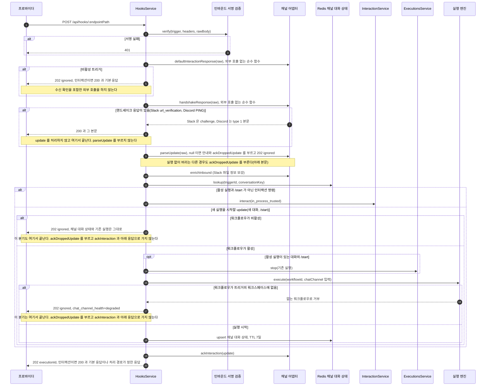
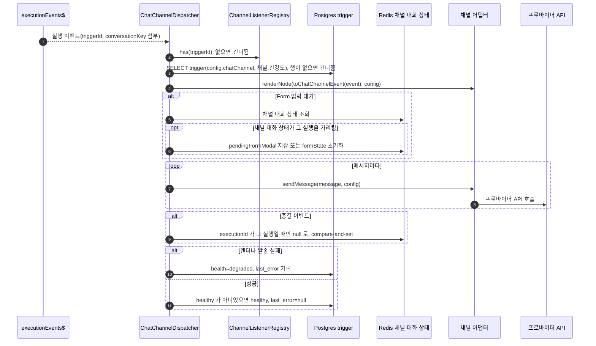

## 개요

이 문서는 [채팅 채널 데이터와 흐름](CLE-CHAT-DATA.md) 의 하위 문서로 웹훅 진입에서 채팅 채널로 갈라진 뒤의 인바운드 처리와, 실행 이벤트를 채널 프로바이더로 보내는 아웃바운드 처리를 정한다. 이 문서에서 단독으로 쓴 「프로바이더」 는 채널 프로바이더를 뜻한다.

## 인바운드 흐름

진입 라우팅(`trigger.config.chatChannel` 이 있으면 일반 웹훅 흐름을 건너뜀)은 [트리거 데이터와 흐름](../CLE-TRIG/CLE-TRIG-DATA.md) 이 정한다. 분기 뒤의 처리는 다음과 같다.

서명 검증이 먼저이고, 비활성 트리거는 검증을 통과한 뒤 조용히 버린다([채팅 채널 「R-CC-12 인바운드 응답은 202 로 고정하고 401·404 만 예외로 둔다」](CLE-CHAT-CORE.md#r-cc-12-인바운드-응답은-202-로-고정하고-401404-만-예외로-둔다)). 서명 검증을 통과하면 채널 어댑터의 `defaultInteractionResponse` 로 인터랙션 기본 응답을 먼저 정한다([채팅 채널 어댑터 규약 「인터랙션 기본 응답과 수신 확인」](CLE-CHAT-ADAPTER.md#인터랙션-기본-응답과-수신-확인)). 비활성 트리거도 인터랙션이면 `200` 과 그 기본 응답으로 답하고 수신 확인을 포함한 외부 호출은 하지 않는다([채팅 채널 「인터랙션 기본 응답」](CLE-CHAT-CORE.md#인터랙션-기본-응답)). 새 대화의 `execute()` 입력은 `{ __triggerSource:'webhook', parameters: {}, body, headers, query, method, chatChannel:{provider, conversationKey, channelUserKey} }` 다. `parameters` 는 트리거 파라미터를 해석하지 않은 빈 객체다. `headers` 는 민감 헤더를 가린 값이다. 진입 경로별 입력은 [실행 컨텍스트 「트리거 입력 파라미터 싣기」](../CLE-EXEC/CLE-EXEC-CONTEXT.md#트리거-입력-파라미터-싣기) 가 정한다. 새 실행을 시작하면 `trigger.last_triggered_at` 을 갱신한다. 그 실행의 `response_code` 는 실제로 보낸 응답 코드라 인터랙션이면 `'200'`, 아니면 `'202'` 다. `parseUpdate` 가 `null` 이면 `maybeNotifyIgnored` 로 필요한 안내를 보낸 뒤 `202 ignored` 로 끝낸다. 중복 제거와 분당 한도 게이트는 `parseUpdate` 직후에 이 순서로 선다([Redis 키](CLE-CHAT-DATA-STORE.md#redis-키)). 첨부 정보 보강(`enrichInbound`)은 두 게이트 뒤, `/help` 처리와 대화 조회 앞에서 부른다. `enrichInbound` 는 채널 어댑터의 선택 메서드다. 지금은 Slack 만 구현한다. 저장된 설정에 인바운드 서명 자료 참조가 없는 행은 서명 검증을 건너뛴다([인바운드 서명 자료 참조가 없는 행](#인바운드-서명-자료-참조가-없는-행)).

활성 트리거에서 update 를 실행 없이 버리면(파싱 결과 없음, 중복 update, 분당 한도 초과, 실행 중 안내, 워크플로우 비활성, 워크플로우 없음) `ackDroppedUpdateAndIgnore` 가 채널 어댑터의 선택 메서드 `ackDroppedUpdate` 를 부른 뒤 `{ executionId: 'ignored' }` 로 끝낸다. 지금은 Telegram 만 이 메서드가 있고 버튼 클릭(`callback_query`)에만 `answerCallbackQuery` 를 보낸다. 인라인 키보드는 그대로 둔다. 수신 확인은 보내기만 하고 끝나기를 기다리지 않아 웹훅 응답을 늦추지 않는다. 실패는 warn 로그만 남기고 응답을 바꾸지 않는다. `/help` 경로와 비활성 트리거에서는 부르지 않는다([채팅 채널](CLE-CHAT-CORE.md)). 버린 update 도 인터랙션이면 `200` 과 기본 응답으로 답한다. `defaultInteractionResponse` 와 `ackDroppedUpdate` 의 함수 계약은 [채팅 채널 어댑터 규약 「인터랙션 기본 응답과 수신 확인」](CLE-CHAT-ADAPTER.md#인터랙션-기본-응답과-수신-확인) 이 정한다.

관문의 순서는 [채팅 채널 「인바운드 관문 순서」](CLE-CHAT-CORE.md#인바운드-관문-순서) 가 정한다. 위 다이어그램은 그 순서를 따르되 `/help`·`/cancel` 같은 분기를 생략했다. 비활성 트리거와 비활성 워크플로우가 막는 범위의 차이와 인터랙션 응답의 차이도 그 절에 있다. 세 경로에 공통인 관문 규칙은 [트리거 데이터와 흐름 「워크플로우 활성 관문」](../CLE-TRIG/CLE-TRIG-DATA.md#워크플로우-활성-관문) 이 정한다. 워크플로우가 비활성이면 새 실행을 시작할 update(새 대화, `/start`)만 `202 ignored` 로 끝나고 채널 대화 상태, 채널 건강도, 중복 제거 키는 그대로다. 활성 실행이 있는 대화의 입력과 `/cancel`·`/help` 는 워크플로우가 비활성이어도 아래 표대로 처리한다.

`ChannelUpdate.command` 종류별 처리는 다음과 같다(`hooks.service.ts`).

| command | 처리와 저장 |
|---|---|
| `text_message` 가 `/help` | 대화 조회 전에 정적 안내를 `adapter.sendMessage` 로 보내고 `202 ignored`(실행 없음). Discord 의 `/<prefix> help` 와 Slack 의 `/<명령> help` 는 이 행에 오지 않는다. 파서가 `null` 로 버리고 도움말은 슬래시 명령의 HTTP 응답 본문(Discord `{ type: 4 }`, Slack `{ response_type: 'ephemeral', text }`)으로 나간다. 따로 보내는 메시지는 없어서 도움말 응답 하나로 끝난다([채팅 채널 「인터랙션 기본 응답」](CLE-CHAT-CORE.md#인터랙션-기본-응답)) |
| `cancel` | 활성 실행이 있으면 `executionsService.stop` 하고 채널 대화 상태의 `executionId` 가 그 실행을 가리킬 때만 null 로 바꾼다(compare-and-set, [아웃바운드 흐름](#아웃바운드-흐름) 의 종결 이벤트 정리와 같다). 취소 메시지를 재개 큐에 넣지 못하면 `executionId` 를 비우지 않는다. 이때 `chat_channel_health=degraded` 와 고정 문구의 `chat_channel_last_error` 를 남기고 warn 로그를 쓴 뒤 `202` 로 답한다. 실행이 먼저 끝나 취소가 `INVALID_STATE` 나 `RESOURCE_NOT_FOUND` 로 거부되면 채널 건강도를 바꾸지 않고 `202` 로 답한다([채팅 채널](CLE-CHAT-CORE.md)) |
| `text_message`·`button_callback`·`contact_share`·`file_upload`(활성 실행) | `formState` 가 진행 중이면 다단계 질문 단계를 처리하고, 아니면 `InteractionService.interact` 로 서버 안 전달([External Interaction API 「내부 신뢰 호출」](../CLE-IX/CLE-EIA.md#내부-신뢰-호출)). 재개 명령을 재개 큐에 넣지 못했을 때의 처리는 표 아래에 있다 |
| `open_form_modal` | 채널 대화 상태의 `pendingFormModal.fields` 와 프로바이더 openContext 로 `adapter.openFormModal`. Discord 는 웹훅 HTTP 응답 본문으로 모달을 돌려준다. `channelUserKey` 가 다르면 거부한다(그룹 안 가로채기 방어) |
| `form_submission` | 대화 단위 Redis 잠금(`SET NX EX 30`)을 잡고 필드 허용 목록 필터와 클라이언트 쪽 검증을 한 뒤 `interact(submit_form)`. 성공하면 `pendingFormModal` 을 지운다. 실패하면 "양식 작성하기" 버튼을 다시 보내고 `pendingFormModal` 은 둔다. 재개 명령을 재개 큐에 넣지 못했을 때도 `pendingFormModal` 을 두고 버튼을 다시 보낸다. 그때의 HTTP 응답은 표 아래에 있다 |
| `start`(활성 실행) | 워크플로우가 비활성이면 아무것도 바꾸지 않고 `202 ignored` 로 끝낸다. 활성이면 기존 실행을 `executionsService.stop` 으로 취소하고(이미 끝났거나 없으면 취소 없이 진행) 새 대화와 같이 `execute()` 한 뒤 채널 대화 상태를 새 실행으로 다시 저장한다(`startedAt` 은 그대로). 취소가 그 밖의 에러로 실패하면 그 update 의 `cc:dedup:` 키를 지우고 새 실행 없이 그 에러로 응답한다([채팅 채널](CLE-CHAT-CORE.md)) |
| 새 대화(그 밖) | 워크플로우가 비활성이면 실행 없이 `202 ignored` 로 끝내고 채널 대화 상태와 채널 건강도를 바꾸지 않는다([채팅 채널](CLE-CHAT-CORE.md)). 활성이면 `execute()` 와 채널 대화 상태 저장. 트리거의 워크플로우가 트리거의 워크스페이스에 없으면 실행 없이 `chat_channel_health=degraded` 와 고정 문구의 `chat_channel_last_error` 를 남기고 `202 ignored` 로 끝낸다. 채널 대화 상태는 저장하지 않는다([채팅 채널](CLE-CHAT-CORE.md#r-cc-25-워크플로우가-다른-워크스페이스에-있으면-202-ignored-와-degraded-로-답한다) 의 「워크플로우가 다른 워크스페이스에 있으면 202 ignored 와 degraded 로 답한다」) |

활성 실행으로 가는 재개 명령(`submit_message`·`click_button`·`submit_form`)을 재개 큐에 넣지 못하면(`queued:false`) 내부 신뢰 호출이라 `503` 이 나지 않는다. 이때 `HooksService` 는 `chat_channel_health=degraded` 와 고정 문구의 `chat_channel_last_error` 를 남기고 warn 로그를 쓴 뒤 `202` 로 답한다. 인터랙션이면 `200` 과 그 어댑터의 기본 응답이다. 고정 문구는 `/cancel` 의 큐 적재 실패와 같다. 입력이 실행에 닿지 않았으므로 실행은 입력 대기에 그대로 남는다. 사용자가 같은 입력을 다시 보내면 새 update 로 들어와 다시 처리된다. 규칙은 [채팅 채널](CLE-CHAT-CORE.md) 과 [채팅 채널 「채널 건강도」](CLE-CHAT-CORE.md#채널-건강도) 가 정한다.

네이티브 폼 모달 제출(`form_submission` 의 `submit_form`)이 큐 적재에 실패하면 같은 양식을 다시 낼 수 있게 모달 대기(`pendingFormModal`)를 남기고 "양식 작성하기" 버튼을 다시 보낸다(위 표). HTTP 응답은 폼 제출 성공 응답이 아니라 그 어댑터의 기본 응답이다(Discord `{ type: 6 }`, Slack 빈 본문). 그래서 모달만 닫히고 Discord 의 제출 확인 문구(«제출되었습니다.»)는 보이지 않는다. Slack 은 제출이 성공해도 빈 본문으로 답하므로 응답이 같다. 사용자는 버튼을 다시 눌러 같은 양식을 다시 낸다. 이 경로는 채널 대화 상태를 저장하지 않으므로 TTL 을 다시 걸지 않는다. 근거는 [Rationale](#rationale) 의 「폼 모달 제출의 큐 적재 실패는 모달 대기를 남기고 버튼을 다시 보낸다 (2026-11-13)」 에 있다.

분당 한도는 구현됐다. `ChatChannelRateLimiterService.consume` 가 `cc:rl:` 키([Redis 키](CLE-CHAT-DATA-STORE.md#redis-키))를 `INCR`+`EXPIRE NX` 한 pipeline 으로 세고, `HooksService` 가 `parseUpdate` 뒤 초과분을 `202 ignored` 로 건너뛰고 `chat_channel_health=degraded` 로 바꾼다. 공개 웹훅 가드(`PublicWebhookThrottleGuard`)의 IP 단위 시작 한도와는 별개의 대화 단위 카운터다. 채팅 채널 트리거는 그 가드의 대상이 아니다([채팅 채널 「인바운드 관문 순서」](CLE-CHAT-CORE.md#인바운드-관문-순서)). 전역 요청 빈도 제한(`UserThrottlerGuard`)에서도 빼는 것이 목표 동작이다. 그 구현 상태는 같은 절에 있다.

### 인바운드 서명 자료 참조가 없는 행

이 절은 지금 코드의 동작을 적는다. 요구사항이 아니다.

인바운드 서명 검증(`ChatChannelInboundAuthenticator.verify`)은 저장된 `config.chatChannel.inboundSigningRef` 가 없는 행에서 검증을 건너뛴다. Telegram · Slack · Discord 가 모두 같다. 그런 행으로 온 요청은 서명이 없거나 틀려도 다음 관문으로 넘어간다. 남는 방어는 웹훅 경로(`endpointPath`)가 v4 UUID 라 짐작하기 어렵다는 점뿐이다. 참조가 있는 행은 검증을 건너뛰지 않는다. 참조가 가리키는 비밀을 시크릿 저장소에서 풀지 못해도 401 이다.

참조가 없는 행은 다음 길로 생긴다. 운영 DB 에 이런 행이 실제로 있는지는 재지 않았다.

- 지금의 참조 보존 규칙이 생기기 전에 만들거나 고친 옛 행. 예를 들어 `chatChannel` 이 실린 PATCH 가 Slack · Discord 행의 `inboundSigningRef` 를 잃던 결함을 고치기 전에 그 PATCH 를 거친 행이다(`chat-channel-binder.service.ts` 의 참조 보존 주석).
- 원시 `config` 로 `chatChannel` 을 붙인 행. 생성 · 수정은 요청 본문의 최상위 필드 `chatChannel` 이 있을 때만 `setupChatChannel` 을 부르므로 이 길로 붙인 설정에는 참조가 실리지 않았다. 원시 `config` 는 이제 `chatChannel` 키를 받지 않으므로 이 길로는 새 행이 생기지 않는다([트리거 관리 「PATCH 본문 계약」](../CLE-TRIG/CLE-TRIG-MANAGE.md#patch-본문-계약)). 이미 저장된 행은 남는다.
- Telegram 생성에서 `setupChannel()` 이 실패한 행. 이 길은 가설이다. Telegram 의 서명 자료는 사용자에게 받지 않고 `setupChannel()` 이 발급한 값만 저장한다. 코드를 읽으면 생성 때 `setupChannel()` 이 실패해 `degraded` 로 저장되는 행에는 참조가 실리지 않는다. 테스트로 확인하지 않았고 이런 행의 수도 재지 않았다.

Slack · Discord 는 생성 때 서명 자료(`inboundSigningPlaintext`)를 필수로 받고 `setupChannel()` 앞에서 시크릿 저장소에 넣는다. 그래서 지금 생성 경로에서는 `setupChannel()` 의 성공 여부와 상관없이 참조가 실린다.

검증을 건너뛰지 않고 401 로 막을지는 NERV Task `CLE-T-AAGZRW` 가 운영 DB 의 참조 없는 행 수를 잰 뒤 정한다. 근거는 [Rationale](#rationale) 의 「인바운드 서명 자료 참조가 없는 행의 검증 생략은 운영 데이터를 잰 뒤 정한다 (2026-10-31)」 에 있다.

## 아웃바운드 흐름

`ChatChannelDispatcher` 는 `WebsocketService.executionEvents$` 를 `onModuleInit` 에서 직접 구독한다(단일 sink, [채팅 채널 「R4 단일 sink 를 직접 구독한다」](CLE-CHAT-CORE.md#r4-단일-sink-를-직접-구독한다)). 받는 이벤트는 EIA 다섯 가지(`execution.waiting_for_input`·`ai_message`·`completed`·`failed`·`cancelled`)와 채팅 채널 내부 `execution.node.completed`(표시 전용 `carousel`·`table`·`chart`·`template` 완료만)다.

- **라우팅 키**: 이벤트의 `triggerId` 와 `chatChannel.conversationKey` 다. `HooksService` 가 `execute()` 입력에 넣은 값이 WebsocketService 의 라우팅 문맥 레지스트리를 거쳐 이벤트 봉투에 자동으로 붙는다. 둘 중 하나라도 없으면 건너뛴다(수동 실행은 채팅 채널 발송 대상이 아니다).
- **빈 텍스트**: 본문이 빈 텍스트 메시지는 조용히 건너뛰고 warn 을 남긴다.
- **Form 입력 대기의 채널 대화 상태 갱신**: Form 입력 대기(`interactionType=form`)의 `execution.waiting_for_input` 이 오면 채널 대화 상태를 조회한다. 그 `executionId` 가 이벤트의 실행을 가리킬 때만 렌더 결과에 따라 `pendingFormModal` 이나 `formState` 를 바꿔 다시 저장한다. 채널 대화 상태가 없거나, `executionId` 가 비어 있거나, 다른 실행을 가리키면 건너뛰고 debug 로그만 남긴다. `/start`·`/cancel` 이 끊은 옛 실행의 Form 입력 대기 이벤트가 늦게 와도 새 실행의 Form 입력 대기 상태를 덮어쓰지 않게 하려는 것이다([채팅 채널](CLE-CHAT-CORE.md)). 렌더한 메시지는 이 조건과 관계없이 보낸다. 이 저장은 compare-and-set 이 아니다. 조회와 저장 사이에 `/start` 가 대화를 새 실행에 이으면 덮어쓸 수 있다. 이 창의 크기는 재지 않았다. NERV Task `CLE-T-QZ8RFC` 가 다룬다.
- **종결 이벤트의 채널 대화 상태 정리**: completed·failed·cancelled 가 오면 채널 대화 상태의 `executionId` 가 그 이벤트의 실행을 가리킬 때만 비운다(`clearExecutionIdIfMatches`). 저장된 JSON 문자열을 읽어 `executionId` 를 확인한 뒤, 저장된 값이 읽은 문자열과 같을 때만 새 값으로 바꾸는 Lua 스크립트를 부른다(TTL 7일도 다시 건다). 다른 쓰기에 밀리면 다시 읽고 최대 3회까지 시도한다. 키가 없거나 다른 실행을 가리키면 바꾸지 않는다. Redis 를 쓸 수 없거나 에러가 나거나 3회 모두 밀리면 warn 을 남기고 비우지 않는다. 그때 남은 `executionId` 는 이미 끝난 실행을 가리키므로 다음 메시지는 새 실행을 시작한다([채팅 채널](CLE-CHAT-CORE.md)). `/cancel` 의 정리도 같은 메서드를 쓴다.
- **트리거 단위 listener 레지스트리**: `setupChatChannel` 이 성공해 잠금 안 재기록이 커밋되면 등록한다. 재기록이 행이 없어 쓰지 못하면 등록하지 않는다. 트리거를 켜는 PATCH 도 커밋 뒤 `setupChannel()` 없이 등록한다([채팅 채널 「R8 트리거 단위 listener 정책」](CLE-CHAT-CORE.md#r8-트리거-단위-listener-정책)). 끄는 PATCH 는 해제하지 않고 트리거 행을 없앨 때 해제한다. 등록 · 해제는 pub/sub 채널 `chat-channel:listener` 로 다른 서버 인스턴스의 레지스트리에도 반영된다([Redis 키](CLE-CHAT-DATA-STORE.md#redis-키)). 재시작 때와 그 pub/sub 채널의 구독이 확립될 때마다 `ChannelListenerRestorer`(`channel-listener.restorer.ts`)가 활성 채팅 채널 트리거를 DB 에서 한꺼번에 복원한다(`bulkRegister`). 미등록 트리거의 이벤트는 DB 왕복 없이 건너뛴다.
- **자동 비활성화 없음**: 실패해도 `degraded` 만 기록하고 트리거를 끄지 않는다([채팅 채널 「신뢰성과 보안」](CLE-CHAT-CORE.md#신뢰성과-보안)).

## 구현 위치

- `codebase/backend/src/modules/hooks/hooks.service.ts`: `handleChatChannelWebhook`(인바운드 전체 조율, 워크플로우 활성 관문, `/start` 의 기존 실행 취소 `stopForRestart`, 인터랙션 기본 응답 적용 `withDefaultInteractionResponse`), 버린 update 의 수신 확인(`ackDroppedUpdateAndIgnore`), 폼 모달 제출의 큐 적재 실패와 검증 실패 때 버튼 다시 보내기(`reNoiseFormModal`)
- `codebase/backend/src/modules/chat-channel/types.ts`: 채널 어댑터의 선택 메서드 `defaultInteractionResponse` · `ackDroppedUpdate` 와 응답 타입 `InboundInteractionResponse`(함수 계약은 [채팅 채널 어댑터 규약 「인터랙션 기본 응답과 수신 확인」](CLE-CHAT-ADAPTER.md#인터랙션-기본-응답과-수신-확인))
- `codebase/backend/src/modules/chat-channel/chat-channel-inbound-authenticator.ts`: 프로바이더별 인바운드 서명 검증(`verify`). 저장된 `inboundSigningRef` 가 없는 행은 검증을 건너뛴다([인바운드 서명 자료 참조가 없는 행](#인바운드-서명-자료-참조가-없는-행))
- `codebase/backend/src/modules/chat-channel/chat-channel.dispatcher.ts`: 아웃바운드 구독(`WebsocketService.executionEvents$`), Form 입력 대기 상태 갱신 가드, 종결 이벤트의 채널 대화 상태 정리
- `codebase/backend/src/modules/chat-channel/channel-listener.registry.ts`, `codebase/backend/src/modules/chat-channel/channel-listener.bus.ts`, `codebase/backend/src/modules/chat-channel/channel-listener.restorer.ts`: 트리거 단위 listener 레지스트리, `chat-channel:listener` 발행 · 구독, 재시작 · 구독 확립 때의 일괄 복원(`ChannelListenerRestorer`)
- `codebase/backend/src/modules/triggers/trigger-resource-releaser.service.ts`: 트리거 행을 없애기 전의 외부 해제 단계에서 채팅 채널 트리거의 레지스트리 해제와 그 변경 메시지 발행

## Rationale

### `/cancel` 과 재개 명령의 큐 적재 실패에서 중복 제거 키를 지우지 않는다 (2026-10-17)

NERV Task `CLE-T-EQDYC1` · `CLE-T-EMB0YG` 의 결정이다. `/cancel` 의 취소나 활성 실행으로 가는 재개 명령을 재개 큐에 넣지 못하면 채팅 채널은 `202` 로 답하고 채널 건강도를 `degraded` 로 바꾼다. 응답 코드를 이렇게 정한 근거는 [채팅 채널 「R-CC-31 /cancel 과 재개 명령의 큐 적재 실패는 202 와 degraded 로 답한다」](CLE-CHAT-CORE.md#r-cc-31-cancel-과-재개-명령의-큐-적재-실패는-202-와-degraded-로-답한다) 에 있다.

이때 `cc:dedup:` 키는 그대로 둔다. 프로바이더는 2xx 를 받으면 같은 update 를 다시 보내지 않으므로 키를 지워도 받을 재전송이 없다. 사용자가 같은 명령이나 입력을 다시 보내면 프로바이더가 새 update id 를 붙이므로 키가 다르다. 그래서 30초 키는 사용자의 다시 보내기를 막지 않는다. `/start` 의 기존 실행 취소 실패는 에러로 답하고 프로바이더의 재전송을 받으려고 키를 지운다. 응답 코드가 다르므로 키 처리도 다르다.

기각한 대안은 큐 적재 실패 때도 `/start` 처럼 키를 지우는 것이다. `202` 뒤에는 재전송이 오지 않아 지워도 달라지는 것이 없다.

### 인바운드 서명 자료 참조가 없는 행의 검증 생략은 운영 데이터를 잰 뒤 정한다 (2026-10-31)

NERV Task `CLE-T-EA7B5M` 에서 사람이 정했다(NERV 질문 `01a19048-6f1c-7782-8fce-2c3a060f9291`). 이 Task 는 [인바운드 서명 자료 참조가 없는 행](#인바운드-서명-자료-참조가-없는-행) 의 현행 동작을 스펙에 적는 데까지 한다. 바꿀지는 NERV Task `CLE-T-AAGZRW` 가 운영 DB 의 행 수를 잰 뒤 정한다.

원시 `config` 계약을 정하면서 이 동작이 드러났다. 원시 `config` 로 채팅 채널을 붙이면 참조 없는 행이 생길 수 있었고 그 행은 서명 검증 없이 인바운드를 받았다. 원시 `config` 의 타입 키 거부로 그 길은 닫힌다([트리거 관리 「PATCH 본문 계약」](../CLE-TRIG/CLE-TRIG-MANAGE.md#patch-본문-계약)). 이미 저장된 행과 다른 길로 생긴 행은 남는다.

지금 고르지 않은 안은 둘이다(후속 Task `CLE-T-AAGZRW` 가 계측 결과로 고른다).

- 지금 401 로 막는다. 참조 없는 옛 Slack · Discord 행이 있으면 그 채팅 채널의 수신이 바로 끊긴다. 두 채널 프로바이더의 서명 자료는 PATCH 로 넣을 수 없어서(1차 범위에 그 경로가 없다) 트리거를 다시 만들어야 한다.
- 지금 동작을 유지한다는 결정을 스펙에 올린다. 참조 없는 행은 웹훅 경로의 무작위성에만 기댄다.

두 안 모두 참조 없는 행이 몇 개인지 모르는 채로 정해야 한다. 그래서 먼저 잰다. 참조가 없는 행이 0 이면 401 로 막고 하나라도 있으면 지금 동작을 유지한다는 결정을 스펙에 올린다.

### 폼 모달 제출의 큐 적재 실패는 모달 대기를 남기고 버튼을 다시 보낸다 (2026-11-13)

NERV Task `CLE-T-6ZTPZ8` 의 결정이다. 사람이 질문 `01a1d2f3-df05-7334-88a9-e745d4a668dc` 에 답해 정했다. 재개 명령의 큐 적재 실패 규칙은 사용자가 같은 입력을 다시 보내면 다시 처리된다는 전제에 기댄다([인바운드 흐름](#인바운드-흐름)). 텍스트와 버튼 입력은 사용자가 그대로 다시 보낼 수 있다. 네이티브 폼 모달은 "양식 작성하기" 버튼으로만 다시 열 수 있고 그 버튼은 `pendingFormModal` 이 있어야 모달을 연다. 큐 적재 실패를 제출 성공처럼 처리해 `pendingFormModal` 을 지우면 사용자는 같은 양식을 다시 낼 수 없다. Discord 에서는 제출 확인 문구까지 보여 입력이 실행에 닿은 것처럼 보인다.

그래서 검증 실패와 같은 복구 경로를 쓴다. `pendingFormModal` 을 두고 버튼을 다시 보내며 성공 응답 대신 기본 응답으로 모달만 닫는다. 응답 코드와 채널 건강도는 다른 재개 명령의 큐 적재 실패와 같다. 근거는 [채팅 채널 「R-CC-31 /cancel 과 재개 명령의 큐 적재 실패는 202 와 degraded 로 답한다」](CLE-CHAT-CORE.md#r-cc-31-cancel-과-재개-명령의-큐-적재-실패는-202-와-degraded-로-답한다) 에 있다.

여러 단계 폼(`formState`)의 마지막 제출은 이 결정에 들어가지 않는다. 지금 코드는 그 제출을 큐에 넣지 못해도 `formState` 를 지운다. 후속에서 다룬다.
