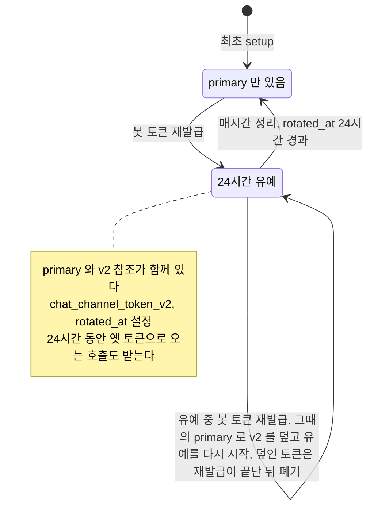

## 개요

이 문서는 [채팅 채널 데이터와 흐름](CLE-CHAT-DATA.md) 의 하위 문서로 봇 토큰과 인바운드 서명 자료의 최초 setup · PATCH · 재발급 · 실패 되돌리기 · 24시간 유예 정리를 정한다.

## 봇 토큰 라이프사이클

봇 토큰 평문은 `trigger.config` 에 저장하지 않고 시크릿 참조로만 가리킨다([시크릿 저장소 「규칙」](../CLE-INT/CLE-INT-SECRET.md#규칙) 규칙 14). 각 단계의 소유 파일이 다르다. 최초 setup·teardown 은 `chat-channel-binder.service.ts`, PATCH 검증은 `chat-channel-input-rules.ts`, 재발급·정리는 `triggers.service.ts` 다.

| 단계 | 흐름 | 저장 |
|---|---|---|
| 최초 setup(생성 `POST /api/triggers` 때만) | `setupChatChannel` 이 평문(`botToken`, 프로바이더 발급 `inboundSigningPlaintext`)을 시크릿 저장소에 UPSERT 하고 `adapter.setupChannel(config, callbackUrl)` 을 부른다. Telegram 은 서버 발급 `issuedInboundSigning` 을 돌려주므로 따로 저장한다. 설정에 `botTokenRef`·`inboundSigningRef`·`botIdentity` 를 합친다 | `secret_store` 행, UPDATE `trigger.config`·`chat_channel_setup_at`·`chat_channel_health='healthy'`, 레지스트리 등록 |
| `chatChannel` 이 실린 PATCH | `setupChannel()` 을 다시 불러 프로바이더 등록만 갱신한다. 사용자가 보낸 비밀은 쓰지 않아 봇 토큰과 Slack·Discord 서명 값은 그대로다. Telegram 은 새 `secret_token` 이 등록되므로 `inboundSigningRef` 가 매번 갱신된다(건너뛰면 인바운드 401). `botTokenRef` · `inboundSigningRef` 의 값은 저장값을 쓰지 않고 트리거 id 에서 만든다(`chatChannelSecretRef`). `botTokenRef` 는 저장할 설정에 늘 싣는다. `inboundSigningRef` 는 이번 요청에서 서명 자료를 새로 저장했거나(Telegram 의 `issuedInboundSigning`) 요청 전 저장값이나 잠금 안에서 다시 읽은 행에 이미 있을 때만 싣는다. 참조가 없던 행에는 싣지 않는다. 서명 자료가 없는 행에 참조를 실으면 인바운드 검증 결과가 달라진다. 구현은 `chat-channel-binder.service.ts` 의 `setupChatChannel` 이다. `triggers.service.ts` 의 `update` 가 병합 전에 집어 둔 `inboundSigningRef` 를 이 함수에 넘긴다 | UPDATE `trigger.config`·`chat_channel_setup_at`·건강도. `secret_store` 는 봇 토큰·Slack·Discord 서명 무변경, Telegram `inbound-signing` 행만 갱신 |
| 켜고 끄는 PATCH(`{ isActive }` 만) | `setupChannel()` · `teardownChannel()` 을 부르지 않는다. 봇 토큰 · 인바운드 서명 · 프로바이더 등록이 그대로다. 켤 때만 트리거 단위 listener 레지스트리에 등록한다. 레지스트리는 메모리에 있고 등록은 pub/sub 로 다른 서버 인스턴스에 알린다. 끌 때는 해제하지 않는다. 근거는 [채팅 채널 「R-CC-29 트리거를 켜고 끌 때 외부 채널 등록은 건드리지 않는다」](CLE-CHAT-CORE.md#r-cc-29-트리거를-켜고-끌-때-외부-채널-등록은-건드리지-않는다) 다 | `trigger.is_active` 만 바뀐다. 시크릿 저장소는 무변경 |
| PATCH 거부 | 비밀 필드를 실었거나, 채팅 채널을 나중에 붙이려 했거나, `provider` 를 바꾸려 했으면 `400 VALIDATION_ERROR` 로 아무것도 쓰지 않고 끝난다. 기준은 [채팅 채널](CLE-CHAT-CORE.md) 의 봇 토큰 변경 단일 경로 | 무변경(DB·시크릿 저장소) |
| 재발급 | `POST /api/triggers/:id/chat-channel/rotate-bot-token` → `rotateBotToken` 6단계: ① 기존 토큰 resolve(없으면 ② 건너뜀. 저장된 이전 토큰이 비었거나 공백만 있어도(빈 값 거부 이전에 저장된 옛 행) ② 의 백업을 건너뛴다) ② v2 참조(`bot-token.v2`)에 토큰 보관 ③ primary 참조에 새 토큰 UPSERT ④ 새 토큰으로 `setupChannel` 재호출(서명 자료 재발급) ⑤ `issuedInboundSigning` 저장 ⑥ 트리거 컬럼 갱신. ② 에서 v2 참조에 옛 토큰을 백업하고 ③ 에서 primary 를 새 토큰으로 바꾸므로 v2 를 primary 로 올리는 단계는 없다([채팅 채널 「신뢰성과 보안」](CLE-CHAT-CORE.md#신뢰성과-보안)). `botTokenRef` · `inboundSigningRef` 는 저장값을 쓰지 않고 `rotateBotToken` 이 `chatChannelSecretRef(trigger.id, …)` 로 트리거 id 에서 만든다(NERV Task `CLE-T-M9QKKX`). ④ 에서 `setupChannel` 에 넘기는 설정에는 `botTokenRef` 를 늘 싣고 `inboundSigningRef` 는 저장된 행에 있을 때만 싣는다([시크릿 저장소 「규칙」](../CLE-INT/CLE-INT-SECRET.md#규칙) 규칙 24). ②~⑥ 가운데 어디서 실패하면 이 요청이 쓴 시크릿을 재발급 전 값으로 되돌린다(표 아래). 유예 중 재발급이 끝까지 성공하면 ② 가 v2 에서 덮은 토큰을 폐기한다(상태도 아래) | UPDATE `chat_channel_token_v2`(v2 참조), `chat_channel_rotated_at`, `chat_channel_health='healthy'`. 실패하면 DB · 시크릿 저장소 모두 재발급 전 값 |
| 유예 종료 정리 | BullMQ `chat-channel-token-rotator` 큐의 repeatable job(`0 * * * *`, `upsertJobScheduler` 라 여러 인스턴스에서도 전역 1회)이 `cleanupRotatedChatChannelTokens` 를 부른다. `chat_channel_token_v2 IS NOT NULL AND chat_channel_rotated_at <= now-24h` 후보마다 프로바이더 `revokeBotToken?` 을 실패 흡수 방식으로 부르고(Slack `auth.revoke` 만, Telegram·Discord 는 revoke API 없음) `secrets.delete(v2Ref)` 한다. 재발급 시점에는 v2 에 백업한 직전 토큰을 폐기하지 않는다. 근거는 [채팅 채널 어댑터 규약 「R-CCA-10 이전 봇 토큰은 24시간 유예가 끝난 정리 작업이 폐기한다」](CLE-CHAT-ADAPTER.md#r-cca-10-이전-봇-토큰은-24시간-유예가-끝난-정리-작업이-폐기한다) 다. 유예 중 재발급으로 v2 에서 덮인 토큰은 이 정리가 찾을 수 없으므로 재발급이 끝난 뒤 폐기한다(상태도 아래) | `secret_store` v2 행 DELETE, UPDATE `chat_channel_token_v2=NULL`·`chat_channel_rotated_at=NULL` |

재발급 실패의 응답 분류(자격 증명 거부 `400 BOT_TOKEN_INVALID`, 그 밖 `502 CHAT_CHANNEL_SETUP_FAILED`)는 [채팅 채널](CLE-CHAT-CORE.md) 의 봇 토큰 재발급 API 가 기준이라 여기 다시 적지 않는다. 봇 토큰 변경은 재발급 API 한 경로다.

재발급이 ②~⑥ 가운데 어디서 실패하면 그 요청이 시크릿 저장소에 쓴 행을 재발급 전 값으로 되돌리고 실패한 단계의 오류로 응답한다(NERV Task `CLE-T-Q353Y4`). ⑥ 의 트리거 행 갱신은 커밋되지 않으므로 `chat_channel_token_v2` · `chat_channel_rotated_at` · 채널 건강도도 재발급 전 값 그대로다. ②, ③, ⑤ 의 시크릿 저장소 쓰기는 그 참조의 기존 행이 다른 워크스페이스 소유면 거부되고 응답은 500 `INTERNAL_ERROR` 다([시크릿 저장소 「규칙」](../CLE-INT/CLE-INT-SECRET.md#규칙) 규칙 25). ④ 가 실패하면 위 응답 분류대로 400 이나 502 다. ⑥ 에서 그 사이 트리거 행이 지워져 쓰지 못하면 되돌리지 않는다. 대신 프로바이더 등록을 해제하고 그 트리거의 시크릿을 모두 지운 뒤 404 로 끝난다([트리거 데이터와 흐름 「트리거 삭제와 자원 해제」](../CLE-TRIG/CLE-TRIG-DATA.md#트리거-삭제와-자원-해제)).

되돌리는 규칙은 다음과 같다. 구현은 `secret-write-journal.ts` 의 `SecretWriteJournal` 이다.

- 이 요청에서 성공한 쓰기만 되돌린다. 거부된 쓰기는 되돌리지 않는다. 다른 워크스페이스 행이라 거부된 쓰기를 «없던 행» 으로 보고 지우면 남의 비밀을 지운다.
- 마지막 쓰기부터 거꾸로 되돌린다.
- 되돌리기 직전에 행을 다시 읽어 이 요청이 쓴 값이 아니면 건드리지 않고 warn 로그를 남긴다. 그 사이 같은 트리거의 다른 재발급이 성공했으면 그 결과를 덮지 않는다. 다시 읽은 뒤 되돌리기까지의 창은 남는다.
- 쓰기 전에 값이 있었으면 그 값을 다시 쓴다. 행이 없었거나 값이 비었거나 공백만 있었으면 행을 지운다. 저장소는 빈 평문을 받지 않아 빈 값은 되살릴 수 없다([시크릿 저장소 「규칙」](../CLE-INT/CLE-INT-SECRET.md#규칙) 규칙 27).
- 쓰기 전 값을 읽지 못했으면(복호화 실패 등) 되돌리지 않고 error 로그를 남긴다. 이 요청이 쓴 값이 남는다.
- 한 행을 되돌리다 실패하면 error 로그를 남기고 나머지 행을 계속 되돌린다. 응답은 그래도 실패한 단계의 오류다. 로그에는 참조와 오류 메시지만 남기고 평문은 남기지 않는다.

실패한 단계별로 되돌린 뒤의 시크릿 저장소는 다음과 같다.

- ② 거부: 쓰기가 없어 되돌릴 것도 없다.
- ③ 거부: ② 가 쓴 `bot-token.v2` 행을 되돌린다. 재발급 전에 `PrimaryOnly` 였으면 그 행이 지워지고, `Grace` 였으면 유예 중이던 옛 토큰으로 돌아온다.
- ④ 실패: primary 는 재발급 전 토큰으로 돌아오고 `bot-token.v2` 는 ③ 거부와 같다. `400 BOT_TOKEN_INVALID` 로 끝났어도 프로바이더가 거부한 토큰은 primary 에 남지 않는다.
- ⑤ 거부(Telegram 만): ④ 실패와 같다.
- ⑥ 실패: ④ 실패와 같고, ⑤ 가 쓴 `inbound-signing`(Telegram 만)도 재발급 전 값으로 돌아온다.

프로바이더 등록은 되돌리지 않는다. ④ 가 새 토큰으로 한 등록은 뒤 단계가 실패해도 프로바이더에 남는다. Telegram 은 ④ 에서 웹훅과 새 `secret_token` 을 먼저 등록하고 `getMe` 를 부르므로 ④ 가 `getMe` 에서 실패해도 등록은 남는다. 새 토큰이 같은 봇의 토큰이면 그 봇에 등록된 `secret_token` 과 시크릿 저장소의 `inbound-signing` 이 달라진다. 두 값이 다시 맞을 때까지(재발급 성공이나 `chatChannel` 이 실린 PATCH) 그 봇의 인바운드는 401 로 거부된다. Slack 의 ④ 는 `auth.test` 만 부르므로 남는 등록이 없다. Discord 의 ④ 는 새 토큰의 애플리케이션에 명령을 등록하고 옛 애플리케이션의 등록은 바꾸지 않는다.

재발급 전에 이미 `Grace` 였으면 되돌린 뒤에도 컬럼이 같은 `bot-token.v2` 참조를 가리킨다. 그래서 앞선 재발급 시각에서 24시간이 지나면 정리가 유예 중이던 옛 토큰을 revoke(Slack 만)하고 지운다.

`PrimaryOnly` 는 primary 참조(`bot-token`)만 있는 상태, `Grace` 는 primary 와 v2 참조(`bot-token.v2`)가 함께 있는 24시간 유예 상태다. 정리는 v2 시크릿 행을 지우고 프로바이더 revoke 를 시도한 뒤 컬럼을 NULL 로 만든다. v2 가 NULL 이면 아무 일도 하지 않으므로 멱등이다.

유예 중에 봇 토큰을 다시 재발급하면 재발급 6단계가 그대로 돈다. ② 가 v2 참조를 그때의 primary 토큰(직전 재발급에서 넣은 토큰)으로 덮고 ⑥ 이 `chat_channel_rotated_at` 을 지금 시각으로 바꾼다. 24시간 유예는 그때부터 다시 센다. 덮이기 전 v2 에 있던 처음 토큰은 시크릿 저장소에서 사라진다. 정리는 v2 에 있는 토큰만 revoke 하므로 처음 토큰을 찾지 못한다. 그래서 재발급이 끝까지 성공하면(⑥ 의 트리거 컬럼 갱신과 감사 기록 뒤) `rotateBotToken` 이 덮인 처음 토큰을 채널 어댑터의 `revokeBotToken` 으로 폐기한다(NERV Task `CLE-T-6ZTPZ8`).

- 실패를 흡수하는 best-effort 호출이다. 폐기가 실패해도 재발급은 성공으로 응답하고 warn 로그만 남긴다.
- 덮기 전 v2 행이 없었거나 읽지 못했으면 폐기하지 않는다. 덮인 값이 비었거나 공백만 있을 때도 폐기하지 않는다.
- 덮인 토큰이 이번에 v2 로 옮긴 토큰(재발급 전 primary)이나 새 토큰과 같으면 폐기하지 않는다. 같은 토큰으로 되돌리는 재발급에서 아직 쓰는 토큰을 끊지 않으려는 것이다.
- 재발급이 ②~⑥ 가운데 어디서 실패해 v2 를 처음 토큰으로 되돌리면 폐기하지 않는다. 그 토큰은 유예 중인 옛 토큰으로 돌아오고 유예가 끝나면 정리가 폐기한다. ⑥ 에서 트리거 행이 지워져 404 로 끝날 때도 폐기하지 않는다.
- revoke API 가 있는 프로바이더는 Slack(`auth.revoke`)뿐이다. Telegram · Discord 에서는 전과 같이 처음 토큰이 시크릿 저장소에서 사라지기만 한다.

근거는 [Rationale](#rationale) 의 「유예 중 재교체로 덮이는 봇 토큰은 재발급이 끝난 뒤 폐기한다 (2026-11-13)」 에 있다.

[EIA 데이터와 흐름 「알림 서명 시크릿」](../CLE-IX/CLE-EIA-DATA.md#알림-서명-시크릿) 도 유예 중 재호출 때 앞의 v2 를 덮고 24시간 유예를 다시 시작한다. v2 에 담는 값의 차이(새 시크릿 대 옛 토큰 백업)와 두 컬럼 이름을 같은 패턴으로 둔 근거는 [Rationale](#rationale) 의 「R-K chat_channel_token_v2 이름을 notification_secret_v2 와 같은 패턴으로 둔다」 에 있다.

## 구현 위치

- `codebase/backend/src/modules/triggers/chat-channel-token-rotator.service.ts`: `chat-channel-token-rotator` 큐(매시간 정리, 정리 로직과 같은 triggers 모듈)
- `codebase/backend/src/modules/triggers/chat-channel-binder.service.ts`: `setupChatChannel`·`teardownChatChannel`(채널 어댑터 바인딩, 시크릿 쓰기와 참조 보존), 켤 때의 레지스트리 등록(`registerListenerOnActivation`)
- `codebase/backend/src/modules/chat-channel/chat-channel-secret-refs.ts`: 트리거 id 로 `botTokenRef` · `inboundSigningRef` 를 만드는 `chatChannelSecretRef`, 저장된 설정을 읽을 때 참조를 트리거 id 로 다시 맞추는 읽기 관문(`pinChatChannelSecretRefs` · `readTriggerChatChannelConfig`), 레지스트리 등록용 `provider` 읽기(`readTriggerChatChannelProvider`)
- `codebase/backend/src/modules/triggers/triggers.service.ts`: `rotateBotToken`·`cleanupRotatedChatChannelTokens`, 유예 중 재발급으로 덮인 토큰의 폐기(`readOverwrittenGraceToken` · `tryRevokeBotToken`), `update` 의 켜는 PATCH 커밋 뒤 레지스트리 등록(`registerListenerOnActivation` 호출)
- `codebase/backend/src/modules/triggers/secret-write-journal.ts`: 재발급이 실패하면 그 요청이 쓴 시크릿을 되돌리는 `SecretWriteJournal`

## Rationale

### chat_channel_token_v2 에 토큰이 아니라 참조를 둔다

컬럼에는 시크릿 참조 문자열만 둔다. 평문이 DB 에 닿지 않게 하는 [시크릿 저장소 「규칙」](../CLE-INT/CLE-INT-SECRET.md#규칙) 규칙 14 를 그대로 적용한 것이다. 24시간 유예는 재발급 직후 옛 토큰으로 오는 프로바이더 쪽 진행 중 호출과 캐시를 위한 안전 창이다. 유예 종료를 별도 cron 프로세스가 아니라 BullMQ repeatable job 으로 둔 것은 스케줄 발사, 알림 서명 시크릿 교체와 같은 "Redis 중앙 등록, 여러 인스턴스에서 전역 1회" 패턴을 다시 쓰려는 것이다.

### R-K chat_channel_token_v2 이름을 notification_secret_v2 와 같은 패턴으로 둔다

`notification_secret_v2` 는 EIA 알림 웹훅 서명 시크릿의 v2 이고 `chat_channel_token_v2` 는 외부 프로바이더 봇 토큰 참조의 v2 다. 두 컬럼은 뜻이 다르지만(서명 시크릿 대 외부 봇 토큰) 이름 패턴(`<channel>_<resource>_v2`)은 같게 둔다. 이름 일관성을 앞세우고 뜻 차이는 컬럼 설명에 적는다. 나중에 봇 토큰 재발급과 시크릿 교체를 한 패턴으로 합치면 두 컬럼 모두 영향을 받는다.

요구사항([채팅 채널 「신뢰성과 보안」](CLE-CHAT-CORE.md#신뢰성과-보안))과 현재 구현(`rotateBotToken`)은 v2 에 옛 토큰을 24시간 백업하고 승격 단계를 두지 않는다. 이 항목의 옛 표현 «유예 기간의 신규 token» 은 그쪽에 맞춰 고쳤다. [시크릿 저장소](../CLE-INT/CLE-INT-SECRET.md) 도 같은 규칙을 적는다. 이름 패턴은 같아도 두 v2 의 뜻은 반대다. `notification_secret_v2` 는 유예 기간의 새 서명 시크릿이고 승격 때 기준 참조를 바꾼다. `chat_channel_token_v2` 는 옛 봇 토큰 백업이고 유예가 끝나면 지운다.

### 유예 중 봇 토큰 재발급은 현재 코드 동작을 적은 것이다 (2026-10-17)

NERV Task `CLE-T-EMB0YG` 의 승인본 동기화다. [봇 토큰 라이프사이클](#봇-토큰-라이프사이클) 상태도의 `Grace --> Grace` 와 그 아래 문단은 유예 중 재발급 때 지금 `rotateBotToken` 이 하는 일을 그대로 적었다. 이 동작을 골라 정한 기록은 없다.

유예 중 재발급을 `409` 로 거부할지와 v2 가 덮일 때 처음 토큰을 revoke 할지는 2026-11-13 에 정했다. 근거는 아래 「유예 중 재교체로 덮이는 봇 토큰은 재발급이 끝난 뒤 폐기한다 (2026-11-13)」 에 있다. v2 에 백업한 직전 토큰의 revoke 시점(유예 종료 정리)은 NERV Task `CLE-T-D41BY6` 에서 정했다(위 표의 「유예 종료 정리」).

### 재발급이 실패하면 그 요청이 쓴 시크릿을 되돌린다 (2026-11-12)

NERV Task `CLE-T-Q353Y4` 의 결정이다. 앞 판은 재발급이 실패한 단계 앞의 쓰기를 되돌리지 않는다고 적고 그것을 결함으로 올렸다. 되돌리지 않으면 세 가지가 남았다.

- ④ 가 `400 BOT_TOKEN_INVALID` 로 끝나도 프로바이더가 거부한 새 토큰이 primary 에 남아 아웃바운드 발송이 그 토큰으로 나갔다.
- 재발급 전에 `PrimaryOnly` 였으면 `chat_channel_token_v2` 가 가리키지 않는 `bot-token.v2` 행이 남았다. 유예 종료 정리는 그 행을 찾지 못했다.
- 재발급 전에 `Grace` 였으면 유예 중이던 옛 토큰이 재발급 전 primary 토큰으로 덮였다. 정리는 앞선 재발급 시각에서 24시간 뒤 그 토큰을 revoke(Slack 만)했다.

되돌리기는 시크릿 저장소 행만 다룬다. ④ 가 프로바이더에 남긴 등록까지 되돌리려면 옛 토큰으로 `setupChannel` 을 다시 불러야 한다. 이 Task 에서는 그 안을 택하지 않았다. 다시 부르는 호출도 실패할 수 있어 실패 처리가 한 겹 더 생긴다. Telegram 은 부를 때마다 새 `secret_token` 을 발급하므로 저장할 쓰기도 다시 생긴다. 남는 Telegram 인바운드 401 은 재발급을 다시 하거나 `chatChannel` 이 실린 PATCH 로 풀린다.

되돌리기 직전에 행을 다시 읽어 이 요청이 쓴 값일 때만 되돌린다. 같은 트리거의 재발급 두 건이 겹쳐 하나만 성공하면 실패한 쪽이 성공한 쪽의 primary 를 옛 토큰으로 덮을 수 있어서다. 쓰기 전 값을 읽지 못한 행은 지우지 않는다. 읽지 못했을 뿐 원래 행이 있을 수 있어서다.

[시크릿 저장소](../CLE-INT/CLE-INT-SECRET.md) 의 «⑤ 에서 거부되면 `bot-token.v2` 백업 행이 남아 유예 정리 대상이 되지 않는다» 는 서술은 이 판과 맞지 않는다. 그 문서의 정정은 후속으로 남긴다.

### 유예 중 재교체로 덮이는 봇 토큰은 재발급이 끝난 뒤 폐기한다 (2026-11-13)

NERV Task `CLE-T-6ZTPZ8` 의 결정이다. 사람이 질문 `01a1d2f3-e056-744a-a58f-76fe3a46c612` 에 답해 정했다. 2026-10-17 판은 유예 중 재발급에서 v2 가 덮일 때 처음 토큰을 revoke 하지 않는 동작을 적고 결정을 미뤘다. 덮인 토큰은 시크릿 저장소에도 트리거 컬럼에도 남지 않는다. 그래서 유예 종료 정리가 그 토큰을 찾지 못하고, Slack 에서는 쓰지 않는 토큰이 프로바이더 쪽에서 계속 유효하다.

폐기는 재발급이 끝까지 성공한 뒤에 한다. 재발급이 실패하면 v2 가 처음 토큰으로 되돌아가 유예 중인 옛 토큰이 된다. 그 전에 폐기하면 되돌린 v2 에 이미 끊긴 토큰이 남는다. 폐기는 best-effort 다. 재발급은 이미 커밋됐으므로 폐기 실패를 재발급 실패로 답하면 사실과 다르다.

기각한 대안은 유예 중 재발급을 `409` 로 거부하는 것이다. 이 안이면 덮이는 토큰이 생기지 않는다. 대신 새 토큰이 새어 나가도 유예가 끝날 때까지 24시간 동안 다시 바꿀 수 없다.

[채팅 채널 어댑터 규약 「R-CCA-10 이전 봇 토큰은 24시간 유예가 끝난 정리 작업이 폐기한다」](CLE-CHAT-ADAPTER.md#r-cca-10-이전-봇-토큰은-24시간-유예가-끝난-정리-작업이-폐기한다) 의 «재발급 시점에는 폐기하지 않는다» 는 v2 에 백업하는 직전 토큰의 규칙이다. 덮이는 토큰은 유예 종료 정리가 폐기할 수 없으므로 이 규칙의 예외로 둔다.
