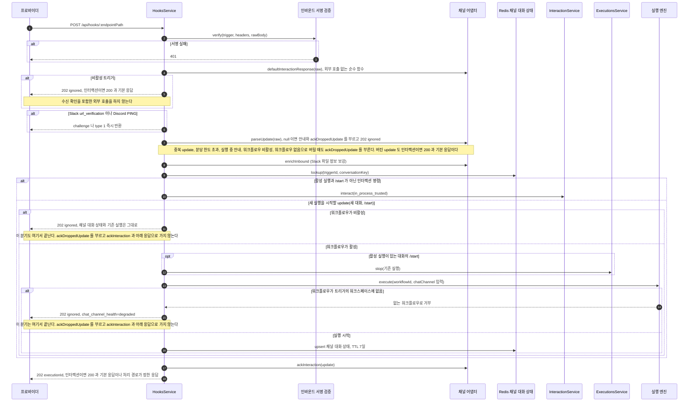
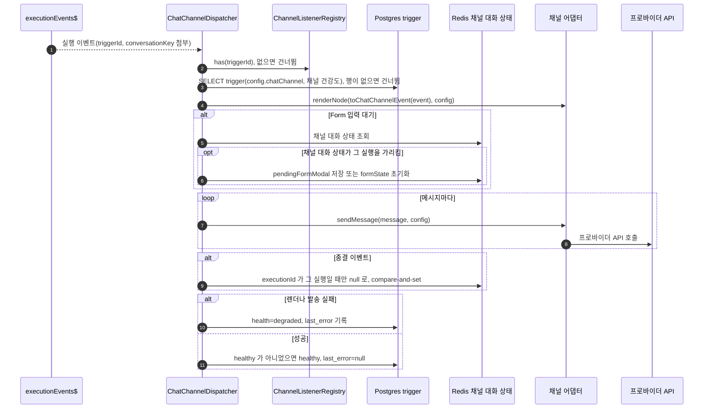
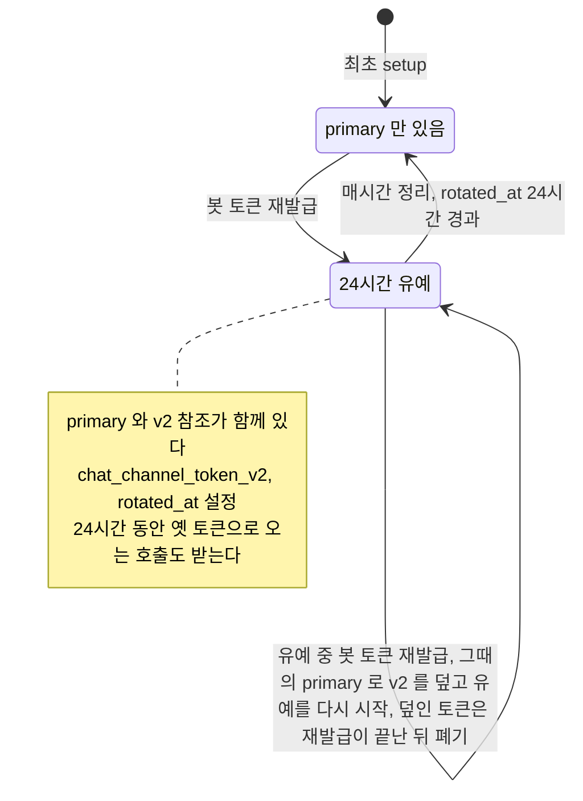

> 구현 상태: 부분 구현 · 원문: `spec/5-system/15-chat-channel.md` (§4 데이터 모델), `spec/data-flow/14-chat-channel.md` · 용어: [용어 사전](../CLE-GLOSSARY.md)

## 개요

이 문서는 [채팅 채널](CLE-CHAT-CORE.md) 이 저장하는 데이터와 그 데이터가 흐르는 경로를 정한다. 다루는 것은 `Trigger.config.chatChannel` 필드, 안내 문구(`languageHints`) 기본값, 트리거의 `chat_channel_*` 컬럼, 채널 대화 상태(`ChannelConversation`)와 Redis 키, 인바운드·아웃바운드 흐름, 봇 토큰 라이프사이클, 상태 전이다. 이 문서에서 단독으로 쓴 「프로바이더」 는 채널 프로바이더를 뜻한다.

저장 모델의 핵심 사실이 하나 있다. 채널 대화 상태는 Postgres 테이블이 아니라 Redis 키-값(`chat-channel:{triggerId}:{conversationKey}`, TTL(Time To Live) 7일)이다. Redis 를 쓸 수 없으면 조용히 기능을 낮춘다(조회는 null, 저장은 no-op 이라 update 마다 새 실행이 시작된다). 영속 데이터는 `trigger` 테이블의 `chat_channel_*` 컬럼 5개와 `trigger.config.chatChannel` JSON, 그리고 [시크릿 저장소](../CLE-INT/CLE-INT-SECRET.md) 의 행뿐이다.

웹훅 진입에서 채팅 채널로 갈라지는 지점은 [트리거 데이터와 흐름](../CLE-TRIG/CLE-TRIG-DATA.md) 이 정하고, 이 문서는 그 분기 뒤의 흐름을 맡는다. 요구사항과 API 계약은 [채팅 채널](CLE-CHAT-CORE.md), 채널 프로바이더별 응답 JSON·서명 알고리즘·Form 모달 세부는 [채팅 채널 어댑터 규약](CLE-CHAT-ADAPTER.md) 과 프로바이더 문서가 정한다. 웹채팅 위젯은 채팅 채널 모듈을 거치지 않는다([웹채팅 경로](#웹채팅-경로)).

## Trigger.config.chatChannel

`chatChannel` 이 없으면 일반 웹훅 트리거다(기존 동작 그대로). 이 필드는 [웹훅](../CLE-TRIG/CLE-TRIG-WEBHOOK.md) 트리거의 `config` JSONB 안에 있다. 메모리 표현 타입(`ChatChannelConfig`)은 [채팅 채널 어댑터 규약](CLE-CHAT-ADAPTER.md) 이 정하고, 필드 계약은 이 절이 정한다. `languageLocale` 을 포함한 `chatChannel` 필드 전체 목록의 기준도 이 절이다([트리거 관리](../CLE-TRIG/CLE-TRIG-MANAGE.md) 가 여기를 가리킨다).

요청 본문에서는 이 설정을 최상위 필드 `chatChannel` 로만 받는다. 생성 · 수정 요청 본문의 `config` 키(원시 `config`) 아래에 `chatChannel` 키가 있으면 값과 상관없이 400 `VALIDATION_ERROR`(`details.field='config.chatChannel'`)다. 그 아래에 내부 필드 경로(`config.chatChannel.botTokenRef` 등)가 함께 실렸으면 그 경로의 거부가 먼저 걸린다. 기준은 [트리거 관리 「PATCH 본문 계약」](../CLE-TRIG/CLE-TRIG-MANAGE.md#patch-본문-계약) 이다.

```jsonc
{
  "chatChannel": {
    "provider": "telegram",                    // 채널 프로바이더. 지원 목록은 채팅 채널 문서의 카탈로그(1차 범위: telegram / slack / discord)
    "botToken": "<provider 발급 plaintext>",   // 입력 전용. 생성 요청(POST /api/triggers) 본문의 chatChannel.botToken 으로만 받는다. 원시 config.chatChannel.botToken 은 400 이다(트리거 관리 REQ-TRIG-053). 서비스가 SecretResolver.rotate 로 옮긴 뒤 지운다. 응답·DB JSONB 에 없다(시크릿 저장소 「규칙」 규칙 14).
                                               // 1~256자의 보이는 ASCII(U+0021~U+007E)만 받는다. 공백·제어 문자·ASCII 밖 문자가 있으면 400 VALIDATION_ERROR(채팅 채널 「R-CC-32 봇 토큰 입력은 보이는 ASCII 만 받는다」)
                                               // telegram = BotFather `\d+:[A-Za-z0-9_-]+` (입력 안내일 뿐 서버는 이 형식을 검증하지 않는다. 잘못된 토큰은 setupChannel 실패 때 BOT_TOKEN_INVALID 로 드러난다)
                                               // slack = `xoxb-*` / discord = Developer Portal Bot Token
    "inboundSigningPlaintext": "<provider-issued plaintext>",  // 입력 전용, slack·discord 만(telegram 은 서버가 발급). slack = 소문자 hex 32자(signing secret), discord = 소문자 hex 64자(ed25519 application public key).
                                               // 생성 요청 본문의 chatChannel.inboundSigningPlaintext 로만 받는다. 원시 config.chatChannel 아래로는 받지 않는다.
                                               // 서비스가 SecretResolver.rotate(inboundSigningRef, ws, plaintext) 뒤 지운다. telegram 에 넣으면 400 VALIDATION_ERROR(field='inboundSigningPlaintext')
    "botTokenRef":      "secret://triggers/{triggerId}/bot-token",       // DB JSONB 에만 둔다. 응답에서는 지운다. 요청 본문으로는 받지 않는다(chatChannel.botTokenRef · 원시 config.chatChannel.botTokenRef 모두 400). 프로바이더 공통
    "inboundSigningRef": "secret://triggers/{triggerId}/inbound-signing",  // DB JSONB 에만 둔다. 응답에서는 지운다. 요청 본문으로는 받지 않는다(chatChannel.inboundSigningRef · 원시 config.chatChannel.inboundSigningRef 모두 400). 프로바이더 공통 단일 슬롯(검증 알고리즘은 백엔드가 프로바이더별로 나눈다)
    "botIdentity": {                            // setupChannel 결과 캐시(생성 뒤 읽기 전용)
      "botId": 123456789,
      "username": "myworkflow_bot",
      "teamId": "T012ABCDE",                    // 선택. workspace·team 개념이 있는 프로바이더(Slack 등)만
      "publicKey": "<verify_key>"               // 선택. Discord 의 GET /applications/@me verify_key 캐시(비민감 공개키)
    },
    "uiMapping": {                              // 선택. 노드를 채팅 채널 UI 로 바꾸는 옵션
      "formMode": "auto",                       // "multi_step" | "native_modal" | "auto"(기본). 뜻은 채팅 채널 어댑터 규약의 Form 입력 흐름
      "visualNode": "auto",                     // "text" | "photo" | "auto"(기본). 예전 "text_only" 는 읽을 때 "text" 로 바꾼다
      "buttonLayout": "auto"                    // "auto" | "vertical" | "horizontal"
    },
    "rateLimitPerMinute": 60,                   // 대화 단위 분당 한도(기본 60, 1–600). 넘치면 건너뛰고 degraded
    "languageLocale": "ko",                     // "ko" | "en", 기본 "ko". languageHints 가 비어 있는 키의 기본 문구 언어
    "languageHints": {                          // 봇이 스스로 보내는 안내 문구(사용자 덮어쓰기). 모두 평문으로 쓴다
      "groupChatRefusal":              "이 봇은 1:1 대화만 지원합니다.",
      "unsupportedMessageKind":        "지원하지 않는 메시지 형식입니다.",
      "executionStarted":              "워크플로우를 시작합니다…",
      "executionCompleted":            "워크플로우가 완료되었습니다.",
      "executionStillRunning":         "워크플로우가 처리 중입니다. 잠시만 기다려 주세요.",
      "help":                          "사용 가능한 명령: /start, /cancel, /help",
      "commandReceived":               "요청을 받았습니다.",
      "formValidationFailed":          "입력값을 다시 확인해 주세요.",
      "formNextField":                 "다음 항목을 입력해 주세요.",
      "formOpenLabel":                 "양식 작성하기",
      "sessionExpired":                "대화 세션이 만료되어 재개할 수 없습니다. 새 메시지를 보내면 새 대화가 시작됩니다.",
      "surfaceMismatch":               "지금은 이 입력을 받을 수 없습니다. 화면에 표시된 양식이나 버튼을 사용해 주세요.",
      "executionFailedThirdParty4xx":  "외부 서비스 요청이 거부되었습니다 ({statusCode}). 잠시 후 다시 시도해 주세요.",
      "executionFailedThirdParty5xx":  "외부 서비스에 일시적인 문제가 발생했습니다 ({statusCode}). 잠시 후 다시 시도해 주세요.",
      "executionFailedThirdParty":     "외부 서비스 응답을 받지 못했습니다. 잠시 후 다시 시도해 주세요.",
      "executionFailedTimeout":        "처리 시간이 초과되었습니다. 잠시 후 다시 시도해 주세요.",
      "executionFailedRateLimit":      "요청량이 많아 잠시 후 다시 시도해 주세요.",
      "executionFailedInternal":       "서비스에 일시적 문제가 발생했습니다. 잠시 후 다시 시도해 주세요."
    }
  }
}
```

`botToken` 입력의 문자 제약은 [채팅 채널 「R-CC-32 봇 토큰 입력은 보이는 ASCII 만 받는다」](CLE-CHAT-CORE.md#r-cc-32-봇-토큰-입력은-보이는-ascii-만-받는다) 가 정한다. 1~256자의 보이는 ASCII(U+0021~U+007E)만 받고 프로바이더별 형식은 검증하지 않는다.

`languageHints` 키의 쓰임은 다음과 같다.

| 키 | 쓰임 |
|---|---|
| `groupChatRefusal` | 그룹 대화 거절 안내 |
| `unsupportedMessageKind` | 그룹이 아닌 미지원 update 안내 |
| `executionStarted` · `executionCompleted` | 실행 시작·완료 안내 |
| `executionStillRunning` | 실행 중 · 대기 중(`running`·`pending`)에 온 메시지 안내 |
| `help` | `/help` 기본 도움말. Discord 의 `/<prefix> help` 와 Slack 의 `/<명령> help` 는 슬래시 명령의 즉시 응답에 이 값을 그대로 싣는다(`{prefix}` 를 바꾸지 않는다). 값이 없으면 두 프로바이더가 함께 쓰는 locale 기본 도움말에 명령 이름을 넣어 쓴다. Discord 는 등록한 명령 이름(`languageHints.slashPrefix`, 없으면 `workflow`)을 넣는다([Discord 어댑터](CLE-CHAT-DISCORD.md)). Slack 은 명령 이름을 앱 manifest 에서 정하므로 `slashPrefix` 를 쓰지 않는다. 요청의 `command` 에서 앞의 `/` 를 뺀 값(비면 `workflow`)을 넣는다([Slack 어댑터](CLE-CHAT-SLACK.md)) |
| `commandReceived` | Discord · Slack 슬래시 명령의 즉시 응답(본인에게만 보이는 메시지)에 싣는 공통 수신 문구. `help` 가 아닌 모든 슬래시 명령에 쓴다([채팅 채널 「인터랙션 기본 응답」](CLE-CHAT-CORE.md#인터랙션-기본-응답)) |
| `formValidationFailed` · `formNextField` | 다단계 질문의 검증 실패 재질문, 다음 필드 질문 |
| `formOpenLabel` | 네이티브 모달을 여는 `form_modal` 버튼 라벨 |
| `sessionExpired` | 멀티턴 재개 실패(`RESUME_*`) 안내 |
| `surfaceMismatch` | 대기 표면과 명령 불일치(409 `STATE_MISMATCH`) 안내 |
| `executionFailed*` 여섯 개 | 실행 실패 안내. 분류 결과 키이고, 허용 자리표시자는 `{statusCode}`(정수) 하나다. 그 밖의 자리표시자는 등록 요청의 입력 검증이 거부한다 |

프로바이더 문서는 이 목록에 없는 키도 참조한다. [Telegram 어댑터](CLE-CHAT-TELEGRAM.md) 는 일반 취소 안내로 `executionCancelled` 를, [Discord 어댑터](CLE-CHAT-DISCORD.md) 는 모달 제목 fallback 으로 `formModalTitle` 을 쓴다. [미결 사항](#미결-사항) 참조.

`botTokenRef`·`inboundSigningRef` 는 `SecretResolver` 가 풀어 쓴다. 설정 JSON 에는 참조만 두고, 평문은 백엔드가 AES-256-GCM 으로 암호화해 `secret_store` 테이블의 `encrypted BYTEA` 컬럼에 둔다. External Interaction API(EIA) 알림 웹훅의 `notification.signing.secretRef` 와 같은 정책, 같은 백엔드다([EIA 데이터와 흐름](../CLE-IX/CLE-EIA-DATA.md)). 두 참조는 응답에 싣지 않는다. 응답은 파생 필드 `hasBotToken` 만 싣는다([채팅 채널](CLE-CHAT-CORE.md) 의 응답 파생 필드). `inboundSigningRef` 의 프로바이더별 자원 성격·발급 주체·검증 알고리즘(Telegram 서버 발급 shared secret, Slack HMAC(Hash-based Message Authentication Code) key, Discord ed25519 공개키)은 [채팅 채널 어댑터 규약](CLE-CHAT-ADAPTER.md) 이 정한다.

## 안내 문구 기본값

실행 실패 안내 키 여섯 개의 기본 문구는 한국어와 영어 두 locale 모두 백엔드가 가진다. 채널 어댑터가 문구를 찾는 순서는 (1) `languageHints[key]` 사용자 덮어쓰기, (2) `languageLocale` 의 기본 문구, (3) locale 이 없을 때 `ko` 다. 처음부터 있던 다섯 키(`groupChatRefusal` 등)의 영어 기본값은 범위 밖이다. `formOpenLabel` 은 네이티브 모달과 함께 들어와 두 locale 을 모두 가진다. `commandReceived` 는 2026-11-12 에 Discord 슬래시 명령의 즉시 응답과 함께 들어와 두 locale 을 모두 가진다. 2026-11-13 부터는 Slack 슬래시 명령의 응답에도 쓴다(NERV Task `CLE-T-MGZRRP`). 찾는 순서는 같다. 슬래시 명령 `help` 의 기본 도움말(`SLASH_HELP_DEFAULTS`)도 두 locale 을 가진다. Discord 와 Slack 이 같은 문구를 쓰고 `{prefix}` 자리에 넣는 명령 이름만 다르다(위 `languageHints` 키 표의 `help`).

| key | KO 기본값 | EN 기본값 |
|---|---|---|
| `executionFailedThirdParty4xx` | "외부 서비스 요청이 거부되었습니다 ({statusCode}). 잠시 후 다시 시도해 주세요." | "The external service rejected the request ({statusCode}). Please try again later." |
| `executionFailedThirdParty5xx` | "외부 서비스에 일시적인 문제가 발생했습니다 ({statusCode}). 잠시 후 다시 시도해 주세요." | "The external service is temporarily unavailable ({statusCode}). Please try again later." |
| `executionFailedThirdParty` | "외부 서비스 응답을 받지 못했습니다. 잠시 후 다시 시도해 주세요." | "Couldn't reach the external service. Please try again later." |
| `executionFailedTimeout` | "처리 시간이 초과되었습니다. 잠시 후 다시 시도해 주세요." | "The request timed out. Please try again later." |
| `executionFailedRateLimit` | "요청량이 많아 잠시 후 다시 시도해 주세요." | "Too many requests. Please try again later." |
| `executionFailedInternal` | "서비스에 일시적 문제가 발생했습니다. 잠시 후 다시 시도해 주세요." | "The service is temporarily unavailable. Please try again later." |
| `formOpenLabel` | "양식 작성하기" | "Open form" |
| `sessionExpired` | "대화 세션이 만료되어 재개할 수 없습니다. 새 메시지를 보내면 새 대화가 시작됩니다." | "This conversation session has expired and cannot be resumed. Send a new message to start a fresh conversation." |
| `surfaceMismatch` | "지금은 이 입력을 받을 수 없습니다. 화면에 표시된 양식이나 버튼을 사용해 주세요." | "This input can't be accepted here right now, please use the form or buttons shown above" |
| `commandReceived` | "요청을 받았습니다." | "Request received." |

`{statusCode}` 는 두 locale 에서 같은 자리에 있다. 그래서 치환 코드가 locale 분기 없이 한 경로로 동작한다.

봇 안내 문구는 메신저로 나가는 봇 메시지라 [다국어와 화면 문구 「규칙」](../CLE-UI/CLE-UI-I18N.md#규칙) 7(화면 한국어 문자열의 표기 · 문체)의 대상이 아니다. 한국어 기본 문구는 합쇼체로 쓰고 «~해 주세요» 처럼 띄어 쓴다. 이 표와 위 `languageHints` 예시가 그 기준이다. 지금 백엔드 기본 문구의 `surfaceMismatch` 와 «~해주세요» 로 붙여 쓴 Form 안내 두 개는 이 기준과 다르고 NERV Task `CLE-T-A0G1FB` 가 맞춘다.

`sessionExpired` 는 멀티턴 AI 대화가 서버 재시작이나 AI 재개 체크포인트 부재로 재개할 수 없을 때(`execution.cancelled` 와 `RESUME_*` 코드) 일반 취소 안내 대신 보낸다([장애 복구와 안전 종료](../CLE-EXEC/CLE-EXEC-RECOVERY.md)). 찾는 순서는 `formOpenLabel` 과 같다. 사용자의 다음 메시지는 새 실행으로 시작한다(취소된 실행은 새 실행을 시작시킨다).

`surfaceMismatch` 는 인바운드 명령이 지금 입력을 기다리는 블로킹 노드의 대기 표면과 맞지 않아 재개 명령 발행기가 409 `STATE_MISMATCH` 로 거부했을 때 보내는 부수 안내다. 예를 들어 Form·버튼 입력 대기 중에 자유 텍스트가 오면 `text_message → submit_message` 고정 매핑이 거부된다([실행 상태 머신과 대기·재개](../CLE-EXEC/CLE-EXEC-STATE.md) 의 표면 매트릭스). 로그만 남기던 경우에도 사용자에게 알려 주려는 것이다. 현재 구현은 `HooksService.forwardToInteractionService` 가 거부를 흡수하면서 `sendSurfaceMismatchNotice` 로 보낸다.

`commandReceived` 는 Discord · Slack 슬래시 명령이 어느 경로로 끝나든(새 실행, 취소, 답장 전달, 중복, 분당 한도 초과, 워크플로우 비활성, 파싱 실패, 트리거 비활성) 같은 문구로 나간다. `help` 하위 명령만 이 문구 대신 도움말로 답한다. 문구는 처리 전에 정하므로 경로에 따라 달라지지 않는다. 새 실행의 시작 안내(`executionStarted`)를 대신하지 않는다. 시작 안내는 NERV Task `CLE-T-0400J6` 가 다룬다.

### 제어 안내의 프로바이더별 escape

`HooksService` 가 렌더러(`renderNode`)를 거치지 않고 `adapter.sendMessage` 로 바로 보내는 제어 안내 키는 `help`, `groupChatRefusal`, `unsupportedMessageKind`, `executionStillRunning`, `surfaceMismatch`, `formValidationFailed`, `formNextField` 일곱 개다. 발송 직전 `adapter.escapeControlText(text)` 로 프로바이더 표면에 맞게 escape 한다.

- Telegram: `escapeMarkdownV2`(예약 문자 backslash escape, `renderNode` 경로와 같은 규칙)
- Slack: `escapeSlackMrkdwn`(`<`, `>`, `&` 만)
- Discord: 평문 그대로(렌더러도 escape 하지 않는다)

그래서 기본 문구와 운영자 덮어쓰기는 모두 평문으로 쓴다. `\.` 같은 수동 escape 는 필요 없다. 예전에는 Telegram escape 가 들어간 문구가 Slack·Discord 에서 그대로 보이던 공백이 있었는데 이 방식으로 없어졌다. `formOpenLabel` 은 버튼 라벨이라 MarkdownV2 대상이 아니고, `sessionExpired` 와 실행 실패 안내는 `renderNode` 경로라 렌더러가 escape 한다. 함수 계약은 [채팅 채널 어댑터 규약](CLE-CHAT-ADAPTER.md) 이 정한다.

Discord · Slack 슬래시 명령의 즉시 응답에 싣는 `commandReceived` 와 도움말(`languageHints.help` 나 기본 도움말)은 `adapter.sendMessage` 로 보내지 않고 인터랙션 응답 본문으로 나간다. 그래서 `adapter.escapeControlText` 를 거치지 않는다. escape 여부는 그 응답을 만드는 어댑터의 `defaultInteractionResponse` 가 프로바이더별로 정한다.

- Discord: 응답 본문(`data.content`)을 escape 하지 않고 평문 그대로 보낸다. Discord 표면은 원래 escape 하지 않으므로 다른 제어 안내와 결과가 같다.
- Slack: 응답의 `text` 는 mrkdwn 으로 렌더된다. 그래서 `escapeSlackMrkdwn` 으로 `&`, `<`, `>` 를 escape 한다. 다른 제어 안내의 Slack escape 와 같은 규칙이다.

이 응답을 정하는 함수의 계약은 [채팅 채널 어댑터 규약 「인터랙션 기본 응답과 수신 확인」](CLE-CHAT-ADAPTER.md#인터랙션-기본-응답과-수신-확인) 이 정한다.

## 트리거 컬럼

`trigger` 테이블에 다음 컬럼 5개가 있다. 엔티티 전체는 [트리거 데이터와 흐름](../CLE-TRIG/CLE-TRIG-DATA.md) 을 보고, 채팅 채널 컬럼의 정의는 그 문서가 이 절로 위임한다.

```sql
ALTER TABLE trigger
  ADD COLUMN chat_channel_health     VARCHAR(16) NOT NULL DEFAULT 'unknown',  -- 'unknown'|'healthy'|'degraded'
  ADD COLUMN chat_channel_last_error TEXT NULL,
  ADD COLUMN chat_channel_setup_at   TIMESTAMPTZ NULL,
  ADD COLUMN chat_channel_token_v2   TEXT NULL,   -- 24시간 유예 동안 옛 봇 토큰을 백업한 시크릿 참조(secret://triggers/{id}/bot-token.v2). 토큰이 아니라 참조만 둔다. primary 로 올리는 단계는 없다(채팅 채널 「신뢰성과 보안」)
  ADD COLUMN chat_channel_rotated_at TIMESTAMPTZ NULL;

ALTER TABLE trigger
  ADD CONSTRAINT chk_trigger_chat_channel_health
  CHECK (chat_channel_health IN ('unknown', 'healthy', 'degraded'));
```

- `chat_channel_health` 는 `VARCHAR(16)` 이고 CHECK 제약 `chk_trigger_chat_channel_health` 가 `unknown`/`healthy`/`degraded` 세 값만 받는다(마이그레이션 V062). EIA 알림 웹훅의 `notification_health` 도 같은 세 값을 같은 방식으로 막는다(`VARCHAR(16)` 과 CHECK 제약 `chk_trigger_notification_health`, 마이그레이션 V059). 두 컬럼이 함께 쓰는 DB 타입은 없다. 두 제약은 [트리거 데이터와 흐름](../CLE-TRIG/CLE-TRIG-DATA.md) 의 제약 목록에도 있다.
- `chat_channel_token_v2` 는 24시간 뒤 `ChatChannelTokenRotatorService` 가 참조와 시크릿 저장소 행을 함께 정리한다. 이름 패턴은 `notification_secret_v2` 와 같다. 근거는 [Rationale](#rationale) 의 「R-K chat_channel_token_v2 이름을 notification_secret_v2 와 같은 패턴으로 둔다」 에 있다.

컬럼과 설정 JSON 의 읽기·쓰기는 다음과 같다.

| 저장소 | 흐름 | 읽기·쓰기 |
|---|---|---|
| `trigger` | setup·설정 | `config.chatChannel` JSON(`provider`, `botTokenRef`, `inboundSigningRef`, `botIdentity`, `uiMapping`, `rateLimitPerMinute`, `languageLocale`, `languageHints`). 평문 비밀 필드는 저장 전에 지운다([시크릿 저장소 「규칙」](../CLE-INT/CLE-INT-SECRET.md#규칙) 규칙 14) |
| `trigger` | setup 완료 | UPDATE `chat_channel_setup_at` |
| `trigger` | 채널 건강도 | UPDATE `chat_channel_health`(`healthy`/`degraded`), `chat_channel_last_error`(1024자에서 자른다. 봇 토큰은 프로바이더 API 클라이언트가 먼저 지운다) |
| `trigger` | 봇 토큰 재발급 | UPDATE `chat_channel_token_v2`(v2 시크릿 참조 문자열, 토큰 아님), `chat_channel_rotated_at`. 정리 때 둘 다 NULL |
| `trigger` | 인바운드로 새 실행 시작 | UPDATE `last_triggered_at` |
| `secret_store` | setup·재발급·정리 | `secret://triggers/{id}/bot-token`(primary), `.../bot-token.v2`(유예 슬롯), `.../inbound-signing`(서명 검증 자료) |
| `execution` | 새 대화 | INSERT. 입력에 `chatChannel:{provider, conversationKey, channelUserKey}` 를 찍는다([실행 데이터와 흐름](../CLE-EXEC/CLE-EXEC-DATA.md)) |

## 채널 대화 상태

채널 대화 상태는 "이 채팅방이 지금 어느 실행에 이어져 있는가" 를 담는 Redis 값이다. 대화 스레드([대화 스레드](../CLE-IX/CLE-IX-THREAD.md) 의 `ConversationThread`)와 다르다. `ChannelConversation` 은 이 값의 개념 이름이다. 코드의 타입은 `ChannelConversationState`(`chat-channel/types.ts`)이고 읽고 쓰는 서비스는 `ChannelConversationService` 다.

```text
key:    chat-channel:{triggerId}:{conversationKey}
value:  {
  executionId:      string | null,   // 활성 실행. 종결되면 null
  threadId:         string,          // 대화 스레드 id(1차 범위에서는 "default")
  channelUserKey:   string,          // 채널 사용자 키(Telegram: user_id)
  startedAt:        ISO8601,
  lastUpdateAt:     ISO8601,
  formState?:       object,          // 다단계 질문 진행 상태
  pendingFormModal?: object          // 네이티브 모달 입력 대기 상태(fields 등)
}
TTL: 7일(저장할 때마다 다시 건다)
```

- 대화 키(`conversationKey`)는 프로바이더마다 다르다. Telegram 은 `chat_id`, Slack 은 DM 채널 ID(`channel_id`, 1:1 DM 이라 `thread_ts` 는 쓰지 않는다, [Slack 어댑터](CLE-CHAT-SLACK.md)), 후보인 Kakao 는 `user_id` 다.
- 같은 `triggerId + conversationKey` 의 다음 메시지는 활성 실행이 있으면 전달하고 없으면 새 실행을 시작한다. `/start` 는 예외로 활성 실행이 있어도 그 실행을 취소하고 새 실행을 시작한다([채팅 채널](CLE-CHAT-CORE.md) REQ-CHAT-062).
- 키는 콜론으로 나눈 계층형이라 다른 모듈 접두와 겹치지 않는다.
- TTL 은 저장할 때만 다시 건다. 새 실행 시작, Form 입력 대기 이벤트의 갱신, 네이티브 모달 제출 처리, 다단계 질문 단계 처리, `executionId` 정리가 저장한다. 활성 실행에 입력을 전달(`interact`)하기만 할 때는 저장하지 않는다. 만료 뒤 남는 입력 대기 실행은 [Rationale](#rationale) 의 「채널 대화 상태를 Redis 에만 둔다」 에 적었다.
- `channelUserKey` 는 이 Redis 값에만 둔다. `ConversationThread` 에는 필드를 더하지 않는다. 여러 사용자 대화는 후속 범위에서 다시 논의한다.
- `formState` 와 `pendingFormModal` 은 서로 배타적이다([상태 전이](#상태-전이)).

## Redis 키

| key·큐 | 쓰는 쪽 | 읽는 쪽 | 내용 |
|---|---|---|---|
| `chat-channel:{triggerId}:{conversationKey}` | `HooksService`(저장, `/cancel` 의 `executionId` 정리), `ChatChannelDispatcher`(그 실행을 가리킬 때만 `pendingFormModal`·`formState` 갱신, 종결 이벤트의 `executionId` 정리) | 양쪽 조회 | 채널 대화 상태 JSON. TTL 7일(저장마다 갱신). Redis 가 없으면 기능을 낮춘다. `executionId` 를 비우는 쓰기는 compare-and-set 이다([아웃바운드 흐름](#아웃바운드-흐름)) |
| `chat-channel-lock:{triggerId}:{conversationKey}:formsubmit` | `form_submission` 처리(`SET NX EX 30`) | 같다 | 네이티브 모달 중복 제출 방지 잠금. Lua 로 소유권을 확인하고 푼다. Redis 가 없으면 통과 |
| `cc:dedup:{triggerId}:{idempotencyKey}` | `HooksService.handleChatChannelWebhook`(`SET NX EX 30`), `/start` 의 기존 실행 취소 실패 때 `ChatChannelDedupService.release`(`DEL`) | 같다(반환값이 곧 판정) | 인바운드 중복 제거([채팅 채널 「신뢰성과 보안」](CLE-CHAT-CORE.md#신뢰성과-보안)). `parseUpdate` 직후이자 분당 한도 앞이다. 재도착은 같은 트래픽이라 한도를 쓰지 않는다. TTL 30초. Redis 가 없으면 통과하고 warn. `/start` 의 기존 실행 취소가 실패해 에러로 응답할 때는 그 키를 지워 프로바이더의 재전송을 받는다. 지우지 못하면 warn 을 남기고 TTL 로 풀린다. `/cancel` 의 취소나 재개 명령을 재개 큐에 넣지 못했을 때는 `202` 로 답하므로 키를 지우지 않는다([Rationale](#rationale)) |
| `cc:rl:{triggerId}:{conversationKey}` | `ChatChannelRateLimiterService.consume`(`INCR`+`EXPIRE NX`) | 같다 | 대화 단위 분당 한도([채팅 채널 「비기능」](CLE-CHAT-CORE.md#비기능)). TTL 60초(fixed-window). 넘치면 건너뛰고 `degraded`. Redis 가 없으면 통과 |
| `cc:sigfail:{triggerId}:{clientIp}` | `ChatChannelSignatureFailureLimiterService.recordFailure`(`INCR`+`EXPIRE NX` 를 한 pipeline 으로). `HooksService.verifyChatChannelSignature` 가 서명 검증이 `UnauthorizedException`(401)으로 실패했을 때만 부른다 | `ChatChannelSignatureFailureLimiterService.isBlocked`(`GET`, 서명 검증 앞) | 인바운드 서명 검증 실패 한도(NERV Task `CLE-T-ZC34Y0`). (트리거, 클라이언트 IP) 쌍마다 센다. TTL 60초(fixed-window). 값이 20 이상이면 창이 끝날 때까지 그 쌍의 요청에 시크릿 조회와 서명 계산 없이 `401`(`AUTH_FAILED`)로 답한다. 막힌 요청은 세지 않으므로 창이 늘어나지 않는다. 서명이 맞는 요청과 401 이 아닌 오류도 세지 않는다. 클라이언트 IP 는 공개 웹훅 IP 한도와 같은 규칙(`extractClientIpFromHeaders`)으로 헤더에서 읽고, 읽지 못하면 세지도 막지도 않는다. Redis 가 없거나 오류면 막지 않는다(fail-open). 오류는 warn 로그로 남긴다 |
| `chat-channel-token-rotator`(BullMQ) | repeatable job scheduler(`0 * * * *`) | `ChatChannelTokenRotatorService` | payload 없음. 매시간 정리 |

pub/sub 채널은 아래 표와 같다.

| pub/sub 채널 | 보내는 쪽 | 받는 쪽 | 내용 |
|---|---|---|---|
| `chat-channel:listener` | `ChannelListenerRegistry` 의 `register`·`unregister`. 자기 레지스트리에 반영한 뒤 `ChannelListenerBus.publish` 가 공유 연결로 보낸다 | 다른 서버 인스턴스의 `ChannelListenerBus`(전용 복제 연결로 구독) | 트리거 단위 listener 레지스트리의 변경 한 건. JSON `{ v: 1, origin, op, triggerId, provider }` 이고 `op` 는 `register` 나 `unregister` 다. `provider` 는 `register` 에만 있다. `origin` 은 보낸 프로세스의 id 이고(HTTP `Origin` 헤더와 무관하다) 받는 쪽이 자기 메시지를 건너뛰는 데 쓴다. 형식이 맞지 않거나 `v` 를 모르면 버린다. 메시지를 저장하지 않는다(TTL 없음). 등록은 그 등록을 낳은 행 쓰기가 커밋된 뒤에 보낸다. 생성 · `chatChannel` PATCH 는 `setupChannel()` 결과의 잠금 안 재기록, 켜는 PATCH 는 그 PATCH 의 쓰기다. 해제는 행을 지우기 전의 외부 해제 단계에서 보낸다. 구독이 확립될 때마다 구독 응답 뒤에 활성 트리거를 DB 에서 다시 일괄 등록해 끊긴 사이 놓친 등록을 메운다. 실패 정책은 [채팅 채널](CLE-CHAT-CORE.md) REQ-CHAT-073 이 정하고 전파 규칙은 REQ-CHAT-071 · 072 가 정한다 |

pub/sub 채널 이름은 키 공간과 따로라 같은 접두의 `chat-channel:{triggerId}:{conversationKey}` 키와 겹치지 않는다.

위 다섯 Redis 키와 pub/sub 채널의 용도·TTL·실패 정책은 이 두 표가 기준이다. 키 모양 규칙은 [Redis 키 명명 규약](../CLE-ENG/CLE-ENG-REDIS.md), 전역 목록은 [비동기 큐와 Redis 키 목록](../CLE-PLAT/CLE-PLAT-QUEUE.md) 이 가진다. 새 키나 pub/sub 채널을 만들면 양쪽을 함께 고친다.

## 인바운드 흐름

진입 라우팅(`trigger.config.chatChannel` 이 있으면 일반 웹훅 흐름을 건너뜀)은 [트리거 데이터와 흐름](../CLE-TRIG/CLE-TRIG-DATA.md) 이 정한다. 분기 뒤의 처리는 다음과 같다.



서명 검증이 먼저이고, 비활성 트리거는 검증을 통과한 뒤 조용히 버린다([채팅 채널 「R-CC-12 인바운드 응답은 202 로 고정하고 401·404 만 예외로 둔다」](CLE-CHAT-CORE.md#r-cc-12-인바운드-응답은-202-로-고정하고-401404-만-예외로-둔다)). 서명 검증을 통과하면 채널 어댑터의 `defaultInteractionResponse` 로 인터랙션 기본 응답을 먼저 정한다([채팅 채널 어댑터 규약 「인터랙션 기본 응답과 수신 확인」](CLE-CHAT-ADAPTER.md#인터랙션-기본-응답과-수신-확인)). 비활성 트리거도 인터랙션이면 `200` 과 그 기본 응답으로 답하고 수신 확인을 포함한 외부 호출은 하지 않는다([채팅 채널 「인터랙션 기본 응답」](CLE-CHAT-CORE.md#인터랙션-기본-응답)). 새 대화의 `execute()` 입력은 `{ __triggerSource:'webhook', parameters: {}, body, headers, query, method, chatChannel:{provider, conversationKey, channelUserKey} }` 다. `parameters` 는 트리거 파라미터를 해석하지 않은 빈 객체다. `headers` 는 민감 헤더를 가린 값이다. 진입 경로별 입력은 [실행 컨텍스트 「트리거 입력 파라미터 싣기」](../CLE-EXEC/CLE-EXEC-CONTEXT.md#트리거-입력-파라미터-싣기) 가 정한다. 새 실행을 시작하면 `trigger.last_triggered_at` 을 갱신한다. 그 실행의 `response_code` 는 실제로 보낸 응답 코드라 인터랙션이면 `'200'`, 아니면 `'202'` 다. `parseUpdate` 가 `null` 이면 `maybeNotifyIgnored` 로 필요한 안내를 보낸 뒤 `202 ignored` 로 끝낸다. 중복 제거와 분당 한도 게이트는 `parseUpdate` 직후에 이 순서로 선다([Redis 키](#redis-키)). 첨부 정보 보강(`enrichInbound`)은 두 게이트 뒤, `/help` 처리와 대화 조회 앞에서 부른다. `enrichInbound` 는 채널 어댑터의 선택 메서드다. 지금은 Slack 만 구현한다. 저장된 설정에 인바운드 서명 자료 참조가 없는 행은 서명 검증을 건너뛴다([인바운드 서명 자료 참조가 없는 행](#인바운드-서명-자료-참조가-없는-행)).

활성 트리거에서 update 를 실행 없이 버리면(파싱 결과 없음, 중복 update, 분당 한도 초과, 실행 중 안내, 워크플로우 비활성, 워크플로우 없음) `dropChatChannelUpdate` 가 채널 어댑터의 선택 메서드 `ackDroppedUpdate` 를 부른 뒤 `{ executionId: 'ignored' }` 로 끝낸다. 지금은 Telegram 만 이 메서드가 있고 버튼 클릭(`callback_query`)에만 `answerCallbackQuery` 를 보낸다. 인라인 키보드는 그대로 둔다. 수신 확인은 보내기만 하고 끝나기를 기다리지 않아 웹훅 응답을 늦추지 않는다. 실패는 warn 로그만 남기고 응답을 바꾸지 않는다. `/help` 경로와 비활성 트리거에서는 부르지 않는다([채팅 채널](CLE-CHAT-CORE.md) REQ-CHAT-081). 버린 update 도 인터랙션이면 `200` 과 기본 응답으로 답한다(REQ-CHAT-080). `defaultInteractionResponse` 와 `ackDroppedUpdate` 의 함수 계약은 [채팅 채널 어댑터 규약 「인터랙션 기본 응답과 수신 확인」](CLE-CHAT-ADAPTER.md#인터랙션-기본-응답과-수신-확인) 이 정한다.

관문의 순서는 [채팅 채널 「인바운드 관문 순서」](CLE-CHAT-CORE.md#인바운드-관문-순서) 가 정한다. 위 다이어그램은 그 순서를 따르되 `/help`·`/cancel` 같은 분기를 생략했다. 비활성 트리거와 비활성 워크플로우가 막는 범위의 차이와 인터랙션 응답의 차이도 그 절에 있다. 세 경로에 공통인 관문 규칙은 [트리거 데이터와 흐름 「워크플로우 활성 관문」](../CLE-TRIG/CLE-TRIG-DATA.md#워크플로우-활성-관문) 이 정한다. 워크플로우가 비활성이면 새 실행을 시작할 update(새 대화, `/start`)만 `202 ignored` 로 끝나고 채널 대화 상태, 채널 건강도, 중복 제거 키는 그대로다. 활성 실행이 있는 대화의 입력과 `/cancel`·`/help` 는 워크플로우가 비활성이어도 아래 표대로 처리한다.

`ChannelUpdate.command` 종류별 처리는 다음과 같다(`hooks.service.ts`).

| command | 처리와 저장 |
|---|---|
| `text_message` 가 `/help` | 대화 조회 전에 정적 안내를 `adapter.sendMessage` 로 보내고 `202 ignored`(실행 없음). Discord 의 `/<prefix> help` 와 Slack 의 `/<명령> help` 는 이 행에 오지 않는다. 파서가 `null` 로 버리고 도움말은 슬래시 명령의 HTTP 응답 본문(Discord `{ type: 4 }`, Slack `{ response_type: 'ephemeral', text }`)으로 나간다. 따로 보내는 메시지는 없어서 도움말 응답 하나로 끝난다([채팅 채널 「인터랙션 기본 응답」](CLE-CHAT-CORE.md#인터랙션-기본-응답)) |
| `cancel` | 활성 실행이 있으면 `executionsService.stop` 하고 채널 대화 상태의 `executionId` 가 그 실행을 가리킬 때만 null 로 바꾼다(compare-and-set, [아웃바운드 흐름](#아웃바운드-흐름) 의 종결 이벤트 정리와 같다). 취소 메시지를 재개 큐에 넣지 못하면 `executionId` 를 비우지 않는다. 이때 `chat_channel_health=degraded` 와 고정 문구의 `chat_channel_last_error` 를 남기고 warn 로그를 쓴 뒤 `202` 로 답한다. 실행이 먼저 끝나 취소가 `INVALID_STATE` 나 `RESOURCE_NOT_FOUND` 로 거부되면 채널 건강도를 바꾸지 않고 `202` 로 답한다([채팅 채널](CLE-CHAT-CORE.md) REQ-CHAT-074 · 075) |
| `text_message`·`button_callback`·`contact_share`·`file_upload`(활성 실행) | `formState` 가 진행 중이면 다단계 질문 단계를 처리하고, 아니면 `InteractionService.interact` 로 서버 안 전달([External Interaction API 「내부 신뢰 호출」](../CLE-IX/CLE-EIA.md#내부-신뢰-호출)). 재개 명령을 재개 큐에 넣지 못했을 때의 처리는 표 아래에 있다 |
| `open_form_modal` | 채널 대화 상태의 `pendingFormModal.fields` 와 프로바이더 openContext 로 `adapter.openFormModal`. Discord 는 웹훅 HTTP 응답 본문으로 모달을 돌려준다. `channelUserKey` 가 다르면 거부한다(그룹 안 가로채기 방어) |
| `form_submission` | 대화 단위 Redis 잠금(`SET NX EX 30`)을 잡고 필드 허용 목록 필터와 클라이언트 쪽 검증을 한 뒤 `interact(submit_form)`. 성공하면 `pendingFormModal` 을 지운다. 실패하면 "양식 작성하기" 버튼을 다시 보내고 `pendingFormModal` 은 둔다. 재개 명령을 재개 큐에 넣지 못했을 때도 `pendingFormModal` 을 두고 버튼을 다시 보낸다. 그때의 HTTP 응답은 표 아래에 있다 |
| `start`(활성 실행) | 워크플로우가 비활성이면 아무것도 바꾸지 않고 `202 ignored` 로 끝낸다. 활성이면 기존 실행을 `executionsService.stop` 으로 취소하고(이미 끝났거나 없으면 취소 없이 진행) 새 대화와 같이 `execute()` 한 뒤 채널 대화 상태를 새 실행으로 다시 저장한다(`startedAt` 은 그대로). 취소가 그 밖의 에러로 실패하면 그 update 의 `cc:dedup:` 키를 지우고 새 실행 없이 그 에러로 응답한다([채팅 채널](CLE-CHAT-CORE.md) REQ-CHAT-062~064) |
| 새 대화(그 밖) | 워크플로우가 비활성이면 실행 없이 `202 ignored` 로 끝내고 채널 대화 상태와 채널 건강도를 바꾸지 않는다([채팅 채널](CLE-CHAT-CORE.md) REQ-CHAT-066). 활성이면 `execute()` 와 채널 대화 상태 저장. 트리거의 워크플로우가 트리거의 워크스페이스에 없으면 실행 없이 `chat_channel_health=degraded` 와 고정 문구의 `chat_channel_last_error` 를 남기고 `202 ignored` 로 끝낸다. 채널 대화 상태는 저장하지 않는다([채팅 채널](CLE-CHAT-CORE.md#r-cc-25-워크플로우가-다른-워크스페이스에-있으면-202-ignored-와-degraded-로-답한다) 의 「워크플로우가 다른 워크스페이스에 있으면 202 ignored 와 degraded 로 답한다」) |

활성 실행으로 가는 재개 명령(`submit_message`·`click_button`·`submit_form`)을 재개 큐에 넣지 못하면(`queued:false`) 내부 신뢰 호출이라 `503` 이 나지 않는다. 이때 `HooksService` 는 `chat_channel_health=degraded` 와 고정 문구의 `chat_channel_last_error` 를 남기고 warn 로그를 쓴 뒤 `202` 로 답한다. 인터랙션이면 `200` 과 그 어댑터의 기본 응답이다. 고정 문구는 `/cancel` 의 큐 적재 실패와 같다. 입력이 실행에 닿지 않았으므로 실행은 입력 대기에 그대로 남는다. 사용자가 같은 입력을 다시 보내면 새 update 로 들어와 다시 처리된다. 규칙은 [채팅 채널](CLE-CHAT-CORE.md) REQ-CHAT-076 과 [채팅 채널 「채널 건강도」](CLE-CHAT-CORE.md#채널-건강도) 가 정한다.

네이티브 폼 모달 제출(`form_submission` 의 `submit_form`)은 같은 양식을 다시 낼 수 있게 모달 대기를 남긴다. `pendingFormModal` 을 지우지 않고 "양식 작성하기" 버튼을 다시 보낸다. 검증에 실패했을 때 버튼을 다시 보내는 경로와 같다. HTTP 응답은 폼 제출 성공 응답이 아니라 그 어댑터의 기본 응답이다(Discord `{ type: 6 }`, Slack 빈 본문). 그래서 모달만 닫히고 Discord 의 제출 확인 문구(«제출되었습니다.»)는 보이지 않는다. Slack 은 제출이 성공해도 빈 본문으로 답하므로 응답이 같다. 사용자는 버튼을 다시 눌러 같은 양식을 다시 낸다. 이 경로는 채널 대화 상태를 저장하지 않으므로 TTL 을 다시 걸지 않는다. 근거는 [Rationale](#rationale) 의 「폼 모달 제출의 큐 적재 실패는 모달 대기를 남기고 버튼을 다시 보낸다 (2026-11-13)」 에 있다.

분당 한도는 구현됐다. `ChatChannelRateLimiterService.consume` 가 `INCR`+`EXPIRE NX` 한 pipeline 으로 세고, `HooksService` 가 `parseUpdate` 뒤 초과분을 `202 ignored` 로 건너뛰고 `chat_channel_health=degraded` 로 바꾼다. 공개 웹훅 가드(`PublicWebhookThrottleGuard`)의 IP 단위 시작 한도와는 별개의 대화 단위 카운터다. 채팅 채널 트리거는 그 가드의 대상이 아니다([채팅 채널 「인바운드 관문 순서」](CLE-CHAT-CORE.md#인바운드-관문-순서)). 전역 요청 빈도 제한(`UserThrottlerGuard`)에서도 빼는 것이 목표 동작이다. 그 구현 상태는 같은 절에 있다.

### 인바운드 서명 자료 참조가 없는 행

이 절은 지금 코드의 동작을 적는다. 요구사항이 아니다.

인바운드 서명 검증(`ChatChannelInboundAuthenticator.verify`)은 저장된 `config.chatChannel.inboundSigningRef` 가 없는 행에서 검증을 건너뛴다. Telegram · Slack · Discord 가 모두 같다. 그런 행으로 온 요청은 서명이 없거나 틀려도 다음 관문으로 넘어간다. 남는 방어는 웹훅 경로(`endpointPath`)가 v4 UUID 라 짐작하기 어렵다는 점뿐이다. 참조가 있는 행은 검증을 건너뛰지 않는다. 참조가 가리키는 비밀을 시크릿 저장소에서 풀지 못해도 401 이다.

참조가 없는 행은 다음 길로 생긴다. 운영 DB 에 이런 행이 실제로 있는지는 재지 않았다.

- 지금의 참조 보존 규칙이 생기기 전에 만들거나 고친 옛 행. 예를 들어 `chatChannel` 이 실린 PATCH 가 Slack · Discord 행의 `inboundSigningRef` 를 잃던 결함을 고치기 전에 그 PATCH 를 거친 행이다(`chat-channel-binder.service.ts` 의 참조 보존 주석).
- 원시 `config` 로 `chatChannel` 을 붙인 행. 생성 · 수정은 요청 본문의 최상위 필드 `chatChannel` 이 있을 때만 `setupChatChannel` 을 부르므로 이 길로 붙인 설정에는 참조가 실리지 않았다. 원시 `config` 는 이제 `chatChannel` 키를 받지 않으므로 이 길로는 새 행이 생기지 않는다([트리거 관리 「PATCH 본문 계약」](../CLE-TRIG/CLE-TRIG-MANAGE.md#patch-본문-계약)). 이미 저장된 행은 남는다.
- Telegram 생성에서 `setupChannel()` 이 실패한 행. 이 길은 가설이다. Telegram 의 서명 자료는 사용자에게 받지 않고 `setupChannel()` 이 발급한 값만 저장한다. 코드를 읽으면 생성 때 `setupChannel()` 이 실패해 `degraded` 로 저장되는 행에는 참조가 실리지 않는다. 테스트로 확인하지 않았고 이런 행의 수도 재지 않았다.

Slack · Discord 는 생성 때 서명 자료(`inboundSigningPlaintext`)를 필수로 받고 `setupChannel()` 앞에서 시크릿 저장소에 넣는다. 그래서 지금 생성 경로에서는 `setupChannel()` 의 성공 여부와 상관없이 참조가 실린다.

검증을 건너뛰지 않고 401 로 막을지는 NERV Task `CLE-T-AAGZRW` 가 정한다. 그 Task 는 운영 DB 에서 참조가 없는 채팅 채널 행 수를 잰다. 그런 행이 없으면 401 로 바꾼다. 있으면 지금 동작을 유지한다는 결정을 스펙에 올린다. 근거는 [Rationale](#rationale) 의 「인바운드 서명 자료 참조가 없는 행의 검증 생략은 운영 데이터를 잰 뒤 정한다 (2026-10-31)」 에 있다.

## 아웃바운드 흐름

`ChatChannelDispatcher` 는 `WebsocketService.executionEvents$` 를 `onModuleInit` 에서 직접 구독한다(단일 sink, [채팅 채널 「R4 단일 sink 를 직접 구독한다」](CLE-CHAT-CORE.md#r4-단일-sink-를-직접-구독한다)). 받는 이벤트는 EIA 다섯 가지(`execution.waiting_for_input`·`ai_message`·`completed`·`failed`·`cancelled`)와 채팅 채널 내부 `execution.node.completed`(표시 전용 `carousel`·`table`·`chart`·`template` 완료만)다.



- **라우팅 키**: 이벤트의 `triggerId` 와 `chatChannel.conversationKey` 다. `HooksService` 가 `execute()` 입력에 넣은 값이 WebsocketService 의 라우팅 문맥 레지스트리를 거쳐 이벤트 봉투에 자동으로 붙는다. 둘 중 하나라도 없으면 건너뛴다(수동 실행은 채팅 채널 발송 대상이 아니다).
- **빈 텍스트**: 본문이 빈 텍스트 메시지는 조용히 건너뛰고 warn 을 남긴다.
- **Form 입력 대기의 채널 대화 상태 갱신**: Form 입력 대기(`interactionType=form`)의 `execution.waiting_for_input` 이 오면 채널 대화 상태를 조회한다. 그 `executionId` 가 이벤트의 실행을 가리킬 때만 렌더 결과에 따라 `pendingFormModal` 이나 `formState` 를 바꿔 다시 저장한다. 채널 대화 상태가 없거나, `executionId` 가 비어 있거나, 다른 실행을 가리키면 건너뛰고 debug 로그만 남긴다. `/start`·`/cancel` 이 끊은 옛 실행의 Form 입력 대기 이벤트가 늦게 와도 새 실행의 Form 입력 대기 상태를 덮어쓰지 않게 하려는 것이다([채팅 채널](CLE-CHAT-CORE.md) REQ-CHAT-069). 렌더한 메시지는 이 조건과 관계없이 보낸다. 이 저장은 compare-and-set 이 아니다. 조회와 저장 사이에 `/start` 가 대화를 새 실행에 이으면 덮어쓸 수 있다. 이 창의 크기는 재지 않았다. NERV Task `CLE-T-QZ8RFC` 가 다룬다.
- **종결 이벤트의 채널 대화 상태 정리**: completed·failed·cancelled 가 오면 채널 대화 상태의 `executionId` 가 그 이벤트의 실행을 가리킬 때만 비운다(`clearExecutionIdIfMatches`). 저장된 JSON 문자열을 읽어 `executionId` 를 확인한 뒤, 저장된 값이 읽은 문자열과 같을 때만 새 값으로 바꾸는 Lua 스크립트를 부른다(TTL 7일도 다시 건다). 다른 쓰기에 밀리면 다시 읽고 최대 3회까지 시도한다. 키가 없거나 다른 실행을 가리키면 바꾸지 않는다. Redis 를 쓸 수 없거나 에러가 나거나 3회 모두 밀리면 warn 을 남기고 비우지 않는다. 그때 남은 `executionId` 는 이미 끝난 실행을 가리키므로 다음 메시지는 새 실행을 시작한다([채팅 채널](CLE-CHAT-CORE.md) REQ-CHAT-065). `/cancel` 의 정리도 같은 메서드를 쓴다.
- **트리거 단위 listener 레지스트리**: `setupChatChannel` 이 성공해 잠금 안 재기록이 커밋되면 등록한다. 재기록이 행이 없어 쓰지 못하면 등록하지 않는다. 트리거를 켜는 PATCH 도 커밋 뒤 `setupChannel()` 없이 등록한다([채팅 채널 「R8 트리거 단위 listener 정책」](CLE-CHAT-CORE.md#r8-트리거-단위-listener-정책)). 끄는 PATCH 는 해제하지 않고 트리거 행을 없앨 때 해제한다. 등록 · 해제는 pub/sub 채널 `chat-channel:listener` 로 다른 서버 인스턴스의 레지스트리에도 반영된다([Redis 키](#redis-키)). 재시작 때와 그 pub/sub 채널의 구독이 확립될 때마다 `ChannelListenerRestorer`(`channel-listener.restorer.ts`)가 활성 채팅 채널 트리거를 DB 에서 한꺼번에 복원한다(`bulkRegister`). 미등록 트리거의 이벤트는 DB 왕복 없이 건너뛴다.
- **자동 비활성화 없음**: 실패해도 `degraded` 만 기록하고 트리거를 끄지 않는다([채팅 채널 「신뢰성과 보안」](CLE-CHAT-CORE.md#신뢰성과-보안)).

## 봇 토큰 라이프사이클

봇 토큰 평문은 `trigger.config` 에 저장하지 않고 시크릿 참조로만 가리킨다([시크릿 저장소 「규칙」](../CLE-INT/CLE-INT-SECRET.md#규칙) 규칙 14). 각 단계의 소유 파일이 다르다. 최초 setup·teardown 은 `chat-channel-binder.service.ts`, PATCH 검증은 `chat-channel-input-rules.ts`, 재발급·정리는 `triggers.service.ts` 다.

| 단계 | 흐름 | 저장 |
|---|---|---|
| 최초 setup(생성 `POST /api/triggers` 때만) | `setupChatChannel` 이 평문(`botToken`, 프로바이더 발급 `inboundSigningPlaintext`)을 시크릿 저장소에 UPSERT 하고 `adapter.setupChannel(config, callbackUrl)` 을 부른다. Telegram 은 서버 발급 `issuedInboundSigning` 을 돌려주므로 따로 저장한다. 설정에 `botTokenRef`·`inboundSigningRef`·`botIdentity` 를 합친다 | `secret_store` 행, UPDATE `trigger.config`·`chat_channel_setup_at`·`chat_channel_health='healthy'`, 레지스트리 등록 |
| `chatChannel` 이 실린 PATCH | `setupChannel()` 을 다시 불러 프로바이더 등록만 갱신한다. 사용자가 보낸 비밀은 쓰지 않아 봇 토큰과 Slack·Discord 서명 값은 그대로다. Telegram 은 새 `secret_token` 이 등록되므로 `inboundSigningRef` 가 매번 갱신된다(건너뛰면 인바운드 401). `botTokenRef` · `inboundSigningRef` 의 값은 저장값을 쓰지 않고 트리거 id 에서 만든다(`chatChannelSecretRef`). `botTokenRef` 는 저장할 설정에 늘 싣는다. `inboundSigningRef` 는 이번 요청에서 서명 자료를 새로 저장했거나(Telegram 의 `issuedInboundSigning`) 요청 전 저장값이나 잠금 안에서 다시 읽은 행에 이미 있을 때만 싣는다. 참조가 없던 행에는 싣지 않는다. 서명 자료가 없는 행에 참조를 실으면 인바운드 검증 결과가 달라진다. 구현은 `chat-channel-binder.service.ts` 의 `setupChatChannel` 이다. `triggers.service.ts` 의 `update` 가 병합 전에 집어 둔 `inboundSigningRef` 를 이 함수에 넘긴다 | UPDATE `trigger.config`·`chat_channel_setup_at`·건강도. `secret_store` 는 봇 토큰·Slack·Discord 서명 무변경, Telegram `inbound-signing` 행만 갱신 |
| 켜고 끄는 PATCH(`{ isActive }` 만) | `setupChannel()` · `teardownChannel()` 을 부르지 않는다. 봇 토큰 · 인바운드 서명 · 프로바이더 등록이 그대로다. 켤 때만 트리거 단위 listener 레지스트리에 등록한다. 레지스트리는 메모리에 있고 등록은 pub/sub 로 다른 서버 인스턴스에 알린다. 끌 때는 해제하지 않는다. 근거는 [채팅 채널 「R-CC-29 트리거를 켜고 끌 때 외부 채널 등록은 건드리지 않는다」](CLE-CHAT-CORE.md#r-cc-29-트리거를-켜고-끌-때-외부-채널-등록은-건드리지-않는다) 다 | `trigger.is_active` 만 바뀐다. 시크릿 저장소는 무변경 |
| PATCH 거부 | 비밀 필드를 실었거나, 채팅 채널을 나중에 붙이려 했거나, `provider` 를 바꾸려 했으면 `400 VALIDATION_ERROR` 로 아무것도 쓰지 않고 끝난다. 기준은 [채팅 채널](CLE-CHAT-CORE.md) 의 봇 토큰 변경 단일 경로 | 무변경(DB·시크릿 저장소) |
| 재발급 | `POST /api/triggers/:id/chat-channel/rotate-bot-token` → `rotateBotToken` 6단계: ① 기존 토큰 resolve(없으면 ② 건너뜀. 저장된 이전 토큰이 비었거나 공백만 있어도(빈 값 거부 이전에 저장된 옛 행) ② 의 백업을 건너뛴다) ② v2 참조(`bot-token.v2`)에 토큰 보관 ③ primary 참조에 새 토큰 UPSERT ④ 새 토큰으로 `setupChannel` 재호출(서명 자료 재발급) ⑤ `issuedInboundSigning` 저장 ⑥ 트리거 컬럼 갱신. ② 에서 v2 참조에 옛 토큰을 백업하고 ③ 에서 primary 를 새 토큰으로 바꾸므로 v2 를 primary 로 올리는 단계는 없다([채팅 채널 「신뢰성과 보안」](CLE-CHAT-CORE.md#신뢰성과-보안)). `botTokenRef` · `inboundSigningRef` 는 저장값을 쓰지 않고 `rotateBotToken` 이 `chatChannelSecretRef(trigger.id, …)` 로 트리거 id 에서 만든다(NERV Task `CLE-T-M9QKKX`). ④ 에서 `setupChannel` 에 넘기는 설정에는 `botTokenRef` 를 늘 싣고 `inboundSigningRef` 는 저장된 행에 있을 때만 싣는다([시크릿 저장소 「규칙」](../CLE-INT/CLE-INT-SECRET.md#규칙) 규칙 24). ②~⑥ 가운데 어디서 실패하면 이 요청이 쓴 시크릿을 재발급 전 값으로 되돌린다(표 아래). 유예 중 재발급이 끝까지 성공하면 ② 가 v2 에서 덮은 토큰을 폐기한다(상태도 아래) | UPDATE `chat_channel_token_v2`(v2 참조), `chat_channel_rotated_at`, `chat_channel_health='healthy'`. 실패하면 DB · 시크릿 저장소 모두 재발급 전 값 |
| 유예 종료 정리 | BullMQ `chat-channel-token-rotator` 큐의 repeatable job(`0 * * * *`, `upsertJobScheduler` 라 여러 인스턴스에서도 전역 1회)이 `cleanupRotatedChatChannelTokens` 를 부른다. `chat_channel_token_v2 IS NOT NULL AND chat_channel_rotated_at <= now-24h` 후보마다 프로바이더 `revokeBotToken?` 을 실패 흡수 방식으로 부르고(Slack `auth.revoke` 만, Telegram·Discord 는 revoke API 없음) `secrets.delete(v2Ref)` 한다. 재발급 시점에는 v2 에 백업한 직전 토큰을 폐기하지 않는다. 근거는 [채팅 채널 어댑터 규약 「R-CCA-10 이전 봇 토큰은 24시간 유예가 끝난 정리 작업이 폐기한다」](CLE-CHAT-ADAPTER.md#r-cca-10-이전-봇-토큰은-24시간-유예가-끝난-정리-작업이-폐기한다) 다. 유예 중 재발급으로 v2 에서 덮인 토큰은 이 정리가 찾을 수 없으므로 재발급이 끝난 뒤 폐기한다(상태도 아래) | `secret_store` v2 행 DELETE, UPDATE `chat_channel_token_v2=NULL`·`chat_channel_rotated_at=NULL` |

재발급 실패의 응답 분류(자격 증명 거부 `400 BOT_TOKEN_INVALID`, 그 밖 `502 CHAT_CHANNEL_SETUP_FAILED`)는 [채팅 채널](CLE-CHAT-CORE.md) 의 봇 토큰 재발급 API 가 기준이라 여기 다시 적지 않는다. 봇 토큰 변경은 재발급 API 한 경로다.

재발급이 ②~⑥ 가운데 어디서 실패하면 그 요청이 시크릿 저장소에 쓴 행을 재발급 전 값으로 되돌리고 실패한 단계의 오류로 응답한다(NERV Task `CLE-T-Q353Y4`). ⑥ 의 트리거 행 갱신은 커밋되지 않으므로 `chat_channel_token_v2` · `chat_channel_rotated_at` · 채널 건강도도 재발급 전 값 그대로다. ②, ③, ⑤ 의 시크릿 저장소 쓰기는 그 참조의 기존 행이 다른 워크스페이스 소유면 거부되고 응답은 500 `INTERNAL_ERROR` 다([시크릿 저장소 「규칙」](../CLE-INT/CLE-INT-SECRET.md#규칙) 규칙 25). ④ 가 실패하면 위 응답 분류대로 400 이나 502 다. ⑥ 에서 그 사이 트리거 행이 지워져 쓰지 못하면 되돌리지 않는다. 대신 프로바이더 등록을 해제하고 그 트리거의 시크릿을 모두 지운 뒤 404 로 끝난다([트리거 데이터와 흐름 「트리거 삭제와 자원 해제」](../CLE-TRIG/CLE-TRIG-DATA.md#트리거-삭제와-자원-해제)).

되돌리는 규칙은 다음과 같다. 구현은 `secret-write-journal.ts` 의 `SecretWriteJournal` 이다.

- 이 요청에서 성공한 쓰기만 되돌린다. 거부된 쓰기는 되돌리지 않는다. 다른 워크스페이스 행이라 거부된 쓰기를 «없던 행» 으로 보고 지우면 남의 비밀을 지운다.
- 마지막 쓰기부터 거꾸로 되돌린다.
- 되돌리기 직전에 행을 다시 읽어 이 요청이 쓴 값이 아니면 건드리지 않고 warn 로그를 남긴다. 그 사이 같은 트리거의 다른 재발급이 성공했으면 그 결과를 덮지 않는다. 다시 읽은 뒤 되돌리기까지의 창은 남는다.
- 쓰기 전에 값이 있었으면 그 값을 다시 쓴다. 행이 없었거나 값이 비었거나 공백만 있었으면 행을 지운다. 저장소는 빈 평문을 받지 않아 빈 값은 되살릴 수 없다([시크릿 저장소 「규칙」](../CLE-INT/CLE-INT-SECRET.md#규칙) 규칙 27).
- 쓰기 전 값을 읽지 못했으면(복호화 실패 등) 되돌리지 않고 error 로그를 남긴다. 이 요청이 쓴 값이 남는다.
- 한 행을 되돌리다 실패하면 error 로그를 남기고 나머지 행을 계속 되돌린다. 응답은 그래도 실패한 단계의 오류다. 로그에는 참조와 오류 메시지만 남기고 평문은 남기지 않는다.

실패한 단계별로 되돌린 뒤의 시크릿 저장소는 다음과 같다.

- ② 거부: 쓰기가 없어 되돌릴 것도 없다.
- ③ 거부: ② 가 쓴 `bot-token.v2` 행을 되돌린다. 재발급 전에 `PrimaryOnly` 였으면 그 행이 지워지고, `Grace` 였으면 유예 중이던 옛 토큰으로 돌아온다.
- ④ 실패: primary 는 재발급 전 토큰으로 돌아오고 `bot-token.v2` 는 ③ 거부와 같다. `400 BOT_TOKEN_INVALID` 로 끝났어도 프로바이더가 거부한 토큰은 primary 에 남지 않는다.
- ⑤ 거부(Telegram 만): ④ 실패와 같다.
- ⑥ 실패: ④ 실패와 같고, ⑤ 가 쓴 `inbound-signing`(Telegram 만)도 재발급 전 값으로 돌아온다.

프로바이더 등록은 되돌리지 않는다. ④ 가 새 토큰으로 한 등록은 뒤 단계가 실패해도 프로바이더에 남는다. Telegram 은 ④ 에서 웹훅과 새 `secret_token` 을 먼저 등록하고 `getMe` 를 부르므로 ④ 가 `getMe` 에서 실패해도 등록은 남는다. 새 토큰이 같은 봇의 토큰이면 그 봇에 등록된 `secret_token` 과 시크릿 저장소의 `inbound-signing` 이 달라진다. 두 값이 다시 맞을 때까지(재발급 성공이나 `chatChannel` 이 실린 PATCH) 그 봇의 인바운드는 401 로 거부된다. Slack 의 ④ 는 `auth.test` 만 부르므로 남는 등록이 없다. Discord 의 ④ 는 새 토큰의 애플리케이션에 명령을 등록하고 옛 애플리케이션의 등록은 바꾸지 않는다.

재발급 전에 이미 `Grace` 였으면 되돌린 뒤에도 컬럼이 같은 `bot-token.v2` 참조를 가리킨다. 그래서 앞선 재발급 시각에서 24시간이 지나면 정리가 유예 중이던 옛 토큰을 revoke(Slack 만)하고 지운다.



`PrimaryOnly` 는 primary 참조(`bot-token`)만 있는 상태, `Grace` 는 primary 와 v2 참조(`bot-token.v2`)가 함께 있는 24시간 유예 상태다. 정리는 v2 시크릿 행을 지우고 프로바이더 revoke 를 시도한 뒤 컬럼을 NULL 로 만든다. v2 가 NULL 이면 아무 일도 하지 않으므로 멱등이다.

유예 중에 봇 토큰을 다시 재발급하면 재발급 6단계가 그대로 돈다. ② 가 v2 참조를 그때의 primary 토큰(직전 재발급에서 넣은 토큰)으로 덮고 ⑥ 이 `chat_channel_rotated_at` 을 지금 시각으로 바꾼다. 24시간 유예는 그때부터 다시 센다. 덮이기 전 v2 에 있던 처음 토큰은 시크릿 저장소에서 사라진다. 정리는 v2 에 있는 토큰만 revoke 하므로 처음 토큰을 찾지 못한다. 그래서 재발급이 끝까지 성공하면(⑥ 의 트리거 컬럼 갱신과 감사 기록 뒤) `rotateBotToken` 이 덮인 처음 토큰을 채널 어댑터의 `revokeBotToken` 으로 폐기한다(NERV Task `CLE-T-6ZTPZ8`).

- 실패를 흡수하는 best-effort 호출이다. 폐기가 실패해도 재발급은 성공으로 응답하고 warn 로그만 남긴다.
- 덮기 전 v2 행이 없었거나 읽지 못했으면 폐기하지 않는다. 덮인 값이 비었거나 공백만 있을 때도 폐기하지 않는다.
- 덮인 토큰이 이번에 v2 로 옮긴 토큰(재발급 전 primary)이나 새 토큰과 같으면 폐기하지 않는다. 같은 토큰으로 되돌리는 재발급에서 아직 쓰는 토큰을 끊지 않으려는 것이다.
- 재발급이 ②~⑥ 가운데 어디서 실패해 v2 를 처음 토큰으로 되돌리면 폐기하지 않는다. 그 토큰은 유예 중인 옛 토큰으로 돌아오고 유예가 끝나면 정리가 폐기한다. ⑥ 에서 트리거 행이 지워져 404 로 끝날 때도 폐기하지 않는다.
- revoke API 가 있는 프로바이더는 Slack(`auth.revoke`)뿐이다. Telegram · Discord 에서는 전과 같이 처음 토큰이 시크릿 저장소에서 사라지기만 한다.

유예가 끝난 토큰의 정리(24시간 뒤 v2 폐기)는 바뀌지 않는다. 근거는 [Rationale](#rationale) 의 「유예 중 재교체로 덮이는 봇 토큰은 재발급이 끝난 뒤 폐기한다 (2026-11-13)」 에 있다.

[EIA 데이터와 흐름 「알림 서명 시크릿」](../CLE-IX/CLE-EIA-DATA.md#알림-서명-시크릿) 도 유예 중 재호출 때 앞의 v2 를 덮고 24시간 유예를 다시 시작한다. 봇 토큰 재발급과 시크릿 교체의 차이는 v2 에 담는 값이다. 알림 서명 시크릿의 v2 는 새 시크릿이고 봇 토큰의 v2 는 옛 토큰 백업이다. 두 컬럼 이름을 같은 패턴으로 둔 근거는 [Rationale](#rationale) 의 「R-K chat_channel_token_v2 이름을 notification_secret_v2 와 같은 패턴으로 둔다」 에 있다.

## 상태 전이

### 채널 대화 상태 전이

| 전이 | 계기 |
|---|---|
| 없음 → 활성 | 새 대화에서 `execute()` 직후 저장(`executionId` 설정) |
| `executionId` → 새 실행 | 활성 실행이 있는 대화의 `/start` 가 기존 실행을 취소하고 새 실행을 시작한 직후 다시 저장 |
| `executionId` → null | 종결 이벤트(completed·failed·cancelled)가 오면 dispatcher 가, `/cancel` 을 처리하면 `HooksService` 가 비운다. 둘 다 `executionId` 가 그 실행을 가리킬 때만 비운다(compare-and-set). `/cancel` 의 취소를 재개 큐에 넣지 못하면 실행이 그대로라 비우지 않는다 |
| `formState` ↔ `pendingFormModal` | 서로 배타적이다. Form 입력 대기 이벤트가 오고 조회한 채널 대화 상태가 그 이벤트의 실행을 가리킬 때만 바꾼다. 렌더 결과가 `form_modal` 이면 `pendingFormModal` 을 저장하고 `formState` 를 지운다. 다단계 질문(`form_prompt`)이면 `formState` 를 초기화하고 `pendingFormModal` 을 지운다 |
| 소멸 | 마지막 저장에서 7일이 지나 TTL 이 만료된다. `ChannelConversationService.clear` 도 키를 지우지만 지금 코드에서 부르는 곳이 없다 |

상태가 남아 있는 동안 같은 `conversationKey` 의 다음 update 는 같은 실행의 재개(서버 안 `interact`)로 흐르고, 만료되거나 실행이 끝나면 새 실행이 시작된다. 키가 만료돼도 그 키가 가리키던 입력 대기 실행은 끝나지 않는다([Rationale](#rationale) 의 「채널 대화 상태를 Redis 에만 둔다」). `/start` 는 예외로 기존 실행을 취소하고 새 실행으로 바꾼다. 멀티턴 대화의 park·재개를 잇는 고리다. 실행 쪽 대기·재개 모델은 [실행 데이터와 흐름](../CLE-EXEC/CLE-EXEC-DATA.md) 을 본다.

### 채널 건강도

| 상태 | 전이 |
|---|---|
| `unknown` | 컬럼 기본값. 아직 setup·발송 결과가 없다 |
| `healthy` | setup·재발급 성공 때, 또는 아웃바운드 첫 성공 때 올린다(`chat_channel_last_error=null`). 인바운드 처리가 성공해도 올리지 않는다 |
| `degraded` | 원인은 [채팅 채널 「채널 건강도」](CLE-CHAT-CORE.md#채널-건강도) 가 정한다. 인바운드에서 생기는 원인(분당 한도 초과, 워크플로우 없음, `/cancel` 과 재개 명령의 큐 적재 실패)은 이미 `degraded` 면 다시 쓰지 않는다. 그래서 `chat_channel_last_error` 에는 먼저 `degraded` 가 된 원인의 문구가 남는다. 트리거를 자동으로 끄지 않는다([채팅 채널 「신뢰성과 보안」](CLE-CHAT-CORE.md#신뢰성과-보안)). 다음 성공 때 다시 `healthy` |

## 웹채팅 경로

웹채팅은 채팅 채널이 아니다. 위젯은 채널 어댑터가 아니라 EIA 의 순수 외부 HTTP 소비자라 채팅 채널 모듈을 거치지 않는다. 위젯 부팅(`GET /api/hooks/:endpointPath/embed-config` 공개 조회), 대화 시작(일반 웹훅 경로와 202 응답의 인터랙션 토큰), 실시간 수신(`/api/external/executions/:id/stream` SSE(Server-Sent Events)와 `interact`)은 [EIA 데이터와 흐름](../CLE-IX/CLE-EIA-DATA.md) 의 흐름을 그대로 쓴다.

웹채팅의 서버 쪽 구성 요소와 그 쓰기 경로는 [웹채팅 구조 §서버 쪽 구성 요소](../CLE-WEBCHAT/CLE-WEBCHAT-ARCH.md#서버-쪽-구성-요소) 가 목록의 기준이다. 임베드 설정 공개 조회, `/api/external/*` 경로별 CORS 처리, 공개 웹훅 가드(`PublicWebhookThrottleGuard`)가 있고, 실행 상태를 바꾸는 쓰기 경로는 유휴 입력 대기 회수(`WebChatIdleReaperService`, BullMQ `webchat-idle-reaper`)뿐이다. 회수 규칙은 [External Interaction API](../CLE-IX/CLE-EIA.md) 가 정한다.

임베드 허용 목록과 `/api/external/*` CORS 허용 목록은 같은 키(`workspace.settings.interactionAllowedOrigins`, [계정과 워크스페이스 데이터 흐름](../CLE-ACCT/CLE-ACCT-DATA.md))를 쓰지만 빈 목록일 때의 뜻이 다르다. 그 차이는 [웹채팅 보안](../CLE-WEBCHAT/CLE-WEBCHAT-SECURITY.md) 이 정한다.

## 외부 의존

| 의존 | 방향 | 참고 |
|---|---|---|
| 트리거 | 인바운드 진입 | 웹훅 분기([트리거 데이터와 흐름](../CLE-TRIG/CLE-TRIG-DATA.md)) |
| 실행 | 양방향 | 새 대화의 `execute()` 진입과 실행 이벤트 아웃바운드([실행 데이터와 흐름](../CLE-EXEC/CLE-EXEC-DATA.md)) |
| EIA(`InteractionService`) | 인바운드 재개 | 내부 신뢰 호출(`scope: 'in_process_trusted'`)로 서버 안 전달([External Interaction API 「내부 신뢰 호출」](../CLE-IX/CLE-EIA.md#내부-신뢰-호출)). 실행 토큰·SSE·EIA 알림 웹훅 흐름은 [EIA 데이터와 흐름](../CLE-IX/CLE-EIA-DATA.md) |
| 시크릿 저장소 | 토큰 보관 | `secret://triggers/{id}/...` 참조 세 가지([시크릿 저장소](../CLE-INT/CLE-INT-SECRET.md)) |
| Telegram API | 아웃바운드·setup | `setWebhook`(setup), `sendMessage` 등(아웃바운드). 인바운드 검증은 `X-Telegram-Bot-Api-Secret-Token` 동일성 |
| Slack API | 아웃바운드·모달·정리 | `auth.test`·`views.open`·`chat.postMessage`, `auth.revoke`(유예 종료 정리, 유예 중 재발급으로 덮인 토큰 폐기). 인바운드 검증은 `X-Slack-Signature` HMAC |
| Discord API | 아웃바운드·setup | 애플리케이션 메타데이터. 모달은 웹훅 HTTP 응답 본문으로 돌려준다. 인바운드 검증은 `X-Signature-Ed25519` |

## 미결 사항

- **`languageHints` 키 목록**: 프로바이더 문서가 참조하는 `executionCancelled`(Telegram 일반 취소 안내)와 `formModalTitle`(Discord 모달 제목 fallback)이 필드 목록에 없다. 코드에는 `slashPrefix` 키도 있다(현재 구현). Discord 기본 도움말은 이 값을 명령 이름으로 쓰고 값이 없으면 `workflow` 를 쓴다. Slack 은 이 키를 쓰지 않고 요청의 `command` 를 쓴다. 목록에 올리고 기본 문구를 둘지 결정 필요.
- **인바운드 서명 자료 참조가 없는 행의 검증 생략**: [인바운드 서명 자료 참조가 없는 행](#인바운드-서명-자료-참조가-없는-행) 의 현행 동작을 401 로 막을지 NERV Task `CLE-T-AAGZRW` 가 운영 데이터를 잰 뒤 정한다.
- **TTL 만료 뒤 남는 입력 대기 실행**: 채널 대화 상태의 TTL 이 만료되면 그 값이 가리키던 입력 대기 실행을 끝내는 경로가 없다. 활성 실행에 입력을 전달하기만 할 때는 TTL 을 다시 걸지 않는다. 이 실행의 회수 여부와 TTL 을 다시 거는 시점을 정해야 한다. 지금 동작은 [Rationale](#rationale) 의 「채널 대화 상태를 Redis 에만 둔다」 에 있다.

## 구현 위치

- `codebase/backend/src/modules/hooks/hooks.service.ts`: `handleChatChannelWebhook`(인바운드 전체 조율, 워크플로우 활성 관문, `/start` 의 기존 실행 취소 `stopForRestart`, 인터랙션 기본 응답 적용 `withDefaultInteractionResponse`), 버린 update 의 수신 확인(`dropChatChannelUpdate`), 폼 모달 제출의 큐 적재 실패와 검증 실패 때 버튼 다시 보내기(`reNoiseFormModal`)
- `codebase/backend/src/modules/chat-channel/types.ts`: 채널 어댑터의 선택 메서드 `defaultInteractionResponse` · `ackDroppedUpdate` 와 응답 타입 `InboundInteractionResponse`(함수 계약은 [채팅 채널 어댑터 규약 「인터랙션 기본 응답과 수신 확인」](CLE-CHAT-ADAPTER.md#인터랙션-기본-응답과-수신-확인))
- `codebase/backend/src/modules/chat-channel/shared/language-hint-defaults.ts`: 안내 문구의 locale 기본값과 덮어쓰기 해석. 공통 수신 문구 `COMMAND_RECEIVED_DEFAULTS` · `resolveCommandReceivedMessage` 와 Discord · Slack 이 함께 쓰는 슬래시 명령 기본 도움말 `SLASH_HELP_DEFAULTS` 를 포함한다
- `codebase/backend/src/modules/chat-channel/providers/discord/discord-interaction-response.ts`, `codebase/backend/src/modules/chat-channel/providers/slack/slack.adapter.ts`, `codebase/backend/src/modules/chat-channel/providers/slack/slack-update.parser.ts`: 슬래시 명령의 즉시 응답. Discord 는 `buildDiscordDefaultInteractionResponse`, Slack 은 `defaultInteractionResponse` · `resolveSlackHelpText`(응답 `text` 의 mrkdwn escape 포함)다. Slack 의 `help` 판정은 파서와 같은 규칙의 `readSlackSlashInvocation` 이 한다
- `codebase/backend/src/modules/chat-channel/chat-channel-inbound-authenticator.ts`: 프로바이더별 인바운드 서명 검증(`verify`). 저장된 `inboundSigningRef` 가 없는 행은 검증을 건너뛴다([인바운드 서명 자료 참조가 없는 행](#인바운드-서명-자료-참조가-없는-행))
- `codebase/backend/src/modules/chat-channel/chat-channel-signature-failure-limiter.service.ts`: 서명 검증 실패 한도(`cc:sigfail:` 키의 판정 `isBlocked` 와 기록 `recordFailure`). 부르는 쪽은 `hooks.service.ts` 의 `verifyChatChannelSignature` 다
- `codebase/backend/src/modules/chat-channel/channel-conversation.service.ts`: Redis 채널 대화 상태 CRUD, `executionId` 의 compare-and-set 정리(`clearExecutionIdIfMatches`), Form 제출 잠금
- `codebase/backend/src/modules/chat-channel/chat-channel-dedup.service.ts`: 인바운드 중복 제거 선점(`claim`)과 해제(`release`)
- `codebase/backend/src/modules/chat-channel/chat-channel.dispatcher.ts`: 아웃바운드 구독(`WebsocketService.executionEvents$`), Form 입력 대기 상태 갱신 가드, 종결 이벤트의 채널 대화 상태 정리
- `codebase/backend/src/modules/triggers/chat-channel-token-rotator.service.ts`: `chat-channel-token-rotator` 큐(매시간 정리, 정리 로직과 같은 triggers 모듈)
- `codebase/backend/src/modules/triggers/chat-channel-binder.service.ts`: `setupChatChannel`·`teardownChatChannel`(채널 어댑터 바인딩, 시크릿 쓰기와 참조 보존), 켤 때의 레지스트리 등록(`registerListenerOnActivation`)
- `codebase/backend/src/modules/chat-channel/chat-channel-secret-refs.ts`: 트리거 id 로 `botTokenRef` · `inboundSigningRef` 를 만드는 `chatChannelSecretRef`, 저장된 설정을 읽을 때 참조를 트리거 id 로 다시 맞추는 읽기 관문(`pinChatChannelSecretRefs` · `readTriggerChatChannelConfig`), 레지스트리 등록용 `provider` 읽기(`readTriggerChatChannelProvider`)
- `codebase/backend/src/modules/chat-channel/channel-listener.registry.ts`, `codebase/backend/src/modules/chat-channel/channel-listener.bus.ts`, `codebase/backend/src/modules/chat-channel/channel-listener.restorer.ts`: 트리거 단위 listener 레지스트리, `chat-channel:listener` 발행 · 구독, 재시작 · 구독 확립 때의 일괄 복원(`ChannelListenerRestorer`)
- `codebase/backend/src/modules/triggers/trigger-resource-releaser.service.ts`: 트리거 행을 없애기 전의 외부 해제 단계에서 채팅 채널 트리거의 레지스트리 해제와 그 변경 메시지 발행
- `codebase/backend/src/modules/triggers/triggers.service.ts`: `rotateBotToken`·`cleanupRotatedChatChannelTokens`, 유예 중 재발급으로 덮인 토큰의 폐기(`readOverwrittenGraceToken` · `tryRevokeBotToken`), `update` 의 켜는 PATCH 커밋 뒤 레지스트리 등록(`registerListenerOnActivation` 호출)
- `codebase/backend/src/modules/triggers/secret-write-journal.ts`: 재발급이 실패하면 그 요청이 쓴 시크릿을 되돌리는 `SecretWriteJournal`
- `codebase/backend/src/modules/web-chat-cors/web-chat-cors-origin.resolver.ts`, `codebase/backend/src/modules/hooks/embed-config.service.ts`: 웹채팅 경로(소유 문서는 웹채팅)

## Rationale

### 채널 대화 상태를 Redis 에만 둔다

채널 대화 상태는 "지금 이 채팅방이 어느 실행에 이어져 있는가" 라는 휘발성 라우팅 정보다. Redis 를 쓸 수 없어도 워크플로우 실행 자체는 막지 않는다. update 마다 새 실행으로 넘어가는 것이 의도한 기능 저하다. 영속이 필요한 것은 채팅 채널 설정, 토큰 참조, 건강도뿐이라 `trigger` 컬럼으로 충분하다.

TTL 7일이 지나면 사용자가 떠난 대화의 라우팅 값이 지워진다. 지워지는 것은 이 값뿐이다. 그 값이 가리키던 입력 대기 실행은 그대로 남는다. 실행 엔진은 입력 대기 실행을 기한 없이 보존한다([장애 복구와 안전 종료](../CLE-EXEC/CLE-EXEC-RECOVERY.md)). 키가 만료된 뒤 같은 대화의 다음 메시지는 새 실행을 시작한다. 옛 실행으로 다시 이어지는 경로는 없다. 웹채팅 위젯 유휴 실행 회수도 토큰 행이 없는 채팅 채널 실행을 대상에서 뺀다([External Interaction API 「공개 위젯의 방치된 입력 대기 회수」](../CLE-IX/CLE-EIA.md#공개-위젯의-방치된-입력-대기-회수)). 그래서 지금은 그 실행을 끝내는 경로가 없다.

이전 판은 7일을 이탈한 대화의 정리 정책이라고 적었다. 그러나 지워지는 것은 라우팅 값뿐이고 입력 대기 실행을 회수하는 경로는 없어서 정리 정책이라 할 수 없다. 그래서 이 판에서 그 설명을 뺐다. 7일이라는 값을 고른 근거는 기록에 없다. [실행 상태 머신과 대기·재개](../CLE-EXEC/CLE-EXEC-STATE.md) 는 입력 대기 실행과 재개 체크포인트에 TTL 을 두지 않기로 했다. 이 키에만 TTL 을 둔 이유도 기록에 없다. TTL 은 저장할 때만 다시 걸린다. 활성 실행에 입력을 전달하기만 할 때는 저장하지 않는다. 그래서 대화가 이어지는 중에도 마지막 저장에서 7일이 지나면 키가 사라질 수 있다. 이 문단은 지금 동작만 적는다. 정할 일은 [미결 사항](#미결-사항) 에 있다.

### executionId 는 그 실행을 가리킬 때만 비운다

2026-10-10 결정이다(NERV Task `CLE-T-V4WVF2`). `/start` 가 기존 실행을 취소하고 새 실행을 대화에 이으면 옛 실행의 `execution.cancelled` 가 그 뒤에 올 수 있다. 종결 이벤트가 `executionId` 를 무조건 비우면 새 실행의 매핑이 지워지고, 다음 메시지는 입력 대기 실행인 새 실행에 가지 않고 또 다른 실행을 시작한다. 그래서 읽은 값의 `executionId` 가 그 실행일 때만 비운다. 읽은 뒤 다른 요청이 대화를 새 실행에 이었을 수 있으므로 저장된 값이 읽은 문자열과 같을 때만 바꾸고, 다르면 다시 읽는다. JSON 을 Lua 안에서 다시 만들지 않고 문자열 그대로 비교한다. Redis Lua 의 cjson 은 빈 배열을 객체로 바꿔 `pendingFormModal.fields` 같은 값을 망가뜨린다. 결정의 근거는 [채팅 채널 「R-CC-27 활성 실행 중 /start 는 기존 실행을 취소하고 새로 시작한다」](CLE-CHAT-CORE.md#r-cc-27-활성-실행-중-start-는-기존-실행을-취소하고-새로-시작한다) 에 있다.

Form 입력 대기의 대화 상태 갱신도 같은 이유로 그 실행을 가리킬 때만 한다. 옛 실행의 늦은 Form 입력 대기 이벤트가 `pendingFormModal`·`formState` 를 덮어쓰면 새 실행의 다음 폼 제출이 옛 실행의 노드 id 를 싣고 간다. 이 갱신은 조회한 값을 고쳐 다시 저장하므로 compare-and-set 이 아니다. 남는 경합은 [채팅 채널 「R-CC-27 활성 실행 중 /start 는 기존 실행을 취소하고 새로 시작한다」](CLE-CHAT-CORE.md#r-cc-27-활성-실행-중-start-는-기존-실행을-취소하고-새로-시작한다) 의 미룬 문제에 있다.

### chat_channel_token_v2 에 토큰이 아니라 참조를 둔다

컬럼에는 시크릿 참조 문자열만 둔다. 평문이 DB 에 닿지 않게 하는 [시크릿 저장소 「규칙」](../CLE-INT/CLE-INT-SECRET.md#규칙) 규칙 14 를 그대로 적용한 것이다. 24시간 유예는 재발급 직후 옛 토큰으로 오는 프로바이더 쪽 진행 중 호출과 캐시를 위한 안전 창이다. 유예 종료를 별도 cron 프로세스가 아니라 BullMQ repeatable job 으로 둔 것은 스케줄 발사, 알림 서명 시크릿 교체와 같은 "Redis 중앙 등록, 여러 인스턴스에서 전역 1회" 패턴을 다시 쓰려는 것이다.

### R-K chat_channel_token_v2 이름을 notification_secret_v2 와 같은 패턴으로 둔다

`notification_secret_v2` 는 EIA 알림 웹훅 서명 시크릿의 v2 이고 `chat_channel_token_v2` 는 외부 프로바이더 봇 토큰 참조의 v2 다. 두 컬럼은 뜻이 다르지만(서명 시크릿 대 외부 봇 토큰) 이름 패턴(`<channel>_<resource>_v2`)은 같게 둔다. 이름 일관성을 앞세우고 뜻 차이는 컬럼 설명에 적는다. 나중에 봇 토큰 재발급과 시크릿 교체를 한 패턴으로 합치면 두 컬럼 모두 영향을 받는다.

이 항목의 원문은 `chat_channel_token_v2` 를 "유예 기간의 신규 token" 으로 적었다. 그러나 재발급 정리 요구사항(지금은 [채팅 채널 「신뢰성과 보안」](CLE-CHAT-CORE.md#신뢰성과-보안)), 원문 컬럼 정의, 데이터 흐름 원문, 현재 구현(`rotateBotToken`)은 모두 v2 에 옛 토큰을 24시간 백업하고 승격 단계를 두지 않는다. 그래서 요구사항 쪽으로 맞추고 이 항목의 그 표현을 고쳤다. [시크릿 저장소](../CLE-INT/CLE-INT-SECRET.md) 도 같은 규칙을 적는다. 이름 패턴은 같아도 두 v2 의 뜻은 반대다. `notification_secret_v2` 는 유예 기간의 새 서명 시크릿이고 승격 때 기준 참조를 바꾼다. `chat_channel_token_v2` 는 옛 봇 토큰 백업이고 유예가 끝나면 지운다.

### 유예 중 봇 토큰 재발급은 현재 코드 동작을 적은 것이다 (2026-10-17)

NERV Task `CLE-T-EMB0YG` 의 승인본 동기화다. [봇 토큰 라이프사이클](#봇-토큰-라이프사이클) 상태도의 `Grace --> Grace` 와 그 아래 문단은 유예 중 재발급 때 지금 `rotateBotToken` 이 하는 일을 그대로 적었다. 이 동작을 골라 정한 기록은 없다.

유예 중 재발급을 `409` 로 거부하는 안을 택하지 않은 이유는 이때 정한 결정이 없었다. v2 가 덮일 때 처음 토큰을 revoke 하지 않는 이유도 정한 결정이 없었다. 두 물음은 2026-11-13 에 정했다. 근거는 아래 「유예 중 재교체로 덮이는 봇 토큰은 재발급이 끝난 뒤 폐기한다 (2026-11-13)」 에 있다. revoke 시점은 NERV Task `CLE-T-D41BY6` 에서 정했다. 이전 토큰은 24시간 유예가 끝난 정리 작업이 폐기하고 재발급 시점에는 폐기하지 않는다. 근거는 [채팅 채널 어댑터 규약 「R-CCA-10 이전 봇 토큰은 24시간 유예가 끝난 정리 작업이 폐기한다」](CLE-CHAT-ADAPTER.md#r-cca-10-이전-봇-토큰은-24시간-유예가-끝난-정리-작업이-폐기한다) 에 있다.

### 웹채팅을 채팅 채널 모듈 밖에 둔다

위젯은 서버 쪽 채널 어댑터(봇 토큰, 서명 검증, 프로바이더 API)가 필요 없는 브라우저 클라이언트다. 그래서 채널 어댑터 인터페이스 대신 EIA 표면(웹훅 202 의 인터랙션 토큰, `interact`·SSE)을 그대로 쓴다. 채팅 채널을 EIA 소비자로만 둔 결정([채팅 채널 「R2 채팅 채널을 EIA 의 소비자로만 둔다」](CLE-CHAT-CORE.md#r2-채팅-채널을-eia-의-소비자로만-둔다))과 대칭이다. 웹채팅의 서버 쪽 구성 요소 목록은 [웹채팅 구조](../CLE-WEBCHAT/CLE-WEBCHAT-ARCH.md) 가 정한다.

### `/cancel` 과 재개 명령의 큐 적재 실패에서 중복 제거 키를 지우지 않는다 (2026-10-17)

NERV Task `CLE-T-EQDYC1` · `CLE-T-EMB0YG` 의 결정이다. `/cancel` 의 취소나 활성 실행으로 가는 재개 명령을 재개 큐에 넣지 못하면 채팅 채널은 `202` 로 답하고 채널 건강도를 `degraded` 로 바꾼다. 응답 코드를 이렇게 정한 근거는 [채팅 채널 「R-CC-31 /cancel 과 재개 명령의 큐 적재 실패는 202 와 degraded 로 답한다」](CLE-CHAT-CORE.md#r-cc-31-cancel-과-재개-명령의-큐-적재-실패는-202-와-degraded-로-답한다) 에 있다.

이때 `cc:dedup:` 키는 그대로 둔다. 프로바이더는 2xx 를 받으면 같은 update 를 다시 보내지 않으므로 키를 지워도 받을 재전송이 없다. 사용자가 같은 명령이나 입력을 다시 보내면 프로바이더가 새 update id 를 붙이므로 키가 다르다. 그래서 30초 키는 사용자의 다시 보내기를 막지 않는다. `/start` 의 기존 실행 취소 실패는 에러로 답하고 프로바이더의 재전송을 받으려고 키를 지운다. 응답 코드가 다르므로 키 처리도 다르다.

기각한 대안은 큐 적재 실패 때도 `/start` 처럼 키를 지우는 것이다. `202` 뒤에는 재전송이 오지 않아 지워도 달라지는 것이 없다.

### `chat_channel_health` 의 공용 DB 타입 검토 문구를 거둔다 (2026-10-17)

NERV Task `CLE-T-EMB0YG` 의 승인본 동기화다. 이 문서는 `chat_channel_health` 와 `notification_health` 를 공용 DB 타입으로 합치는 것을 나중에 검토한다고 적었다. 두 컬럼은 이미 같은 방식으로 값을 막는다. 둘 다 `VARCHAR(16)` 이고 세 값만 받는 CHECK 제약이 있다(마이그레이션 V059 · V062). 이 저장소의 마이그레이션에서 Postgres enum 타입(`CREATE TYPE`)은 V001 에만 있다. 검토를 맡은 Task 도 없었다. 그래서 검토 문구를 지우고 지금 저장 형태를 [트리거 컬럼](#트리거-컬럼) 에 적었다.

기각한 대안은 공용 enum 타입으로 합치는 것이다. 값을 더할 때 `ALTER TYPE` 이 필요하다. 두 컬럼은 이미 같은 값 집합을 각자의 CHECK 제약으로 막고 있어 합쳐서 막을 수 있는 잘못된 값이 없다.

### 인바운드 서명 자료 참조가 없는 행의 검증 생략은 운영 데이터를 잰 뒤 정한다 (2026-10-31)

NERV Task `CLE-T-EA7B5M` 에서 사람이 정했다(NERV 질문 `01a19048-6f1c-7782-8fce-2c3a060f9291`). 이 Task 는 [인바운드 서명 자료 참조가 없는 행](#인바운드-서명-자료-참조가-없는-행) 의 현행 동작을 스펙에 적는 데까지 한다. 바꿀지는 NERV Task `CLE-T-AAGZRW` 가 운영 DB 의 행 수를 잰 뒤 정한다.

원시 `config` 계약을 정하면서 이 동작이 드러났다. 원시 `config` 로 채팅 채널을 붙이면 참조 없는 행이 생길 수 있었고 그 행은 서명 검증 없이 인바운드를 받았다. 원시 `config` 의 타입 키 거부로 그 길은 닫힌다([트리거 관리 「PATCH 본문 계약」](../CLE-TRIG/CLE-TRIG-MANAGE.md#patch-본문-계약)). 이미 저장된 행과 다른 길로 생긴 행은 남는다.

지금 고르지 않은 안은 둘이다(후속 Task `CLE-T-AAGZRW` 가 계측 결과로 고른다).

- 지금 401 로 막는다. 참조 없는 옛 Slack · Discord 행이 있으면 그 채팅 채널의 수신이 바로 끊긴다. 두 채널 프로바이더의 서명 자료는 PATCH 로 넣을 수 없어서(1차 범위에 그 경로가 없다) 트리거를 다시 만들어야 한다.
- 지금 동작을 유지한다는 결정을 스펙에 올린다. 참조 없는 행은 웹훅 경로의 무작위성에만 기댄다.

두 안 모두 참조 없는 행이 몇 개인지 모르는 채로 정해야 한다. 그래서 먼저 잰다. 참조가 없는 행이 0 이면 401 로 막고 하나라도 있으면 지금 동작을 유지한다는 결정을 스펙에 올린다.

### 재발급이 실패하면 그 요청이 쓴 시크릿을 되돌린다 (2026-11-12)

NERV Task `CLE-T-Q353Y4` 의 결정이다. 앞 판은 재발급이 실패한 단계 앞의 쓰기를 되돌리지 않는다고 적고 그것을 결함으로 올렸다. 되돌리지 않으면 세 가지가 남았다.

- ④ 가 `400 BOT_TOKEN_INVALID` 로 끝나도 프로바이더가 거부한 새 토큰이 primary 에 남아 아웃바운드 발송이 그 토큰으로 나갔다.
- 재발급 전에 `PrimaryOnly` 였으면 `chat_channel_token_v2` 가 가리키지 않는 `bot-token.v2` 행이 남았다. 유예 종료 정리는 그 행을 찾지 못했다.
- 재발급 전에 `Grace` 였으면 유예 중이던 옛 토큰이 재발급 전 primary 토큰으로 덮였다. 정리는 앞선 재발급 시각에서 24시간 뒤 그 토큰을 revoke(Slack 만)했다.

되돌리기는 시크릿 저장소 행만 다룬다. ④ 가 프로바이더에 남긴 등록까지 되돌리려면 옛 토큰으로 `setupChannel` 을 다시 불러야 한다. 이 Task 에서는 그 안을 택하지 않았다. 다시 부르는 호출도 실패할 수 있어 실패 처리가 한 겹 더 생긴다. Telegram 은 부를 때마다 새 `secret_token` 을 발급하므로 저장할 쓰기도 다시 생긴다. 남는 Telegram 인바운드 401 은 재발급을 다시 하거나 `chatChannel` 이 실린 PATCH 로 풀린다.

되돌리기 직전에 행을 다시 읽어 이 요청이 쓴 값일 때만 되돌린다. 같은 트리거의 재발급 두 건이 겹쳐 하나만 성공하면 실패한 쪽이 성공한 쪽의 primary 를 옛 토큰으로 덮을 수 있어서다. 쓰기 전 값을 읽지 못한 행은 지우지 않는다. 읽지 못했을 뿐 원래 행이 있을 수 있어서다.

[시크릿 저장소](../CLE-INT/CLE-INT-SECRET.md) 는 ⑤ 에서 거부되면 그 앞에서 쓴 `bot-token.v2` 백업 행이 남아 유예 정리 대상이 되지 않는다고 적는다. 이 판부터는 그 행을 되돌리므로 맞지 않는다. 그 문서의 정정은 이 Task 범위 밖이라 후속으로 남긴다.

### 슬래시 명령의 공통 수신 문구를 안내 문구 키로 둔다 (2026-11-12)

2026-11-12 결정이다(NERV Task `CLE-T-TSEP9G` · `CLE-T-C5G12M`). 사람이 질문 `01a1d025-899f-7709-b759-4f7bf6c16ef5` 에 답해 정했다. Discord 슬래시 명령은 3초 안에 `{ type: 4 }` 로 답해야 하므로 처리 전에 정할 문구가 하나 필요하다. 그 문구를 `languageHints` 의 새 키 `commandReceived` 로 둔다. 기본값은 ko "요청을 받았습니다." · en "Request received." 이고 다른 안내 문구처럼 운영자가 덮어쓸 수 있다. 찾는 순서도 같다([안내 문구 기본값](#안내-문구-기본값)). 이 문구는 인터랙션 응답 본문으로 나가므로 제어 안내의 `escapeControlText` 를 거치지 않는다([제어 안내의 프로바이더별 escape](#제어-안내의-프로바이더별-escape)). 응답을 처리 전에 정하는 이유는 [채팅 채널 「R-CC-33 인터랙션은 어느 경로로 끝나도 기본 응답으로 답하고 버린 클릭에는 수신 확인을 보낸다」](CLE-CHAT-CORE.md#r-cc-33-인터랙션은-어느-경로로-끝나도-기본-응답으로-답하고-버린-클릭에는-수신-확인을-보낸다) 에 있다.

기각한 대안은 둘이다.

- (a) 서버가 고정한 문구로 답한다. 봇이 보내는 다른 안내 문구는 모두 운영자가 바꿀 수 있는데 이 문구만 바꿀 수 없게 된다. `languageLocale` 도 따르지 못한다.
- (b) 시작 안내 `executionStarted` 를 다시 쓴다. 이 응답은 새 실행뿐 아니라 취소, 답장 전달, 중복, 분당 한도 초과, 워크플로우 비활성처럼 실행을 시작하지 않는 경로에도 나간다. 그 경로에서 «워크플로우를 시작합니다» 는 사실과 다르다. 시작 안내는 NERV Task `CLE-T-0400J6` 가 따로 다룬다.

2026-11-13 에 Slack 슬래시 명령에도 같은 키와 같은 기본 도움말을 쓰기로 했다(NERV Task `CLE-T-MGZRRP`, 질문 `01a1d2f3-e188-7354-8298-243092419a3c`). Slack 도 슬래시 명령에는 3초 안에 `200` 으로 답해야 한다. 그래서 Discord 와 같게 모든 경로에서 본인에게만 보이는 응답(`response_type: 'ephemeral'`)으로 답한다. Slack 응답의 `text` 는 mrkdwn 으로 렌더되므로 다른 Slack 안내 문구와 같은 규칙으로 escape 한다. Slack 은 명령 이름을 앱 manifest 에서 정하고 요청마다 `command` 로 보내 준다. 그래서 기본 도움말에 넣을 명령 이름을 `languageHints.slashPrefix` 로 받지 않는다.

### 폼 모달 제출의 큐 적재 실패는 모달 대기를 남기고 버튼을 다시 보낸다 (2026-11-13)

NERV Task `CLE-T-6ZTPZ8` 의 결정이다. 사람이 질문 `01a1d2f3-df05-7334-88a9-e745d4a668dc` 에 답해 정했다. 재개 명령의 큐 적재 실패 규칙은 사용자가 같은 입력을 다시 보내면 다시 처리된다는 전제에 기댄다([인바운드 흐름](#인바운드-흐름)). 텍스트와 버튼 입력은 사용자가 그대로 다시 보낼 수 있다. 네이티브 폼 모달은 "양식 작성하기" 버튼으로만 다시 열 수 있고 그 버튼은 `pendingFormModal` 이 있어야 모달을 연다. 큐 적재 실패를 제출 성공처럼 처리해 `pendingFormModal` 을 지우면 사용자는 같은 양식을 다시 낼 수 없다. Discord 에서는 제출 확인 문구까지 보여 입력이 실행에 닿은 것처럼 보인다.

그래서 검증 실패와 같은 복구 경로를 쓴다. `pendingFormModal` 을 두고 버튼을 다시 보내며 성공 응답 대신 기본 응답으로 모달만 닫는다. 응답 코드와 채널 건강도는 다른 재개 명령의 큐 적재 실패와 같다. 근거는 [채팅 채널 「R-CC-31 /cancel 과 재개 명령의 큐 적재 실패는 202 와 degraded 로 답한다」](CLE-CHAT-CORE.md#r-cc-31-cancel-과-재개-명령의-큐-적재-실패는-202-와-degraded-로-답한다) 에 있다.

여러 단계 폼(`formState`)의 마지막 제출은 이 결정에 들어가지 않는다. 지금 코드는 그 제출을 큐에 넣지 못해도 `formState` 를 지운다. 후속에서 다룬다.

### 유예 중 재교체로 덮이는 봇 토큰은 재발급이 끝난 뒤 폐기한다 (2026-11-13)

NERV Task `CLE-T-6ZTPZ8` 의 결정이다. 사람이 질문 `01a1d2f3-e056-744a-a58f-76fe3a46c612` 에 답해 정했다. 2026-10-17 판은 유예 중 재발급에서 v2 가 덮일 때 처음 토큰을 revoke 하지 않는 동작을 적고 결정을 미뤘다. 덮인 토큰은 시크릿 저장소에도 트리거 컬럼에도 남지 않는다. 그래서 유예 종료 정리가 그 토큰을 찾지 못하고, Slack 에서는 쓰지 않는 토큰이 프로바이더 쪽에서 계속 유효하다.

폐기는 재발급이 끝까지 성공한 뒤에 한다. 재발급이 실패하면 v2 가 처음 토큰으로 되돌아가 유예 중인 옛 토큰이 된다. 그 전에 폐기하면 되돌린 v2 에 이미 끊긴 토큰이 남는다. 이번에 v2 로 옮긴 토큰이나 새 토큰과 같은 값은 폐기하지 않는다. 같은 토큰으로 되돌리는 재발급에서 아직 쓰는 토큰을 끊지 않으려는 것이다. 폐기는 best-effort 다. 재발급은 이미 커밋됐으므로 폐기 실패를 재발급 실패로 답하면 사실과 다르다.

기각한 대안은 유예 중 재발급을 `409` 로 거부하는 것이다. 이 안이면 덮이는 토큰이 생기지 않는다. 대신 새 토큰이 새어 나가도 유예가 끝날 때까지 24시간 동안 다시 바꿀 수 없다.

[채팅 채널 어댑터 규약 「R-CCA-10 이전 봇 토큰은 24시간 유예가 끝난 정리 작업이 폐기한다」](CLE-CHAT-ADAPTER.md#r-cca-10-이전-봇-토큰은-24시간-유예가-끝난-정리-작업이-폐기한다) 의 «재발급 시점에는 폐기하지 않는다» 는 v2 에 백업하는 직전 토큰의 규칙이다. 덮이는 토큰은 유예 종료 정리가 폐기할 수 없으므로 이 규칙의 예외로 둔다.
