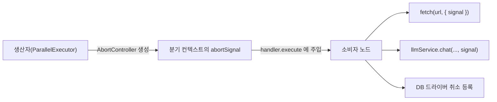

> 구현 상태: 부분 구현 · 원문: `spec/conventions/node-cancellation.md` (전체) · 용어: [용어 사전](../CLE-GLOSSARY.md)

## 개요

오래 걸리는 외부 I/O 를 하는 노드(HTTP, DB, AI, Email, 이커머스 통합 Cafe24·MakeShop)는 실행 도중 바깥에서 온 취소를 받을 수 있어야 한다. 그래야 다음 기능이 동작한다.

- **Parallel `cancel-others-on-fail`**: 첫 분기가 실패하면 다른 분기의 외부 I/O 를 바로 멈춘다. Parallel 노드를 설계할 때 이 정책에 노드 취소가 필요하다고 정했다.
- **워크플로우 시간 한도**: 실행 시간 한도([큐 워커와 동시 실행 제한](CLE-EXEC-WORKER.md))를 넘으면 진행 중인 노드의 외부 I/O 를 멈춘다. 신호 연동은 아직 없다(규칙 6).
- **사용자 실행 중지**: UI 에서 실행 중인 워크플로우를 멈춘다. 2026-05-31 에 구현됐다. 에디터 툴바의 Stop 버튼이 `running`·`waiting_for_input` 상태에서 보이고 `POST /api/executions/:id/stop` 을 부른다(규칙 7). 최종 `cancelled` 는 WebSocket `execution.cancelled` 이벤트로 확정된다.
- **안전 종료**: 서버가 끝날 때 진행 중인 노드의 외부 I/O 를 멈춘다. 신호 연동은 아직 없다(규칙 8).

이 규약은 노드 취소(node cancellation)의 두 메커니즘을 정한다. 하나는 실행 컨텍스트의 노드 취소 신호(`ExecutionContext.abortSignal`)를 전파하는 것이고 다른 하나는 신호를 만들지 않는 취소(사용자 실행 중지)를 엔진이 DB 를 다시 읽어 알아채는 것이다.

범위 밖:

- `abortSignal` 이 실행 컨텍스트의 어느 분류(안정 핵심)에 속하는지는 [실행 컨텍스트](CLE-EXEC-CONTEXT.md) 가 정한다. 이 문서는 동작 계약(전파 의무, best-effort, 에러 분류)을 정한다.
- 실행·노드 실행의 상태 전이는 [실행 상태 머신과 대기·재개](CLE-EXEC-STATE.md) 가 정한다.
- Stop 버튼의 위치와 표시 조건은 [에디터 실행과 디버깅](CLE-EXEC-RUN.md) 에, 역할별 권한은 [워크스페이스와 멤버](../CLE-ACCT/CLE-ACCT-WS.md) 에 있다.
- 워크플로우 시간 한도의 판정은 [큐 워커와 동시 실행 제한](CLE-EXEC-WORKER.md), 안전 종료 절차는 [장애 복구와 안전 종료](CLE-EXEC-RECOVERY.md) 에 있다.

## 하위 문서

규칙 번호(1~22)는 하위 문서와 이어서 매긴다.

- [노드 취소 — DB 관측 취소 가드](CLE-EXEC-CANCEL-DBGUARD.md): 사용자 실행 중지를 엔진이 노드 경계 · 턴 경계 · 짝 전이 · 종결 경로에서 알아채는 규칙 10~17, 가드의 구현 현황과 그 Rationale. 맡는 요구사항: 없음.
- [노드 취소 — 노드별 적용과 구현 현황](CLE-EXEC-CANCEL-NODES.md): fetch 연쇄 패턴, 노드별 신호 전파 · 취소 에러 분류의 구현 현황, HTTP Request · AI 노드의 취소 판정 결정과 이웃 문서 정합 과제. 맡는 요구사항: 없음.

## 규칙

### 노드 핸들러 의무

1. `NodeHandler.execute(input, config, context)` 는 `context.abortSignal?: AbortSignal` 을 받는다.
2. **외부 I/O 노드**는 오래 걸리는 외부 호출에 `context.abortSignal` 을 전파한다.

   | 호출 | 신호 전파 | 상태 |
   | --- | --- | --- |
   | `fetch(url, init)` | `init.signal` 에 넣는다. 자체 타임아웃과 함께 쓰면 연쇄 패턴을 따른다([fetch 자체 타임아웃과의 연쇄](CLE-EXEC-CANCEL-NODES.md#fetch-자체-타임아웃과의-연쇄)) | 구현됨(HTTP Request·Cafe24·MakeShop). 신호 전파와 취소 에러 분류(`AbortError` 를 엔진까지 전달)를 모두 한다 |
   | LLM 호출 | AI 노드(AI 에이전트·텍스트 분류기·정보 추출기)는 `llmService.chat` 에 `signal` 을 넘기고 프로바이더 클라이언트가 진행 중인 요청을 끊는다([LLM 클라이언트](../CLE-AI/CLE-AI-LLM.md)). AI 에이전트의 롤링 요약(`summary_buffer`) 호출에는 아직 `signal` 을 넘기지 않는다(구현 공백, [AI 노드 공통](../CLE-NODE-AI/CLE-NODE-AI-COMMON.md#미결-사항)). 신호가 만들어지는 병렬 분기 취소에서도 요약 요청은 끝날 때까지 남는다. 사용자 실행 중지는 신호를 만들지 않으므로(규칙 9) 이 공백과 상관없이 노드 경계 · 턴 경계 확인(규칙 10 · 12)이 맡는다. 정보 추출기의 첫 멀티턴 경로(`executeMultiTurn`)는 첫 턴의 LLM 호출에 `context.abortSignal` 을 그대로 넘긴다. AI 에이전트의 첫 멀티턴 경로는 LLM 을 부르지 않고 바로 입력 대기로 간다. 멀티턴 재개 경로(`processMultiTurnMessage`)에는 전파할 신호가 없어 턴 경계 DB 관측으로 취소를 처리한다. `ResumableMessageOptions.signal` 은 지금 늘 `undefined` 인 자리다. 나중에 신호를 만드는 곳이 생기면 전파되도록 열어 둔 것이지 도입이 예정된 것은 아니다 | 신호 전파는 롤링 요약 호출을 빼고 구현됨. 취소 에러 분류는 세 AI 노드 모두 구현됨(규칙 3, [구현 현황](CLE-EXEC-CANCEL-NODES.md#구현-현황)) |
   | PostgreSQL(`pg`)·MySQL(`mysql2`) | `signal.addEventListener('abort', ...)` 로 진행 중 쿼리 취소를 등록한다. 취소되면 **별도 풀 연결**로 PG `SELECT pg_cancel_backend(<pid>)`·MySQL `KILL QUERY <threadId>` 를 보내 진행 중 쿼리만 끊는다(연결은 유지). 취소로 난 드라이버 에러(PG `57014`·MySQL `ER_QUERY_INTERRUPTED`)는 catch 에서 `AbortError` 로 다시 던져 `cancelled` 로 분류되게 한다. 취소 권한(PG 소유자·MySQL `PROCESS`)과 타이밍에 따라 실패할 수 있지만 무해하다. 정상 완료하면 리스너를 해제한다 | 구현됨 |
   | MongoDB | 드라이버의 `signal` 옵션에 바로 넘긴다 | 미구현(Planned). 지금 DB 노드는 pg·mysql 만 지원한다 |
   | Email(nodemailer) | 진행 중 중단은 일부러 택하지 않았다. 전송 중에 `transporter.close()` 를 부르면 일부만 가거나 두 번 갈 위험이 있어 들어가기 직전 `abortSignal?.aborted` 사전 확인만 한다. SMTP 전송은 보통 짧다. 안전한 중단 방법이 확인되면 다시 검토한다 | 부분 구현 |

   AI 에이전트는 신호와 별도로 턴 응답을 만드는 `chat` 호출에 앱 수준 타임아웃(`AI_AGENT_LLM_CALL_TIMEOUT_MS`, 기본 10분)을 건다. 대상 호출은 [AI 에이전트 노드](../CLE-NODE-AI/CLE-NODE-AGENT.md#llm-호출-타임아웃) 가 정하고 롤링 요약 호출은 빠진다. `withTimeout` 이 **자체 `AbortController`** 로 동작해 신호가 있든 없든 무기한 대기를 막는다.
3. 취소 때 나는 에러는 노드가 이름이 `AbortError` 인 채로 엔진까지 던진다(AI 노드가 다른 이름의 SDK 에러를 감싸 던지는 방식은 아래 문단). 엔진의 노드 실행 catch 가 에러 처리 정책을 적용하기 전에 그 에러를 취소로 분류하므로 노드가 따로 처리하지 않는다. 에러를 잡아 다른 코드로 바꾸면 엔진이 취소로 분류하지 못한다. 요청 자신의 타임아웃처럼 노드 취소 신호에서 오지 않은 `AbortError` 는 노드가 자기 실패로 다룬다([fetch 자체 타임아웃과의 연쇄](CLE-EXEC-CANCEL-NODES.md#fetch-자체-타임아웃과의-연쇄)). 노드 취소 신호로 끝난 외부 호출은 통합 활동 로그를 남기지 않는다. 그 호출은 끝나지 않았기 때문이다(근거는 아래 Rationale). HTTP Request·Cafe24·MakeShop·DB 노드와 세 AI 노드(AI 에이전트·텍스트 분류기·정보 추출기)는 노드 취소를 `AbortError` 로 엔진에 넘긴다. 활동 로그 규칙은 HTTP Request·Cafe24·MakeShop 노드가 지킨다. DB 노드는 아직 취소 때도 `failed` 활동 로그를 남긴다([구현 현황](CLE-EXEC-CANCEL-NODES.md#구현-현황)).

   노드 취소를 가르는 방식은 호출 종류마다 다르다. fetch 를 쓰는 노드(HTTP Request·Cafe24·MakeShop)는 `isUpstreamAbort` 로 가른다. 에러 이름이 `AbortError` 이고 노드 취소 신호가 켜져 있어야 노드 취소다. 요청 자신의 타임아웃도 이름이 `AbortError` 라서 신호를 함께 본다. AI 노드는 LLM 호출이 실패했을 때 노드 취소 신호가 켜져 있으면 에러 이름과 상관없이 노드 취소로 본다. 프로바이더 SDK 마다 취소된 요청이 던지는 에러가 달라 이름으로는 가를 수 없기 때문이다. Anthropic·OpenAI SDK 는 `name` 이 `'Error'` 인 `APIUserAbortError` 를 던지고 fetch 기반 클라이언트는 `name` 이 `AbortError` 인 DOMException 을 던진다. AI 노드는 이름이 `AbortError` 인 에러를 그대로 던지고 이름이 다른 에러는 이름이 `AbortError` 인 새 에러로 감싸 던진다. 새 에러의 메시지는 고정 문구 `LLM call was aborted` 이고 원래 에러는 `cause` 에만 남긴다. 엔진은 취소 에러의 메시지를 노드 실행의 `error` 와 `execution.node.cancelled` 이벤트에 그대로 싣는다(규칙 19). 메시지를 고정해 두면 취소와 경합한 401·5xx 같은 실패의 프로바이더 문구가 그 자리로 가지 않는다. 노드 취소 신호가 열려 있을 때 실패한 LLM 호출은 앱 수준 타임아웃을 포함해 노드 자신의 실패다. 두 방식 모두 노드 취소 신호가 켜지지 않은 실패를 취소로 보지 않는다(근거는 [AI 노드는 노드 신호로 취소를 판정한다 (2026-10-31)](CLE-EXEC-CANCEL-NODES.md#ai-노드는-노드-신호로-취소를-판정한다-2026-10-31)).
4. **CPU 위주이거나 바로 끝나는 노드**는 신호를 지원하지 않아도 된다(best-effort). 작업을 끝까지 해도 되지만 시작 직전에 `context.abortSignal?.aborted` 를 확인하기를 권한다. 시작 전에 이미 취소됐으면 바로 끝낸다.

### 신호를 만드는 쪽

5. **`ParallelExecutor`**(구현됨): `errorPolicy === 'cancel-others-on-fail'` 이면 내부 `AbortController` 를 만들고 첫 분기가 실패하면 `controller.abort()` 를 부르며 각 `branchContext.abortSignal` 에 넣는다. 위쪽 `context.abortSignal` 이 있으면 그 취소도 그룹 controller 로 이어 준다(`parallel-executor.ts`).
6. **워크플로우 시간 한도**: **입력 대기 시간을 뺀 누적 실행 시간 한도**로 구현했다. 벽시계 타이머와 취소 신호는 쓰지 않는다. dispatch 루프가 노드 사이마다 `assertActiveTimeWithinLimit` 를 불러 한도를 넘으면 `EXECUTION_TIME_LIMIT_EXCEEDED` 로 끝낸다. 판정 규칙은 [큐 워커와 동시 실행 제한](CLE-EXEC-WORKER.md) 에 있다. 진행 중 노드의 외부 I/O 를 바로 끊는 신호 연동은 미구현(Planned)이고 지금은 다음 노드 경계에서 판정한다.
7. **사용자 실행 중지**(구현됨 2026-05-31): REST `POST /api/executions/:id/stop` 이 실행을 멈춘다. `running`·`pending` 은 `cancelled` 로, `waiting_for_input` 은 재개 취소로 처리한다. 에디터 툴바 Stop 버튼이 진입점이고 **편집자 이상**만 쓸 수 있다. 뷰어에게는 버튼이 보이지 않고(프론트엔드 `canEdit` 가드) 서버도 `@Roles('editor')` 로 403 을 낸다. **이 경로는 `AbortController` 를 만들지 않고 실행 행만 UPDATE 한다**. 진행 중 dispatch 를 실제로 멈추는 일은 [DB 관측 취소 가드](CLE-EXEC-CANCEL-DBGUARD.md#db-관측-취소-가드) 가 맡는다.
8. **안전 종료**: 지금은 grace 시간을 넘긴 노드를 `failed` 와 `SERVER_INTERRUPTED` 로 마감한다([장애 복구와 안전 종료](CLE-EXEC-RECOVERY.md)). 안전 종료를 취소 신호 생산자로 통합하는 것은 예정 과제다. 마감 상태를 `failed` 와 `SERVER_INTERRUPTED` 로 둘지 `cancelled` 로 바꿀지는 정의가 갈린다. 안전 종료 절차가 쓰는 에러 처리 정책 값 `continue` 가 무엇을 뜻하는지도 정해지지 않았다. 두 문제는 [장애 복구와 안전 종료 §미결 사항](CLE-EXEC-RECOVERY.md#미결-사항) 에서 다룬다.
9. `context.abortSignal` 을 채우는 생산자는 `ParallelExecutor` 하나뿐이다. HTTP 노드의 자체 타임아웃이나 AI 에이전트의 `withTimeout` 도 `AbortController` 를 만들지만 이들은 자기 호출 안에서만 쓰고 `context.abortSignal` 을 채우지 않는다. 그래서 선형 경로와 재개 경로에서 `context.abortSignal` 은 늘 `undefined` 다. HTTP 노드의 자체 타임아웃이 낸 `AbortError` 는 노드 취소로 분류되지 않는다. HTTP 노드는 이 에러를 `HTTP_TRANSPORT_FAILED` 로 에러 포트에 보낸다([HTTP Request 노드](../CLE-NODE-INT/CLE-NODE-HTTP.md)).

### 신호 전파 흐름

생산자는 `AbortController` 를 만든 뒤 그 `signal` 을 취소 범위의 컨텍스트(예: 분기 컨텍스트)의 `abortSignal` 에 넣는다. 소비자는 자기 호출에 전파한다. fetch 노드의 연쇄 패턴은 [fetch 자체 타임아웃과의 연쇄](CLE-EXEC-CANCEL-NODES.md#fetch-자체-타임아웃과의-연쇄) 에 있다.

### DB 관측 취소 가드

→ [노드 취소 — DB 관측 취소 가드](CLE-EXEC-CANCEL-DBGUARD.md#db-관측-취소-가드)

### 취소 에러 분류

18. **두 sentinel 은 같은 상태로 끝난다**. 핸들러가 던지는 `error.name === 'AbortError'` 와 엔진 경계 가드가 던지는 `ExecutionCancelledError` 는 나는 곳이 다르지만 둘 다 `NodeExecution.status = cancelled`·`Execution.status = cancelled` 로 끝난다. 분류는 `instanceof` 나 `error.name` 으로 하고 에러 문구는 판정에 쓰지 않는다. AI 노드는 프로바이더 SDK 가 다른 이름으로 던진 취소 에러를 규칙 3 대로 이름이 `AbortError` 인 에러로 감싸 던진다. 그래서 엔진은 이름만 보고 분류한다.
19. **`AbortError` 는 실패가 아니라 중단이다**. 엔진은 노드 실행 상태를 `failed` 가 아닌 `cancelled` 로 기록한다. dispatch 직전에 `context.abortSignal?.aborted` 가 이미 참이면 핸들러를 실행하지 않고 바로 `cancelled` 로 기록한다. 끝날 때 `execution.node.cancelled` 이벤트를 내 타임라인이 `running` 에 남지 않게 한다([WebSocket 이벤트와 명령](../CLE-API/CLE-API-WS-EVENTS.md)). 취소 에러는 `NodeExecution.error` 에 `{ code: 'AbortError', message }` 로 남고 같은 값이 `execution.node.cancelled` 이벤트의 `error` 로 나간다. 엔진은 취소된 노드 실행의 `output_data`(출력 봉투 전체)를 쓰지 않는다. 이 기록은 `AbortError` 경로 한정이다. 엔진의 `ExecutionCancelledError`(DB 관측 취소 가드)도 노드 실행을 같은 상태로 끝내지만 `error` 를 싣지 않는다. 그 sentinel 의 메시지에는 실행 id 가 들어 있어 클라이언트로 내보내지 않는다. `AbortError` 는 에러 코드 이름 규칙(UPPER_SNAKE_CASE)의 예외다. 웹 표준 `AbortSignal` 이 던지는 `DOMException.name` 을 그대로 옮긴 값이기 때문이다([에러 코드 규약과 카탈로그 §3](../CLE-API/CLE-API-ERRCODES.md#3-예외-등록-코드)).
20. **취소된 노드 뒤의 워크플로우 흐름**: 노드 실행이 `cancelled` 로 끝난 뒤의 흐름은 두 층으로 나눠 정한다.
    - **노드 자신의 에러 처리 정책**(`config.errorHandling.policy`, [노드 에러 처리 정책](../CLE-NODE/CLE-NODE-ERROR.md))은 `AbortError` 에 쓰지 않는다. 현재 구현의 엔진은 정책과 상관없이 노드 실행을 `cancelled` 로 기록하고 `AbortError` 를 다시 던진다. `retry` 정책이어도 다시 시도하지 않는다. `skip_node`·`use_default_output`·`route_to_error_port` 정책도 취소를 흡수하지 않는다.
    - **Parallel 의 항목 에러 정책**(`config.errorPolicy`, [Parallel 노드](../CLE-NODE-LOGIC/CLE-NODE-PARALLEL.md))이 흐름을 정한다. 다시 던진 `AbortError` 는 그 노드가 속한 병렬 분기의 실패가 되고 Parallel 이 정책에 따라 모은다.
      - `stop`(기본): 취소가 위쪽 취소 범위에서 왔으면 워크플로우는 그 원인대로 마감한다. 사용자 취소면 실행 `cancelled`, cancel-others-on-fail 이면 최초 실패 원인으로 실행 `failed` 다. 노드 하나의 `AbortError` 자체가 워크플로우를 새로 실패시키지는 않는다.
      - `continue`: 그 노드를 `cancelled` 로 기록하고 뒤 분기를 계속한다.
      - `cancel-others-on-fail`: 이미 취소 중이므로 취소된 뒤 분기도 `cancelled` 로 기록한다. 근본 원인(최초의 취소가 아닌 실패)은 `ParallelExecutor` 가 따로 드러낸다.
    - 여기의 `continue` 는 Parallel 항목 에러 정책의 값이다. 노드 에러 처리 정책에는 `continue` 가 없다. 두 정책의 층 구분은 [Logic 노드 공통 §항목 에러 정책](../CLE-NODE-LOGIC/CLE-NODE-LOGIC-COMMON.md#항목-에러-정책) 이 정한다.
21. **`ExecutionCancelledError` 는 에러 정책을 따르지 않는다**. 위 흐름 규칙은 핸들러가 던진 `AbortError` 에만 적용된다. 엔진이 던진 `ExecutionCancelledError` 는 정책과 상관없이 늘 다시 던진다. `ForEachExecutor`·`ParallelExecutor` 는 항목 에러 정책을 판정하기 **전에** 이 sentinel 을 다시 던지므로 항목 에러 정책이 `skip`·`continue` 여도 계속하지 않는다. 사용자 실행 중지가 `continue` 정책 때문에 조용히 무시되면 안 되기 때문이다.
22. **rehydration 실패는 노드 취소 신호 경로가 아니다**. 재개 인프라 실패(`RESUME_*`)에서 노드 실행은 실패(`failed`)로 끝난다. 실행은 취소됨(`cancelled`)으로 끝난다([실행 상태 머신과 대기·재개](CLE-EXEC-STATE.md)).

## 미결 사항

- **에디터의 강제 중단(Force)**: [에디터 실행과 디버깅](CLE-EXEC-RUN.md) 은 Stop 버튼을 3초 이상 누르면 진행 중인 노드를 바로 멈추는 Force 모드를 약속한다. 이 규약에서 사용자 실행 중지는 신호를 만들지 않고 실행 행만 UPDATE 하며 다음 노드·턴 경계에서만 관측된다. Force 에 대응하는 생산자가 없고 현재 코드(`editor-toolbar.tsx`·`executions.controller.ts`)에도 Force 경로가 없다. External Interaction API 도 force 옵션을 지원하지 않는다고 적는다. Force 를 만들지(그러면 이 규약에 생산자를 더해야 한다), 에디터 문서에서 지우거나 미구현으로 둘지 결정해야 한다.

- **시간 한도·안전 종료의 노드 신호 연동**(미구현, Planned): 규칙 6 · 8 의 신호 연동은 NERV Task `CLE-T-6WSCPE` 가 맡는다. 시간 한도 자체는 노드 경계 판정으로 구현됐다([큐 워커와 동시 실행 제한](CLE-EXEC-WORKER.md)).

## 구현 위치

나머지는 [노드별 적용](CLE-EXEC-CANCEL-NODES.md#구현-위치) · [DB 관측 취소 가드](CLE-EXEC-CANCEL-DBGUARD.md#구현-위치) 의 구현 위치 절에 있다.

- `codebase/backend/src/nodes/core/node-handler.interface.ts` (`ExecutionContext.abortSignal`)
- `codebase/backend/src/modules/execution-engine/containers/parallel-executor.ts`
- `codebase/backend/src/modules/executions/executions.controller.ts`, `executions.service.ts` (`stop()`, 규칙 7)
- `codebase/frontend/src/components/editor/toolbar/editor-toolbar.tsx`, `codebase/frontend/src/lib/api/executions.ts` (Stop 버튼, 규칙 7)

## Rationale

### 취소를 노드 공통 기반으로 따로 둔다

이 규약은 Parallel 노드의 `cancel-others-on-fail` 요구에서 시작했다. 그러나 노드 단계 취소는 워크플로우 시간 한도, 사용자 실행 중지, 안전 종료 같은 여러 기능이 함께 다시 쓰는 기반이다. 그래서 노드 단계 취소를 Parallel 설계에서 떼어 별도 규약으로 두기로 했다.

### 표준 `AbortSignal` API 를 쓴다

- 주요 SDK·fetch·드라이버가 모두 표준으로 지원해 별도 래퍼가 필요 없다.
- 외부 타임아웃과의 연쇄가 표준 패턴이다(`AbortController` 의 취소가 이어진다).
- `AbortSignal.any([...])`(Node.js 18+)나 `AbortSignal.timeout(ms)` 같은 표준 도구를 나중에 쓸 수 있다.
- 지금 연쇄는 `AbortSignal.any` 대신 공용 헬퍼(`linkUpstreamAbort`)로 직접 잇는다(fetch 노드인 HTTP Request·Cafe24·MakeShop 한정). 직접 이으면 리스너를 떼는 시점을 호출자가 `finally` 로 정한다. HTTP Request 노드는 응답 본문을 다 읽은 뒤에 뗀다. `AbortSignal.any` 로 바꾸면 그 해제를 런타임이 맡으므로 옮기기 전에 이 시점이 지켜지는지 확인한다. LLM 호출의 연쇄는 다르다. `LlmService.chat` 은 타임아웃을 건 호출에서 타임아웃 신호와 호출자 신호를 `AbortSignal.any` 로 합쳐 프로바이더 클라이언트에 넘긴다.

### 핸들러 시그니처를 바꾸지 않고 실행 컨텍스트 필드로 전파한다

- 운영 핸들러 24개의 시그니처를 바꾸면 모든 모듈이 영향을 받아 기반 변경 PR 이 너무 커진다.
- 실행 컨텍스트는 이미 엔진이 dispatch 직전에 넣어 주는 통합 진입점이라 필드 하나를 더하는 비용이 작다.
- 모듈마다 조금씩 도입할 수 있다. 노드 핸들러가 `context.abortSignal` 을 읽는지만 다르고 시그니처는 그대로다.

### 취소 뒤 흐름을 정하는 정책을 두 층으로 나눠 적는다

원문 규칙은 "노드의 `errorPolicy` 가 dispatch 진행을 정한다" 고만 적었다. 일반 노드의 에러 처리 정책(`config.errorHandling.policy`)에는 `continue`·`cancel-others-on-fail` 값이 없어 어느 정책을 뜻하는지 문장만으로는 알 수 없었다. 원문이 든 세 값(`stop`·`continue`·`cancel-others-on-fail`)은 Parallel 의 항목 에러 정책 값 집합과 같다. 현재 구현(`parallel-executor.ts` 의 `ParallelErrorPolicy`)도 이 세 값으로 병렬 분기 실패를 모은다. 엔진의 `executeNode` 는 `AbortError` 를 노드 에러 처리 정책보다 먼저 가로채 `cancelled` 로 기록하고 다시 던진다. 그래서 규칙 20 은 노드 자신의 정책과 Parallel 항목 에러 정책을 나눠 적었다.

### HTTP Request 노드도 노드 취소를 `cancelled` 로 끝낸다 (2026-10-10)

→ [노드 취소 — 노드별 적용과 구현 현황](CLE-EXEC-CANCEL-NODES.md#http-request-노드도-노드-취소를-cancelled-로-끝낸다-2026-10-10)

### 노드 취소로 끝난 호출은 활동 로그를 남기지 않는다 (2026-10-10)

활동 로그는 통합 호출 한 건이 성공했는지 실패했는지를 남긴다. 노드 취소 신호로 끊긴 호출은 끝나지 않았으므로 어느 쪽에도 들지 않는다. `failed` 로 남기면 다른 분기의 실패로 멈춘 호출이 이 통합의 실패로 기록된다.

### 취소 에러는 노드 실행의 `error` 에 남긴다 (2026-10-10)

규칙 19 는 원래 `output.error` 를 표준 형태에 `code: 'AbortError'` 로 기록하고 `meta.success = false` 를 둔다고 적었다. 구현은 엔진이 `NodeExecution.error` 에 `{ code: 'AbortError', message }` 를 저장하고 같은 값을 `execution.node.cancelled` 이벤트의 `error` 로 보내며 `output_data` 는 쓰지 않는다. [WebSocket 이벤트와 명령](../CLE-API/CLE-API-WS-EVENTS.md) 의 `node.cancelled` payload(`executionId`·`nodeId`·`nodeExecutionId`·`nodeLabel`·`error?`)도 이미 이 형태다.

그래서 구현을 바꾸지 않고 규칙 19 의 문구를 구현에 맞췄다. `meta.success` 는 [Code 노드](../CLE-NODE-DATA/CLE-NODE-CODE.md) 전용 편의 필드라 취소에 쓸 근거가 없다. 구현에 `meta.success` 를 더하는 대안은 이 이유로 기각했다.

이 기록 위치에서도 사용자는 취소 에러를 본다. 실행 결과 패널의 오류 탭은 노드 결과에 `error` 가 있을 때만 보인다(`codebase/frontend/src/components/editor/run-results/result-detail.tsx`). 실행 기록 화면에서는 그 값이 노드 실행의 `error.message` 에서 온다(`executions/[executionId]/page.tsx` 의 `toNodeResult`). 실시간 화면에서는 `execution.node.cancelled` 이벤트의 `error.message` 에서 온다(`codebase/frontend/src/lib/websocket/use-execution-events.ts`). [노드 출력 규약](../CLE-NODE/CLE-NODE-OUTPUT.md) §3.2 규칙 1 과 [에러 코드 규약과 카탈로그](../CLE-API/CLE-API-ERRCODES.md) §3·§6.6 머리말을 이 기록 위치에 맞추는 일은 NERV Task `CLE-T-GZRYQ3` 가 맡는다.
