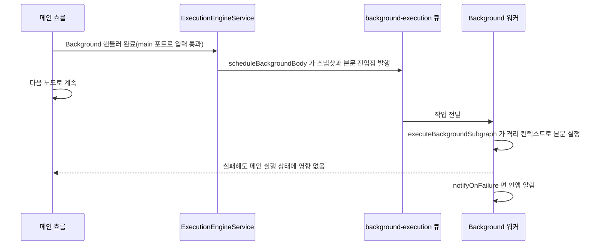

> 구현 상태: 부분 구현 · 원문: `spec/5-system/4-execution-engine.md` (§3.0~§3.4 중 Background 본문) · 용어: [용어 사전](../CLE-GLOSSARY.md)

## 개요

이 문서는 [컨테이너 실행](CLE-EXEC-CONTAINER.md) 의 하위 문서로 엔진이 Background 본문을 별도 큐로 넘겨 실행하는 방법과 컨테이너 본문 안에 둔 Background 의 처리를 정한다. Background 노드의 설정 · 격리 계약 · 모니터링 API 는 [Background 노드](../CLE-NODE-LOGIC/CLE-NODE-BACKGROUND.md) 가 정한다.

## Background 본문 실행

Background 노드는 컨테이너 소속(`container_id`) 모델을 쓰지 않는다. `background` 포트 연결선으로 본문 진입점을 찾고 별도 BullMQ 큐 `background-execution` 과 워커가 본문을 비동기로 실행한다(PRD ND-BG-05 평면 구조). 컨테이너 본문 안에 둔 Background 라면 본문 노드에도 `containerId` 가 있다. 이 값은 에디터 연결선 체인 규칙이 준 위치 속성으로, Background 가 놓인 컨테이너를 가리킬 뿐이다([컨테이너 본문 안 Background](#컨테이너-본문-안-background)). 노드 동작·격리 계약·모니터링 API 는 [Background 노드](../CLE-NODE-LOGIC/CLE-NODE-BACKGROUND.md) 가 기준이다. 이 절은 엔진 쪽 동작만 적는다.

1. `main` 포트로 입력을 바로 넘겨 메인 흐름이 계속된다.
2. 핸들러가 끝난 직후 `ExecutionEngineService.scheduleBackgroundBody()` 가 현재 컨텍스트 스냅샷과 본문 진입점을 `background-execution` 큐에 넣는다. 스냅샷 항목의 기준은 [Background 노드 §실행 로직](../CLE-NODE-LOGIC/CLE-NODE-BACKGROUND.md#실행-로직) 이다. 대화 스레드는 `{ ...thread, turns: [...thread.turns] }` 형태로 `turns` 배열까지 새로 복사해 싣는다.
3. 워커의 `executeBackgroundSubgraph()` 가 `background` 포트 연결선에서 앞으로 닿는 서브그래프를 격리된 컨텍스트로 실행한다. 본문 노드 실행은 `parentNodeExecutionId` 로 묶인다.
4. 본문이 끝나거나 실패하면 설정에 따라 `NotificationsService` 로 알린다.

- 본문은 메인 실행과 같은 `execution_id` 를 쓴다. 노드 실행 묶음, WebSocket 채널, 권한의 1차 키가 모두 이것이다. 다만 **메모리의 실행 컨텍스트 Map 키만** 따로 `bg:<executionId>:<backgroundRunId>` 를 써서 부모 컨텍스트와 격리하고 `executeBackgroundSubgraph` 가 자기 `finally` 에서 정리한다. 이 키의 분류는 [실행 컨텍스트](CLE-EXEC-CONTEXT.md) 가 정한다.
- 본문 노드의 `parentNodeExecutionId` 는 Background 노드 자신의 노드 실행 ID 를 가리킨다.
- 본문의 Parallel 도 엔진의 Parallel 실행 경로를 탄다(`PARALLEL_ENGINE=v1`). 본문은 격리된 새 컨텍스트에서 실행되므로 Parallel 중첩 깊이를 1부터 센다. 예외로 병렬 분기 본문에 바로 둔 Background 의 본문은 바깥 Parallel 의 사전 검사(`planParallelBody`)와 저장 규칙 `parallel:nested-depth-exceeded` 가 바깥 깊이를 이어서 센다. 이 검사 범위는 아직 정하지 않았다([Parallel 노드 §저장 규칙과 실행 검사의 범위](../CLE-NODE-LOGIC/CLE-NODE-PARALLEL.md#저장-규칙과-실행-검사의-범위), [미결 사항](../CLE-NODE-LOGIC/CLE-NODE-PARALLEL.md#미결-사항)). 컨테이너 안 Background 의 본문은 사전 검사도 깊이 1 부터 센다([본문 안 Parallel](CLE-EXEC-CONTAINER.md#본문-안-parallel)).
- 본문 실패는 메인 실행 상태에 영향을 주지 않는다.
- 대화 스레드는 발행 시점 스냅샷으로 격리된다. 본문에서 생긴 턴은 메인 스레드에 영향이 없고 반대도 같다([대화 스레드](../CLE-IX/CLE-IX-THREAD.md)).
- 본문이 실패하고 `notifyOnFailure=true` 이면 **워크스페이스 관리자에게 인앱 알림**(`type: background_failed`, `channel: in_app`)을 보낸다. 이메일 채널과 실행자(`executed_by`) 수신은 현재 지원하지 않는다.
- 실행 상세 화면은 성공·실패와 상관없이 Background 본문 결과를 별도 섹션으로 보인다([에디터 실행과 디버깅](CLE-EXEC-RUN.md) 의 실행 결과 드로어).

### 컨테이너 본문 안 Background

Loop · ForEach · Map 본문 안의 Background 도 메인 흐름의 Background 처럼 본문을 큐에 넣는다. 본문 루프는 `PARALLEL_ENGINE` 값과 상관없이 Background 를 이 경로로 넘긴다.

| 규칙 | 설명 |
| --- | --- |
| 발행 횟수 | 회차마다 한 번 큐에 넣는다. 회차가 3번이면 작업도 3개다 |
| 진입 입력 | 그 회차에 Background 노드가 받은 입력이다. 기준은 [Background 노드](../CLE-NODE-LOGIC/CLE-NODE-BACKGROUND.md#본문-진입-background-포트-fire-and-forget) 의 본문 진입 입력 표다 |
| 회차 루프 | `background` 포트 뒤 노드는 회차 루프에서 실행하지 않는다. 워커만 실행한다 |
| 본문 노드 소속 | 에디터의 연결선 체인 규칙에 따라 `background` 포트 뒤 노드도 Background 와 같은 컨테이너 소속을 받는다 |
| 작업 범위 | 작업에 Background 가 속한 컨테이너 ID(`containerScopeId`)를 싣는다. 워커는 그 컨테이너의 본문 노드만으로 그래프를 만들어 진입점부터 실행한다. 큐에 넣은 뒤 그 컨테이너가 워크플로우에서 지워졌으면 워커가 만든 그래프가 비어 본문을 실행하지 않고 오류 없이 끝난다. 필드가 없는 작업(맨 바깥 Background, 필드를 넣기 전에 큐에 들어간 작업)은 맨 바깥 그래프로 실행한다 |
| 병렬 분기 | 컨테이너 본문 안 Parallel 의 병렬 분기에 둔 Background 도 같은 컨테이너 ID 를 싣는다 |
| 반복 변수 | 큐에 넣는 시점의 ForEach · Map `itemContext`(`$item` · `$itemIndex` · `$itemIsFirst` · `$itemIsLast`)와 Loop `loopContext`(`$loop`)를 작업 스냅샷에 복사해 싣고 워커가 본문 실행 컨텍스트에 되살린다. 그래서 본문 노드는 큐에 넣은 회차의 값을 읽고 컨테이너가 다음 회차로 넘어가도 값이 바뀌지 않는다. 병렬 분기에 둔 Background 는 그 병렬 분기가 이어받은 반복 변수를 싣는다. 병렬 분기가 바깥 반복 변수를 이어받는 규칙([본문 안 Parallel](CLE-EXEC-CONTAINER.md#본문-안-parallel), [Parallel 노드 요구사항](../CLE-NODE-LOGIC/CLE-NODE-PARALLEL.md#요구사항))과 같다(NERV 질문 `01a1cd70-d2c0-74dd-9078-f6f0b3492ff3`, 답 A). 맨 바깥 Background 의 작업과 필드를 넣기 전에 큐에 들어간 작업은 본문에서 반복 변수가 비어 있다 |

## 구현 위치

- `codebase/backend/src/modules/execution-engine/execution-engine.service.ts` (`scheduleBackgroundBody`, `executeBackgroundSubgraph`, 본문 루프의 Background 넘기기(`executeContainerBody`))
- `codebase/backend/src/modules/execution-engine/queues/background-execution.queue.ts`, `background-execution.processor.ts`

## Rationale

### Background 본문은 컨테이너 소속 모델을 쓰지 않는다

Background 본문은 메인 흐름과 따로 끝나며 결과가 메인으로 돌아오지 않는다. 반복하며 결과를 모으는 컨테이너 구조와 맞지 않아 `background` 포트 연결선으로 본문을 찾는 평면 구조를 택했다(PRD ND-BG-05). 본문이 부모와 같은 `executionId` 를 Map 키로 쓰던 때 먼저 끝난 부모가 본문 컨텍스트를 지우는 경쟁이 있었다. 그래서 메모리 Map 키만 따로 둔다. 결정 경위는 [실행 컨텍스트](CLE-EXEC-CONTEXT.md) 에 있다.

컨테이너 본문 안 Background 의 본문 노드가 받는 `containerId` 와 이 결정의 관계는 [본문 안 컨테이너와 Background 도 실행 경로로 넘긴다 (2026-11-12)](#본문-안-컨테이너와-background-도-실행-경로로-넘긴다-2026-11-12) 에 있다.

### 본문 안 컨테이너와 Background 도 실행 경로로 넘긴다 (2026-11-12)

이 개정 전에는 본문 루프가 Parallel 만 실행 경로로 넘겼다. 본문 안 Loop · ForEach · Map 은 핸들러만 돌고 안쪽 본문은 실행되지 않았다. 본문 안 Background 는 `main` 으로 입력만 넘겨 본문이 큐에 들어가지 않았고, 워커도 맨 바깥 노드로만 그래프를 만들었다. 스펙은 중첩을 허용했지만 구현이 따라가지 않았다. 그래서 메인 루프와 병렬 분기 루프가 노드 종류에 따라 실행 경로를 고르는 규칙을 본문 루프에도 적용했다.

Background 본문은 여전히 `background` 포트 연결선으로 찾는다([Background 본문은 컨테이너 소속 모델을 쓰지 않는다](#background-본문은-컨테이너-소속-모델을-쓰지-않는다)). 컨테이너 ID 는 워커가 그래프를 만들 단계를 고르는 데만 쓴다.

기각한 대안은 네 가지다.

- **워커가 소속을 무시하고 진입점에서 닿는 노드를 모두 모으는 안**: 안쪽 컨테이너의 본문 노드까지 평평하게 실행해 회차 구분이 깨진다.
- **에디터가 `background` 포트 뒤 노드에 컨테이너 소속을 주지 않게 바꾸는 안**: 저장된 워크플로우의 소속을 옮기는 마이그레이션이 필요하고 캔버스 배치도 바뀐다.
- **컨테이너 본문 안 Background 를 금지하는 안**: 이미 저장된 워크플로우가 검증에서 막히고 회차마다 비동기 작업을 띄우는 쓰임을 잃는다.
- **Background 본문을 컨테이너 소속 모델로 바꾸는 안**: 평면 구조 결정(PRD ND-BG-05)을 뒤집는다.

반복 변수는 사람이 정했다(NERV 질문 `01a1cd70-d2c0-74dd-9078-f6f0b3492ff3`, 답 A). 큐에 넣는 시점의 반복 변수를 작업 스냅샷에 실어 워커가 되살린다([컨테이너 본문 안 Background](#컨테이너-본문-안-background)). 병렬 분기가 바깥 반복 변수를 이어받는 결정(NERV 질문 `01a1b060-de22-7734-a37a-69c25ee314a3`, 답 A)과 같은 규칙이다. 기각한 대안은 두 가지다.

- **반복 변수를 싣지 않는 안**: 필요한 값을 앞 노드 출력으로 넘겨야 한다. 에디터가 `background` 포트 뒤 노드를 컨테이너 본문 노드처럼 그리는 모델과 어긋나고 병렬 분기가 반복 변수를 이어받는 규칙과도 갈린다.
- **컨테이너 본문 안 Background 를 금지하는 안**: 지금 저장된 워크플로우가 실행 오류로 끝난다. 실행 경로를 정할 때도 같은 안을 기각했다.

**호환**: `containerScopeId` 가 없는 작업은 맨 바깥 그래프로 실행하므로 필드를 넣기 전에 큐에 남은 작업도 그대로 돈다. 반복 변수가 없는 옛 작업은 본문에서 반복 변수가 비어 있다(개정 전과 같은 동작). 롤링 배포 중에 옛 워커는 반복 변수 필드를 무시한다.

본문 진입 노드가 받는 입력을 어디서나 Background 노드가 받은 입력으로 맞춘 근거는 [Background 노드 Rationale](../CLE-NODE-LOGIC/CLE-NODE-BACKGROUND.md#본문-진입-노드는-background-노드가-받은-입력을-받는다-2026-11-12) 에 있다.
