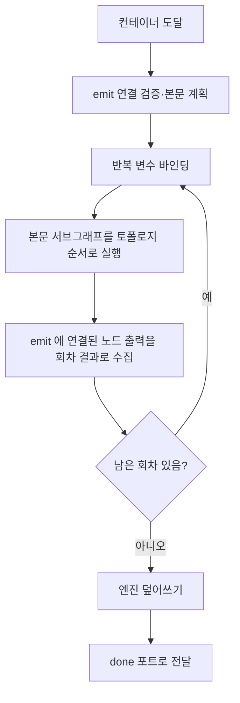

> 구현 상태: 부분 구현 · 원문: `spec/5-system/4-execution-engine.md` (§3.0~§3.4), 엔진 덮어쓰기 대조: `spec/conventions/node-output.md` (Principle 9), `spec/4-nodes/1-logic/0-common.md` (§4, §9.1) · 용어: [용어 사전](../CLE-GLOSSARY.md)

## 개요

컨테이너(container)는 자식 노드를 반복 실행하는 Loop·ForEach·Map 세 노드다. 자식은 `containerId` 로 소속을 나타낸다. 이 문서는 엔진이 컨테이너 본문(container body)을 반복 실행하는 방법, 반복 결과를 모으고 노드 출력을 덮어쓰는 방법, 중첩된 컨테이너의 변수 스코프를 정한다.

Parallel 노드는 컨테이너가 아니지만 끝날 때 엔진 덮어쓰기(engine override)를 받는다. 이 문서는 Parallel 의 덮어쓰기 결과와 컨테이너 본문에 둔 Parallel 의 처리만 다룬다. 병렬 분기 본문의 노드 집합 · 실행 순서 · 결과 노드는 [Parallel 노드](../CLE-NODE-LOGIC/CLE-NODE-PARALLEL.md#병렬-분기의-노드-집합과-위상-순서) 가 정한다. Background 노드도 컨테이너가 아니다. 이 문서는 엔진이 Background 본문을 별도 큐로 넘기는 부분만 다룬다.

범위 밖:

- 노드별 설정·포트·출력 예시는 [Loop 노드](../CLE-NODE-LOGIC/CLE-NODE-LOOP.md), [ForEach 노드](../CLE-NODE-LOGIC/CLE-NODE-FOREACH.md), [Map 노드](../CLE-NODE-LOGIC/CLE-NODE-MAP.md), [Parallel 노드](../CLE-NODE-LOGIC/CLE-NODE-PARALLEL.md), [Background 노드](../CLE-NODE-LOGIC/CLE-NODE-BACKGROUND.md) 가 정한다.
- 컨테이너 공통 포트 표와 항목 에러 정책 값은 [Logic 노드 공통](../CLE-NODE-LOGIC/CLE-NODE-LOGIC-COMMON.md) 이 정한다.
- 캔버스에서 컨테이너를 만들고 지우는 규칙은 [워크플로우 에디터와 캔버스](../CLE-WF/CLE-WF-EDITOR.md) 에 있다.
- 본문 노드를 글로벌 그래프에서 빼고 따로 정렬하는 규칙은 [실행 엔진 개요와 그래프 순회](CLE-EXEC-ENGINE.md) 에 있다.
- 반복 변수(`$loop`·`$item` 등)의 표현식 표면은 [표현식 언어](../CLE-WF/CLE-WF-EXPR.md) 가 정한다.

## 하위 문서

- [컨테이너 실행 — Background 본문](CLE-EXEC-CONTAINER-BG.md): 엔진이 Background 본문을 `background-execution` 큐로 넘기는 흐름, 컨테이너 본문 안 Background 의 회차별 발행 · 작업 범위 · 반복 변수, 그 결정의 Rationale. 맡는 요구사항 번호: 없음(이 문서에 요구사항 줄이 없다).

## 공통 실행 모델

컨테이너는 `body` 출력 포트로 본문에 들어가 본문 서브그래프를 반복 실행한다. 반복마다 본문 안에서 **`emit` 입력 포트에 연결된 노드**의 출력을 그 회차의 결과로 모은다. 반복이 끝나면 엔진이 노드 출력을 모은 결과로 덮어쓰고 `done` 출력 포트로 내보낸다.

### emit 수집 규칙

컨테이너마다 `emit` 이라는 **입력 포트**가 있다. 본문의 한 노드가 출력을 컨테이너의 `emit` 포트로 연결하면 그 노드의 회차별 출력이 결과 배열의 원소가 된다.

엔진은 컨테이너 실행을 시작하기 전에 다음을 검사한다.

| 조건 | 결과 |
| --- | --- |
| `emit` 에 연결된 노드가 없음 | 실행 실패. 메시지는 `CONTAINER_MISSING_EMIT: Container "<label>" has no body node wired to its "emit" port. Connect the node whose output should be collected.` |
| `emit` 에 본문 밖 노드만 연결됨 | 실행 실패. 메시지는 `CONTAINER_MISSING_EMIT: Container "<label>" has an "emit" wire from "<sources>" but that node isn't a body child of this container. Open its settings panel and set its "Container" to "<label>".` |
| `emit` 에 연결된 본문 노드가 2개 이상 | 실행 실패. 메시지는 `CONTAINER_MULTIPLE_EMIT: Container "<label>" has <N> nodes wired to its "emit" port. Only one emit source is allowed.` |
| `emit` 소스가 포트 라우팅 때문에 그 회차에 도달하지 못함 | 그 회차의 수집 값은 `undefined` |

`<label>` 은 컨테이너 노드의 이름이고 이름이 없으면 노드 유형이다. `<sources>` 는 `emit` 에 연결된 본문 밖 노드의 이름을 쉼표로 이은 값이다.

`CONTAINER_MISSING_EMIT: ` 과 `CONTAINER_MULTIPLE_EMIT: ` 은 에러 메시지 앞에 붙는 접두사다. `ErrorCode` enum 값이 아니다([Logic 노드 공통](../CLE-NODE-LOGIC/CLE-NODE-LOGIC-COMMON.md#컨테이너-패턴) 규칙 1). 접두사는 진단용이며 클라이언트가 분기 근거로 쓰지 않는다([에러 코드 규약과 카탈로그](../CLE-API/CLE-API-ERRCODES.md#규칙) 규칙 4). 코드가 아니어서 카탈로그에 행을 두지 않는다([에러 코드 규약과 카탈로그 「6.5」](../CLE-API/CLE-API-ERRCODES.md#65-워크플로우-실행-엔진-수준)).

### 본문 제약

- **트리거 노드 금지**: 트리거 카테고리 노드는 컨테이너 자식이 될 수 없다. 자식에 있으면 실행 전에 `CONTAINER_INVALID_CHILD: Trigger node "<node>" cannot be placed inside container "<label>".` 에러로 실패한다.
- **`containerId` 순환 금지**: 자식의 `containerId` 를 따라 올라가다 같은 노드를 다시 만나면 실행 전에 `CONTAINER_CYCLE: Container "<label>" is part of a containerId cycle involving node "<node>".` 에러로 실패한다. 이 두 접두사도 `emit` 검사의 접두사처럼 코드가 아니다.
- **되돌아가는 연결선(순환) 금지**: 본문에 순환이 있으면 `Container body contains back-edges` 에러로 실패한다.
- **입력 대기 노드 금지**: 본문에 Form·버튼·멀티턴 AI(`form`·`buttons`·`ai_conversation`) 노드를 둘 수 없다. 입력 대기 여부의 판정 기준은 [인터랙션 타입 레지스트리](../CLE-IX/CLE-IX-TYPES.md) 를 따른다.
- **중첩 허용**: 본문 안에 다른 컨테이너를 둘 수 있다. 본문 루프는 안쪽 Loop · ForEach · Map 을 컨테이너 실행 경로로 넘겨 회차마다 안쪽 본문을 끝까지 실행한다. 스코프 규칙은 [중첩 컨테이너 스코프](#중첩-컨테이너-스코프) 에 있다.
- **Parallel 허용**: 본문 안에 Parallel 을 둘 수 있다. 규칙은 [본문 안 Parallel](#본문-안-parallel) 에 있다.
- **Background 허용**: 본문 안에 Background 를 둘 수 있다. 회차마다 본문을 큐에 넣는다. 규칙은 [컨테이너 본문 안 Background](CLE-EXEC-CONTAINER-BG.md#컨테이너-본문-안-background) 에 있다.

### 결과 배열의 인덱스

ForEach 와 Map 의 결과 배열은 원본 배열과 **같은 인덱스**를 유지한다. 실패한 항목도 자리를 비우지 않는다. 그래서 뒤 노드가 원본 항목과 결과를 인덱스로 맞춰 볼 수 있다.

Parallel 의 `branches` 도 병렬 분기 번호(`branch_<index>` 의 index)를 인덱스로 지킨다. `errorPolicy='continue'` 에서 실패한 병렬 분기 자리는 `null` 이다([Parallel 노드](../CLE-NODE-LOGIC/CLE-NODE-PARALLEL.md#출력-구조)).

## 엔진 덮어쓰기

엔진 덮어쓰기 대상 노드(Loop·ForEach·Map·Parallel)의 노드 출력은 시점에 따라 `output` 이 다르다.

1. **시작 시점(본문 진입 직전)**: 핸들러가 한 번 실행돼 결과를 돌려준다. ForEach·Map 은 `output: items[]` 를 돌려주고 엔진이 이 배열을 회차별 본문 입력으로 나눈다.
2. **완료 시점(모든 회차 종료 뒤)**: 엔진이 핸들러를 다시 부르지 않고 `output` 을 `{ <컬렉션 키>: [...], count: N }` 으로 직접 덮어쓴다.

| 노드 | 컬렉션 키 | 시작 시점 핸들러 반환 | 완료 시점 엔진 덮어쓰기 |
| --- | --- | --- | --- |
| Loop | `iterations` | 없음(입력을 나누지 않음) | `{ iterations: [...], count }` |
| ForEach | `items` | `items[]`(본문 입력 분배) | `{ items: [...], count }`, 실패 항목이 있으면 `skipped` 도 |
| Map | `mapped` | `items[]`(본문 입력 분배) | `{ mapped: [...], count }` |
| Parallel | `branches` | 없음(`output: null`, 같은 입력을 병렬 분기마다 복제) | `{ branches: [...], count }`, 실패한 병렬 분기가 있으면(`errorPolicy='continue'`) `skipped` 도 |

Parallel 의 `branches[i]` 는 `emit` 으로 모으지 않는다. 병렬 분기마다 어느 노드의 출력을 담는지는 [Parallel 노드](../CLE-NODE-LOGIC/CLE-NODE-PARALLEL.md#병렬-분기의-노드-집합과-위상-순서) 가 정한다. `emit` 같은 수집 지점을 강제하지 않는 이유는 [Parallel 노드](../CLE-NODE-LOGIC/CLE-NODE-PARALLEL.md#결과-노드의-동률은-엔진-위상-순서로-가른다-2026-11-02) 의 Rationale 에 있다.

`PARALLEL_ENGINE=off` 되돌림 경로에서는 엔진이 Parallel 을 덮어쓰지 않는다. Parallel 노드 출력은 시작 시점 형태로 남는다([Parallel 노드](../CLE-NODE-LOGIC/CLE-NODE-PARALLEL.md#off-되돌림-경로는-완료-출력을-만들지-않는다-2026-11-02)).

시작 시점의 `output: items[]` 는 엔진 내부 전용 중간 표현이다. 완료 시점에 엔진이 실행 컨텍스트의 출력을 덮어쓰므로 park · 재구동 없이 이어진 실행에서 `done` 포트 뒤 노드의 표현식(`$node["X"].output.*`)은 원시 배열이 아니라 `{ <컬렉션 키>, count }` 형태를 본다. 노드 실행 기록(`node_execution.output_data`)과 `execution.node.completed` 이벤트에는 아직 시작 시점 배열이 남고 재개 · 재구동 때 rehydration 한 실행 컨텍스트도 이 저장값을 쓴다(미구현, [Logic 노드 공통](../CLE-NODE-LOGIC/CLE-NODE-LOGIC-COMMON.md#미결-사항)). 노드 출력 다섯 필드 계약은 [노드 출력 규약](../CLE-NODE/CLE-NODE-OUTPUT.md) 이 정한다.

## Loop 실행

1. `count` 를 평가해 반복 횟수 N 을 정한다.
2. `planContainerBody(loopNode, nodes, edges)` 로 본문을 계획한다. `emit` 검증도 여기서 한다.
3. i = 0 부터 N - 1 까지 반복한다.
   1. 반복 컨텍스트(`$loop`)에 현재 인덱스를 바인딩한다. 표현식에 노출하는 키는 [표현식 언어 §`$loop` 속성](../CLE-WF/CLE-WF-EXPR.md#loop-속성) 이 정하고 `$loop.count` 는 그 안에 없다. 엔진 내부 `loopContext` 에는 반복 횟수 `count` 도 있지만 표현식으로 넘기지 않는다. 총 반복 횟수를 읽는 방법은 [Loop 노드](../CLE-NODE-LOGIC/CLE-NODE-LOOP.md) 에 있다.
   2. 본문 서브그래프를 토폴로지 순서로 실행한다.
   3. `emit` 소스의 출력을 i 번째 회차 결과로 모은다.
   4. `breakCondition` 을 평가해 참이면 일찍 끝낸다. `breakCondition` 은 엔진이 미리 평가하지 않고 회차마다 다시 평가한다([노드 핸들러 계약](CLE-EXEC-HANDLER.md)).
4. 엔진이 출력을 `{ iterations, count }` 로 덮어쓰고 `done` 포트로 넘긴다.

- 회차마다 노드 실행 행 묶음이 따로 생기고 회차 인덱스를 기록한다.
- `maxIterations` 를 넘으면 `MAX_ITERATIONS_EXCEEDED` 에러다.
- Loop 가 중첩되면 `LoopExecutor` 가 바깥 `$loop` 를 저장했다가 되돌린다.
- 회차 사이의 입력 전달 등 노드 동작은 [Loop 노드](../CLE-NODE-LOGIC/CLE-NODE-LOOP.md) 에 있다.

## ForEach 와 Map 실행

ForEach 와 Map 은 같은 `ForEachExecutor` 를 쓰고 뜻만 다르다. ForEach 는 항목마다 부수 효과를 내고 Map 은 항목을 변환한다.

1. 핸들러가 `arrayField`(Map 은 `inputField`)를 평가해 배열을 얻는다. 배열이 아니면 `[]` 로 바꾸고 `meta.fellBackToEmpty: true` 를 싣는다([Logic 노드 공통](../CLE-NODE-LOGIC/CLE-NODE-LOGIC-COMMON.md#배열이-아닌-입력-처리)). 실행기는 핸들러가 돌려준 배열을 받는다.
2. `planContainerBody(containerNode, nodes, edges)` 로 본문을 계획한다. `emit` 검증도 여기서 한다.
3. 배열의 항목마다 다음을 한다.
   1. `$item` 에 현재 항목, `$itemIndex` 에 인덱스를 바인딩한다. `$itemIsFirst`·`$itemIsLast` 도 함께 둔다.
   2. 본문 서브그래프를 토폴로지 순서로 실행한다.
   3. `emit` 소스의 출력을 같은 인덱스의 회차 결과로 모은다.
   4. 항목 에러 정책(`config.errorPolicy`)에 따라 에러를 처리한다.
4. 엔진이 출력을 `{ items, count }`(Map 은 `{ mapped, count }`)로 덮어쓰고 `done` 포트로 넘긴다. ForEach 는 실패 항목이 있으면 `skipped` 도 싣는다. 완료 `meta` 에는 두 노드 모두 본문 실행 횟수 `iterations` 를, 실패 항목이 있으면 `skippedCount` 를 싣는다.

ForEach 가 중첩되면 `ForEachExecutor` 가 바깥 `$item`·`$itemIndex` 를 저장했다가 되돌린다.

항목 에러 정책(`config.errorPolicy`)은 ForEach · Map · Parallel 에만 있다(Loop 에는 없다). 값(`stop` 기본 · `skip` · `continue`)의 동작은 [Logic 노드 공통](../CLE-NODE-LOGIC/CLE-NODE-LOGIC-COMMON.md#항목-에러-정책) 이 정한다. `skip` · `continue` 에서 ForEach 는 `output.items[i] = null` 과 `output.skipped: [{ index, error: { code, message } }]` · `meta.skippedCount` 로([ForEach 노드](../CLE-NODE-LOGIC/CLE-NODE-FOREACH.md)), Map 은 `output.mapped[i] = { _skipped: true, error: { code, message } }` 인라인 표시로([Map 노드](../CLE-NODE-LOGIC/CLE-NODE-MAP.md)) 실패를 남긴다. 항목 에러 정책은 일반 노드의 에러 처리 정책(`config.errorHandling.policy`)과 다른 층이다. ForEach · Map 의 핸들러 호출이 실패하면 에러 처리 정책을, 반복 회차가 실패하면 항목 에러 정책을 적용한다([노드 에러 처리 정책](../CLE-NODE/CLE-NODE-ERROR.md#두-키가-함께-있는-이유), [Logic 노드 공통](../CLE-NODE-LOGIC/CLE-NODE-LOGIC-COMMON.md#항목-에러-정책)).

## 중첩 컨테이너 스코프

컨테이너가 중첩되면(예: Loop 안의 ForEach) 안쪽 컨테이너는 스코프 체인으로 바깥 컨텍스트를 읽을 수 있다.

| 규칙 | 설명 |
| --- | --- |
| 읽기 | 안쪽 컨테이너에서 바깥 컨테이너의 반복 변수를 읽을 수 있다 |
| 쓰기 불가 | 안쪽 컨테이너에서 바깥 컨테이너의 반복 변수를 직접 바꿀 수 없다 |
| 가림(shadowing) | 같은 이름의 변수가 있으면 안쪽(현재 스코프)이 우선한다 |
| 바깥 컨테이너 명시 참조 없음 | 한 단계 바깥 컨테이너를 가리키는 `$parent` 변수는 없다([표현식 언어 §`$loop` 속성](../CLE-WF/CLE-WF-EXPR.md#loop-속성)). 바깥 반복 변수는 안쪽 컨테이너가 같은 이름을 만들지 않을 때만 그 이름으로 읽는다 |

Loop 안에 ForEach 가 있을 때:

| 참조 | 가리키는 것 |
| --- | --- |
| ForEach 안의 `$loop` | 바깥 Loop 의 `$loop`. ForEach 는 `$loop` 를 만들지 않으므로 가려지지 않는다 |
| ForEach 안의 `$item` | ForEach 자신의 현재 항목 |
| `$itemIndex`·`$itemIsFirst`·`$itemIsLast` | ForEach 의 인덱스와 처음·마지막 여부. 최상위 변수다 |
| `$item.index` | `$item` 이 객체일 때 그 객체의 `index` 속성. ForEach 인덱스와 무관하다 |

### 본문 안 Parallel

`PARALLEL_ENGINE=v1`(코드 기본값)이면 본문 루프는 Parallel 노드를 엔진의 Parallel 실행 경로로 넘긴다. 그 Parallel 은 메인 흐름의 Parallel 처럼 병렬 분기를 동시에 실행하고 항목 에러 정책을 따른다. 끝나면 [엔진 덮어쓰기](#엔진-덮어쓰기)를 받는다. `done` 뒤 본문 노드는 완료 출력을 입력으로 받는다. 병렬 분기의 실행 규칙은 [Parallel 노드](../CLE-NODE-LOGIC/CLE-NODE-PARALLEL.md#컨테이너-본문과-서브-워크플로우의-parallel-도-parallel-실행-경로로-넘긴다-2026-11-06) 가 정한다.

| 규칙 | 설명 |
| --- | --- |
| 반복 변수 | 병렬 분기 노드도 바깥 반복 변수(`$item` · `$itemIndex` · `$loop`)를 읽는다. 위 표의 읽기 · 쓰기 불가 · 가림 규칙을 병렬 분기에도 그대로 적용한다. 병렬 분기 안 컨테이너가 반복 변수를 새로 바인딩해도 다른 병렬 분기와 바깥 컨테이너에는 영향이 없다 |
| `emit` 수집 | `emit` 원천 노드가 병렬 분기 안에 있어도 그 출력을 회차 결과로 모은다 |
| 중첩 깊이 | 본문 안 Parallel 은 컨테이너를 둘러싼 병렬 분기의 깊이를 이어받는다. 맨 바깥 컨테이너의 본문 Parallel 은 깊이 1, 병렬 분기 안 컨테이너의 본문 Parallel 은 깊이 2 이고 바깥 × 안쪽 동시 실행 수 곱 상한 32 가 걸린다(줄이면 `meta.clampedConcurrency`). 본문 안 컨테이너는 깊이를 늘리지 않는다. 본문 안 Background 의 본문(`background` 연결선으로만 닿는 노드)은 실행 검사에서 깊이 1 부터 센다([Parallel 노드 Rationale](../CLE-NODE-LOGIC/CLE-NODE-PARALLEL.md#컨테이너-안-background-본문의-parallel-은-사전-검사도-깊이-1-부터-센다-2026-11-12)). 저장 단계 규칙은 병렬 분기 안 컨테이너면 바깥 깊이를 이어서 센다([Parallel 노드 §저장 규칙과 실행 검사의 범위](../CLE-NODE-LOGIC/CLE-NODE-PARALLEL.md#저장-규칙과-실행-검사의-범위)) |
| 깊이 검사 시점 | 엔진은 컨테이너 시작(첫 반복 회차 전)과 바깥 Parallel 의 병렬 분기 계획 두 곳에서 본문(본문 안 컨테이너의 본문 포함)의 Parallel 깊이를 미리 검사한다. 깊이가 2를 넘으면 메시지가 `PARALLEL_NESTED_DEPTH_EXCEEDED:` 로 시작하는 에러로 실행이 실패하고, 첫 회차 전에 던지므로 컨테이너의 항목 에러 정책이 흡수하지 않는다. 본문 안 Background 의 본문은 두 검사 모두 깊이 1 부터 센다([Parallel 노드 §놓인 위치별 실행과 중첩 깊이](../CLE-NODE-LOGIC/CLE-NODE-PARALLEL.md#놓인-위치별-실행과-중첩-깊이)) |

동기 서브 워크플로우는 호출한 쪽의 깊이를 이어받지 않고 깊이를 새로 센다([워크플로우 호출 노드](../CLE-NODE-FLOW/CLE-NODE-SUBWF.md#서브-워크플로우의-parallel-은-깊이를-새로-센다-2026-11-06)).

`PARALLEL_ENGINE=off` 되돌림 경로에서는 본문 루프가 Parallel 을 넘기지 않고 깊이도 미리 검사하지 않는다. 병렬 분기 노드는 다른 본문 노드처럼 차례로 실행된다.

## Background 본문 실행

Background 노드는 컨테이너가 아니다. 엔진은 `background` 포트 연결선으로 본문을 찾아 별도 큐로 넘기고 컨테이너 본문 안 Background 는 회차마다 본문을 큐에 넣는다. → [컨테이너 실행 — Background 본문](CLE-EXEC-CONTAINER-BG.md#background-본문-실행)

### 컨테이너 본문 안 Background

→ [컨테이너 실행 — Background 본문](CLE-EXEC-CONTAINER-BG.md#컨테이너-본문-안-background)

## 구현 위치

- `codebase/backend/src/modules/execution-engine/containers/loop-executor.ts`
- `codebase/backend/src/modules/execution-engine/containers/foreach-executor.ts` (ForEach·Map 공용)
- `codebase/backend/src/modules/execution-engine/containers/parallel-executor.ts`
- `codebase/backend/src/modules/execution-engine/execution-engine.service.ts` (`planContainerBody`, 본문 안 컨테이너 · Background · Parallel 넘기기(`executeContainerBody`)와 깊이 검사(`runContainerInner`), 엔진 덮어쓰기)
- `codebase/backend/src/modules/execution-engine/graph/graph-builder.ts` (`buildGraph` 의 컨테이너 범위)
- Background 본문 큐 · 워커는 [컨테이너 실행 — Background 본문](CLE-EXEC-CONTAINER-BG.md#구현-위치)

## Rationale

### 본문에 입력 대기 노드를 두지 않는다

컨테이너는 회차마다 결과를 모아 한 번에 `done` 으로 내보낸다. 본문 안에서 입력 대기가 생기면 어느 회차가 끝났는지, 결과 배열을 언제 확정하는지가 모호해진다. 그래서 본문 안의 입력 대기 노드를 금지한다. 글로벌 그래프의 순환은 이런 수집 구조가 없어 입력 대기 노드를 허용한다([실행 엔진 개요와 그래프 순회](CLE-EXEC-ENGINE.md)).

이 금지 덕분에 중첩 실행에서 park 가 생길 수 있는 곳은 서브 워크플로우 호출 체인뿐이다. 그래서 중첩 park 의 호출 스택은 선형 목록으로 충분하고 회차·분기 상태를 저장할 필요가 없다([장애 복구와 안전 종료](CLE-EXEC-RECOVERY.md)).

### 결과 배열이 원본 인덱스를 지킨다

ForEach·Map 뒤의 노드는 원본 항목과 결과를 짝지어 쓰는 경우가 많다. 실패한 항목을 빼고 배열을 당기면 짝이 어긋나므로 실패한 자리도 채워 인덱스를 지킨다. ForEach 는 성공과 실패가 한 배열에 섞이지 않도록 실패를 `skipped` 로 따로 모은다. Parallel 도 실패한 병렬 분기 자리를 `null` 로 채워 병렬 분기 번호를 지키고 실패는 `skipped` 로 따로 모은다.

### 반복 변수 표면은 표현식 언어를 따른다

엔진 원문은 Loop 회차마다 `$loop.count` 를 바인딩하고 안쪽 컨테이너가 `$parent.loop`·`$parent.item` 으로 바깥 컨텍스트를 명시 참조한다고 적었다. [표현식 언어](../CLE-WF/CLE-WF-EXPR.md) 와 [Loop 노드](../CLE-NODE-LOGIC/CLE-NODE-LOOP.md) 는 `$loop` 에 네 키만 두고 `$parent` 를 두지 않으며 구현의 표현식 resolver 도 같다. 반복 변수의 표현식 표면은 표현식 언어가 소유하므로 이 문서는 그 기준을 따르고 엔진 원문의 두 서술은 옮기지 않았다.

### 완료 시점 덮어쓰기를 엔진이 한다

ForEach·Map 핸들러는 본문에 나눌 배열을 `output` 으로 돌려준다. 노드 출력 다섯 필드 계약을 깨지 않고 분배용 데이터를 엔진에 넘기기 위한 방식이고, 핸들러 반환 형태와 외부에 보이는 형태가 다른 것은 의도한 설계다. 엔진이 완료 시점에 핸들러를 다시 부르지 않고 덮어써서 다음 노드 표현식에는 `{ <컬렉션 키>, count }` 만 보이게 하는 것이 목표다([Logic 노드 공통](../CLE-NODE-LOGIC/CLE-NODE-LOGIC-COMMON.md#시작-시점-배열을-엔진-내부-표현으로-둔다) 의 Rationale). 저장값과 rehydration 에 남는 시작 시점 배열은 [엔진 덮어쓰기](#엔진-덮어쓰기) 의 미구현 항목이다.

### Background 본문은 컨테이너 소속 모델을 쓰지 않는다

Background 본문은 메인 흐름과 따로 끝나고 결과가 메인으로 돌아오지 않아 `background` 포트 연결선으로 본문을 찾는 평면 구조를 택했다(PRD ND-BG-05). 근거 전문은 [컨테이너 실행 — Background 본문](CLE-EXEC-CONTAINER-BG.md#background-본문은-컨테이너-소속-모델을-쓰지-않는다) 에 있다.

### Parallel 덮어쓰기의 예외를 적는다 (2026-11-06)

병렬 분기 안의 안쪽 Parallel 이 실행 경로를 타게 되면서([Parallel 노드](../CLE-NODE-LOGIC/CLE-NODE-PARALLEL.md#병렬-분기-안의-안쪽-parallel-을-parallel-실행-경로로-넘긴다-2026-11-06)) 컨테이너 · 동기 서브 워크플로우 · Background 본문의 Parallel 만 완료 출력을 받지 않는다는 예외를 엔진 덮어쓰기 절에 적었다. 같은 날 아래 결정으로 예외가 없어졌고 이 절은 이력으로 남긴다.

**기존 워크플로우 영향**: 없다. 문서만 실행기 동작에 맞췄다.

### 컨테이너 본문의 Parallel 도 덮어쓰기를 받는다 (2026-11-06)

이 개정 전에는 컨테이너 본문 루프(`executeContainerBody`)가 Parallel 의 핸들러만 불렀다. 병렬 분기 노드는 본문 루프가 차례로 실행했고 완료 출력 · 동시 실행 · 항목 에러 정책 · 깊이 검사가 없었다. 이제 본문 루프가 Parallel 을 엔진의 Parallel 실행 경로(`runParallel`)로 넘긴다. 동기 서브 워크플로우와 Background 본문을 실행하는 루프(`executeInline`)도 같다. 그래서 엔진 덮어쓰기 절의 예외 문단을 지웠다. 실행 경로 쪽 규칙은 [Parallel 노드](../CLE-NODE-LOGIC/CLE-NODE-PARALLEL.md#컨테이너-본문과-서브-워크플로우의-parallel-도-parallel-실행-경로로-넘긴다-2026-11-06) 가 정한다.

사람이 정한 것은 두 가지다.

- **중첩 깊이** (NERV 질문 `01a1b05f-6988-7613-a9d3-78c9492b9a86`, 답 A): 본문 안 Parallel 은 컨테이너를 둘러싼 병렬 분기의 깊이를 이어받는다. 반복 회차가 컨테이너가 받은 컨텍스트를 그대로 쓰므로 병렬 분기 안 컨테이너의 본문 Parallel 은 깊이 2 다. 바깥 Parallel 의 사전 검사는 병렬 분기 안 컨테이너 본문까지 내려간다. 회차 안에서 처음 검사하면 위반이 회차 하나의 실패가 되어 컨테이너나 바깥의 항목 에러 정책(`skip` · `continue`)에 묻힌다. [Parallel 노드 요구사항](../CLE-NODE-LOGIC/CLE-NODE-PARALLEL.md#요구사항) 은 깊이 위반이 실행을 실패시킨다고 정한다. 그래서 첫 반복 회차와 바깥 병렬 분기가 시작되기 전에 검사한다. 동기 서브 워크플로우가 깊이를 새로 세는 이유는 [워크플로우 호출 노드](../CLE-NODE-FLOW/CLE-NODE-SUBWF.md#서브-워크플로우의-parallel-은-깊이를-새로-센다-2026-11-06) 에 있다.
- **반복 변수** (NERV 질문 `01a1b060-de22-7734-a37a-69c25ee314a3`, 답 A): 병렬 분기 컨텍스트가 바깥 반복 변수(`$item` · `$itemIndex` · `$loop`)를 이어받는다. 개정 전에는 병렬 분기 노드가 반복 회차 컨텍스트에서 차례로 실행돼 반복 변수를 읽었다. 병렬 분기에 들어갈 때 반복 변수를 비우면 실행 경로로 넘기는 순간 이 값이 사라진다. 그래서 중첩 컨테이너 스코프의 읽기 규칙을 병렬 분기에도 적용했다.

기각한 대안은 두 가지다.

- **컨테이너 본문도 깊이를 새로 세는 안**: 병렬 분기 안 컨테이너의 본문 Parallel 은 같은 그래프에서 바깥 Parallel 안에 있다. 새로 세면 바깥 × 안쪽 곱 상한 32 가 걸리지 않아 「중첩 Parallel 을 제한적으로 허용한다」 결정([Parallel 노드](../CLE-NODE-LOGIC/CLE-NODE-PARALLEL.md#중첩-parallel-을-제한적으로-허용한다-깊이-2-동시-실행-수-곱-상한-32-2026-05-30-결정-3--g--d))이 막으려던 동시 실행 수 폭발이 컨테이너 하나를 사이에 두고 다시 열린다.
- **병렬 분기에서 반복 변수를 비우는 규칙을 그대로 두는 안**: 본문 안 병렬 분기 노드가 읽던 `$item` · `$loop` 가 사라져 지금 동작하는 워크플로우가 깨진다.

**사실 정정**: 지운 예외 문단은 이 Parallel 이 「`done` 포트도 열리지 않는다」 고 적었다. 실제로는 핸들러가 돌려준 `port: string[]` 로 `done` 을 포함한 연결선이 모두 활성화되어 `done` 뒤 노드가 시작 출력을 받아 실행됐다. `PARALLEL_ENGINE=off` 되돌림 경로의 메인 루프와 같은 동작이고, `off` 경로의 컨테이너 본문에는 지금도 남아 있다.

**기존 워크플로우 영향**:

- 본문 안 Parallel 의 병렬 분기가 동시에 실행되고 Parallel 의 항목 에러 정책을 따른다. `done` 뒤 본문 노드는 시작 출력 대신 완료 출력(`{ branches, count, skipped? }`)을 받는다.
- 병렬 분기 안 컨테이너의 본문 Parallel 은 깊이 2 라서 바깥 × 안쪽 동시 실행 수 곱이 32를 넘으면 동시 실행 수가 줄어든다.
- 깊이 3 이 되는 그래프는 컨테이너의 첫 반복 회차 전이나 바깥 병렬 분기가 시작되기 전에 실행이 실패한다. 저장 규칙이 이미 깊이 3 을 거부하므로 그 규칙이 생기기 전에 저장된 워크플로우만 새로 실패한다.
- `PARALLEL_ENGINE=off` 되돌림 경로는 바뀌지 않는다.

### 본문 안 컨테이너와 Background 도 실행 경로로 넘긴다 (2026-11-12)

이 개정 전에는 본문 루프가 Parallel 만 실행 경로로 넘기고 다른 노드는 핸들러만 돌렸다. 그래서 본문 안 Loop · ForEach · Map 은 핸들러만 돌고 안쪽 본문은 한 번도 실행되지 않았다. 스펙은 중첩을 허용한다고 적었지만 구현이 따라가지 않았다. 이를 고치려고 메인 루프와 병렬 분기 루프가 노드 종류에 따라 실행 경로를 고르는 규칙을 본문 루프에도 적용했다. 안쪽 컨테이너는 컨테이너 실행 경로로 넘어가 회차마다 안쪽 본문을 끝까지 실행한다([본문 제약](#본문-제약)의 중첩 허용).

같은 개정에서 본문 안 Background 도 큐 발행 경로로 넘겼다. Background 쪽 경위 · 기각한 대안 · 반복 변수 결정 · 호환은 [컨테이너 실행 — Background 본문](CLE-EXEC-CONTAINER-BG.md#본문-안-컨테이너와-background-도-실행-경로로-넘긴다-2026-11-12) 에 있다.

### 컨테이너 구조 검사는 메시지 전체를 적는다 (2026-11-12)

접두사 이름만 적으면 `error.code` 값으로 읽히는데 엔진은 이 이름을 코드 필드에 싣지 않는다. 그래서 [Loop 노드](../CLE-NODE-LOGIC/CLE-NODE-LOOP.md) 의 에러 표처럼 엔진이 던지는 메시지 전체를 적고 트리거 자식 · `containerId` 순환 메시지도 본문 제약에 적었다. 카탈로그는 이 접두사들에 행을 두지 않고 `INVALID_NODE_CONFIG: ` 처럼 메시지 접두로 적는다. 옛 문장은 `CONTAINER_*` 접두사를 안정된 코드로 올릴지를 후속 검토에 넘겼다. 그 검토는 실패한 회차의 `error.code` 값만 정하고 끝났고 접두사는 코드로 올리지 않았다([Logic 노드 공통 「실패한 회차와 병렬 분기의 `error.code`」](../CLE-NODE-LOGIC/CLE-NODE-LOGIC-COMMON.md#실패한-회차와-병렬-분기의-errorcode-2026-11-05)). 그래서 그 문장을 지웠다.
