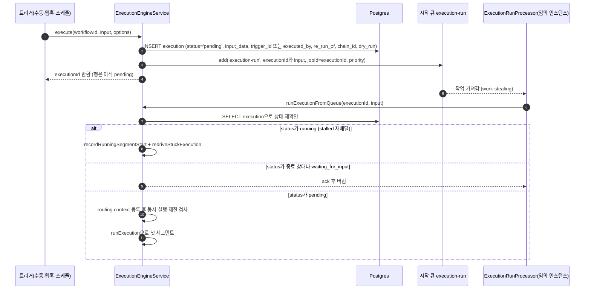
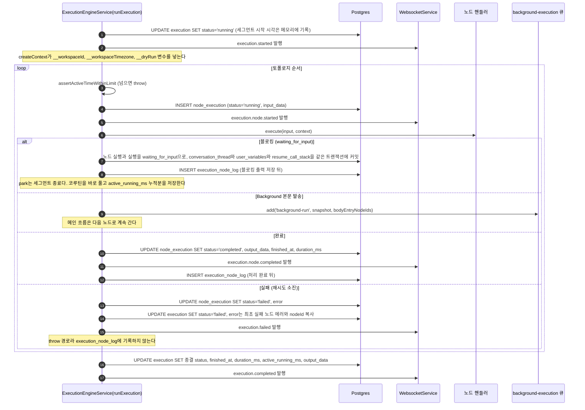
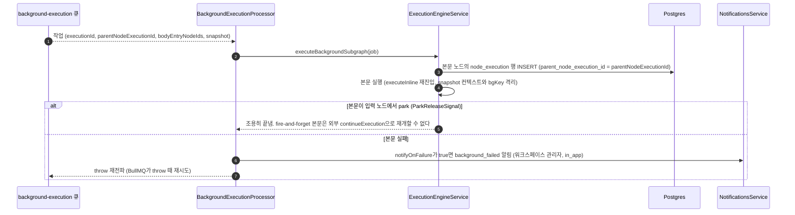
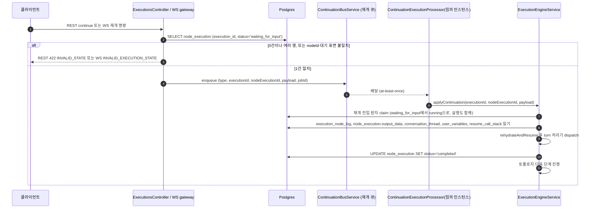

## 개요

이 문서는 [실행 데이터와 흐름](CLE-EXEC-DATA.md) 의 하위 문서로 실행 시작부터 첫 세그먼트, Background 본문, 입력 재개, 서브 워크플로우 호출까지 실행 데이터가 흐르는 순서와 Postgres · Redis · WebSocket 저장소 매핑을 정한다. 각 엔티티의 필드 정의는 [실행 데이터와 흐름 — 데이터 모델](CLE-EXEC-DATA-MODEL.md) 에 있다.

## 실행 데이터 흐름

코드 진입점은 `ExecutionEngineService` 의 `execute` / `runExecutionFromQueue` / `runExecution` / `executeInline` / `executeSync` / `executeAsync` 다. 아래 시퀀스에서 `Eng` 는 한 actor 로 그렸다. 재개 턴 처리와 마지막 턴 재시도는 같은 프로세스 안의 협력 서비스(`FormInteractionService` / `ButtonInteractionService` / `AiTurnOrchestrator` / `RetryTurnService`)에 in-process `EngineDriver` 로 맡긴다. 분산 분리가 아니라 클래스 경계 정리다. 배경은 [실행 엔진 개요와 그래프 순회](CLE-EXEC-ENGINE.md) 에 있다.

### 실행 시작

`execute()` 는 실행을 **직접 시작하지 않는다.** 실행 행을 `pending` 으로 저장하고 시작 큐에 작업을 발행한 뒤 executionId 를 바로 돌려준다. 반환 직후 실행이 곧바로 시작된다는 보장은 없다. 첫 세그먼트는 임의 인스턴스의 워커가 work-stealing 으로 처리한다.

그림은 실행 행이 만들어지고 워커가 첫 세그먼트를 시작하기까지다. 우선순위, jobId, 작업 옵션, 세 갈래 분기의 규칙은 [큐 워커와 동시 실행 제한](CLE-EXEC-WORKER.md) 에 있다. `running` 분기의 재구동은 [장애 복구와 안전 종료](CLE-EXEC-RECOVERY.md) 에 있다.

### 첫 세그먼트

그림은 첫 세그먼트에서 노드마다 어떤 행이 쓰이는지 보여 준다.

- **노드 실행 순서 로그는 처리 완료 로그다.** 기록 시점은 [노드 실행 순서 로그](CLE-EXEC-DATA-MODEL.md#노드-실행-순서-로그) 에 있다.
- **세그먼트 시간 누적**: `updateExecutionStatus` 가 `running` 에 들어가고 나올 때마다 세그먼트 시간을 `execution.active_running_ms` 에 더한다. dispatch 반복문은 노드 사이마다 `assertActiveTimeWithinLimit` 를 부른다. 누적(저장분 + 진행 중 세그먼트 경과분)이 한도(`EXECUTION_MAX_ACTIVE_RUNNING_MS`, 기본 30분, `0`=무제한, `execution-limits.ts`) 이상이면 `ExecutionTimeLimitError` 를 던져 `error.code='EXECUTION_TIME_LIMIT_EXCEEDED'` 로 `failed` 마감한다. 입력 대기 park 시간은 `running` 이 아니므로 누적에서 저절로 빠진다(불변식).
- 노드 실행은 try 첫 줄에서 `ShutdownStateService.registerInFlight` 로 등록되고 finally 에서 해제된다. 안전 종료 drain 이 이 목록을 추적한다([장애 복구와 안전 종료](CLE-EXEC-RECOVERY.md)).

### Background 본문

그림은 Background 본문이 메인 실행과 따로 도는 흐름이다.

- `background_failed` 알림을 보내는 주체는 엔진이 아니라 **`BackgroundExecutionProcessor.process` 의 catch** 다(`dispatchFailureNotification`, 정리된 에러 메시지 포함). 알림 속성은 [알림](../CLE-OBS/CLE-OBS-NOTIFY.md) 에 있다.
- 본문 실패는 메인 실행의 상태를 바꾸지 않는다(격리).
- Processor 는 `background:run:<id>` WebSocket 채널로 `execution.background_run.started` / `completed` 이벤트도 발행한다(모니터링). 본문 실행 규칙과 모니터링은 [Background 노드](../CLE-NODE-LOGIC/CLE-NODE-BACKGROUND.md) 와 [컨테이너 실행](CLE-EXEC-CONTAINER.md) 에 있다.

### 입력으로 재개

그림은 입력 대기 실행에 재개 명령이 들어와 다시 진행되기까지 읽고 쓰는 데이터다.

- 재개 진입점은 두 가지다. (1) REST `POST /executions/:id/continue` 는 본문 `{ formData? }` 만 받고 입력 대기가 아니면 동기 422 `INVALID_STATE` 로 응답한다(`executions.controller.ts` `continueExecution`). (2) WebSocket `execution.submit_form` / `execution.click_button` / `execution.submit_message` / `execution.end_conversation`(`websocket.gateway.ts`). ack 이름과 wire 형식은 [WebSocket 이벤트와 명령](../CLE-API/CLE-API-WS-EVENTS.md) 이 기준이다.
- `type` / `nodeExecutionId` / `payload` 는 클라이언트가 보내는 필드가 아니다. 발행자가 노드 실행 조회 뒤 구성해 재개 큐에 싣는 내부 메시지 필드다. 사전 검증 규칙은 [큐 워커와 동시 실행 제한](CLE-EXEC-WORKER.md) 에 있다.
- claim 이 affected=0 이면 작업을 ack 하고 버린다. 턴 처리의 LLM throw 는 `running → failed`, rehydration 과정 실패는 `RESUME_*` 종결이다. rehydration 실패는 뒤따르는 `execution.cancelled` 이벤트로 알린다. 절차는 [장애 복구와 안전 종료](CLE-EXEC-RECOVERY.md) 에 있다.
- **마지막 턴 재시도(`execution.retry_last_turn`)는 이 흐름과 다르다.** 대상 실행은 `failed` 여야 하고 입력 대기 조회를 거치지 않는다. 새 `running` 노드 실행 행을 만들어 재개 큐로 넘기며 claim 도 `_retryState` 키 조건부 소비로 따로 한다. 규칙은 [실행 상태 머신과 대기·재개](CLE-EXEC-STATE.md) 와 [큐 워커와 동시 실행 제한](CLE-EXEC-WORKER.md) 에 있다.

### 서브 워크플로우 호출

Workflow 노드(`flow.workflow`)가 서브 워크플로우를 부를 때의 진입점이다. 모드 정의는 [워크플로우 호출 노드](../CLE-NODE-FLOW/CLE-NODE-SUBWF.md) 가 기준이다.

| 모드 | 진입점 | 데이터 |
| --- | --- | --- |
| 동기 | `executeInline` | 서브 워크플로우를 **부모 executionId 와 실행 컨텍스트를 공유해** 같은 실행 내역 타임라인 안에서 돌린다. 새 실행 행을 만들지 않는다. 중첩 인라인 안에서 park 하면 호출 체인을 `resume_call_stack` frame 으로 영속하고 rehydration 이 frame 단위로 재진입한다. Background 본문도 이 경로를 다시 쓴다. |
| 비동기(fire-and-forget) | `executeAsync` | 부모는 바로 다음 노드로 간다. 자식 실행 행을 INSERT 한 뒤(`parent_execution_id = parent.id`, `recursion_depth = parent + 1`) **`runExecution` 을 자체 promise 로 실행**한다(`.catch` 는 로그만). 결과는 별도 행으로 볼 수 있다. `MAX_RECURSION_DEPTH` 로 깊이를 막는다. 시작 큐를 거치지 않는다. |

엔진에는 `executeSync` 진입점도 있다. 자식 실행 행을 `pending` 으로 INSERT 한 뒤 **`runExecution` 을 직접 await** 하고 `timeoutMs`(기본 300초, `0`=무제한)와 `Promise.race` 한다. timeout 뒤에는 행을 다시 읽어 상태를 비교해 TOCTOU 를 막는다. 시작 큐를 거치지 않는다. 현재 구현의 Workflow 노드 핸들러는 동기 모드에 `executeInline`, 비동기 모드에 `executeAsync` 를 부르며 `executeSync` 는 부르지 않는다.

메인 워크플로우와 서브 워크플로우의 실제 실행 본체는 모두 `runExecution` 이다. `executeInline` 은 "부모 실행 안의 인라인 실행" 전용이며 메인 실행 경로의 이름이 아니다. 서브 워크플로우 자식 실행에 동시 실행 제한이 적용되는지는 [큐 워커와 동시 실행 제한](CLE-EXEC-WORKER.md) 의 미결 사항에 있다.

## 저장소 매핑

### Postgres

| 테이블 | 흐름 | 읽고 쓰는 컬럼 | 인덱스·제약 |
| --- | --- | --- | --- |
| `execution` | 실행 진입 | INSERT `workflow_id, trigger_id?, status='pending', input_data, started_at, executed_by?, parent_execution_id?, recursion_depth, re_run_of?, chain_id?, dry_run`. `re_run_of`/`chain_id` 는 재실행 체인(decision F2), `dry_run` 은 컨텍스트 변수 `__dryRun` 으로 핸들러에 넣는다(V068). | `(workflow_id, started_at DESC)`, `(status)` |
| `execution` | 상태 전이 | UPDATE `status, finished_at, duration_ms, output_data, error, active_running_ms`. `error` 는 최초 `failed` 노드 실행의 에러 + nodeId 복사다. **`status IN (종료 아닌 상태)` 조건부 UPDATE 이며 트랜잭션 안에서 실행한다**(2026-08-30). 결과 shape 확인이 throw 하면 이 UPDATE 도 함께 롤백된다. 원자성 규칙은 [실행 상태 머신과 대기·재개](CLE-EXEC-STATE.md), 결정 배경은 [장애 복구와 안전 종료](CLE-EXEC-RECOVERY.md) 의 Rationale 에 있다. | 없음 |
| `execution` | park 진입(영속 재개) | UPDATE `conversation_thread, user_variables, resume_call_stack`. `waiting_for_input` 전이와 같은 트랜잭션으로 커밋한다(V084/V085/V087). | 없음 |
| `node_execution` | 노드 실행 시작 | INSERT `execution_id, node_id, status='running', started_at, input_data, retry_count=0, parent_node_execution_id?`(V006/V012). 건너뛴 노드는 `status='skipped'` 로 바로 INSERT | `(execution_id)`, V034 `(execution_id, node_id, started_at DESC)` 복합, V095 `(execution_id, status) WHERE status IN ('waiting_for_input','running')` 부분 인덱스(활성 노드 조회·전이), V112 `(node_id)`(FK CASCADE, 캔버스 노드 삭제·워크플로우 삭제) |
| `node_execution` | 노드 완료 | UPDATE `status, finished_at, duration_ms, output_data, error, retry_count, interaction_data`(V004) | 없음 |
| `execution_node_log` | 노드 **처리 완료 때** | INSERT `execution_id, node_id, created_at`(append-only). throw 경로는 기록하지 않는다. | `(execution_id, id)`(V035). bigserial PK 가 인스턴스 사이 결정적 순서를 보장한다. |

### Redis

실행 엔진은 BullMQ 큐 세 개를 쓴다.

| 큐 | 발행 | 소비 | payload 핵심 필드 |
| --- | --- | --- | --- |
| `execution-run`(시작 큐) | `ExecutionEngineService.execute`(실행 행 `pending` 저장 뒤) | `ExecutionRunProcessor` → `runExecutionFromQueue`(work-stealing) | `{executionId, input?}`. jobId, 우선순위, 작업 옵션은 [큐 워커와 동시 실행 제한](CLE-EXEC-WORKER.md) |
| `execution-continuation`(재개 큐) | `ContinuationBusService.publish`(WS gateway, REST controller 경유) | `ContinuationExecutionProcessor` | `{type, executionId, nodeExecutionId, payload}`. jobId 와 수명은 [큐 워커와 동시 실행 제한](CLE-EXEC-WORKER.md) |
| `background-execution` | `ExecutionEngineService.scheduleBackgroundBody` | `BackgroundExecutionProcessor` | `executionId, parentNodeExecutionId, backgroundRunId?, workspaceId, workflowId, bodyEntryNodeIds[], containerScopeId?, itemContext?, loopContext?, input, variables, nodeOutputCache, expressionContext, conversationThread?, config{notifyOnFailure, maxDurationMs}`(`background-execution.queue.ts`). `input` 의 뜻은 [Rationale](#background-본문에-스냅샷-컨텍스트를-싣는다) 에 있다. `containerScopeId?` · `itemContext?` · `loopContext?` 는 컨테이너 본문 안(그 안 병렬 분기 포함) Background 가 큐에 넣을 때만 싣는다([컨테이너 실행 §컨테이너 본문 안 Background](CLE-EXEC-CONTAINER.md#컨테이너-본문-안-background)). `backgroundRunId?` 와 `conversationThread?` 는 하위 호환용 선택 필드이며 옛 큐 메시지에는 없다. 선택 필드 다섯 개 모두 그 필드를 넣기 전에 큐에 들어간 메시지에는 없다. |

- 재개 큐는 `removeOnFail:false` 라 시도(`RESUME_BULLMQ_ATTEMPTS`, 기본 3)를 소진한 작업이 `failed`(DLQ)로 쌓인다. `ContinuationDlqMonitorService` 가 `failed`/`delayed` 적재량을 주기적으로 보고 임계를 넘으면 구조화된 `logger.error` 경고를 cooldown 단위로 남긴다. 설정은 [비동기 큐와 Redis 키 목록](../CLE-PLAT/CLE-PLAT-QUEUE.md) 에 있다.
- 보조 키 `exec:recover:lock`(부팅 복구 스캔 전역 lock, TTL 60초)과 `exec:cont:seq:<executionId>`(재개 큐 jobId 용 단조 seq, `CONTINUATION_SEQ_TTL_SECONDS` 기본 24시간 sliding TTL)의 정의는 [비동기 큐와 Redis 키 목록](../CLE-PLAT/CLE-PLAT-QUEUE.md) 이 기준이다.
- 재개 신호는 재개 큐로 전달한다. 옛 Redis pub/sub 채널 `execution:<executionId>` 는 폐기했다. 결정 근거는 [장애 복구와 안전 종료](CLE-EXEC-RECOVERY.md) 의 Rationale 에 있다.

### WebSocket

| 이벤트 | 발행 시점 | 구독 room |
| --- | --- | --- |
| `execution.started` / `completed` / `failed` / `cancelled` | 실행 상태 전이 | `workflow:<id>` 또는 `execution:<id>` |
| `execution.node.started` / `completed` / `failed` / `cancelled` / `skipped`, `execution.waiting_for_input` | 노드 실행 상태 전이 | 같음 |
| `execution.snapshot` | 소켓이 `execution:<id>` 채널을 처음 구독할 때 한 번(재연결 뒤 재구독 포함). 연결 시점이 아니라 구독 시점이다. 같은 소켓이 이미 구독한 채널을 다시 구독하면 보내지 않는다. 규칙은 [WebSocket 연결과 채널 구독 §6.2](../CLE-API/CLE-API-WS.md#62-놓친-이벤트-복구) | `execution:<id>` |
| `execution.background_run.started` / `completed` | Background 본문 시작·종료 | `background:run:<id>` |

- 이벤트 이름과 발행 조건의 기준은 [WebSocket 이벤트와 명령](../CLE-API/CLE-API-WS-EVENTS.md) 이다. 위 표는 요약이며 어긋나면 그 문서가 우선한다. room 이름(`workflow:<id>` / `execution:<id>`)은 socket.io room 이름공간으로 이벤트 이름과 별개다.
- 모든 발행은 `WebsocketService` 한 곳을 거친다. 정책은 [큐 워커와 동시 실행 제한](CLE-EXEC-WORKER.md) 의 실행 이벤트 발행 경로에 있다.

## 구현 위치

- `codebase/backend/src/modules/execution-engine/execution-engine.service.ts` (`execute / runExecutionFromQueue / runExecution / executeInline / executeSync / executeAsync`)
- `codebase/backend/src/modules/execution-engine/queues/execution-run.queue.ts`, `execution-run.processor.ts` (시작 큐)
- `codebase/backend/src/modules/execution-engine/queues/background-execution.queue.ts`, `background-execution.processor.ts` (Background 본문 큐와 실패 알림)
- `codebase/backend/src/modules/execution-engine/continuation/continuation-bus.service.ts` (재개 큐)

## Rationale

### Background 본문에 스냅샷 컨텍스트를 싣는다

Background 본문이 도는 동안 메인 흐름이 변수를 바꿔도 본문에 영향이 없어야 한다. 그래서 발송 시점에 메인의 `variables / nodeOutputCache / expressionContext` 를 얕은 복사로 떠서 payload 에 담는다(`background-execution.queue.ts` 주석). 소비자는 이 스냅샷으로 다시 만든 컨텍스트 위에서 `executeBackgroundSubgraph` 를 부른다.

payload 에는 Background 노드가 받은 입력의 스냅샷(`input`)도 싣는다. 본문 진입 노드가 이 값을 입력으로 받는다([Background 노드 Rationale](../CLE-NODE-LOGIC/CLE-NODE-BACKGROUND.md#본문-진입-노드는-background-노드가-받은-입력을-받는다-2026-11-12)). 컨테이너 본문 안 Background 면 그 컨테이너 ID(`containerScopeId`)와 큐에 넣은 회차의 반복 변수(`itemContext` · `loopContext`)도 싣는다. 워커는 그 컨테이너 단계 그래프로 본문을 실행하고 본문 노드 식은 그 회차의 반복 변수를 읽는다([Background 노드 Rationale](../CLE-NODE-LOGIC/CLE-NODE-BACKGROUND.md#컨테이너-본문-안-background-는-컨테이너-단계-그래프로-실행한다-2026-11-12)).
