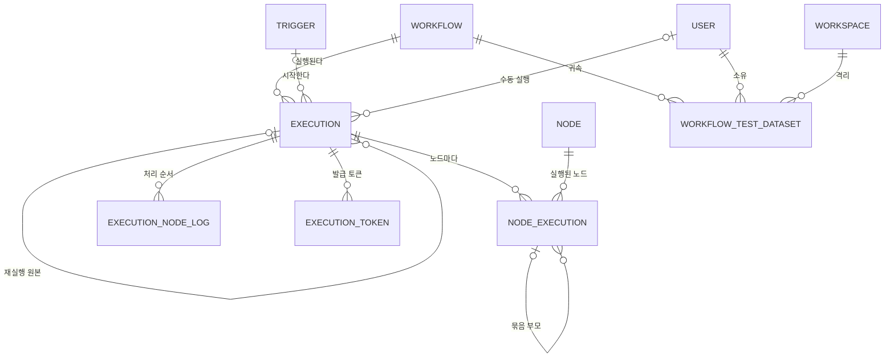

> 구현 상태: 구현됨 · 원문: `spec/data-flow/3-execution.md`, `spec/1-data-model.md` (§2.13 Execution, §2.13.1 ExecutionNodeLog, §2.13.3 WorkflowTestDataset, §2.14 NodeExecution, Rationale "삭제 연쇄의 FK 인덱스 다섯", "Execution.execution_path → ExecutionNodeLog"), `spec/5-system/4-execution-engine.md` (§7.4 `execution_node_log` 모델) · 용어: [용어 사전](../CLE-GLOSSARY.md)

## 개요

워크플로우 한 번의 실행이 어떤 데이터를 남기고 그 데이터가 어디로 흐르는지 정한다. 실행은 트리거(수동·웹훅·스케줄)에서 시작해 시작 큐(`execution-run`)를 거친다. 임의 인스턴스의 워커가 노드 그래프를 토폴로지 순서로 돌며 노드 핸들러를 부르고 결과를 Postgres, Redis, WebSocket 에 반영한다. Background 노드 본문과 재개 신호는 별도 BullMQ 큐로 나뉜다.

이 문서와 하위 문서가 소유하는 엔티티는 넷이다.

- 실행(Execution, `execution`): 워크플로우가 한 번 도는 단위와 그 기록
- 노드 실행(NodeExecution, `node_execution`): 한 실행 안에서 노드가 한 번 도는 단위와 그 기록
- 노드 실행 순서 로그(`ExecutionNodeLog`): 노드가 처리된 순서를 쌓는 append-only 테이블
- 테스트 데이터셋(`WorkflowTestDataset`): 이름을 붙여 저장한 테스트 입력(Mock Input)

범위 밖:

- 실행 상태와 노드 실행 상태의 전이 규칙과 상태도는 [실행 상태 머신과 대기·재개](CLE-EXEC-STATE.md) 가 정한다. 이 문서는 상태 값을 컬럼으로만 다룬다.
- 시작 큐·재개 큐의 계약, 동시 실행 제한, 실행 시간 한도는 [큐 워커와 동시 실행 제한](CLE-EXEC-WORKER.md) 에 있다.
- 크래시 재구동, rehydration, 안전 종료는 [장애 복구와 안전 종료](CLE-EXEC-RECOVERY.md) 에 있다.
- 실행 컨텍스트 필드와 park 때 무엇을 커밋하는지는 [실행 컨텍스트](CLE-EXEC-CONTEXT.md) 에 있다.
- EIA 토큰 테이블 `execution_token` 은 [EIA 데이터와 흐름](../CLE-IX/CLE-EIA-DATA.md), 재실행 컬럼의 정책은 [재실행](CLE-EXEC-RERUN.md), 응답 마스킹은 [응답 자격 증명 마스킹](../CLE-API/CLE-API-EGRESS.md), 테스트 데이터셋의 화면·권한·API 는 [에디터 실행과 디버깅](CLE-EXEC-RUN.md) 에 있다.
- 엔티티 전체 지도와 공통 컬럼 규칙은 [데이터 모델 개요](../CLE-PLAT/CLE-PLAT-DATA.md) 에 있다.

## 하위 문서

- [실행 데이터와 흐름 — 데이터 모델](CLE-EXEC-DATA-MODEL.md): 실행 · 노드 실행 · 노드 실행 순서 로그 · 테스트 데이터셋의 필드, 행 생성 규칙, 실행 에러와 노드 실행 에러의 관계. 요구사항 번호 없음.
- [실행 데이터와 흐름 — 흐름과 저장소 매핑](CLE-EXEC-DATA-FLOW.md): 실행 시작 · 첫 세그먼트 · Background 본문 · 입력으로 재개 · 서브 워크플로우 호출의 시퀀스와 Postgres · Redis · WebSocket 저장소 매핑. 요구사항 번호 없음.

## 엔티티 관계

실행은 워크플로우에 속하고 노드 실행과 노드 실행 순서 로그를 거느린다. 서브 워크플로우 실행과 재실행은 실행끼리 자기 참조로 잇는다.

## 입력으로 재개

다른 문서가 이 앵커를 링크한다. 본문은 하위 문서로 옮겼다.

→ [실행 데이터와 흐름 — 흐름과 저장소 매핑](CLE-EXEC-DATA-FLOW.md#입력으로-재개)

## 상태별 종결 코드

실행 상태 값의 전이 규칙은 [실행 상태 머신과 대기·재개](CLE-EXEC-STATE.md) 가 정한다. 여기서는 종결 때 `Execution.error.code` 에 남는 값을 모은다.

| 종결 상태 | `error.code` | 경로 | 기준 문서 |
| --- | --- | --- | --- |
| `failed` | 노드 에러 복사 | 어떤 노드든 재시도를 소진하고 실패. 최초 `failed` 노드 실행의 에러 + nodeId 복사 | [실행 데이터와 흐름 — 데이터 모델](CLE-EXEC-DATA-MODEL.md#실행-에러와-노드-실행-에러) |
| `failed` | `EXECUTION_TIME_LIMIT_EXCEEDED` | 노드 사이 `assertActiveTimeWithinLimit` 검사에서 세그먼트 누적 시간 한도 초과 | [큐 워커와 동시 실행 제한](CLE-EXEC-WORKER.md) |
| `failed` | `WORKER_HEARTBEAT_TIMEOUT` | stalled 재배달(`maxStalledCount=1`) 소진 때 `finalizeStalledExhausted` 가 표시. 부팅 복구 스캔 재구동은 이 코드를 쓰지 않는다. | [장애 복구와 안전 종료](CLE-EXEC-RECOVERY.md) |
| `failed` | `SERVER_INTERRUPTED` | SIGTERM 안전 종료 유예 시간 초과 | [장애 복구와 안전 종료](CLE-EXEC-RECOVERY.md) |
| `cancelled` | `EXECUTION_QUEUE_WAIT_TIMEOUT` | 큐 대기 5분 초과. 작업을 가져갈 때 검사하거나 작업을 잃은 경우 부팅 복구 스캔이 회수한다. 취소 주체는 `timeout` 이다. | [큐 워커와 동시 실행 제한](CLE-EXEC-WORKER.md) |
| `cancelled` | `RESUME_CHECKPOINT_MISSING` / `RESUME_FAILED` / `RESUME_INCOMPATIBLE_STATE` | rehydration 실패. 짝 노드 실행은 `failed` | [장애 복구와 안전 종료](CLE-EXEC-RECOVERY.md) |
| `cancelled` | `WEBCHAT_IDLE_TIMEOUT` | 공개 웹채팅 위젯 입력 대기 회수(익명 per_execution 토큰 영구 만료 + 유예, EIA-RL-07) | [External Interaction API](../CLE-IX/CLE-EIA.md) |

사용자 실행 중지로도 `cancelled` 가 된다. 큐에서 기다리던 실행이 중지되면 `runExecutionFromQueue` 가 작업을 ack 하고 버린다. 중지 규칙은 [에디터 실행과 디버깅](CLE-EXEC-RUN.md) 과 [노드 취소](CLE-EXEC-CANCEL.md) 에 있다.

비정상 종료 회수(stalled 재배달, 부팅 복구 스캔, 안전 종료)는 입력 대기 실행을 건드리지 않는다. 입력이 도착하면 rehydration 으로 재개한다. 세 경로의 규칙은 [장애 복구와 안전 종료](CLE-EXEC-RECOVERY.md) 가 한 곳에서 정한다.

## 외부 의존

| 의존 | 방향 | 참고 |
| --- | --- | --- |
| 트리거 | 진입 | 웹훅·스케줄·수동 트리거가 실행을 만든다. [트리거 데이터와 흐름](../CLE-TRIG/CLE-TRIG-DATA.md) |
| LLM 사용량 | AI 노드 호출 때 | LLM 호출 뒤 `llm_usage_log` 적재. [LLM 사용량 기록](../CLE-AI/CLE-AI-USAGE.md) |
| 통합 | HTTP Request·Database Query·Send Email 노드 | 자격 증명 해석. [통합 데이터와 흐름](../CLE-INT/CLE-INT-DATA.md) |
| 지식 저장소 | AI 에이전트의 지식 저장소 도구(`kb_*`) 호출 | RAG 검색 진입. [지식 저장소 데이터와 흐름](../CLE-KB/CLE-KB-DATA.md) |
| 알림 | `execution_failed` / `background_failed` | [알림](../CLE-OBS/CLE-OBS-NOTIFY.md) |
| WebSocket | 모든 상태 전이 발행 | 단일 발행 경로. [WebSocket 이벤트와 명령](../CLE-API/CLE-API-WS-EVENTS.md) |

## 삭제와 보존

- 실행 이력을 보존 기간으로 정리하는 배치는 없다. 보존 배치는 `integration_usage_log` 90일 하나뿐이다. 그래서 노드 실행은 아래 두 경로로만 지워진다.

| 삭제 경로 | 빈도 | 연쇄 |
| --- | --- | --- |
| 캔버스 저장이 노드를 뺀다(제출 목록에 없는 `Node` 를 지운다) | 캔버스 저장마다 | `node` → `node_execution`(CASCADE, `node_id`) → 지워지는 노드 실행 **행마다** `integration_usage_log`(CASCADE) · `llm_usage_log`(SET NULL) 를 `node_execution_id` 로 찾는다. |
| 워크플로우 삭제 | 관리 동작 | 위 연쇄 + `execution` 행마다 `llm_usage_log`(SET NULL, `execution_id`) + `integration_usage_log`(CASCADE, `workflow_id`) |

- 실행이 지워지면 노드 실행(CASCADE), 노드 실행 순서 로그(ON DELETE CASCADE), EIA 토큰(ON DELETE CASCADE)이 함께 지워진다. 테스트 데이터셋은 워크플로우·소유 사용자·워크스페이스 가운데 하나가 지워지면 함께 지워진다(모두 ON DELETE CASCADE).
- 두 연쇄에서 비용을 내던 FK 다섯에 선두 인덱스를 두었다(V112~V116). `node_execution(node_id)`, `integration_usage_log(node_execution_id)`, `integration_usage_log(workflow_id)`, `llm_usage_log(node_execution_id)`(부분), `llm_usage_log(execution_id)`(부분)다. 실측과 판단 근거는 [Rationale](#rationale) 에 있다. FK 인덱스 전체의 처분은 [데이터 모델 개요](../CLE-PLAT/CLE-PLAT-DATA.md) 가 다룬다.

## 미결 사항

- **노드 실행 `pending` 사용 여부**: 엔진 원문의 노드 실행 상태 설명은 `pending`(실행 대기, 선행 노드 완료 대기) → `running` 전이를 그리고 `skipped` 도 `running` 에서 갈라진다고 그린다. 데이터 흐름 원문은 코드 관찰로 엔진이 노드 실행을 처음부터 `running`(또는 `skipped`)으로 INSERT 하며 `pending` 은 엔티티 기본값일 뿐 어떤 엔진 경로도 쓰지 않는다고 적는다(관련: [실행 상태 머신과 대기·재개](CLE-EXEC-STATE.md)). `pending` 을 "엔티티 기본값, 엔진 미사용" 으로 정리할지 정해야 한다.

## 구현 위치

- `codebase/backend/src/modules/execution-engine/state/state-machine.ts` (실행 상태 전이 `ALLOWED_TRANSITIONS`. 노드 실행 전이표는 코드에 없음)
- `codebase/backend/src/modules/execution-engine/shutdown/shutdown-state.service.ts` (안전 종료 drain, `SERVER_INTERRUPTED` 표시)
- `codebase/backend/migrations/V*.sql` (V035, V036, V067, V068, V083, V084, V085, V087, V096, V097, V098, V104, V112~V116, V141)
- `codebase/backend/test/deletion-cascade-indexes.e2e-spec.ts` (삭제 연쇄 인덱스 가드)

## Rationale

### 삭제 연쇄의 FK 인덱스 다섯 (2026-09-18)

부모 행을 지울 때 Postgres 의 FK 트리거는 **지워지는 부모 행마다** 자식을 한 번씩 찾는다. 선두 인덱스가 없는 FK 의 비용은 그래서 «자식 테이블 크기 × 연쇄로 지워지는 부모 행 수» 다. 단일 컬럼 FK 87개 가운데 선두 인덱스가 없는 것이 37개였다(카탈로그 `pg_index.indkey[0]` 대조, 부모를 한정하지 않은 전수이며 **부분 인덱스도 «있음» 으로 센 수**다. FK 조회가 쓸 수 없는 부분 인덱스만 가진 셋을 더하면 40개다). 그중 다섯이 [삭제와 보존](#삭제와-보존) 의 두 삭제 경로 연쇄에서 비용을 냈다.

실측(PostgreSQL 18, V001~V111 적용, 워크플로우마다 노드 10 · 실행 20 · 실행당 노드 실행 10 · 통합 로그 20 · LLM 로그 40, 워밍 뒤 1회):

| 규모(`node_execution` / 통합 로그 / LLM 로그) | 캔버스 노드 하나 삭제 | 워크플로우 삭제 |
| --- | --- | --- |
| 200k / 20k / 40k | 45.7 ms | 444.7 ms |
| 800k / 80k / 160k | 206.6 ms | 2,225 ms |
| 800k + 인덱스 넷(`node_execution_id` 두 · `node_id` · `execution_id`) | **0.79 ms** | **6.96 ms** |

800k 워크플로우 삭제에서 FK 별로 `llm_usage_log.node_execution_id` 1,296.9 → 0.80 ms(200회), `integration_usage_log.node_execution_id` 530.6 → 0.50 ms(200회), `node_execution.node_id` 271.3 → 0.19 ms(10회), `llm_usage_log.execution_id` 116.9 → 0.39 ms(20회), `integration_usage_log.workflow_id` 2.56 → 0.028 ms(1회, 다섯째 인덱스)였다. 두 경로의 나머지 FK 트리거는 200k 에서 각 0.5 ms 미만이었다. 그중 선두 인덱스가 없는 `alert_rule.workflow_id` 와 `edge.target_node_id` 는 작은 테이블이라 넣지 않았다. **그 측정의 연결선은 약 1만 행이었다**(실행 이력이 많고 워크플로우가 적은 구성). 워크플로우 10만 규모에서는 `edge.target_node_id` 가 캔버스 저장 경로의 가장 큰 비용이라 별도 처분에서 인덱스를 넣었다(V121). `alert_rule.workflow_id` 는 그 규모에서도 1.3 ms 라 대상에서 뺐다. FK 인덱스 전체 처분은 [데이터 모델 개요](../CLE-PLAT/CLE-PLAT-DATA.md) 에 있다.

쓰기 비용(10만 행 INSERT 5회 중앙값, FK 컬럼을 모두 채운 최악 조건):

| 테이블 | 더하는 인덱스 | 없음 | 있음 | 행당 |
| --- | --- | --- | --- | --- |
| `node_execution` | `(node_id)` | 975 ms | 1,060 ms | +0.85 µs (+8.7%) |
| `integration_usage_log` | `(node_execution_id)` · `(workflow_id)` | 1,080.7 ms | 1,188.6 ms | +1.08 µs (+10.0%) |
| `llm_usage_log` | 부분 `(node_execution_id)` · `(execution_id)` | 1,500.5 ms | 1,635.3 ms | +1.35 µs (+9.0%) |

노드 한 번 실행이나 외부 호출 한 번에 1행이라 행당 1 µs 대는 무시할 만하다. `node_id` 는 바뀌지 않는 컬럼이라 상태 전이 UPDATE 의 HOT 갱신도 막지 않는다. «없음» 을 먼저 쟀으므로 오버헤드가 약간 적게 잡혔을 수 있다.

**`llm_usage_log` 두 인덱스만 부분 인덱스인 이유**: 두 컬럼은 NULL 을 허용한다(노드 밖·실행 밖 LLM 호출). FK 트리거의 쿼리는 등치라 `IS NOT NULL` 을 함의해 부분 인덱스를 쓸 수 있다. `(workflow_id, created_at DESC) WHERE workflow_id IS NOT NULL` 과 같은 이유다. 나머지 셋의 컬럼은 NOT NULL 이다.

**Trigger `(workflow_id)` 인덱스 검토와의 관계**: 그 검토는 부모를 `workflow`·`workspace` 둘로 한정했고 `integration_usage_log` 는 쓰기 비용과 맞바꾸는 판단이라 따로 재기로 했다. 이 절이 그 검토다. 그 대상이던 `integration_usage_log.workflow_id` 는 삭제 한 번에 0.55 ms(200k)였고 비용은 한정 밖의 FK(`node_execution` 을 가리키는 것)에 있었다. 나머지 32개 FK 는 트래커에 전수로 남겼다. 같은 날 그래프 RAG 삭제 연쇄의 FK 인덱스 넷이 닫혀 28개가 남았다. 그 28개와 셈법이 놓친 셋은 이후 모두 처분됐다(인덱스 열, 비대상 스물하나). 처분 내역은 [데이터 모델 개요](../CLE-PLAT/CLE-PLAT-DATA.md) 에 있다.

