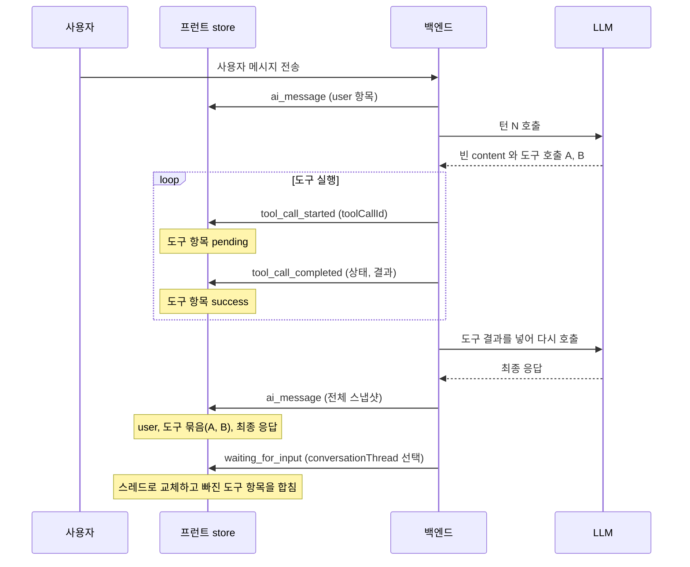

## 개요

이 문서는 [대화 미리보기](CLE-EXEC-PREVIEW.md) 의 하위 문서로 실시간 이벤트가 프런트 store 를 바꾸는 규칙, 실행 단계별 store 초기화, 변환 함수 계약을 정한다. `Inv-N` 불변량은 [대화 미리보기 §UI 불변량](CLE-EXEC-PREVIEW.md#ui-불변량) 이 정한다.

## 한 턴이 표시되는 흐름

멀티턴 AI 에이전트의 한 턴에서 실행 트리 항목은 아래 순서로 바뀐다. `conversationThread` 는 백엔드가 입력 대기 이벤트에 골라서 함께 싣는다.



최종 응답의 `ai_message` 전체 스냅샷에서 빈 content 의 중간 assistant 는 도구 묶음의 부모가 된다.

## 이벤트별 store 변환

`useExecutionStore.conversationMessages` 를 바꾸는 규칙이다. 모든 이벤트의 의미는 [WebSocket 이벤트와 명령](../CLE-API/CLE-API-WS-EVENTS.md) 을 따른다. 표의 이벤트 이름은 `execution.` 접두를 뺐다(정식 이름은 `execution.tool_call_started` 등).

| 이벤트 | store 변경 | 목적 |
| --- | --- | --- |
| `tool_call_started` | `toolCallId` 로 UPSERT(status=pending) | 라이브 표시 시작 |
| `tool_call_completed` | `toolCallId` 로 UPDATE(status, result, durationMs, error) | 라이브 상태 전이 |
| `user_message` | optimistic `ai_user` 항목(`text=payload.message`)을 APPEND 한다. `receivedAt` 으로 중복(재전송·재구독)을 막는다. **단, 같은 발화의 말풍선이 이미 있으면**(클라이언트가 직접 보내 즉시 optimistic 말풍선을 띄운 경우) 새 항목을 붙이지 않고 그 말풍선에 권위 `receivedAt` 을 찍어 맞춘다. 이 찍기는 턴 종료 `ai_message` 교체의 보조 준비 단계다. 말풍선이 없을 때(채널 텍스트 수신 등)만 붙인다 | 사용자 발화를 일찍 보여 주기 |
| `ai_message` | `messagesToConversationItems(payload.messages, …)` 로 REPLACE 한다. 단 `toolStatus`·`durationMs`·`error` 는 이전 목록의 같은 `toolCallId` 항목에서 이어받는다. 교체는 직전 `user_message` 의 optimistic 말풍선을 권위 스냅샷의 같은 user 메시지로 자연스럽게 대신한다 | 스냅샷 정합 |
| `waiting_for_input`(`ai_conversation`) | `threadTurnsToConversationItems(payload.conversationThread.turns)` 로 REPLACE 하고 **남은 도구·중간 assistant 항목을 MERGE** 한다([변환 함수 계약](#변환-함수-계약)). `lastAppliedThreadSeqRef` 로 같은 `nextSeq` 재전송은 건너뛴다 | lean 스레드 보존 |
| `waiting_for_input`(`ai_form_render`) | 위 `ai_conversation` 행과 같은 REPLACE·MERGE 에 더해 `conversationConfig.pendingFormToolCall: { toolCallId, formConfig }` 를 store 의 `waitingConversationConfig.pendingFormToolCall` 에 저장한다. 이 값이 있는 동안 `SummaryView`·`SelectedItemDetail` 의 `AssistantPresentationsBlock` 은 `payload.toolCallId` 가 맞는 폼을 인터랙티브로 렌더한다 | AI 에이전트 멀티턴의 `render_form` 블로킹 |
| `waiting_for_input`(`form`·`buttons`) | `conversationThread` 가 함께 실려 왔을 때만 위 `ai_conversation` 행과 같이 적용한다. 라이브 도구 행 보존 의무도 같다(Inv-4) | Form·버튼 노드 |
| `node.failed`(`ai_conversation` 맥락의 AI 에이전트 멀티턴) | `system_error` 항목을 `conversationMessages` 끝에 APPEND 한다. **전송 데이터 최상위 `error` 는 문자열(메시지만)이다**([WebSocket 이벤트와 명령](../CLE-API/CLE-API-WS-EVENTS.md)). 구조화된 에러 객체는 **`payload.output.output.error`** 에만 있고 `output` 이 함께 실리는 두 경로(에러 포트 종료, AI 턴 종료)에서만 닿는다. 그것을 `system_error` 의 `data` 모양으로 옮긴다. 기존 항목은 바꾸지 않는다(Inv-6) | 에러 인라인 표시 |
| `node.completed`(멀티턴 `port: 'error'` 와 `output.error` 있음) | 위 `node.failed` 와 같다. `system_error` 를 APPEND 하고 에러 정보는 **`output.output.error`** 에서 꺼낸다. 전송 데이터의 `output` 은 노드 출력(`NodeHandlerOutput`) 전체라 도메인 값이 한 겹 아래에 있다([AI 에이전트 노드 출력과 디버그](../CLE-NODE-AI/CLE-NODE-AGENT-OUTPUT.md) 의 `buildMultiTurnFinalOutput` 에러 종료 형태) | 에러 인라인 표시 |

REPLACE 는 배열을 무조건 바꾸는 것이 아니라 **이어받을 값이 정해진 교체**다. Inv-1·Inv-4 를 깨지 않도록 이전 목록의 일부 상태를 보존한다. 이어받는 필드(`toolStatus`, `durationMs`, `error`)는 store 안 `ConversationItem` 의 런타임 필드(`codebase/frontend/src/lib/stores/execution-store.ts`)이고 대화 기록 항목 전송 스키마를 넓힌 것이 아니다. 이어받기는 먼저 도착한 라이브 이벤트 정보를 빈 스냅샷이 덮어쓰지 않게 하려는 규칙이다.

노드 출력 래퍼와 도메인 값의 구분은 [노드 출력 규약](../CLE-NODE/CLE-NODE-OUTPUT.md) 이 정한다. 위 두 에러 행은 그 계약을 다시 적지 않고 인용한다. 현재 구현의 `use-execution-events.ts` `extractNodeErrorPayload` 는 문자열 `error` 를 보지 않고 `output.output.error` 만 읽는다.

### store 초기화 정책

`useExecutionStore` 의 실행 단계 액션마다 두 묶음을 따로 초기화한다.

| 묶음 | 대상 필드 |
| --- | --- |
| **입력 대기 UI 초기화** | 사용자 입력 대기 UI 상태: `waitingNodeId`, `waitingFormConfig`, `waitingInteractionType`, `waitingButtonConfig`, `waitingConversationConfig`, `isWaitingAiResponse`, `selectedConversationItemIndex` |
| **대화 스냅샷 초기화** | `conversationMessages` 배열(라이브 대화 스레드의 store 쪽 권위 사본) |

| 단계 액션 | 입력 대기 UI 초기화 | 대화 스냅샷 초기화 |
| --- | --- | --- |
| `startExecution`(새 실행 시작) | 적용 | 적용(이전 실행의 대화는 의미가 없다) |
| `completeExecution`(정상 종료) | 적용 | **적용 안 함, 대화 보존** |
| `failExecution`(실행 실패) | 적용 | **적용 안 함, 대화 보존**(Inv-6) |
| `resumeFromForm`, `resumeFromButtons`, `resumeFromConversation`(입력 대기 해제) | 적용 | 적용 안 함, 대화 진행 중 |
| `resumeFromAiRenderForm`(`render_form` 제출 뒤) | **적용 안 함, 대화·AI 응답 대기 상태 보존** | 적용 안 함, 대화 진행 중 |

`resumeFromAiRenderForm` 을 따로 두는 것은 의도한 비대칭이다. `render_form` 제출은 멀티턴 AI 대화 도중의 폼 입력 한 건이 끝난 것이지 입력 대기 자체가 풀린 것이 아니다. `waitingNodeId`, `waitingInteractionType: 'ai_form_render'`, `waitingConversationConfig`, `isWaitingAiResponse: true` 는 보존하고 `waitingConversationConfig.pendingFormToolCall` 만 null 로 비운다(중첩 patch). 그러면 UI 가 폼 페이로드를 `FormSubmittedContent` 로 자연스럽게 바꾸면서 AI 응답 대기 스피너가 유지된다. `resumeFromForm` 처럼 입력 대기 UI 전체를 비우면 서버에서는 대기 중(`result.status !== 'completed'`)인데 대화 미리보기가 라이브에서 완료 분기로 떨어져 타임라인이 null 로 깜빡인다([AI 에이전트 노드](../CLE-NODE-AI/CLE-NODE-AGENT.md) 의 `render_form` 타임라인 인라인 표현).

store 초기화 정책의 기준은 이 절이다. [에디터 실행과 디버깅](CLE-EXEC-RUN.md) 의 라이프사이클 표는 이 정책을 가리킨다. 두 묶음의 프런트 구현 식별자(상수 이름 등)는 구현 세부라 여기 적지 않는다. 스펙과 코드가 어긋나는 것을 피하려는 것이다.

## 변환 함수 계약

두 1차 변환 함수는 **같은 턴의 `ConversationItem` 다중집합으로서 동치**여야 한다.

```text
threadTurnsToConversationItems(turns) ⊆ messagesToConversationItems(messages)
```

- 두 쪽의 차이는 **lean 스레드(`includeToolTurns: false`)인 경우에만** 생긴다. 스레드는 `ai_tool` 과 중간 `ai_assistant` 를 뺄 수 있고 messages 에는 항상 모든 항목이 있다.
- 빠진 항목은 `mergeOrphanToolItems(threadItems, prev)` 가 채운다. `prev` 는 직전 `ai_message` 가 채워 둔 messages 기반 스냅샷이다.
- 두 함수의 **공통 불변량**: 같은 턴 안 항목의 부분 순서(user → 중간 assistant → tool → 최종 assistant)를 보존한다.

| 함수 | 입력 | 쓰는 곳 |
| --- | --- | --- |
| `messagesToConversationItems(messages, opts)` | `ai_message.messages[]`(전체 대화 기록) | `handleAiMessage`(라이브), `parseHistoryMessages`(내역 재구성) |
| `threadTurnsToConversationItems(turns)` | `conversationThread.turns` 스냅샷 | `handleWaitingForInput`(라이브 1차 소스), `parseHistoryMessages`(내역 화면의 스레드 재구성) |
| `mergeOrphanToolItems(threadItems, prev)` | 스레드 항목과 store 이전 목록 → 합친 항목 | `handleWaitingForInput` 안, REPLACE 직전 |
| `mergeRagRetrievalItems(items, ragDeltas)` | 항목과 `meta.turnDebug[]` 의 `TurnRagDelta[]` → 🔎 `rag` 항목을 끼운 항목 | `ResultDetail` 의 항목 배선. 미리보기와 실행 트리 두 화면에 공급하기 직전 |

새 변환 경로를 도입하면 이 표를 갱신하고 위 등가성 정의를 만족하는지 검토한다.

**`mergeRagRetrievalItems` 는 1차 변환이 아니다.** 위 등가성 정의는 같은 턴을 표현하는 두 1차 변환의 관계다. `mergeRagRetrievalItems` 는 `mergeOrphanToolItems` 와 같은 **후처리 병합** 계열이다. 대화 턴을 만들지 않고 보조 관찰성 레인의 🔎 줄을 끼워 넣는다. 그래서 등가성 정의의 양쪽에 들어가지 않고 대신 Inv-9(참조 표면들과 `sources[]` 동일성)가 정합성을 정한다.

## 구현 위치

- `codebase/frontend/src/lib/conversation/conversation-utils.ts` (`isAssistantContentBlank`, `groupToolCallItems`, 변환 함수)
- `codebase/frontend/src/lib/stores/execution-store.ts` (`conversationMessages`, 단계 액션과 초기화)
- `codebase/frontend/src/lib/websocket/use-execution-events.ts` (이벤트별 store 변환)

## Rationale

### 전송 데이터의 래퍼와 도메인 값을 구분해 적는다

`node.failed` 전송 데이터 최상위 `error` 는 문자열이고 구조화 객체는 `output.output.error` 에만 있다. 예전 규약 문구는 최상위 `error` 를 객체처럼 적었고 그 문구가 그대로 파싱 규칙(`extractNodeErrorPayload`)으로 옮겨져 라이브 경로에서 `system_error` 배너가 한 번도 뜨지 않는 결함이 생겼다(2026-08-24 발견). 스펙 문장이 곧 파싱 규칙으로 옮겨 적히는 자리라는 증거다. 그래서 이 문서는 래퍼와 도메인 값을 구분해 적고 그 구분의 기준은 [노드 출력 규약](../CLE-NODE/CLE-NODE-OUTPUT.md) 을 인용한다.
