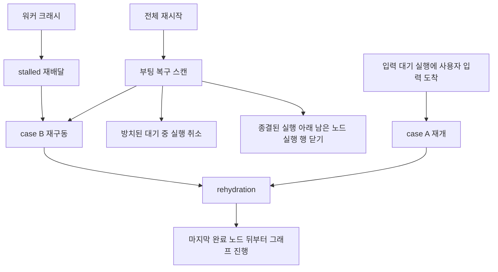

> 구현 상태: 부분 구현 · 원문: `spec/5-system/4-execution-engine.md` (§7.1–§7.5, §11, Rationale), `spec/data-flow/3-execution.md` (§3.3, Rationale) · 용어: [용어 사전](../CLE-GLOSSARY.md)

## 개요

서버 인스턴스가 죽거나 다시 시작되거나 배포로 내려가도 실행(Execution, `execution`)을 잃지 않고 이어 가는 규칙을 정한다. 다루는 것은 네 가지다.

- **재구동(re-drive)**: 실행 중(`running`)이던 세그먼트를 다른 워커가 다시 굴린다. 운영 중 워커 크래시는 stalled 재배달(stalled redelivery)이, 전체 재시작은 부팅 복구 스캔(`recoverStuckExecutions`)이 맡는다.
- **체크포인트와 멱등성**: 무엇을 남겨 두기에 이어 갈 수 있는지, 같은 턴이나 세그먼트가 두 번 돌지 않게 무엇이 막는지.
- **rehydration(`rehydrateContext`)**: DB 에 남긴 내용으로 실행 컨텍스트를 되살리는 단일 경로. 입력 대기 실행의 재개(resume)와 크래시 재구동이 함께 쓴다.
- **안전 종료(graceful shutdown)**: SIGTERM 을 받았을 때의 절차.

범위 밖:

- 시작 큐·재개 큐의 계약, 재개 명령 발행과 사전 검증, ack 에러 표면은 [큐 워커와 동시 실행 제한](CLE-EXEC-WORKER.md) 이 정한다.
- 실행과 노드 실행의 상태 전이, 블로킹·재개 계약, AI 재개 체크포인트(`_resumeCheckpoint`)는 [실행 상태 머신과 대기·재개](CLE-EXEC-STATE.md) 가 정한다.
- park 때 무엇을 커밋하는지(저장 전략)는 [실행 컨텍스트](CLE-EXEC-CONTEXT.md), 노드 실행 순서 로그(`ExecutionNodeLog`) 스키마는 [실행 데이터와 흐름](CLE-EXEC-DATA.md) 에 있다.
- 노드 취소(`abortSignal`)와 사용자 중지의 관측은 [노드 취소](CLE-EXEC-CANCEL.md) 가 정한다.
- Redis 키(`exec:recover:lock` 등)와 DLQ 모니터 설정은 [비동기 큐와 Redis 키 목록](../CLE-PLAT/CLE-PLAT-QUEUE.md) 에 있다.

## 하위 문서

| 문서 | 다루는 것 | 맡는 요구사항 |
| --- | --- | --- |
| [크래시 재구동과 부팅 복구 스캔](CLE-EXEC-RECOVERY-REDRIVE.md) | 운영 중 stalled 재배달, 부팅 복구 스캔의 lock과 네 단계, 작업을 잃은 대기 중 실행 취소, 종결된 실행 아래 남은 노드 실행 행 마감, zombie race, 그 결정 근거 | 없음 |
| [체크포인트와 rehydration](CLE-EXEC-RECOVERY-REHYDRATE.md) | 체크포인트, 재구동 절차, 멱등성 계약, rehydration 두 진입 경우와 재개 절차, 중첩 서브 워크플로우 재개, 재개 진입 원자 claim, rehydration 실패, 재시도 층의 합산, park 즉시 해제(Phase B) 결정 | 없음 |
| [안전 종료와 영속 재개 큐](CLE-EXEC-RECOVERY-SHUTDOWN.md) | SIGTERM 안전 종료 절차와 `SIGTERM_GRACE_MS`, 끊긴 노드를 정책과 상관없이 `failed` 로 끝내는 결정, 영속 재개 큐 채택 · 시간 과소 계산 허용 · DLQ 경고 결정 | 없음 |

이 문서에는 요구사항 줄이 없다.

## 복구 경로 한눈에

| 상황 | 트리거 | 대상 | 처리 | 끝내지 못할 때 |
| --- | --- | --- | --- | --- |
| 운영 중 워커 크래시 | stalled 재배달 | stall 된 세그먼트 작업의 실행(아직 `running`) | 같은 jobId 로 1회 재배달 → case B 재구동 | 재배달 소진: `failed` + `WORKER_HEARTBEAT_TIMEOUT` |
| 전체 재시작, Redis 비영속, 작업 유실 | 부팅 복구 스캔 | `running` 이고 `started_at` 이 30분보다 오래된 실행 | row 단위 원자 re-claim → case B 재구동 | 재구동 불가: `RESUME_CHECKPOINT_MISSING` |
| 작업을 잃은 대기 중 실행 | 같은 부팅 복구 스캔 | `pending` 이고 `queued_at` 이 큐 대기 한도(5분)보다 오래된 실행 | `cancelled` + `EXECUTION_QUEUE_WAIT_TIMEOUT` | 없음 |
| 종결된 실행 아래 남은 노드 실행 행 | 같은 부팅 복구 스캔 | 실행이 종결(`completed` · `failed` · `cancelled`)됐고 `running` 이며 `started_at` 이 30분보다 오래된 노드 실행 행. Background 본문 행과 깊이 한도 안에서 최상위 행에 닿지 못한 행은 뺀다 | 노드 실행 행만 `failed` 로 닫고 실행 상태는 그대로 둔다([종결된 실행 아래 남은 노드 실행 행](CLE-EXEC-RECOVERY-REDRIVE.md#종결된-실행-아래-남은-노드-실행-행)) | 없음 |
| 입력 대기 중 재시작 | 사용자 입력 도착 | 입력 대기 실행 | case A rehydration 재개 | `cancelled` + `RESUME_*` |
| 배포·정상 종료 | SIGTERM | 이 인스턴스의 진행 중 노드 실행 | 유예 시간 동안 완료 대기 | `failed` + `SERVER_INTERRUPTED` |

입력 대기(`waiting_for_input`) 실행은 어느 복구 트리거도 건드리지 않는다. 사용자 입력은 며칠 뒤에 올 수 있다. 입력이 오면 rehydration 으로 재개한다.

그림은 복구 트리거가 rehydration 한 경로로 모이는 모습이다. case A 와 case B 는 도착 입력의 유무만 다르다. 부팅 복구 스캔의 두 정리 단계(방치된 대기 중 실행 취소, 남은 노드 실행 행 닫기)는 rehydration 을 거치지 않는다.

## 크래시 재구동

크래시한 세그먼트는 운영 중 stalled 재배달과 부팅 복구 스캔 두 트리거로 재구동한다. → [크래시 재구동과 부팅 복구 스캔](CLE-EXEC-RECOVERY-REDRIVE.md#크래시-재구동)

### 운영 중 stalled 재배달

→ [크래시 재구동과 부팅 복구 스캔](CLE-EXEC-RECOVERY-REDRIVE.md#운영-중-stalled-재배달)

### heartbeat 채널을 두지 않는다

→ [크래시 재구동과 부팅 복구 스캔](CLE-EXEC-RECOVERY-REDRIVE.md#heartbeat-채널을-두지-않는다)

### 남은 zombie race

→ [크래시 재구동과 부팅 복구 스캔](CLE-EXEC-RECOVERY-REDRIVE.md#남은-zombie-race)

## 부팅 복구 스캔

→ [크래시 재구동과 부팅 복구 스캔](CLE-EXEC-RECOVERY-REDRIVE.md#부팅-복구-스캔)

### 종결된 실행 아래 남은 노드 실행 행

→ [크래시 재구동과 부팅 복구 스캔](CLE-EXEC-RECOVERY-REDRIVE.md#종결된-실행-아래-남은-노드-실행-행)

### 재구동 절차

→ [체크포인트와 rehydration](CLE-EXEC-RECOVERY-REHYDRATE.md#재구동-절차)

## 멱등성 계약

→ [체크포인트와 rehydration](CLE-EXEC-RECOVERY-REHYDRATE.md#멱등성-계약)

### 재개 절차

→ [체크포인트와 rehydration](CLE-EXEC-RECOVERY-REHYDRATE.md#재개-절차)

### 재개 진입 원자 claim

→ [체크포인트와 rehydration](CLE-EXEC-RECOVERY-REHYDRATE.md#재개-진입-원자-claim)

## rehydration 실패

→ [체크포인트와 rehydration](CLE-EXEC-RECOVERY-REHYDRATE.md#rehydration-실패)

### 재시도 층의 합산

→ [체크포인트와 rehydration](CLE-EXEC-RECOVERY-REHYDRATE.md#재시도-층의-합산)

## park 즉시 해제와 rehydration 단일 경로 (Phase B)

→ [체크포인트와 rehydration](CLE-EXEC-RECOVERY-REHYDRATE.md#park-즉시-해제와-rehydration-단일-경로-phase-b)

## 안전 종료

→ [안전 종료와 영속 재개 큐](CLE-EXEC-RECOVERY-SHUTDOWN.md#안전-종료)

## 미결 사항

- **rehydration 실패를 `cancelled` 로 두는 결정의 유지 여부**: 원문 근거 "재실행 UI 가 `cancelled` 상태에서 활성화된다" 는 재실행 문서와 맞지 않아 빠졌다. 남은 근거로 이분 결정을 유지할지는 [실행 상태 머신과 대기·재개](CLE-EXEC-STATE.md#미결-사항) 에서 다룬다.

## Rationale

이 문서는 복구 하위 문서 세 편의 색인이고 결정은 하위 문서에서 내린다. 결정 근거는 각 문서의 Rationale 에 있다.

- [크래시 재구동과 부팅 복구 스캔](CLE-EXEC-RECOVERY-REDRIVE.md#rationale)
- [체크포인트와 rehydration](CLE-EXEC-RECOVERY-REHYDRATE.md#rationale)
- [안전 종료와 영속 재개 큐](CLE-EXEC-RECOVERY-SHUTDOWN.md#rationale)

## 구현 위치

하위 문서마다 맡는 파일을 적는다. 이 주제 전체의 진입 파일은 아래다.

- `codebase/backend/src/modules/execution-engine/execution-engine.service.ts` (`onApplicationBootstrap` 의 부팅 스캔 호출, `rehydrateContext`, `redriveStuckExecution`, `driveCallStackResume`, `finalizeStalledExhausted`)
- 부팅 복구 스캔 · stalled 재배달: [크래시 재구동과 부팅 복구 스캔](CLE-EXEC-RECOVERY-REDRIVE.md#구현-위치)
- 재개 큐 소비자 · 재개 turn 분기 · park 진입 분기 · 호출 스택 frame 확인 · 재개 공용 타입: [체크포인트와 rehydration](CLE-EXEC-RECOVERY-REHYDRATE.md#구현-위치)
- 안전 종료: [안전 종료와 영속 재개 큐](CLE-EXEC-RECOVERY-SHUTDOWN.md#구현-위치)
