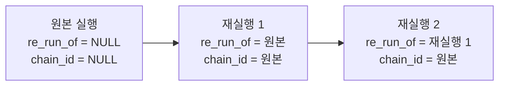

## 개요

이 문서는 [재실행](CLE-EXEC-RERUN.md) 의 하위 문서로 재실행 · 체인 조회 API, 에러 코드, 재실행이 실행 엔티티에 더한 컬럼, 감사 로그, rate limit 을 정한다.

## API

API 는 [HTTP API 규약](../CLE-API/CLE-API-CONV.md) 의 응답 봉투와 [에러 응답과 클라이언트 처리](../CLE-API/CLE-API-ERROR.md) 의 에러 모양을 따른다.

### POST /api/executions/:executionId/re-run

원본 실행을 바탕으로 새 실행을 시작한다.

**경로 파라미터**: `executionId`(UUID, 필수). 재실행할 원본 실행 ID. 같은 체인의 어느 실행이어도 된다(그 실행이 직계 부모가 된다).

**원본 실행 상태**: 재실행할 수 있는 원본 실행의 상태(`status`)를 제한하지 않는다. 현재 구현(`executions.service.ts` 의 `reRun`)도 원본 상태를 검사하지 않는다. 화면에서 재실행 버튼을 어느 상태에서 보일지는 진입점 문서가 정한다([진입점](CLE-EXEC-RERUN-UI.md#진입점)).

**요청 본문**

```typescript
{
  // 원본 입력을 그대로 쓸지(true), inputOverride 를 쓸지(false). 기본 true
  useOriginalInput?: boolean;

  // useOriginalInput=false 일 때 쓸 입력. 수동 트리거 parameters 스키마와 호환.
  // resolveTriggerParameters 와 같은 검증을 거친다
  inputOverride?: Record<string, unknown>;

  // dry-run 으로 실행할지. 기본 false
  dryRun?: boolean;
}
```

화면은 토글 상태로 `useOriginalInput` 을 **늘 명시해서 보낸다.** 그래서 API 기본값 `true` 는 필드를 빼고 API 를 직접 부르는 호출자를 위한 안전한 기본값일 뿐이고 UI 기본값(꺼짐, `false`)과 모순되지 않는다.

**응답 201 Created**: 새로 만든 실행을 [실행 내역](CLE-EXEC-HISTORY.md) 의 실행 상세 응답 모양 그대로 돌려준다. 기본 실행 응답 필드 가운데 다음 세 필드가 재실행 정보를 담는다.

```typescript
{
  ...Execution,           // 기본 실행 응답
  reRunOf: string;        // 직계 부모 실행 ID. 재실행 직후의 행이라 null 이 아니다
  chainId: string;        // 체인 루트 실행 ID. 재실행 직후의 행이라 null 이 아니다
  dryRun: boolean;        // 이 실행이 dry-run 인지
}
```

기본 실행 응답에서 `reRunOf` · `chainId` 의 타입은 `string | null` 이다. 재실행 응답은 방금 만든 재실행 행이라 두 필드에 늘 값이 있다.

**에러 코드**

| HTTP | code | 뜻 |
| --- | --- | --- |
| 401 | `AUTH_REQUIRED` | 인증 토큰이 없거나 만료됨 |
| 403 | `NOT_A_MEMBER` | RR-PL-06 첫 조건. 워크스페이스 멤버가 아님(`RolesGuard`) |
| 403 | `EDITOR_REQUIRED` | RR-PL-06 첫 조건. 뷰어(`RolesGuard`, 라우트가 `@Roles('editor')`) |
| 403 | `RERUN_PERMISSION_DENIED` | RR-PL-06 둘째 조건. 다른 사용자가 시작한 실행이고 소유자·관리자가 아님(서비스) |
| 404 | `RERUN_EXECUTION_NOT_FOUND` | `executionId` 가 없거나 다른 워크스페이스의 실행 |
| 404 | `RERUN_WORKFLOW_DELETED` | 원본 실행의 워크플로우가 삭제됨(재실행의 전제인 현재 워크플로우 정의가 없다). 방어용이다. 데이터 모델에서 `Execution.workflow_id` 는 워크플로우 삭제 시 CASCADE 라([실행 데이터와 흐름 §삭제와 보존](CLE-EXEC-DATA.md#삭제와-보존)) 원본 실행도 함께 지워진다. 그래서 정상 경로에서는 `RERUN_EXECUTION_NOT_FOUND` 가 먼저 나고 이 코드에는 도달하지 않는다 |
| 409 | `RERUN_CHAIN_DEPTH_EXCEEDED` | RR-PL-05 체인 깊이 32 초과 |
| 400 | `RERUN_DRY_RUN_NOT_APPLICABLE` | dry-run 요청인데 워크플로우나 그 워크플로우가 부르는 서브 워크플로우에 `supportsDryRun: false` 노드가 있음 |
| 400 | `INVALID_TRIGGER_PARAMETERS` | `inputOverride` 가 수동 트리거 parameters 스키마와 맞지 않음(`resolveTriggerParameters` 가 던지는 것과 같은 에러), **또는 마스킹된 값을 그대로 다시 보냄**([마스킹된 입력 처리](CLE-EXEC-RERUN-UI.md#마스킹된-입력-처리)). 필드별 사유는 `error.details[]` 에 싣고 항목 코드는 [에러 코드 규약과 카탈로그](../CLE-API/CLE-API-ERRCODES.md) 의 카탈로그를 따른다(`MISSING_REQUIRED_FIELD`, `TYPE_COERCION_FAILED`, `INVALID_SCHEMA`, `MASKED_VALUE_RESUBMITTED`) |

`INVALID_TRIGGER_PARAMETERS` 만 `RERUN_` 접두가 없는 이유는 [Rationale](#invalid_trigger_parameters-만-rerun_-접두가-없다) 에 있다.

### GET /api/executions/:executionId/chain

같은 체인의 모든 실행을 시간순으로 돌려준다. 실행 상세 화면의 체인 배지가 쓴다.

**응답 200**: `{ data: Execution[] }`. 배열을 `data` 로 감싸는 모양은 [OpenAPI 문서화](../CLE-API/CLE-API-SWAGGER.md#5-2-공용-래퍼-헬퍼) 의 배열 응답 헬퍼(`ApiOkWrappedArrayResponse`)를 따른다. `data` 는 체인의 모든 행을 `started_at ASC` 로 정렬한 배열이다. 항목은 위 재실행 응답과 같은 필드를 담고 `nodeExecutions` 는 뺀다. 다만 체인 루트(원본) 실행도 항목에 들어가므로 `reRunOf` · `chainId` 는 null 일 수 있다. 항목은 실행 상세 응답과 같은 마스킹 관문(`toResponseExecution`)을 거친다.

```typescript
{
  data: Array<{
    ...Execution,              // 기본 실행 응답(nodeExecutions 제외)
    reRunOf: string | null;    // 직계 부모 실행 ID. 체인 루트(원본)면 null
    chainId: string | null;    // 체인 루트 실행 ID. 체인 루트(원본)면 null
    dryRun: boolean;           // 이 실행이 dry-run 인지
  }>;
}
```

**권한**: 워크스페이스 멤버(실행 상세 조회와 같다). 멤버의 역할과 원본 실행의 시작자는 보지 않는다. RR-PL-06 은 이 라우트에 적용하지 않는다([체인 조회 권한](CLE-EXEC-RERUN-POLICY.md#체인-조회-권한)).

**에러 코드**

| HTTP | code | 뜻 |
| --- | --- | --- |
| 401 | `AUTH_REQUIRED` | 인증 토큰이 없거나 만료됨 |
| 403 | `NOT_A_MEMBER` | 헤더로 지정한 워크스페이스의 멤버가 아님(`RolesGuard`. 이 라우트는 `@Roles()` 없이 `@WorkspaceId()` 만 쓴다) |
| 404 | `RERUN_EXECUTION_NOT_FOUND` | `executionId` 가 없거나 다른 워크스페이스의 실행 |

## 데이터 모델

실행 엔티티 전체 컬럼은 [실행 데이터와 흐름](CLE-EXEC-DATA.md) 이 정한다. 이 절은 재실행이 더한 컬럼의 뜻과 불변식을 정한다.

### 체인 컬럼

| 컬럼 | 타입 | NULL | 설명 |
| --- | --- | --- | --- |
| `re_run_of` | `UUID` | NULL | 직계 부모 실행. NULL 이면 이 실행이 체인의 시작(원본)이다. `REFERENCES execution(id) ON DELETE SET NULL` |
| `chain_id` | `UUID` | NULL | 체인 루트 실행 ID. **v1 은 재실행으로 만든 행에만 채운다.** 일반 실행(원본·서브 워크플로우·Background)은 NULL 이다. 체인 루트 ID 는 체인 맨 위(원본) 실행의 ID 다 |

**인덱스**

- `(re_run_of)`: 직계 부모 조회(체인 배지의 직계 부모 표시)
- `(chain_id, started_at)`: 체인 전체 조회(`/chain` 엔드포인트가 자주 쓴다)

**불변식**

- 체인 루트는 `re_run_of = NULL` 인 맨 위 원본 실행이다. 체인 전체 조회는 `id = rootId OR chain_id = rootId` 다(`rootId = exec.chain_id ?? exec.id`).
- 재실행 행의 `chain_id` 는 같은 체인 루트를 가리킨다. 다른 체인으로 넘어가는 재실행은 없다(애플리케이션 수준).
- 체인 깊이 32 제한은 **애플리케이션 수준**에서 지킨다(`computeChainDepth`). `re_run_of` 를 루트까지 따라가며 깊이를 세는 재귀 CTE 단일 쿼리이고 순환을 막는 탐색 상한이 있다.



원본을 재실행하면 재실행 1 이 생기고 재실행 1 을 다시 재실행하면 재실행 2 가 생긴다. 두 재실행 모두 `chain_id` 로 원본을 가리키고 `re_run_of` 로 바로 앞 실행을 가리킨다.

마이그레이션 `codebase/backend/migrations/V067__execution_re_run_chain.sql` 이 이 컬럼과 인덱스를 만든다.

### dry-run 표시

- **노드 실행**: dry-run 으로 실행된 노드 실행은 `outputData.output._dryRun === true` 로 알아본다. 모의 객체가 노드 출력의 `output` 값이기 때문이다. 화면은 이 키로 배지를 단다. 화면의 판정(`result-detail.tsx` 의 `isDryRunOutput`)은 최상위 `_dryRun` 도 보지만 모의 객체가 실리는 곳은 `output` 이다.
- **실행**: 실행 행에는 `dry_run: boolean` 컬럼이 있다(V068, `NOT NULL DEFAULT false`). dry-run 실행이 시작한 비동기 서브 워크플로우의 자식 실행 행에도 true 가 남는다.

두 표시는 역할이 다르다. 노드 실행의 `_dryRun` 은 결과 표시용이고 실행의 `dry_run` 은 실행 제어용(엔진 주입과 복원)이다. 다만 **실행 상세 화면 배지**는 `Execution.dry_run` 을 표시 목적으로도 쓴다(제어와 표시를 겸한다). 에디터 드로어는 노드 표시만 쓴다([결과 표시](CLE-EXEC-RERUN-DRYRUN.md#결과-표시)). 구현과 테스트는 `result-detail.tsx`, `execution-detail-waiting.test.tsx` 에 있다.

## 감사 로그

`audit_log` 테이블에 재실행 이벤트 `execution.re_run` 을 남긴다. `audit_log.action` 은 enum 제약이 없는 `varchar(100)` 이라 DB 마이그레이션 없이 새 action 문자열을 더할 수 있다. 다만 애플리케이션에서는 `AuditAction` union(`audit-logs/audit-action.const.ts` 의 `AUDIT_ACTIONS`)에 더해야 한다. action 이름 규칙(`<resource>.<verb>`, resource 접두 필수)은 [감사 action 명명](../CLE-OBS/CLE-OBS-AUDITNAME.md) 이 정한다.

아래는 논리 필드와 실제 `audit_log` 컬럼의 대응이다(entity: `AuditLogsService.record`).

| 논리 필드 | 실제 컬럼 | 값 |
| --- | --- | --- |
| `event_type` | `action` | `execution.re_run` |
| `actor_user_id` | `user_id` | 호출자 사용자 ID |
| `target_type` | `resource_type` | `execution` |
| `target_id` | `resource_id` | **새로 만든** 실행 ID |
| `metadata` | `details`(jsonb) | `{ "originalExecutionId": "<UUID>", "chainId": "<UUID>", "dryRun": boolean, "inputModified": boolean }` |
| 워크스페이스 격리 | `workspace_id` | 재실행 요청의 워크스페이스 ID |

`inputModified` 는 `useOriginalInput === false` 이고 해석한 입력이 원본 `inputData.parameters` 와 다를 때 `true` 다. 큰 입력은 details 에 저장하지 않고 바뀌었는지만 boolean 으로 남긴다. 감사 로그 기록 실패는 `AuditLogsService.record` 안에서 삼켜 재실행 주 동작을 깨지 않는다. 감사 로그 표준 스키마는 [감사 로그](../CLE-OBS/CLE-OBS-AUDIT.md) 가 정한다.

## rate limit

한도의 단일 기준은 [HTTP API 규약](../CLE-API/CLE-API-CONV.md#7-요청-빈도-제한) §7 표다. 한도를 넘으면 §7 의 공통 정책대로 429 기본 코드 `RATE_LIMITED` 로 거부한다. 현재 구현은 라우트의 `@Throttle` 이고 사용자 단위로 센다.

## 구현 위치

- `codebase/backend/src/modules/executions/executions.controller.ts` (`POST :id/re-run`, `GET :id/chain` 의 getChain. 체인 조회 라우트는 `@Roles` 없이 멤버 전원이 조회한다)
- `codebase/backend/src/modules/executions/executions.service.ts` (reRun 과 재실행 권한, getChain, `computeChainDepth`, `assertDryRunSupported`)
- `codebase/backend/src/modules/executions/dto/re-run.dto.ts`
- `codebase/backend/migrations/V067__execution_re_run_chain.sql`
- `codebase/backend/migrations/V068__execution_dry_run.sql`

## Rationale

### 왜 E3(`re_run_of` 와 `chain_id` 둘 다)인가

E1(`re_run_of` 만)은 직계 부모 조회는 빠르지만 체인 전체 조회에 재귀 CTE 가 필요해 느려진다(깊이 32 까지 가능). E2(`chain_id` 만)는 체인 전체 조회는 빠르지만 직계 부모를 알려면 같은 체인의 모든 행을 정렬해야 한다. E3 는 컬럼 하나(`chain_id`)와 인덱스 하나(`(chain_id, started_at)`)를 더하는 비용으로 두 조회를 모두 빠르게 한다. 체인 배지가 직계 부모와 체인 안 위치를 함께 보여 주는 UX 에 잘 맞는다.

### `chain_id` 는 NULLABLE 이다 (2026-05-31, 결정 F2)

초기 설계는 `chain_id NOT NULL` 에 원본이 자기를 가리키는(`chain_id = id`) 모델이었다. 그런데 실행 행은 서브 워크플로우·Background·재시도 등 **여러 경로**에서 INSERT 된다. 모든 경로에 `chain_id` 채우기를 강제하면 핵심 실행 경로가 회귀할 위험이 크다. 그래서 v1 은 `chain_id` 를 NULLABLE 로 두고 재실행 행만 채운다(일반 실행 NULL, 체인 루트는 원본 ID). 백필은 필요 없다. NOT NULL·자기 체인으로 강화하는 것은 모든 생성 경로를 정리한 뒤 v2 에서 검토한다.

### 실행에 `dry_run` 컬럼을 둔다

초안에서는 이 컬럼을 v2 이후로 미뤘다. dry-run 을 게이트가 아니라 완전한 구현으로 채택하면서 두 제약 때문에 v1 컬럼으로 정했다.

- 엔진은 **첫 노드 실행 전** `createContext` 때 `variables.__dryRun` 을 넣어야 한다. 이 값은 노드 실행이 하나도 없을 때 정해져야 하므로 노드 실행의 `_dryRun` 으로는 알 수 없다. 실행 단위 플래그가 먼저 있어야 한다.
- 입력 대기 뒤 **rehydration** 경로에서도 같은 dry-run 모드를 복원해야 하므로 메모리 플래그가 아니라 **영속 컬럼**이어야 한다.

### 체인 깊이 32

운영 쓰임을 보면 디버그 때 같은 입력으로 5~10번 반복하는 경우는 흔하지만 32번을 넘는 경우는 거의 없다. 보통 사용자는 입력을 바꾸거나 워크플로우를 고치러 떠난다. 32 는 "안전한 방어 한도" 이고 그 이상은 무한 루프나 잘못된 자동화 스크립트일 가능성이 높아 거부하는 것이 사용자를 지키는 길이다. 운영 뒤 한도를 조정할 수 있다.

### `INVALID_TRIGGER_PARAMETERS` 만 `RERUN_` 접두가 없다

형제 코드(권한, 체인 깊이, 워크플로우 삭제, dry-run 부적용 등)는 재실행 **고유** 실패라 경로 이름을 붙였다. 이 코드는 반대로 수동 실행(`POST /workflows/:id/execute`)·저장(`POST /workflows/:id/save`) 경로와 **같은 검증 실패를 같은 코드로 내기 위한** 것이다. 경로별 접두를 붙이면 통일이 의미 없어진다. 2026-08-22 이전에는 이 자리가 `INVALID_INPUT` 이었다. 이름 변경 이력은 [에러 코드 규약과 카탈로그](../CLE-API/CLE-API-ERRCODES.md) 에 있다.
