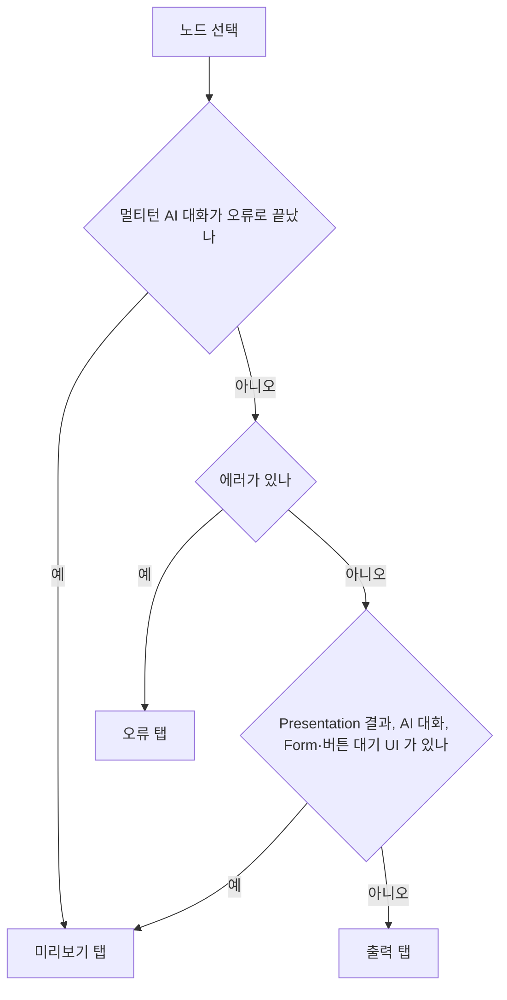

## 개요

이 문서는 [에디터 실행과 디버깅](CLE-EXEC-RUN.md) 의 하위 문서로 실행 결과 드로어(Run Results drawer)의 원칙·레이아웃·헤더·실행 트리·결과 상세 탭·라이프사이클·단축키를 정한다. 실행 내역 화면의 실행 상세도 같은 결과 상세 탭을 쓴다. 드로어를 채우는 실시간 수신과 REST 폴링 대체 경로는 [에디터 실행과 디버깅 — 실시간 수신·내역·Background](CLE-EXEC-RUN-SYNC.md) 가 정한다.

## 실행 결과 드로어

실행 결과 드로어는 워크플로우를 실행하면 **모든 노드**의 실행 상태와 결과를 실시간으로 보여 주는 하단 패널이다.

### 원칙

- 드로어는 에디터 아래쪽에 펼쳐지는 2단 패널이다. 왼쪽 실행 트리(Run Tree)에 실행된 노드가 순서대로 쌓이고 오른쪽 결과 상세 탭(`ResultDetail`)에 고른 노드의 결과가 표시된다.
- 실행된 모든 노드가 실행 트리에 표시된다. Trigger·Logic·Data·AI·Integration·Presentation 이 모두 포함된다.
- 실행을 멈추는 노드는 블로킹 노드뿐이다. Form 노드, 버튼이 설정된 Presentation 노드, 멀티턴 AI 노드가 입력 대기에 들어간다. 나머지 노드는 실행을 멈추지 않는다. 멈추는 조건은 [실행 상태 머신과 대기·재개](CLE-EXEC-STATE.md) 가 정한다.
- Presentation 노드는 전용 렌더러(테이블·차트 등)로, 나머지 노드는 JSON 뷰어로 표시한다.

### 레이아웃

| 영역 | 위치 | 들어가는 요소 | 동작 |
| --- | --- | --- | --- |
| 드래그 핸들 | 맨 위 | 핸들 | 끌어서 높이를 바꾼다. 높이는 localStorage 에 저장한다 |
| 머리 | 위 | 상태 아이콘, 상태 라벨, 노드 카운터, 재실행 버튼, 최소화 `[−]`, 닫기 `[✕]` | [헤더](#헤더) 참조 |
| 실행 트리 | 왼쪽 | 노드 항목 목록 | 폭 280–640px, 기본 400px. 폭도 localStorage 에 저장한다 |
| 결과 상세 | 오른쪽 | 선택한 노드의 탭과 내용 | 남은 폭을 모두 쓴다 |

| 속성 | 값 |
| --- | --- |
| 기본 높이 | 420px |
| 최소 높이 | 240px |
| 최대 높이 | 뷰포트의 60% |
| 위치 | 캔버스 영역 아래, 전체 폭 |
| 접힌 상태 | 36px 높이 바. 상태 아이콘, 라벨, 노드 카운터만 남는다 |
| 쌓임 순서 | 캔버스 위, 모달·대화상자 아래 |

### 헤더

| 요소 | 설명 |
| --- | --- |
| 상태 아이콘 | 🔄 Running, ✅ Completed, ❌ Failed, ⏸ Waiting |
| 상태 라벨 | "Running...", "Completed", "Failed", "Waiting for input..." |
| 노드 카운터 | `N/M nodes`. 완료 수와 전체 수다. 실패 노드가 있으면 `(N failed)` 를 붙인다 |
| 최소화 `[−]` | 드로어를 접힌 상태로 줄인다 |
| 닫기 `[✕]` | 드로어를 완전히 숨기고 실행 상태를 초기화한다 |

상태 바 예시는 다음과 같다.

| 상태 | 표시 |
| --- | --- |
| 실행 중 | `🔄 Running...   3/10 nodes   [−] [✕]` |
| 완료 | `✅ Completed    10/10 nodes   [−] [✕]` |
| 입력 대기 | `⏸ Waiting for input...   5/10 nodes   [−] [✕]` |
| 실패 | `❌ Failed       5/10 nodes (1 failed)   [−] [✕]` |

### 실행 트리

실행 트리는 실행된 노드를 시간순으로 나열하는 좁은 목록이다.

| 요소 | 설명 |
| --- | --- |
| 카테고리 색 점 | Trigger 🟡, Logic 🔵, Flow 🟣, AI 🟢, Integration 🟠, Data 🔵, Presentation 🩷 |
| 노드 라벨 | 사용자가 붙인 라벨 또는 노드 유형 이름. 길면 자른다 |
| 상태 아이콘 | ⏳ Running(스피너), ✅ Completed, ❌ Failed, ⏸ Waiting, — Skipped |
| 실행 시간 | 예: "142ms", "1.2s" |
| 클릭 | 그 노드를 결과 상세에 표시한다 |

새 항목이 추가되면 자동으로 아래로 스크롤한다. 첫 노드가 자동으로 선택된다. 블로킹 노드가 입력 대기에 들어가면 그 노드가 자동으로 선택된다.

**컨테이너 본문 노드의 반복 표시**: Loop·ForEach·Map 같은 컨테이너의 본문 노드는 한 실행 안에서 여러 반복 회차에 걸쳐 실행된다. 반복 회차마다 **실행 트리 항목이 따로** 생긴다.

- 같은 노드가 여러 번 나오면 라벨에 `(iter N)` 이 자동으로 붙는다. 예: `Transform (iter 1)`, `Transform (iter 2)`.
- 항목 하나는 노드 실행(`NodeExecution`) 행 하나에 대응하고 `nodeExecutionId` 로 구분한다.
- 항목마다 입력·출력을 따로 볼 수 있다. 특정 회차의 실패 원인을 찾을 때 쓴다.
- 한 번만 실행된 노드에는 접미사가 붙지 않는다.
- 컨테이너 안 Presentation 노드의 표시는 정의가 갈린다. [미결 사항](CLE-EXEC-RUN.md#미결-사항) 참조.

노드 이벤트(`execution.node.started`·`completed`·`skipped`·`failed`·`cancelled`)와 `execution.waiting_for_input` 에는 `nodeExecutionId` 가 실려 있어 에디터가 회차를 구분한다. REST 폴링도 `nodeExecution.id` 로 합쳐지므로 같은 회차가 두 번 생기지 않는다. 필드 정의는 [WebSocket 이벤트와 명령](../CLE-API/CLE-API-WS-EVENTS.md) 이 정한다.

**AI 멀티턴 노드**: AI 에이전트 멀티턴 노드는 접고 펼 수 있는(►/▼) 트리 항목으로 표시된다. 펼치면 대화 턴이 미리보기 카드로 들어간다.

| 항목 | 아이콘 | 미리보기 | 배지 |
| --- | --- | --- | --- |
| AI 에이전트 부모(접힘) | ► 🤖 | 노드 라벨 | `Turn N/M` 과 상태 |
| AI 에이전트 부모(펼침) | ▼ 🤖 | 노드 라벨 | `Turn N/M` 과 상태 |
| 사용자 메시지 | 👤 | 메시지 앞 두 줄 | 없음 |
| AI 응답 | 🤖 | 응답 앞 두 줄 | `📚 N`, `🔧 N` (있을 때만) |
| 도구 호출 | 🔧 | 도구 이름 | 🔄 pending, ✓ success, ✗ error |
| 시스템 에러(`system_error`) | ❌ | `<code>`(예: `LLM_RATE_LIMIT`)와 메시지 첫 줄 | retryable 이면 `[다시 시도]`, 아니면 없음 |

대화가 진행 중일 때(Live)는 자동으로 펼치고 새 메시지가 오면 자동으로 스크롤한다. 대화가 끝난 뒤(History)에는 접힌 상태가 기본이고 눌러서 편다. 항목별 시각 규칙과 도구 호출 묶음은 [대화 미리보기](CLE-EXEC-PREVIEW.md) 가 정한다.

### 결과 상세 탭

결과 상세의 머리에는 카테고리 색 점, 노드 라벨, 노드 유형 이름, 상태 배지, 실행 시간이 표시된다.

completed·failed·cancelled·waiting_for_input 상태 노드는 머리 아래에 탭 바를 표시한다. `cancelled` 노드는 `failed` 와 같은 입력·출력·오류 탭 배치를 쓰고 오류 탭에 취소(`AbortError`) 내용을 표시한다. AI 에이전트·정보 추출기·텍스트 분류기 같은 AI 노드도 같은 탭 UI 를 쓴다. 대화형 노드는 미리보기 탭 안에 대화 미리보기를 렌더한다.

탭 구성은 선택 대상에 따라 세 가지다.

| 선택 대상 | 탭 바 |
| --- | --- |
| 일반 노드 | `[미리보기]  입력  출력  설정` |
| AI 노드(노드 수준, 메시지 미선택) | `[미리보기]  입력  출력  LLM 사용량  설정` |
| 멀티턴 AI 노드에서 assistant 메시지 선택 | `[미리보기]  응답  요청  LLM 사용량` |

| 탭 | 표시 조건 | 내용 |
| --- | --- | --- |
| 미리보기(Preview) | Presentation 노드이고 `outputData` 가 있을 때, AI 대화형 노드일 때, Form·버튼 대기 UI 가 있을 때. **AI 대화형 노드는 `status` 로 가르지 않는다.** 대화 데이터(`outputData` 의 대화 형태 또는 live store 스냅샷)가 있으면 오류로 끝난(`failed`) 노드에서도 표시한다 ([대화 미리보기](CLE-EXEC-PREVIEW.md) Inv-8) | 시각 미리보기. 테이블·캐러셀·차트, 폼·버튼 대기 UI, 대화 미리보기. 출력 JSON 은 출력 탭에서 본다 |
| 입력(Input) | 노드 수준에서 항상 | 노드에 전달된 `inputData` JSON. 노드 이벤트나 (폴링 대체 경로 중에는) REST 응답으로 받기 전에는 "Loading..." |
| 출력(Output) | 노드 수준에서 항상 | 노드의 `outputData` JSON. AI 노드는 위에 메타데이터 표를 더한다(아래 「AI 노드의 출력 탭」) |
| 응답(Response) | AI 노드에서 assistant 메시지를 골랐을 때 | 그 턴 LLM 호출의 `responsePayload` JSON. 한 턴에 호출이 여러 개(도구 루프·재시도)면 위쪽 호출 선택기로 고른다 |
| 요청(Request) | AI 노드에서 assistant 메시지를 골랐을 때 | 그 턴 LLM 호출의 `requestPayload` JSON. 응답 탭과 호출 선택기를 같이 쓴다 |
| LLM 사용량(LLM Usage) | AI 노드 | 노드 수준은 노드 전체 합계(Model, Total·Request·Response·Thinking Tokens, Turn Count, Tool Calls, LLM Calls). 메시지 수준은 고른 호출의 토큰·지연 시간 |
| 설정(Config) | 노드 수준에서 항상 | 핸들러가 싣는 설정 에코(`config`). 새 출력 형태를 쓰는 노드만 있다. 지원하지 않는 노드는 안내 문구 |
| 참조(References) | AI 노드에서 지식 저장소 검색을 시도했을 때(노드 수준, 또는 assistant 메시지를 고르면 그 턴) | 턴별로 쓰인 지식 저장소 청크 |
| 메타(Meta) | 노드 출력에 실행 메트릭 `meta`(durationMs·statusCode·토큰 등)가 있을 때(노드 수준) | 실행 메트릭 표 |
| 포트(Port) | 노드 출력에 `port` 값이 있을 때(노드 수준) | 엔진이 고른 출력 포트 |
| 상태(Status) | 노드 출력에 흐름 지시 상태 `status` 가 있을 때(노드 수준) | 흐름 지시 상태 값 |
| 오류(Error) | 에러가 있을 때만(노드 수준) | 에러 정보 JSON |

**기본 탭 고르기**: 실행 트리에서 노드를 누르면 다음 순서로 기본 탭을 고른다.

예외가 하나 있다. 멀티턴 AI 노드가 대화 출력(`output.result.messages`)을 남기고 **오류로 끝났으면**(`output.error` 가 채워짐, retryable 여부와 상관없음) 미리보기 탭이 먼저다. 근거는 [Rationale](#rationale) 에 있다.

이 예외는 `execution.node.failed` 로 판정한다. 엔진은 멀티턴 AI 노드의 턴 오류를 예외 없이 `finalizeAiNode(finalStatus: 'FAILED')` 로 FAILED 처리하므로([AI 에이전트 노드 출력과 디버그](../CLE-NODE-AI/CLE-NODE-AGENT-OUTPUT.md)) 실제로 오는 경로는 `execution.node.failed` 뿐이다. 핸들러 출력의 `port: 'error'`·`status: 'ended'` 만으로는 `node.completed` 가 발생하지 않는다. 그래서 `port: 'error'` 를 기본 탭 판정 조건으로 쓰지 않는다.

단일 턴 AI 에이전트의 LLM 호출 실패는 이 예외에 들지 않고 오류 탭이 기본 탭이다. 단일 턴 출력에는 대화 기록(`output.result.messages`)이 없고 대화 스레드에 `system_error` 항목도 생기지 않는다. 엔진은 `error` 포트로 돌려준 이 실패도 노드 실행을 `failed` 로 마감하므로 오류 탭에 에러가 표시된다.

**AI 노드의 출력 탭**: AI 노드(AI 에이전트, 정보 추출기, 텍스트 분류기)의 출력 탭은 JSON 위에 다음 요소를 더 표시한다.

- **AI 메타데이터 표**: Model, Total·Request·Response·Thinking Tokens, Turn Count(멀티턴), Tool Calls(AI 에이전트).
- **추출 필드 카드**(정보 추출기 전용): 수집한 필드를 라벨-값 표로 보여 준다. 아직 수집하지 않은 필드는 흐린 "—" 로 자리만 둔다. 입력 대기 중에는 재수집 횟수(`재수집 n/m`)도 위에 표시한다.

**LLM 사용량·응답·요청 탭**: AI 노드에서만 나오는 최상위 탭이다.

- 노드 수준(메시지 미선택)에서는 LLM 사용량 탭 하나만 나온다. 노드 전체 합계를 보여 준다. 백엔드 핸들러가 호출별 기록(`_llmCalls` 또는 `_turnDebugHistory`)을 저장하지 않은 실행(옛 기록 포함)은 "정보 없음" 자리 표시를 보여 준다.
- 메시지 수준(AI 에이전트·정보 추출기 멀티턴에서 assistant 메시지 선택)에서는 응답(`responsePayload` 전체 JSON), 요청(`requestPayload` 전체 JSON, model·messages·tools·responseFormat 등), LLM 사용량(고른 호출의 Model, Input·Output·Total·Thinking Tokens, Latency)이 나온다.
- **호출 선택기**: 같은 턴에 LLM 호출이 2개 이상일 때(도구 호출 루프, 정보 추출기 재수집 반복) 각 탭 위에 드롭다운이 나온다. 호출이 하나뿐이면 숨긴다.

**탭 자동 전환**: 사용자가 고른 탭이 선택 변경으로 사라지면(예: 노드 수준에서 메시지 수준으로 바뀌어 입력·출력·설정이 사라질 때) 미리보기 탭이나 남은 첫 탭으로 자동으로 바꾼다. 호출 선택기의 선택은 응답·요청·LLM 사용량 탭 사이를 오가도 유지된다.

**입력 대기 노드의 탭**:

- Form 입력 대기: 미리보기 탭에 인터랙티브 폼 UI. 입력·출력 탭도 열 수 있다.
- 버튼 대기: 미리보기 탭에 렌더된 콘텐츠와 버튼 바. 입력·출력 탭도 열 수 있다.
- AI 멀티턴 대기: 미리보기 탭에 대화 미리보기(메시지 입력 포함). 다른 탭은 일반 AI 노드와 같다.
- 기본 탭은 미리보기다. 인터랙티브 콘텐츠가 있기 때문이다.

**탭이 없는 경우**: running·pending 상태의 비대화형 노드는 탭 없이 평면 배치로 표시한다.

**입력 데이터 흐름**:

- `execution.node.completed` 이벤트는 `input` 필드에 `NodeExecution.inputData` 를 싣는다. 값 패턴 마스킹이 적용된다([응답 자격 증명 마스킹](../CLE-API/CLE-API-EGRESS.md)).
- REST 폴링(2초 간격)도 **같은 store 자리**를 채운다. 에디터에서는 이 폴링이 실시간 경로가 막혔을 때만 켜지는 대체 경로다. 켜고 끄는 조건은 [노드 결과 수집](CLE-EXEC-RUN-SYNC.md#노드-결과-수집) 에 있다. 두 경로의 마스킹 정책이 다르면 폴링이 마스킹된 값을 원문으로 덮는 flip-flop 이 생긴다. 지금은 REST 와 WebSocket 이 같은 규칙을 써서 그런 일이 없다.
- 늦게 오는 WebSocket 이벤트가 이미 받은 값을 지우지 않도록 합칠 때 `??` 로 기존 값을 보존한다.

#### Presentation 노드 콘텐츠

| 노드 유형 | 렌더 |
| --- | --- |
| Carousel | 가로 스크롤 텍스트 중심 카드 목록. 제목·설명·버튼 라벨, `layout` 배지, lazy 썸네일(이미지 매핑 확인용). 시각 레이아웃 재구성은 대화형 채널이 맡는다([Presentation 노드 공통](../CLE-NODE-PRES/CLE-NODE-PRES-COMMON.md)) |
| Carousel(버튼 대기 중) | 카드 목록과 **버튼 바**. port 버튼을 누르면 `execution.click_button` 명령을 보내고 link 버튼을 누르면 새 탭에서 URL 을 연다. link 버튼만 있으면 암시적 `[Continue →]` 를 표시한다. 입력 대기에는 기한이 없어 남은 시간 카운트다운을 표시하지 않는다([Presentation 노드 공통](../CLE-NODE-PRES/CLE-NODE-PRES-COMMON.md#규칙)) |
| Carousel(버튼 클릭 후) | 누른 버튼 라벨, 누른 시각과 누른 사람 |
| Table | 테이블. 컬럼 헤더와 행 데이터. 최대 표시 행 수는 정의가 갈린다. [미결 사항](CLE-EXEC-RUN.md#미결-사항) 참조 |
| Table(버튼 대기 중·클릭 후) | Carousel 과 같은 버튼 바 동작과 클릭 후 표시 |
| Chart | `output.data` 와 `config`(차트 유형·제목)로 화면에서 차트를 다시 그린다. 렌더 규칙은 [Chart 노드](../CLE-NODE-PRES/CLE-NODE-CHART.md) 가 정한다 |
| Chart(버튼 대기 중·클릭 후) | Carousel 과 같은 버튼 바 동작과 클릭 후 표시 |
| Template | `outputFormat` 에 따라 HTML 로 렌더하거나 텍스트 코드 블록으로 표시한다 |
| Template(버튼 대기 중·클릭 후) | Carousel 과 같은 버튼 바 동작과 클릭 후 표시 |
| Form(대기 중) | **인터랙티브 폼 UI**. 제목, 설명, 동적으로 만든 필드 목록, 제출 버튼. 제출하면 `execution.submit_form` 명령을 보낸다 |
| Form(제출 후) | 제출된 데이터를 키-값으로 표시 |

노드별 데이터 필드와 버튼 동작의 기준은 [Presentation 노드 공통](../CLE-NODE-PRES/CLE-NODE-PRES-COMMON.md) 이다.

#### AI 멀티턴 콘텐츠

실행 트리에서 대화 항목을 누르면 결과 상세의 탭 구성과 내용이 선택 대상에 따라 바뀐다.

| 누른 대상 | 탭 구성 | 표시 내용 |
| --- | --- | --- |
| AI 에이전트 부모 노드(메시지 미선택) | 미리보기·입력·출력·LLM 사용량·설정·(오류) | 미리보기에 대화 미리보기. 출력은 요약(Model, Turns, Tokens, Tool Calls, End Reason)과 최종 응답. LLM 사용량은 노드 전체 토큰·호출 수 |
| 사용자 메시지 | 미리보기만 | 대화 미리보기에서 그 메시지를 강조하고 전체 텍스트를 표시 |
| AI 응답(assistant) | 미리보기·응답·요청·LLM 사용량 | 미리보기는 응답 텍스트. 응답·요청은 그 턴 LLM 호출 페이로드 JSON. LLM 사용량은 그 호출의 토큰·지연 시간. 한 턴에 호출이 여럿이면 위쪽 호출 선택기로 바꾼다 |
| 도구 호출 | 미리보기만 | 대화 미리보기에 도구 이름, Arguments JSON, Result JSON |

대화가 진행 중일 때는 결과 상세 아래쪽에 메시지 입력 UI(textarea, 보내기, 종료)가 고정된다. AI 응답을 기다리는 동안 입력은 비활성이고 로딩이 표시된다. 실행 트리의 어느 항목을 눌러도 입력 영역은 남는다.

**재시도 가능한 에러로 끝났을 때 입력 영역**: 대화 스레드의 마지막 항목이 `system_error` 이고 `data.retryable === true` 면 textarea 와 보내기 버튼 자리에 `[다시 시도]` 버튼과 `data.retryAfterSec` 카운트다운이 나온다.

1. 누르면 `execution.retry_last_turn` 명령을 보낸다. 노드 상태가 `running` 으로 바뀌고 버튼 자리가 스피너로 바뀐다.
2. 새 `ai_assistant` 턴이 오면 스레드에 자연 순서로 추가되고 입력 영역이 일반 textarea 로 돌아온다.
3. `retryable === false` 이거나 `system_error` 가 스레드 마지막이 아니면 일반 입력 영역을 표시한다.

이 매핑의 시각 규칙과 회귀 시나리오(CT-S9~S11)는 [대화 미리보기](CLE-EXEC-PREVIEW.md) 가 정한다.

정보 추출기 노드의 멀티턴 모드도 같은 탭 구성을 따른다. 텍스트 분류기 노드는 호출이 한 번뿐이라 실행 트리에 assistant 메시지 항목이 없고 노드 수준 탭(LLM 사용량 포함)만 있다.

#### 일반 노드 콘텐츠

Presentation 이 아닌 노드는 일반 렌더러로 표시한다.

| 요소 | 설명 |
| --- | --- |
| 에러 표시 | 실패하면 에러 메시지를 빨간 배경으로 강조 |
| 상태·실행 시간 | Status 와 Duration 텍스트 |
| 출력 | 접고 펼 수 있는 JSON 뷰어. 노드의 `outputData` 를 구조화해 표시 |

노드를 고르지 않았으면 "Select a node to view details" 안내를 표시한다.

### 라이프사이클

| 이벤트 | 드로어 동작 |
| --- | --- |
| 실행 시작 | 드로어를 표시하고 실행 트리를 비운다. "Waiting for nodes..." 를 표시한다 |
| 노드 실행 시작 | 실행 트리에 running 항목을 추가하고 자동으로 스크롤한다 |
| 노드 실행 완료 | 항목 상태를 completed·failed·skipped 로 바꾼다. `output.error` 가 채워진 멀티턴 AI 에이전트 종료면 대화 스레드 마지막에 `system_error` 항목을 붙인다 |
| 노드 취소(`execution.node.cancelled`) | 외부 `abortSignal`(AbortError)로 멈춘 노드를 종료 상태로 처리한다. 항목이 running 에 남지 않는다 ([실행 상태 머신과 대기·재개](CLE-EXEC-STATE.md)) |
| Form 노드 입력 대기 진입 | 그 노드를 자동으로 고르고 결과 상세에 폼 UI 를 표시한다 |
| Form 제출 | 실행이 재개되고 상태 바가 "🔄 Running..." 으로 바뀐다 |
| 버튼 Presentation 노드 입력 대기 진입 | 그 노드를 자동으로 고르고 결과 상세에 렌더된 콘텐츠와 버튼 바를 표시한다. 캔버스에는 `⏸` 아이콘과 분홍 테두리 펄스 |
| 버튼 클릭(port) | `execution.click_button` 명령을 보낸다. 그 포트로 실행이 재개되고 상태 바가 "🔄 Running..." 으로 바뀐다 |
| 버튼 클릭(link) | 새 탭에서 URL 을 연다. 실행 상태는 바뀌지 않는다 |
| Continue 클릭 | `execution.click_button`(`__continue__`)을 보낸다. `continue` 포트로 실행이 재개된다 |
| 실행 재개(`execution.resumed`) | 입력 대기 뒤 실행이 다시 진행된다 |
| AI 멀티턴 입력 대기 진입 | 그 노드를 자동으로 고르고 펼친다. 실행 트리에 대화 미리보기를, 결과 상세에 입력 UI 를 표시한다 |
| 멀티턴 사용자 메시지 전송 | 실행 트리에 사용자 메시지를 optimistic 으로 추가하고 입력을 비활성화한다 |
| 도구 호출 시작(`execution.tool_call_started`) | 실행 트리에 pending 상태 🔧 도구 항목을 추가한다(스피너) |
| 도구 호출 완료(`execution.tool_call_completed`) | `toolCallId` 로 항목을 찾아 success·error 로 바꾸고 결과 상세에 인자·결과·에러를 표시한다 |
| 멀티턴 AI 응답 수신(`execution.ai_message`) | `messages` 스냅샷으로 실행 트리를 다시 만든다. user·assistant·tool 이 모두 들어가고 `toolCallId` 로 중복을 없앤다. 입력을 다시 활성화한다 |
| 멀티턴 대화 종료(종료 버튼·maxTurns) | 실행이 재개되고 상태 바가 "🔄 Running..." 으로 바뀐다 |
| 멀티턴 오류 종료(`output.error` 채워짐, 엔진이 `node.failed` 발생) | 노드 상태를 `failed` 로 바꾸고 대화 스레드 마지막에 `system_error` 항목을 자동으로 붙인다. **미리보기 탭을 유지하고 기본으로 고른다**(retryable 무관, Inv-8). `output.error.details.retryable === true` 면 입력 영역이 `[다시 시도]` 와 `output.error.details.retryAfterSec` 카운트다운으로 바뀌고 `false` 면 액션 영역이 비어 있다. 대화 스레드의 `system_error` 항목에서는 이 두 값을 `data.retryable` · `data.retryAfterSec` 로 읽는다. 노드 `outputData` 는 실패해도 저장·전송되므로 새로고침 뒤 내역 화면에서도 대화가 복원된다. 이때는 재시도 버튼만 숨는다 |
| 멀티턴 재시도 클릭(`execution.retry_last_turn`) | 노드 상태를 `running` 으로 바꾼다. 화면 변화는 [AI 멀티턴 콘텐츠](#ai-멀티턴-콘텐츠) 의 재시도 순서를 따른다 |
| 끝난 멀티턴 노드 클릭(내역) | 접힘·펼침을 바꾸고 대화 기록 미리보기를 표시한다. 입력 영역은 없다 |
| 실행 완료 | 드로어를 유지한다. 실행 트리에서 노드를 눌러 결과를 살펴본다. **대화 스냅샷을 보존한다** |
| 실행 실패 | 드로어를 유지하고 실패 시점까지의 노드 기록을 표시한다. **대화 스냅샷을 보존한다**(Inv-6). 멀티턴 AI 에이전트의 대화가 노드 실패와 함께 사라지지 않는다 |
| 새 실행 시작 | 이전 기록을 지우고 드로어를 초기화한다. **대화 스냅샷도 지운다.** 이 초기화는 `startExecution` 에만 적용된다 |
| 드로어 닫기(`[✕]`) | 실행 상태를 초기화한다 |
| 노드 없는 실행 | "No nodes executed" 를 표시한다 |

위 표의 명령은 소켓이 연결돼 있을 때의 동작이다. 소켓 연결이 끊겨 있으면 폼 제출은 REST 로 보내고 버튼 클릭·Continue·멀티턴 메시지·대화 종료·[다시 시도] 는 보내지 않고 안내한다([실행 이벤트와 명령](CLE-EXEC-RUN-SYNC.md#실행-이벤트와-명령) 의 「소켓이 끊겼을 때」).

멀티턴 관련 행(`tool_call_started`·`tool_call_completed`·`ai_message`·`waiting_for_input`)이 대화 UI 에서 store 의 `conversationMessages` 를 어떻게 바꾸는지(UPSERT·UPDATE·REPLACE 와 carry-over), 실행 단계별 store 초기화 정책은 [대화 미리보기](CLE-EXEC-PREVIEW.md) 가 한 곳에서 정한다. 위 표의 "다시 만든다" 는 그 계약을 따른다.

### 설정 패널과 함께 쓰기

실행 결과 드로어와 오른쪽 설정 패널은 동시에 표시될 수 있다. 설정 패널은 오른쪽, 드로어는 아래쪽에 있고 그만큼 캔버스 영역이 줄어든다.

### 단축키

에디터 전역 키 핸들러(`workflow-editor.tsx`)가 드로어 단축키 두 개를 처리한다. 드로어 펼침 상태는 `execution-store.drawerExpanded` 에 있어 단축키와 헤더 펼침 버튼이 같은 상태를 쓴다. 에디터 단축키 전체 목록은 [워크플로우 에디터와 캔버스](../CLE-WF/CLE-WF-EDITOR.md) 가 정한다.

| 단축키 | 동작 |
| --- | --- |
| Ctrl + Shift + R | 드로어 펼침·접힘 토글. 브라우저 강력 새로고침 기본 동작은 `preventDefault` 로 막는다 |
| Escape(드로어 포커스 시) | 캔버스로 포커스를 돌린다. 드로어 안 편집 가능한 필드(input·textarea·select·contenteditable)에 포커스가 있으면 그 요소가 Escape 를 처리하게 둔다 |

## Rationale

### 멀티턴 AI 노드가 오류로 끝나면 미리보기 탭이 먼저다

대화 스레드 안에 `system_error` 항목이 인라인으로 표시되므로 사용자는 대화 흐름 안에서 에러를 그 자리에서 보고 retryable 이면 [다시 시도] 를 바로 쓸 수 있다. 오류 탭은 명시적으로 골라 계속 열 수 있어 에러 정보에 닿는 길은 줄지 않는다. 이 예외를 retryable 여부와 상관없이 넓힌 근거와, 판정에 `status` 를 쓰지 않는 근거는 [대화 미리보기](CLE-EXEC-PREVIEW.md) 의 Rationale(Inv-8)에 있다.

이 예외는 대화 출력을 남기는 멀티턴 AI 노드(AI 에이전트 멀티턴 · 정보 추출기 멀티턴)에만 둔다. 둘 다 오류 종료 출력에 대화 기록(`output.result.messages`)을 남긴다. 단일 턴 AI 에이전트는 대화 스레드에 대화를 쌓지 않고 [다시 시도] 로 되돌릴 마지막 턴 재시도 상태(`_retryState`)도 남기지 않는다. 미리보기 탭을 먼저 열어도 대화 흐름 안에서 보여 줄 에러가 없으므로 일반 규칙대로 오류 탭을 연다.

### LLM 탭은 하나의 탭 아래에 두지 않고 최상위로 편다

예전에는 `LLM Information` 탭 하나 아래에 `Response`·`Request`·`Usage` 하위 탭이 있었다. 멀티턴 타임라인에서 assistant 메시지를 고른 뒤 원문 요청을 보려면 탭을 두 번 들어가야 했다. 특정 턴의 요청·응답 페이로드를 확인하는 메시지 수준 검사는 실패 진단에서 가장 자주 쓰는 동선이다. 그래서 응답·요청·LLM 사용량을 최상위 탭으로 펴 클릭 수를 줄였다. 노드 수준(메시지 미선택)에서는 합계 성격의 LLM 사용량만 의미가 있어 그것만 보여 준다.

### 버튼 대기 카운트다운을 옮기지 않는다 (2026-10-24)

옛 에디터 실행 문서는 버튼 대기 중 "타임아웃 설정 시 잔여 시간 카운트다운" 을 표시한다고 적었다. 입력 대기에 기한을 두지 않기로 정해서 카운트다운도 옮기지 않는다(NERV Task `CLE-T-PERSR7`). 결정과 기각한 대안은 [Presentation 노드 공통](../CLE-NODE-PRES/CLE-NODE-PRES-COMMON.md#rationale) 에 있다.
