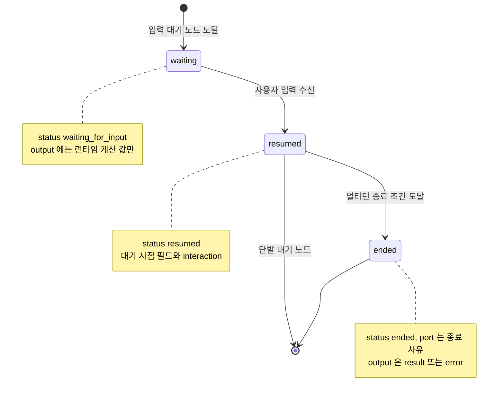
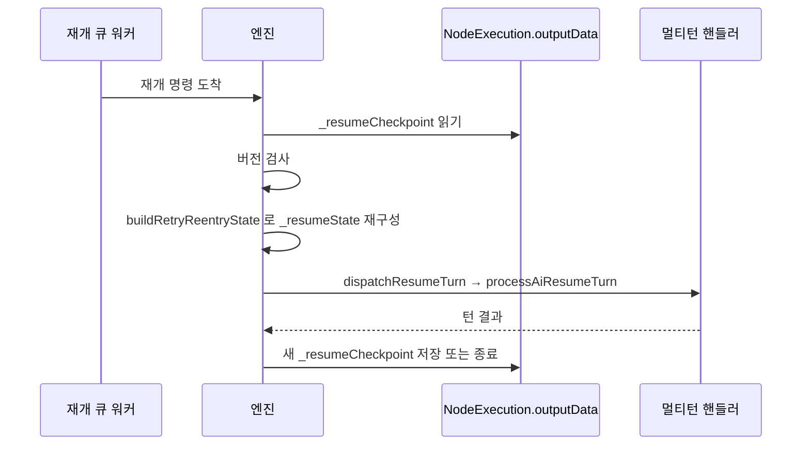

## 개요

이 문서는 [실행 상태 머신과 대기·재개](CLE-EXEC-STATE.md) 의 하위 문서로 입력 대기와 재개의 출력 흐름, 대기 진입 직전 읽기 창의 정규화, 멀티턴 AI 노드의 재개 상태(`_resumeState`)와 DB 에 남기는 보존 예외 `_resumeCheckpoint` 를 정한다. 재개 상태에 싣는 MCP 서버의 표현식 여부는 [MCP 서버 표현식 여부 보존](CLE-EXEC-STATE-MCPEXPR.md) 이, `_retryState` 와 마지막 턴 재시도는 [마지막 턴 재시도](CLE-EXEC-STATE-RETRY.md) 가 정한다. rehydration 절차는 [장애 복구와 안전 종료](CLE-EXEC-RECOVERY.md) 에 있다.

## 대기 진입 직전의 읽기 창 정규화

`executeNode` 의 입력 대기 분기는 핸들러 출력(`NodeHandlerOutput.status='waiting_for_input'`)을 `NodeExecution.outputData` 에 **먼저** 저장한다. 이때 `NodeExecution.status` 컬럼은 `running` 그대로다. 바로 뒤에 `waitForButtonInteraction`·`waitForFormSubmission`·`waitForAiConversation` 이 상태를 원자 전이한다.

두 저장 사이에 스냅샷을 조회하면 같은 행이 `status='running'` 인데 `outputData.status='waiting_for_input'` 인 행 내부 불일치로 보인다. 실행 ↔ 노드 실행 원자성([원자성 보장](CLE-EXEC-STATE.md#원자성-보장))은 이 창을 막지 못한다. `findById` 의 REPEATABLE READ 트랜잭션도 두 조회에 걸친 불일치만 막고 같은 행 안의 컬럼과 출력 사이 불일치는 잡지 못한다.

이 창은 두 층에서 막는다.

1. **백엔드 읽기 정규화** (`ExecutionsService.findById` 의 `reconcilePreParkWaitingStatus`): 스냅샷 응답 직전에 `status` 가 `running`·`pending` 이면서 `outputData.status==='waiting_for_input'` 인 행(아래 AI 대화 재개 스냅샷 포함)은 응답 상태를 `waiting_for_input` 으로 올린다. DB 쓰기와 엔진 원자성은 바꾸지 않는다. 모든 스냅샷 소비자(웹 앱, 웹채팅, External Interaction API)에 똑같이 적용된다.
2. **프론트엔드 이중 방어** (`codebase/frontend/src/lib/websocket/apply-execution-snapshot.ts` 의 `isNodeWaitingForInput`): WebSocket `execution.snapshot` 이벤트, read replica, 옛 응답 모양처럼 백엔드 정규화가 닿지 않는 경로에서도 불일치를 잡는다. `ne.status` 하나만 믿지 않고 `running`·`pending` 행에 한해 `ne.outputData.status==='waiting_for_input'`(아래 AI 대화 재개 스냅샷 포함)도 본다. 종결 행은 제외한다.

**AI 대화 재개 턴**: AI 대화 재개 턴의 창도 같은 두 층에서 막는다. 멀티턴 AI 노드(AI 에이전트, 정보 추출기)는 재개 턴에서 LLM 을 부르기 전에 재개 스냅샷(`outputData.status==='resumed'`, `outputData.meta.interactionType==='ai_conversation'`)을 저장한다([AI 에이전트 노드 출력과 디버그](../CLE-NODE-AI/CLE-NODE-AGENT-OUTPUT.md) 의 재개 절). 재개 claim 이 행을 `running` 으로 바꾼 뒤라 LLM 응답이 올 때까지 행 상태는 `running` 이다. 두 층은 `running`·`pending` 행의 출력이 이 재개 스냅샷이어도 대기로 본다. 그래서 실행 상세 화면은 LLM 호출 동안에도 대기 화면을 유지한다. form · buttons 의 `resumed` 는 그 노드의 마지막 출력이라 대기로 보지 않는다. 둘은 `meta.interactionType` 으로 가른다.

두 층의 판정 조건(노드 상태, 출력 상태와 재개 스냅샷의 `meta.interactionType`, 종결 제외)은 일부러 똑같이 둔다. 한쪽만 바꾸면 불일치 창이 다시 열리므로 `reconcilePreParkWaitingStatus` 와 `isNodeWaitingForInput` 은 반드시 함께 바꾼다.

## 입력 대기와 재개의 출력 흐름

- **입력 대기**: `status: "waiting_for_input"`. `output` 에는 런타임에 계산한 값만 둔다.
- **재개 출력**: `status: "resumed"`. `output` 은 대기 시점의 런타임 필드를 그대로 두고 `interaction: { type, data, receivedAt }` 를 더한다. `type` 은 `form_submitted`·`button_click`·`button_continue`·`message_received` 중 하나다. 타입별 `data` 모양과 적용 노드는 [노드 출력 규약](../CLE-NODE/CLE-NODE-OUTPUT.md) 의 `interaction.data` 규격이 정한다. AI 대화 노드의 재개 출력이 다른 점(사용자 메시지를 `output.result.messages` 에 더하고 `meta.interactionType` 을 고정한다)은 [노드 출력 규약 4.1](../CLE-NODE/CLE-NODE-OUTPUT.md#41-상태-전이) 에 있다.
- **대화 종료**: 멀티턴 LLM 이 종료 조건에 닿으면 `status: "ended"` 와 종료 사유에 따른 `port`, `output: { result }` 또는 `output: { error }` 를 낸다.
- **단일 턴 AI 에이전트 종료**: 입력 대기 없이 한 번에 끝나는 단일 턴 AI 에이전트도 `status: "ended"` 를 낸다. `port` 는 정상 완료면 `out`, 조건 분기면 그 조건의 포트, LLM 호출 실패 · 도구 정의 크기 예산 초과면 `error` 다([AI 에이전트 노드 출력과 디버그](../CLE-NODE-AI/CLE-NODE-AGENT-OUTPUT.md)).

Presentation 노드의 재개 출력도 `status: 'resumed'` 를 쓴다. 사용자가 무엇을 했는지는 `interaction.type` 으로만 나타낸다.

Presentation 노드의 `interaction` 과 멀티턴 AI 노드의 `message_received` 는 모두 [대화 스레드](../CLE-IX/CLE-IX-THREAD.md) 에 자동으로 쌓인다. 뒤의 AI 에이전트가 이를 자동으로 주입받을 수 있다. 쌓는 시점은 `nodeOutputCache` 갱신과 같은 트랜잭션이다.

## 재개 상태 `_resumeState`

- 멀티턴 AI 노드(AI 에이전트, 정보 추출기) 핸들러가 다음 턴을 처리하려고 들고 있는 내부 상태다. 노드 출력 다섯 필드 밖의 최상위 필드로 허용된 예외다.
- 엔진은 `_resumeState` 를 읽어 다음 턴을 다시 만든다.
- 표현식 resolver 는 이 필드를 노출하지 않는다.
- 최종 출력을 저장할 때 엔진(`stripControlFields()`)이 `_resumeState` 를 지운다. 옛 키 `_multiTurnState` 도 지움 대상에 남아 있지만 옛 페이로드 호환을 위한 방어일 뿐 현재 경로는 이 키를 만들지 않는다.

## 보존 예외 `_resumeCheckpoint`

`_resumeCheckpoint` 는 서버가 다시 시작된 뒤나 다른 인스턴스에서 멀티턴 대화를 이어 가려고 DB 에 남기는 재개 상태의 일부다.

- **적용 범위**: `ai_agent` 와 `information_extractor` 의 멀티턴(`ai_conversation`). 저장 허용 목록은 두 핸들러 런타임 상태의 합집합이다. `ai_agent` 는 messages·turnCount·토큰·RAG·MCP·`pendingFormToolCall` 을, `information_extractor` 는 여기에 `partialResult`·`collectionRetryCount`(둘 다 자격 증명 없는 런타임 값)를 더한다. 설정 필드는 노드마다 다르지만(`ai_agent`: `llmConfigId`·`maxTurns`·`conditions`·`presentationTools`, `information_extractor`: `outputSchema`·`examples`·`instructions`·`maxCollectionRetries`) 재구성 때 공통 함수 `resolveRetryNodeConfig` 가 `node.config` 에서 다시 만든다. `buildRetryReentryState` 는 두 모양의 합집합을 채우고 각 핸들러의 `processMultiTurnMessage` 가 자기 필드만 읽는다. 그 밖의 `ai_conversation` 핸들러는 고유 런타임 상태가 허용 목록에 없어 체크포인트를 남기지 않는다. 이런 노드는 재시작 뒤 재개하면 `RESUME_INCOMPATIBLE_STATE` 로 정리된다.
- **저장 시점**: 입력 대기에 들어갈 때(`emitAiWaitingForInput`)와 턴마다(`handleAiMessageTurn`) 엔진이 `_resumeState` 의 자격 증명을 뺀 부분집합을 `_resumeCheckpoint` 로 옮겨 `NodeExecution.outputData._resumeCheckpoint` 에 저장한다. 재개 턴에는 LLM 을 부르기 전에 저장하는 재개 스냅샷에도 직전 대기와 같은 재개 상태로 만든 체크포인트를 싣는다. LLM 호출 중 서버가 재시작해도 체크포인트가 남는다.
- **지움 예외**: `stripControlFields()` 는 `_resumeCheckpoint` 를 남긴다. 다음 노드 입력으로 넘길 때는 `_resumeState` 와 함께 지운다.
- **모양**: `_retryState` 와 같은 부분집합(messages·turnCount·model·temperature·maxTokens·knowledgeBases·RAG·MCP·`pendingFormToolCall?` 등)이다. 다만 `expiresAt`(TTL)이 없다. 입력 대기 실행은 기한 없이 보존되므로 대화는 오래 쉰 뒤에도 이어져야 한다. `lastUserMessage` 도 없다. 재개할 때 도착한 사용자 메시지를 그대로 첫 턴으로 처리한다.
- **자격 증명 제외**: 자격 증명과 컨텍스트 결속 필드는 싣지 않는다. `buildRetryState`·`buildResumeState` 가 옮길 키를 하나씩 열거하는 허용 목록 방식이다.
- **두 재유도 경로**: 재개할 때 **조작 필드**(`llmConfigId`·`maxTurns`·`conditions`·`presentationTools` 등)는 `node.config` 를 다시 평가해 만든다. **식별 필드**는 호출하는 쪽 컨텍스트에서 다시 만든다. `workflowId` 는 `execution.workflowId`, `nodeId` 는 재개할 노드 행의 `node.id`, 재개 대상 `nodeExecutionId` 는 대기·재시도 노드 실행 행의 PK(`buildRetryReentryState` 옵션), `workspaceId` 는 실행 컨텍스트에서 가져온다. `workflowId` 는 실행의 루트 워크플로우라서 서브 워크플로우 안의 노드에서는 그 노드가 속한 워크플로우와 다르다. 노드가 속한 워크플로우가 필요하면 `nodeId` 로 찾는다.
- **MCP 서버의 표현식 여부**: `_resumeState` · `_resumeCheckpoint` · `_retryState` 는 서버 목록(`mcpServers`)과 표현식 여부 배열 `mcpServerFromExpression` 을 함께 싣는다. 저장 · 판정 규칙, 배열이 없는 옛 체크포인트와 서버 목록이 통째로 없는 체크포인트의 처리는 [MCP 서버 표현식 여부 보존](CLE-EXEC-STATE-MCPEXPR.md) 이 정한다.
- **스키마 버전**: 체크포인트는 정수 `CHECKPOINT_SCHEMA_VERSION` 을 함께 싣는다. 재개할 때 버전이 없거나(기능 배포 전 행) 현재 코드 버전 이하이면 빠진 필드를 기본값으로 채워 다시 만든다. 현재 코드 버전보다 크면(롤링 배포 중 옛 인스턴스가 새 형식을 받음) 안전하게 만들 수 없으므로 `RESUME_INCOMPATIBLE_STATE` 로 정리한다. MCP 서버의 `mcpServerFromExpression` 처럼 값이 없을 때의 뜻이 정해진 필드는 버전을 올리지 않고 더한다([Rationale](CLE-EXEC-STATE-MCPEXPR.md#mcp-서버-항목에-표현식-여부를-저장하고-스키마-버전을-올리지-않는다-2026-10-25), [Rationale](CLE-EXEC-STATE-MCPEXPR.md#표현식-여부를-서버-항목-밖-배열로-옮긴다-2026-11-07)).
- **소비**: rehydration 이 `outputData._resumeCheckpoint` 를 읽고 버전을 검사한 뒤 `buildRetryReentryState`(`_retryState` 와 공유)로 `_resumeState` 를 다시 만든다. 핵심 필드가 빠졌으면 기본값으로 채운다. `driveResumeAwaited`·`driveResumeFrame` 이 도착한 재개 페이로드를 `dispatchResumeTurn` 을 거쳐 `handleAiResumeTurn` → `processAiResumeTurn`(한 턴 처리기)에 넘긴다. 체크포인트가 없거나(기능 배포 전 행) 손상됐거나 미래 버전이면 `RESUME_INCOMPATIBLE_STATE` 로 정리한다.
- **재개 payload 기준**: 재개 큐 `'continue'` 메시지 payload 의 표시 값(폼 제출이면 `{ type: 'form_submitted', formData }`)과 `processAiResumeTurn` 이 이 값으로 나누는 분기는 [Presentation 노드 공통](../CLE-NODE-PRES/CLE-NODE-PRES-COMMON.md#폼-제출-wire-format) 이 기준이다.

### 식별 필드 불변식

**사용량 귀속 불변식**: 재개·재시도 턴의 provider 도구 `logUsage` 귀속(`IntegrationUsageLog.node_execution_id`)은 위 식별 필드 `nodeExecutionId`·`workflowId` 가 `buildRetryReentryState` 재구성 결과에 다시 들어가야 성립한다. 두 필드는 자격 증명 제외 허용 목록(`CREDENTIAL_CONTEXT_FIELDS`)에 따라 체크포인트에서 빠진다. 재구성 때 호출 쪽 컨텍스트에서 다시 넣지 않으면 provider 도구의 사용 로그 조건(`ctx.nodeExecutionId && ctx.workflowId`)이 거짓이 돼 재개·재시도 턴의 통합 사용 로그가 조용히 빠진다.

소비하는 곳은 노드 유형마다 다르다. `ai_agent` 의 provider 도구 `IntegrationUsageLog` 는 조건부라 필드가 없으면 로그가 빠진다. 두 노드의 LLM 호출이 남기는 `llm_usage_log`(`LlmUsageLogService.record`, `?? null`)는 조건이 없어 필드가 없거나 틀리면 로그가 빠지지 않고 귀속이 오염된다. provider 도구가 없는 `information_extractor` 재개가 이 경우다. 현재 이 불변식은 회귀 테스트로만 강제되므로 `CREDENTIAL_CONTEXT_FIELDS`·`resumeStateSchema` 를 고칠 때 반드시 지킨다. 사용량 기록 구조는 [LLM 사용량 기록](../CLE-AI/CLE-AI-USAGE.md) 과 [통합 노드 공통](../CLE-NODE-INT/CLE-NODE-INT-COMMON.md) 에 있다.

**개인 통합 판정의 식별 필드**: 재개·재시도 턴의 도구 프로바이더는 재구성 결과의 `nodeId` 를 개인 통합 조회에 넘긴다. `nodeId` 도 `CREDENTIAL_CONTEXT_FIELDS` 에 있어 체크포인트에서 빠지므로 위 귀속 불변식처럼 재구성 때 다시 넣어야 한다. 이 값이 빠지면 통합 서비스가 워크플로우 작성자를 구하지 못해 개인 통합을 쓰는 서버가 모두 거절된다. 남의 개인 통합이 쓰이지는 않지만 워크플로우 작성자 자신의 개인 통합도 쓰지 못한다.

## 구현 위치

- `codebase/backend/src/modules/execution-engine/utils/resume-state.schema.ts` (`resumeStateSchema` · `resumeCheckpointSchema`. 서버 목록과 `mcpServerFromExpression` 을 함께 싣는다)
- `codebase/backend/src/modules/execution-engine/ai-turn-orchestrator.service.ts`
- `codebase/backend/src/shared/execution-resume/park-release-signal.ts` (park 해제 신호 `ParkReleaseSignal`)
- `codebase/backend/src/shared/execution-resume/process-turn-result.ts` (턴 처리 결과 `ProcessTurnResult` · `PARK_RELEASED`)
- `codebase/backend/src/shared/execution-resume/resume-call-stack.types.ts` (중첩 재개 호출 스택 `ResumeCallStack` · `CALL_STACK_SCHEMA_VERSION`)
- `codebase/backend/src/modules/executions/executions.service.ts` (`findById`, `reconcilePreParkWaitingStatus`)
- `codebase/frontend/src/lib/websocket/apply-execution-snapshot.ts` (`isNodeWaitingForInput`)

## Rationale

### 대기 진입 직전 읽기 창은 읽기 쪽에서 정규화한다

입력 대기 노드(Carousel·Form·AI)는 핸들러 출력을 먼저 저장하고 노드 실행 상태 컬럼은 바로 뒤 대기 함수의 원자 트랜잭션에서 바꾼다. 프론트엔드 `applyExecutionSnapshot` 은 `ne.status` 하나를 대기 판정의 기준으로 믿었다. 그래서 불일치 스냅샷이 오면 대기 화면이 채워지지 않거나, 먼저 도착한 `waiting_for_input` 이벤트가 만든 대기 상태를 재개로 오해해 지웠다. 그 결과 Carousel 버튼이 콜백 없이 비활성으로 멈췄다. 턴 단위 park 구조가 들어온 뒤 이 창이 더 자주 보였다.

- **쓰기 쪽 전이를 앞당기지 않는다**: 출력을 저장하는 순간 노드 실행 상태를 `waiting_for_input` 으로 올리면 짝 실행 상태 전이는 아직 대기 함수에서 일어난다. 그 사이 서버가 죽으면 실행은 `running`, 노드 실행은 `waiting_for_input` 인 불일치가 저장돼 원자성 보장이 깨진다. 그래서 쓰기 경로와 엔진 원자성은 그대로 두고 읽기 경로에서 출력 상태를 올린다.
- **백엔드 정규화를 1차로 둔다**: 스냅샷이 다시 실행 `running`·노드 실행 `waiting_for_input` 형태가 되므로 프론트엔드의 검증된 조정 경로가 그대로 동작한다.
- **프론트엔드 판정을 2차로 둔다**: 백엔드 정규화가 닿지 않는 경로를 위해 한 층에만 기대는 단일 실패 지점을 없앤다.

읽기 창 자체를 없애는 일(출력 저장과 상태 전이를 한 트랜잭션으로 묶기)은 별도 작업으로 남긴다.

### AI 대화 재개 스냅샷도 대기로 정규화한다 (2026-11-12)

AI 대화 경로가 재개 스냅샷을 노드 실행 행에 저장하게 됐다([AI 에이전트 노드 출력과 디버그](../CLE-NODE-AI/CLE-NODE-AGENT-OUTPUT.md) Rationale 의 2026-11-12 항목, NERV Task `CLE-T-TBJ863`). 그 전에는 재개 턴의 LLM 호출 동안 행에 직전 대기 출력(`outputData.status==='waiting_for_input'`)이 남아 있어 두 판정이 이 행을 대기로 봤다. 저장 뒤에는 출력 상태가 `resumed` 다. 판정을 그대로 두면 실행 상세의 2초 폴링이 대기가 끝났다고 보고 대화 화면을 비운다. 2026-05-23 에 보고된 깜빡임 회귀와 같은 경로다.

- **두 판정을 함께 넓힌다(사람 결정)**: 백엔드 `reconcilePreParkWaitingStatus` 와 프런트 `isNodeWaitingForInput` 이 `running`·`pending` 행의 AI 대화 재개 스냅샷도 대기로 본다. 짝 규칙대로 두 곳을 같은 조건으로 고쳤다.
- **`meta.interactionType` 으로 가른다**: form · buttons 의 `resumed` 는 그 노드의 마지막 출력이다. 이를 대기로 보면 끝난 노드가 계속 대기로 보인다. AI 재개 스냅샷은 `meta.interactionType` 을 늘 `ai_conversation` 으로 두므로 이 값으로 가를 수 있다.
- **쓰기 쪽 전이는 여기서도 앞당기지 않는다**: 재개 턴 동안 노드 실행 행의 상태 컬럼은 `running` 이고 이번 변경은 출력 컬럼만 저장한다. 상태 컬럼을 `waiting_for_input` 으로 되돌리면 실행 상태 `running` 과 짝이 어긋나는 행이 저장된다. 그래서 [대기 진입 직전 읽기 창은 읽기 쪽에서 정규화한다](#대기-진입-직전-읽기-창은-읽기-쪽에서-정규화한다) 항목의 원칙대로 읽기 쪽 판정만 넓혔다.
- **기각한 대안**: 메모리 캐시에만 싣는 안은 화면 회귀가 없지만 실행 내역 어디에서도 스냅샷이 보이지 않는다. 저장만 하고 판정을 그대로 두는 안은 채팅 턴마다 대화 화면이 깜빡인다. 둘 다 사람 결정으로 택하지 않았다.

### `_resumeCheckpoint` 를 남긴다 (옛 메모리 전용 결정 번복)

도입 초기에는 `_resumeState` 가 원본 설정·턴 디버그·모델 상태 같은 잠재 자격 증명을 담을 수 있다는 우려로 DB 에 남기지 않고 메모리에만 두었다. 그러자 배포·오토스케일·크래시로 인스턴스가 다시 시작되면 진행 중인 멀티턴 대화를 영원히 이어 갈 수 없었다(`RESUME_INCOMPATIBLE_STATE`). 텔레그램처럼 오래 이어지는 채널에서는 대화 중 백엔드가 한 번 배포되면 그 대화가 끝나 버렸다. 실행 행 자체는 기한 없이 보존되지만 재개에 필요한 `_resumeState` 가 사라져 쓸모가 없었다.

자격 증명을 뺀 부분집합 `_resumeCheckpoint` 를 평문으로 남기는 안을 골랐다.

- **암호화(`ENCRYPTION_KEY` 기반 시크릿 저장소) 기각**: 대화 메시지는 이미 `output.result.messages` 로 평문 저장되고 있어 암호화가 더 지켜 주는 것이 적다. `_resumeState` 는 원시 시크릿을 담지 않고 `llmConfigId` 같은 참조 ID 만 담는다. provider 시크릿은 시크릿 저장소 참조로 따로 있다. 매 턴 시크릿 저장소 쓰기와 대화 종료 뒤 정리도 복잡도를 더한다.
- **선례 일반화**: `_retryState` 가 같은 일(자격 증명을 뺀 부분집합을 평문으로 남기고 재개 때 다시 만들기)을 재시도 경로에서 이미 검증된 채로 하고 있었다. `_resumeCheckpoint` 는 이 선례를 매 대기 턴 경로로 넓힌 것이다. 자격 증명 제외는 `buildRetryState`·`buildResumeState` 가 옮길 키를 열거하는 허용 목록 방식이다.
- **재구성기 공유**: 두 필드는 자격 증명을 뺀 부분집합과 `node.config` 재유도라는 같은 재구성 형태로 모이므로 `buildRetryReentryState` 를 함께 쓴다. 차이(재시작 재개인지 재시도 명령인지, `lastUserMessage`·`expiresAt` 유무)는 재구성 결과에 영향이 없다. 체크포인트에는 `lastUserMessage` 가 없어 다시 돌리지 않고 도착한 재개 페이로드를 다음 턴으로 처리한다(`resumeMode` 플래그로 재시도 전용 경고만 나눈다).
- **TTL 을 두지 않는다**: 입력 대기 실행은 기한 없이 보존되므로 대화는 오래 쉰 뒤에도 이어져야 한다. 시간이 지나는 것만으로 만료되면 이 결함의 원형이 다시 생긴다.
- **정보 추출기로 넓힌다**: 처음에는 `ai_agent` 에만 냈다. 엔진 dispatch 가 이미 `handler.processMultiTurnMessage` 로 다형적이고 `resolveRetryNodeConfig`·`buildRetryReentryState` 가 노드 유형과 무관해 설정 재유도가 정보 추출기에도 그대로 동작한다. 정보 추출기 고유 상태(`partialResult`·`collectionRetryCount`)는 자격 증명이 없고 작아 허용 목록에 더하는 비용이 낮다. 새 멀티턴 핸들러는 자기 런타임 상태를 허용 목록에 등록해야 지원된다.
- **별도 컬럼 `_continuationCheckpoint` 기각**: 기존 기준인 `NodeExecution.outputData`(JSONB)에 키로 남겨 스키마 변경과 마이그레이션을 피한다.

체크포인트가 없거나 재구성이 실패하면 `RESUME_INCOMPATIBLE_STATE` 로 끝내고 채널 어댑터는 원시 에러 대신 "대화 세션 만료, 새로 시작" 안내를 보인다.

### 재개·재시도 턴의 식별 필드를 다시 넣는다 (2026-07)

체크포인트 항목을 "`node.config` 에서 다시 만든다" 고만 적으면 갭이 가려진다. 실제로 `node.config` 재평가로 다시 만들어지는 것은 조작 필드뿐이고 식별 필드는 호출 쪽 컨텍스트에서 다시 만들어야 한다. 그래서 `buildRetryReentryState` 가 `workflowId`(실행)와 `nodeExecutionId`(옵션)를 재구성 결과에 다시 넣도록 하고 이를 불변식으로 적었다. 재구성기는 `nodeId` 도 `node.id` 로 다시 넣는다. 2026-10-25 에 개인 통합 판정이 이 값을 쓰게 되어 식별 필드 목록에 더했다.

정보 추출기는 provider 도구가 없어(도구는 `finalize_extraction` 하나) 유일한 소비처가 `llm_usage_log` 다. 교정 전에는 재개 `llmContext` 가 `nodeExecutionId=state.nodeId`(노드 정의 ID)이고 `workflowId` 가 빠져 귀속이 오염됐다. `ai_agent` 메인 대화 재개의 비슷한 NULL 누락도 함께 교정했다.

**기각한 대안: 재개 식별 필드 전용 헬퍼**. 두 노드의 재개 `llmContext` 조립부를 공용 타입 `ResumeIdentificationFields` 와 `pickResumeIdentificationFields()` 로 뽑는 안을 검토했지만 택하지 않았다.

- 오탈자를 컴파일 때 막는 목적은 이미 이뤘다. `ai_agent` 는 `narrowResumeState(state)` 가 `resumeStateSchema` 에서 나온 `ResumeState` 로 필드 이름을 검사하고 소비 쪽은 `LlmCallContext` 타입 주석이 받친다. `information_extractor` 는 자체 `MultiTurnState` interface 가 필드를 강제한다.
- 두 노드의 타입 구조가 이미 다르다. 공용 헬퍼는 서로 다른 구조 위에 억지 공통 타입을 얹어 표면을 늘린다.
- 세 조립 지점의 모양이 실제로 다르다(3필드, 5필드와 `?? ''` 대체값과 `workspaceId`, 조건부 `undefined` 3필드). 헬퍼 하나로 묶으면 이 차이를 인자로 되살려야 해 이득이 작다.
- 막 안정된 코드를 흔드는 비용이 작은 이득보다 크다.
