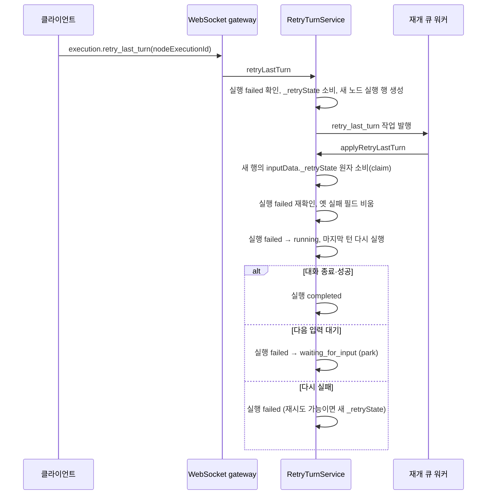

## 개요

이 문서는 [실행 상태 머신과 대기·재개](CLE-EXEC-STATE.md) 의 하위 문서로 멀티턴 AI 노드의 마지막 턴 재시도(`retry_last_turn`)를 정한다. 재시도용 보존 예외 `_retryState`, 재진입 흐름, 작업 배달 claim, 재시도 전제, 재시도 턴 중 취소를 다룬다. 실행 상태의 `failed → running` · `failed → waiting_for_input` 전이와 `allowRetryReentry` opt-in 의 DB 가드 규칙은 부모 문서의 [허용 전이](CLE-EXEC-STATE.md#허용-전이) 와 [원자성 보장](CLE-EXEC-STATE.md#원자성-보장) 에 있다. 재구성에 쓰는 `buildRetryReentryState` 와 식별 필드 불변식은 [입력 대기와 재개 상태](CLE-EXEC-STATE-RESUME.md#보존-예외-_resumecheckpoint) 에 있다.

## 보존 예외 `_retryState`

- 멀티턴 AI 에이전트가 재시도 가능한 에러(HTTP 429·5xx·네트워크 타임아웃, `output.error.details.retryable === true`)로 끝나면 `buildMultiTurnFinalOutput` 이 `_resumeState` 스냅샷을 `_retryState` 로 옮긴다. 최상위 필드이며 노드 출력 다섯 필드의 예외다.
- `stripControlFields()` 는 `_retryState` 를 남긴다. `NodeExecution.outputData._retryState` 로 DB 에 저장된다.
- 모양은 `_resumeState` 의 부분집합에 `expiresAt: ISO 8601` 을 더한 것이다. TTL 기본값은 60분이고 환경 변수 `AI_RETRY_STATE_TTL_MINUTES` 로 바꾼다. 자격 증명 제외 방식은 `_resumeState` 와 같다(허용 목록). 표현식 resolver 와 자동완성에 노출하지 않는다. 필드 목록 전체(`lastUserMessage` 등)는 [노드 출력 규약](../CLE-NODE/CLE-NODE-OUTPUT.md) 의 보존 예외 절에 있다.
- **소비(원자적)**: WebSocket 명령 `execution.retry_last_turn` 이 `nodeExecutionId` 로 `_retryState` 를 찾는다. `expiresAt` 을 확인한 뒤 **같은 트랜잭션에서 `_retryState` 키를 지우고(소비) 새 노드 실행 행을 만든다**. 이어 재개 큐(`execution-continuation`)에 `retry_last_turn` 작업을 발행하고 워커가 새 행을 `_retryState` 로 채워 멀티턴 루프에 다시 들어간다. 키 삭제가 affected=1 인 쪽만 진행하므로 동시에 온 재시도가 행을 두 번 만들지 않는다. TTL 이 지났거나 이미 소비된 `_retryState` 는 `RETRY_STATE_NOT_FOUND` 다. 재시도 턴을 돌리려면 워커 컨텍스트가 필요해 WebSocket gateway 가 동기로 처리할 수 없으므로 재개 큐로 넘긴다.
- 사용자 쪽 흐름은 [AI 에이전트 노드 출력과 디버그](../CLE-NODE-AI/CLE-NODE-AGENT-OUTPUT.md) 의 멀티턴 에러 포트 절에 있다.

## 마지막 턴 재시도 재진입

마지막 턴 재시도(`retry_last_turn`)는 재시도 가능한 에러로 끝난 멀티턴 AI 노드의 마지막 LLM 호출을 같은 실행 안에서 다시 돌린다. [재실행](CLE-EXEC-RERUN.md) 과 다르다.



1. 재시도는 **새 노드 실행 행을 만들어** 마지막 턴을 다시 돌린다. 기존 `failed` 행은 그대로 둔다. 새 행의 턴이 `node.started`·`node.completed` 를 내려면 실행이 `running` 이어야 하므로 실행은 `failed → running` 으로 간다.
2. 재시도 턴이 대화를 끝내지 않으면 `reparkAiResumeTurn` 이 실행을 `waiting_for_input` 으로 park 하고 세그먼트를 끝낸다. 멀티턴 노드의 마지막 턴 재시도에서 가장 흔한 경로다. 이후 재개는 일반 `waiting_for_input → running` 경로(원자 claim)로 합류하므로 opt-in 은 이 한 번의 park 에만 필요하다.
3. 재시도 턴이 성공하면 실행은 `completed` 로, 다시 실패하면 `failed` 로 마감한다. 재시도 가능한 에러로 다시 실패하면 새 `_retryState` 를 남겨 다시 재시도할 수 있다.
4. **작업 배달 claim**: `applyRetryLastTurn` 은 새 행의 `inputData._retryState` 키를 조건부 UPDATE 로 원자 소비한다. affected=1 인 배달만 진행한다.

   ```sql
   UPDATE node_execution SET input_data = input_data - '_retryState'
    WHERE id = :id AND status = 'running' AND jsonb_exists(input_data, '_retryState')
   ```

   두 조건이 모두 필요하다. `jsonb_exists` 가 경쟁을 가른다. `status = 'running'` 이 없으면 이미 끝난 턴을 다시 돌린다. `inputData` 에 쓰는 지점은 행을 만들 때뿐이라 턴이 `completed` 로 끝나도 키가 남기 때문이다.
5. claim 은 크래시로 중단된 턴의 BullMQ 재배달도 막는다. 이 claim 에서 버려진 새 행은 `running` 으로 남을 수 있다. 버려지는 시점의 실행은 이미 `failed` 라 부팅 복구 스캔의 재구동 대상(오래 멈춘 `running` 실행)이 아니기 때문이다. 워커 진입 때 실행 `failed` 재확인에서 거절된 행은 이와 달리 그 자리에서 `failed` 로 마감한다([재시도 전제와 재시도 턴 시작](#재시도-전제와-재시도-턴-시작)). claim 이 성공한 뒤 턴에 들어가기 전에 예외나 크래시가 나도 새 행이 `running` 으로 남는다. 크래시뿐 아니라 일반 예외도 여기에 든다. 그 뒤의 재배달은 claim 에 실패해 버려지기 때문이다. 두 경우의 남은 행은 [부팅 복구 스캔의 종결된 실행 아래 남은 노드 실행 행 정리](CLE-EXEC-RECOVERY.md#종결된-실행-아래-남은-노드-실행-행) 가 닫는다. 행의 `started_at` 이 30분을 넘으면 `failed` 로 바꾼다. 재시도 턴이 `finalizeAiNode` 의 마감 전에 예외를 던지면 `closeSpawnedRowIfRunning` 이 새 행을 바로 닫는다([재시도 전제와 재시도 턴 시작](#재시도-전제와-재시도-턴-시작)). 부팅 스캔은 이 마감이 닿지 않는 크래시와 턴 진입 전 예외를 맡는다.
6. **재시도 턴의 설정 표현식 재평가**: 재시도 턴은 노드 설정의 `{{ }}` 표현식을 가능한 만큼 다시 평가해 조작 필드(`llmConfigId`·`maxTurns` 등)를 일반 dispatch 와 맞춘다. `_retryState` 는 턴 직전 `_resumeState` 스냅샷에서 나와 원래 노드 입력이 없으므로 `$input.*` 는 풀리지 않는다. 되살린 컨텍스트에서 `$node`·`$var`·`$thread`·`$execution`·`$now` 만 풀린다. 재평가에 실패하면 원본 설정으로 돌아가므로 정적 설정은 영향이 없다. `output.config` 설정 에코는 항상 원본(`rawConfig` 고정 스냅샷)이고 재평가 값은 실행에만 쓴다.
7. 재시도 턴을 마친 노드 이후의 그래프 진행은 일반 `completed` 노드와 같다. 순환 안이면 순환에 다시 들어간다([실행 엔진 개요와 그래프 순회](CLE-EXEC-ENGINE.md)).

### 재시도 전제와 재시도 턴 시작

- **실행이 `failed` 일 때만 재시도한다**: 이 조건을 두 번 확인한다.
  - 명령 시점: `retryLastTurn` 이 `_retryState` 를 소비하기 전에 실행을 읽는다. `failed` 가 아니면 `INVALID_EXECUTION_STATE` 로 거절한다. 새 행을 만들지 않고 `_retryState` 도 소비하지 않는다.
  - 워커 진입 시점: `applyRetryLastTurn` 이 배달 claim 뒤 실행을 다시 읽는다. 명령과 워커 사이에 실행이 `failed` 에서 벗어났으면 새 행을 `failed` 로 마감하고 작업을 버린다. 같은 실행의 다른 재시도 턴이 먼저 시작했거나 실행이 취소된 경우다. `node.started` 를 내기 전이라 노드 이벤트는 내지 않는다.
- 이 확인은 재시도 턴이 살아 있는 본 흐름과 같은 실행에서 함께 도는 것을 막는다.
  - 노드가 에러로 끝나도 에러 포트로 흐름이 이어지면 실행은 `failed` 가 아니다(`running`·`waiting_for_input`·`completed`). 이때 [다시 시도] 버튼이 보여도 재시도는 거절된다.
  - [Parallel 노드](../CLE-NODE-LOGIC/CLE-NODE-PARALLEL.md) 의 병렬 분기 안에서 실패했고 `errorPolicy` 가 `continue` 면 다른 분기가 도는 동안 실행은 `running` 이라 거절된다. 다른 정책에서는 모든 분기가 끝난 뒤에 실행이 `failed` 가 되므로 재시도 턴이 형제 분기와 겹치지 않는다.
- **재시도 턴을 시작할 때 옛 실패 필드를 비운다**: 워커 진입 확인을 통과하면 실행의 `error`·`finishedAt`·`durationMs` 를 비운다. 앞선 실패가 남긴 값이다. 재시도 턴 끝의 전이(`failed → running` 또는 `failed → waiting_for_input`)가 빈 값을 함께 저장한다. 그래서 재시도 턴이 park 하거나 그래프를 이어 도는 동안 실행에 옛 에러와 종료 시각이 남지 않고, 다시 종결할 때 옛 `durationMs` 를 그대로 쓰지 않는다.
- **재시도 턴이 예외로 끝나면 새 행을 마감한다**: 예외가 났는데 새 행이 아직 `running` 이면 조건부 UPDATE(`status = 'running'`)로 새 행을 `failed`(취소로 끝났으면 `cancelled`)로 마감하고 노드 종결 이벤트를 낸다. 그다음 실행을 마감한다. 턴 끝 전이가 거절돼 예외가 난 경우에도 새 행이 `running` 으로 남지 않는다. 턴 안에서 이미 마감한 행은 조건에 걸리지 않아 덮지 않는다.

같은 실행의 재시도 둘이 서로 다른 워커에서 함께 도는 경우는 [미결 사항](#미결-사항) 에 있다.

### 재시도 턴 중 취소

- 재시도 턴이 `running` 으로 도는 동안 도착한 취소는 **진행 중인 턴을 바로 끊지 않는다**. `running` 상태의 재개·재시도 턴 구동에는 깨울 메모리 코루틴이 없기 때문이다.
- 취소 **기록은 늦어지지 않는다**. `stop()` 의 `running`·`pending` 경로가 조건부 UPDATE 로 `cancelled` 와 `finishedAt`·`durationMs` 를 바로 커밋한다.
- 재시도 턴은 다음 **턴 경계**의 `assertExecutionNotCancelled` 에서 취소를 보고 끝난다. park 에 닿으면 `cancelParkedExecution` 의 `status = WAITING_FOR_INPUT` 가드가 짝 노드 실행까지 `cancelled` 로 표시한다.
- park 없이 그 턴에서 끝나도 취소가 우선한다. 종결 경로가 모두 조건부 UPDATE(`status IN (비종결)`)를 거치므로 이미 `cancelled` 인 행은 `completed`·`failed` 로 덮이지 않고 종결 이벤트도 나가지 않는다. 취소 시각(`finishedAt`·`durationMs`)은 `stop()` 이 쓴 값이 기준이다. 가드 규칙은 [노드 취소](CLE-EXEC-CANCEL.md) 에 있다.

## 미결 사항

- **같은 실행의 재시도 둘이 서로 다른 워커에서 함께 도는 경우**: 같은 실행 안 서로 다른 노드 실행(예: 병렬 분기 둘이 모두 재시도 가능한 에러로 실패)의 재시도가 거의 동시에 들어오면 둘 다 명령 시점과 워커 진입 시점에 실행 `failed` 를 볼 수 있다. 재시도 턴이 끝날 때까지 실행은 `failed` 이기 때문이다. 배달 claim 은 새 행 단위라 둘을 가르지 않는다. 워커가 하나면 두 번째 작업은 첫 번째 턴이 끝난 뒤 들어와 워커 진입 확인에서 거절된다. 인스턴스가 여럿이거나 `CONTINUATION_WORKER_CONCURRENCY` 를 올린 경우에만 남는다. 막으려면 실행 단위로 재시도 턴을 하나만 받는 claim 이 필요하고 진 쪽은 실행을 건드리지 않고 물러나야 한다. 후속은 NERV Task `CLE-T-T9HZX7` 다.

## 구현 위치

- `codebase/backend/src/modules/execution-engine/retry-turn.service.ts`

## Rationale

### 재시도 가능한 에러로 끝나면 `_retryState` 를 남긴다

재시도 가능한 에러(HTTP 429·5xx·네트워크 타임아웃)로 끝날 때의 처리 두 안 가운데 상태 `ended` 와 `port: 'error'` 는 그대로 두고 `_retryState` 를 함께 싣는 안을 골랐다.

- **새 상태 `waiting_for_retry` 를 두는 안 기각**: 입력 대기 계열을 넓히는 일이라 흐름 지시 계약이 다른 노드까지 번지고 포트 활성화 모델과의 정합도 다시 따져야 해 스펙 범위가 커진다.
- 고른 안은 `ended` 와 `port: 'error'` 의 뜻을 그대로 두므로 에러 포트 뒤 노드(알림 등)의 의미가 바뀌지 않는다. 재시도 가능 여부는 `output.error.details.retryable` 하나로 충분히 전달되고 재시도는 에러 라우팅 뒤의 별도 사용자 행동(`execution.retry_last_turn`)으로 들어온다.
- `_retryState` 는 `_resumeState` 처럼 표현식에 노출하지 않고 자격 증명을 뺀다. TTL(기본 60분)이 사실상 재시도 상한이다.

### `failed → running` 마지막 턴 재시도 전이를 둔다 (옛 "park 도달 후 발효" 철회, 2026-07-28)

마지막 턴 재시도가 실제로 실행될 때의 전이다. 재시도는 새 노드 실행 행을 만들어 마지막 턴을 다시 돌리고 새 행이 이벤트를 내려면 실행이 `running` 이어야 하므로 `failed → running` 을 더했다. 기각한 새 상태 `waiting_for_retry` 와는 무관한 경로이고 입력을 기다리지 않고 새 행을 바로 구동한다는 점에서 재개 흐름과도 다르다. 일반 노드 실패로 번지지 않도록 `allowRetryReentry` opt-in 으로만 허용한다.

처음에는 "재진입이 park 없이 끝나면 취소는 효과 없이 흘려보낸다" 고 적었다. 당시 구현(조건 없는 전체 엔티티 `save()`)을 그대로 적은 것이었다. 이후 하류 dispatch 계속, 엔진의 조건 없는 종결 쓰기, 재시도 턴 종결 경로를 모두 "사용자 실행 중지가 사라진다" 는 결함으로 보고 막았다. 그래서 park 도달 여부는 취소가 효과를 내는 조건이 아니다. 문서가 반대 내용을 계약으로 남기면 나중에 구현이 가드를 되돌리는 근거로 오해할 수 있어 철회했다.

### 마지막 턴 재시도에 배달 단위 claim 을 둔다 (2026-07-28)

재개 진입 claim 은 `waiting_for_input → running` 조건부 전이로 경쟁을 가른다. 마지막 턴 재시도의 대상은 `retryLastTurn` 이 이미 `running` 으로 만든 새 행이라 이 전이가 성립하지 않는다. 그래서 이 유형만 claim 에서 빠져 있었고 대신 `applyRetryLastTurn` 첫머리의 `status !== RUNNING → 버림` 검사가 멱등 가드로 쓰였다.

그 검사는 원자적이지 않았다. `findOneBy` 다음 `if` 로 가르는 방식은 확인과 실행 사이에 창을 남겨 BullMQ stalled 재배달, `CONTINUATION_WORKER_CONCURRENCY` 상향, 여러 인스턴스 환경에서 두 배달이 모두 통과할 수 있었다. 그러면 잠금 없는 인스턴스 로컬 실행 컨텍스트를 함께 써 대화 상태가 망가지고 LLM 호출과 뒤의 도구(Cafe24·MakeShop·MCP 등 실제 부수 효과)가 두 번 실행된다.

행을 만드는 단계의 원자성만으로는 모자란다. `retryLastTurn` 은 원본 행의 `outputData._retryState` 를 JSONB `-` 로 원자 소비하며 행을 만들므로 행은 한 번만 생긴다. 하지만 재개 큐로 넘기는 순간부터 작업 배달 횟수는 별개 축이다. 작업 ID 가 `${executionId}:${nodeExecutionId}:${seq}` 로 발행마다 달라 BullMQ 중복 제거도 걸리지 않는다. "한 번만 만들었다" 와 "그 행을 한 번만 구동한다" 는 서로 다른 보장이고 뒤쪽에는 별도 claim 이 필요하다.

**대가(의도한 교환)**: 크래시로 멈춘 턴의 BullMQ 재배달까지 막힌다. 형제 재개 명령 네 가지도 재개 진입 claim(`claimResumeEntry`)으로 같은 성질을 받아들이고 그 복구는 부팅 복구 스캔(오래 멈춘 `running` 실행의 re-claim 과 재구동)이 맡는다. 그러나 이 2차 claim(`claimSpawnedRetryRow`) 경로에는 그 스캔의 재구동이 닿지 않는다. claim 실패로 버리는 시점에 대상 실행은 이미 `failed` 로 끝나 있어 재구동 대상이 아니다(실측 확인). 그래서 버린 새 행 자체가 `running` 으로 남을 수 있다. [장애 복구와 안전 종료](CLE-EXEC-RECOVERY.md#멱등성-계약) 의 "남은 행 마감" 은 부팅 스캔이 오래 멈춘 `running` 실행을 재구동할 때의 옛 `running` 행을 다루므로 이 경로는 대상이 아니다. 두 서술은 범위가 달라 모순이 아니다.

그래도 버리는 편이 옳다. 살아 있는 작업을 두 번 돌리는 것(claim 도입 전 결함)이 이론상의 남은 행보다 늘 더 나쁘다. 마지막 턴 재시도만 claim 을 만들지 않으면 "중복 실행 0" 보장이 그 유형에서만 거짓이 된다. 이것은 claim 을 두느냐의 문제이고 남은 행 문제와는 다른 사안이다.

2026-11-12 갱신: 버린 새 행과 claim 뒤 턴 진입 전 예외 · 크래시로 남은 행은 [부팅 복구 스캔의 종결된 실행 아래 남은 노드 실행 행 정리](CLE-EXEC-RECOVERY.md#종결된-실행-아래-남은-노드-실행-행) 가 30분 뒤 `failed` 로 닫는다. 이 30분은 노드 실행 행의 `started_at` 으로 잰다. 실행이 이미 종결된 행에만 적용하므로 크래시로 멈춘 `running` 세그먼트를 재구동하게 하면서(2026-07-04) 폐기한 실행 단위 30분 일괄 실패와 대상이 다르다. "크래시로 멈춘 턴" 에 claim 과 턴 진입 사이의 일반 예외가 드는지 열려 있던 범위도 같은 정리가 덮는다. 버림 결정은 그대로다. 결정 경위는 [장애 복구와 안전 종료](CLE-EXEC-RECOVERY.md) Rationale 의 "종결된 실행 아래 남은 running 노드 행은 부팅 스캔이 닫는다" 에 있다(NERV Task `CLE-T-CCEQEC`).

### 재시도 전에 실행 `failed` 를 두 번 확인한다 (2026-11-06)

**문제**: 재시도 명령은 `_retryState` 만 보고 실행 상태는 보지 않았다. 에러 포트로 흐름이 이어졌거나 병렬 분기의 다른 분기가 아직 돌아 실행이 `running` 인데도 재시도 턴이 시작됐다. 재시도 턴은 같은 실행의 본 흐름과 함께 `node.*` 이벤트를 내고, 턴 끝에서 `running → waiting_for_input` 같은 일반 전이로 본 흐름의 상태를 덮을 수 있었다. 실행이 `completed` 였다면 턴 끝 전이가 거절돼 새 행이 `running` 으로 남았다. 또 재시도 턴 동안 실행에는 앞선 실패의 `error`·`finishedAt`·`durationMs` 가 그대로 있었고 다시 종결할 때 옛 `durationMs` 를 다시 썼다.

**결정**: 명령 시점과 워커 진입 시점에 실행이 `failed` 인지 확인한다. 워커 진입 확인을 통과하면 옛 실패 필드를 비운다. 재시도 턴이 예외로 끝나면 `running` 으로 남은 새 행을 조건부로 마감한다.

- 명령 시점 확인은 사용자에게 바로 `INVALID_EXECUTION_STATE` 를 돌려주고 `_retryState` 를 남긴다. 이것만 두면 명령과 워커 사이에 실행이 바뀌는 창이 남는다.
- 워커 진입 확인은 그 창을 닫는다. 이것만 두면 명령은 성공 ack 를 받고 `_retryState` 도 소비된 뒤에 재시도 턴이 버려져 사용자가 다시 시도할 수 없다.
- 두 확인을 함께 둬도 명령과 워커 사이에 실행이 바뀌면 같은 일이 생긴다. 워커 진입 거절은 성공 ack 뒤라 클라이언트에 알려지지 않는다. 이 창은 대부분 같은 실행의 재시도끼리 겹칠 때 생겨서 [미결 사항](#미결-사항) 의 후속에서 함께 다룬다.
- 거절 코드는 새로 만들지 않는다. [WebSocket 이벤트와 명령](../CLE-API/CLE-API-WS-EVENTS.md) 과 [큐 워커와 동시 실행 제한](CLE-EXEC-WORKER.md) 가 이미 `execution.retry_last_turn` 의 기대 상태를 `failed` 로 두고 이 코드를 쓴다.
- 이 결정으로 [재시도 가능한 에러로 끝나면 `_retryState` 를 남긴다](#재시도-가능한-에러로-끝나면-_retrystate-를-남긴다) 에서 정한 별도 사용자 행동(`execution.retry_last_turn`)은 실행이 `failed` 인 경우로 한정된다.
- 옛 필드는 재시도 턴 시작 때 실행 엔티티에서 비우고 턴 끝 전이가 함께 저장하게 한다. 모든 전이가 함께 쓰는 `updateExecutionStatus` 의 SET 절을 재시도 전용으로 바꾸는 방법은 다른 전이까지 영향이 넓어 택하지 않았다.

같은 실행의 재시도 둘이 서로 다른 워커에서 함께 들어오는 경우는 이 결정으로 막히지 않는다. 실행 단위 claim 과 진 쪽의 물러남 규칙이 필요해 [미결 사항](#미결-사항) 에 남겼다.

### 재시도 턴의 설정 표현식을 다시 평가하되 설정 에코는 원본으로 둔다

재시도 턴의 조작 필드가 일반 dispatch 와 다르면 같은 노드가 경로에 따라 다른 모델이나 최대 턴 수로 돈다. 그래서 가능한 만큼 다시 평가한다. 설정 에코를 원본으로 두는 것은 [노드 핸들러 계약](CLE-EXEC-HANDLER.md) 의 원본 설정 노출 결정을 따른 것이다. 두 가지를 함께 지켜 같은 입력의 재현성과 설정·출력의 직교성을 모두 보존한다.
