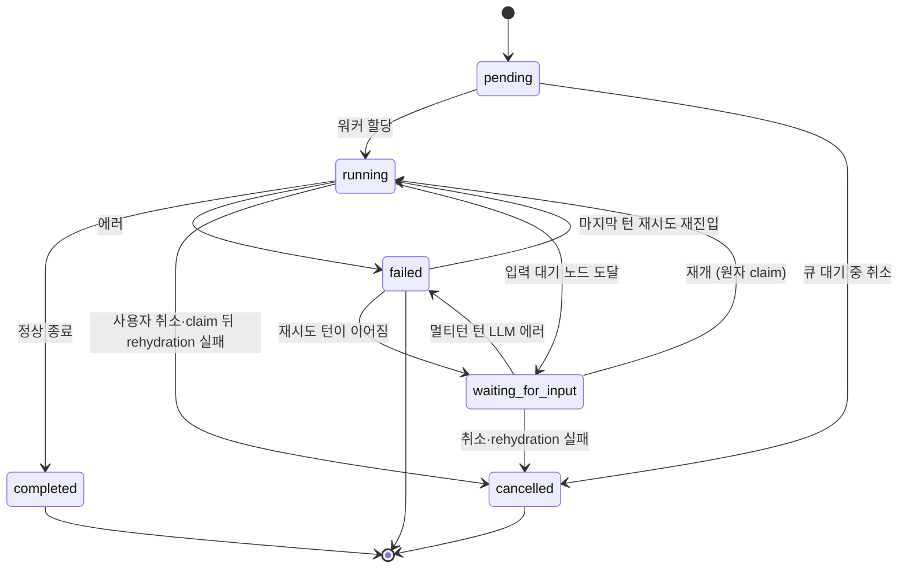
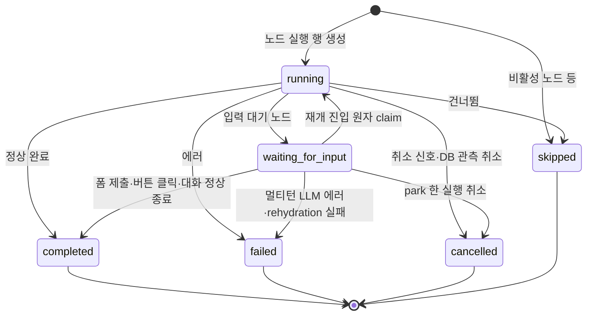

> 구현 상태: 부분 구현 · 원문: `spec/5-system/4-execution-engine.md` (§1.1~§1.3, Rationale 중 상태 전이·대기·재개·마지막 턴 재시도 항목) · 용어: [용어 사전](../CLE-GLOSSARY.md)

## 개요

이 문서는 실행(Execution)과 노드 실행(NodeExecution) 두 층의 상태와 전이를 정한다. 노드 핸들러가 엔진 흐름을 바꾸는 흐름 지시 상태(`NodeHandlerOutput.status`)도 여기서 정한다. 입력 대기·재개 계약과 멀티턴 AI 노드의 재개 상태 보존, 마지막 턴 재시도(`retry_last_turn`) 흐름은 [하위 문서](#하위-문서) 가 정한다.

입력 대기(`waiting_for_input`)에 들어간 실행은 세그먼트를 끝내고 DB 에만 남는다. 이 동작을 park 라고 부른다. park 한 실행에는 큐 작업·heartbeat·TTL 이 없고 기한 없이 보존된다. 사용자 입력이 도착해야만 재개 명령(`execution.submit_form`·`execution.click_button`·`execution.submit_message`·`execution.end_conversation`)이 재개 큐 작업을 만들고 다음 세그먼트가 시작된다. 재개 때는 DB 에 저장한 내용으로 실행 컨텍스트를 되살린다(rehydration).

입력 대기가 아닌 실행에 재개 명령을 보내면 상태 불일치 에러(invalid execution state)로 거부한다. 같은 뜻을 진입점마다 다른 코드로 알린다. WebSocket 은 `INVALID_EXECUTION_STATE`, REST 는 422 `INVALID_STATE`, External Interaction API(EIA) 는 409 `STATE_MISMATCH` 다. 검사 규칙은 [큐 워커와 동시 실행 제한](CLE-EXEC-WORKER.md#발행-전-사전-검증) 에 있다.

범위 밖:

- park 가 세그먼트를 끝내는 방식과 세그먼트 워커는 [큐 워커와 동시 실행 제한](CLE-EXEC-WORKER.md) 에서 정한다.
- 재개 명령의 발행 전 사전 검증(상태 불일치 에러, 대기 표면과 명령의 조합, nodeId 검사 범위)과 ack 에러 표면은 [큐 워커와 동시 실행 제한](CLE-EXEC-WORKER.md) 의 재개 큐 절에서 정한다.
- rehydration 절차, 재개 진입의 원자 claim, 크래시 재구동은 [장애 복구와 안전 종료](CLE-EXEC-RECOVERY.md) 에서 정한다. 재개 진입 claim 의 결정 근거도 그 문서 Rationale 에 있다. 마지막 턴 재시도 claim 의 결정 근거는 [마지막 턴 재시도](CLE-EXEC-STATE-RETRY.md#rationale) 에 있다.
- 노드 출력의 다섯 필드와 재개 출력의 모양은 [노드 출력 규약](../CLE-NODE/CLE-NODE-OUTPUT.md) 이 정한다.
- 취소 신호와 DB 관측 취소 가드의 동작은 [노드 취소](CLE-EXEC-CANCEL.md) 가 정한다.
- 재개 명령의 wire 형식과 응답은 [WebSocket 이벤트와 명령](../CLE-API/CLE-API-WS-EVENTS.md) 이 정한다.
- 실행·노드 실행 엔티티의 컬럼은 [실행 데이터와 흐름](CLE-EXEC-DATA.md) 에 있다.

## 하위 문서

- [실행 상태 머신과 대기·재개 — 입력 대기와 재개 상태](CLE-EXEC-STATE-RESUME.md): 대기 진입 직전 읽기 창 정규화, 입력 대기와 재개의 출력 흐름, `_resumeState`, 보존 예외 `_resumeCheckpoint`(MCP 서버 표현식 여부 제외), 재개·재시도 턴의 식별 필드 불변식. 요구사항 번호: 없음
- [실행 상태 머신과 대기·재개 — MCP 서버 표현식 여부 보존](CLE-EXEC-STATE-MCPEXPR.md): 재개 상태에 싣는 `mcpServerFromExpression` 배열, 옛 체크포인트 변환, 서버 목록이 없을 때의 재판정, 스키마 버전을 올리지 않는 결정. 요구사항 번호: 없음
- [실행 상태 머신과 대기·재개 — 마지막 턴 재시도](CLE-EXEC-STATE-RETRY.md): 보존 예외 `_retryState`, `retry_last_turn` 재진입 흐름, 배달 claim, 재시도 전제, 재시도 턴 중 취소. 요구사항 번호: 없음

## 실행 상태

`failed` 에서 나가는 두 전이는 마지막 턴 재시도에만 열린다. 다른 입력으로 다시 입력 대기를 잇는 rehydration 은 `waiting_for_input` 안의 내부 전이다. 상태 값은 바뀌지 않으므로 그림에 자기 전이로 그리지 않는다.

| 상태 | 본문 표기 | 설명 | 들어오는 조건 |
| --- | --- | --- | --- |
| `pending` | 대기 중 | 실행이 요청됐고 워커 할당을 기다린다 | 트리거 발화·수동 실행 시 생성 |
| `running` | 실행 중 | 실행 중 | 워커가 작업을 가져감 |
| `waiting_for_input` | 입력 대기 | Form 노드, 버튼이 설정된 Presentation 노드, 멀티턴 AI 노드가 사용자 입력을 기다린다 | 해당 노드 도달 또는 멀티턴 대화 턴 대기 |
| `completed` | 완료 | 정상 종료 | 모든 노드 실행 완료 |
| `failed` | 실패 | 실패 | 노드 에러와 워크플로우 중단 정책, 또는 시스템 에러 |
| `cancelled` | 취소됨 | 사용자나 시스템 사유로 멈춤 | 실행 중지 요청 등 |

건너뜀(`skipped`)은 노드 실행 전용이다. 실행 층에는 `skipped` 가 없다. 모든 노드가 건너뜀(노드 비활성·분기 미선택·도달 불가)으로 끝나 에러 없이 dispatch 루프가 끝나면 실행은 `completed` 로 마감한다. 그래서 [실행 내역](CLE-EXEC-HISTORY.md) 필터에도 실행 층 `skipped` 는 없고 모든 노드가 건너뛴 실행은 `completed` 로 보인다.

시스템 에러로 끝나는 경로의 에러 코드는 다른 문서가 정한다. 실행 시간 한도 초과(`EXECUTION_TIME_LIMIT_EXCEEDED`)와 큐 대기 한도 초과(`EXECUTION_QUEUE_WAIT_TIMEOUT`)는 [큐 워커와 동시 실행 제한](CLE-EXEC-WORKER.md), stalled 재배달 소진(`WORKER_HEARTBEAT_TIMEOUT`)·안전 종료 중단(`SERVER_INTERRUPTED`)·rehydration 실패(`RESUME_*`)는 [장애 복구와 안전 종료](CLE-EXEC-RECOVERY.md) 에 있다. 취소 주체(`result.cancelledBy`)와 사유 코드의 대응은 [External Interaction API](../CLE-IX/CLE-EIA.md) 가 정한다.

### 허용 전이

| 이전 | 다음 | 조건 |
| --- | --- | --- |
| `pending` | `running` | 워커 할당 |
| `pending` | `cancelled` | 큐 대기 중 취소 |
| `running` | `completed` | 정상 종료 |
| `running` | `failed` | 에러 발생 |
| `running` | `cancelled` | 사용자 취소, 재개 진입 claim 뒤 rehydration 실패(`RESUME_CHECKPOINT_MISSING`·`RESUME_FAILED`·`RESUME_INCOMPATIBLE_STATE`). claim 이 실행을 이미 `running` 으로 바꾼 뒤라 이 전이로 마감한다. 실패 경우별 코드와 원자 마감은 [장애 복구와 안전 종료](CLE-EXEC-RECOVERY.md#rehydration-실패) 에 있다 |
| `running` | `waiting_for_input` | Form 노드 도달, 버튼이 설정된 Presentation 노드 도달, 멀티턴 대화 턴 대기 |
| `waiting_for_input` | `running` | 폼 제출, 버튼 클릭, AI 대화 메시지 수신이나 대화 종료로 재개. 재개 진입은 DB 원자 claim(`… WHERE status='waiting_for_input' RETURNING`)으로 조건부로 일어나고 affected=1 인 워커 하나만 진행한다. 동시 재개 경쟁을 이 조건이 막는다 |
| `waiting_for_input` | `failed` | 멀티턴 턴 처리 중 LLM 에러(429·타임아웃·연결 실패). `handleAiTurnError` 가 `port='error', status='ended'` 모양으로 마감한다([AI 에이전트 노드 출력과 디버그](../CLE-NODE-AI/CLE-NODE-AGENT-OUTPUT.md)). 재개 턴의 LLM 에러는 claim 으로 이미 `running` 이므로 `running → failed` 로 마감한다. 이 행은 claim 을 거치지 않는 경로에만 해당한다 |
| `waiting_for_input` | `waiting_for_input` | rehydration 재개. 상태 값은 그대로이고 사용자 입력이 오면 아무 워커나 컨텍스트를 되살려 다음 세그먼트를 시작한다. park 하면 코루틴을 해제하므로 같은 인스턴스가 우연히 받아도 같은 경로를 탄다 |
| `waiting_for_input` | `cancelled` | 사용자 취소, 공개 웹채팅 유휴 실행 회수(`cancelledBy='timeout'`, `error.code='WEBCHAT_IDLE_TIMEOUT'`, [External Interaction API](../CLE-IX/CLE-EIA.md)), rehydration 실패(`RESUME_CHECKPOINT_MISSING`·`RESUME_FAILED`·`RESUME_INCOMPATIBLE_STATE`). 노드별 입력 대기 타임아웃은 없다([Presentation 노드 공통](../CLE-NODE-PRES/CLE-NODE-PRES-COMMON.md#규칙) 규칙 10) |
| `failed` | `running` | 마지막 턴 재시도 재진입 전용(`allowRetryReentry` opt-in). [마지막 턴 재시도 재진입](CLE-EXEC-STATE-RETRY.md#마지막-턴-재시도-재진입) 참고 |
| `failed` | `waiting_for_input` | 마지막 턴 재시도 재진입 전용(`allowRetryReentry` opt-in). 재시도 턴이 끝나지 않고 다음 사용자 입력을 기다리면 `reparkAiResumeTurn` 이 세그먼트를 끝내며 park 한다 |

`failed → running` 과 `failed → waiting_for_input` 은 일반 노드 실패 경로에는 없다. 코드는 상태 머신의 `allowRetryReentry` opt-in 으로만 이 두 전이를 허용한다. 실패로 끝난 실행이 일반 `updateExecutionStatus` 경로로 우연히 되살아나는 것을 막기 위해서다.

### 원자성 보장

1. `running ↔ waiting_for_input` 전이는 짝이 되는 노드 실행 상태 변경(`waiting_for_input` 또는 `completed`)과 **한 DB 트랜잭션**으로 묶어 함께 커밋하거나 함께 되돌린다. 두 저장 사이에 서버가 죽어도 실행과 노드 실행의 상태가 어긋나지 않는다(구현: `ExecutionEngineService.updateExecutionStatus` 의 `linkedNodeExec` 인자). WebSocket 이벤트는 커밋 뒤에 발행한다.
2. `waiting_for_input → failed` 도 같은 원자성을 따른다. 노드 실행 `FAILED` 저장과 실행 `FAILED` 저장을 한 트랜잭션으로 묶고 이벤트는 `NODE_FAILED` → `EXECUTION_FAILED` 순서로 낸다.
3. 재개 진입의 `waiting_for_input → running` claim 도 이 원자성에 들어간다. 조건부 UPDATE 가 실행과 노드 실행의 짝 상태를 한 트랜잭션으로 바꾼다. affected=0 이면 어느 쪽도 바꾸지 않고 작업을 받은 뒤 버린다. claim 뒤 rehydration 이 실패하면 `RESUME_*` 종결로 원자 마감해 `running` 이 남지 않게 한다. 절차는 [장애 복구와 안전 종료](CLE-EXEC-RECOVERY.md) 에 있다.
4. 짝 없이 `running`·`completed`·`failed`·`cancelled` 로 바로 마감하는 경로(else 분기)의 조건부 UPDATE 도 `dataSource.transaction` 안에서 돈다. 짝 전이와 목적이 다르다. 결과 모양 가드가 예외를 던질 때 그 UPDATE 도 함께 되돌리려는 것이다. 되돌리지 않으면 실행 행은 종결 상태로 커밋된 채 종결 이벤트만 사라진다. 부팅 복구 스캔에서 실행 행을 고르는 단계는 비종결 실행만 보므로 이 행을 고르지 않는다. 같은 스캔의 [종결된 실행 아래 남은 노드 실행 행 정리](CLE-EXEC-RECOVERY.md#종결된-실행-아래-남은-노드-실행-행) 는 노드 실행 행만 닫고 이벤트를 내지 않아 사라진 종결 이벤트를 되살리지 못한다.
5. 짝 전이는 방향과 상관없이 아무것도 하지 않고 끝날 수 있다. 재개 방향 claim 뿐 아니라 park 방향(`running → waiting_for_input`)도 대상 행이 이미 종결 상태면 적용하지 않는다. 짝 전이는 같은 트랜잭션 안에서 실행 행을 `SELECT … FOR UPDATE` 로 잠그고 비종결 상태를 확인한 뒤에만 두 행을 저장한다. 선점이 보이면 아무것도 쓰지 않고 `false` 를 돌려준다. 호출자는 이때 park·종결 이벤트 발행을 건너뛰고 짝 노드 실행을 `cancelled` 로 표시한 뒤 취소 전파 경로로 넘긴다.
6. 마지막 턴 재시도 재진입은 예외다. 위 "비종결 확인" 의 종결 정의가 `allowRetryReentry` opt-in 에 따라 바뀐다. 마지막 턴 재시도에 한해 DB 가드(짝 전이의 `FOR UPDATE` 잠금과 else 분기 조건부 UPDATE)가 `failed` 행도 대상에 넣는다(`NON_TERMINAL_OR_FAILED_STATUSES_SQL`). DB 가드의 비종결 목록은 손으로 적지 않고 상태 머신의 `canTransition` 에서 계산한다(`nonTerminalStatuses(opts)`, `guardStatusesSql(opts)`). 나가는 전이가 하나라도 허용되는 상태가 비종결이다. opt-in 을 상태 머신(`canTransition`)에만 반영하고 DB 가드에 전달하지 않으면 마지막 턴 재시도의 짝 전이가 늘 0행이 돼 기능이 동작하지 않는다. opt-in 이어도 `completed`·`cancelled` 는 대상에서 빠지므로 실제 동시 취소는 계속 막힌다.
7. 이 가드가 없으면 park·재개 경로가 실행을 다시 읽지 않아 메모리의 엔티티가 낡은 상태에서 전체 엔티티 저장이 동시에 도착한 취소를 덮어쓴다. 그러면 사용자의 실행 중지가 그대로 사라진다. 같은 이유로 `finalizeFailedExecution` 등 종결 마감 경로도 조건부 UPDATE(`status IN (비종결)`)를 거친다. 가드의 근거는 [노드 취소](CLE-EXEC-CANCEL.md) 에 있다.

조건부 UPDATE 결과를 읽을 때는 `RETURNING` 결과가 `[rows, affectedCount]` 튜플이라는 점을 지켜야 한다. 이 규칙은 [raw SQL 결과 읽기 규약](../CLE-ENG/CLE-ENG-RAWQUERY.md) 에 있다.

대기 진입 직전에 실행 ↔ 노드 실행 원자성이 막지 못하는 읽기 창과 그 정규화는 [입력 대기와 재개 상태](CLE-EXEC-STATE-RESUME.md#대기-진입-직전의-읽기-창-정규화) 에 있다.

## 노드 실행 상태

현재 구현은 노드 실행 행을 처음부터 `running` 으로 만든다. 비활성 노드는 처음부터 `skipped` 행으로 만든다. `pending` 은 엔티티 기본값으로 남아 있지만 엔진 경로는 이 값을 쓰지 않는다. 노드 실행에는 실행의 `ALLOWED_TRANSITIONS` 같은 코드 수준 전이 표가 없다.

| 상태 | 설명 |
| --- | --- |
| `pending` | 실행 대기(선행 노드 완료 대기). 엔티티 기본값이며 현재 엔진은 쓰지 않는다 |
| `running` | 실행 중 |
| `waiting_for_input` | 사용자 입력 대기. Form 노드, 버튼이 설정된 Presentation 노드, 멀티턴 AI 노드. 턴 처리 중 LLM 에러(429·타임아웃·연결 실패)가 나면 `failed` 로 바뀐다(`handleAiTurnError`). rehydration 실패(`RESUME_CHECKPOINT_MISSING`·`RESUME_FAILED`·`RESUME_INCOMPATIBLE_STATE`)에도 `failed` 로 바뀌고 함께 있는 실행은 `cancelled` 로 마감한다. 재개 진입 claim 뒤의 실패면 노드 실행은 claim 으로 이미 `running` 이라 `running → failed` 로 끝난다. park 한 실행이 취소되면 짝 노드 실행도 `cancelled` 로 표시한다 |
| `completed` | 정상 완료 |
| `failed` | 노드 핸들러 에러와 워크플로우 중단 정책 또는 에러 포트로 라우팅 정책, 또는 시스템 에러. rehydration 인프라 실패도 취소가 아닌 결함이므로 `failed` 다 |
| `cancelled` | 노드가 실패한 것이 아니라 중단된 상태. 신호 경로(핸들러가 던진 `AbortError`, dispatch 직전 이미 취소된 신호 포함)와 DB 관측 경로(엔진이 노드 경계·턴 경계·짝 전이에서 실행 행을 다시 읽고 `ExecutionCancelledError` 를 던짐)가 같은 상태로 끝난다. 사용자 실행 중지는 신호를 만들지 않으므로 선형 경로와 재개 경로에서는 DB 관측이 유일한 수단이다. 끝날 때 `execution.node.cancelled` 이벤트를 낸다. 규칙은 [노드 취소](CLE-EXEC-CANCEL.md) 가 정한다 |
| `skipped` | 건너뜀(노드 비활성, 노드 건너뛰기 정책, 조건 분기 미선택) |

마지막 턴 재시도는 새 노드 실행 행을 만든다. 재시도 가능한 에러로 `failed` 가 된 멀티턴 노드 실행 행은 전이시키지 않고 그대로 둔다. `execution.retry_last_turn` 은 같은 노드의 **새 노드 실행 행을 `running` 으로 만들어** 마지막 턴을 다시 돌린다. 그래서 한 노드에 행이 여러 개일 수 있고 재시도 명령은 `nodeExecutionId` 로 행을 가리킨다(`nodeId` 로는 행 하나를 고를 수 없다). 실행 층의 `failed → running` 은 이 새 행을 구동하려는 실행 엔티티의 전이이고 기존 `failed` 행의 전이가 아니다.

## 흐름 지시 상태

노드 핸들러는 노드 출력의 `status` 필드로 엔진에 흐름 지시를 보낸다. 이것을 흐름 지시 상태라고 부르고 실행·노드 실행 기록의 상태와 층이 다르다.

| `status` | 본문 표기 | 의미 | 내는 때 |
| --- | --- | --- | --- |
| 없음(`undefined`) | 일반 완료 | 대부분의 노드 | 입력 대기가 없는 노드의 최종 출력 |
| `waiting_for_input` | 입력 대기 | 사용자 입력 대기 | Form, 버튼이 설정된 Carousel·Chart·Table·Template, 멀티턴 AI 에이전트, 멀티턴 정보 추출기 |
| `resumed` | 재개 출력 | 사용자 입력을 받은 직후 | 재개 시점. 관측용이며 라우팅에 영향이 없다 |
| `ended` | 대화 종료 | 멀티턴 종료 · 단일 턴 AI 에이전트 종료 | 멀티턴 LLM 대화가 `completed`·`user_ended`·`max_turns`·`max_retries`·`error` 중 하나로 끝날 때. 단일 턴 AI 에이전트는 정상 완료 · 조건 분기 · `error` 포트 실패 모두 이 값으로 끝난다 |
| `requires_integration` | 통합 필요 | 외부 통합이 연결되지 않아 준비가 필요함 | Send Email 등이 통합 없이 실행될 때 |
| `requires_playwright` | PDF 렌더러 필요 | PDF 렌더러가 필요함 | 지금 이 값을 내는 노드가 없다. 핸들러 계약의 `status` 주석에만 남아 있다 |

이 표의 두 곳은 [용어 사전](../CLE-GLOSSARY.md) 의 흐름 지시 상태 표와 다르다. 사전은 `ended` 를 멀티턴 대화 종료로만 적지만 이 문서는 단일 턴 AI 에이전트 종료도 `ended` 로 적는다. `requires_playwright` 는 사전에 없는 값이다. 사전 보강은 NERV Task `CLE-T-TC36RK` 에서 한다.

값별 출력 모양(입력 대기 · 재개 출력 · 대화 종료)과 흐름은 [입력 대기와 재개 상태](CLE-EXEC-STATE-RESUME.md#입력-대기와-재개의-출력-흐름) 에 있다.

## 보존 예외 `_resumeCheckpoint`

→ [입력 대기와 재개 상태 — 보존 예외 `_resumeCheckpoint`](CLE-EXEC-STATE-RESUME.md#보존-예외-_resumecheckpoint). MCP 서버의 표현식 여부와 옛 체크포인트 변환은 [MCP 서버 표현식 여부 보존](CLE-EXEC-STATE-MCPEXPR.md) 에 있다.

## 미결 사항

- **rehydration 실패를 실행 `cancelled` 로 두는 결정의 유지 여부**: 원문 결정은 재실행 버튼이 `cancelled` 상태에서 켜지므로 인프라 실패를 `cancelled` 로 두어야 다시 시도할 수 있다는 것을 근거로 들었다. 반면 [실행 내역](CLE-EXEC-HISTORY.md) 은 재실행 버튼을 상태와 상관없이 항상 보이고 [에디터 실행과 디버깅](CLE-EXEC-RUN.md) 의 드로어는 `failed` 에서도 보인다. [재실행](CLE-EXEC-RERUN.md) API 에도 상태 제한이 없다. 그래서 [Rationale](#rationale) 에서 그 근거를 뺐다. 남은 근거(인프라 실패와 비즈니스 실패의 뜻 구분, 재실행 진입점의 원인 판별 부담)만으로 실행 `cancelled` · 노드 실행 `failed` 로 나누는 결정을 유지할지 다시 판단해야 한다. 결정 전까지 본문 규칙은 이분 결정을 따른다.
- **병렬 분기 안에서 입력 대기를 낸 노드 실행의 종결 상태** (info): [Parallel 노드](../CLE-NODE-LOGIC/CLE-NODE-PARALLEL.md) 의 병렬 분기 안 노드가 실행 중에 `waiting_for_input` 을 내면 그 병렬 분기는 에러로 실패하고 그 에러 메시지는 `PARALLEL_INVALID_CHILD:` 로 시작한다(REQ-PARALLEL-032). `PARALLEL_INVALID_CHILD:` 는 에러 코드가 아니라 메시지 접두사다. 병렬 분기는 park 하지 않으므로 이 노드 실행은 재개로 끝나지 않는다. 그런데 이 노드 실행 행이 `waiting_for_input` 에서 어느 상태로 끝나는지는 위 전이도와 표에 없다. 종결 상태를 정해 전이도에 넣을지 [Parallel 노드 §미결 사항](../CLE-NODE-LOGIC/CLE-NODE-PARALLEL.md#미결-사항) 과 함께 결정 필요.
- **같은 실행의 재시도 둘이 서로 다른 워커에서 함께 도는 경우**: [마지막 턴 재시도 — 미결 사항](CLE-EXEC-STATE-RETRY.md#미결-사항) 에 있다.

## 구현 위치

- `codebase/backend/src/modules/execution-engine/state/state-machine.ts` (`ALLOWED_TRANSITIONS`, `canTransition`, `allowRetryReentry`, `nonTerminalStatuses`)
- `codebase/backend/src/modules/execution-engine/execution-engine.service.ts` (`updateExecutionStatus`, `guardStatusesSql`, `markExecutionCancelled`, `stripControlFields`, `buildRetryReentryState`, `buildResumeCheckpoint`)
- `codebase/backend/src/modules/execution-engine/form-interaction.service.ts`, `button-interaction.service.ts`
- `codebase/frontend/src/lib/websocket/use-execution-events.ts`
- `codebase/frontend/src/lib/websocket/ws-client.ts`
- 재개 상태 · MCP 서버 표현식 여부 · 마지막 턴 재시도의 구현 위치는 각 하위 문서에 있다.

## Rationale

### `waiting_for_input → failed` 전이를 더한다

옛 정책은 입력 대기의 끝을 `running` 이나 `cancelled` 로만 정했다. 멀티턴 AI 턴이 LLM 에러(429·타임아웃·연결 실패)로 끝나면 엔진의 `handleAiTurnError` → `finalizeAiNode('FAILED')` 가 실행을 바로 `failed` 로 옮겨야 `port='error', status='ended'` 모양으로 제대로 마감된다.

이 전이가 없을 때 `handleAiMessageTurn` 의 예외가 대기 루프를 빠져나가지 못해 `finalizeAiNode` 가 불리지 않았다. 노드 실행은 입력 대기에 영원히 남고 실행만 최상위 catch 에서 실패가 돼, 화면은 헤더 "실패" 와 노드 "Waiting" 이 함께 보이는 모순 상태가 됐다.

그래서 `waiting_for_input → failed` 를 한 번에 옮기고 노드 실행 `FAILED` 저장과 `NODE_FAILED` → `EXECUTION_FAILED` 이벤트 순서를 한 트랜잭션으로 묶었다. `running` 을 거쳐 `failed` 로 가는 두 단계 전이는 트랜잭션이 둘로 나뉘어 원자성이 깨지고 복잡해져서 택하지 않았다. 구현은 `state-machine.ts` 의 `ALLOWED_TRANSITIONS` 다.

2026-07-02 에 재개 진입을 DB 원자 claim 으로 바꾸면서 재개 턴에 한해 이 결정을 부분 수정했다. 재개 턴의 LLM 에러는 claim 뒤 `running → failed` 로 마감한다. claim 이 개입하지 않는 마감은 그대로다. 결정 경위는 [장애 복구와 안전 종료](CLE-EXEC-RECOVERY.md) 에 있다.

### 짝 없는 직접 마감도 트랜잭션 안에서 한다 (2026-08-30)

else 분기의 조건부 UPDATE 는 원래 트랜잭션 밖의 단발 쿼리였다. 결과 모양 가드(`updateReturningRows`)가 예외를 던져도 UPDATE 는 이미 커밋된 뒤였다. 가드가 발동하면 행은 종결 상태로 커밋된 채 종결 이벤트만 사라지고 그 실행은 부팅 복구 스캔에도 걸리지 않는다. 가드가 막으려던 무기한 대기가 가드가 발동한 순간 생기는 셈이었다.

UPDATE 를 `dataSource.transaction` 안에서 돌리도록 바꿨다. 예외가 롤백을 부르고 행은 비종결로 남아 재구동 대상이 된다. 짝 전이 분기는 이미 트랜잭션을 쓰고 있어 두 분기가 대칭이 됐고 공통 종결부를 `finishStatusTransition` 으로 뽑아 두 분기가 따로 어긋날 여지도 없앴다. 상태 전이 지점마다 BEGIN/COMMIT 왕복이 붙지만 롤백 보장이 그 비용보다 크다고 판단했다.

### 종결 이벤트 선점 감지가 넉 달 동안 동작하지 않았다

종결 경로는 조건부 UPDATE(`status IN (비종결)`) 결과로 "동시 취소가 먼저 종결시켰으면 종결 이벤트를 내지 않는다" 를 가른다. 그런데 그 UPDATE 의 반환은 `[rows, affectedCount]` 튜플이라 `updated.length > 0` 이 늘 참이었고 건너뛰는 분기가 한 번도 타지 않았다(2026-08-13 수정).

DB 는 깨지지 않았다. `WHERE status IN (...)` 조건이 쓰기 자체를 지켰다. 틀린 것은 앱이 자기가 적용했는지 아는 쪽이었고 증상은 취소된 실행에도 종결 이벤트가 나간 것이다. 원인은 분기하는 여러 곳이 함께 쓰는 드라이버 메서드 한 곳이었다. 같은 결함의 반대 부호는 [큐 워커와 동시 실행 제한](CLE-EXEC-WORKER.md) 의 동시 실행 제한에 있었다. 불변식은 [raw SQL 결과 읽기 규약](../CLE-ENG/CLE-ENG-RAWQUERY.md) 이 정한다.

### 마지막 턴 재시도 opt-in 은 DB 가드까지 전달해야 한다 (2026-07-30)

`allowRetryReentry` opt-in 을 상태 머신에만 반영하고 DB 가드에 전달하지 않으면 마지막 턴 재시도의 짝 전이가 늘 0행이 돼 기능이 전혀 동작하지 않는다. 실제로 2026-07-30 까지 그 상태였다. 그래서 종결 정의 자체를 opt-in 에 따라 바꾸도록 했다. 2026-11-06 에는 DB 가드의 목록을 상태 머신에서 계산하게 바꿔 두 곳이 따로 어긋날 수 없게 했다(NERV Task `CLE-T-9WG82W`). opt-in 에서도 `completed`·`cancelled` 는 빼므로 진짜 동시 취소는 계속 막힌다.

같은 날 `failed → waiting_for_input` 도 더했다. 재시도 턴이 이어지는 경우가 멀티턴 노드의 마지막 턴 재시도에서 가장 흔한데, 그때까지 상태 머신과 DB 가드 어느 쪽도 이 전이를 허용하지 않아 호출마다 동기 예외가 났고 그 메시지가 `EXECUTION_FAILED` 페이로드로 노출됐다. 동시성과 무관하게 매번 실패하는 결함이었다.

### rehydration 실패의 종결 상태를 실행 `cancelled`, 노드 실행 `failed` 로 나눈다

rehydration 실패 세 경우(`RESUME_CHECKPOINT_MISSING`·`RESUME_FAILED`·`RESUME_INCOMPATIBLE_STATE`)에서 실행은 `cancelled`, 함께 있는 노드 실행은 `failed` 로 끝낸다.

- **실행 `cancelled`**: 세 코드 모두 인프라 실패다. 재개에 필요한 영속 상태(`NodeExecution.outputData`, 중첩 재개의 호출 스택 frame)가 없거나 손상된 경우, 재개 큐 시도 소진, 체크포인트 스키마 불일치가 그 경우다. 사용자가 뜻을 갖고 취소한 것과 다르지만 `cancelled` 를 골랐다. `failed` 는 비즈니스·노드 에러로 워크플로우가 정상 종결된 경우이고 인프라 실패는 다시 시도하면 성공할 수 있는 범주라는 판단이다.
- **빼낸 근거**: 원문은 여기에 "재실행 UI 가 `cancelled` 상태에서 활성화된다" 를 근거로 덧붙였다. 이 근거는 성립하지 않아 뺐다. 재실행 API 는 원본 실행의 상태를 제한하지 않고([재실행](CLE-EXEC-RERUN.md)) 실행 상세의 재실행 버튼은 상태와 관계없이 항상 보인다([실행 내역](CLE-EXEC-HISTORY.md)). 남은 근거만으로 이분 결정을 유지할지는 [미결 사항](#미결-사항) 참조.
- **노드 실행 `failed`**: 노드는 정상 완료하지 못했으므로 `completed` 일 수 없다. 노드 실행 `cancelled` 는 취소 신호와 DB 관측 취소 경로 전용이고 rehydration 실패는 취소가 아닌 인프라 결함이므로 `failed` 다. 두 종결의 뜻(취소와 실패)을 가른다. 노드 실행 `cancelled` 값은 2026-06-03 노드 취소 경로용으로 새로 생겼고([노드 취소](CLE-EXEC-CANCEL.md)) rehydration 실패는 그 경로가 아니다.

실행도 `failed` 로 통일하는 안은 재실행 진입점이 `failed` 원인(인프라인지 비즈니스인지)을 코드 밖에서 판별해야 해 UX 가 복잡해져서 택하지 않았다.

이 결정의 본문 처리(실패 경우별 코드와 원자 마감)는 [장애 복구와 안전 종료](CLE-EXEC-RECOVERY.md#rehydration-실패) 에 있다.

### MCP 서버 항목에 표현식 여부를 저장하고 스키마 버전을 올리지 않는다 (2026-10-25)

→ [MCP 서버 표현식 여부 보존](CLE-EXEC-STATE-MCPEXPR.md#mcp-서버-항목에-표현식-여부를-저장하고-스키마-버전을-올리지-않는다-2026-10-25)

### 표현식 여부를 서버 항목 밖 배열로 옮긴다 (2026-11-07)

→ [MCP 서버 표현식 여부 보존](CLE-EXEC-STATE-MCPEXPR.md#표현식-여부를-서버-항목-밖-배열로-옮긴다-2026-11-07)

### AI 대화 재개 스냅샷도 대기로 정규화한다 (2026-11-12)

→ [입력 대기와 재개 상태](CLE-EXEC-STATE-RESUME.md#ai-대화-재개-스냅샷도-대기로-정규화한다-2026-11-12)
