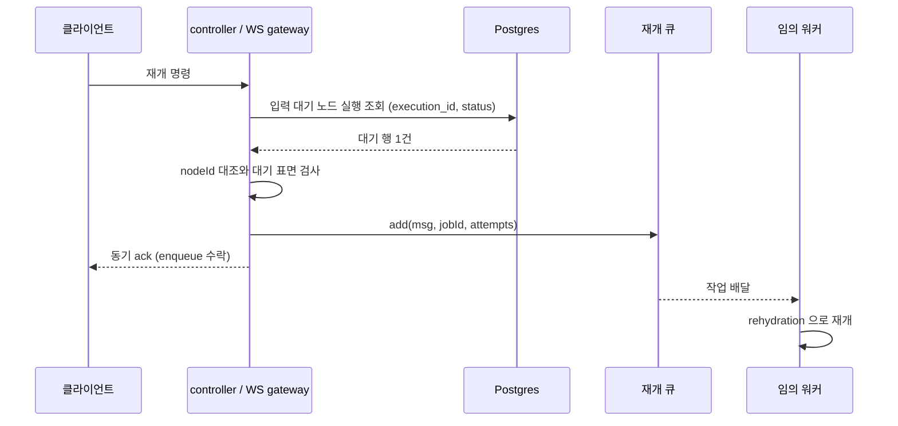

## 개요

이 문서는 [큐 워커와 동시 실행 제한](CLE-EXEC-WORKER.md) 의 하위 문서로 재개 큐(`execution-continuation`)의 계약, 재개 명령의 발행 흐름, 재개 워커의 동작과 claim 지점, 발행 전 사전 검증(nodeId · 대기 표면)과 진입점별 거부 코드를 정한다. 발행 결과와 ack 에러 표면은 [큐 워커 — 재개 ack 에러 표면](CLE-EXEC-WORKER-ACK.md) 이, 세그먼트 모델과 park 는 부모 문서가 정한다.

## 재개 큐

재개 큐(`execution-continuation`)는 재개 명령을 워커로 넘기는 영속 BullMQ 큐다. 옛 Redis pub/sub 채널 `execution:continuation` 을 대체했다. 영속 큐를 고른 이유는 [장애 복구와 안전 종료](CLE-EXEC-RECOVERY.md) 의 Rationale "영속 재개 큐와 안전 종료" 에 있다.

### 계약

| 항목 | 값 |
| --- | --- |
| 큐 이름 | `execution-continuation`. `background-execution` 과 같은 BullMQ 인프라를 쓴다. |
| 메시지 타입 | `continue` / `cancel` / `button_click` / `ai_message` / `ai_end_conversation` / `retry_last_turn` (`ContinuationType`, `continuation-bus.service.ts`). `continue` 메시지 payload 안의 표시 값(폼 제출이면 `{ type: 'form_submitted', formData }`)은 [Presentation 노드 공통](../CLE-NODE-PRES/CLE-NODE-PRES-COMMON.md#폼-제출-wire-format) 이 기준이다. |
| 메시지 스키마 | `{ type: ContinuationType, executionId: string, nodeExecutionId: string, payload?: unknown }` |
| jobId | `${executionId}:${nodeExecutionId}:${monotonic-seq}`. seq 는 executionId 마다 Redis INCR 로 받는 멱등 키다. 키와 TTL 은 [비동기 큐와 Redis 키 목록](../CLE-PLAT/CLE-PLAT-QUEUE.md) 의 `exec:cont:seq:<executionId>` 에 있다. |
| 큐 재시도 | `attempts: RESUME_BULLMQ_ATTEMPTS`(기본 3). 재시도 간격은 1초에서 4배씩 늘어나고 상한은 없다. 기본 3회면 재시도 간격은 1초 · 4초다. BullMQ 내장 `exponential`(2배씩)은 쓰지 않는다. 사용자 정의 backoff 전략 `continuation-exp4` 를 쓰고 워커의 `settings.backoffStrategy` 가 간격을 계산한다. 근거는 [Rationale 「재개 큐 재시도 간격을 사용자 정의 전략으로 4배씩 늘린다」](#재개-큐-재시도-간격을-사용자-정의-전략으로-4배씩-늘린다-2026-10-17) 에 있다. |
| 작업 보존 | `removeOnComplete: true`, `removeOnFail: false`. 실패 작업을 남겨 DLQ 적재량을 관측한다. |
| DLQ | 모든 시도를 소진하면 실행을 `cancelled` + `error.code='RESUME_FAILED'` 로 마감한다. 처리는 [장애 복구와 안전 종료](CLE-EXEC-RECOVERY.md) 에 있다. |
| 워커 동시성 | `CONTINUATION_WORKER_CONCURRENCY`(기본 1). 아래 [워커 동작](#워커-동작) 참조. |

`retry_last_turn` 은 AI 에이전트 멀티턴의 마지막 턴 재시도(`retry_last_turn`, WebSocket `execution.retry_last_turn`) 전용이다. 대상 행은 입력 대기 행이 아니라 새로 만든 `running` 행이다. 그래서 입력 대기 사전 검증과 `claimResumeEntry` 의 `waiting_for_input → running` 조건부 전이가 적용되지 않는다. 대신 `applyRetryLastTurn` 이 자체 원자 claim 을 한다(2026-07-28). 마지막 턴 재시도의 상태 전이는 [실행 상태 머신과 대기·재개](CLE-EXEC-STATE.md) 에 있다.

### 발행 흐름

재개 명령이 들어오는 진입점은 다음과 같다.

- REST `POST /executions/:id/continue`: 본문은 `{ formData? }` 뿐이다(폼 제출 전용).
- REST `POST /executions/:id/stop` 의 입력 대기 취소 분기
- WebSocket `execution.submit_form` / `execution.click_button` / `execution.submit_message` / `execution.end_conversation` / `execution.retry_last_turn`
- External Interaction API(EIA) `/interact`: 규칙은 [EIA 수신 API와 SSE](../CLE-IX/CLE-EIA-INBOUND.md) 에 있다.
- 채팅 채널의 in-process 전달(`scope: 'in_process_trusted'`)

엔진 쪽 메서드 `continueExecution` / `cancelWaitingExecution` / `continueButtonClick` / `continueAiConversation` / `endAiConversation` 은 모두 같은 순서를 따른다. `execution.retry_last_turn` 은 이 순서를 따르지 않는다. 기대 상태가 `failed` 이고 새 `running` 행을 만든 뒤 재개 큐에 넣는다.

1. 입력 수신부(controller 또는 WS gateway)가 `resolveWaitingNodeExecutionId` 로 현재 입력 대기 노드 실행을 DB 에서 찾는다. 조회 조건은 `execution_id + status='waiting_for_input'` 이다.
2. 찾은 단일 대기 행으로 [발행 전 사전 검증](#발행-전-사전-검증) 을 한다. nodeId 는 조회 조건이 아니라 조회 뒤 대조하는 값이다.
3. 대기 행의 `nodeExecutionId` 로 메시지를 채워 재개 큐에 넣는다(`bus.add(msg, { jobId, attempts })`).
4. 임의 인스턴스의 워커가 작업을 가져가 rehydration 으로 재개한다. 절차는 [장애 복구와 안전 종료](CLE-EXEC-RECOVERY.md) 에 있다.

`type`, `nodeExecutionId`, `payload` 는 클라이언트가 보내는 필드가 아니다. 발행자가 노드 실행 조회 뒤 구성하는 내부 메시지 필드다.

그림은 입력 대기 실행에 재개 명령이 들어와 워커에 닿기까지의 순서다. 동기 ack 는 enqueue 수락까지만 알린다.

- **라우팅 원칙**: 모든 진입점은 항상 재개 큐에 넣는다. 같은 인스턴스에서 바로 처리하는 분기는 없다. in-process `pendingContinuations` Map 이 제거돼 그런 분기 자체가 존재하지 않는다. 워커는 어느 인스턴스에서 작업을 가져가든 rehydration 으로 재개한다.
- **"No pending continuation" 즉시 throw 는 쓰지 않는다**: 단일 인스턴스에서는 이 상황을 정확히 판단할 수 없다. 처리할 대상이 메모리에 없으면 rehydration 이 DB 에서 다시 만든다.
- **입력 대기 사전 검증은 발행자 책임이다.**

### 워커 동작

- 임의 인스턴스가 작업을 가져가 항상 rehydration 경로로 재개한다. park 할 때 코루틴을 바로 풀어 주므로 in-process resolver 가 없다. 워커는 `runExecution` 을 직접 await 한다. 배리어(`firstSegmentBarriers`)도 `pendingContinuations` Map 도 없다. 이것이 발행 쪽 원칙 "항상 재개 큐에 넣는다" 의 워커 쪽 짝이다.
- **취소**: 메모리에 코루틴이 없으므로 park 취소는 `ContinuationExecutionProcessor` 가 `await applyCancellation(executionId)` 로 처리한다. 그 안에서 `cancelParkedExecution` 이 실행과 짝 입력 대기 노드 실행을 직접 `cancelled` 로 표시한다.
- **동시성**: `CONTINUATION_WORKER_CONCURRENCY` 기본값은 1(인스턴스당 직렬)이다. 대량 동시 재개에서 rehydration·그래프 빌드가 줄을 서 지연이 보이면 올린다. 재개 진입을 DB 원자 claim 으로 막으므로 동시성을 올리거나 인스턴스를 늘려도 "같은 턴 이중 실행 0" 불변식이 유지된다. 이 기본값은 성능 값이지 정합성 전제가 아니다. claim 지점은 메시지 타입마다 다르다.

| 메시지 타입 | claim 지점 |
| --- | --- |
| `continue` / `button_click` / `ai_message` / `ai_end_conversation` | `claimResumeEntry` 의 `waiting_for_input → running` 조건부 전이 |
| `retry_last_turn` | `applyRetryLastTurn` 의 `_retryState` 키 조건부 소비(`status='running'` + `jsonb_exists`) |
| `cancel` | claim 대상이 아니다. `cancelParkedExecution` 자체가 조건부 UPDATE 다. |

재개 진입 claim 의 결정 근거는 [장애 복구와 안전 종료](CLE-EXEC-RECOVERY.md) 의 Rationale 에, 마지막 턴 재시도 claim 의 결정 근거는 [실행 상태 머신과 대기·재개](CLE-EXEC-STATE.md) 의 Rationale 에 있다.

## 발행 전 사전 검증

입력 수신부는 발행 직전에 대기 노드 실행을 조회하고 도착 명령의 **nodeId 와 대기 표면**을 검사한다. `resolveWaitingNodeExecutionId` 가 `execution_id + status='waiting_for_input'` 로 단일 대기 행(정상 1건)을 찾은 뒤 검사한다. 아래 경우에는 재개 큐에 넣지 않고 바로 동기 응답한다.

| 경우 | 응답 코드(WS ack) | 원인 |
| --- | --- | --- |
| 일치하는 행 0건 | `INVALID_EXECUTION_STATE` | 실행이 다른 상태(`running` / `completed` / `cancelled` / `failed`)라 입력 대기 노드 실행이 없다. |
| 일치하는 행 2건 이상(불변식 위반) | `INVALID_EXECUTION_STATE` + `logger.warn` | 정상이라면 일어나지 않는다. race 나 데이터 손상을 의심한다. |
| nodeId 불일치 | `INVALID_EXECUTION_STATE` | 명령이 지정한 `nodeId` 가 실제 대기 노드와 다르다. 낡거나 잘못 지정한 제출을 현재 대기 노드에 적용하지 않고 거부한다. 호출자가 nodeId 를 지정할 때만 적용한다. 근거는 [EIA 수신 API와 SSE](../CLE-IX/CLE-EIA-INBOUND.md) 의 `STATE_MISMATCH`("다른 nodeId") 와 `InteractDto.nodeId` 계약이다. |
| 대기 표면(`interactionType`) 불일치 | `INVALID_EXECUTION_STATE` | 대기 노드의 대기 표면이 도착 명령을 받지 않는다. `form` 대기는 `submit_form` 만, `buttons` 대기는 `click_button` 만 받는다. `ai_conversation` / `ai_form_render` 대기는 네 명령을 모두 받는다. 표면을 판정할 수 없는 행(`form` 이 아니면서 `interactionType` 이 없는 행)도 거부한다(fail-closed). |

대기 표면(`WaitingInteractionType`) 값의 기준은 [인터랙션 타입 레지스트리](../CLE-IX/CLE-IX-TYPES.md) 다.

nodeId 불일치 검사는 `resolveWaitingNodeExecutionId(executionId, expectedCommand, expectedNodeId?)` 의 선택 인자 `expectedNodeId` 로 켠다. 호출자가 이 값을 채울 때만 동작한다. 대기 표면 검사는 모든 진입점에 적용한다.

| 진입점 | nodeId 검사 | 이유 |
| --- | --- | --- |
| EIA REST `/interact` | 적용(`InteractDto.nodeId` 전달) | 외부 토큰 호출자는 SSE `waiting_for_input` 의 `waitingNodeId` 를 받으므로 대상 nodeId 를 지정할 수 있다. |
| 채팅 채널 `scope: 'in_process_trusted'` | 면제 | 신뢰하는 합성 컨텍스트는 scope 단위로 면제한다(진입점 판정이 아니다). `HooksService.forwardToInteractionService` 의 고정 매핑(`text_message → submit_message` 등)은 대기 nodeId 를 모른다. 면제가 scope 전체에 적용되므로 nodeId 를 아는 채팅 채널 폼 제출(`handleFormStep`, `pendingFormModal.nodeId`)도 함께 면제된다. |
| WebSocket 재개 명령(`execution.*`) | nodeId 를 실었을 때 적용 | `execution.submit_message` / `click_button` / `end_conversation` 은 명령 본문에 `nodeId` 를 실을 수 있다. 실으면 대기 노드와 대조하고 없으면 건너뛴다(하위 호환). `execution.submit_form` 에는 nodeId 필드가 없다. 세 handler 가 `data.nodeId` 를 `expectedNodeId` 로 넘긴다. 프론트엔드는 `submit_message` / `end_conversation` 에 대기 노드 `nodeId` 를 이미 싣는다. |
| REST `/continue` | 미적용 | 요청 본문에 `nodeId` 파라미터가 없다(폼 제출 전용). |

"면제"와 "미적용"은 결과적으로 둘 다 nodeId 검사를 건너뛴다. 앞의 것은 신뢰 컨텍스트의 의도된 정책이고 뒤의 것은 진입점에 nodeId 계약이 없어서다. 어느 쪽도 대기 표면 검사는 건너뛰지 않는다.

**진입점별 코드**: `resolveWaitingNodeExecutionId` 는 조회가 잘못되면(0건 또는 여러 행) `InvalidExecutionStateError` 를 던진다. 발행 진입점은 이것을 동기로 돌려준다.

| 진입점 | 코드 |
| --- | --- |
| WebSocket gateway 재개 handler 4개 | ack `errorCode='INVALID_EXECUTION_STATE'` |
| REST `POST :id/continue` | 422 `INVALID_STATE` |
| EIA 외부 진입점(`interaction.service`) | 409 `STATE_MISMATCH` |

- 세 코드는 같은 뜻(상태 불일치 에러, invalid execution state)이다. WebSocket 과 REST 이름을 따로 두는 이유는 [Rationale](#rationale) 에 있다. REST 코드의 기준은 [에러 코드 규약과 카탈로그](../CLE-API/CLE-API-ERRCODES.md) 다.
- DB 조회 자체의 인프라 실패는 `INVALID_EXECUTION_STATE` 로 바꾸지 않고 원래 에러로 올린다(재시도 가능).
- `__no_node_exec__` sentinel 은 워커 쪽에만 남아 있다. 취소 계열(nodeExecutionId 없음)과 배포 전에 넣은 옛 작업을 처리하기 위해서다.
- `INVALID_EXECUTION_STATE` 는 입력 대기 진입점 밖에서도 "기대 상태가 아님" 의 일반 표현으로 쓴다. `execution.retry_last_turn`(기대 상태 `failed`)이 그 예다.
- 이 동기 거부는 rehydration 실패 코드 `RESUME_*` 와 다른 축이다. `INVALID_EXECUTION_STATE` 는 ack 동기 응답이고 `RESUME_*` 는 뒤따르는 `execution.cancelled` 이벤트로 온다.

## 구현 위치

- `codebase/backend/src/modules/execution-engine/waiting-surface-guard.ts` (발행 전 사전 검증의 대기 표면과 명령 조합 `isCommandAllowedOnSurface`)
- `codebase/backend/src/modules/execution-engine/queues/continuation-execution.queue.ts` (재개 큐 작업 옵션과 backoff 전략 이름 `continuation-exp4`)
- `codebase/backend/src/modules/execution-engine/continuation/continuation-bus.service.ts` (재개 큐 발행)
- `codebase/backend/src/modules/execution-engine/continuation/continuation-execution.processor.ts` (재개 큐 소비자. 워커 `settings.backoffStrategy` 가 재시도 간격을 계산한다)

## Rationale

### 대기 표면과 명령의 조합을 발행 전에 검사한다 (2026-07-11)

실행이 `waiting_for_input` 인지(`assertWaiting`)만 보면 다른 종류의 명령을 막지 못한다. 재개 처리기(`dispatchResumeTurn`)는 도착 메시지의 `type` 이 아니라 **대기 노드의 표면**으로 골라진다. 그래서 표면과 맞지 않는 명령이 통과하면 조용히 잘못 처리됐다. `form` 대기는 sentinel 불일치 폴백으로 **빈 폼이 제출된 것처럼** 완료됐다. `buttons` 대기는 `resolveButtonInteraction` 의 else(d) 폴백으로 **엉뚱한 `continue` 포트로 분기**했다. 그래서 `resolveWaitingNodeExecutionId` 가 대기 노드의 표면을 판정해 도착 명령의 허용 여부를 발행 전에 검사한다.

- **`form`/`buttons` 는 자기 명령만, `ai_conversation`/`ai_form_render` 는 넷 다 받는 이유**: AI 표면은 이미 다른 종류의 명령을 정상적으로 받도록 설계됐다. `render_form` 응답(`form_submitted`)과 낡은 `button_click` 을 다시 park 하는 불변식이 그것이다. 기준은 [AI 에이전트 노드 출력과 디버그](../CLE-NODE-AI/CLE-NODE-AGENT-OUTPUT.md) 와 [Presentation 노드 공통](../CLE-NODE-PRES/CLE-NODE-PRES-COMMON.md) 에 있다. 여기서 넷을 좁히면 두 계약이 깨진다. `form`/`buttons` 는 한 가지 목적의 표면이라 자기 명령만 받는 것이 자연스럽다.
- **새 코드를 만들지 않는 이유**: 기존 `InvalidExecutionStateError` 를 다시 쓰면 진입점별 매핑(WS ack `INVALID_EXECUTION_STATE` / REST `/continue` 422 `INVALID_STATE` / EIA 409 `STATE_MISMATCH`)이 저절로 따라온다. 이 거부는 EIA-IN-13 필수 요구사항과 EIA `STATE_MISMATCH` 행이 이미 약속한 동작이다. 코드가 그 미이행 틈을 메운 것이지 새 계약이 아니다.
- **판정할 수 없어도 거부(fail-closed)하는 이유**: 짝이 되는 `dispatchResumeTurn` 도 맞는 처리기를 못 찾으면 거부(`RESUME_CHECKPOINT_MISSING`)한다. 표면을 판정할 수 없는 행은 어차피 워커에서 그 에러로 실행이 끝난다(`form` 은 정적 handler metadata 로 항상 판정되므로 이 경우에 오지 않는다). 발행 전에 동기로 거부하면 실행이 `waiting_for_input` 으로 남아 복구 가능성이 높다. 이 프로젝트의 fail-open 선례는 인프라 가용성(Redis/DB) 상황에 한정된다. 데이터 정합성 검사는 fail-closed 가 원칙이다. 서브 워크플로우 워크스페이스 격리를 fail-closed 로 바꾼 선례와 같은 방향이다.

nodeId 불일치 행은 2026-07-14 에 표면 불일치 행 앞에 더했다.

### `INVALID_EXECUTION_STATE` 와 `INVALID_STATE` 이름을 나눠 둔다

발행 전 사전 검증의 0건·여러 행 경우를 WebSocket 은 `INVALID_EXECUTION_STATE` 로, REST 는 422 `INVALID_STATE` 로 응답한다. 두 층을 `INVALID_STATE` 하나로 합치면 WS ack 를 처리하는 클라이언트가 같은 코드를 동기 ack 응답과 뒤따르는 이벤트로 나눠 분기하기 어렵다. 이름을 나눠 두면 코드 이름만 보고 경로를 알 수 있다. 두 층이 같은 뜻이라는 점은 본문에서 서로 링크한다. 이 코드는 입력 대기 진입점(`execution.submit_form` / `click_button` / `submit_message` / `end_conversation`) 밖에서 `execution.retry_last_turn`(기대 상태 `failed`)에도 같은 뜻으로 쓴다.

### 재개 큐 재시도 간격을 사용자 정의 전략으로 4배씩 늘린다 (2026-10-17)

이 문서는 재개 큐의 재시도 간격을 «exponential backoff(1초 / 4초 / 16초)» 로 적었다. 코드는 BullMQ 내장 `exponential` 전략에 `delay: 1000` 을 주었다. 내장 전략은 간격을 2배씩 늘리므로 실제 간격은 1초 · 2초였다. 코드 주석에는 4배가 적혀 있었다. 사람 결정으로 코드를 문서의 의도에 맞췄다.

- 재개 큐는 사용자 정의 backoff 전략 `continuation-exp4` 를 쓴다. 간격은 1초에서 4배씩 늘어나고 상한은 없다.
- 기본 시도 횟수 3회면 재시도 간격은 1초 · 4초다. 재시도 대기의 합은 3초에서 5초로 늘어난다.
- 옛 서술의 16초는 시도 횟수를 4 이상으로 올렸을 때의 셋째 간격이다. 기본값에서는 나오지 않으므로 계약 표에서 뺐다.

기각한 대안은 세 가지다.

- 문서를 1초 · 2초로 고치는 안. 문서와 코드 주석이 모두 4배를 적었으므로 4배가 의도한 값이다.
- 내장 `exponential` 의 `delay` 만 바꾸는 안. 내장 전략의 배수는 2로 고정돼 있어 4배를 만들 수 없다.
- EIA 알림 웹훅의 `exp-base4` 전략을 그대로 쓰는 안. 알림 재시도 간격에는 1시간 상한이 있고 재개 큐에는 상한이 없다([EIA 알림 웹훅 「재시도와 실패 처리」](../CLE-IX/CLE-EIA-NOTIFY.md#재시도와-실패-처리)). 이름을 나눠 두 동작을 구분한다. 코드에서 두 전략이 계산 함수를 함께 쓰는 것은 허용한다.
