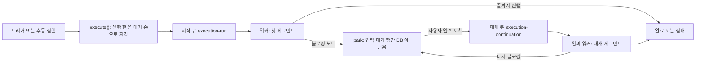

> 구현 상태: 부분 구현 · 원문: `spec/5-system/4-execution-engine.md` (§4, §7.4 Continuation Bus, §7.5.1, §7.5.2, §8, §11 환경 변수 표, Rationale), `spec/data-flow/3-execution.md` (§1.1, §1.5, Rationale) · 용어: [용어 사전](../CLE-GLOSSARY.md)

## 개요

실행 엔진은 실행(Execution, `execution`) 한 건을 여러 서버 인스턴스의 워커에 나눠 맡긴다. 한 실행은 워커가 노드를 실제로 전진시키는 세그먼트(active segment)들과 그 사이의 park 로 이루어진다. 세그먼트는 BullMQ 큐 두 개가 운반한다. 첫 세그먼트는 시작 큐(`execution-run`)가, 재개 세그먼트는 재개 큐(`execution-continuation`)가 맡는다. 입력 대기(waiting for input, `waiting_for_input`) 동안에는 어느 큐에도 작업이 없고 실행 행만 DB 에 남는다.

이 문서는 세그먼트 모델, 두 큐의 계약, 재개 명령(continuation command)의 발행과 사전 검증, 발행 결과의 ack 에러 표면, 수평 확장, park 규칙, 실행 이벤트 발행 경로, 동시 실행 제한(admission gate, `maxConcurrentExecutions`)과 실행 시간 한도(`EXECUTION_MAX_ACTIVE_RUNNING_MS`)를 정한다.

범위 밖:

- 워커가 죽은 뒤의 재구동, rehydration 절차, 안전 종료는 [장애 복구와 안전 종료](CLE-EXEC-RECOVERY.md) 가 정한다.
- 실행 상태와 노드 실행 상태의 전이는 [실행 상태 머신과 대기·재개](CLE-EXEC-STATE.md) 가 정한다.
- 저장소 전체의 BullMQ 큐 목록, Redis 키, DLQ 모니터 설정은 [비동기 큐와 Redis 키 목록](../CLE-PLAT/CLE-PLAT-QUEUE.md) 이 정한다.
- 실행·노드 실행 테이블과 데이터 흐름 시퀀스는 [실행 데이터와 흐름](CLE-EXEC-DATA.md) 에 있다.
- 세그먼트 안의 그래프 순회는 [실행 엔진 개요와 그래프 순회](CLE-EXEC-ENGINE.md), Background 본문 큐(`background-execution`)는 [컨테이너 실행](CLE-EXEC-CONTAINER.md) 과 [Background 노드](../CLE-NODE-LOGIC/CLE-NODE-BACKGROUND.md) 가 다룬다.
- WebSocket 명령과 ack 의 wire 형식은 [WebSocket 이벤트와 명령](../CLE-API/CLE-API-WS-EVENTS.md), 에러 코드 카탈로그는 [에러 코드 규약과 카탈로그](../CLE-API/CLE-API-ERRCODES.md) 가 기준이다.

## 하위 문서

| 문서 | 다루는 내용 | 요구사항 |
| --- | --- | --- |
| [큐 워커 — 재개 큐와 사전 검증](CLE-EXEC-WORKER-RESUME.md) | 재개 큐 계약, 재개 명령의 발행 흐름, 재개 워커 동작과 claim 지점, 발행 전 사전 검증(nodeId · 대기 표면)과 진입점별 거부 코드 | 없음 |
| [큐 워커 — 재개 ack 에러 표면](CLE-EXEC-WORKER-ACK.md) | 발행 결과 `ContinuationPublishResult` 와 진입점별 큐 적재 실패 응답, 동기 ack 의 뜻, ack 에러 변환(`ExecutionError` · `EXECUTION_INTERNAL_ERROR`) | 없음 |
| [큐 워커 — 동시 실행 제한과 시간 한도](CLE-EXEC-WORKER-LIMIT.md) | 워크스페이스 · 워크플로우 동시 실행 제한, 실행 시간 한도, 큐 대기 한도, 원자 검사(advisory lock), 환경 변수 | 없음 |

## 세그먼트와 park

한 실행은 세그먼트들이 이어진 것이다. 세그먼트 사이에는 park(`waiting_for_input`)가 끼어 있다.

- **세그먼트**: 워커가 실행을 한 번 이어서 진행하는 구간이다. 시작이나 재개에서 출발해 다음 블로킹 노드에 닿거나 실행이 끝나면 멈춘다. 한 세그먼트는 한 워커 프로세스 안에서 처음부터 끝까지 돈다.
- **두 운반 큐**: 시작 큐(`execution-run`)가 첫 세그먼트(시작부터 첫 BLOCK 또는 완료까지)를, 재개 큐(`execution-continuation`)가 매 재개 세그먼트를 운반한다.
- **park**: 입력 대기는 큐에 들어가지 않는 DB 상태다. 규칙은 [입력 대기 park](#입력-대기-park) 에 있다.
- **세그먼트 안의 노드 dispatch**: `runExecution` 의 in-process 반복문이 노드를 차례로 부른다. 노드 한 개를 워커 한 개에 보내는 노드 단위 큐(per-node task queue, 1 워커 = 1 노드 실행)는 두지 않는다. 근거는 [Rationale](#rationale) 의 "노드 단위 큐 대신 실행 단위 시작 큐" 에 있다.

실행 엔진이 쓰는 BullMQ 큐는 `execution-run`, `execution-continuation`, `background-execution` 세 개다. 셋 다 실행이나 세그먼트 단위 작업을 나른다. 노드 단위 작업을 나르는 큐는 없다.



그림은 실행 하나의 수명을 보여 준다. 시작 큐와 재개 큐가 세그먼트를 운반하고 park 동안에는 큐에 아무것도 없다.

## 시작 큐

시작 큐(`execution-run`)는 실행 시작 요청을 받아 워커에 나눈다. 시작 큐는 2026-06-04, 우선순위 3단계는 2026-07-04 에 구현됐다.

### 발행

- `execute()` 는 실행 행을 대기 중(`pending`)으로 저장하고 시작 큐에 "실행 시작" 작업을 발행한 뒤 executionId 를 바로 돌려준다(비동기). 반환 직후 실행이 곧바로 시작된다는 보장은 없다.
- 백엔드·워커 인스턴스 N 개가 work-stealing 으로 작업을 가져간다. 웹훅이나 이벤트가 몰리면 시작 큐가 버퍼 역할을 해 backpressure 가 생긴다.
- 시작 큐는 `background-execution`, `execution-continuation` 과 같은 BullMQ 인프라를 쓴다.
- 작업 메시지:

```json
{
  "executionId": "uuid",
  "input": { }
}
```

- **jobId = `executionId`**: 실행 행을 만들 때마다 정확히 한 번 발행하므로 executionId 만으로 유일하다. BullMQ 가 같은 jobId 의 중복 발행을 자동으로 거른다(`buildExecutionRunJobId`). seq 는 쓰지 않는다. stalled 재배달도 같은 jobId 작업을 그대로 다시 처리하므로 seq 가 필요 없다. `<executionId>:run:<seq>` 형식은 명시적 재발행을 도입하는 미래 변경에서만 쓴다. 그 키(`exec:run:seq:<executionId>`)의 예약 상태는 [비동기 큐와 Redis 키 목록](../CLE-PLAT/CLE-PLAT-QUEUE.md) 에 있다.
- **우선순위**: BullMQ job priority 로 `manual`(1) > `webhook`(2) > `schedule`(3) 순서를 둔다(`EXECUTION_RUN_PRIORITY`).
  - `execute()` 는 `executedBy` 를 먼저 본다. `executedBy` 가 있으면 `manual` 이다. 수동 실행과 스케줄의 "지금 실행"(`runNow`)이 여기에 든다.
  - 그 밖에는 호출부(웹훅·채팅 채널·스케줄)가 `ExecuteOptions.triggerType` 으로 넘긴 값(`Trigger.type` 어휘 `webhook`/`schedule`)을 쓴다. 넘기지 않으면 `webhook` 으로 본다. 이 값을 `resolveExecutionRunPriority` 에 넘긴다.
  - `triggerType` 은 작업 payload 에 싣지 않는다. 우선순위 계산에만 쓴다. 실행 내역에 보이는 실행 출처(`triggerSource`)와는 다른 값이다. 실행 출처 규칙은 [실행 내역](CLE-EXEC-HISTORY.md) 에 있다.
- **작업 옵션**: `attempts: 1`(작업이 throw 해도 자동 재시도 없음), `maxStalledCount: 1`, `stalledInterval: 30초`, `removeOnComplete: true`, `removeOnFail: false`. stalled 재배달의 동작과 소진 처리는 [장애 복구와 안전 종료](CLE-EXEC-RECOVERY.md) 에 있다.

### 소비

`ExecutionRunProcessor` 가 작업을 가져와 `runExecutionFromQueue` 에 넘긴다. `runExecutionFromQueue` 는 실행 상태를 다시 읽어 세 갈래로 나눈다.

| 다시 읽은 실행 상태 | 처리 |
| --- | --- |
| `pending` | 트리거가 있으면 routing context 를 작업을 가져간 인스턴스에 등록한다. [동시 실행 제한](CLE-EXEC-WORKER-LIMIT.md#동시-실행-제한) 검사를 통과하면 `runExecution` 으로 첫 세그먼트를 시작한다. |
| `running` | stalled 재배달로 본다. `recordRunningSegmentStart` 와 `redriveStuckExecution` 으로 재구동한다. 절차는 [장애 복구와 안전 종료](CLE-EXEC-RECOVERY.md) 에 있다. |
| 그 밖(종료 상태, `waiting_for_input`) | 큐에서 기다리는 동안 취소되거나 park 한 경우다. 작업을 ack 하고 버린다. 다시 실행하지 않는다. |

- BullMQ job lock 이 같은 작업의 동시 처리를 막으므로 이 분기에 별도 DB claim 은 없다.
- 세그먼트가 끝나는 방식은 두 가지다. (a) 실행이 완료나 실패로 끝나면 작업을 정상 ack 한다. (b) 노드가 BLOCK(`waiting_for_input`)하면 park 처리 뒤 작업을 정상 ack 한다.
- 워커는 첫 세그먼트(시작부터 첫 BLOCK 또는 완료까지)만 await 한다. park 동안 BullMQ 작업을 붙잡지 않는다.

### 서브 워크플로우 자식 실행

서브 워크플로우 호출은 시작 큐를 거치지 않는다. 비동기 호출(`executeAsync`)은 자식 실행 행을 만든 뒤 `runExecution` 을 자체 promise 로 실행한다. 동기 호출은 부모 실행 안에서 `executeInline` 으로 돈다. 모드 정의는 [워크플로우 호출 노드](../CLE-NODE-FLOW/CLE-NODE-SUBWF.md), 진입점별 데이터 흐름은 [실행 데이터와 흐름](CLE-EXEC-DATA.md) 에 있다. 자식 실행에 동시 실행 제한과 stalled 재배달이 적용되는지는 정의가 갈린다. [미결 사항](#미결-사항) 참조.

## 재개 큐

재개 큐(`execution-continuation`)는 재개 명령을 워커로 넘기는 영속 BullMQ 큐다. 옛 Redis pub/sub 채널 `execution:continuation` 을 대체했다. 계약 · 발행 흐름 · 워커 동작은 → [큐 워커 — 재개 큐와 사전 검증](CLE-EXEC-WORKER-RESUME.md#재개-큐)

### 발행 전 사전 검증

→ [큐 워커 — 재개 큐와 사전 검증](CLE-EXEC-WORKER-RESUME.md#발행-전-사전-검증)

### 발행 결과와 ack 에러 표면

→ [큐 워커 — 재개 ack 에러 표면](CLE-EXEC-WORKER-ACK.md#발행-결과와-ack-에러-표면)

## 세그먼트 직렬화 불변식

- 시작 큐의 `jobId = executionId` 중복 제거 때문에 한 실행의 세그먼트는 **항상 하나**다. 두 세그먼트가 동시에 돌지 않는다.
- 실행 시간 한도는 `assertActiveTimeWithinLimit`(판정)와 `updateExecutionStatus`(누적) 사이에 잠금 없이 읽고 판단하고 쓴다. 이 불변식 때문에 그 사이에 다른 세그먼트가 끼어들 경로가 없어 실제 race 는 없다.
- **마지막 턴 재시도 경로 재검증(2026-07-28)**: `retry_last_turn` 은 재개 큐 jobId(`${executionId}:${nodeExecutionId}:${seq}`)를 써서 `jobId = executionId` 중복 제거 밖에 있다. 그래서 이 불변식이 저절로 성립하지 않는다. `applyRetryLastTurn` 이 자체 원자 claim 으로 같은 보장을 만든다. `status='running'` 과 `jsonb_exists` 조건으로 `input_data - '_retryState'` 를 UPDATE 하고 affected=1 인 배달만 진행한다.
- 크래시 재구동 경로의 재검증과 남은 zombie race 는 [장애 복구와 안전 종료](CLE-EXEC-RECOVERY.md) 에 있다.
- 동시 실행 제한에 걸려 다시 넣는 작업은 jobId 없이 자동 id 를 받는다. 이 작업과 위 불변식의 관계는 [미결 사항](#미결-사항) 참조.

## 수평 확장

| 항목 | 설명 |
| --- | --- |
| 워커 인스턴스 수 | 백엔드 인스턴스 수로 정한다(로드 밸런서 뒤 N 개). |
| 워커당 동시성 | `EXECUTION_RUN_WORKER_CONCURRENCY`. 잘못된 입력 처리는 `CONTINUATION_WORKER_CONCURRENCY` 방식을 따른다. |
| 스케일 아웃 | 백엔드·워커 프로세스를 더하면 처리량이 늘어난다(work-stealing). |
| 우선순위 | BullMQ job priority 로 `manual` > `webhook` > `schedule`(`triggerType` → priority 매핑) |
| 큐 분할 | 워크스페이스별 큐 분리는 후속이다. 지금은 시작 큐 하나에 priority 와 concurrency 를 둔다. |

## 입력 대기 park

시작 큐 도입은 대기의 의미를 바꾸지 않는다. 입력 대기는 세그먼트가 아니라 두 세그먼트 사이의 park 다.

- **BLOCK 진입**: 그 세그먼트를 운반하던 작업(시작 큐 또는 재개 큐)은 "BLOCK 이나 완료까지 전진" 이라는 자기 일을 끝낸 것이다. 작업을 정상 ack 하고 지운다. 실패나 재시도가 아니다. 실행 행만 `waiting_for_input` 으로 남는다.
- **park 상태**: 큐 항목이 없다. heartbeat 도 TTL 도 없다. stalled 재배달 대상이 아니고 부팅 복구 스캔(`recoverStuckExecutions`) 대상도 아니다. DB 에 기한 없이 남는다.
- **재개**: 사용자 인터랙션이 도착해야만 재개 큐 작업이 생기고 다음 세그먼트가 시작된다.
- **노드별 대기 타임아웃은 없다**: Presentation 노드는 외부 취소나 종료가 없으면 입력을 기한 없이 기다린다. 기준은 [Presentation 노드 공통](../CLE-NODE-PRES/CLE-NODE-PRES-COMMON.md#규칙) 의 규칙 10 이다. 노드 설정에 대기 타임아웃 필드(원문의 `formConfig.timeout` 등)는 없다. 실행 시간 한도는 park 시간을 세지 않는다.
- **예외 회수**: 다시 이어 갈 수 없음이 확실한 park 만 예외로 회수한다. 공개 웹채팅 위젯의 익명 per_execution 토큰이 영구 만료된 경우다. 이 회수는 엔진 부팅 복구가 아니라 EIA 계층의 토큰 수명 sweep 이 `cancelled` 로 처리한다. 그래서 park 무기한 보존 불변식과 충돌하지 않는다. 규칙은 [External Interaction API](../CLE-IX/CLE-EIA.md) 의 EIA-RL-07 에 있다.

**park 는 세그먼트 종료다(Phase B, 구현 완료)**: park 에서 `runExecution` 세그먼트가 바로 반환한다.

- form·button·멀티턴 AI 의 각 `waitForX` 는 재개에 필요한 상태를 DB 에 남긴 뒤 기다리지 않고 반환한다. 남기는 항목은 대화 스레드(`Execution.conversation_thread`), 사용자 정의 변수(`Execution.user_variables`), AI 재개 체크포인트(`_resumeCheckpoint`), 호출 스택(`Execution.resume_call_stack`)이다. 무엇을 언제 커밋하는지는 [실행 컨텍스트](CLE-EXEC-CONTEXT.md) 의 저장 전략이 정한다.
- `runExecutionFromQueue`(워커 `process()` 진입점)는 `runExecution` 의 반환만 await 하고 작업을 ack 한다. park 동안 BullMQ 슬롯도 코루틴도 컨텍스트 메모리도 쓰지 않는다.
- 멀티턴 AI 는 턴 단위로 park 한다. 한 턴 처리가 한 세그먼트다. 응답 없는 대화도 메모리를 쓰지 않는다.
- 재개는 임의 워커가 rehydration 으로 컨텍스트를 다시 만들어 다음 세그먼트를 구동한다. 모든 park 지점(단발 form·button, 최상위와 중첩 멀티턴 AI, 중첩 `executeInline` 블로킹)이 이 한 경로로 재개한다. 절차와 결정 근거는 [장애 복구와 안전 종료](CLE-EXEC-RECOVERY.md) 에 있다.

## 실행 이벤트 발행 경로

**결정**: 실행 엔진의 외부 이벤트(`NODE_STARTED` / `NODE_COMPLETED` / `EXECUTION_*` / `AI_MESSAGE` 등) 발행 대상은 `WebsocketService` 하나다. `IExecutionEventEmitter` 같은 인터페이스나 Nest `EventEmitter2` 같은 별도 추상화를 두지 않는다.

- 재개 신호의 인스턴스 사이 전달은 재개 큐가 맡는다(옛 Redis pub/sub 채널 `execution:continuation` 은 폐기). 실행 이벤트를 다른 인스턴스의 WebSocket 구독자에게 보내는 일은 `WebsocketService` 뒤의 게이트웨이(Socket.IO Redis adapter)가 맡는다([WebSocket 연결과 채널 구독 — 메시지 · 구독 · 에러 「4.6 여러 서버 인스턴스에서의 전달」](../CLE-API/CLE-API-WS-MSG.md#46-여러-서버-인스턴스에서의-전달)). 엔진은 그대로 `WebsocketService` 하나에만 발행하고 인스턴스 사이 전달을 알지 못한다.
- `ExecutionEventEmitter` 는 발행 호출 지점을 한데 모은 **같은 모양의 얇은 래퍼**다. 이 절이 금지하는 외부 이벤트 발행 추상화 인터페이스가 아니므로 단일 발행 정책의 예외가 아니다. 이 래퍼가 생긴 배경(엔진 클래스 분할)은 [실행 엔진 개요와 그래프 순회](CLE-EXEC-ENGINE.md) 의 Rationale 에 있다.
- External Interaction API 의 EIA 알림 웹훅(Outbound Notification Webhook)과 외부 SSE 어댑터가 생긴 뒤에도 엔진 수준 단일 발행 정책은 유지한다. NotificationDispatcher 와 SSE 어댑터(Redis 로 인스턴스 사이 fan-out 하는 부분 포함, [EIA 데이터와 흐름](../CLE-IX/CLE-EIA-DATA.md))는 모두 엔진 밖 facade 층에 둔다. 엔진 코드는 외부 발행 대상의 종류를 알 필요가 없다. 기준은 [External Interaction API](../CLE-IX/CLE-EIA.md) 의 R10 이다.
- 외부 발행 대상(웹훅 콜백, 텔레메트리 export 등)이 실제로 더해지면 이 결정을 다시 검토한다.

**순환 의존 처리**: 엔진의 DI 순환은 성격에 따라 두 표준 기법으로 푼다. 둘 다 NestJS 표준이며 회피용 안티패턴이 아니다.

| 기법 | 적용 기준 | 사례 |
| --- | --- | --- |
| `forwardRef(() => X)`(생성자 주입 지연) | 순환은 있지만 양쪽이 부트스트랩 때 함께 인스턴스화돼 정상 해석되는 경우. 기본 선택이다. | `ExecutionEngineService ↔ WebsocketService`, `ExecutionEventEmitter → WebsocketService`(ES-module 순환 봉인) |
| `ModuleRef.get(X, { strict: false })`(런타임 지연 해석) | 순환 그래프에서 이 서비스가 상대 모듈보다 먼저 인스턴스화돼 생성자 `@Optional` 주입이 `undefined` 로 굳는 경우. `forwardRef` 로도 풀리지 않는 인스턴스화 순서 함정을 런타임 해석으로 피한다. | `ExecutionEngineService → NotificationsService`(`getNotificationsService`. 해석하지 못하면 `execution_failed` 알림 발송이 조용히 no-op 이 된다), `NotificationsService → WebsocketService`(`getWebsocket`) |

- 순환 자체를 이벤트 기반 분리 등으로 근본적으로 줄이는 일은 별도 대규모 리팩터링 backlog 다. 지금은 두 기법으로 봉인한 상태를 유지한다.
- **모듈 그래프 층의 완화책**: 위 두 기법은 DI 그래프를 다룬다. 순환은 모듈 그래프 층에서도 다른 실패를 낸다. 순환 위의 모듈이 모듈 평가 시점에 다른 모듈의 값(enum 등)을 읽으면 아직 `undefined` 다. 이 문제는 값·타입 선언을 의존성 없는 모듈로 떼어 내 푼다(`codebase/backend/src/modules/websocket/websocket-events.types.ts`). 이 조치로 DI 그래프, `forwardRef` 배치, 단일 발행 정책은 바뀌지 않는다. 줄어든 것은 모듈 그래프이지 DI 그래프가 아니다.

## 동시 실행 제한

→ [큐 워커 — 동시 실행 제한과 시간 한도](CLE-EXEC-WORKER-LIMIT.md#동시-실행-제한)

## 미결 사항

- **서브 워크플로우 자식 실행의 큐·제한 적용 범위**: 데이터 흐름 문서는 서브 워크플로우 호출(`executeAsync`, 그리고 옛 서술의 `executeSync`)이 시작 큐를 타지 않는다고 적는다(관련: [실행 데이터와 흐름](CLE-EXEC-DATA.md)). 엔진 원문의 워커 모델과 동시 실행 제한 절은 새 실행이 시작 큐와 동시 실행 제한 검사를 거친다고만 적고 이 예외를 말하지 않는다. 그래서 비동기 자식 실행이 동시 실행 제한과 stalled 재배달의 대상인지 알 수 없다. 현재 구현은 `executeAsync` 가 `runExecution` 을 직접 부른다(원문 데이터 흐름 기준, 코드 재확인 안 함). 적용 범위를 정해야 한다.
- **동시 실행 제한 재발행 작업과 세그먼트 직렬화 불변식**: 워커 모델 절은 `jobId = executionId` 중복 제거로 한 실행의 세그먼트가 항상 하나라고 적는다. Rationale "방치된 대기 중 실행 회수" 는 동시 실행 제한에 걸려 다시 넣는 작업이 jobId 없는 자동 id 라고 적는다. 따라서 중복 제거는 첫 발행에만 걸린다. 실제 이중 진행은 동시 실행 제한 검사의 조건부 UPDATE(`WHERE status='pending'`)가 막는 것으로 보이나 원문에 명시되지 않았다(관련: [장애 복구와 안전 종료](CLE-EXEC-RECOVERY.md)). 불변식 서술에 재발행 작업의 처리를 적어야 한다.

## 구현 위치

- `codebase/backend/src/modules/execution-engine/execution-engine.service.ts` (`execute`, `runExecutionFromQueue`, 동시 실행 제한 검사 `admitExecutionOrDefer`)
- `codebase/backend/src/modules/execution-engine/queues/execution-run.queue.ts` (시작 큐와 우선순위, 작업 옵션)
- `codebase/backend/src/modules/execution-engine/queues/execution-run.processor.ts` (시작 큐 소비자)
- `codebase/backend/src/modules/websocket/websocket-events.types.ts` (이벤트 값·타입 선언 분리)
- 재개 큐 · 사전 검증 파일은 [재개 큐와 사전 검증](CLE-EXEC-WORKER-RESUME.md#구현-위치), 한도 파일은 [동시 실행 제한과 시간 한도](CLE-EXEC-WORKER-LIMIT.md#구현-위치) 에 있다.

## Rationale

### 노드 단위 큐 대신 실행 단위 시작 큐 (2026-06-04 결정, PR1)

- **배경**: 초기 모델은 `execute()` 가 같은 인스턴스에서 바로 실행 반복문에 들어가는 fire-and-forget in-process 방식이었다. 웹훅이 몰려도 backpressure 가 없었다. 실행이 요청을 받은 인스턴스에 고정돼 수평 확장도 안 됐다. 원래 목표 그림은 노드 단위 큐(1 워커 = 1 노드 실행, 노드마다 `{taskId, nodeId, nodeType, input, context, timeout}` 태스크 발행)였으나 구현되지 않았다. 성능·안정성·대량·분산 처리 신뢰성이 사용 방식과 관계없는 기반 요건으로 확인돼 구현에 들어가면서 설계를 다시 검토했다.
- **기각(노드 단위 큐)**: in-process dispatch 반복문은 컨테이너(Loop/ForEach/Map), 중첩 컨테이너 스코프 체인([컨테이너 실행](CLE-EXEC-CONTAINER.md). 원문은 `$parent` 로 적었으나 그 변수는 없다), back-edge 순환, Parallel(`p-limit` + `allSettled`)을 "한 실행이 한 프로세스 안에 있다" 는 전제로 처리한다. 노드를 워커로 나누려면 노드마다 실행 컨텍스트 전체(변수, loop·item 컨텍스트, 스코프 체인, 대화 스레드)를 직렬화하고 rehydration 해야 한다. rehydration 인프라는 "입력 대기 뒤 재개" 용이지 "실행 중 노드 인계" 용이 아니다. 엔진을 다시 쓰는 수준의 고위험 작업이다.
- **채택(실행 단위 시작 큐)**: 워커가 실행 1건의 세그먼트를 통째로 처리한다. 세그먼트 안의 노드 dispatch 는 in-process 로 둔다. n8n queue mode 와 같은 구조이며 수평 처리량, work-stealing, backpressure, 동시 실행 제한의 토대를 노드 단위 방식보다 훨씬 낮은 위험으로 얻는다. `background-execution` 과 재개 큐 패턴을 그대로 다시 쓴다.
- **세그먼트 모델과 맞물림**: 재개 큐가 이미 "재개 세그먼트" 를 운반하고 있었으므로 시작 큐가 그 짝으로 "첫 세그먼트" 를 운반하면 두 큐가 세그먼트를, park 가 그 사이를 맡는 구조가 완성된다.
- **대가**: 한 실행 안의 노드들을 여러 워커로 나누는 세밀한 분산은 포기한다. 단일 실행이 매우 무겁고 내부 분산이 실제로 필요해지면 다시 검토한다(지금은 그런 요구가 없다). 워크스페이스별 큐 분할도 후속이다.
- **서브 워크플로우는 시작 큐를 타지 않는다**: 부모 세그먼트 안에서 동기 await 나 자체 promise 로 충분하다. 큐를 한 번 더 거치면 부모 세그먼트의 지연만 늘어난다(원문 데이터 흐름 Rationale).
- **노드 단위 큐가 없음을 확정**: 엔진 큐 셋([세그먼트와 park](#세그먼트와-park))은 모두 실행·세그먼트 단위 작업을 나른다. 안전 종료 절차도 이 전제를 따른다.

### 실행 이벤트 발행 대상을 하나로 둔다

- 이 시스템의 외부 이벤트 소비자는 WebSocket 클라이언트 한 종류뿐이다. 발행 대상이 여럿으로 드러나기 전까지 추상화는 YAGNI 다.
- 분산은 재개 큐(재개 신호)와 게이트웨이의 Redis adapter(이벤트 전달)가 맡으므로 이벤트 발행 추상화와 관계가 없다.
- 테스트에서는 `Partial<WebsocketService>` mock 으로 충분하다. 추상화 인터페이스용 noop 구현체가 필요 없다.

### 재개 큐 재시도 간격을 사용자 정의 전략으로 4배씩 늘린다 (2026-10-17)

→ [재개 큐와 사전 검증 Rationale](CLE-EXEC-WORKER-RESUME.md#재개-큐-재시도-간격을-사용자-정의-전략으로-4배씩-늘린다-2026-10-17)

### 진입점마다 큐 적재 실패를 다르게 알린다 (2026-10-17)

→ [재개 ack 에러 표면 Rationale](CLE-EXEC-WORKER-ACK.md#진입점마다-큐-적재-실패를-다르게-알린다-2026-10-17)
