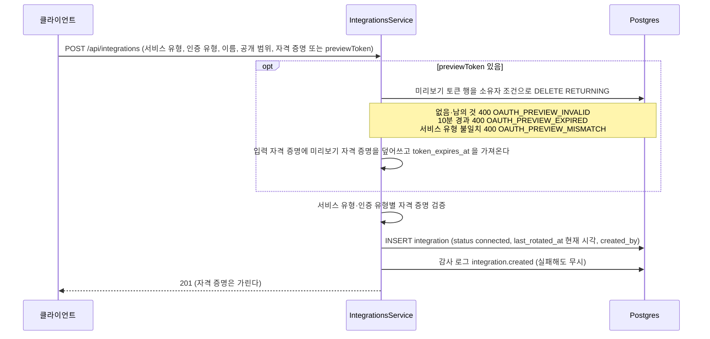
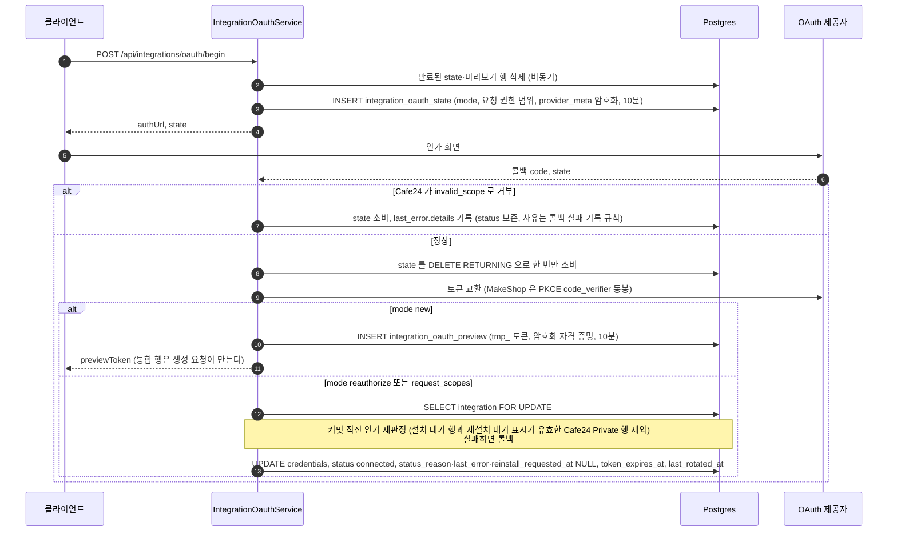
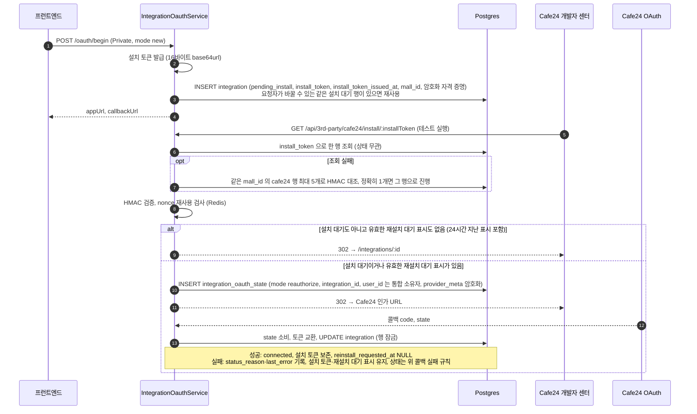
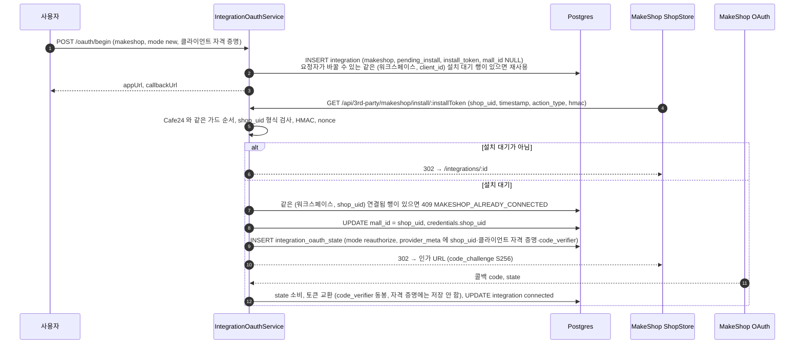

> 구현 상태: 구현됨 · 원문 출처는 부모 [통합 데이터와 흐름](CLE-INT-DATA.md) 머리 줄 · 용어: [용어 사전](../CLE-GLOSSARY.md)

## 개요

이 문서는 [통합 데이터와 흐름](CLE-INT-DATA.md) 의 하위 문서로 통합 생성 · OAuth 연결 · 자격 증명 교체 · 설치 흐름이 어느 테이블에 무엇을 쓰는지 정한다. 테이블 정의는 [엔티티와 인덱스](CLE-INT-DATA-ENTITY.md), API 계약과 에러 매핑은 [OAuth 연결과 토큰 갱신](CLE-INT-OAUTH.md) 이 정한다.

## 통합 생성

`POST /api/integrations` 는 두 입력을 받는다. 하나는 API Key 류처럼 사용자가 직접 넣은 자격 증명이고, 다른 하나는 새 OAuth 연결이 발급한 미리보기 토큰(`previewToken`)이다. 새 OAuth 연결의 통합 행은 콜백이 아니라 이 요청에서 생긴다.

`last_rotated_at` 을 생성 시각으로 채우는 이유는 NULL 로 두면 Cafe24 백그라운드 갱신의 기준 시각 비교에서 계속 빠질 수 있어서다. 스캐너 조건에 `IS NULL` 분기도 따로 둔다.

INSERT 는 트랜잭션 안에서 한다. 트랜잭션을 열면 먼저 워크스페이스, 멤버십 순으로 잠그고(`lockForIntegrationWrite`) 그다음 통합을 INSERT 한다. 멤버십은 개인 통합일 때만 잠근다. 개인 통합인데 요청자의 멤버십이 그 사이 없어졌으면 403 `NOT_A_MEMBER` 다. 미리보기 토큰 소비와 자격 증명 검증은 잠그기 전에 끝낸다. 잠금 방식은 [통합 관리](CLE-INT-MANAGE.md#나간-멤버의-개인-통합은-나갈-때-지운다-2026-10-29) 가 정한다.

## OAuth 연결과 설치

`integration_oauth_state.mode` 는 `new` / `reauthorize` / `request_scopes` 세 가지다. 진입점과 API 계약은 [OAuth 연결과 토큰 갱신](CLE-INT-OAUTH.md) 이 정한다. 여기서는 테이블에 무엇을 쓰는지만 적는다.

- 통합 재인증과 설치 대기 행은 자격 증명을 통째로 바꾸고, 추가 권한 요청은 기존 자격 증명에 합치고 권한 범위를 갱신한다. 콜백은 설치 토큰과 발급 시각을 보존한다. 설치 토큰을 새로 발급하는 것은 `oauth/begin` 이 설치 대기 행을 다시 쓸 때뿐이다([엔티티와 인덱스](CLE-INT-DATA-ENTITY.md#통합-integration) 의 `install_token` 행). 재설치 대기 표시(`reinstall_requested_at`)는 같은 UPDATE 에서 지운다.
- 콜백이 실패하면(토큰 교환 실패 등) state 를 소비한 뒤 식별된 행에 `markIntegrationCallbackError` 가 `last_error={code,message,at}` 을 기록한다. 상태와 상태 사유(`normalizeStatusReason` 으로 union 정규화)를 어떻게 다루는지와 기록하지 않는 경우는 [상태 모델 「콜백 실패 기록」](CLE-INT-STATUS-MODEL.md#콜백-실패-기록)이 정한다.
- 커밋 직전 인가 재판정이 실패하면 트랜잭션을 롤백하고 상태는 보존한다. `EDITOR_REQUIRED`(개인 통합)와 `ADMIN_REQUIRED` 는 같은 수집 경로가 `last_error` 에 기록한다. `RESOURCE_NOT_FOUND` 는 요청자에게 그 행이 보이지 않게 된 경우(남의 개인 통합이 됐거나 지워짐)라 `last_error`·`status_reason` 을 쓰지 않고 요청자의 콜백 응답에만 싣는다([OAuth 연결과 토큰 갱신](CLE-INT-OAUTH.md#에러-매핑) 의 에러 매핑). 서비스 계층이 내는 이 `EDITOR_REQUIRED` 는 [에러 코드 규약과 카탈로그](../CLE-API/CLE-API-ERRCODES.md) §6.2 「인증·인가」 의 `EDITOR_REQUIRED` 행에도 발행 자리로 적혀 있다.
- 설치 대기 행과, 재설치 대기 표시가 유효한 Cafe24 Private 행은 커밋 직전 인가 재판정을 하지 않는다. 이 행의 state 는 App URL(설치 토큰과 HMAC 이 인가한다)이 만들어 `user_id` 가 요청자가 아니라 통합 소유자다. 조건과 받아들인 잔여 위험은 [상태 모델 「재설치 대기 표시」](CLE-INT-STATUS-MODEL.md#재설치-대기-표시)가 정한다.
- 설치 토큰이 있는 Cafe24 Private 행의 통합 재인증과 추가 권한 요청은 `oauth/begin` 을 거치지 않고 state 도 만들지 않는다. 통합 재인증은 판정한 행 조건으로 `reinstall_requested_at` 만 현재 시각으로 UPDATE 하고 그 사이 행이 지워졌으면 404 `RESOURCE_NOT_FOUND` 다. 추가 권한 요청은 `credentials.scopes` 를 합쳐 저장하면서 설치 대기가 아니면 같은 값을 쓴다. 이미 표시가 있으면 새 시각으로 덮어써 24시간을 다시 센다. 상태·상태 사유·토큰은 그대로다. state 는 사용자가 «테스트 실행» 을 눌러 App URL 이 불릴 때 생긴다([Cafe24 Private 앱 설치](#cafe24-private-앱-설치)).
- 자격 증명 교체(`POST /api/integrations/:id/rotate`)는 OAuth 흐름이 아니다. 연결 테스트를 통과하면 자격 증명을 합치고 `last_rotated_at` 을 갱신하며 연결됨으로 되돌린다.
  - 연결 테스트는 요청 시점에 읽은 행에 새 값을 합친 자격 증명으로 트랜잭션 밖에서 돈다. 실패하면 행을 건드리지 않고 `INTEGRATION_TEST_FAILED` 로 거절한다(응답은 [통합 관리 「에러 코드」](CLE-INT-MANAGE.md#에러-코드)).
  - 통과하면 트랜잭션을 열고 `SELECT integration FOR UPDATE`(`pessimistic_write`)로 행을 다시 읽는다. 다시 읽은 행으로 보기 권한과 수정 권한을 다시 판정한다. 조직 통합이면 요청자의 역할도 같은 트랜잭션에서 다시 읽는다. 행이 없거나 요청자에게 보이지 않게 됐으면 404 `RESOURCE_NOT_FOUND` 다.
  - 새 값은 다시 읽은 행의 자격 증명 위에 다시 합치고 구조 검증을 한 번 더 한다. 그다음 바꾸는 컬럼(`credentials`·`last_rotated_at`·`status`·`status_reason`·`last_error`)만 UPDATE 한다. 테스트하는 몇 초 사이 먼저 커밋된 다른 교체를 요청 시점의 옛 값으로 되돌리지 않기 위해서다. 엔티티 전체를 저장하지 않으므로 그사이 활동 기록이 쓴 `last_used_at` 같은 컬럼도 되돌리지 않는다.
  - 잠금 안에서는 외부를 부르지 않는다. 위 통합 재인증 콜백도 토큰을 교환한 뒤에 `FOR UPDATE` 로 행을 잡는다. 잠금을 쥔 채 HTTP 요청을 하면 DB 커넥션 점유가 길어지기 때문이다. 토큰 갱신이 advisory lock 을 뺀 이유도 같다([OAuth 연결과 토큰 갱신 「여러 인스턴스의 갱신 경쟁은 BullMQ `jobId` 중복 제거로 푼다」](CLE-INT-OAUTH.md#여러-인스턴스의-갱신-경쟁은-bullmq-jobid-중복-제거로-푼다)).
  - 받아들인 잔여: 두 교체가 서로 다른 필드를 바꾸면 커밋된 조합은 테스트한 적이 없는 조합이다. 테스트는 옛 행 위에 합친 값으로 돌았고 커밋은 새 행 위에 합친 값이기 때문이다. 먼저 커밋된 필드가 옛 값으로 되돌아가는 것보다 낫다고 보고 받아들였다.
- 자격 증명 교체와 통합 삭제가 끝나면 `IntegrationsService` 가 모든 인스턴스에 자격 증명 캐시 무효화를 방송한다. 채널, 발행 시점, 방송 실패 처리는 [실행과 정리 흐름 「자격 증명 캐시 무효화」](CLE-INT-DATA-RUN.md#자격-증명-캐시-무효화) 가 정한다.

### Cafe24 Private 앱 설치

설치를 마친 행은 재설치 대기 표시가 유효할 때만 App URL 이 OAuth 로 보낸다. 표시가 없거나 남긴 지 24시간이 지났으면 «앱으로 가기» 같은 App URL 재호출은 상세 화면으로 간다. 가드 순서와 에러 코드, rate limit 은 [OAuth 연결과 토큰 갱신](CLE-INT-OAUTH.md) 의 설치 엔드포인트 절이 소유한다.

### MakeShop 설치

MakeShop 은 Cafe24 Private 과 같은 설치 대기와 설치 토큰 모델을 쓴다. 다른 점은 이렇다. 클라이언트가 한 종류뿐이다. `shop_uid` 를 설치 redirect 때에야 알게 되므로 `oauth/begin` 에서 `mall_id` 투영과 중복 검사를 할 수 없다. 인가는 OAuth 2.1 로 PKCE S256 과 공백 구분 권한 범위를 쓴다.

MakeShop 에는 설치 토큰 불일치 회복이 없다. 조회에 실패하면 바로 404 다.

MakeShop 에는 재설치 대기 표시가 없다. 설치를 마친 행은 상점에서 ShopStore 앱을 다시 설치해도 상세 화면으로 갈 뿐 자격 증명이 바뀌지 않는다. 그래서 오류가 된 MakeShop 통합의 복구는 삭제 후 재등록이다([MakeShop 은 삭제 후 재등록으로만 복구한다](CLE-INT-OAUTH-REAUTH.md#makeshop-은-삭제-후-재등록으로만-복구한다)).

## 구현 위치

- `codebase/backend/src/modules/integrations/integrations.service.ts` (생성 · 미리보기 토큰 소비, `reauthorize` · `requestScopes` 의 재설치 대기 표시, 자격 증명 교체)
- `codebase/backend/src/modules/integrations/integration-owner-write-lock.ts` (통합 행을 만들거나 개인으로 바꾸는 쓰기의 잠금 도우미 `lockForIntegrationWrite` 와 생성 거절 `throwUnlessIntegrationCreateLocked`)
- `codebase/backend/src/modules/integrations/integration-oauth.service.ts` (OAuth begin·콜백·설치, `handleInstall` 의 재설치 대기 분기, 콜백의 행 잠금과 커밋 직전 재판정 `lockAndRejudgeCallbackTarget` · `assertRequesterStillAllowed`, `markIntegrationCallbackError`)
- `codebase/backend/src/modules/integrations/pending-install-writer.ts` (Cafe24 Private · MakeShop 설치 대기 행 쓰기 `PendingInstallWriter`. 후보 조회, 잠금, 재사용 판정, 쓰기, 경합 재시도)
- `codebase/backend/src/modules/integrations/third-party-oauth.controller.ts` (`/api/3rd-party/**` 설치·콜백 엔드포인트)

## Rationale

### 새 OAuth 연결은 콜백에서 통합 행을 만들지 않는다

`mode='new'` 콜백 시점에는 통합의 최종 이름과 공개 범위가 정해지지 않았다. 사용자는 팝업이 닫힌 뒤 폼에서 마저 입력한다. 콜백에서 바로 행을 만들면 미완성 행이 목록에 보이고, 사용자가 폼을 떠나면 주인 없는 행이 남는다. 대신 토큰을 미리보기 토큰 테이블(10분, 암호화)에 맡기고 참조 토큰만 프런트엔드로 보낸다. `POST /api/integrations` 가 이 토큰을 한 번만 원자적으로 소비해 최종 행을 만든다. 폼을 떠나면 남는 것은 만료된 행뿐이고 다음 `oauth/begin` 이 지운다. 한때 «OAuth 콜백이 바로 통합을 INSERT/UPDATE 한다» 는 서술이 있었으나 이 설계로 대체됐다. 콜백의 직접 UPDATE 는 통합 재인증·추가 권한 요청·설치 후속 콜백에만 남는다.

### 자격 증명 교체는 연결 테스트 뒤 잠근 행 위에 다시 합친다 (2026-11-12)

자격 증명 교체는 연결 테스트를 마친 뒤 잠근 행을 다시 읽고 그 위에 새 값을 다시 합친다(`IntegrationsService.rotate`). 요청 시점에 읽은 행 위에 합쳐 저장하면 테스트가 몇 초 걸리는 동안 먼저 커밋된 다른 교체가 옛 값으로 되돌아간다. 형제 흐름인 통합 재인증 · 추가 권한 요청 콜백과 같은 순서다.

뺀 안: 연결 테스트까지 잠금 안에 넣으면 테스트하지 않은 조합이 생기지 않지만, 잠금을 쥔 채 외부를 불러 DB 커넥션 점유가 길어진다. 토큰 갱신이 advisory lock 을 뺀 이유와 같다. 테스트하지 않은 조합은 두 교체가 서로 다른 필드를 바꿀 때만 생겨서 받아들였다.

### `EDITOR_REQUIRED` 의 카탈로그 서술을 고쳤다 (2026-11-13)

커밋 직전 재판정 항목은 에러 코드 카탈로그가 `EDITOR_REQUIRED` 를 가드 거부 코드로만 적는다고 했다. [에러 코드 규약과 카탈로그](../CLE-API/CLE-API-ERRCODES.md) 승인본(v34)은 §6.2 의 `EDITOR_REQUIRED` 행에 통합 OAuth 콜백의 커밋 직전 재판정(`assertPersonalWriteRole`)을 이미 적어서 그 문장을 카탈로그를 가리키는 문장으로 바꿨다. 동작은 바뀌지 않았다.
