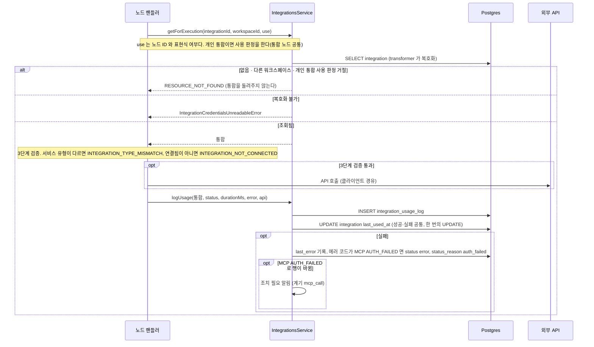

> 구현 상태: 구현됨 · 원문 출처는 부모 [통합 데이터와 흐름](CLE-INT-DATA.md) 머리 줄 · 용어: [용어 사전](../CLE-GLOSSARY.md)

## 개요

이 문서는 [통합 데이터와 흐름](CLE-INT-DATA.md) 의 하위 문서로 노드 실행 · 만료 스캐너 · 멤버 나가기 · 캐시 무효화가 통합 데이터를 쓰고 지우는 흐름과 Redis 와 외부 대상을 정한다. 활동 로그의 `api_*` 채우기 규칙은 [엔티티와 인덱스 「호출 API 식별 채우기 규칙」](CLE-INT-DATA-ENTITY.md#호출-api-식별-채우기-규칙) 이 정한다.

## 노드 실행의 통합 사용

통합 노드 핸들러의 공통 베이스는 `IntegrationHandlerBase` 다. 핸들러 계약과 에러 코드는 [통합 노드 공통](../CLE-NODE-INT/CLE-NODE-INT-COMMON.md) 이 정한다.

통합을 얻지 못한 두 갈래(없음 · 다른 워크스페이스 · 사용 판정 거절, 복호화 불가)는 노드 에러로 끝난다. 활동 로그를 쓰지 않고 그 통합의 `last_used_at` · `last_error` 도 바꾸지 않는다. 3단계 검증에서 끝난 실패는 통합을 얻은 뒤라 외부 호출 없이 활동 로그를 남긴다.

- 토큰 만료가 가깝거나 지난 것은 조회 실패 조건이 아니다. Cafe24·MakeShop 클라이언트가 호출 직전에 토큰을 갱신하고, 401 을 받으면 갱신 뒤 다시 시도한다([OAuth 연결과 토큰 갱신](CLE-INT-OAUTH.md)).
- `IntegrationsService.logUsage` 는 통합 ID 대신 `getForExecution` 이 돌려준 통합을 받는다. 활동 로그 행의 `integration_id` 와 통합 행 UPDATE 는 그 통합의 `id` 로 하고 받은 엔티티를 저장하지 않는다. 통합을 얻기 전에 끝난 실행은 넘길 통합이 없어 기록하지 않는다. 자격 증명을 읽지 못한 경우(`IntegrationCredentialsUnreadableError`)도 `getForExecution` 이 통합을 돌려주지 않으므로 기록하지 않는다([통합 노드 공통 「자격 증명을 읽지 못한 통합은 얻지 못한 통합으로 본다」](../CLE-NODE-INT/CLE-NODE-INT-COMMON.md#자격-증명을-읽지-못한-통합은-얻지-못한-통합으로-본다-2026-11-05)). 얻기 전에 끝나는 실패의 목록은 [통합 노드 공통 「공통 에러 코드」](../CLE-NODE-INT/CLE-NODE-INT-COMMON.md#공통-에러-코드) 의 «통합을 얻기 전에 끝난 실행의 기록» 이 정본이다. 서명은 [통합 노드 공통](../CLE-NODE-INT/CLE-NODE-INT-COMMON.md#integrationsservice-api-실행-엔진용) 에 있다.
- 서비스 유형과 연결 상태는 서비스가 아니라 핸들러 기반 클래스가 3단계에서 검증한다(`integration-handler-base.ts`, [통합 노드 공통 「IntegrationHandlerBase」](../CLE-NODE-INT/CLE-NODE-INT-COMMON.md#integrationhandlerbase)). 연결 상태 실패의 메시지에는 상태와 사유를 싣는다. 통합을 얻은 뒤의 실패라 그 통합에 활동 로그를 남긴다.
- `logUsage` 는 예외를 던지지 않는다. 기록 실패가 노드 실행을 깨지 않도록 삼킨다. `nodeExecutionId` 가 없으면 행을 쓰지 않는다.
- MCP 도구 호출이 `MCP_AUTH_FAILED` 로 실패하면 `logUsage` 가 조건부 UPDATE 한 번으로 통합을 `error(auth_failed)` 로 바꾼다. 다른 사유의 `error` 도 바뀌고, 이미 `error(auth_failed)` 면 바뀌지 않는다. UPDATE 가 행을 바꾼 호출만 조치 필요 알림(계기 `mcp_call`)을 보낸다. 규칙의 정본은 [MCP 클라이언트 — 에러 처리 「인증 실패 상태 전환」](CLE-INT-MCP-ERROR.md#인증-실패-상태-전환) 이고 문구는 [통합 상태와 만료 알림 — 만료 스캐너와 알림 「조치 필요 알림」](CLE-INT-STATUS-SCAN.md#조치-필요-알림-integration_action_required) 이 정한다.
- Cafe24·MakeShop 의 인증 실패와 네트워크 실패로 인한 오류 전이는 `logUsage` 가 아니라 각 클라이언트의 `markAuthFailed`·`recordNetworkFailure` 가 한다. 노드 실행 실패가 통합 상태를 어디까지 바꾸는지는 [통합 상태와 만료 알림](CLE-INT-STATUS.md) 의 미결 사항이다.
- 재설치 대기 표시는 실행 경로가 보지 않는다. 표시가 있는 연결됨 행은 기존 토큰으로 계속 실행된다. 표시가 있는 오류·만료됨 행은 위 상태 검사에서 막힌다.

## 만료 스캐너

만료 스캐너는 `integration-expiry-scanner` 큐 위의 네 작업으로 통합 상태와 알림, 활동 로그 보존, Cafe24 백그라운드 갱신을 처리한다. 대상 조건과 동작은 [통합 상태와 만료 알림](CLE-INT-STATUS.md) 이 소유한다. 쓰는 테이블은 `integration`(상태·사유·설치 토큰·상점 식별자 UPDATE), `integration_expiry_dispatch`(임계 선점 INSERT), `integration_usage_log`(90일 경과 DELETE), `notification`(인앱 알림 INSERT)이다. `reinstall_requested_at` 은 읽지도 쓰지도 않는다. 24시간이 지난 값도 지우지 않는다.

## 멤버가 나가거나 제거될 때

멤버 제거(`removeMember`)와 나가기(`leaveWorkspace`)는 멤버십을 지우는 트랜잭션 안에서 그 멤버의 개인 통합을 지운다. 규칙과 근거, 잠금 순서는 [통합 관리](CLE-INT-MANAGE.md#나간-멤버의-개인-통합은-나갈-때-지운다-2026-10-29) 가 정한다. 이 절은 삭제 조건과 모듈 경계를 정한다. 다른 문서는 삭제 조건을 이 절에서 링크한다.

- 멤버십 DELETE 와 통합 DELETE 를 한 트랜잭션에서 한다. 이 트랜잭션의 잠금 대기 상한과 그 상한을 넘겼을 때의 처리는 [계정과 워크스페이스 데이터 흐름 「워크스페이스 삭제와 나가기」](../CLE-ACCT/CLE-ACCT-DATA.md#워크스페이스-삭제와-나가기) 가 정한다.
- 멤버십 DELETE 가 1행을 지웠을 때만 통합을 지운다. 0행이면 통합을 건드리지 않고 지금 판정(`MEMBER_NOT_FOUND`, `CANNOT_REMOVE_OWNER`)을 그대로 낸다. 멤버 제거는 지운 멤버의 사용자 ID 를 `RETURNING` 으로 받아 통합 삭제 조건과 감사 로그에 쓴다. 나가기는 요청자가 그 멤버다.
- 통합 삭제는 `DELETE integration WHERE workspace_id = :ws AND created_by = :user AND scope = 'personal' RETURNING id, service_type, name` 이다. 상태와 사용처는 보지 않는다.
- 통합 모듈이 이미 워크스페이스 모듈을 가져온다. 워크스페이스 서비스가 통합 서비스를 직접 부르면 순환 의존이 된다. 그래서 워크스페이스 모듈이 포트 `MEMBER_PERSONAL_INTEGRATIONS_PURGER`(`workspaces/member-personal-integrations.port.ts`)를 정의하고 통합 모듈의 `MemberPersonalIntegrationsPurgerService` 가 구현한다.
- 워크스페이스 서비스는 트랜잭션을 열기 전에 `ModuleRef.get(MEMBER_PERSONAL_INTEGRATIONS_PURGER, { strict: false })` 로 포트를 찾는다. 트리거 정리 포트(`TRIGGER_RESOURCE_RELEASER`)와 같은 방식이다. 찾지 못하면 에러를 던지므로 나가기와 제거가 실패하고 멤버십도 그대로 남는다. 조용히 넘어가면 나간 멤버의 개인 통합이 다시 남기 때문이다.
- 포트에는 두 단계가 있다.
  1. 트랜잭션 안 삭제 `purgeInTransaction(manager, { workspaceId, userId })`. 멤버십 DELETE 뒤에 호출자의 트랜잭션 매니저로 위 DELETE 를 하고 지운 행의 `id`·`serviceType`·`name` 을 돌려준다. 결과는 [raw SQL 결과 읽기 규약](../CLE-ENG/CLE-ENG-RAWQUERY.md) 대로 `updateReturningRows` 로 읽고 `service_type` 을 `serviceType` 으로 바꾼다.
  2. 커밋 뒤 후처리 `finishAfterCommit(purged, departure)`. 워크스페이스 서비스가 커밋 뒤에 `member.removed` 감사 로그를 남기고 이 단계를 부른다. 지운 통합이 없으면 부르지 않는다. 이 단계는 지운 통합마다 일반 삭제(`DELETE /api/integrations/:id`)와 같은 후처리 `IntegrationsService.finishIntegrationDeletion` 을 부른다. 그 후처리가 `integration.deleted` 감사 로그를 남기고([통합 관리](CLE-INT-MANAGE.md#감사-로그)) 모든 인스턴스에 자격 증명 캐시 무효화를 알린다([자격 증명 캐시 무효화](#자격-증명-캐시-무효화)). 감사의 행위자는 나가기면 나간 멤버이고 제거면 제거한 관리자다. 일반 삭제와 다른 것은 감사 `details` 의 `mode`(`left` 또는 `removed`)와 `memberUserId` 뿐이다. 이 단계는 던지지 않는다. 한 통합의 후처리가 실패해도 나머지를 이어 가고 에러 로그만 남긴다.
- 일반 삭제는 판정(역할, 사용처 차단)을 거친 뒤 지우고 같은 후처리를 쓴다. 나가기와 제거의 삭제는 이 판정을 거치지 않는다.
- 후처리가 실패하거나 커밋과 후처리 사이에 프로세스가 멈추면 캐시에 지운 통합이 남을 수 있다. 그래도 그 통합을 쓰는 노드는 통합 소유자가 멤버가 아니라서 개인 통합 사용 판정에서 거절된다. 같은 창에서 `integration.deleted` 감사 행도 빠질 수 있다. 감사 기록 실패가 리소스 변경을 되돌리지 않는다는 계약([감사 로그](../CLE-OBS/CLE-OBS-AUDIT.md))과 같은 쪽이라 받아들인다.

## 자격 증명 캐시 무효화

노드 핸들러 가운데는 자격 증명으로 맺은 연결을 인스턴스 메모리에 캐시하는 것이 있다. 한 인스턴스에서 자격 증명을 바꾸거나 통합을 지워도 다른 인스턴스의 캐시에는 옛 자격 증명으로 맺은 연결이 남는다. 그래서 `IntegrationsService` 는 바뀐 통합의 ID 를 Redis pub/sub 채널 `integration:cache:invalidate` 로 모든 인스턴스에 알린다. 이 채널의 발행과 구독 규칙은 이 절이 정본이다. 방송을 받은 캐시가 무엇을 하는지는 구독하는 노드의 문서가 정한다.

- 발행 시점은 두 곳이다. 발행은 무효화 버스(`IntegrationCacheBus.publish`)로 한다.
  - 자격 증명 교체(`POST /api/integrations/:id/rotate`): 바꾼 컬럼을 커밋하고 감사 로그를 남긴 뒤 발행한다.
  - 통합 삭제: 삭제 뒤 후처리 `finishIntegrationDeletion` 이 `integration.deleted` 감사 로그를 남긴 뒤 발행한다. 일반 삭제(`DELETE /api/integrations/:id`)와 멤버가 나가거나 제거될 때의 개인 통합 삭제가 이 후처리를 함께 쓴다([멤버가 나가거나 제거될 때](#멤버가-나가거나-제거될-때)).
- 그 밖의 쓰기는 발행하지 않는다. 별칭 수정과 공개 범위 전환은 자격 증명을 바꾸지 않는다. OAuth 토큰 자동 갱신과 통합 재인증 · 추가 권한 요청 · 설치의 콜백도 발행하지 않는다. 지금 구독하는 캐시가 OAuth 자격 증명을 쓰지 않기 때문이다.
- 페이로드는 통합 ID 평문 문자열 하나다.
- 모든 인스턴스가 부팅할 때 채널을 구독한다. 발행한 인스턴스도 자기 메시지를 받는다. 메시지를 받으면 그 인스턴스의 무효화 버스에 등록된 처리 함수를 모두 부른다.
- 지금 처리 함수를 등록한 것은 [Database Query 노드](../CLE-NODE-INT/CLE-NODE-DBQUERY.md#풀-캐시-무효화) 의 연결 풀 하나다. Send Email 노드도 SMTP transport 를 인스턴스마다 캐시하지만 등록하지 않는다. 그래서 다른 인스턴스의 transport 는 다음 실행의 자격 증명 해시 비교로만 바뀐다.
- 공유 Redis 연결은 명령 전용이라 SUBSCRIBE 를 보내지 않는다. SUBSCRIBE 를 보낸 연결은 구독 모드로 바뀌어 다른 명령을 보낼 수 없기 때문이다. 구독은 공유 연결을 복제한 전용 연결로 하고 PUBLISH 는 공유 연결로 보낸다.
- 방송은 즉시성을 보강하는 best-effort 층이다. 발행은 예외를 던지지 않으므로 자격 증명 교체와 삭제는 방송 때문에 실패하지 않는다.
  - Redis 가 설정되지 않았으면 발행을 조용히 건너뛴다. 구독은 부팅 때 경고 로그를 한 번 남기고 만들지 않는다.
  - PUBLISH 가 실패하면 경고 로그를 남기고 카운터 `clemvion.redis.fail_open` 을 `component=integration_cache_bus`, `reason=publish_failed` 로 한 번 센다.
  - SUBSCRIBE 가 실패하거나 구독 연결에 오류가 나면 로그를 남기고 같은 카운터를 `reason=subscribe_failed` 로 센다.
  - 구독이 끝나기 전에 발행된 메시지는 잃을 수 있다.
  - 처리 함수가 실패하면 경고 로그만 남기고 카운터는 세지 않는다.
- 메시지를 잃어도 정합성은 깨지지 않는다. 구독하는 핸들러는 캐시에 자격 증명 해시를 함께 두고, 다음 실행에서 해시가 다르면 옛 연결을 버린다. 방송은 그 다음 실행까지의 공백을 줄인다.

Redis pub/sub 을 고른 근거와 기각한 대안(유휴 타임아웃 단축)은 [Database Query 노드](../CLE-NODE-INT/CLE-NODE-DBQUERY.md) 의 Rationale «풀 캐시 무효화에 Redis pub/sub 방송 채택» 에 있다.

## Redis 와 외부 대상

| 대상 | 쓰임 | 소유 문서 |
| --- | --- | --- |
| `integration-expiry-scanner` 큐 | 만료 스캐너 네 작업 | [통합 상태와 만료 알림](CLE-INT-STATUS.md) |
| `cafe24-token-refresh`·`makeshop-token-refresh` 큐 | 토큰 자동 갱신 | [OAuth 연결과 토큰 갱신](CLE-INT-OAUTH.md) |
| 설치 nonce 캐시·설치 실패 카운터 | Cafe24·MakeShop 설치 재사용 방어와 IP 잠금. Redis 가 없으면 조용히 건너뛴다 | [OAuth 연결과 토큰 갱신](CLE-INT-OAUTH.md) |
| `integration:cache:invalidate` pub/sub | 자격 증명 캐시 무효화. Redis 가 없으면 조용히 건너뛴다 | [통합 데이터와 흐름](CLE-INT-DATA.md) 「[자격 증명 캐시 무효화](#자격-증명-캐시-무효화)」 (이 하위 문서) |
| OAuth 제공자 | 인가·토큰 교환·갱신. Google·GitHub 는 고정 host, Cafe24 는 `{mall_id}.cafe24api.com`, MakeShop 은 `auth.makeshop.com`(데이터 호출 host 와 분리) | [OAuth 연결과 토큰 갱신](CLE-INT-OAUTH.md) |
| 서비스 API | 노드 실행 본체 호출(Google API, GitHub API, HTTP, Cafe24 Admin API, MakeShop API 등) | 각 노드 문서 |

## 구현 위치

- `codebase/backend/src/modules/integrations/integrations.service.ts` (활동 로그, `getForExecution` 의 개인 통합 사용 판정, 삭제 뒤 후처리 `finishIntegrationDeletion`, 자격 증명 캐시 무효화 발행 `broadcastCredentialChange`)
- `codebase/backend/src/common/redis/integration-cache-bus.service.ts` (자격 증명 캐시 무효화 버스 `IntegrationCacheBus` 와 채널 상수 `INTEGRATION_CACHE_INVALIDATE_CHANNEL`)
- `codebase/backend/src/modules/integrations/personal-integration-use.ts` · `personal-integration-use-facts.ts` (개인 통합 사용 판정 함수와 판정에 넘길 사실 읽기. 사실 읽기는 실행 경로와 저장 경로가 함께 쓴다)
- `codebase/backend/src/modules/workspaces/member-personal-integrations.port.ts` (멤버의 개인 통합을 지우는 포트 `MEMBER_PERSONAL_INTEGRATIONS_PURGER` 와 지연 해석 `resolveMemberPersonalIntegrationsPurger`)
- `codebase/backend/src/modules/integrations/member-personal-integrations-purger.service.ts` (그 포트의 구현 `MemberPersonalIntegrationsPurgerService`)
- `codebase/backend/migrations/V153__purge_departed_member_personal_integrations.sql` (통합 소유자가 멤버가 아닌 개인 통합을 한 번 지운다)
- `codebase/backend/src/modules/integrations/integration-expiry-scanner.service.ts` (만료 스캐너. 설치 대기 만료 때 `mall_id` 비우기 포함)
- `codebase/backend/src/modules/integrations/integration-action-required-notifier.service.ts` (조치 필요 알림)
- `codebase/backend/src/nodes/integration/cafe24/`, `codebase/backend/src/nodes/integration/makeshop/` (클라이언트의 토큰 갱신·상태 전이, 갱신 큐 워커)
- `codebase/backend/src/nodes/ai/ai-agent/tool-providers/` (AI 에이전트 도구 프로바이더의 활동 로그 기록. 내부 MCP 브리지 `Cafe24McpToolProvider` · `MakeshopMcpToolProvider` 와 외부 MCP `McpToolProvider`)

## Rationale

### MCP 인증 실패의 알림을 노드 실행 흐름에 적었다 (2026-11-14)

`logUsage` 의 시퀀스는 MCP `AUTH_FAILED` 의 상태 전이만 그리고 그 뒤의 조치 필요 알림을 그리지 않았다. 정본인 [MCP 클라이언트 — 에러 처리 「인증 실패 상태 전환」](CLE-INT-MCP-ERROR.md#인증-실패-상태-전환) 은 행이 바뀐 호출만 알림을 보낸다고 적는다. NERV Task `CLE-T-BDPE71` 에서 시퀀스와 본문에 그 단계를 더했다. 동작은 바뀌지 않았다.

### 나간 멤버의 개인 통합 삭제 구현 반영 (2026-10-30, NERV Task `CLE-T-PS7JQY`)

「멤버가 나가거나 제거될 때」 는 구현한 두 단계 포트에 맞췄고, 구현에 없는 일반 삭제 후처리의 «서비스 유형별 정리» 는 뺐다. 잠금 규칙은 통합 행을 만들 수 있는 쓰기 전체(조직 공개 범위의 begin 포함)에 걸리고 잠금 방식은 [통합 관리](CLE-INT-MANAGE.md#나간-멤버의-개인-통합은-나갈-때-지운다-2026-10-29) 한 곳에 둔다.

### 자격 증명 캐시 무효화 채널의 정본을 통합 데이터 문서로 모았다 (2026-11-13)

2026-11-13 에 사람이 통합 데이터 문서를 `integration:cache:invalidate` 채널의 정본으로 정했다(NERV Task `CLE-T-VQX844`). 그 전에는 발행 시점 · 페이로드 · 연결 분리 · 방송 실패 처리가 [Database Query 노드](../CLE-NODE-INT/CLE-NODE-DBQUERY.md) 에만 있었다. 이제 노드 문서에는 풀이 방송을 받았을 때 하는 일만 남는다. 옮기면서 코드와 다시 맞춰 삭제 쪽 발행 지점(`finishIntegrationDeletion`, 개인 통합 삭제 포함), 처리 함수를 등록한 소비자(Database Query 풀 하나), 방송 실패의 fail-open 카운터를 바로잡았다.
