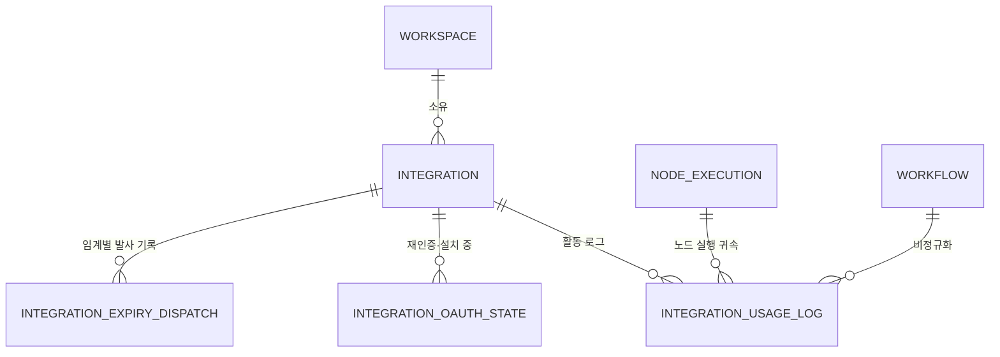

> 구현 상태: 구현됨 · 원문: `spec/data-flow/5-integration.md`, `spec/1-data-model.md` (§2.10, §2.10.1, §2.21.1, §3 통합 인덱스 행, Rationale «install_token 형식»), `spec/2-navigation/4-integration.md` (§13) · 용어: [용어 사전](../CLE-GLOSSARY.md)

## 개요

이 문서는 통합(Integration, `integration`) 도메인이 저장하는 엔티티와 그 데이터가 어디서 들어와 어디로 가는지를 정한다. 통합은 외부 SaaS(Google·GitHub·Cafe24·MakeShop 등)와 통신하는 데 필요한 자격 증명(credentials)과 연결 상태를 워크스페이스에 저장한다. 노드 실행 시점에 통합의 자격 증명을 꺼내 외부 API 를 부른다. 통합을 얻은 뒤의 호출 결과는 활동 로그(activity log, `IntegrationUsageLog`)에 한 행씩 남긴다. OAuth 토큰은 만료 스캐너가 주기적으로 점검한다. 갱신할 수 있는 통합은 전용 갱신 큐로 토큰을 새로 받고, 그렇지 않은 통합은 만료됨으로 바꾼다.

다루는 엔티티는 통합, 활동 로그, 통합 연결 과정의 임시 테이블 세 개(통합 OAuth state, 미리보기 토큰, 만료 알림 발사 기록), 그리고 시크릿 저장소(`secret_store`) 테이블이다. 이 문서는 엔티티 관계도와 암호화 규칙을 정하고 나머지는 하위 문서가 정한다.

범위 밖:

- 통합 상태 전이 규칙과 상태 사유(`status_reason`) 허용값, 만료 스캐너 동작은 [통합 상태와 만료 알림](CLE-INT-STATUS.md) 이 정한다.
- OAuth 연결·설치 흐름의 API 계약, 에러 매핑, 토큰 자동 갱신 정책은 [OAuth 연결과 토큰 갱신](CLE-INT-OAUTH.md) 이 정한다.
- 통합 화면과 관리 API 는 [통합 관리](CLE-INT-MANAGE.md), 서비스별 자격 증명 필드는 [서비스별 인증 방식과 자격 증명](CLE-INT-AUTH.md) 이 정한다.
- 시크릿 참조 형식과 `SecretResolver` 호출 규약은 [시크릿 저장소](CLE-INT-SECRET.md) 가 정한다.
- 엔티티 관계 전체 지도는 [데이터 모델 개요](../CLE-PLAT/CLE-PLAT-DATA.md), 큐 카탈로그 전체는 [비동기 큐와 Redis 키 목록](../CLE-PLAT/CLE-PLAT-QUEUE.md) 이 정한다.

## 하위 문서

| 문서 | 맡는 내용 | 관련 요구사항(다른 문서 소유) |
| --- | --- | --- |
| [통합 데이터와 흐름 — 엔티티와 인덱스](CLE-INT-DATA-ENTITY.md) | 테이블별 필드 · 제약, 호출 API 식별 채우기 규칙, 인덱스 | REQ-INTOAUTH-068 |
| [통합 데이터와 흐름 — 연결과 설치 흐름](CLE-INT-DATA-FLOW.md) | 통합 생성, OAuth 콜백, 자격 증명 교체, Cafe24 Private · MakeShop 설치 | REQ-INTMGMT-066, REQ-INTOAUTH-012, REQ-INTOAUTH-058, REQ-INTOAUTH-059, REQ-INTOAUTH-060 |
| [통합 데이터와 흐름 — 실행과 정리 흐름](CLE-INT-DATA-RUN.md) | 노드 실행과 활동 로그 기록, 만료 스캐너, 멤버가 나갈 때의 개인 통합 삭제, 자격 증명 캐시 무효화, Redis 와 외부 대상 | REQ-INTMGMT-053, REQ-INTMGMT-062, REQ-INTMGMT-065, REQ-INTMGMT-058 |

하위 문서의 규칙과 요구사항의 짝은 다음과 같다.

| 요구사항 | 하위 문서의 규칙 |
| --- | --- |
| REQ-INTOAUTH-068 | 엔티티 「통합」 제약: 같은 상점 행 조회 함수가 만료 행을 거른다(`findAllCafe24RowsForMall` 대체 경로 포함) |
| REQ-INTMGMT-066 | 「통합 생성」: 잠근 뒤 개인 통합 요청자의 멤버십이 없으면 403 `NOT_A_MEMBER` |
| REQ-INTOAUTH-012 · REQ-INTOAUTH-058 | 「Cafe24 Private 앱 설치」: 요청자가 바꿀 수 있는 같은 설치 대기 행 재사용 |
| REQ-INTOAUTH-059 · REQ-INTOAUTH-060 | 「MakeShop 설치」: 같은 (워크스페이스, client_id) 설치 대기 행 재사용 |
| REQ-INTMGMT-053 | 「노드 실행의 통합 사용」: 통합을 얻지 못한 실행은 활동 로그 · `last_used_at` · `last_error` 를 바꾸지 않는다 |
| REQ-INTMGMT-062 | 「노드 실행의 통합 사용」: `logUsage` 는 얻은 통합을 받고, 3단계 검증 실패도 그 통합에 기록한다 |
| REQ-INTMGMT-065 | 「멤버가 나가거나 제거될 때」: 멤버십 삭제 트랜잭션 안에서 개인 통합을 지운다 |
| REQ-INTMGMT-058 | 「멤버가 나가거나 제거될 때」: 캐시에 남은 지운 통합도 개인 통합 사용 판정에서 거절된다 |

## 엔티티

활동 로그의 부모는 통합이다. 활동 로그에는 `workspace_id` 가 없고 통합을 거쳐 워크스페이스에 귀속한다. 미리보기 토큰(`integration_oauth_preview`)은 아직 통합 행이 없을 때 쓰는 테이블이라 통합과 FK 로 잇지 않는다.

### 통합 (`integration`)

→ [엔티티와 인덱스 「통합 (`integration`)」](CLE-INT-DATA-ENTITY.md#통합-integration)

### 활동 로그 (`integration_usage_log`)

→ [엔티티와 인덱스 「활동 로그 (`integration_usage_log`)」](CLE-INT-DATA-ENTITY.md#활동-로그-integration_usage_log)

#### 호출 API 식별 채우기 규칙

→ [엔티티와 인덱스 「호출 API 식별 채우기 규칙」](CLE-INT-DATA-ENTITY.md#호출-api-식별-채우기-규칙)

### 통합 OAuth state (`integration_oauth_state`)

→ [엔티티와 인덱스 「통합 OAuth state (`integration_oauth_state`)」](CLE-INT-DATA-ENTITY.md#통합-oauth-state-integration_oauth_state)

### 미리보기 토큰 (`integration_oauth_preview`)

→ [엔티티와 인덱스 「미리보기 토큰 (`integration_oauth_preview`)」](CLE-INT-DATA-ENTITY.md#미리보기-토큰-integration_oauth_preview)

### 만료 알림 발사 기록 (`integration_expiry_dispatch`)

→ [엔티티와 인덱스 「만료 알림 발사 기록 (`integration_expiry_dispatch`)」](CLE-INT-DATA-ENTITY.md#만료-알림-발사-기록-integration_expiry_dispatch)

### 일시 테이블의 FK 와 삭제 동작

→ [엔티티와 인덱스 「일시 테이블의 FK 와 삭제 동작」](CLE-INT-DATA-ENTITY.md#일시-테이블의-fk-와-삭제-동작)

### 시크릿 저장소 (`secret_store`)

→ [엔티티와 인덱스 「시크릿 저장소 (`secret_store`)」](CLE-INT-DATA-ENTITY.md#시크릿-저장소-secret_store)

## 인덱스

→ [엔티티와 인덱스 「인덱스」](CLE-INT-DATA-ENTITY.md#인덱스)

## 암호화

통합 암호화 키(`INTEGRATION_ENCRYPTION_KEY`)로 아래 다섯 JSONB 컬럼을 암호화한다. TypeORM 컬럼 transformer(`credentials-transformer.ts`)가 ORM 경계에서 AES-256-GCM 으로 암호화하고 복호화한다. 이 키와 transformer 동작의 규범은 이 절 한 곳에 둔다. 다만 운영 환경 가드가 이 키를 거부하는 기준은 [세션과 토큰 「암호화 키 검사」](../CLE-ACCT/CLE-ACCT-SESSION.md#암호화-키-검사) 에 둔다.

| 컬럼 | 담는 값 |
| --- | --- |
| `integration.credentials` | 통합 자격 증명 |
| `integration.last_error` | 최근 호출 실패 요약. OAuth 응답 본문에 토큰 일부가 섞일 수 있다 |
| `integration_oauth_state.provider_meta` | 콜백까지 들고 가는 클라이언트 자격 증명과 PKCE `code_verifier` |
| `integration_oauth_preview.credentials` | 새 OAuth 연결의 콜백이 받은 토큰 |
| `auth_config.config` | 인증 설정 자격 증명. 인증 설정 엔티티가 같은 transformer 를 가져다 쓴다([트리거 데이터와 흐름 「AuthConfig」](../CLE-TRIG/CLE-TRIG-DATA.md#authconfig)) |

### 키

- transformer 는 환경 변수 값을 SHA-256 으로 해시해 32바이트 키를 만든다. 64자 hex 값도 원시 바이트로 쓰지 않고 해시한다.
- 그래서 키 길이에 하한을 두지 않는다. 운영 키로는 32바이트 이상의 무작위 값을 권한다(예: `openssl rand -hex 32`).
- 이 키는 시크릿 저장소의 마스터키(`ENCRYPTION_KEY`)와 별개다. 마스터키는 64자 hex 면 원시 32바이트로 쓰고 그 밖의 문자열은 SHA-256 으로 만든다([시크릿 저장소 「마스터키」](CLE-INT-SECRET.md#마스터키)). 그래서 64자 hex 문자열을 두 키에 함께 넣으면 실제 키가 다르다. 그 밖의 문자열이면 두 키 모두 SHA-256 으로 만들어 실제 키가 같다.
- 값을 쓸 때마다 12바이트 IV 를 새로 만든다. AAD 는 쓰지 않아서 암호문이 행에 묶이지 않는다. 시크릿 저장소는 AAD 로 암호문을 참조에 묶는다.

### 키가 없을 때

- `NODE_ENV=production` 에서 키가 없거나 쓸 수 없는 값이면 서버가 기동하지 않는다. 부팅 때 `main.ts` 가 부르는 운영 환경 가드(`assertProductionConfig`, `production-guards.ts`)가 환경 변수를 검사한다. 무엇을 쓸 수 없는 값으로 보는지는 [세션과 토큰 「암호화 키 검사」](../CLE-ACCT/CLE-ACCT-SESSION.md#암호화-키-검사) 에 있다. 예시 값 목록은 그 절이 가리키는 `production-guards.ts` 상수가 정본이다.
- 요청 경로의 transformer 는 키 때문에 예외를 던지지 않는다.
- 운영 환경 밖에서 키가 없으면 transformer 가 프로세스마다 경고를 한 번 남기고 값을 평문 JSON 으로 저장한다.
- 그래서 암호화가 보장되는 범위는 운영 환경에서 새로 쓰는 값이다.

### 이미 저장된 값

- 평문으로 저장된 행(키 없이 쓴 행과 옛 행)은 그대로 읽힌다. 키가 있는 환경에서 그 컬럼을 다음에 쓸 때 암호화된다.
- 서버는 평문 행을 일괄로 다시 암호화하지 않는다. 근거는 [시크릿 저장소 「R13. 통합 암호화 키를 마스터키와 따로 둔다」](CLE-INT-SECRET.md#r13-통합-암호화-키-integration_encryption_key-를-마스터키와-따로-두고-production-에서-키-없이-기동하지-않는다-2026-10-10) 에 있다.
- 복호화는 예외를 던지지 않는다. 값을 읽지 못하면 복호화 불가 표식(`__unreadable: true` 인 객체)을 돌려준다. 키가 다를 때(키 교체 등), 암호문이 깨졌을 때, 암호문인데 키가 없을 때, 저장된 내용을 JSON 으로 해석하지 못할 때다.
- 인증 태그 검증에 실패했거나(키가 맞지 않거나 암호문이 깨진 경우) 복호화한 내용이나 평문 문자열을 JSON 으로 해석하지 못해 표식이 된 값은 원래 저장값을 표식의 `__original_ciphertext` 키에 함께 담는다. 이 값을 다시 저장하면 원래 저장값이 그대로 저장된다.
- 암호문인데 키가 없거나(운영 환경 밖) 봉투 길이나 버전이 맞지 않아 표식이 된 값은 원래 값을 담지 않는다. 이 값을 다시 저장하면 표식 자체가 저장된다. 키가 있으면 표식을 암호화해 저장하고 키가 없으면 평문 JSON 으로 저장한다.
- 복호화하지 못한 행은 지우지 않는다. 그 행이 어떻게 드러나는지는 컬럼마다 다르다.

| 컬럼 | 복호화하지 못한 행 |
| --- | --- |
| `integration.credentials` | 응답에서 `credentialsStatus='needs_reauth'`(`status='error'`, `statusReason='credentials_unreadable'`)로 드러난다. 노드 실행은 `IntegrationCredentialsUnreadableError` 로 멈춘다([실행과 정리 흐름 「노드 실행의 통합 사용」](CLE-INT-DATA-RUN.md#노드-실행의-통합-사용)). 사용자가 통합을 다시 연결한다 |
| `integration.last_error` | 응답의 `lastError` 가 `null` 이다(`integrations.service.ts` 의 `toPublic`) |
| `auth_config.config` | `needs_reauth` 같은 표시가 없다. 인증 설정 응답에는 표식을 싣고 표식에 담긴 원래 저장값은 싣지 않는다([외부 호출 인증 설정 「마스킹 규칙」](../CLE-TRIG/CLE-TRIG-AUTHCFG.md#마스킹-규칙)). 그 설정을 쓰는 웹훅 인증은 요청을 401 `AUTH_FAILED` 로 거부한다. 복호화 불가 표식에는 기대값(`username` · `password` · `token` · `key` · `secret`)이 없다. 웹훅 인증의 판정은 [웹훅](../CLE-TRIG/CLE-TRIG-WEBHOOK.md) 이 정한다. 화면은 표식을 보고 행에 «읽을 수 없음» 을 표시한다. 복구하려면 원래 키를 되돌리거나 재생성한다. 재생성은 API Key · Bearer Token · HMAC 에서 표식을 버리고 새 config 를 만든다. Basic Auth 는 재생성이 없어 지우고 다시 만든다([외부 호출 인증 설정 「재생성」](../CLE-TRIG/CLE-TRIG-AUTHCFG.md#재생성)) |
| `integration_oauth_state.provider_meta` · `integration_oauth_preview.credentials` | 짧게 쓰고 버리는 행이다. 진행 중인 연결 흐름이 실패하므로 사용자가 연결을 처음부터 다시 시작한다 |

### 그 밖의 규칙

- 응답을 만들 때는 컨트롤러·DTO 단계에서 `credentials` 를 가린다.
- 운영 환경에서는 콜백 전 임시 보관 단계에서도 토큰과 `client_secret` 이 DB 에 평문으로 남지 않는다.
- 평문으로 두는 값: `install_token` 은 App URL 경로에 공개로 들어가는 식별자라 암호화 대상이 아니다. `status_reason` 은 분류 코드만 담아 평문이다. `mall_id` 는 조회용 평문 투영이다.

## 데이터 흐름

### 통합 생성

→ [연결과 설치 흐름 「통합 생성」](CLE-INT-DATA-FLOW.md#통합-생성)

### OAuth 연결과 설치

→ [연결과 설치 흐름 「OAuth 연결과 설치」](CLE-INT-DATA-FLOW.md#oauth-연결과-설치)

#### Cafe24 Private 앱 설치

→ [연결과 설치 흐름 「Cafe24 Private 앱 설치」](CLE-INT-DATA-FLOW.md#cafe24-private-앱-설치)

#### MakeShop 설치

→ [연결과 설치 흐름 「MakeShop 설치」](CLE-INT-DATA-FLOW.md#makeshop-설치)

### 노드 실행의 통합 사용

→ [실행과 정리 흐름 「노드 실행의 통합 사용」](CLE-INT-DATA-RUN.md#노드-실행의-통합-사용)

### 만료 스캐너

→ [실행과 정리 흐름 「만료 스캐너」](CLE-INT-DATA-RUN.md#만료-스캐너)

### 멤버가 나가거나 제거될 때

→ [실행과 정리 흐름 「멤버가 나가거나 제거될 때」](CLE-INT-DATA-RUN.md#멤버가-나가거나-제거될-때)

### 자격 증명 캐시 무효화

→ [실행과 정리 흐름 「자격 증명 캐시 무효화」](CLE-INT-DATA-RUN.md#자격-증명-캐시-무효화)

### Redis 와 외부 대상

→ [실행과 정리 흐름 「Redis 와 외부 대상」](CLE-INT-DATA-RUN.md#redis-와-외부-대상)

## 미결 사항

- **재암호화 스크립트의 키 길이 하한**: `auth_config.config` 의 평문 행을 암호화하는 1회용 스크립트 `codebase/backend/src/scripts/encrypt-auth-config.ts`(백엔드 `package.json` 스크립트 `encrypt-auth-config`)는 키가 32자 미만이면 실행을 거부한다. 운영 환경 가드(`assertProductionConfig`)에는 길이 하한이 없어서 두 기준이 맞지 않는다. 키 길이 계약은 NERV Task `CLE-T-C6GCKV` 가 정한다.
- **평문 행과 공개 예시 값 행의 재암호화**: 평문으로 저장된 행과 공개 예시 값으로 암호화된 행을 다시 암호화할 수단이 없다. 위 스크립트는 `auth_config.config` 의 평문 행만 암호화하고 나머지 네 컬럼에는 이런 스크립트가 없다. 공개 예시 값으로 암호화된 행은 키를 바꾸면 복호화되지 않는다. 재암호화 방법은 NERV Task `CLE-T-C6GCKV` 가 정한다.

## 구현 위치

암호화에 관한 위치만 둔다. 나머지는 각 하위 문서의 「구현 위치」 에 있다.

- `codebase/backend/src/modules/integrations/services/credentials-transformer.ts` (자격 증명 컬럼 암호화)
- `codebase/backend/src/modules/auth-configs/entities/auth-config.entity.ts` (같은 transformer 를 쓰는 인증 설정 엔티티)
- `codebase/backend/src/common/config/production-guards.ts` (통합 암호화 키를 검사하는 운영 환경 가드 `assertProductionConfig` 와 공개 예시 값 목록 `INSECURE_INTEGRATION_ENCRYPTION_KEYS`)
- `codebase/backend/src/main.ts` (운영 환경 가드를 부르는 곳)
- `codebase/backend/src/scripts/encrypt-auth-config.ts` (`auth_config.config` 평문 행을 암호화하는 1회용 스크립트)

## Rationale

### 자격 증명을 컬럼 단위로 암호화한다

평문으로 저장하면 DB 덤프나 복제본이 새어 나갈 때 외부 시스템 자격 증명이 통째로 노출된다. TypeORM 컬럼 transformer 를 쓰면 ORM 경계에서 암호화와 복호화가 자동으로 일어난다. 같은 transformer 를 통합 OAuth state 의 `provider_meta` 와 미리보기 토큰의 자격 증명에도 적용해 콜백 전 임시 보관 단계도 막는다. 이 키를 시크릿 저장소의 마스터키와 따로 두는 이유와 운영 환경에서 키 없이 기동하지 않게 한 이유는 [시크릿 저장소 「R13. 통합 암호화 키를 마스터키와 따로 둔다」](CLE-INT-SECRET.md#r13-통합-암호화-키-integration_encryption_key-를-마스터키와-따로-두고-production-에서-키-없이-기동하지-않는다-2026-10-10) 에 있다.

### `last_error` 도 암호화한다

OAuth 응답 본문에 토큰 일부가 섞일 수 있다. 그래서 `last_error` 도 같은 transformer 로 암호화한다(`entities/integration.entity.ts`). 반면 `status_reason` 은 분류 코드만 담으므로 평문으로 둔다. 두 컬럼이 같은 코드를 중복해 담는 이유는 [통합 상태와 만료 알림](CLE-INT-STATUS.md) 의 Rationale 에 있다.

### 운영 환경 가드의 키 거부 기준을 세션과 토큰으로 옮겼다 (2026-10-31)

운영 환경 가드가 통합 암호화 키를 거부하는 기준(공백뿐인 값, 공개 예시 값, 앞뒤 공백을 뗀 값 대조)과 예시 값 목록은 [세션과 토큰](../CLE-ACCT/CLE-ACCT-SESSION.md), [시크릿 저장소](CLE-INT-SECRET.md), [비기능 요구사항](../CLE-PLAT/CLE-PLAT-NFR.md) 과 이 문서에 사본으로 있었다. NERV Task `CLE-T-NAT45Z` 가 기준을 [세션과 토큰 「암호화 키 검사」](../CLE-ACCT/CLE-ACCT-SESSION.md#암호화-키-검사) 한 곳에 모았다. 마스터키와 통합 암호화 키를 같은 함수가 같은 규칙으로 검사하므로 가드 목록 옆에 둔다.

옮긴 것은 운영 환경 가드의 거부 기준뿐이다. 키를 만드는 방식, 적용 컬럼, 운영 환경 밖에서 키가 없을 때의 동작, 복호화 실패 처리는 계속 이 문서가 정한다.

### 복호화하지 못한 인증 설정의 복구를 미결에서 걷었다 (2026-11-05)

키가 바뀌어 복호화하지 못한 인증 설정은 재생성과 편집 `PATCH` 로 고쳐지지 않았다. 표식에 새 값을 넣어 저장하면 원래 저장값이 그대로 다시 저장되기 때문이었다. NERV Task `CLE-T-SAMVX8` 이 재생성은 표식을 버리고 새 config 를 만들고, 편집은 표식에 config 를 병합하지 않게 고쳐서 이 항목을 미결에서 걷었다. 정본은 [외부 호출 인증 설정 「재생성」](../CLE-TRIG/CLE-TRIG-AUTHCFG.md#재생성) 과 [「편집」](../CLE-TRIG/CLE-TRIG-AUTHCFG.md#편집) 이다.

transformer 의 동작은 바꾸지 않았다. 원래 저장값을 담은 표식은 다시 저장해도 원래 저장값이 그대로 저장된다. 응답 `config` 에 표식을 그대로 싣고 통합의 `credentialsStatus` 같은 상태 표시로 바꾸지 않는 결정은 [외부 호출 인증 설정 「복호화 불가 표식을 응답에 그대로 둔다」](../CLE-TRIG/CLE-TRIG-AUTHCFG.md#복호화-불가-표식을-응답에-그대로-둔다-2026-11-05) 에 있다. 그래서 이 문서의 표식 정의와 용어 사전 「복호화 불가 표식」 은 바꾸지 않았다.
