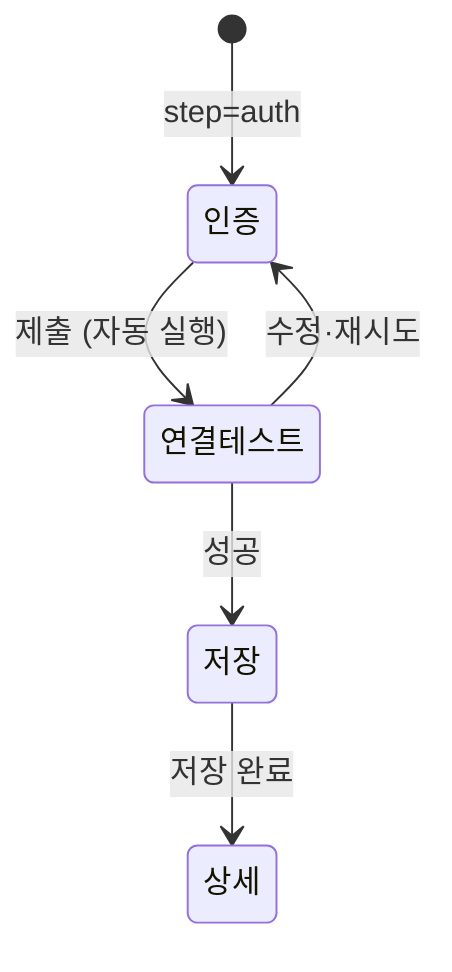

## 개요

이 문서는 [통합 관리](CLE-INT-MANAGE.md) 의 하위 문서로 통합 라우트, 목록 페이지, 추가 페이지와 Cafe24 · MakeShop 중복 사전 감지의 화면 쪽 규칙을 정한다. 상세 페이지는 [통합 관리 — 상세 화면](CLE-INT-MANAGE-DETAIL.md), 동작별 권한은 [통합 관리 — 권한과 멤버 퇴장](CLE-INT-MANAGE-PERM.md) 이 정한다.

## 라우트

| 경로 | 설명 |
| --- | --- |
| `/integrations` | 통합 목록(기본 진입점) |
| `/integrations/new?service=<type>&step=auth` | 통합 추가 위저드. 서비스 선택은 목록 모달이 맡고 인증 단계부터 이 페이지로 들어온다 |
| `/integrations/[id]` | 상세 페이지 |

서비스 선택 같은 가벼운 단계는 목록 모달로 진입 비용을 낮춘다. OAuth 팝업 복귀와 딥링크가 필요한 인증 단계부터는 독립 라우트에서 상태를 복원한다.

## 목록 페이지

| 영역 | 위치 | 들어가는 요소 | 동작 |
| --- | --- | --- | --- |
| 헤더 | 맨 위 | 제목 `Integrations`, `[+ Add Integration]` | 추가 모달을 연다(키보드 `N`). 버튼과 `N` 은 편집자 이상에게만 있다. 뷰어에게는 버튼이 보이지 않고 `N` 을 눌러도 모달이 열리지 않는다 |
| 주의 필요 배너 | 헤더 아래 | 요약 문구와 분해 카운트 | [통합 상태와 만료 알림](CLE-INT-STATUS.md) 의 배너 규칙 |
| 검색·공개 범위 | 배너 아래 | 검색 입력, `Scope: All ▼` 셀렉트 | 아래 필터 표 |
| 서비스 유형 칩 | 그 아래 | `All`·`Google`·`GitHub`·`HTTP`·`DB`·`Email`·`Webhook` 등 | 다중 선택 |
| 상태 칩 | 그 아래 | `All`·`Attention`·`Connected`·`Expiring`·`Expired`·`Error` | 단일 선택 |
| Organization 섹션 | 본문 | 조직 통합 카드 | 섹션 안에서 최신 생성순 |
| Personal 섹션 | 본문 | 개인 통합 카드 | 섹션 안에서 최신 생성순 |

카드 요소:

| 요소 | 설명 |
| --- | --- |
| 상태 아이콘 | 상태별 아이콘. 표시 규칙은 [통합 상태와 만료 알림](CLE-INT-STATUS.md) |
| 서비스 아이콘 | 서비스 유형별 로고 |
| 별칭 | 사용자가 정한 이름(`Integration.name`) |
| 인증 유형 | 통합 인증 유형(`auth_type`)을 대문자·공백을 정리해 보인다(`OAuth2`, `API Key`, `Bearer Token`, `Basic`, `Connection String`, `SMTP`, `Webhook Outbound`). `service_type='mcp'` 는 `MCP Server`, `service_type='cafe24'` 는 `Cafe24` 로 따로 보인다 |
| 상태 문구 | `Connected`·`Expires in Nd`·`Expired`·`Error: <reason>`·`Pending install` 과 진단 단서. 규칙은 [통합 상태와 만료 알림](CLE-INT-STATUS.md) |
| 더보기(⋮) | 상세 열기, 연결 테스트(연결됨만), 통합 재인증(OAuth, 비활성 조건은 [상세 화면 보안 탭](CLE-INT-MANAGE-DETAIL.md#보안-탭)), 삭제(사용처가 있으면 비활성). 설치 대기 통합은 상세 열기와 삭제만 활성이다. 통합 재인증은 외부 쪽 «테스트 실행»·앱 설치가 정식이고 연결 테스트는 토큰이 없어 의미가 없다. 변경 항목(통합 재인증, 삭제)은 [권한](CLE-INT-MANAGE-PERM.md#권한) 표에서 그 동작을 할 수 있는 사람에게만 보인다 |

### 검색과 필터

| 컨트롤 | 동작 |
| --- | --- |
| 검색 입력 | 별칭(`name`) ILIKE 부분 일치 |
| 공개 범위 셀렉트 | `All` / `Personal` / `Organization` |
| 서비스 유형 칩 | 다중 선택. 아무것도 고르지 않으면 전체 |
| 상태 칩 | 단일 선택. `Expiring`·`Attention` 은 DB 상태에 없는 가상 필터 값이고 판정은 [통합 상태와 만료 알림](CLE-INT-STATUS.md) 이 정한다. 설치 대기 칩은 없다 |

모든 필터는 URL 쿼리 파라미터(`q`, `scope`, `serviceType`, `status`)와 맞춰 두어 공유하거나 새로고침해도 복원된다.

### 통합 추가 모달

서비스 카드 격자에서 서비스를 고른다. 순서는 자체 서비스(Google·GitHub·Cafe24·MakeShop), 범용(HTTP·Database·Email·Webhook), 도구 확장(MCP)이다. 카드 목록은 `GET /api/integrations/services`(백엔드 서비스 레지스트리)로 그린다. MakeShop 카드는 레지스트리의 `type: 'makeshop'` 등록으로 나온다.

- 카드를 누르면 `/integrations/new?service=<type>&step=auth` 로 가고 모달은 닫힌다.
- 모달은 목록 페이지에서만 열린다(키보드 `N` 허용). 편집자 이상만 열 수 있다.

### 화면 상태

| 상태 | 표시 |
| --- | --- |
| 목록 로딩 | 3×3 스켈레톤 카드 격자 |
| 목록 빈 상태 | 아이콘, "No integrations yet", `[+ Add Integration]`(편집자 이상) |
| 필터 결과 0건 | "No integrations match your filters." 와 필터 초기화 버튼 |
| 목록 조회 에러 | "Failed to load integrations." 와 `[Retry]` |
| 상세 로딩 | 헤더 스켈레톤과 탭 스켈레톤 |
| 상세 없음 | 404 페이지와 목록으로 돌아가기 |
| 연결 테스트 중 | 버튼 `Testing...` 과 스피너 |
| 자격 증명 교체 중 | 폼 비활성과 진행 배너 |
| 삭제 차단 | 모달의 `Delete` 비활성과 차단 사유 다이얼로그 |

## 추가 페이지

쿼리 파라미터 `step` 으로 단계를 제어한다. 추가 페이지는 편집자 이상이 쓴다. 뷰어가 `/integrations/new` 주소로 들어오면 단계 대신 통합 추가는 편집자 이상만 할 수 있다는 안내와 목록으로 돌아가는 링크만 보인다.

### 인증 단계

왼쪽 헤더에 `← Back to list`, 서비스 로고와 이름, 단계 표시(`2 / 3`)를 둔다. 입력 폼은 [서비스별 인증 방식과 자격 증명](CLE-INT-AUTH.md) 의 스키마를 따른다.

| 공통 필드 | 필수 | 설명 |
| --- | --- | --- |
| `name` | ✓ | 별칭. 워크스페이스 안에서 유일 |
| `scope` | ✓ | 공개 범위. 팀 워크스페이스에서 `Personal` / `Organization`. 관리자가 아니면 `Organization` 을 비활성화한다 |

- OAuth 서비스는 인증 단계에서 연결 흐름을 시작한다. Google·GitHub·Cafe24 Public 은 팝업, Cafe24 Private·MakeShop 은 설치 우선 흐름의 설정 안내 화면이다. 흐름, 팝업 복귀, 설정 안내 화면은 [OAuth 연결과 토큰 갱신](CLE-INT-OAUTH.md) 이 정한다.
- 추가 흐름의 요청이 역할이나 설치 대기 행 충돌로 거절되면 토스트로 알린다. 409 `CAFE24_PRIVATE_APP_INSTALL_PENDING`·`MAKESHOP_INSTALL_PENDING` 은 다른 멤버가 시작한 설치가 기다리고 있다는 문장 뒤에 `details.pendingInstallExpiresAt` 의 기한을 붙여 그 뒤에 다시 시도하라고 안내한다. `403 EDITOR_REQUIRED`·`ADMIN_REQUIRED` 는 필요한 역할을 알린다.
- 설치 대기 행을 다시 쓴 `oauth/begin` 응답의 `scope` 가 고른 공개 범위와 다르면 기존 행의 공개 범위를 그대로 쓴다고 안내한다([OAuth 연결과 토큰 갱신](CLE-INT-OAUTH.md#설치-대기-행-재사용의-권한)).
- 이름 충돌 409 `INTEGRATION_NAME_TAKEN` 은 이름 칸에 에러로 보인다.
- OAuth 가 아닌 서비스는 모든 필드를 입력한 뒤 `[Continue]` 로 연결 테스트 단계로 간다.

### 연결 테스트 단계

- 저장 전 연결 테스트(`POST /api/integrations/preview-test`)를 자동으로 부른다. DB 에 저장하지 않고 메모리의 자격 증명으로 확인한다.
- OAuth 는 팝업에서 토큰 교환이 이미 끝났으므로 필드 구조만 확인한다. 서비스별 확인 범위는 [서비스별 인증 방식과 자격 증명](CLE-INT-AUTH.md).
- 성공하면 `[Save integration]` 버튼을 활성화한다.
- 실패하면 에러 메시지와 `[Back to auth]` 버튼을 보인다. 인증 단계로 돌아가도 입력값은 유지한다.

### 저장 단계

- `POST /api/integrations` 로 만든다. OAuth 는 토큰이 이미 서버 임시 저장소에 있어 미리보기 토큰(`previewToken`)만 넘긴다.
- 성공하면 `/integrations/[id]` 로 이동하고 토스트 `Integration created` 를 띄운다.
- 실패하면 연결 테스트 단계 화면을 유지한다.

### 이탈과 복원

- 새로고침하면 쿼리 파라미터에서 `service`·`step` 을 복원한다. 입력한 자격 증명은 보안상 복원하지 않고 인증 단계로 되돌린다.
- 입력 중인 자격 증명이 있으면 `beforeunload` 에서 경고한다.

## 구현 위치

- `codebase/frontend/src/app/(main)/w/[slug]/integrations/page.tsx`
- `codebase/frontend/src/app/(main)/w/[slug]/integrations/new/page.tsx`
- `codebase/frontend/src/app/(main)/w/[slug]/integrations/new/_components/auth-step.tsx` (이름 충돌 409 의 이름 칸 에러 표시)
- `codebase/frontend/src/app/(main)/w/[slug]/integrations/_shared/*.tsx`

## Rationale

### 중복 사전 감지로 상점 식별자 입력 단계에서 미리 알린다

사용자가 상점 식별자를 다 입력하기 전(입력 중)에 충돌을 감지해 인라인 경고로 보이는 읽기 전용 엔드포인트다([API](CLE-INT-MANAGE-API.md#인증교체권한) 의 «중복 사전 감지»). begin 의 사전 검사와 같은 SELECT 를 노출하되 다음을 반영했다.

- **응답 최소화**: `{ conflict, existingIntegrationId?, existingName?, status? }` 만 돌려준다. 자격 증명, 토큰, 시각, 워크스페이스 메타는 싣지 않는다.
- **노출 범위 격리**: 현재 워크스페이스 소속 행만 돌려준다. 충돌 행이 남의 개인 통합이면 ID 와 이름을 뺀다([개인 통합 소유자를 강제한다](CLE-INT-MANAGE-PERM.md#개인-통합-소유자를-강제한다-404-로-숨기고-역할-우위를-두지-않으며-노드-실행은-후속으로-둔다-2026-09-25)).
- **상태 하나만**: 전체 행 목록이 아니라 가장 제한적인 상태 하나를 돌려준다. 프런트엔드 i18n 메시지 네 가지가 같은 우선순위로 나뉜다.
- **enum 밖 상태**: 미래의 과도 상태가 오면 `status` 를 빼 프런트엔드가 모르는 enum 을 조용히 흘려보내지 않게 한다.
- **throttle**: 분당 60회. 상점 식별자 정규식이 프런트엔드에서 먼저 걸러 백엔드 호출이 줄어든다. 무차별 열거의 비용은 회당 SQL 한 번과 JWT 검증으로 낮지만 throttle 이 마지막 방어다.

폐기한 «전방위 O(N) `mall_id` 스캔 + HMAC 대조» 와 다르다. precheck 는 평문 `mall_id` 컬럼의 인덱스(V072)로 한 번에 몇 행만 가져온다. `mall_id` 가 NULL 인 옛 행을 위한 대체 쿼리만 backfill 이 끝나기 전까지 임시로 더 부르고 backfill 이 끝나면 없앤다(구현 주석 `findAllCafe24RowsForMall`).
