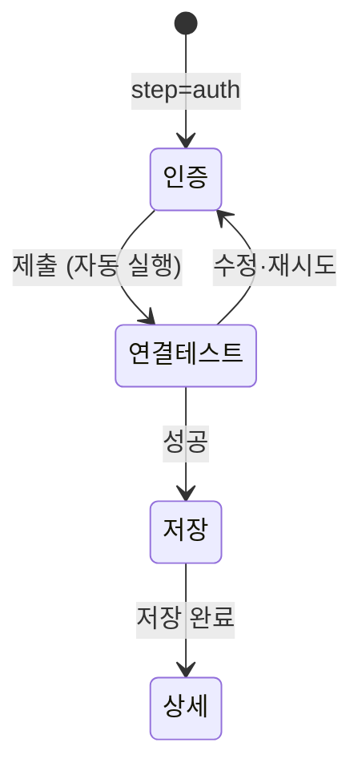

> 구현 상태: 부분 구현 · 원문: `spec/2-navigation/4-integration.md` (§1~§4, §7, §8, §9, §12, §14, 관련 Rationale), `spec/4-nodes/4-integration/_product-overview.md` (§1, §2 의 INT-MG·INT-AU·INT-US·INT-WH·INT-SV·INT-OG), `spec/2-navigation/_product-overview.md` (§3.4 NAV-IN) · 용어: [용어 사전](../CLE-GLOSSARY.md)

## 개요

통합(Integration, `integration`)은 외부 서비스 자격 증명(credentials)과 연결 상태를 워크스페이스에 저장한 것이다. 통합 노드와 AI 에이전트가 통합을 참조해 외부 서비스를 부른다. 이 문서는 사용자가 통합을 만들고 보고, 바꾸고 지우는 기능을 정한다. 목록·추가·상세 화면, 사용처(usages) 추적과 삭제 차단, 권한, 연결 테스트(test connection), 관리 API 와 에러 코드, 노드 실행·에디터·감사 로그와의 연동이 여기에 있다.

하나의 서비스에 계정이나 인스턴스별로 통합을 여러 개 둘 수 있고 별칭으로 구분한다. 공개 범위(`Integration.scope`)가 개인(`personal`)이면 통합 소유자(`created_by`)만 보고 바꾼다. 노드에서는 통합 소유자가 작성한 워크플로우에서만 쓸 수 있다. 조직(`organization`)이면 워크스페이스 멤버 전원이 쓴다.

범위 밖:

- 서비스별 자격 증명 필드와 연결 테스트가 서비스마다 무엇을 확인하는지는 [서비스별 인증 방식과 자격 증명](CLE-INT-AUTH.md) 이 정한다.
- OAuth 연결·설치 흐름, 권한 탭, 통합 재인증(reauthorize)과 추가 권한 요청(request scopes), 토큰 자동 갱신은 [OAuth 연결과 토큰 갱신](CLE-INT-OAUTH.md) 이 정한다.
- 상태 전이, 상태 표시, 주의 필요 판정, 재설치 대기 표시와 상태의 관계, 만료 스캐너와 알림은 [통합 상태와 만료 알림](CLE-INT-STATUS.md) 이 정한다.
- 엔티티 컬럼, 활동 로그(activity log) 채우기 규칙, 암호화는 [통합 데이터와 흐름](CLE-INT-DATA.md) 이 정한다.
- 통합 노드의 핸들러 계약과 노드 에러 코드는 [통합 노드 공통](../CLE-NODE-INT/CLE-NODE-INT-COMMON.md), MCP 서버 통합의 도구 노출은 [MCP 클라이언트](CLE-INT-MCP.md) 가 정한다.
- 같은 제품 요구사항 문서의 지식 저장소와 마켓플레이스 요구사항은 [지식 저장소 관리](../CLE-KB/CLE-KB-MANAGE.md) 와 [마켓플레이스 (구상)](../CLE-UI/CLE-UI-MARKET.md) 에 있다.

## 요구사항

- REQ-INTMGMT-001 WHEN 사용자가 통합 메뉴를 열면 THE SYSTEM SHALL 워크스페이스의 외부 서비스 통합을 한 목록에서 관리하게 한다. (원본: INT-MG-01, NAV-IN-01)
- REQ-INTMGMT-002 WHEN 사용자가 통합을 추가하면 THE SYSTEM SHALL 목록 모달에서 서비스 유형을 고르게 한 뒤 `/integrations/new?service=<type>&step=auth` 페이지에서 자격 증명을 입력받는다. (원본: INT-MG-02, INT-MG-08, NAV-IN-02)
- REQ-INTMGMT-003 WHEN 사용자가 같은 서비스 유형의 통합을 여러 개 만들면 THE SYSTEM SHALL 계정이나 인스턴스마다 별도 통합으로 저장한다. (원본: INT-MG-03)
- REQ-INTMGMT-004 WHEN 사용자가 통합을 만들면 THE SYSTEM SHALL 워크스페이스 안에서 유일한 별칭을 받는다. (원본: INT-MG-04)
- REQ-INTMGMT-005 IF 같은 워크스페이스에 같은 별칭의 통합이 이미 있으면 THE SYSTEM SHALL 생성과 별칭 수정을 409 `INTEGRATION_NAME_TAKEN` 으로 거절한다. Cafe24 Private·MakeShop 의 `oauth/begin` 이 설치 대기 행을 만드는 것도 생성이다.
- REQ-INTMGMT-006 WHEN 사용자가 통합을 열면 THE SYSTEM SHALL 개요·보안·권한·사용·활동·위험 영역 탭이 있는 상세 페이지를 보인다. 위험 영역 탭은 공개 범위 전환이나 삭제를 할 수 있는 사람에게만 보인다(REQ-INTMGMT-063). (원본: INT-MG-05)
- REQ-INTMGMT-007 WHEN 사용자가 OAuth 가 아닌 통합의 자격 증명 교체를 제출하면 THE SYSTEM SHALL 새 값으로 연결 테스트를 하고 성공할 때만 저장한다. (원본: INT-MG-06)
- REQ-INTMGMT-008 IF 자격 증명 교체의 연결 테스트가 실패하면 THE SYSTEM SHALL 기존 자격 증명을 그대로 둔다. (원본: INT-MG-06)
- REQ-INTMGMT-009 WHEN 자격 증명이 바뀌면 THE SYSTEM SHALL 보안 탭에 마지막 교체 시각을 상대 시간과 절대 시간으로 보인다. (원본: INT-MG-06)
- REQ-INTMGMT-010 WHEN 관리자 이상이 공개 범위 전환을 확인하면 THE SYSTEM SHALL 개인과 조직 사이를 바꾸고 기존 자격 증명을 승계하며 감사 로그를 남긴다. 조직에서 개인으로 바꿀 때 통합을 만든 사람이 멤버가 아니면 바꾸지 않는다(REQ-INTMGMT-067). (원본: INT-MG-07)
- REQ-INTMGMT-011 WHEN 사용자가 통합을 만들면 THE SYSTEM SHALL 서비스에 맞게 OAuth 2.0·API Key·Bearer Token·Basic·Connection String·SMTP 인증을 받는다. (원본: INT-AU-02, INT-AU-03, INT-AU-08, INT-AU-09, INT-AU-10, NAV-IN-04)
- REQ-INTMGMT-012 WHEN 통합을 저장하면 THE SYSTEM SHALL 자격 증명을 암호화해 저장하고 응답에서는 가린 미리보기만 보인다. (원본: INT-AU-05)
- REQ-INTMGMT-013 WHEN 사용자가 연결 테스트를 누르면 THE SYSTEM SHALL 저장된 자격 증명으로 외부 서비스 연결을 확인하고 결과를 보인다. (원본: NAV-IN-06)
- REQ-INTMGMT-014 WHEN 추가 위저드가 연결 테스트 단계에 들어가면 THE SYSTEM SHALL 저장하지 않은 자격 증명으로 저장 전 연결 테스트를 자동으로 부르고 성공해야 저장 버튼을 활성화한다.
- REQ-INTMGMT-015 IF 설치 대기 통합에 연결 테스트를 요청하면 THE SYSTEM SHALL 외부를 부르지 않고 200 과 `{ success:false, code:'INTEGRATION_INCOMPLETE' }` 를 돌려준다.
- REQ-INTMGMT-016 WHEN 연결 테스트가 실패하면 THE SYSTEM SHALL 그 실패를 연속 네트워크 실패 카운터에 합산하지 않는다.
- REQ-INTMGMT-017 WHEN 사용처를 조회하면 THE SYSTEM SHALL 노드 `config.integrationId` 직접 참조와 AI 에이전트 `config.mcpServers[].integrationId` MCP 참조의 합집합을 워크플로우 활성 여부와 상관없이 돌려준다. (원본: INT-US-01)
- REQ-INTMGMT-018 WHEN 사용처를 돌려주면 THE SYSTEM SHALL 노드마다 `usageKind`(`direct`·`mcp`)를 표시하고 두 경로에 모두 해당하면 `direct` 로 둔다. (원본: INT-US-01)
- REQ-INTMGMT-019 IF 사용처가 남은 통합을 삭제하려 하면 THE SYSTEM SHALL 409 `INTEGRATION_IN_USE` 와 사용처 목록으로 거절하고 노드를 먼저 바꾸거나 지우라고 안내한다. 멤버가 나가거나 제거될 때의 삭제(REQ-INTMGMT-065)는 이 거절을 거치지 않는다. (원본: INT-US-02)
- REQ-INTMGMT-020 WHEN 통합이 만료됨이나 오류가 되면 THE SYSTEM SHALL 그 통합을 참조하는 노드에 에디터 경고 배지와 상세 바로가기를 보인다. (원본: INT-US-03)
- REQ-INTMGMT-021 WHEN 통합 노드나 내부 MCP 브리지가 통합을 부르면 THE SYSTEM SHALL 호출마다 활동 로그를 한 행 남기고 상세 활동 탭에 최근 7일 호출 수 차트를 보인다. 통합을 얻기 전에 끝난 실패는 REQ-INTMGMT-053 을 따르고, dry-run 이 모의 출력 · 응답으로 대신한 호출은 REQ-RERUN-053 을 따른다. (원본: INT-US-04)
- REQ-INTMGMT-022 WHEN 활동 로그를 남기면 THE SYSTEM SHALL 호출 API 식별 정보(`api_label`·`api_method`·`api_path`)를 함께 저장한다. (원본: INT-US-05)
- REQ-INTMGMT-023 WHEN 활동 탭이 Cafe24·MakeShop 카탈로그 키를 보이면 THE SYSTEM SHALL `services/:type/catalog` 의 `labelKey` 와 프런트엔드 i18n 으로 사람이 읽는 문구를 보인다.
- REQ-INTMGMT-024 WHILE 통합이 연결됨이 아닌 동안 THE SYSTEM SHALL 활동 탭 위에 «연결 안 됨» 인라인 안내를 보인다.
- REQ-INTMGMT-025 WHEN 사용자가 Webhook 통합을 만들면 THE SYSTEM SHALL URL·메서드·기본 헤더·서명 시크릿으로 밖으로 보내는 호출 대상만 정의하게 한다. (원본: INT-WH-01, INT-SV-04)
- REQ-INTMGMT-026 WHEN 들어오는 웹훅 URL 이 필요하면 THE SYSTEM SHALL 트리거에서만 발급하고 Webhook 통합과 서로 참조하거나 공유하지 않는다. (원본: INT-WH-02)
- REQ-INTMGMT-027 WHEN 사용자가 서비스를 고르면 THE SYSTEM SHALL HTTP/REST·Database·Email(SMTP)·Webhook·Cafe24·Google·GitHub·MCP 서버·MakeShop 을 제공한다. (원본: INT-SV-01~INT-SV-09)
- REQ-INTMGMT-028 WHEN Cafe24·MakeShop 통합을 만들면 THE SYSTEM SHALL 같은 통합을 워크플로우 노드와 AI 에이전트 MCP 도구 양쪽에서 쓰게 한다. (원본: INT-SV-05, INT-SV-09)
- REQ-INTMGMT-029 WHEN 팀 워크스페이스의 관리자 이상이 통합을 만들면 THE SYSTEM SHALL 조직 공개 범위를 고를 수 있게 한다. (원본: INT-OG-01, NAV-IN-07)
- REQ-INTMGMT-030 WHEN 조직 통합이 있으면 THE SYSTEM SHALL 워크스페이스 멤버 전원이 워크플로우에서 쓰게 한다. (원본: INT-OG-02)
- REQ-INTMGMT-031 IF 관리자 미만이 조직 통합을 생성·별칭 수정·삭제·통합 재인증·자격 증명 교체·추가 권한 요청·공개 범위 전환하려 하면 THE SYSTEM SHALL 403 으로 거절한다. 코드는 `ADMIN_REQUIRED` 다. 라우트 가드가 편집자 이상으로 먼저 막는 뷰어의 요청만 `EDITOR_REQUIRED` 다. 공개 범위 전환은 라우트 가드가 관리자 이상으로 막으므로 뷰어도 `ADMIN_REQUIRED` 다. 삭제는 라우트 가드가 뷰어를 막지 않으므로(REQ-INTMGMT-051) 뷰어의 조직 통합 삭제도 `ADMIN_REQUIRED` 다. (원본: INT-OG-03, NAV-IN-07)
- REQ-INTMGMT-032 WHEN 목록을 보이면 THE SYSTEM SHALL 조직 통합과 개인 통합을 섹션으로 나눠 보인다. (원본: INT-OG-04)
- REQ-INTMGMT-033 IF 요청자가 통합 소유자가 아닌 개인 통합에 접근하면 THE SYSTEM SHALL 목록에서 빼고 그 `:id` 경로 전부를 404 `RESOURCE_NOT_FOUND` 로 응답한다. 라우트 가드가 있는 경로는 가드의 역할 거부 코드가 먼저 나간다.
- REQ-INTMGMT-034 WHILE 개인 통합을 다루는 동안 THE SYSTEM SHALL 소유자·관리자 역할이라도 통합 소유자가 아니면 보거나 바꾸지 못하게 한다.
- REQ-INTMGMT-035 IF 뷰어가 개인 통합을 생성·별칭 수정·자격 증명 교체·통합 재인증·추가 권한 요청하려 하면 THE SYSTEM SHALL 403 `EDITOR_REQUIRED` 로 거절한다.
- REQ-INTMGMT-036 WHEN 노드가 실행 중에 개인 통합을 참조하면 THE SYSTEM SHALL 그 노드가 속한 워크플로우의 작성자(`workflow.created_by`)가 통합 소유자일 때만 그 통합을 쓴다.
- REQ-INTMGMT-037 WHEN 사용자가 목록을 검색하거나 거르면 THE SYSTEM SHALL 별칭 부분 일치, 공개 범위, 서비스 유형(다중 선택), 상태(단일 선택) 필터를 URL 쿼리 `q`·`scope`·`serviceType`·`status` 와 맞춰 둔다.
- REQ-INTMGMT-038 WHEN 사용자가 추가 페이지를 새로고침하면 THE SYSTEM SHALL `service`·`step` 을 복원하되 입력한 자격 증명은 복원하지 않고 인증 단계로 되돌린다.
- REQ-INTMGMT-039 WHILE 추가 페이지에 입력 중인 자격 증명이 있는 동안 THE SYSTEM SHALL 페이지를 떠나려 하면 경고한다.
- REQ-INTMGMT-040 WHEN 통합 조회 응답을 만들면 THE SYSTEM SHALL 자격 증명을 가리고 파생 값 `autoRefresh`·`appUrl` 을 싣는다.
- REQ-INTMGMT-041 WHEN 사용자가 Cafe24 상점 식별자를 입력하면 THE SYSTEM SHALL 같은 상점의 Cafe24 통합이 이미 있는지 중복 사전 감지로 미리 알린다.
- REQ-INTMGMT-042 IF 중복 사전 감지의 충돌 행이 요청자가 볼 수 없는 개인 통합이면 THE SYSTEM SHALL 통합 ID 와 이름을 빼고 충돌 여부와 상태만 돌려준다.
- REQ-INTMGMT-043 WHEN 통합의 생성·수정·삭제·자격 증명 교체·비OAuth 재인증·공개 범위 전환이 일어나면 THE SYSTEM SHALL `resource_type='integration'` 감사 로그를 남긴다.
- REQ-INTMGMT-044 WHEN OAuth 통합 재인증이 콜백으로 끝나면 THE SYSTEM SHALL `integration.reauthorized` 감사 로그를 남긴다. (미구현)
- REQ-INTMGMT-045 WHEN 노드 설정 패널에서 통합을 고르면 THE SYSTEM SHALL 서비스 유형으로 거른 통합 선택기를 보이고 해당 유형 통합이 없으면 만들기 링크를 보인다.
- REQ-INTMGMT-046 IF 노드에 저장된 통합이 삭제됐으면 THE SYSTEM SHALL `{id앞8자}… (missing)` 옵션을 더해 값을 보존한다.
- REQ-INTMGMT-047 WHEN 통합 조회 응답을 만들면 THE SYSTEM SHALL 재설치 대기 표시를 `reinstallRequestedAt`(ISO 8601 시각 또는 `null`)으로 싣고 남긴 지 24시간이 지난 표시는 `null` 로 싣는다.
- REQ-INTMGMT-048 WHILE 통합 조회 응답의 `reinstallRequestedAt` 이 `null` 이 아닌 동안 THE SYSTEM SHALL 상세 화면 머리 아래에 «테스트 실행» 을 누르라는 안내와 요청 시각을 info 톤으로 보인다.
- REQ-INTMGMT-049 WHEN 보안 탭이 통합 재인증 버튼을 막으면 THE SYSTEM SHALL 설치 대기, 설치 기한 만료, App URL 없음, MakeShop 가운데 해당하는 이유의 안내 문구를 버튼 아래에 보인다.
- REQ-INTMGMT-050 WHEN 통합 재인증 응답이 `cafe24_private_pending` 이면 THE SYSTEM SHALL 팝업을 열지 않고 info 토스트를 보인 뒤 통합을 다시 조회한다.
- REQ-INTMGMT-051 WHEN 뷰어가 자기 개인 통합을 삭제하면 THE SYSTEM SHALL 다른 역할과 같은 사용처 검사를 거쳐 허용한다.
- REQ-INTMGMT-052 IF 실행 중인 노드가 워크플로우 작성자가 통합 소유자가 아닌 개인 통합을 참조하면 THE SYSTEM SHALL 없는 통합을 참조할 때와 똑같이 통합 노드는 같은 노드 에러 코드로 실패시키고 AI 에이전트의 MCP 서버 항목은 그 서버만 건너뛴다.
- REQ-INTMGMT-053 IF 통합 노드나 MCP 서버 항목이 통합을 얻기 전에 실패하면 THE SYSTEM SHALL 설정의 통합 ID 로 활동 로그를 남기지 않고 그 통합의 `last_used_at`·`last_error` 도 쓰지 않는다. (부분 구현, NERV Task `CLE-T-PTC4SF`)
- REQ-INTMGMT-054 IF 노드 생성·노드 설정 수정·캔버스 저장 요청이 새로 넣거나 바꾼 통합 참조가 워크스페이스에 없는 통합이나 저장자 또는 워크플로우 작성자가 통합 소유자가 아닌 개인 통합을 가리키면 THE SYSTEM SHALL 거절 이유를 구분하지 않고 400 `VALIDATION_ERROR`(`details[].code`=`INVALID_FIELD`)로 거절한다. 복제·가져오기·버전 복원은 거절하지 않고 참조를 비운다(REQ-WFLIST-054·055, REQ-WFVER-026). 참조 값이 표현식이면 거절하지도 비우지도 않고 실행 시점 판정에 맡긴다(REQ-INTMGMT-059).
- REQ-INTMGMT-055 IF 실행 중 노드가 속한 워크플로우의 작성자를 알 수 없으면 THE SYSTEM SHALL 그 노드의 개인 통합 참조를 워크플로우 작성자가 통합 소유자가 아닐 때와 같이 처리한다.
- REQ-INTMGMT-056 IF 지금 사용자가 워크플로우 작성자가 아니면 THE SYSTEM SHALL 통합 선택기에서 자기 개인 통합을 고를 수 없는 항목으로 보이고 그 이유를 함께 보인다.
- REQ-INTMGMT-057 WHEN 관리자가 조직 통합을 개인으로 전환하려 하고 통합 소유자가 아닌 사람이 작성한 워크플로우가 그 통합을 쓰면 THE SYSTEM SHALL 전환 확인 다이얼로그에 실행이 실패하게 될 워크플로우 목록을 보인다. 전환을 막지는 않는다.
- REQ-INTMGMT-058 IF 실행 중 노드나 버전 복원이 참조하는 개인 통합의 통합 소유자가 지금 워크스페이스 멤버가 아니면 THE SYSTEM SHALL 그 참조를 워크플로우 작성자가 통합 소유자가 아닐 때와 같이 처리한다.
- REQ-INTMGMT-059 IF 실행 중 노드의 통합 참조 값이 표현식으로 정해지고 그 값이 개인 통합을 가리키면 THE SYSTEM SHALL 그 참조를 워크플로우 작성자가 통합 소유자가 아닐 때와 같이 처리한다. 평가 전 원본 값을 확인하지 못한 참조도 표현식으로 정한 참조로 본다.
- REQ-INTMGMT-060 WHEN 통합 삭제 요청을 받으면 THE SYSTEM SHALL 존재와 조회 권한(404), 역할(403), 사용처(409) 순으로 판정하고 셋을 모두 통과한 뒤에만 캐시 무효화와 감사 로그를 남긴다.
- REQ-INTMGMT-061 IF 뷰어가 저장 전 연결 테스트를 부르면 THE SYSTEM SHALL 403 `EDITOR_REQUIRED` 로 거절한다.
- REQ-INTMGMT-062 WHEN 활동 로그를 기록하면 THE SYSTEM SHALL 실행 중에 조회해 얻은 통합에만 활동 로그와 그 통합의 `last_used_at`·`last_error` 를 쓴다. (미구현, NERV Task `CLE-T-PTC4SF`)
- REQ-INTMGMT-063 WHEN 통합 목록이나 상세 화면을 보이면 THE SYSTEM SHALL 지금 사용자가 역할이나 통합 소유 때문에 할 수 없는 변경 동작(목록 헤더와 빈 상태의 통합 추가, 별칭 수정, 통합 재인증, 자격 증명 교체, 추가 권한 요청, 공개 범위 전환, 삭제)의 버튼을 보이지 않고 공개 범위 전환과 삭제를 둘 다 할 수 없으면 위험 영역 탭도 보이지 않는다. 통합 추가를 할 수 없으면 `N` 키로도 추가 모달이 열리지 않는다. 연결 테스트처럼 조회성 동작의 버튼은 보인다.
- REQ-INTMGMT-064 IF 뷰어가 통합 추가 화면 주소(`/integrations/new`)로 들어오면 THE SYSTEM SHALL 추가 단계 대신 편집자 이상만 통합을 추가할 수 있다는 안내와 목록으로 돌아가는 링크를 보인다.
- REQ-INTMGMT-065 WHEN 멤버가 워크스페이스를 나가거나 제거되면 THE SYSTEM SHALL 멤버십을 지우는 트랜잭션 안에서 그 멤버가 통합 소유자인 그 워크스페이스의 개인 통합을 상태와 사용처에 관계없이 모두 지운다. 커밋 뒤 지운 통합마다 캐시를 무효화하고 `details.mode` 와 `details.memberUserId` 를 실은 `integration.deleted` 감사 로그를 남긴다.
- REQ-INTMGMT-066 WHEN 개인 통합 행을 만들거나(통합 생성) Cafe24 Private·MakeShop `oauth/begin` 이 개인 공개 범위 요청으로 설치 대기 행을 만들거나 다시 쓰면 THE SYSTEM SHALL 같은 트랜잭션에서 워크스페이스, 멤버십, 통합 순으로 잠그고 통합 소유자의 멤버십을 다시 읽어 없으면 403 `NOT_A_MEMBER` 로 거절한다. 멤버십이 있는지만 보고 역할은 보지 않는다. 잠금 순서는 [나간 멤버의 개인 통합은 나갈 때 지운다](#나간-멤버의-개인-통합은-나갈-때-지운다-2026-10-29) 가 정한다.
- REQ-INTMGMT-067 IF 관리자가 조직 통합을 개인으로 전환하려는데 통합을 만든 사람(`created_by`)이 그 워크스페이스 멤버가 아니면 THE SYSTEM SHALL 409 `INTEGRATION_OWNER_NOT_MEMBER` 로 거절하고 통합을 바꾸지 않는다. 판정은 전환 트랜잭션 안에서 REQ-INTMGMT-066 과 같은 순서로 잠근 멤버십으로 한다.
- REQ-INTMGMT-068 WHEN 조직 공개 범위로 통합 행을 만들거나(통합 생성) Cafe24 Private·MakeShop `oauth/begin` 이 조직 공개 범위 요청으로 설치 대기 행을 만들거나 다시 쓰면 THE SYSTEM SHALL 같은 트랜잭션에서 통합 행보다 먼저 워크스페이스 행을 잠그고 워크스페이스가 그 사이 지워졌으면 403 `NOT_A_MEMBER` 로 거절한다. 멤버십은 잠그지 않는다. 잠금 순서는 [나간 멤버의 개인 통합은 나갈 때 지운다](#나간-멤버의-개인-통합은-나갈-때-지운다-2026-10-29) 가 정한다.

통합 참조가 놓이는 자리와 저장 검사가 거절할 값 모양(문자열이 아닌 값, 표현식이 아니면서 UUID 모양이 아닌 문자열)은 [플랫폼 데이터 모델 「참조의 소속」](../CLE-PLAT/CLE-PLAT-DATA.md#참조의-소속) 의 「통합 참조」 가 정한다. 위 054 의 거절 대상도 이 규칙을 따른다.

## 라우트

| 경로 | 설명 |
| --- | --- |
| `/integrations` | 통합 목록(기본 진입점) |
| `/integrations/new?service=<type>&step=auth` | 통합 추가 위저드. 서비스 선택은 목록 모달이 맡고 인증 단계부터 이 페이지로 들어온다 |
| `/integrations/[id]` | 상세 페이지 |

서비스 선택 같은 가벼운 단계는 목록 모달로 진입 비용을 낮춘다. OAuth 팝업 복귀와 딥링크가 필요한 인증 단계부터는 독립 라우트에서 상태를 복원한다.

## 목록 페이지

| 영역 | 위치 | 들어가는 요소 | 동작 |
| --- | --- | --- | --- |
| 헤더 | 맨 위 | 제목 `Integrations`, `[+ Add Integration]` | 추가 모달을 연다(키보드 `N`). 버튼과 `N` 은 편집자 이상에게만 있다. 뷰어에게는 버튼이 보이지 않고 `N` 을 눌러도 모달이 열리지 않는다 |
| 주의 필요 배너 | 헤더 아래 | 요약 문구와 분해 카운트 | [통합 상태와 만료 알림](CLE-INT-STATUS.md) 의 배너 규칙 |
| 검색·공개 범위 | 배너 아래 | 검색 입력, `Scope: All ▼` 셀렉트 | 아래 필터 표 |
| 서비스 유형 칩 | 그 아래 | `All`·`Google`·`GitHub`·`HTTP`·`DB`·`Email`·`Webhook` 등 | 다중 선택 |
| 상태 칩 | 그 아래 | `All`·`Attention`·`Connected`·`Expiring`·`Expired`·`Error` | 단일 선택 |
| Organization 섹션 | 본문 | 조직 통합 카드 | 섹션 안에서 최신 생성순 |
| Personal 섹션 | 본문 | 개인 통합 카드 | 섹션 안에서 최신 생성순 |

카드 요소:

| 요소 | 설명 |
| --- | --- |
| 상태 아이콘 | 상태별 아이콘. 표시 규칙은 [통합 상태와 만료 알림](CLE-INT-STATUS.md) |
| 서비스 아이콘 | 서비스 유형별 로고 |
| 별칭 | 사용자가 정한 이름(`Integration.name`) |
| 인증 유형 | 통합 인증 유형(`auth_type`)을 대문자·공백을 정리해 보인다(`OAuth2`, `API Key`, `Bearer Token`, `Basic`, `Connection String`, `SMTP`, `Webhook Outbound`). `service_type='mcp'` 는 `MCP Server`, `service_type='cafe24'` 는 `Cafe24` 로 따로 보인다 |
| 상태 문구 | `Connected`·`Expires in Nd`·`Expired`·`Error: <reason>`·`Pending install` 과 진단 단서. 규칙은 [통합 상태와 만료 알림](CLE-INT-STATUS.md) |
| 더보기(⋮) | 상세 열기, 연결 테스트(연결됨만), 통합 재인증(OAuth, 비활성 조건은 [상세 페이지 보안 탭](#보안-탭)), 삭제(사용처가 있으면 비활성). 설치 대기 통합은 상세 열기와 삭제만 활성이다. 통합 재인증은 외부 쪽 «테스트 실행»·앱 설치가 정식이고 연결 테스트는 토큰이 없어 의미가 없다. 변경 항목(통합 재인증, 삭제)은 [권한](#권한) 표에서 그 동작을 할 수 있는 사람에게만 보인다 |

### 검색과 필터

| 컨트롤 | 동작 |
| --- | --- |
| 검색 입력 | 별칭(`name`) ILIKE 부분 일치 |
| 공개 범위 셀렉트 | `All` / `Personal` / `Organization` |
| 서비스 유형 칩 | 다중 선택. 아무것도 고르지 않으면 전체 |
| 상태 칩 | 단일 선택. `Expiring`·`Attention` 은 DB 상태에 없는 가상 필터 값이고 판정은 [통합 상태와 만료 알림](CLE-INT-STATUS.md) 이 정한다. 설치 대기 칩은 없다 |

모든 필터는 URL 쿼리 파라미터(`q`, `scope`, `serviceType`, `status`)와 맞춰 두어 공유하거나 새로고침해도 복원된다.

### 통합 추가 모달

서비스 카드 격자에서 서비스를 고른다. 순서는 자체 서비스(Google·GitHub·Cafe24·MakeShop), 범용(HTTP·Database·Email·Webhook), 도구 확장(MCP)이다. 카드 목록은 `GET /api/integrations/services`(백엔드 서비스 레지스트리)로 그린다. MakeShop 카드는 레지스트리의 `type: 'makeshop'` 등록으로 나온다.

- 카드를 누르면 `/integrations/new?service=<type>&step=auth` 로 가고 모달은 닫힌다.
- 모달은 목록 페이지에서만 열린다(키보드 `N` 허용). 편집자 이상만 열 수 있다([권한](#권한)).

### 화면 상태

| 상태 | 표시 |
| --- | --- |
| 목록 로딩 | 3×3 스켈레톤 카드 격자 |
| 목록 빈 상태 | 아이콘, "No integrations yet", `[+ Add Integration]`(편집자 이상) |
| 필터 결과 0건 | "No integrations match your filters." 와 필터 초기화 버튼 |
| 목록 조회 에러 | "Failed to load integrations." 와 `[Retry]` |
| 상세 로딩 | 헤더 스켈레톤과 탭 스켈레톤 |
| 상세 없음 | 404 페이지와 목록으로 돌아가기 |
| 연결 테스트 중 | 버튼 `Testing...` 과 스피너 |
| 자격 증명 교체 중 | 폼 비활성과 진행 배너 |
| 삭제 차단 | 모달의 `Delete` 비활성과 차단 사유 다이얼로그 |

## 추가 페이지

쿼리 파라미터 `step` 으로 단계를 제어한다.

추가 페이지는 편집자 이상이 쓴다. 뷰어가 `/integrations/new` 주소로 들어오면 단계 대신 통합 추가는 편집자 이상만 할 수 있다는 안내와 목록으로 돌아가는 링크만 보인다(REQ-INTMGMT-064).

### 인증 단계

왼쪽 헤더에 `← Back to list`, 서비스 로고와 이름, 단계 표시(`2 / 3`)를 둔다. 입력 폼은 [서비스별 인증 방식과 자격 증명](CLE-INT-AUTH.md) 의 스키마를 따른다.

| 공통 필드 | 필수 | 설명 |
| --- | --- | --- |
| `name` | ✓ | 별칭. 워크스페이스 안에서 유일 |
| `scope` | ✓ | 공개 범위. 팀 워크스페이스에서 `Personal` / `Organization`. 관리자가 아니면 `Organization` 을 비활성화한다 |

- OAuth 서비스는 인증 단계에서 연결 흐름을 시작한다. Google·GitHub·Cafe24 Public 은 팝업, Cafe24 Private·MakeShop 은 설치 우선 흐름의 설정 안내 화면이다. 흐름, 팝업 복귀, 설정 안내 화면은 [OAuth 연결과 토큰 갱신](CLE-INT-OAUTH.md) 이 정한다.
- 추가 흐름의 요청이 역할이나 설치 대기 행 충돌로 거절되면 토스트로 알린다. 409 `CAFE24_PRIVATE_APP_INSTALL_PENDING`·`MAKESHOP_INSTALL_PENDING` 은 다른 멤버가 시작한 설치가 기다리고 있다는 문장 뒤에 `details.pendingInstallExpiresAt` 의 기한을 붙여 그 뒤에 다시 시도하라고 안내한다. `403 EDITOR_REQUIRED`·`ADMIN_REQUIRED` 는 필요한 역할을 알린다.
- 설치 대기 행을 다시 쓴 `oauth/begin` 응답의 `scope` 가 고른 공개 범위와 다르면 기존 행의 공개 범위를 그대로 쓴다고 안내한다([OAuth 연결과 토큰 갱신](CLE-INT-OAUTH.md#설치-대기-행-재사용의-권한)).
- OAuth 가 아닌 서비스는 모든 필드를 입력한 뒤 `[Continue]` 로 연결 테스트 단계로 간다.

### 연결 테스트 단계

- 저장 전 연결 테스트(`POST /api/integrations/preview-test`)를 자동으로 부른다. DB 에 저장하지 않고 메모리의 자격 증명으로 확인한다.
- OAuth 는 팝업에서 토큰 교환이 이미 끝났으므로 필드 구조만 확인한다. 서비스별 확인 범위는 [서비스별 인증 방식과 자격 증명](CLE-INT-AUTH.md).
- 성공하면 `[Save integration]` 버튼을 활성화한다.
- 실패하면 에러 메시지와 `[Back to auth]` 버튼을 보인다. 인증 단계로 돌아가도 입력값은 유지한다.

### 저장 단계

- `POST /api/integrations` 로 만든다. OAuth 는 토큰이 이미 서버 임시 저장소에 있어 미리보기 토큰(`previewToken`)만 넘긴다.
- 성공하면 `/integrations/[id]` 로 이동하고 토스트 `Integration created` 를 띄운다.
- 실패하면 연결 테스트 단계 화면을 유지한다.

### 이탈과 복원

- 새로고침하면 쿼리 파라미터에서 `service`·`step` 을 복원한다. 입력한 자격 증명은 보안상 복원하지 않고 인증 단계로 되돌린다.
- 입력 중인 자격 증명이 있으면 `beforeunload` 에서 경고한다.

## 상세 페이지

| 영역 | 위치 | 들어가는 요소 | 동작 |
| --- | --- | --- | --- |
| 뒤로 가기 | 맨 위 | `← Back to integrations` | 목록으로 |
| 제목 | 그 아래 | 상태 아이콘, 별칭 | |
| 메타 라인 | 제목 아래 | `<인증 유형> · <공개 범위> · <상태 배지> · <Last used …>` | 자동 갱신 보조 라벨은 [통합 상태와 만료 알림](CLE-INT-STATUS.md) |
| 생성 정보 | 메타 아래 | `Created by @<user>, <date>` | |
| 재설치 대기 안내 | 머리 아래, 탭 위 | 제목, 설명, 요청 시각 | `reinstallRequestedAt` 이 `null` 이 아닐 때만 보인다. [재설치 대기 안내](#재설치-대기-안내) |
| 탭 | 본문 위 | `Overview`·`Security`·`Scope & Permissions`·`Usage`·`Activity`·`Danger zone` | 앵커(`#security`, `#usage` 등)로 전환. `Danger zone` 은 공개 범위 전환이나 삭제 가운데 하나라도 할 수 있을 때만 보인다 |

변경 버튼(별칭 수정, 통합 재인증, 자격 증명 교체, 추가 권한 요청, 공개 범위 전환, 삭제)은 [권한](#권한) 표에서 그 동작을 할 수 있는 사람에게만 보인다. 연결 테스트처럼 조회성 동작은 누구에게나 보인다. 위험 영역 탭을 볼 수 없는 사람이 그 탭의 앵커로 들어오거나 공개 범위를 바꿔 탭이 사라지면 개요 탭을 보인다. 숨기는 경우와 비활성으로 두는 경우를 가르는 기준은 [Rationale 「통합 화면은 할 수 없는 변경 동작을 숨긴다」](#통합-화면은-할-수-없는-변경-동작을-숨긴다-2026-10-29) 에 있다.

### 재설치 대기 안내

통합에 재설치 대기 표시(`IntegrationDto.reinstallRequestedAt`)가 있으면 머리와 탭 사이에 인라인 안내를 보인다. 지금 표시가 생기는 통합은 Cafe24 Private 뿐이다. 표시의 뜻과 상태와의 관계는 [통합 상태와 만료 알림](CLE-INT-STATUS.md#재설치-대기-표시), 남기고 지우는 규칙은 [OAuth 연결과 토큰 갱신](CLE-INT-OAUTH.md#재설치-대기-표시) 이 정한다.

- 톤은 info(파랑)다. 표시는 상태가 아니라 다음에 할 일을 알리는 안내라서 상태 배지와 따로 둔다. 오류·만료됨 같은 상태 문제는 상태 배지가 경고 톤으로 따로 보인다.
- 제목: "Cafe24 Developers 에서 '테스트 실행'을 눌러 주세요" / `Click "Test run" in Cafe24 Developers`
- 설명: "재설치를 요청했어요. Cafe24 Developers 의 앱 화면에서 '테스트 실행'을 누르면 동의 화면이 열려요. 동의하면 새 토큰으로 바뀌어요. 요청은 24시간 동안 유효해요." / `Reinstall requested. Click "Test run" on your app in Cafe24 Developers to open the consent screen; once you approve, the integration switches to the new token. The request stays valid for 24 hours.` 그 전까지 지금 토큰으로 실행된다는 문장은 넣지 않는다. 오류·만료됨 행은 콜백이 성공하기 전까지 노드 실행이 계속 막힌다.
- 요청 시각: "요청 시각: <시각>" / "Requested at: <시각>". 시각은 `formatDate(…, "datetime")` 로 보인다.
- 콜백이 성공하면 표시가 지워져 다음 조회부터 안내가 사라진다. 표시는 남긴 시각부터 24시간 동안만 유효하다. 24시간 안에 «테스트 실행» 을 하지 않으면 응답의 `reinstallRequestedAt` 이 `null` 이 되어 안내도 사라진다. 다시 하려면 통합 재인증이나 추가 권한 요청을 다시 누른다.
- 안내 영역은 `role="status"` 다. 탭 위에 있어 어느 탭을 열어도 보인다.

### 개요 탭

| 요소 | 설명 |
| --- | --- |
| 기본 정보 | 서비스, 별칭, 만든 사람, 생성·수정일, 마지막 사용 시각, 마지막 교체 시각, 토큰 만료 시각(자동 갱신 통합의 표기는 [통합 상태와 만료 알림](CLE-INT-STATUS.md)) |
| 빠른 동작 | `Test connection`(연결됨만), `Reauthorize`(OAuth, 비활성 조건은 [보안 탭](#보안-탭). 자동 갱신 통합이 연결됨인 동안에는 버튼을 활성으로 두되 hover 에 "Auto-renewing — manual reauthorization is not required" 를 보인다), `Rotate credentials`(OAuth 아님), `Edit alias` |
| 상태 배지 | 현재 상태와 사유(예: `error(insufficient_scope)`) |
| 별칭 편집 | 인라인 편집, `PATCH /api/integrations/:id` |
| App URL 카드 | `IntegrationDto.appUrl` 이 null 이 아닌 통합에만 보인다. 현재 Cafe24 Private(`service_type='cafe24' AND credentials.app_type='private'`)과 MakeShop ShopStore 설치 통합이다. App URL(`${APP_URL}/api/3rd-party/<provider>/install/:installToken`)과 Redirect URI(App URL 의 `/install/<token>` 을 `/callback` 으로 바꾼 값)를 복사 버튼과 함께 보인다. 문구는 서비스 유형별로 다르다. Cafe24 는 개발자 센터 «앱 URL» 갱신 안내(App URL HMAC 실패 에러 페이지가 비교 대상으로 가리키는 곳이 이 카드다), MakeShop 은 파트너센터 앱 설정 안내다. 새 등록 흐름의 설정 안내 화면과 같은 복사 UX(라벨, 모노스페이스 URL, 복사 버튼, 한 줄 안내)를 다시 쓴다 |

### 보안 탭

| 블록 | 설명 |
| --- | --- |
| Authentication | 인증 유형과 현재 자격 증명 메타(예: `Token preview: xoxb-****4f2a`). 원본 값은 복호화해 보이지 않는다 |
| Reauthorize (OAuth) | `[Reauthorize]` → `POST /api/integrations/:id/reauthorize`. 응답에 `authUrl` 이 있으면 팝업 OAuth 를 열고 성공하면 연결됨으로 돌아온다. Cafe24 Private 은 응답이 `cafe24_private_pending` 이라 팝업 없이 info 토스트("Cafe24 Developers 에서 '테스트 실행'을 눌러 주세요")를 보이고 통합을 다시 조회한다. 다시 조회한 화면에 [재설치 대기 안내](#재설치-대기-안내)가 나온다. Cafe24 Private 의 버튼 위 설명은 "재설치를 요청한 뒤 Cafe24 Developers 에서 '테스트 실행'을 누르면 토큰이 갱신돼요." 다. 비활성 조건은 아래 표 |
| Rotate credentials (OAuth 아님) | 인라인 폼. 기존 값은 가리고 토글로 교체 폼을 열어 새 값을 넣으면 `POST /api/integrations/:id/rotate` 가 안에서 연결 테스트를 하고 성공할 때만 저장한다. 실패하면 기존 자격 증명을 유지한다. 폼 필드는 서비스 스키마와 같다. 서버는 테스트가 성공하기 전까지 기존 자격 증명을 건드리지 않는다 |
| Last rotated | `last_rotated_at` 상대 시간과 절대 시간 |

통합 재인증 버튼은 아래 조건에서 막고 버튼 아래에 이유별 안내 문구를 보인다(`reauthorizeDisabledReason`). 위 행부터 판정해 처음 맞는 이유를 쓴다.

| 이유 값 | 조건 | 막는 이유 | 안내 문구 |
| --- | --- | --- | --- |
| `pending_install` | 설치 대기(서비스 무관) | 설치가 끝나지 않았다. 외부 «테스트 실행»·앱 설치가 정식 경로다 | "설치가 끝나지 않은 통합은 재인증할 수 없어요. 설치를 먼저 마쳐 주세요." |
| `install_timeout` | `status='expired' AND status_reason='install_timeout'` | 설치 기한이 지나 설치 토큰이 지워졌다. 상점 식별자를 비우므로 이 행을 지우지 않아도 같은 상점을 새로 등록한다. 이름은 그대로 남아 같은 이름으로 등록하면 409 `INTEGRATION_NAME_TAKEN` 이라 다른 이름으로 등록한다([OAuth 연결과 토큰 갱신](CLE-INT-OAUTH.md#만료된-설치-대기-행은-상점-자리를-놓는다-2026-10-29)) | "설치 시간이 지나 만료된 통합은 재인증할 수 없어요. 이 통합을 지우지 않아도 같은 상점을 새로 등록할 수 있어요. 이름이 겹치면 다른 이름으로 등록해 주세요." |
| `makeshop` | MakeShop 통합 | 서버가 재인증을 시작할 수 없고 ShopStore 재설치도 기존 통합을 되살리지 않는다. 삭제 후 재등록한다 | "MakeShop 통합은 재인증할 수 없어요. 문제가 생기면 통합을 삭제한 뒤 다시 등록해 주세요. 상점에서 앱을 다시 설치해도 기존 통합은 복구되지 않아요." |
| `no_app_url` | App URL(`appUrl`)이 없는 Cafe24 Private 통합 | 설치 토큰이 없어 «테스트 실행» 이 이 행으로 돌아올 수 없다. 삭제 후 재등록한다 | "App URL 이 없어 재설치를 요청할 수 없어요. 통합을 삭제한 뒤 다시 등록해 주세요." |

- 설치를 마치고 App URL 이 있는 Cafe24 Private 통합은 버튼이 활성이다. 서버는 재설치 대기 표시만 남기고 사용자가 «테스트 실행» 을 누르면 App URL 이 OAuth 로 보낸다([OAuth 연결과 토큰 갱신](CLE-INT-OAUTH.md#재설치-대기-표시)). 표시가 남아 있어도 버튼은 활성이고 다시 누르면 새 시각으로 표시를 다시 남긴다.
- 화면에서 막는 것과 별개로 서버도 거절한다. 설치 대기이거나 설치 토큰이 없는 Cafe24 Private 통합과 MakeShop 통합의 `:id/reauthorize` 는 400 이다([OAuth 연결과 토큰 갱신](CLE-INT-OAUTH.md)). 가시성과 관리자 판정(404·403)을 통과한 요청만 이 400 에 닿는다. Cafe24 Private 의 코드는 [에러 코드](#에러-코드) 표의 `CAFE24_PRIVATE_APP_USE_TEST_RUN`(설치 대기)과 `CAFE24_PRIVATE_APP_INSTALL_TOKEN_MISSING`(설치 토큰 없음)이다.

### 권한 탭

OAuth 통합에서만 보인다. 요소와 추가 권한 요청 응답 처리는 [OAuth 연결과 토큰 갱신](CLE-INT-OAUTH.md) 이 정한다. 설치 기한이 지나 만료된 통합, MakeShop 통합, App URL 이 없는 Cafe24 Private 통합은 권한 요청 버튼도 막고 이유별 안내를 보인다(`requestScopesDisabledReason`). 이유는 `install_timeout`·`makeshop`·`no_app_url` 순서로 판정하고 통합 재인증 비활성 이유와 같은 순서다. 설치 기한 만료는 이 통합을 지우지 않고 필요한 권한으로 같은 상점을 새로 등록하라고 안내하고 나머지 둘은 삭제 후 재등록을 안내한다. 이유별 문구는 [OAuth 연결과 토큰 갱신](CLE-INT-OAUTH.md) 의 권한 탭 요소 표가 정한다. 추가 권한 요청이 `cafe24_private_pending` 으로 끝나면 통합을 다시 조회하므로 재설치 대기 표시가 남은 경우 [재설치 대기 안내](#재설치-대기-안내)가 바로 나온다.

### 사용 탭

"Used by 3 nodes across 2 workflows" 같은 요약 아래 워크플로우별로 사용 노드를 묶어 보인다. 각 행은 노드 라벨, 노드 ID, `[Open in editor →]` 링크다.

- 데이터는 `GET /api/integrations/:id/usages` 에서 온다([사용처 추적과 삭제 차단](#사용처-추적과-삭제-차단)).
- 워크플로우 활성 여부와 상관없이 모두 보인다. 워크플로우 이름 옆에 `(Active)`·`(Inactive)` 를 붙인다.
- «Open in editor» 는 워크플로우 에디터 URL 로 가서 그 노드를 선택한 상태로 연다.
- `usageKind='mcp'` 노드는 라벨 옆에 보조 톤의 `MCP` 배지를 붙인다. 통합을 직결 노드가 아니라 AI 에이전트의 MCP 도구로 쓴다는 뜻이다. `direct` 는 배지가 없다.

### 활동 탭

맨 위에 "Last 7 days: 124 calls · 98% success" 요약과 일별 호출 수 스파크라인을 두고 아래에 최근 20건 표를 둔다.

| 컬럼 | 내용 |
| --- | --- |
| At | 호출 시각. 상대 표기와 tooltip 절대 시각 |
| API | 라벨(굵게)과 endpoint 보조 문구(작게) 두 줄. `apiLabel` 만 있으면 라벨만, `apiMethod`·`apiPath` 만 있으면 endpoint 한 줄(`{method} {path}`), 둘 다 NULL 이면 `—` |
| Status | `Success` / `Failed` |
| Duration | `durationMs` 를 읽기 쉽게(`412 ms` / `1.2 s`) |
| Error | 실패 행에만 `error.code` 와 잘린 첫 줄 메시지. 비면 `—` |

예시:

| At | API | Status | Duration | Error |
| --- | --- | --- | --- | --- |
| 14:03 Apr 11 | **상품 목록 조회** / `GET products` | Success | 412 ms | — |
| 13:55 Apr 11 | `POST api.example.com/v1/users` | Failed | 1203 ms | `HTTP_502` HTTP 502 Bad Gate… |
| 13:40 Apr 11 | — | Success | 18 ms | — |

- 데이터는 `GET /api/integrations/:id/activity?limit=20&days=7` 에서 온다([사용처와 활동 API](#사용처와-활동-api)).
- 실패 행을 누르면 에러 요약 팝오버와 `Execution detail →` 링크를 보인다.
- 카탈로그 라벨: Cafe24 의 `apiLabel`(`cafe24.<resource>.<operation>`)은 `GET /api/integrations/services/cafe24/catalog` 응답의 `labelKey` 와 프런트엔드 i18n 사전으로 한국어·영어 라벨이 된다. MakeShop 도 같다(`makeshop.<resource>.<operation>`, `services/makeshop/catalog`). 그 밖의 통합은 `apiLabel` 이 NULL 이라 endpoint 만 보인다. 채우기 규칙은 [통합 데이터와 흐름](CLE-INT-DATA.md).
- **연결 안 됨 안내**: 통합 상태가 연결됨이 아니면(오류, 만료됨, 설치 대기) 활동 목록과 빈 상태 위에 [인라인 안내](../CLE-UI/CLE-UI-LAYOUT.md) 를 보인다. 이 상태에서는 새 호출이 기록되지 않는다. AI 에이전트는 내부 MCP 브리지가 연결되지 않은 통합의 도구를 노출하지 않아 호출이 없고 직결 노드는 `INTEGRATION_NOT_CONNECTED` 로 바로 실패한다. 그래서 단순한 «활동 없음» 과 구분해 원인을 알린다. 톤은 오류가 red, 만료됨·설치 대기가 amber 로 헤더 상태 배지와 맞춘다. 안내에는 개요 탭으로 가는 «상태 확인» 버튼이 있다. 연결됨(만료 임박 포함)은 여전히 기록되므로 안내를 보이지 않는다. 설치 대기를 넣는 것은 주의 필요(설치 대기 제외)와 다른 축이다. «조치가 필요한가» 가 아니라 «활동 데이터가 왜 없는가» 를 설명한다.

### 위험 영역 탭

- `[Delete integration]` 버튼을 누르면 `GET /api/integrations/:id/usages` 를 확인한다. 사용처가 0건이면 확인 다이얼로그 뒤 `DELETE /api/integrations/:id` 를 부른다. 1건 이상이면 삭제 차단 다이얼로그에 사용처 목록과 안내를 보인다.
- 공개 범위 전환도 이 탭에 있다(관리자만).

공개 범위 전환 다이얼로그 문구:

> ⚠ Change scope from Personal to Organization?
>
> 기존 OAuth 토큰이 워크스페이스 전체 멤버에게 그대로 승계됩니다. 공유해도 문제가 없는 권한인지 확인해 주세요.
>
> [취소] [Change to Organization]

조직에서 개인으로 바꾸는 다이얼로그는 전환 전에 `GET /api/integrations/:id/usages` 를 확인한다. 워크플로우 작성자가 통합 소유자가 아닌 워크플로우(응답의 `authorIsIntegrationOwner` 가 `false`)가 있으면 그 목록과 함께 전환 뒤 그 워크플로우의 노드가 이 통합을 쓰지 못해 실행에서 실패한다는 안내를 보인다(REQ-INTMGMT-057). 관리자가 확인하면 전환한다. 그런 워크플로우가 없으면 안내 없이 확인만 받는다. 통합을 만든 사람이 이미 워크스페이스를 나갔으면 서버가 전환을 409 `INTEGRATION_OWNER_NOT_MEMBER` 로 거절한다(REQ-INTMGMT-067). 화면은 전환하지 않고 «이 통합을 만든 사람이 워크스페이스에 없어 개인 통합으로 바꿀 수 없어요. 조직 통합으로 두거나 삭제해 주세요.» 를 에러 토스트로 보인다. 확인 창과 경고 다이얼로그는 요청 전에 닫힌다. 이 문구는 에러 코드로 고른 사전 항목(ko/en)이고 [다국어와 화면 문구 규칙 5](../CLE-UI/CLE-UI-I18N.md#규칙) 의 «통합 화면 에러 응답 코드» 행을 따른다.

API 는 `PATCH /api/integrations/:id/scope`(관리자만)이고 전환 뒤 감사 로그 `integration.scope_changed` 를 남긴다. 서버는 사용처가 있어도 전환을 거절하지 않는다. 다이얼로그를 연 뒤에 생긴 사용처는 경고에 나오지 않는다. 통합을 만든 사람이 멤버가 아니라 거절한 전환(REQ-INTMGMT-067)은 감사 로그를 남기지 않는다. 전환 트랜잭션이 잠글 워크스페이스 행이 그 사이 지워졌으면 404 `RESOURCE_NOT_FOUND` 다. 워크스페이스와 함께 그 통합도 지워졌으므로 없는 통합과 같은 응답이다.

## 사용처 추적과 삭제 차단

`GET /api/integrations/:id/usages` 는 모든 워크플로우의 `Node.config` 를 JSONB 로 조회해 두 참조 경로의 합집합을 돌려준다.

- 직접 참조: 최상위 `config->>'integrationId' = :id`. HTTP·Database·Send Email·Cafe24·MakeShop 등 통합 노드다.
- MCP 참조: AI 에이전트 노드 `config->'mcpServers'` 배열 안 객체의 `integrationId`. JSONB containment 로 찾는다: `config->'mcpServers' @> '[{"integrationId":"<id>"}]'::jsonb`.

결과는 워크플로우 단위로 묶는다: `{ workflowId, workflowName, isActive, authorIsIntegrationOwner, nodes: [{ id, label, type, usageKind }] }[]`.

- `usageKind: 'direct' | 'mcp'` 는 노드가 통합을 참조하는 방식이다. 일반 노드에는 `mcpServers` 가 없고 AI 에이전트 노드는 최상위 `integrationId` 를 쓰지 않아 두 경로는 실제로 겹치지 않는다. 한 노드가 양쪽에 걸리면 `direct` 로 둔다.
- `authorIsIntegrationOwner` 는 그 워크플로우의 작성자(`workflow.created_by`)가 통합 소유자(`integration.created_by`)와 같은지다. 공개 범위 전환 다이얼로그가 쓴다(REQ-INTMGMT-057). 워크플로우 작성자 id 는 싣지 않는다.
- 응답에는 요청자가 볼 수 있는 워크스페이스의 워크플로우만 넣는다.

삭제 차단 다이얼로그 문구:

> Cannot delete "Google - Team Account"
>
> This integration is still referenced by the following nodes:
>
> Workflow A (Active) · Send Email message (node id: abc) · Lookup Google user (node id: def)
> Workflow B (Inactive) · Notify on failure (node id: ghi)
>
> Please replace or remove these node references first.
>
> [Close] [Open Workflow A →]

- 서버의 `DELETE /api/integrations/:id` 도 같은 조건을 확인해 409 `INTEGRATION_IN_USE` 를 돌려준다. 사용처 목록은 에러 봉투의 `details.usages` 에 싣는다. 사전 조회와 삭제 사이에 사용처가 생겨 409 가 오면 화면은 그 목록으로 같은 차단 다이얼로그를 띄우고 목록이 없으면 토스트로 알린다. 현재 구현은 이 목록을 응답에 싣지 못한다([미결 사항](#미결-사항)).
- 통합을 MCP 도구로 참조하는 AI 에이전트 노드도 차단 대상이다. 쓰이고 있는 MCP 통합을 실수로 지워 AI 에이전트가 실행 중에 깨지는 것을 막는다. 다이얼로그의 MCP 노드 행에도 `MCP` 배지를 붙인다.
- 삭제 후 재등록으로 복구하는 통합(MakeShop, 설치 토큰 보존 전에 연결된 옛 Cafe24 Private)은 이 차단 때문에 노드의 통합 참조를 먼저 비우거나 바꿔야 지울 수 있다. 다시 등록한 뒤에는 노드에서 새 통합을 다시 고른다. 순서와 이유는 [OAuth 연결과 토큰 갱신](CLE-INT-OAUTH.md#makeshop-은-삭제-후-재등록으로만-복구한다) 이 정한다. 24시간 설치 기한을 넘겨 만료된 설치 대기 행(`install_timeout`)은 서비스와 관계없이 지우지 않고 같은 상점을 새로 등록하므로 삭제 전에 참조를 먼저 비우는 단계가 없다. 이 행을 쓰던 노드와 AI 에이전트가 있으면 새로 등록한 통합을 다시 고른다([OAuth 연결과 토큰 갱신](CLE-INT-OAUTH.md#만료된-설치-대기-행은-상점-자리를-놓는다-2026-10-29)).
- 멤버가 나가거나 제거될 때 그 사람의 개인 통합을 지우는 경로는 이 차단을 거치지 않는다(REQ-INTMGMT-065). 그 통합을 참조하던 노드는 삭제된 통합과 같다. 에디터의 선택기에는 `(missing)` 옵션(REQ-INTMGMT-046)이 보이고 캔버스에는 [삭제된 통합 표시](../CLE-NODE-INT/CLE-NODE-INT-COMMON.md#삭제된-통합-표시) 배지가 붙는다. 통합 노드는 실행에서 실패한다. AI 에이전트의 MCP 서버 항목은 도구 목록에서 빠진다([MCP 클라이언트](CLE-INT-MCP.md)). 이유는 [나간 멤버의 개인 통합은 나갈 때 지운다](#나간-멤버의-개인-통합은-나갈-때-지운다-2026-10-29) 에 있다.

통합이 만료됨이나 오류가 되면 그 통합을 참조하는 모든 노드는 워크플로우 에디터에서 경고 배지(🟡·🔴)와 tooltip "Integration needs attention — open settings" 를 보인다. 노드 설정 패널에는 통합 상세로 가는 바로가기 링크를 둔다.

## 권한

| 동작 | 개인 통합 | 조직 통합 |
| --- | --- | --- |
| 생성 | 편집자 이상 | 관리자 이상 |
| 저장 전 연결 테스트 | 편집자 이상 | 편집자 이상 |
| 조회 | 통합 소유자만(뷰어 포함) | 모든 멤버 |
| 수정(별칭) | 통합 소유자만(편집자 이상) | 관리자 이상 |
| 통합 재인증 | 통합 소유자만(편집자 이상) | 관리자 이상 |
| 자격 증명 교체 | 통합 소유자만(편집자 이상) | 관리자 이상 |
| 추가 권한 요청 | 통합 소유자만(편집자 이상) | 관리자 이상 |
| 공개 범위 전환 | 통합 소유자만(관리자 이상) | 관리자 이상 |
| 삭제 | 통합 소유자만(뷰어 포함, 사용처 없을 때) | 관리자 이상(사용처 없을 때) |
| 워크플로우 노드에서 사용 | [개인 통합 사용 판정](#개인-통합-사용-판정)을 통과할 때만 | 모든 멤버 |

역할 매트릭스 전체는 [워크스페이스와 멤버](../CLE-ACCT/CLE-ACCT-WS.md) 가 기준이다. 판정 규칙(2026-09-25 부터 강제):

- **통합 소유자는 `created_by` 다.** 개인 통합에는 역할 우위가 없다. 소유자·관리자 역할도 남의 개인 통합을 보거나 바꾸지 못한다. 예외는 멤버 제거 하나다. 관리자가 멤버를 제거하면 그 멤버의 개인 통합도 함께 지워진다(REQ-INTMGMT-065). 관리자가 그 통합을 보거나 고르게 되지는 않는다.
- **남의 개인 통합은 없는 통합과 같다.** 목록(`GET /api/integrations`)에서 빠지고 `:id` 경로 전부(상세, 사용처, 활동, 연결 테스트, 별칭 수정, 삭제, 자격 증명 교체, 통합 재인증, 추가 권한 요청, 공개 범위 전환)가 없는 ID 와 같은 `404 RESOURCE_NOT_FOUND` 를 낸다. `POST /api/integrations/oauth/begin` 의 `reauthorize`·`request_scopes` 모드(`integrationId` 지정)도 같은 판정을 받는다. 라우트 가드가 있는 경로(편집자 이상 쓰기, 관리자 이상 공개 범위 전환)는 가드의 거부 코드가 먼저 나간다. 가드는 요청 대상을 보기 전에 돌아서 남의 개인 통합이 있는지 드러나지 않는다(아래 «역할 거부 코드는 라우트 가드가 먼저 정한다»).
- **표에 없는 조회성 경로는 «조회» 행을 따른다.** 저장된 통합의 연결 테스트(`:id/test`), 사용처, 활동, 그리고 워크플로우 어시스턴트의 통합 목록 도구와 노드 후보 제시가 해당한다. 어시스턴트의 두 경로는 여기에 노드 사용 기준을 더해 그 워크플로우에서 쓸 수 있는 통합만 고른다(아래 2026-10-24 판정 규칙).
- **조직 통합의 변경은 관리자 이상이다.** 생성, 별칭 수정, 삭제, 통합 재인증, 자격 증명 교체, 추가 권한 요청, 공개 범위 전환이 해당한다. 거부는 `403 ADMIN_REQUIRED` 다. 라우트 가드의 역할 거부와 같은 코드에 동작별 문구를 싣는다. 라우트 가드(대부분 `@Roles('editor')`, 삭제는 `@Roles('viewer')`, 공개 범위 전환은 `@Roles('admin')`)는 그 아래의 첫 번째 선일 뿐이다.
- **공개 범위 전환은 관리자가 볼 수 있는 통합에만 된다.** 자기 개인 통합을 조직으로, 조직 통합을 개인으로 바꾼다. 전환해도 `created_by` 는 바뀌지 않으므로 조직에서 개인으로 바꾸면 그 통합을 만든 사람이 통합 소유자가 된다. 그러면 워크플로우 작성자가 통합 소유자가 아닌 워크플로우는 이 통합을 노드에서 쓰지 못한다(REQ-INTMGMT-036). 전환은 막지 않고 다이얼로그에서 그런 워크플로우를 알린다(REQ-INTMGMT-057). 그 통합을 만든 사람이 이미 워크스페이스를 나갔으면 조직에서 개인으로 바꾸지 못한다(REQ-INTMGMT-067). 바꾸면 아무도 보거나 지울 수 없는 개인 통합이 다시 생긴다. 판정 순서는 관리자 미만 403 `ADMIN_REQUIRED`, 볼 수 없는 통합 404, 같은 공개 범위면 바꾸지 않고 그대로 돌려준다, 이 409 다.
- **중복 사전 감지는 공개 범위를 가리지 않는다.** 상점 식별자 유일성이 워크스페이스 단위라서다. 충돌 행이 남의 개인 통합이면 `existingIntegrationId`·`existingName` 을 싣지 않고 `conflict`·`status` 만 싣는다. 설치 흐름의 409 `*_ALREADY_CONNECTED` 는 공개 범위와 상관없이 `integrationId` 를 싣지 않는다([OAuth 연결과 토큰 갱신](CLE-INT-OAUTH.md#oauthbegin-요청과-응답)).

2026-10-24 에 정한 판정 규칙([Rationale](#개인-통합의-역할-하한과-노드-사용-기준을-정한다-2026-10-24)):

- **역할 거부 코드는 라우트 가드가 먼저 정한다.** 편집자 이상 라우트 가드가 붙는 라우트는 생성, 별칭 수정, 자격 증명 교체, 통합 재인증, 추가 권한 요청, 저장 전 연결 테스트, `oauth/begin` 이다. 뷰어가 부르면 대상의 공개 범위와 상관없이 `403 EDITOR_REQUIRED` 다. REQ-INTMGMT-031 의 관리자 미만 가운데 뷰어가 받는 코드는 이 규칙이 정한다.
- **공개 범위 전환은 라우트 가드가 관리자 이상으로 막는다.** 관리자 미만이 `PATCH /api/integrations/:id/scope` 를 부르면 뷰어도 `403 ADMIN_REQUIRED` 다.
- **저장 전 연결 테스트(`POST /api/integrations/preview-test`)는 편집자 이상이다.** 추가 화면에서만 쓰고 저장하지 않은 자격 증명으로 사용자가 적은 host 를 부른다(REQ-INTMGMT-061). 저장된 통합의 연결 테스트(`:id/test`)는 «조회» 행을 따른다.
- **개인 통합의 쓰기는 편집자 이상이다.** 생성, 별칭 수정, 자격 증명 교체, 통합 재인증, 추가 권한 요청이 해당한다. 뷰어가 하면 라우트 가드가 `403 EDITOR_REQUIRED` 로 거절한다. `POST /api/integrations/oauth/begin` 의 `new` 모드(설치 대기 행을 만드는 Cafe24 Private·MakeShop 포함)도 생성으로 본다. 뷰어가 부르면 `403 EDITOR_REQUIRED` 다. 관리자 미만이 조직 공개 범위를 고르면 `403 ADMIN_REQUIRED` 다. OAuth 콜백이 커밋 직전에 하는 재판정도 같은 하한을 본다([OAuth 연결과 토큰 갱신](CLE-INT-OAUTH.md#처리-순서)).
- **뷰어는 자기 개인 통합을 보고 지울 수 있다.** 그래서 삭제 라우트의 역할 가드는 뷰어 이상이다. 라우트 가드는 대상 통합을 읽기 전에 돌아 공개 범위를 볼 수 없으므로 조직 통합 삭제의 관리자 검사는 서비스 계층이 대상을 읽은 뒤에 한다(아래 판정 순서). 사용처가 남아 있으면 다른 역할과 같이 `409 INTEGRATION_IN_USE` 다. 저장된 통합의 연결 테스트는 지금처럼 «조회» 행을 따른다.
- **삭제는 404, 403, 409 순으로 판정한다.** 먼저 없는 통합과 남의 개인 통합을 `404 RESOURCE_NOT_FOUND` 로 거른다. 다음으로 관리자 미만의 조직 통합 삭제를 `403 ADMIN_REQUIRED` 로 거른다. 마지막으로 사용처가 남았으면 `409 INTEGRATION_IN_USE` 다. 캐시 무효화와 감사 로그는 셋을 모두 통과한 뒤에만 남긴다(REQ-INTMGMT-060). 뷰어가 조직 통합을 지우려 하면 403 만 받고 아무것도 바뀌지 않는다.
- **개인 통합을 만들거나 개인으로 바꿀 때 통합 소유자가 될 사람의 멤버십을 잠가 다시 읽는다.** 라우트 가드가 멤버십을 확인한 뒤 행을 쓰기 전에 그 멤버가 나가거나 제거될 수 있다. 그래서 개인 통합 행을 만드는 트랜잭션은 워크스페이스, 멤버십, 통합 순으로 잠그고 멤버십이 없으면 403 `NOT_A_MEMBER` 로 거절한다(REQ-INTMGMT-066). 조직 통합을 개인으로 바꾸는 트랜잭션도 같은 순서로 통합을 만든 사람의 멤버십을 읽고 없으면 409 `INTEGRATION_OWNER_NOT_MEMBER` 로 거절한다(REQ-INTMGMT-067). 멤버십이 있는지만 보고 역할은 보지 않는다. 잠금 순서와 근거는 Rationale [나간 멤버의 개인 통합은 나갈 때 지운다](#나간-멤버의-개인-통합은-나갈-때-지운다-2026-10-29) 가 정한다.
- **노드에서 개인 통합을 쓸 수 있는지는 [개인 통합 사용 판정](#개인-통합-사용-판정) 하나로 정한다.** 실행 시점 조회, 노드 설정 저장 검사, 참조 비우기, 고르는 화면이 모두 이 판정을 쓴다.
- **노드 설정을 저장할 때는 새로 넣거나 바꾼 참조만 검사한다.** 검사할 참조의 위치는 [플랫폼 데이터 모델 「참조의 소속」](../CLE-PLAT/CLE-PLAT-DATA.md#참조의-소속) 의 목록 하나를 따른다. 개인 통합이면 저장자와 워크플로우 작성자가 둘 다 통합 소유자여야 한다. 경로마다의 규칙과 복제·가져오기·버전 복원에서 참조를 비우는 규칙도 같은 절이 정한다.
- **설치 대기 행은 그 행을 바꿀 수 있는 사람만 다시 쓴다.** 개인 행은 통합 소유자, 조직 행은 관리자 이상이다. 남의 개인 설치 대기 행과 부딪히면 409, 조직 설치 대기 행에 관리자 미만이 오면 `403 ADMIN_REQUIRED` 다. 코드와 응답은 [OAuth 연결과 토큰 갱신](CLE-INT-OAUTH.md#설치-대기-행-재사용의-권한) 이 정한다.
- **설치 대기 행 재사용은 공개 범위를 넓힐 수 있다.** 개인 공개 범위로 시작한 `oauth/begin` 이 같은 상점(MakeShop 은 같은 `client_id`)의 조직 설치 대기 행을 다시 쓰면 결과 통합은 조직 공개 범위가 된다. 행의 공개 범위는 바뀌지 않고 요청과 달라질 뿐이다. 그래서 `integration.scope_changed` 감사 로그를 남기지 않는다. 이것은 [위험 영역 탭](#위험-영역-탭) 의 공개 범위 전환 확인 규칙 밖의 명시적 예외다. 그 행은 관리자 이상만 다시 쓸 수 있고 응답의 `scope` 와 [추가 흐름 안내](#인증-단계)로 알린다([OAuth 연결과 토큰 갱신](CLE-INT-OAUTH.md#설치-대기-행-재사용의-권한)).
- **고르는 화면은 저장 검사를 통과할 통합만 고르게 한다.** 노드 설정 패널의 통합 선택기는 지금 사용자가 워크플로우 작성자가 아니면 그 사용자의 개인 통합을 고를 수 없는 항목으로 보인다. 어시스턴트의 통합 목록 도구와 노드 후보는 그 통합을 아예 뺀다. 붙여넣거나 복제한 노드는 지금 사용자가 고를 수 없는 참조를 비우고 경고한다. 화면 규칙은 [워크플로우 에디터](#워크플로우-에디터), [AI 어시스턴트 도구](../CLE-WF/CLE-WF-ASSIST-TOOLS.md#위젯별-후보-조회-범위), [에디터](../CLE-WF/CLE-WF-EDITOR.md#노드-조작) 가 정한다.

정했지만 아직 코드에 없는 것:

- 활동 로그. NERV Task `CLE-T-PTC4SF` 가 맡는다. 통합을 얻기 전에 끝난 실패의 기록(REQ-INTMGMT-053)과 얻은 통합에만 쓰는 활동 로그(REQ-INTMGMT-062)다. `logUsage` 가 통합 ID 대신 얻은 통합을 받도록 서명을 바꾸는 일도 이 Task 가 맡는다.
  - 지금은 조회가 거절된 통합의 기록만 임시 장치로 건너뛴다. 어디까지 기록하지 않는지는 [통합 노드 공통 「공통 에러 코드」](../CLE-NODE-INT/CLE-NODE-INT-COMMON.md#공통-에러-코드) 가 정하고, 장치의 동작과 걷는 시점은 [같은 문서 Rationale 「거절된 조회는 임시 장치로 건너뛴다」](../CLE-NODE-INT/CLE-NODE-INT-COMMON.md#거절된-조회는-임시-장치로-건너뛴다-2026-10-25) 에 있다.

MCP 서버 통합을 개인 공개 범위로 등록할 수 있는지는 [미결 사항](#미결-사항) 에 있다.

### 개인 통합 사용 판정

노드가 개인 통합을 쓸 수 있는지는 이 판정 하나로 정한다. 같은 규칙을 쓰는 곳은 세 갈래다. 조직 통합은 이 판정을 거치지 않고 워크스페이스만 본다.

- **판정 함수를 부르는 곳**: 실행 시점 조회, 노드 설정 저장 검사, 복제·가져오기·버전 복원의 참조 비우기, AI 에이전트 노드의 도구 예산 경고 계산(`personal-integration-use-facts.ts` 의 `filterExecutionUsableIntegrations`)이다.
- **줄인 조건을 화면에서 쓰는 곳**: 통합 선택기와 에디터의 붙여넣기·복제다(아래 `canUseIntegrationInWorkflow`).
- **쿼리 조건으로 미리 거르는 곳**: 어시스턴트의 통합 목록 도구와 노드 후보다(아래 마지막 글머리).

| 조건 | 보는 경로 | 통과하지 못하는 경우 |
| --- | --- | --- |
| 워크플로우 작성자가 통합 소유자다 | 모든 경로. 복제·가져오기에서는 요청자가 새 워크플로우 작성자다 | 노드가 속한 워크플로우의 `created_by` 가 통합의 `created_by` 와 다르거나 워크플로우 작성자를 알 수 없다(REQ-INTMGMT-036·055) |
| 저장자가 통합 소유자다 | 노드 생성, 노드 설정 수정, 캔버스 저장 | 요청을 보낸 사람이 통합 소유자가 아니다(REQ-INTMGMT-054) |
| 통합 소유자가 지금 워크스페이스 멤버다 | 실행 시점 조회, 버전 복원 | 통합 소유자가 워크스페이스를 떠났다(REQ-INTMGMT-058). 저장 경로에서는 저장자 조건이 이것을 대신한다 |
| 참조 값이 표현식이 아니다 | 실행 시점 조회 | 참조 값이 표현식(`{{ }}`)이라 실행 중에 정해졌다. 표현식으로 정한 참조는 조직 통합만 쓴다(REQ-INTMGMT-059) |

- 기준은 워크플로우 작성자다. 실행을 시작한 사람은 보지 않는다. 수동 실행, 재실행, 스케줄, 웹훅, 채팅 채널, 서브 워크플로우가 모두 같다. 서브 워크플로우는 자기 워크플로우 작성자로 판정하고 부모 워크플로우의 작성자는 보지 않는다.
- 판정을 통과하지 못한 참조는 어느 경로에서나 없는 통합과 같이 다룬다. 실행은 [노드 실행 연동](#노드-실행-연동), 저장 거절은 REQ-INTMGMT-054, 참조 비우기는 [플랫폼 데이터 모델 「참조의 소속」](../CLE-PLAT/CLE-PLAT-DATA.md#참조의-소속), 화면은 [워크플로우 에디터](#워크플로우-에디터) 가 정한다.
- 참조 값의 모양이 틀린 참조도 없는 통합과 같다. 문자열이 아닌 값과, 표현식이 아니면서 UUID 모양이 아닌 문자열은 어느 통합도 가리키지 못하므로 판정까지 가지 않는다. 저장 경로는 REQ-INTMGMT-054 대로 거절하고 복제·가져오기·버전 복원과 에디터의 붙여넣기·복제는 비운다. 고르지 않은 자리(키 없음, `null`, 빈 문자열)는 참조가 아니다. 값 모양 규칙은 [플랫폼 데이터 모델 「참조의 소속」](../CLE-PLAT/CLE-PLAT-DATA.md#참조의-소속) 의 「통합 참조」 가 정한다.
- 판정은 역할을 보지 않는다. 뷰어로 강등된 사람이 작성한 워크플로우도 실행되면 워크플로우 작성자 자신의 개인 통합을 쓴다([Rationale 「개인 통합의 역할 하한과 노드 사용 기준을 정한다」](#개인-통합의-역할-하한과-노드-사용-기준을-정한다-2026-10-24) 결정 5).
- 실행 시점에 워크플로우 작성자를 구하는 방법은 [통합 노드 공통](../CLE-NODE-INT/CLE-NODE-INT-COMMON.md#integrationsservice-api-실행-엔진용) 이 정한다.
- 백엔드는 판정을 함수 하나에 두고 경로마다 따로 쓰지 않는다. 판정 함수는 저장소를 읽지 않는다. 입력은 경로 종류와 부르는 쪽이 모은 사실(워크플로우 작성자, 저장자, 통합 소유자, 통합 소유자가 지금 멤버인지, 참조 값이 표현식인지)이다.
  - «참조 값이 표현식인지» 는 경로마다 정하는 방법이 다르다. 실행 경로는 평가 전 원본 값이 문자열이고 평가한 값과 같을 때만 리터럴로 보고 원본을 확인하지 못하면 표현식으로 본다(REQ-INTMGMT-059, [통합 노드 공통](../CLE-NODE-INT/CLE-NODE-INT-COMMON.md#integrationsservice-api-실행-엔진용)). 저장 검사와 참조 비우기는 값이 `{{` 를 담은 문자열이면 표현식으로 보고 판정하지 않는다(백엔드 `codebase/backend/src/modules/integrations/node-integration-refs.ts`). 도구 예산 경고 계산은 리터럴 참조만 모으므로 이 조건을 늘 통과시킨다.
- 판정 함수는 통과하지 못한 이유를 하나 돌려준다. 이유는 «워크플로우 작성자를 알 수 없음», «워크플로우 작성자가 통합 소유자가 아님», «저장자가 통합 소유자가 아님», «통합 소유자가 멤버가 아님», «표현식 참조» 다.
  - 응답과 노드 출력에는 이유를 싣지 않는다. 없는 통합과 같아야 해서다.
  - 실행 시점 거절은 서버 로그에 WARN 으로 남긴다([로깅과 헬스 체크 「로그 형식」](../CLE-OBS/CLE-OBS-LOGGING.md#로그-형식)). `workspaceId` 는 최상위 필드이고 `nodeId`·`integrationId`·이유(`reason`)는 `context` 에 싣는다. AI 에이전트 노드가 건너뛴 MCP 서버도 같다. 저장 거절과 참조 비우기도 같은 필드에 경로 종류를 더해 남긴다.
  - 이유 값은 로그에만 쓰고 응답 에러 코드와 별개다. 이유가 여럿이면 위 목록에서 먼저 나온 것을 돌려준다.
- 부르는 쪽은 필요한 엔티티를 자기 모듈에 등록해 사실을 모은다. 판정 때문에 다른 기능 모듈을 import 하지 않는다. 개인 통합 가시성 판정(`integration-visibility.ts`)이 같은 모양이다.
- 통합 선택기와 붙여넣기의 거르기, 어시스턴트의 후보 거르기는 저장에서 거절될 참조를 미리 거르는 장치다. 권위는 저장 검사와 실행 시점 판정에 있다. 화면이 거르지 못한 참조도 저장 검사가 거절한다.
- 노드 `config` 에 통합 참조를 쓰는 경로를 새로 만들면 그 경로도 이 판정을 거친다. 거부할지 비울지는 [데이터 모델 개요 「참조의 소속」](../CLE-PLAT/CLE-PLAT-DATA.md#참조의-소속) 표에 그 경로를 더해 정한다.
- 통합 선택기와 붙여넣기는 이 판정을 서버에 묻지 않는다. 지금 사용자에게 보이는 개인 통합은 늘 자기 것이라 조건이 «지금 사용자가 워크플로우 작성자인가» 하나로 줄어든다. 지금 사용자와 워크플로우의 `createdBy` 는 화면에 이미 있다.
  - 프런트엔드는 줄인 조건을 `canUseIntegrationInWorkflow`(`codebase/frontend/src/lib/integrations/node-integration-refs.ts`) 한 곳에 둔다. 통합 선택기(`useIntegrationPickBlocked`)와 붙여넣기·복제의 비우기가 모두 이 함수를 쓴다.
  - 붙여넣기·복제는 지금 사용자, 워크플로우 작성자, 통합 목록 가운데 하나라도 모르면 비우지 않고 저장 검사에 맡긴다. 모르는 채로 비우면 쓸 수 있는 참조까지 잃는다.
- 어시스턴트의 통합 목록 도구와 노드 후보도 같은 사전 거르기다. 판정 함수로 행마다 거르지 않고 요청자가 워크플로우 작성자가 아니면 통합 조회에 `scope = 'organization'` 조건을 더한다(`ExploreToolsService.requesterIsWorkflowAuthor`). 조회가 후보 수를 잘라서(`LIMIT`) 자른 뒤에 거르면 후보가 모자랄 수 있기 때문이다. 권위는 여기서도 저장 검사에 있다.

## 연결 테스트

| 경로 | 쓰임 |
| --- | --- |
| `POST /api/integrations/preview-test` | 저장 전 연결 테스트. 본문 `{ serviceType, authType, credentials }`(`PreviewTestDto`) |
| `POST /api/integrations/:id/test` | 저장된 자격 증명으로 연결 테스트 |
| `POST /api/integrations/:id/rotate` | 안에서 새 자격 증명으로 연결 테스트를 하고 성공할 때만 저장 |

- 결과는 `IntegrationTestResult`(`{ success, code, message }` 와 서비스별 추가 필드)다. 실패 코드는 노드 출력의 `output.error.code` 와 다른 이름공간이다. 서비스마다 무엇을 확인하고 어떤 코드를 내는지는 [서비스별 인증 방식과 자격 증명](CLE-INT-AUTH.md) 이 정한다.
- 외부를 실제로 부르는 서비스는 Email·MCP·HTTP·Database 이고 Cafe24·MakeShop·Google·GitHub·Webhook 은 저장 전 테스트에서 구조만 확인한다. Cafe24·MakeShop 은 저장 뒤 `:id/test` 에서 실제로 부른다.
- 설치 대기 통합에 `:id/test` 를 부르면 외부 호출 없이 `200 + { success:false, code:'INTEGRATION_INCOMPLETE' }` 로 바로 거절한다. 토큰이 없어 외부 호출이 의미가 없다. 서비스 유형이 아니라 상태만 보는 가드라 설치 대기를 쓰는 모든 서비스에 적용된다. 화면의 버튼 비활성을 우회한 API 직접 호출의 백엔드 방어다.
- 같은 엔드포인트의 다른 가드도 같은 모양이다. 복호화 실패는 `INTEGRATION_CREDENTIALS_UNREADABLE`, Cafe24 자격 증명 필드 누락은 `INTEGRATION_INCOMPLETE` 를 200 과 `IntegrationTestResult` 로 돌려준다.
- 사용자가 직접 누른 연결 테스트의 실패는 연속 네트워크 실패(`consecutive_network_failures`)에 합산하지 않는다.

## API

응답 봉투는 [HTTP API 규약](../CLE-API/CLE-API-CONV.md) 을 따른다. 성공은 `{ data: ... }` 또는 `{ data: ..., pagination: ... }` 이고 실패는 에러 응답 봉투 `{ error: { code, message, requestId, details? } }` 다. 봉투 필드의 뜻과 `details` 를 싣는 규칙은 [에러 응답과 클라이언트 처리](../CLE-API/CLE-API-ERROR.md) 가 정한다.

### 목록과 CRUD

| 메서드 | 경로 | 설명 |
| --- | --- | --- |
| GET | `/api/integrations` | 목록. 쿼리 `q`, `scope`, `serviceType`, `status`, `page`, `limit`. `status` 허용값은 `connected`·`expiring`·`expired`·`error`·`attention` 이고 `expiring`·`attention` 은 가상 필터 값이다([통합 상태와 만료 알림](CLE-INT-STATUS.md)). 각 행은 상세와 같은 `IntegrationDto` 라 파생 값 두 개가 모두 들어 있다. 페이지네이션은 [HTTP API 규약](../CLE-API/CLE-API-CONV.md) 의 목록 응답을 따른다 |
| POST | `/api/integrations` | 생성. OAuth 는 `previewToken` 으로 서버 임시 저장 토큰을 참조한다. 소비 규칙은 [통합 데이터와 흐름](CLE-INT-DATA.md) |
| GET | `/api/integrations/:id` | 상세. `{ data: IntegrationDto }`. 자격 증명은 가린다 |
| PATCH | `/api/integrations/:id` | 별칭 등 메타 수정 |
| DELETE | `/api/integrations/:id` | 삭제. 사용처가 있으면 409 |
| POST | `/api/integrations/:id/test` | 저장된 자격 증명으로 연결 테스트 |
| GET | `/api/integrations/services` | 지원 서비스 메타데이터(필드 스키마 포함). Cafe24 항목은 `meta.publicAppAvailable` 을 싣는다([OAuth 연결과 토큰 갱신](CLE-INT-OAUTH.md)) |

`IntegrationDto` 는 DB 컬럼이 아닌 파생 값 두 개를 응답마다 계산해 싣는다. 이 둘은 이 절이 소유한다.

- **`appUrl: string | null`**: Cafe24 Private 통합은 `${APP_URL}/api/3rd-party/cafe24/install/:installToken`, MakeShop ShopStore 설치 통합은 `${APP_URL}/api/3rd-party/makeshop/install/...`, 그 밖은 `null` 이다. 설치 토큰은 따로 노출하지 않고 App URL 경로 안에만 둔다.
- **`autoRefresh: boolean`**: 자동 갱신 표시. 백엔드 서비스 레지스트리의 `ServiceDefinition.supportsTokenAutoRefresh`(`service-registry.ts`)에서 파생한다. 현재 `cafe24`·`google`·`makeshop`(auth-code + refresh)이 true, 그 밖(`github` 포함)은 false 다. 사이드바 카운트, 주의 필요 배너, `Expiring`·`Attention` 칩, 상세 헤더·개요의 분기 신호이고 권한과 상관없이 모든 인증 요청에 싣는다. Google 이 true 인 문제는 [통합 상태와 만료 알림](CLE-INT-STATUS.md) 의 미결 사항이다.
- 두 파생 값의 서비스별 계산은 `buildIntegrationMeta` 의 Cafe24 하드코딩에서 `Map<serviceType, fn>` 서비스 레지스트리 방식으로 일반화됐다.

`IntegrationDto` 는 파생 값 외에 엔티티 컬럼 투영 여섯 개도 싣는다: `mallId`·`tokenExpiresAt`·`lastRotatedAt`·`reinstallRequestedAt`·`lastUsedAt`·`consecutiveNetworkFailures`. 이 컬럼들의 뜻과 마이그레이션은 [통합 데이터와 흐름](CLE-INT-DATA.md) 이 기준이다. 그 컬럼들이 관여하는 상태 전이와 스캐너 판정은 [통합 상태와 만료 알림](CLE-INT-STATUS.md) 이 기준이다. `consecutiveNetworkFailures` 는 health 판정의 내부 카운터이고 프런트엔드 참조가 0곳(2026-09-10 재측정)이라 노출 중단을 별도 트래커(`plan/in-progress/spec-draft-nullable-notation-followups.md`)에서 추적한다. 새 소비자를 만들지 않는다.

`reinstallRequestedAt: string | null` 은 재설치 대기 표시(`reinstall_requested_at`, V151)다. ISO 8601 시각이고 표시가 없거나 남긴 지 24시간이 지났으면 `null` 이다. 서버는 24시간이 지난 값을 컬럼에 남겨 두지만 응답에는 싣지 않는다. 지금은 Cafe24 Private 통합에만 값이 생기고 그 밖의 통합은 늘 `null` 이다. 상세 화면의 [재설치 대기 안내](#재설치-대기-안내)가 이 값을 쓴다.

### 인증·교체·권한

| 메서드 | 경로 | 설명 |
| --- | --- | --- |
| POST | `/api/integrations/oauth/begin` | OAuth 시작. 요청·응답과 Cafe24 begin 사전 검사는 [OAuth 연결과 토큰 갱신](CLE-INT-OAUTH.md) |
| GET | `/api/integrations/cafe24/precheck` | Cafe24 중복 사전 감지(아래) |
| GET | `/api/integrations/makeshop/precheck` | MakeShop 중복 사전 감지(아래) |
| GET | `/api/3rd-party/cafe24/install/:installToken` | Cafe24 Private App URL. [OAuth 연결과 토큰 갱신](CLE-INT-OAUTH.md) |
| GET | `/api/3rd-party/makeshop/install/:installToken` | MakeShop App URL. 같은 문서 |
| GET | `/api/3rd-party/:provider/callback` | OAuth 콜백. `:provider ∈ {cafe24, google, github, makeshop}`. 같은 문서 |
| POST | `/api/integrations/preview-test` | 저장 전 연결 테스트 |
| POST | `/api/integrations/:id/reauthorize` | 통합 재인증. OAuth 통합은 `authUrl` 을 발급하고 OAuth 가 아닌 통합은 바로 연결됨으로 되돌린다. 설치 토큰이 있고 설치 대기가 아닌 Cafe24 Private 통합은 재설치 대기 표시만 남기고(이미 있으면 새 시각으로 덮어쓴다) `{ mode: 'cafe24_private_pending', integrationId, appUrl, callbackUrl }` 을 돌려준다. 추가 권한 요청의 Private 응답과 같은 모양이고 `scopesAdded` 만 없다. 설치 대기이거나 설치 토큰이 없는 Cafe24 Private 통합과 MakeShop 통합은 400 으로 거절한다(Cafe24 Private 의 코드는 [에러 코드](#에러-코드)). Cafe24 Public 통합은 행의 상점 식별자와 앱 유형으로 그 상점의 `authUrl` 을 발급한다. 같은 문서 |
| POST | `/api/integrations/:id/rotate` | OAuth 가 아닌 자격 증명 교체. 본문은 새 자격 증명 객체. 안에서 테스트하고 성공할 때만 저장. `oauth2` 는 `INTEGRATION_ROTATE_UNSUPPORTED` |
| POST | `/api/integrations/:id/request-scopes` | 추가 권한 요청. 본문 `{ scopes: string[] }`. 설치 토큰이 있는 Cafe24 Private 통합은 OAuth 없이 권한 범위를 합쳐 저장하고 설치 대기가 아니면 재설치 대기 표시를 남긴 뒤(이미 있으면 새 시각으로 덮어쓴다) `{ mode: 'cafe24_private_pending', integrationId, appUrl, callbackUrl, scopesAdded: string[] }` 를 돌려준다. 설치 토큰이 없는 Cafe24 Private 통합(`CAFE24_PRIVATE_APP_INSTALL_TOKEN_MISSING`)과 MakeShop 통합은 400 으로 거절한다. 그 밖의 응답 분기는 같은 문서 |
| PATCH | `/api/integrations/:id/scope` | 공개 범위 전환(관리자) |

같은 «서비스 식별자» 개념인데 두 엔드포인트가 필드명을 다르게 쓴다. `oauth/begin` 은 `OAuthBeginDto.service`, `preview-test` 는 `PreviewTestDto.serviceType` 이다. 두 DTO 가 따로 발전한 결과이며 `service` 이름 변경은 별도 breaking change 범위다.

**중복 사전 감지(precheck)**:

- `GET /api/integrations/cafe24/precheck`: 쿼리 `mallId`(`^[a-z0-9-]{3,50}$`). 응답 `Cafe24PrecheckResultDto`(`ApiOkWrappedResponse` 래퍼) = `{ conflict: bool, existingIntegrationId?: string, existingName?: string, status?: 'connected'|'pending_install'|'expired'|'error' }`.
- `GET /api/integrations/makeshop/precheck`: 쿼리 `shopUid`(`^[A-Za-z0-9_-]{2,64}$`). 응답 모양은 Cafe24 와 같다. MakeShop begin 에는 `shop_uid` 입력이 없으므로(설치 redirect 로 온다) 설치 뒤 식별된 `shop_uid` 의 중복 확인 같은 선제 화면에서 쓴다.
- 인증된 사용자의 현재 워크스페이스(`X-Workspace-Id` 헤더) 소속 행만 본다. 워크스페이스를 넘는 조회 경로가 아니다. 충돌 행이 남의 개인 통합이면 `existingIntegrationId`·`existingName` 을 싣지 않는다. 자격 증명, 토큰, 시각은 싣지 않는다.
- 여러 행이 있으면 `connected > pending_install > error > expired` 순으로 가장 제한적인 상태 하나만 돌려준다. enum 밖의 과도 상태(`initializing` 등)가 오면 `status` 를 빼서 프런트엔드가 모르는 값을 조용히 흘려보내지 않게 한다.
- throttle 은 분당 60회이고 이 엔드포인트 전용 상한이다(`@Throttle`). 일반 API rate limit 위에 더하지 않고 이 값으로 바꾼다. 입력 350ms debounce 기준으로 입력당 정상 호출은 1~2회다.
- NestJS 라우트 선언 순서: `:id` 동적 경로보다 앞에 선언해야 `cafe24`·`makeshop` 이 UUID 로 해석되지 않는다. 컨트롤러 주석에 회귀 방지로 적어 둔다.

### 사용처와 활동 API

| 메서드 | 경로 | 설명 |
| --- | --- | --- |
| GET | `/api/integrations/:id/usages` | 사용 중인 워크플로우·노드 목록 |
| GET | `/api/integrations/:id/activity` | 최근 호출 기록. 쿼리 `limit`(기본 20, 최대 100), `days`(기본 7, 최대 30). 응답 `{ items: ActivityItem[], summary: { totalCalls, successRate, dailyCounts[] } }` |
| GET | `/api/integrations/services/:type/catalog` | 서비스 유형별 API 카탈로그. 응답 `{ operations: Array<{ key, method, path, labelKey, descriptionKey }> }` |

`ActivityItem`(모든 통합 공통):

| 필드 | 타입 | 설명 |
| --- | --- | --- |
| `id` | UUID | `integration_usage_log.id` |
| `integrationId` | UUID | `integration_usage_log.integration_id` |
| `nodeExecutionId` | UUID? | `integration_usage_log.node_execution_id`. 컬럼은 NOT NULL 이고 노드 실행이 없으면 행을 쓰지 않으므로 저장된 행에는 늘 있다 |
| `workflowId` | UUID? | 연관 워크플로우(조인) |
| `status` | `'success' \| 'failed'` | 호출 결과 |
| `error` | `{ code, message } \| null` | 실패 코드와 메시지(sanitize 적용) |
| `durationMs` | number | 호출 소요 시간 |
| `at` | ISO8601 | 호출 시각 |
| `apiLabel` | string \| null | 호출 API 라벨(카탈로그 키 형식) |
| `apiMethod` | string \| null | HTTP 메서드, SQL 동사, `SEND` 등 |
| `apiPath` | string \| null | host+path, 드라이버, SMTP host 등 |

세 `api*` 값의 통합별 채우기와 길이 한도(`varchar(128)`·`varchar(8)`·`varchar(256)`, 넘으면 `…` 로 자름)는 [통합 데이터와 흐름](CLE-INT-DATA.md) 이 정한다.

카탈로그 엔드포인트:

- `key` 는 활동 로그 `apiLabel` 과 맞추는 키다. Cafe24 는 `cafe24.<resource>.<operation>`([Cafe24 operation 메타데이터](CLE-C24-META)), MakeShop 은 `makeshop.<resource>.<operation>`([MakeShop operation 메타데이터](CLE-MKS-META)). `method`·`path` 는 endpoint 보조 문구의 대체값이고 `labelKey`·`descriptionKey` 는 프런트엔드 i18n 사전이 사람이 읽는 라벨로 바꾼다.
- `:type='cafe24'`·`'makeshop'` 만 백엔드 메타데이터에서 뽑은 `operations[]` 를 채운다. `http`·`database`·`email`·`webhook`·`mcp`·`google`·`github` 은 빈 배열(`{ operations: [] }`)이다. 지원하지 않는 `:type` 은 일반 404 다.
- 모든 인증 요청이 접근할 수 있고 워크스페이스 격리가 없다(메타데이터는 같다).
- 응답 DTO 이름은 `OperationCatalogDto` 다. 서비스 종류 목록인 `ServiceCatalogDto`(`GET /api/integrations/services`)와 구분한다.
- NestJS 선언 순서는 `:id` 동적 경로보다 앞, `services/:type` 단독 경로(나중에 생기면)보다 뒤다.

### 에러 코드

통합 API 가 내는 에러 코드를 한곳에 모은다. 상태 코드가 정의되지 않은 코드는 비워 둔다.

| 코드 | HTTP | 뜻 |
| --- | --- | --- |
| `INTEGRATION_IN_USE` | 409 | 사용처가 있어 삭제를 막았다. 사용처 목록은 `details.usages` 에 싣는다. 현재 구현은 목록을 싣지 못한다([미결](#미결-사항)) |
| `INTEGRATION_NAME_TAKEN` | 409 | 워크스페이스에 같은 이름의 통합이 있다(`integration_workspace_name_unique`, 공개 범위 무관). 생성과 별칭 수정이 낸다. Cafe24 Private·MakeShop 의 `oauth/begin` 이 설치 대기 행을 만들 때도 낸다([OAuth 연결과 토큰 갱신](CLE-INT-OAUTH.md#설치-대기-행-재사용의-권한)). 겹친 쪽이 남의 개인 통합이어도 난다(아래 Rationale 의 받아들인 잔여) |
| `INTEGRATION_TEST_FAILED` | [미결](#미결-사항) | 연결 테스트 실패. 무엇을 확인하는지는 서비스마다 다르다([서비스별 인증 방식과 자격 증명](CLE-INT-AUTH.md)). HTTP 는 `base_url` 이 401·403 을 돌려줄 때만 자격 증명 거부를 안다 |
| `INTEGRATION_INVALID_SERVICE` | 400 | 지원하지 않는 서비스 유형·인증 유형 조합. 생성과 저장 전 연결 테스트가 공유하는 `IntegrationsService.validateServiceAuthType` 이 서비스 레지스트리(`findVariant`)에 없는 조합을 거부한다. 메시지 `Unsupported service/auth combination: {serviceType}/{authType}` |
| `INTEGRATION_ROTATE_UNSUPPORTED` | | `oauth2` 통합에 자격 증명 교체를 요청했다 |
| `RESOURCE_NOT_FOUND` | 404 | 없는 통합, 다른 워크스페이스 통합, 남의 개인 통합. 공개 범위 전환 도중 워크스페이스와 함께 지워진 통합도 같다([위험 영역 탭](#위험-영역-탭)) |
| `NOT_A_MEMBER` | 403 | 개인 통합 행을 만드는 트랜잭션이 통합 소유자(요청자)의 멤버십을 다시 읽었는데 없다(REQ-INTMGMT-066). 라우트 가드가 멤버십을 확인한 뒤 같은 사람이 나가거나 제거된 경쟁에서만 난다. 통합을 만드는 트랜잭션이 먼저 잠글 워크스페이스 행이 그 사이 지워졌을 때도 공개 범위와 관계없이 같은 코드다(조직 통합은 REQ-INTMGMT-068). 가드 거부와 같은 코드다([워크스페이스와 멤버 「가드 거부 에러 코드」](../CLE-ACCT/CLE-ACCT-WS.md#가드-거부-에러-코드)) |
| `INTEGRATION_OWNER_NOT_MEMBER` | 409 | 조직 통합을 개인으로 바꾸려는데 통합을 만든 사람(`created_by`, 전환하면 통합 소유자가 된다)이 워크스페이스 멤버가 아니다(REQ-INTMGMT-067). 통합은 바뀌지 않는다. 요청자는 멤버이고 통합의 상태와 부딪힌 요청이라 `NOT_A_MEMBER` 를 쓰지 않는다 |
| `ADMIN_REQUIRED` | 403 | 관리자 미만이 조직 통합을 만들거나 바꾸려 했다. `oauth/begin` 이 다시 쓸 조직 설치 대기 행을 관리자 미만이 만난 경우도 같다([OAuth 연결과 토큰 갱신](CLE-INT-OAUTH.md#설치-대기-행-재사용의-권한)). 공개 범위 전환은 라우트 가드가 이 코드를 낸다. 삭제는 라우트 가드가 뷰어를 막지 않아 뷰어의 조직 통합 삭제도 이 코드다. 라우트 가드 밖에서는 OAuth 콜백의 커밋 직전 인가 재판정도 관리자 미만인 요청자의 조직 통합 재인증 · 추가 권한 요청을 이 코드로 실패시키고 콜백 팝업과 통합의 `last_error` 로 알린다([OAuth 연결과 토큰 갱신](CLE-INT-OAUTH.md#에러-매핑)). [에러 코드 규약과 카탈로그](../CLE-API/CLE-API-ERRCODES.md) 는 아직 `oauth/begin` 과 이 콜백 재판정을 발행처로 적지 않았다. 정리는 NERV Task `CLE-T-5BZ3M2` 가 맡는다. 뷰어가 이 코드와 `EDITOR_REQUIRED` 가운데 무엇을 받는지는 [권한](#권한) 의 «역할 거부 코드는 라우트 가드가 먼저 정한다» 가 정한다 |
| `EDITOR_REQUIRED` | 403 | 뷰어가 편집자 이상 라우트(생성, 별칭 수정, 자격 증명 교체, 통합 재인증, 추가 권한 요청, 저장 전 연결 테스트, `oauth/begin`)를 불렀다. 대상의 공개 범위와 상관없이 라우트 가드가 낸다. 뷰어의 조회, 저장된 통합의 연결 테스트, 삭제는 이 코드를 내지 않는다. 라우트 가드 밖에서는 OAuth 콜백의 커밋 직전 인가 재판정이 시작과 콜백 사이에 뷰어로 강등된 요청자의 개인 통합 재인증 · 추가 권한 요청을 이 코드로 실패시키고 콜백 팝업과 통합의 `last_error` 로 알린다([OAuth 연결과 토큰 갱신](CLE-INT-OAUTH.md#에러-매핑)). [에러 코드 규약과 카탈로그](../CLE-API/CLE-API-ERRCODES.md) 는 아직 이 발행처를 적지 않았다. 정리는 NERV Task `CLE-T-5BZ3M2` 가 맡는다 |
| `OAUTH_STATE_MISMATCH` | 400 | OAuth state 불일치 |
| `OAUTH_STATE_EXPIRED` | 400 | OAuth state 의 유효 시간이 지났다 |
| `INTEGRATION_INSTALL_EXPIRED` | 400 | 설치 기한이 지나 만료된(`install_timeout`) 설치 대기 행에 OAuth 콜백이 늦게 도착했다. 행을 되살리지 않고 `last_error` 도 쓰지 않는다([OAuth 연결과 토큰 갱신 「에러 매핑」](CLE-INT-OAUTH.md#에러-매핑)) |
| `OAUTH_CONFIG_MISSING` | 500 | 서버 OAuth 설정(예: Cafe24 Public 환경 변수) 없음 |
| `OAUTH_PREVIEW_INVALID` · `OAUTH_PREVIEW_EXPIRED` · `OAUTH_PREVIEW_MISMATCH` | 400 | 미리보기 토큰이 없거나 남의 것 · 10분 경과 · 서비스 유형 불일치 |
| `INSUFFICIENT_SCOPE` | 403 | 권한 부족. 노드 실행 중 감지하면 통합 상태도 `error(insufficient_scope)` 로 바뀐다. `details.missingScopes: string[]`(Cafe24 응답에서 뽑은 누락 권한 범위)와, Cafe24 만 `details.requiresCafe24Approval?: string[]`(누락 권한과 [Cafe24 별도 승인 scope](CLE-C24-SCOPES) §1·§2 명단 전체의 교집합)를 싣는다. §2 항목은 권한 범위 자체(`mall.read_store`·`mall.write_store`)가 일반 사용 가능이라 교집합은 대개 §1 항목에서 생긴다. 다른 서비스는 이 필드를 뺀다. 프런트엔드는 비어 있지 않으면 «이 권한은 카페24 별도 승인이 필요해요» 를 더 보인다. 새 코드 없이 필드만 더한 보강이다. 노드 실행 중 403 의 노드 출력 코드는 [미결](#미결-사항) |
| `CAFE24_PRIVATE_APP_ALREADY_CONNECTED` | 409 | 같은 워크스페이스에 같은 상점의 Cafe24 통합이 있다(앱 유형 무관). `new` 가 아닌 모드의 begin(통합 재인증·추가 권한 요청)은 대상 통합 자신을 빼고 본다. 겹친 행의 통합 ID 는 싣지 않는다. 발행 경로와 이름의 유래는 [OAuth 연결과 토큰 갱신](CLE-INT-OAUTH.md) |
| `CAFE24_PRIVATE_APP_INSTALL_PENDING` | 409 | Cafe24 Private `oauth/begin`(`new`)이 다시 쓸 같은 상점의 설치 대기 행이 남의 개인 통합이다. 통합 ID 와 App URL 을 싣지 않고 `details.pendingInstallExpiresAt` 에 그 행의 설치 기한을 싣는다([OAuth 연결과 토큰 갱신](CLE-INT-OAUTH.md#설치-대기-행-재사용의-권한)). 이름이 통합 상태 값 `pending_install` 과 비슷하지만 상태 값이 아니고 `oauth/begin` 이 내는 충돌 코드다 |
| `CAFE24_PRIVATE_APP_USE_TEST_RUN` | 400 | 우리 서버가 OAuth 를 시작할 수 없는 Cafe24 Private 통합에 OAuth 시작을 요청했다. 설치는 «테스트 실행» 이 App URL 을 거쳐 마친다. 나오는 자리는 `client_id`·`client_secret` 을 갖춘 `oauth/begin` 의 `new` 외 모드와 설치 토큰이 있는 설치 대기 Cafe24 Private 통합의 `:id/reauthorize` 다. 설치 대기여도 설치 토큰이 없으면 `CAFE24_PRIVATE_APP_INSTALL_TOKEN_MISSING` 이다. 설치 토큰이 있고 설치 대기가 아닌 통합의 통합 재인증과 추가 권한 요청은 이 코드 대신 재설치 대기 표시를 남긴다. 2026-10-10 에 낼 자리가 좁아졌지만 뜻이 같아 이름을 유지했다([OAuth 연결과 토큰 갱신](CLE-INT-OAUTH.md) Rationale) |
| `CAFE24_PRIVATE_APP_INSTALL_TOKEN_MISSING` | 400 | 설치 토큰이 없는 Cafe24 Private 통합(24시간 설치 기한을 넘긴 행, 설치 토큰 보존 전에 연결된 옛 행)에 통합 재인증이나 추가 권한 요청을 했다. App URL 이 없어 «테스트 실행» 이 이 통합으로 돌아오지 못한다. 복구는 행에 따라 다르다. 24시간 설치 기한을 넘긴 행은 지우지 않고 같은 상점을 새로 등록한다. 설치 토큰 보존 전에 연결된 옛 행은 삭제 후 재등록한다. 행에 설치 토큰이 저장돼 있지 않다는 조건이라 App URL 경로의 설치 토큰으로 행을 찾지 못한 `CAFE24_INSTALL_INVALID_TOKEN`(404)과 다르다. 설치 대기 행이어도 설치 토큰이 없으면 이 코드다. 2026-10-15 에 새로 뒀다([OAuth 연결과 토큰 갱신](CLE-INT-OAUTH.md) Rationale) |
| `CAFE24_PRIVATE_APP_CREDENTIALS_REQUIRED` | 400 | Cafe24 Private `oauth/begin` 본문에 `client_id`·`client_secret` 이 없다. 콜백의 토큰 교환에서 OAuth state 에 자격 증명이 없을 때도 같은 코드가 난다 |
| `CAFE24_INVALID_MALL_ID` | 400 | Cafe24 `oauth/begin` 의 상점 식별자가 없거나 형식(`^[a-z0-9-]{3,50}$`)이 틀렸다. 통합 재인증과 추가 권한 요청은 행의 `credentials.mall_id` 를 넘기므로 그 값이 없는 옛 행에서 난다. 노드 실행에서 나는 같은 이름의 코드는 [Cafe24 노드](../CLE-NODE-INT/CLE-NODE-CAFE24.md) 가 정한다 |
| `CAFE24_INVALID_APP_TYPE` | 400 | Cafe24 `oauth/begin` 의 앱 유형이 `public`·`private` 가 아니다. 통합 재인증과 추가 권한 요청에서는 `credentials.app_type` 이 없는 옛 행에서 난다 |
| `MAKESHOP_USE_SHOPSTORE_INSTALL` | 400 | MakeShop 통합에 `oauth/begin` 을 `new` 외 모드로 요청했다. MakeShop 은 통합 재인증과 추가 권한 요청이 없고 ShopStore 재설치도 기존 통합을 되살리지 않는다. 복구는 삭제 후 재등록이다. 이름을 유지한 이유는 같은 문서의 Rationale |
| `MAKESHOP_CREDENTIALS_REQUIRED` | 400 | MakeShop `oauth/begin` 본문에 `client_id`·`client_secret` 이 없다. MakeShop 통합의 `:id/reauthorize`·`:id/request-scopes` 도 지금은 이 코드로 거절된다([OAuth 연결과 토큰 갱신](CLE-INT-OAUTH.md#미결-사항)) |
| `MAKESHOP_ALREADY_CONNECTED` | 409 | 같은 워크스페이스에 같은 `shop_uid` 의 연결됨 MakeShop 통합이 있다. 겹친 행의 통합 ID 는 싣지 않는다 |
| `MAKESHOP_INSTALL_PENDING` | 409 | MakeShop `oauth/begin`(`new`)이 다시 쓸 같은 `client_id` 의 설치 대기 행이 남의 개인 통합이다. 응답 모양은 `CAFE24_PRIVATE_APP_INSTALL_PENDING` 과 같다. `MAKESHOP_INSTALL_*` 계열이지만 설치 엔드포인트가 아니라 `oauth/begin` 이 낸다. 그래서 클라이언트는 접두로 묶지 않고 코드 값 전체로 분기한다 |
| `CAFE24_INSTALL_MISSING_PARAMS` | 400 | App URL 호출에 `mall_id`·`timestamp`·`hmac` 누락 |
| `CAFE24_INSTALL_INVALID_TOKEN` | 404 | App URL 경로의 설치 토큰으로 행을 찾지 못했다(삭제, 24시간 만료, 회복 실패) |
| `CAFE24_INSTALL_INVALID_HMAC` | 403 | App URL HMAC 검증 실패 |
| `CAFE24_INSTALL_REPLAY` | 400 | App URL timestamp 가 ±5분 창 밖 |
| `CAFE24_INSTALL_RATE_LIMITED` | 429 | 같은 IP 의 설치 토큰 조회·HMAC 실패가 임계치 초과 |
| `MAKESHOP_INSTALL_REPLAY` | 400 | MakeShop App URL timestamp 가 ±5분 창 밖 |
| `MAKESHOP_INVALID_SHOP_UID` | 400 | MakeShop App URL 의 `shop_uid` 형식 위반. 노드 출력 문맥은 [MakeShop 노드](../CLE-NODE-INT/CLE-NODE-MAKESHOP.md) 가 정한다 |

설치 엔드포인트 코드의 조건과 순서는 [OAuth 연결과 토큰 갱신](CLE-INT-OAUTH.md), 409 등 상태 코드 선택은 [OpenAPI 문서화](../CLE-API/CLE-API-SWAGGER.md), 코드 명명 규율은 [에러 코드 규약과 카탈로그](../CLE-API/CLE-API-ERRCODES.md) 가 정한다.

## 노드 실행 연동

핸들러 실행 계약은 [통합 노드 공통](../CLE-NODE-INT/CLE-NODE-INT-COMMON.md) 과 [노드 핸들러 계약](../CLE-EXEC/CLE-EXEC-HANDLER.md) 이 정한다. 통합 쪽에서 보는 핵심은 이렇다.

- 모든 통합 핸들러는 `IntegrationsService.getForExecution` 으로 자격 증명을 꺼내고 호출 결과를 그 통합과 함께 `IntegrationsService.logUsage` 로 기록한다. 개인 통합이면 조회가 [개인 통합 사용 판정](#개인-통합-사용-판정) 을 거친다. 부르는 쪽이 넘기는 인자와 통합 서비스가 워크플로우 작성자를 구하는 방법은 [통합 노드 공통](../CLE-NODE-INT/CLE-NODE-INT-COMMON.md#integrationsservice-api-실행-엔진용) 이 정한다.
- 통합을 얻기 전에 끝난 실행은 조회 거절이든 그 앞 단계의 실패든 활동 로그를 남기지 않는다. 설정의 통합 ID 가 가리키는 통합의 `last_used_at`·`last_error` 도 쓰지 않는다(REQ-INTMGMT-053). 지금은 조회가 거절된 통합의 기록만 건너뛴다. 아직 기록하는 경로는 [통합 노드 공통 「공통 에러 코드」](../CLE-NODE-INT/CLE-NODE-INT-COMMON.md#공통-에러-코드) 에 있다(NERV Task `CLE-T-PTC4SF`).
- `logUsage` 는 조회가 돌려준 통합을 인자로 받는다. 그래서 얻지 못한 통합에는 기록할 수 없다(REQ-INTMGMT-062). 이 서명은 미구현이고 지금 동작은 [권한](#권한) 의 «정했지만 아직 코드에 없는 것» 에 있다(NERV Task `CLE-T-PTC4SF`).
- 엔진은 노드 실행 직전에 `ExecutionContext.nodeExecutionId` 를 넣어 활동 로그의 귀속을 보장한다.
- 실패하면 핸들러는 `IntegrationError(code, message)` 를 throw 하지 않고 `port: 'error'` 와 `output.error` 로 보낸다. 통합을 얻은 뒤의 실패면 `logUsage(통합, { status: 'failed' })` 로 기록한다. config 형식 오류(`handler.validate` 실패)만 throw 로 남는다. 실패가 통합 상태를 어디까지 바꾸는지는 [통합 상태와 만료 알림](CLE-INT-STATUS.md) 의 미결 사항이다.
- 노드 에러 코드(`INTEGRATION_CALL_FAILED`·`INTEGRATION_TYPE_MISMATCH`·`INTEGRATION_NOT_CONNECTED`·`INTEGRATION_INCOMPLETE`·`INTEGRATION_AUTH_UNSUPPORTED`·`INTEGRATION_SERVICE_UNAVAILABLE` 등 공통 코드와 노드별 코드)는 [통합 노드 공통](../CLE-NODE-INT/CLE-NODE-INT-COMMON.md) 과 각 노드 문서가 정한다. 존재하지 않거나 다른 워크스페이스의 통합은 별도 `INTEGRATION_NOT_FOUND` 없이 `INTEGRATION_CALL_FAILED` 다.
- [개인 통합 사용 판정](#개인-통합-사용-판정) 을 통과하지 못한 개인 통합도 같은 코드와 같은 문구로 실패한다. 노드 출력만 보고는 남의 개인 통합인지 알 수 없다(REQ-INTMGMT-052). AI 에이전트의 `mcpServers[].integrationId` 는 없는 통합과 같이 그 서버만 건너뛰고 노드는 계속 실행한다. 건너뛴 서버를 알리는 방식은 [MCP 클라이언트 「통합 조회 기준」](CLE-INT-MCP.md#통합-조회-기준) 이 정한다.
- HTTP Request 노드는 2xx 가 아닌 응답을 노드 출력 `HTTP_4XX`·`HTTP_5XX` 로 내고 활동 로그에는 `HTTP_{status}`(예: `HTTP_502`)로 남긴다([HTTP Request 노드](../CLE-NODE-INT/CLE-NODE-HTTP.md)).
- 연결 테스트 전용 코드(`EMAIL_CONNECT_FAILED`·`DB_AUTH_FAILED`·`DB_CONNECT_FAILED`·`HTTP_AUTH_FAILED`·`HTTP_SERVER_ERROR`·`HTTP_CONNECT_FAILED`)와 노드와 공유하는 host 차단 코드(`EMAIL_HOST_BLOCKED`·`DB_HOST_BLOCKED`·`HTTP_BLOCKED`)는 [서비스별 인증 방식과 자격 증명](CLE-INT-AUTH.md) 에 있다.

활동 로그 기록 시점:

| 노드 | 기록 조건 |
| --- | --- |
| `send_email` | 매 호출(성공·실패 모두) |
| `database_query` | 매 호출(성공·실패 모두) |
| `http_request` | `authentication === 'integration'` 일 때만. None·Custom 은 대상이 아니다 |
| `cafe24` | 매 호출(성공·실패 모두). AI 에이전트의 `Cafe24McpToolProvider` 호출도 같은 로그에 남긴다. `node_execution_id` 는 호출 시점의 AI 에이전트 노드 실행이다. 메타 도구 호출은 남기지 않는다([MCP 클라이언트](CLE-INT-MCP.md)) |
| `makeshop` | 매 호출(성공·실패 모두). `MakeshopMcpToolProvider` 호출도 같다 |

표의 «매 호출» 은 통합을 얻은 뒤의 호출이다. 통합을 얻기 전에 끝난 실패는 남기지 않는다(REQ-INTMGMT-053).

### 워크플로우 에디터

- 노드 설정 패널은 공용 드롭다운인 통합 선택기(`IntegrationSelector`)로 통합을 고른다. 지금 사용자가 워크플로우 작성자가 아니면 자기 개인 통합은 고를 수 없는 항목으로 보이고 워크플로우 작성자의 개인 통합만 노드에서 쓸 수 있다는 이유가 함께 보인다(REQ-INTMGMT-056). 화면 문구는 [다국어와 화면 문구](../CLE-UI/CLE-UI-I18N.md) 규칙을 따른다. 조직 통합은 누구나 고른다. `serviceTypes` prop 으로 거른다: Send Email 은 `email`, Database 는 `database`, HTTP 의 `authentication='integration'` 모드는 `http`, Cafe24 노드는 `cafe24`, MakeShop 노드는 `makeshop`, AI 에이전트의 `mcpServers` 항목은 `['mcp', 'cafe24', 'makeshop']`.
- AI 에이전트의 `mcpServers` 선택은 외부 MCP 서버와 Cafe24·MakeShop 통합을 모두 받는다. Cafe24·MakeShop 은 `Cafe24McpToolProvider`·`MakeshopMcpToolProvider` 가 서버 안의 `AgentToolProvider` 로 동작한다([MCP 클라이언트](CLE-INT-MCP.md)). 화면은 그룹을 나눠 보인다(`🌐 Generic MCP (HTTP) servers` / `🛒 Cafe24 stores (Internal Bridge)` / `🛒 MakeShop stores (Internal Bridge)`).
- AI 에이전트의 `mcpServers` 는 다중 선택이고 서버별로 노출 도구 목록과 resource·prompt 노출 토글이 붙는다. Cafe24 는 도구가 많아(리소스 × operation 485개, 2026-07-17 실측, 수치 기준은 [Cafe24 API 카탈로그](CLE-C24-CATALOG#5-coverage-matrix)) 노출 도구 목록을 카테고리 단위로 묶어 보인다. 이 규모는 `AI_AGENT_TOOL_COUNT_MAX` 기본값(128)을 늘 넘으므로 노출 도구 목록은 편의가 아니라 사실상 필수다([AI 에이전트 노드](../CLE-NODE-AI/CLE-NODE-AGENT.md), [Cafe24 operation 메타데이터](CLE-C24-META)).
- 통합 상태 배지를 함께 보이고 해당 유형 통합이 0건이면 선택기 아래에 `+ Create {Service} integration` 링크(`/integrations/new?service=…&step=auth`)를 보인다.
- 삭제된 통합 ID 가 저장돼 있으면 `{id앞8자}… (missing)` 옵션을 더해 값을 보존한다. 캔버스의 배지는 [통합 노드 공통 「삭제된 통합 표시」](../CLE-NODE-INT/CLE-NODE-INT-COMMON.md#삭제된-통합-표시) 가 정한다.
- 워크플로우 작성자가 아닌 사용자에게는 워크플로우 작성자의 개인 통합이 목록에 없으므로 같은 `(missing)` 옵션으로 보이고 값은 그대로 남는다. 저장 검사는 바뀐 참조만 보므로 그 노드의 다른 필드를 고쳐 저장해도 거절되지 않는다.
- 그 사용자가 통합 참조를 그대로 두고 같은 노드의 다른 필드(HTTP Request 노드의 URL, Send Email 노드의 받는 사람 등)를 바꾸는 것은 막지 않는다. 노드는 워크플로우 작성자의 자격 증명으로 바뀐 목적지를 부른다([Rationale](#개인-통합의-역할-하한과-노드-사용-기준을-정한다-2026-10-24) 의 받아들인 잔여).
- 노드를 붙여넣거나 복제하면 지금 사용자가 그 워크플로우에서 고를 수 없는 통합 참조를 비우고 경고한다. 지금 사용자, 워크플로우 작성자, 통합 목록 가운데 하나라도 모르면 비우지 않는다. 규칙은 [에디터](../CLE-WF/CLE-WF-EDITOR.md#노드-조작) 가 정한다.

### 감사 로그

통합 생성·수정·삭제·교체·재인증·공개 범위 전환을 `resource_type='integration'` 으로 기록한다. 액션은 `integration.created`, `integration.updated`, `integration.deleted`, `integration.rotated`, `integration.reauthorized`, `integration.scope_changed` 다. `integration.scope_changed` 는 개인과 조직 사이의 공개 범위 전환이며 `details { from, to }` 를 싣는다. OAuth 권한 범위 변경이 아니다. 전환이 커밋됐을 때만 남기고 REQ-INTMGMT-067 로 거절한 전환은 남기지 않는다. 액션 카탈로그는 [감사 로그](../CLE-OBS/CLE-OBS-AUDIT.md), 명명 규약은 [감사 action 명명](../CLE-OBS/CLE-OBS-AUDITNAME.md) 이 정한다.

멤버가 나가거나 제거되면서 지운 개인 통합(REQ-INTMGMT-065)도 통합마다 `integration.deleted` 를 남긴다. `details` 에는 일반 삭제와 같은 `serviceType`·`name` 에 `mode` 와 `memberUserId` 를 더한다. 두 키는 같은 요청의 `member.removed` 와 같다. 나가기는 `mode='left'`, 제거는 `mode='removed'` 이고 `memberUserId` 는 나가거나 제거된 멤버다. 일반 삭제에는 두 키가 없다. 감사 행의 행위자는 나가기면 나간 멤버, 제거면 제거한 관리자다. 같은 요청의 `member.removed` 와 함께 남는다. 이 기록은 커밋 뒤 삭제 포트의 후처리가 일반 삭제와 같은 마무리로 남긴다([통합 데이터와 흐름 「멤버가 나가거나 제거될 때」](CLE-INT-DATA.md#멤버가-나가거나-제거될-때)).

`integration.reauthorized` 는 모든 재인증을 포괄하지 않는다. OAuth 제공자가 없는 통합의 reset 경로 전용이다. `reauthorize()` 가 상태를 연결됨으로 되돌리는 즉시 `details.mode='reset'` 으로 기록한다. OAuth 통합의 재인증은 `reauthorize()` 가 `oauth/begin` 에 맡기기만 하므로 시작 시점에 기록하지 않고 이어지는 콜백 완료도 현재 기록하지 않는다. OAuth 재인증 완료는 현재 감사 커버리지의 빈틈이다. 확장할 때 콜백 성공 지점에서 기록한다.

Cafe24 Private 의 재설치 대기 경로도 같은 빈틈에 들어간다. 통합 재인증과 추가 권한 요청이 재설치 대기 표시를 남길 때도, 그 뒤 «테스트 실행» 콜백이 표시를 지우고 자격 증명을 바꿀 때도 감사 로그를 남기지 않는다. `integration.reauthorized` 는 여전히 reset 경로에서만 남는다(Task CLE-T-NNENG8).

## 미결 사항

- **`INTEGRATION_TEST_FAILED` 의 HTTP 상태**: 통합 화면 정의의 에러 카탈로그는 422 로 적는다. [MCP 클라이언트](CLE-INT-MCP.md) 는 자격 증명 교체 경로에서 `BadRequestException`(400)으로 적는다. 현재 구현(`integrations.service.ts` rotate)은 400 이고 컨트롤러 Swagger 도 400 응답 설명에 이 코드를 적는다. 통합 화면 Rationale 도 이 서비스의 다른 throw 가 모두 400 이라고 적는다. API 계약이라 한쪽으로 정해야 한다. 422 로 가면 코드와 MCP 클라이언트 정의를 함께 바꾼다.
- **노드 실행 중 403 의 에러 코드**: [Cafe24 노드](../CLE-NODE-INT/CLE-NODE-CAFE24.md) 는 403 을 `output.error.code=CAFE24_AUTH_FAILED` 로 내고 상태를 `auth_failed` 또는 `insufficient_scope` 로 바꾼다고 적는다. 이 문서의 에러 코드 표와 [Cafe24 별도 승인 scope](CLE-C24-SCOPES) 는 노드 실행 중 403 이 `INSUFFICIENT_SCOPE` 와 `details.missingScopes`·`requiresCafe24Approval` 을 낸다고 적는다. 워크플로우 작성자가 분기할 코드가 문서마다 다르다. 현재 구현에서 `CAFE24_INSUFFICIENT_SCOPE` 는 연결 테스트용으로 보인다(미확인). 노드 출력 코드와 `requiresCafe24Approval` 이 실리는 자리(`last_error.details` 로 보인다)를 확정해야 한다.
- **MCP 서버 통합의 개인 공개 범위**: [MCP 클라이언트](CLE-INT-MCP.md) 는 MCP 통합의 기본값이 조직이고 개인 등록을 지원하지 않는다고 적는다. 이 문서의 추가 화면·권한 규칙과 [서비스별 인증 방식과 자격 증명](CLE-INT-AUTH.md) 에는 MCP 예외가 없어 모든 서비스가 개인을 고를 수 있다. MCP 전용 제한은 코드에서 찾지 못했다(미확인). MCP 개인 등록을 막을지 결정이 필요하다.
- **삭제 차단 409 의 사용처 목록**: 이 문서는 `DELETE` 의 409 `INTEGRATION_IN_USE` 가 에러 봉투의 `details.usages` 에 사용처 목록을 싣는다고 정한다(REQ-INTMGMT-019). 현재 구현(`integrations.service.ts` 의 삭제 경로)은 목록을 예외 객체 최상위의 `usages` 에 담는다. 전역 예외 필터(`http-exception.filter.ts`)는 `code`·`message`·`details` 만 봉투로 옮기므로 목록이 응답에서 빠진다. 화면(`danger-tab.tsx`)도 응답 본문 최상위의 `usages` 를 읽어 경합으로 409 가 오면 늘 토스트로 끝난다. 삭제 전 `usages` 조회로 차단 다이얼로그를 띄우는 정상 흐름은 영향이 없다. 서버는 `details.usages` 로 싣고 화면은 `error.details.usages` 를 읽도록 함께 고쳐야 한다.

## 구현 위치

- `codebase/frontend/src/app/(main)/w/[slug]/integrations/page.tsx`
- `codebase/frontend/src/app/(main)/w/[slug]/integrations/new/page.tsx`
- `codebase/frontend/src/app/(main)/w/[slug]/integrations/new/_components/auth-step.tsx` (이름 충돌 409 의 이름 칸 에러 표시)
- `codebase/frontend/src/app/(main)/w/[slug]/integrations/[id]/**` (`reinstall-requested-notice.tsx`: 재설치 대기 안내, `scope-tab.tsx`: 권한 탭, `danger-tab.tsx`: 개인 전환 경고와 전환 거절 토스트)
- `codebase/frontend/src/app/(main)/w/[slug]/integrations/_shared/*.tsx`
- `codebase/frontend/src/app/(main)/w/[slug]/integrations/_shared/integration-permissions.ts` (화면의 변경 동작 판정 `integrationPermissions`·`hasDangerZoneAction`)
- `codebase/frontend/src/components/auth/role-gate.tsx` (역할 게이트 `RoleGate`·`useHasRole`)
- `codebase/frontend/src/lib/integrations/*.ts` (`reauthorize.ts`: `reauthorizeDisabledReason`·`requestScopesDisabledReason`·`isRequestScopesDisabled`, 프런트엔드 `node-integration-refs.ts`: `canUseIntegrationInWorkflow` 와 붙여넣기 · 복제의 참조 비우기, `use-integration-pick-blocked.ts`: 통합 선택기의 `useIntegrationPickBlocked`, `cleared-integration-refs.ts`: 비운 참조의 경고)
- `codebase/frontend/src/components/editor/canvas/duplicate-node.ts` (컨텍스트 메뉴 복제의 참조 비우기)
- `codebase/frontend/src/lib/api/integrations.ts`
- `codebase/frontend/src/lib/api/integration-error-codes.ts`
- `codebase/backend/src/modules/integrations/**` (`integrations.service.ts`: `reauthorize`·`requestScopes`·`getForExecution`, `dto/responses/integration-response.dto.ts`: `reinstallRequestedAt`·`authorIsIntegrationOwner`)
- `codebase/backend/src/modules/integrations/integration-owner-write-lock.ts` (통합 쓰기의 잠금 도우미 `lockForIntegrationWrite`)
- `codebase/backend/src/modules/integrations/member-personal-integrations-purger.service.ts` (나가기 · 제거 때의 개인 통합 삭제)
- `codebase/backend/migrations/V153__purge_departed_member_personal_integrations.sql` (배포 때 나간 멤버의 개인 통합을 한 번 지운다)
- 개인 통합 사용 판정(백엔드):
  - `codebase/backend/src/modules/integrations/personal-integration-use.ts` (판정 함수 `judgePersonalIntegrationUse`)
  - `codebase/backend/src/modules/integrations/personal-integration-use-facts.ts` (경로마다 사실 모으기, 거절 로그, 예산 계산의 실행 시점 판정 `filterExecutionUsableIntegrations`. 테스트 `personal-integration-use-facts.spec.ts`)
  - `codebase/backend/src/modules/integrations/node-integration-refs.ts` · `codebase/backend/src/modules/integrations/node-integration-ref-check.ts` (백엔드. 노드 `config` 의 통합 참조 꺼내기, 저장 검사, 비우기)
  - `codebase/backend/src/nodes/integration/_base/integration-handler-base.ts` (`acquireIntegration` · `assertUsable`, 임시 장치 `rejectedLookups`)
  - `codebase/backend/src/nodes/ai/ai-agent/mcp-server-ref-use.ts` (MCP 서버 항목의 표현식 여부)
  - `codebase/backend/src/modules/workflow-assistant/tools/explore-tools.service.ts` · `candidate-lookup.service.ts` (`requesterIsWorkflowAuthor`, 어시스턴트 후보 거르기)
- 가드: `codebase/backend/src/repo-guards/__tests__/integration-visibility-bypass-guard.ts`(가시성 판정을 거치지 않는 통합 읽기) · `codebase/backend/src/repo-guards/__tests__/node-row-writers-guard.ts`(노드 `config` 를 쓰는 지점의 허용 목록) · `codebase/backend/src/repo-guards/__tests__/integration-owner-write.spec.ts`(통합 쓰기 경로가 `lockForIntegrationWrite` 를 건너뛰지 않는지 보는 AST 가드)
- e2e: `codebase/backend/test/integration-personal-use.e2e-spec.ts`, `codebase/backend/test/member-leave-personal-integrations.e2e-spec.ts`, `codebase/backend/test/member-departure-integration-write-concurrency.e2e-spec.ts`, `codebase/backend/test/member-remove-concurrency.e2e-spec.ts`, `codebase/backend/test/member-departure-migrations.e2e-spec.ts`
- e2e(화면의 역할 게이트): `codebase/frontend/e2e/integrations/role-gating.spec.ts`
- `codebase/backend/src/common/filters/http-exception.filter.ts` (에러 응답 봉투)

## Rationale

### 나간 멤버의 개인 통합은 나갈 때 지운다 (2026-10-29)

개인 통합은 통합 소유자에게만 보인다. 그래서 통합 소유자가 워크스페이스를 나가거나 제거되면 그 통합은 아무도 보거나 지울 수 없었다. 2026-10-24 에 그런 통합을 노드 실행에서 거절하기로 했지만(REQ-INTMGMT-058) 행은 남았다. 남은 행은 암호화한 자격 증명과 워크스페이스 이름 UNIQUE 의 별칭, 상점 식별자 UNIQUE 의 상점 자리를 계속 잡는다. 만료 알림과 Cafe24 백그라운드 갱신도 그 행을 계속 다룬다. 2026-10-29 에 사용자가 정했다(NERV Task `CLE-T-TGZGM9`).

결정:

- 멤버십을 지울 때 그 사람의 개인 통합을 같은 트랜잭션에서 지운다(REQ-INTMGMT-065). 나가기와 제거가 같다. 멤버십만 지워지고 통합은 남는 중간 상태를 만들지 않는다.
- 상태와 사용처를 보지 않는다. 사용처가 남은 통합을 지우면 그 노드는 삭제된 통합과 같이 실패한다. 그런데 그 노드는 REQ-INTMGMT-058 로 이미 실행에서 실패한다. 지워도 실행 결과는 같다. 사용처 때문에 남기면 그 행을 정리할 사람이 다시 없어진다.
- 조직 통합은 지우지 않는다. 조직 통합은 통합 소유자와 상관없이 관리자 이상이 관리한다.
- 제거는 멤버십을 끝내는 동작이고 개인 통합 삭제는 통합 소유자가 이 워크스페이스에서 사라진 결과다. 관리자가 남의 개인 통합을 보거나 고르는 권한을 얻는 것은 아니다.
- 일반 삭제와 같이 캐시를 무효화하고 통합마다 `integration.deleted` 를 남긴다. 일반 삭제와는 `details.mode` 로 구분한다([감사 로그](#감사-로그)). 키 이름과 값을 `member.removed` 와 같게 둬서 두 기록을 `mode`·`memberUserId` 로 이을 수 있다. 감사 액션을 따로 두지 않는다. 통합이 지워진 기록은 `integration.deleted` 하나로 모은다. 제공자 쪽 앱 해지는 하지 않는다. 일반 삭제도 하지 않는다.
- 나가기와 제거 확인 다이얼로그에서 개인 통합도 지워진다고 알린다(REQ-WSPACE-069). 안내 규칙과 근거는 [워크스페이스와 멤버](../CLE-ACCT/CLE-ACCT-WS.md#나가기와-제거는-개인-통합도-지운다-2026-10-29) 가 정한다.
- 다시 초대해도 지운 통합은 돌아오지 않는다. 다시 들어온 멤버는 새로 등록한다.
- 만료 알림과 Cafe24 백그라운드 갱신은 따로 막지 않는다. 행이 지워지면 둘 다 그 행을 다루지 않는다.

나간 멤버의 개인 통합을 노드 실행에서 거절하는 규칙(REQ-INTMGMT-058)은 두 번째 방어로 남긴다. 배포 중 옛 인스턴스가 처리한 나가기처럼 행이 남는 경우에도 그 통합을 노드에서 쓰지 못하게 한다.

나가기·제거와 개인 통합 생성이 겹치는 경쟁은 잠금으로 막는다. 라우트 가드는 트랜잭션 밖에서 멤버십을 확인하므로 그 뒤에 멤버십이 지워지고 통합 행이 만들어질 수 있다. 그러면 삭제 트랜잭션이 보지 못한 행이 남는다. 조직 통합을 개인으로 바꾸는 전환도 같다(REQ-INTMGMT-067).

통합 쓰기의 잠금 순서는 이 절이 정한다. 다른 문서는 이 절을 링크한다. 순서는 워크스페이스, 멤버십, 통합이다. 워크스페이스 삭제와 소유자 이양이 워크스페이스, 멤버십 순으로 잠그므로([계정과 워크스페이스 데이터 흐름](../CLE-ACCT/CLE-ACCT-DATA.md#워크스페이스-삭제와-나가기)) 그 뒤에 통합을 붙였다.

- 통합 행을 INSERT 할 수 있는 쓰기는 공개 범위와 상관없이 트랜잭션에서 맨 먼저 워크스페이스 행을 `FOR KEY SHARE` 로 잡는다. 통합 생성과 Cafe24 Private·MakeShop `oauth/begin`(조직 · 개인 공개 범위 모두)이 해당한다. begin 은 다시 쓸 후보 행을 잠근 뒤 그 행을 고치거나 새 행을 INSERT 한다. 통합 INSERT 의 외래 키 확인도 워크스페이스 행에 `FOR KEY SHARE` 를 잡는다. 이 잠금이 멤버십이나 통합 행의 잠금 뒤에 오면 워크스페이스 삭제·소유자 이양과 순서가 엇갈리고 교착(`40P01`)이 날 수 있다. 그래서 워크스페이스를 먼저 명시적으로 잠근다. 이 적용 범위는 2026-10-30 에 사용자가 정했다(NERV Task `CLE-T-G56XCH` 리뷰 후속). 개인 통합 쓰기에만 거는 안은 아래 «기각한 안» 에 있다.
- 워크스페이스가 그 사이 지워져 잠글 행이 없으면 통합 생성과 begin 은 공개 범위와 관계없이 403 `NOT_A_MEMBER` 로 끝낸다(REQ-INTMGMT-066·068). 통합을 만드는 경로(통합 생성, `oauth/begin`)는 트랜잭션 안의 재확인에도 라우트 가드와 같은 거부 코드를 쓴다. 가드는 없는 워크스페이스와 비멤버를 구분하지 않고 `NOT_A_MEMBER` 로 답한다([워크스페이스와 멤버 「가드 거부 에러 코드」](../CLE-ACCT/CLE-ACCT-WS.md#가드-거부-에러-코드)). 워크스페이스를 지우면 멤버십도 함께 지워지므로 그 뒤에 가드를 다시 거쳐도 같은 코드가 나온다. 같은 경쟁에서 다른 응답을 내는 경로가 둘 있다. 워크스페이스 관리 경로는 대상 워크스페이스 자체를 다루는 요청이라 404 `WORKSPACE_NOT_FOUND` 를 낸다([워크스페이스와 멤버 「워크스페이스를 찾지 못할 때」](../CLE-ACCT/CLE-ACCT-WS.md#워크스페이스를-찾지-못할-때)). 조직에서 개인으로 바꾸는 전환은 이미 있는 통합을 바꾸는 요청이다. 워크스페이스와 함께 그 통합도 지워졌으므로 없는 통합과 같은 404 `RESOURCE_NOT_FOUND` 로 끝낸다.
- 개인 통합 행을 만드는 트랜잭션은 그다음 통합 소유자의 멤버십 행을 `FOR SHARE` 로 읽는다(REQ-INTMGMT-066). 멤버십 잠금은 개인 공개 범위에만 더한다. 조직 통합은 만든 사람이 나가도 지우지 않으므로 멤버십을 잡지 않는다.
- 설치 대기 행을 다시 쓰는 begin 은 요청 공개 범위가 개인일 때만 멤버십을 잡는다. 요청이 조직인데 개인 설치 대기 행을 다시 쓰는 사람은 그 행의 통합 소유자다. 그래서 새 개인 행이 생기지 않는다. 그 기존 행은 나가기·제거의 통합 DELETE 가 행 잠금을 기다렸다가 지운다.
- MakeShop begin 은 이 잠금 다음에 `(workspace_id, client_id)` advisory lock 을 잡고 그다음 다시 쓸 후보 행을 `FOR UPDATE` 로 잠근다.
- 조직 통합을 개인으로 바꾸는 트랜잭션도 같은 순서로 잠근 뒤 통합 행을 바꾼다(REQ-INTMGMT-067). 이 UPDATE 는 외래 키 컬럼을 바꾸지 않아 워크스페이스 행을 저절로 잠그지 않는다. 그래도 순서를 하나로 두려고 같게 잠근다.
- 나가기·제거는 멤버십을 지운 다음 통합을 지운다. 워크스페이스 행은 잠그지 않으므로 이 순서를 어기지 않는다.
- 생성이 먼저 잠그면 멤버십 삭제가 생성의 커밋을 기다린다. 그 뒤의 통합 삭제는 새 문장이라 생성이 만든 행까지 보고 지운다. 격리 수준은 READ COMMITTED 를 전제한다. 문장마다 새 스냅샷을 받아서 이렇게 된다.
- 삭제가 먼저 잠그면 생성의 `FOR SHARE` 가 삭제의 커밋을 기다린다. 그 뒤에는 멤버십 행이 없으므로 생성은 403 `NOT_A_MEMBER` 로, 전환은 409 `INTEGRATION_OWNER_NOT_MEMBER` 로 끝난다.
- `user` 행의 외래 키 잠금(`created_by`)은 이 순서 밖이다. 사용자 hard delete 가 생기면 다시 본다.
- 잠금을 쥔 동안 외부 호출(OAuth 토큰 교환, 연결 테스트, 제공자 API)을 하지 않는다. 외부 호출은 트랜잭션 앞에서 끝낸다. 잠금을 오래 쥐면 같은 멤버의 나가기·제거와 워크스페이스 삭제가 그만큼 기다린다.
- 통합 행을 만들거나 개인으로 바꾸는 쓰기는 모두 통합 도메인의 쓰기 도우미 `lockForIntegrationWrite` 를 트랜잭션 첫 문장으로 부른다. 잠금과 재확인은 그 도우미에만 둔다. 새 경로가 도우미를 건너뛰지 않는지는 그런 쓰기 경로를 열거하는 AST 가드(`integration-owner-write.spec.ts`)가 본다.
- 재확인은 멤버십이 있는지만 본다([재확인은 멤버십만 본다](#재확인은-멤버십만-본다-2026-10-29)).

2026-10-25 에 설치 대기 행 재사용의 판정과 쓰기 사이를 잠금으로 묶은 것과 같은 방식이다([OAuth 연결과 토큰 갱신](CLE-INT-OAUTH.md#남의-개인-설치-대기-행은-409-로-거절한다-2026-10-24)).

이행:

- 이 규칙을 배포하기 전에 나간 멤버의 개인 통합은 배포 때 한 번 지운다. 배포 전에 읽기 전용 조회로 건수를 재서 구현 PR 본문에 남긴다. 이 정리는 마이그레이션(V153)이 하고 감사 로그를 남기지 않는다. 지우는 행은 그때까지 아무에게도 보이지 않던 행이다.
- 배포 중에 옛 인스턴스가 처리한 나가기는 행을 남길 수 있다. 배포 뒤 같은 조회를 다시 돌려 0건인지 확인한다.

기각한 안:

- 관리자가 남은 개인 통합을 보고 지우게 하는 안: 관리자에게 남의 개인 통합을 보여야 한다. 아래 «개인 통합 소유자를 강제한다» (2026-09-25)에서 정한 대로 남의 개인 통합은 없는 것처럼 404 로 숨긴다. 정리할 행을 사람이 찾아야 하는 것도 그대로다.
- 그대로 두는 안: 자격 증명이 남고 이름과 상점 자리가 계속 잡힌다. 그 상점을 다시 등록하려는 멤버는 보이지 않는 행 때문에 막힌다.
- 조직 통합으로 옮기는 안: 개인으로 등록한 자격 증명을 본인 동의 없이 워크스페이스 전체가 쓰게 된다. 공개 범위 전환은 관리자 이상이 확인 다이얼로그를 거쳐 하는 일이다([위험 영역 탭](#위험-영역-탭)).
- 나가기 전에 개인 통합을 먼저 지우게 하는 안: 제거는 관리자가 하는 일이라 그 멤버에게 먼저 지우라고 할 수 없다. 나가기만 막으면 두 경로의 결과가 달라진다.
- 경쟁을 DB 트리거로 막는 안(2026-10-29 추가, NERV Task `CLE-T-G56XCH`): 트리거도 멤버십을 잠가야 경쟁을 막으므로 잠금 순서 문제는 그대로다. 트리거의 예외를 403·409 응답으로 바꾸는 층이 따로 생기고 규칙이 애플리케이션과 DB 두 곳에 나뉜다.
- 복합 외래 키 `(workspace_id, created_by)` → `workspace_member(workspace_id, user_id)` 로 막는 안(2026-10-29 추가): 공개 범위에 따라 걸 수 없다. Postgres 에는 조건을 붙인 외래 키가 없다. 조직 통합에도 걸리면 만든 사람이 나갈 때 나가기가 막히거나(NO ACTION) 조직 통합까지 지워진다(CASCADE).
- 잠금 규칙을 개인 통합 쓰기에만 거는 안(2026-10-30 추가, NERV Task `CLE-T-G56XCH` 리뷰 후속): 조직 공개 범위의 begin 이 다시 쓸 후보 행을 `FOR UPDATE` 로 잠근 채 기다리는 사이 그 행이 설치 완료나 만료로 후보에서 빠지면 새 행을 INSERT 한다. 그때 외래 키 확인이 워크스페이스 행을 늦게 잡아 워크스페이스 삭제(워크스페이스를 잡고 CASCADE 로 그 후보 행을 기다린다)와 교착(`40P01`)할 수 있다. 워크스페이스 삭제가 희생되면 트리거의 외부 자원은 이미 놓인 채 워크스페이스가 남는다. 범위를 넓히는 비용은 조직 begin 의 SELECT 한 번이라 사용자가 넓히는 쪽을 골랐다.

받아들인 잔여:

- 사용처가 남은 개인 통합도 지우므로 그 노드에는 삭제된 통합과 같이 `(missing)` 옵션과 [삭제된 통합 표시](../CLE-NODE-INT/CLE-NODE-INT-COMMON.md#삭제된-통합-표시) 배지가 보인다. REQ-INTMGMT-058 로 이미 실행에서 실패하던 노드라 실행 결과는 바뀌지 않는다.
- 뷰어는 사용처가 남은 자기 개인 통합을 지우지 못한다(아래 «개인 통합의 역할 하한과 노드 사용 기준을 정한다» 의 받아들인 잔여). 그런데 나가면 그 통합도 지워진다. 그 노드는 REQ-INTMGMT-058 로 이미 실행에서 실패하던 노드라 결과는 같다.
- 실수로 제거한 멤버를 다시 초대해도 개인 통합은 돌아오지 않는다. 다이얼로그가 미리 알린다.
- 다이얼로그는 개인 통합의 개수와 이름을 보이지 않지만 `integration.deleted` 감사 로그의 `details.name` 에는 이름이 남는다. 감사 로그를 볼 수 있는 사람은 지워진 개인 통합의 이름을 본다. 일반 삭제의 감사 로그와 같은 정도다.

### 요구사항 변경 이력 (2026-10-29, Task CLE-T-TGZGM9)

- REQ-INTMGMT-005: Cafe24 Private·MakeShop 의 `oauth/begin` 이 설치 대기 행을 만드는 것도 생성이라고 더했다. 이 경로는 이름 UNIQUE 에 걸리면 `RESOURCE_CONFLICT` 를 냈다. 만료된 설치 대기 행이 상점 자리를 놓게 되면서([OAuth 연결과 토큰 갱신](CLE-INT-OAUTH.md#만료된-설치-대기-행은-상점-자리를-놓는다-2026-10-29)) 같은 상점을 다시 등록하는 begin 이 만료 행의 이름과 겹치는 일이 생긴다. Cafe24 Private 의 기본 이름은 상점 식별자로 만들어서 같은 상점이면 이름도 같다. 사용자가 이름을 바꿔 다시 시도할 수 있게 이름 칸에 에러로 표시되는 코드를 낸다.
- REQ-INTMGMT-019: 멤버가 나가거나 제거될 때의 삭제는 이 거절을 거치지 않는다고 더했다. 나간 멤버의 개인 통합은 사용처와 관계없이 지운다([나간 멤버의 개인 통합은 나갈 때 지운다](#나간-멤버의-개인-통합은-나갈-때-지운다-2026-10-29)).

새 요구사항은 REQ-INTMGMT-065·066 이다.

### 나간 멤버의 개인 통합으로 바꾸는 전환은 거절한다 (2026-10-29)

공개 범위 전환은 `created_by` 를 바꾸지 않는다. 그래서 통합을 만든 사람이 이미 나간 조직 통합을 개인으로 바꾸면 아무도 보거나 지울 수 없는 개인 통합이 다시 생긴다. 그 사람을 다시 초대하면 그 통합이 돌아와서 «다시 초대해도 지운 통합은 돌아오지 않는다»(REQ-INTMGMT-065)와도 어긋난다. 나가기와 전환이 겹쳐도 결과가 같다. 2026-10-29 승인본의 리뷰가 찾았고(finding 01a186cc-30c8-7391-ac96-ab0c18c01a64 · 01a186d0-4798-7670-b59e-956d388d8ed7) 같은 날 사용자가 정했다(NERV Task `CLE-T-G56XCH`).

결정:

- 통합을 만든 사람이 워크스페이스 멤버가 아니면 조직에서 개인으로 바꾸는 전환을 409 `INTEGRATION_OWNER_NOT_MEMBER` 로 거절한다(REQ-INTMGMT-067). 개인 통합 생성의 재확인(REQ-INTMGMT-066)과 같은 순서로 잠근다. «나간 멤버의 개인 통합은 없다» 를 규칙 하나로 지킨다.
- 관리자는 그 통합을 조직 통합으로 두거나 지운다.
- `NOT_A_MEMBER` 를 쓰지 않는다. 요청자는 멤버이고 문제는 통합을 만든 사람이다. 클라이언트는 `NOT_A_MEMBER` 를 «이 워크스페이스에 더는 속하지 않는다» 로 읽는다([워크스페이스와 멤버](../CLE-ACCT/CLE-ACCT-WS.md#가드-거부에-에러-코드를-붙인다)). 대상 상태와 부딪힌 요청이라 409 다. 사용처가 남은 통합의 삭제를 막는 `INTEGRATION_IN_USE`(409)와 같은 부류다.
- 거절한 전환은 `integration.scope_changed` 를 남기지 않는다. 바뀐 것이 없다.
- 사용처가 있어도 전환을 막지 않고 다이얼로그로 알리는 규칙(REQ-INTMGMT-057)은 그대로다. 이 거절은 사용처를 보지 않고 통합을 만든 사람의 멤버십만 보며 에러로 알린다([위험 영역 탭](#위험-영역-탭)).

기각한 안:

- 전환할 때 통합을 지우는 안: 전환 요청이 삭제가 되어 관리자가 예상하지 못한다. 일반 삭제는 사용처가 있으면 409 `INTEGRATION_IN_USE` 로 막히는데 전환으로는 지워져 그 규칙과도 부딪힌다.
- 받아들인 잔여로 두는 안: REQ-INTMGMT-058 이 실행을 막고 배포 때의 정리 조회를 다시 돌리면 지워진다. 그래도 없애려던 행이 다시 생긴다.

### 재확인은 멤버십만 본다 (2026-10-29)

REQ-INTMGMT-066·067 의 재확인은 멤버십이 있는지만 보고 역할은 보지 않는다. 2026-10-29 에 사용자가 정했다(NERV Task `CLE-T-G56XCH`).

- 이 재확인은 나가기·제거와의 경쟁을 막으려는 것이다. 막을 것은 «나간 멤버의 개인 통합» 하나이고 멤버십이 있는지로 충분하다.
- 역할 하한은 라우트 가드가 본다(생성은 편집자 이상, 전환은 관리자 이상). 가드와 쓰기 사이에 역할이 낮아지는 경쟁은 남는다. 그래도 뷰어로 강등된 사람은 이미 자기 개인 통합을 갖고 있고 지울 수 있다([개인 통합의 역할 하한과 노드 사용 기준을 정한다](#개인-통합의-역할-하한과-노드-사용-기준을-정한다-2026-10-24)). 그 틈으로 생긴 행도 아무도 보지 못하는 행이 아니다.
- 전환에서 역할까지 보면 만든 사람이 뷰어인 조직 통합을 개인으로 바꾸지 못한다. 뷰어도 개인 통합을 가질 수 있으므로 막을 이유가 없다.
- 요청자의 역할을 잠그지 않고 읽는 결정([워크스페이스와 멤버](../CLE-ACCT/CLE-ACCT-WS.md#관리자-역할-판정의-요청자-역할은-잠그지-않고-읽는다))과 부딪히지 않는다. 여기서 잠그는 것은 통합 소유자가 될 사람의 멤버십 행 하나이고 그 역할 값으로 판정하지 않는다.

### 요구사항 변경 이력 (2026-10-29, Task CLE-T-G56XCH)

- REQ-INTMGMT-066: 잠금 순서를 워크스페이스(`FOR KEY SHARE`), 멤버십(`FOR SHARE`) 순으로 고치고 멤버십이 있는지만 본다고 더했다. 멤버십만 먼저 잠그면 워크스페이스 삭제·소유자 이양과 교착할 수 있었다.
- REQ-INTMGMT-010: 조직에서 개인으로 바꿀 때 통합을 만든 사람이 멤버가 아니면 바꾸지 않는다는 예외(REQ-INTMGMT-067)를 더했다.
- REQ-INTMGMT-005: 지금 동작 문장(«아직 `RESOURCE_CONFLICT` 를 낸다»)을 빼고 [권한](#권한) 절의 «정했지만 아직 코드에 없는 것» 목록으로 옮겼다. 요구는 그대로다.

새 요구사항은 REQ-INTMGMT-067 이다.

### 요구사항 변경 이력 (2026-10-30, Task CLE-T-PS7JQY)

NERV Task `CLE-T-PS7JQY` 의 구현을 반영했다.

- REQ-INTMGMT-066: 잠금 모드(`FOR KEY SHARE`·`FOR SHARE`)를 요구사항 줄에서 빼고 [나간 멤버의 개인 통합은 나갈 때 지운다](#나간-멤버의-개인-통합은-나갈-때-지운다-2026-10-29) 의 잠금 절로 옮겼다. 요구사항 줄에는 «워크스페이스, 멤버십, 통합 순» 과 멤버십 재확인만 남겼다. 잠금 순서를 그 절 한 곳에서 정하려는 것이다(NERV Task `CLE-T-G56XCH` 리뷰 후속). 요구는 그대로다.
- REQ-INTMGMT-005·065·066·067: 구현돼 미구현 표시를 걷었다. [권한](#권한) 의 «정했지만 아직 코드에 없는 것» 에서 이 항목을 지웠다.

같은 날 바꾼 본문:

- 잠금 절에 적용 범위를 더했다. 통합을 INSERT 할 수 있는 쓰기는 공개 범위와 상관없이 워크스페이스를 먼저 잡고 멤버십은 개인 공개 범위에만 잡는다. 사용자가 고른 안이다(NERV Task `CLE-T-G56XCH` 리뷰 후속). 쓰기 도우미 이름과 그 도우미를 건너뛰지 않는지 보는 가드도 적었다.
- [권한](#권한) 의 «개인 통합에는 역할 우위가 없다» 에 멤버 제거 때의 삭제 예외를 더했다.
- [위험 영역 탭](#위험-영역-탭) 의 전환 거절 안내를 구현대로 에러 토스트로 고치고 문구가 따르는 다국어 규칙의 행을 링크했다.

### 요구사항 변경 이력 (2026-10-30, Task CLE-T-395HK2)

NERV Task `CLE-T-PS7JQY` 의 스펙 consistency 검토가 남긴 INFO 를 정리했다.

- 새 요구사항은 REQ-INTMGMT-068 이다. 조직 통합 행을 만들 때 워크스페이스를 먼저 잠그고 워크스페이스가 지워졌으면 `NOT_A_MEMBER` 로 끝내는 규칙은 잠금 절 · 에러 표 · [에러 코드 규약과 카탈로그](../CLE-API/CLE-API-ERRCODES.md) 에만 있었다. [OAuth 연결과 토큰 갱신](CLE-INT-OAUTH.md) 은 이 규칙을 개인 통합만 다루는 REQ-INTMGMT-066 으로 인용했다. 규칙은 2026-10-30 승인본의 잠금 절과 같고 요구사항 줄로 올린 것이다. `oauth/begin` 이 조직 공개 범위 요청으로 설치 대기 행을 다시 쓸 때도 같은 잠금이라 요구사항 줄에 함께 적었다.

같은 날 바꾼 본문:

- 통합 재인증 비활성 이유 표의 `install_timeout` 행을 지금 동작에 맞췄다. 만료된 설치 대기 행은 상점 자리를 놓으므로 지우지 않아도 같은 상점을 새로 등록한다. 안내 문구(사전 키 `integrations.reauthorizeDisabledInstallTimeout`)도 같은 Task 에서 «삭제한 뒤 다시 등록» 을 이 동작으로 고쳤다. 이 변경은 [OAuth 연결과 토큰 갱신](CLE-INT-OAUTH.md#만료된-설치-대기-행은-상점-자리를-놓는다-2026-10-29) 의 «화면 안내 문구는 «삭제한 뒤 다시 등록» 을 그대로 둔다» 를 뒤집은 것이고 이유는 그 절의 2026-10-30 번복에 있다. Rationale 의 «비활성 안내는 이유마다 따로 보인다» 항목도 이 동작에 맞췄다.
- [권한 탭](#권한-탭) 의 권한 요청 비활성 이유에 설치 기한 만료(`install_timeout`)를 더했다. 같은 Task 의 코드 수정으로 이 이유를 먼저 판정한다. 만료된 Cafe24 Private 행은 App URL 도 없어 그 전에는 «삭제 후 재등록» 을 보였다. 판정 함수는 이유를 돌려주는 `requestScopesDisabledReason` 으로 적었다(불리언 래퍼 `isRequestScopesDisabled` 는 그대로 있다).
- 사용처 절의 삭제 후 재등록 통합 목록과 에러 표 `CAFE24_PRIVATE_APP_INSTALL_TOKEN_MISSING` 행에서 24시간 설치 기한을 넘긴 행을 뺐다. 그 행은 지우지 않고 같은 상점을 새로 등록한다.
- 개인 통합 잠금 요구사항(REQ-INTMGMT-066)에 `oauth/begin` 의 설치 대기 행 다시 쓰기를 넣어 REQ-INTMGMT-068 과 맞췄다. 코드의 `lockForPendingWrite` 는 개인 요청이면 만들기와 다시 쓰기 모두 요청자의 멤버십을 잠근다. 동작 변경은 없다.
- [위험 영역 탭](#위험-영역-탭) 에 워크스페이스가 그 사이 지워진 전환의 응답(404 `RESOURCE_NOT_FOUND`)을 적었다. 에러 코드 표의 `RESOURCE_NOT_FOUND` 행에도 같은 경우를 더했다. 잠금 절에는 워크스페이스가 없을 때의 응답과 그 근거를 더했다. 같은 경쟁에서 워크스페이스 관리 경로가 404 `WORKSPACE_NOT_FOUND` 를 내는 것과 무엇이 다른지도 적었다.

### 통합 화면은 할 수 없는 변경 동작을 숨긴다 (2026-10-29)

통합 목록과 상세 화면은 지금 사용자가 역할이나 통합 소유 때문에 할 수 없는 변경 동작을 보이지 않는다(REQ-INTMGMT-063·064). 할 수 있는지는 [권한](#권한) 표로 정한다.

- **동작 자체를 할 수 없는 역할이면 그 버튼을 숨긴다.** 목록 헤더와 빈 상태의 `[+ Add Integration]` 과 `N` 키, 상세의 변경 버튼(별칭 수정, 통합 재인증, 자격 증명 교체, 추가 권한 요청, 공개 범위 전환, 삭제), 위험 영역 탭이 해당한다. 위험 영역 탭은 공개 범위 전환과 삭제를 둘 다 할 수 없을 때 숨긴다.
- **한 화면에서 고를 수 있는 값 가운데 일부만 막히면 선택지를 숨기지 않는다.** 비활성으로 두고 이유를 보인다. 노드 설정 패널의 통합 선택기([개인 통합의 역할 하한과 노드 사용 기준을 정한다](#개인-통합의-역할-하한과-노드-사용-기준을-정한다-2026-10-24) 결정 8)와 추가 페이지 `scope` 의 `Organization` 비활성이 이 경우다. 결정 8 의 이유와 같이 숨기면 사용자는 그 값이 왜 없는지 알 수 없다.
- **두 방식은 막히는 범위로 가른다.** 동작 전체를 할 수 없으면 숨긴다. 같은 화면에서 고르는 값의 일부만 막히면 비활성으로 둔다. 상태 때문에 막는 경우(통합 재인증의 비활성 이유, 사용처가 남은 삭제)는 이 기준과 별개이고 지금처럼 이유를 보인다.
- **이 기준은 통합 목록·추가·상세 화면에 쓴다.** [워크스페이스와 멤버](../CLE-ACCT/CLE-ACCT-WS.md#워크스페이스-관리-화면) 의 멤버 탭이 소유자가 아닌 관리자에게 관리자 선택지를 숨기는 것은 이 결정 밖이다. 다른 영역 화면(실행 이력, 재실행, 트리거 관리)과 기준을 맞추는 일은 여기서 정하지 않는다.
- **화면 제한은 편의이고 경계는 서버다.** 권한은 라우트 가드와 서비스 계층 판정이 지킨다. 그래서 화면 게이트는 서버의 역할 하한과 같은 배포에 들어가거나 그 뒤에 들어간다. 화면만 먼저 바뀌면 숨긴 동작을 API 로 계속 부를 수 있다. 같은 원칙이 [개인 통합의 역할 하한과 노드 사용 기준을 정한다](#개인-통합의-역할-하한과-노드-사용-기준을-정한다-2026-10-24) 의 이행에도 있다.

받아들인 잔여:

- 추가 버튼, 변경 버튼, 위험 영역 탭을 숨기므로 뷰어와 편집자는 그 동작을 할 수 없는 이유를 화면에서 안내받지 않는다. 안내는 뷰어가 추가 화면 주소(`/integrations/new`)로 들어올 때만 보인다(REQ-INTMGMT-064). 자기 역할은 [워크스페이스 관리 화면](../CLE-ACCT/CLE-ACCT-WS.md#워크스페이스-관리-화면) 의 개요 탭에서 본다.

### 개인 통합의 역할 하한과 노드 사용 기준을 정한다 (2026-10-24)

2026-09-25 결정은 개인 통합의 읽기·쓰기를 닫고 두 가지를 남겼다. 하나는 노드 실행에서 «통합 소유자» 를 누구로 볼지였다. 다른 하나는 뷰어가 자기 개인 통합을 쓸 수 있는지였다(그때의 미결 사항). 그 뒤 같은 영역을 다시 살피다가 설치 대기 행 재사용이 통합 소유자를 보지 않는다는 것도 확인했다. 세 가지를 NERV Task `CLE-T-MG0EQZ` 에 모아 선택지와 함께 올렸고 사용자가 모두 추천안을 골랐다(2026-10-24). 결정 1~7 은 그때 정했다. 결정 8·9 는 같은 날 따로 올린 문제다. 8 은 추천안을 골랐고 9 는 추천안이 아닌 «경고만 한다» 를 골랐다. 결정 10~18 은 승인한 초안을 코드 리뷰와 consistency 리뷰가 다시 본 뒤 같은 날 더했다. 사용자가 이 Task 에서 함께 고치라고 했다. 10·11·16·17 은 개인 통합에만 닿는 규칙이 아니지만 같은 이유로 여기서 정했다. 결정 15·17·18 은 2026-10-25 에 승인본을 다시 리뷰한 뒤 고쳤다.

결정:

1. **노드 사용 기준은 워크플로우 작성자(`workflow.created_by`)다.** 실행을 시작한 사람은 스케줄·웹훅·채팅 채널 실행에는 없다. 그래서 실행 경로마다 기준이 달라진다. 워크플로우 작성자는 모든 실행 경로에 있고 실행 사이에 바뀌지 않는다. 서브 워크플로우를 자기 워크플로우 작성자로 판정하는 것도 같은 이유다. 부모의 워크플로우 작성자로 판정하면 남의 개인 통합을 쓰는 서브 워크플로우를 부모로 감싸 우회할 수 있다. 워크플로우 작성자를 알 수 없을 때 거절하는 것은 그 빈틈이 우회로가 되지 않게 하려는 것이다(초안에서 정했다).
2. **저장할 때는 새로 넣거나 바꾼 참조만 검사한다.** 모든 참조를 검사하면 워크플로우 작성자가 아닌 사용자는 워크플로우 작성자의 개인 통합이 든 노드를 아예 저장하지 못한다. 그 노드의 다른 필드를 고치는 것도 막힌다. 바꾼 참조만 보면 그 사용자는 노드를 고칠 수 있고 남의 개인 통합을 새로 끌어오는 것만 막힌다. 저장자와 워크플로우 작성자를 둘 다 보는 이유는 둘 중 하나만 보면 우회가 남아서다. 저장자만 보면 워크플로우 작성자가 아닌 통합 소유자가 남의 워크플로우에 자기 개인 통합을 심어 그 워크플로우가 실행에서 깨진다. 워크플로우 작성자만 보면 워크플로우 작성자가 아닌 사용자가 워크플로우 JSON 에서 본 워크플로우 작성자의 개인 통합 ID 를 다른 노드에 옮겨 넣을 수 있다. 통합 소유자가 고르지 않은 자리에서 그 사람의 자격 증명이 쓰인다. 이 결정이 막는 것은 남의 개인 통합 참조를 새로 끌어오는 것뿐이다. 이미 있는 참조가 든 노드의 다른 필드를 바꾸는 것은 막지 않는다(아래 «받아들인 잔여»). 저장자 조건은 저장 경로에서만 지킨다. 실행 시점 판정에는 저장자 조건이 없어서 저장 검사를 빠뜨린 쓰기 경로로 들어온 참조는 실행 시점에 다시 막히지 않는다. 그래서 통합 참조를 쓰는 쓰기 경로는 모두 저장 검사를 거친다([플랫폼 데이터 모델 「참조의 소속」](../CLE-PLAT/CLE-PLAT-DATA.md#참조의-소속)).
3. **거절은 400 `VALIDATION_ERROR` 와 `INVALID_FIELD` 이고 이유를 구분하지 않는다.** 없는 통합, 다른 워크스페이스 통합, 남의 개인 통합을 같은 응답으로 묶는다. 2026-09-25 에 정한 «남의 개인 통합은 없는 통합과 같다» 를 저장 경로에도 적용한 것이다.
4. **실행 시점 거절도 없는 통합과 같은 노드 에러다.** 새 코드(예: `INTEGRATION_OWNER_MISMATCH`)를 두면 노드 출력을 보는 사람(워크플로우 작성자와 다른 멤버)이 남의 개인 통합이 있다는 것을 알게 된다. AI 에이전트의 MCP 서버 항목은 노드를 실패시키지 않고 그 서버만 건너뛴다. 없는 통합을 가리키는 항목을 이미 그렇게 다루므로([MCP 클라이언트](CLE-INT-MCP.md)) 같은 원칙을 따른 것이고 서버 단위 격리를 뒤집지 않는다. 거절된 조회가 활동 로그와 `last_used_at`·`last_error` 를 쓰지 않게 한 것도 같은 이유다. 쓰면 통합 소유자의 활동 탭에 남의 워크플로우 실행이 보인다. 소유자의 통합 상태도 남의 실행 때문에 바뀐다. 조회 앞 단계에서 끝난 실패도 설정의 통합 ID 로 기록하면 같은 문제가 생기므로 «통합을 얻기 전의 실패» 전체를 기록하지 않는다.
   - 응답이 같으면 운영자도 거절과 삭제를 구분하지 못해 «통합이 있는데 노드가 실패한다» 는 문의를 확인할 길이 없다. 그래서 거절 이유는 사용자에게 보이지 않는 서버 로그에만 남긴다([개인 통합 사용 판정](#개인-통합-사용-판정), finding 01a170cc-1bb7-71c3-b028-aca93bef0ab2).
5. **개인 통합의 쓰기는 편집자 이상으로 좁힌다.** 뷰어는 노드를 고칠 수도 워크플로우를 실행할 수도 없다([워크스페이스와 멤버](../CLE-ACCT/CLE-ACCT-WS.md) 역할 매트릭스). 그래서 뷰어가 개인 통합을 새로 만들거나 바꿀 일이 없다. 외부 자격 증명이라 좁은 편이 안전하다. 생성·별칭 수정·자격 증명 교체 라우트에는 이미 편집자 이상 가드가 있었다. OAuth 시작·통합 재인증·추가 권한 요청에는 가드가 없어 이 결정으로 새로 막았다. 이 결정은 REQ-INTMGMT-035 를 뒤집는다.
   - 쓰기를 좁혀도 실행은 막지 않는다. 편집자였다가 뷰어로 강등된 사람이 작성한 워크플로우는 스케줄·웹훅·채팅 채널로 계속 실행되고 노드는 워크플로우 작성자 자신의 개인 통합을 쓴다. [개인 통합 사용 판정](#개인-통합-사용-판정)은 역할을 보지 않는다. 역할까지 보면 강등하는 순간 그 사람이 만든 자동화가 모두 실패한다.
6. **뷰어도 자기 개인 통합을 보고 지울 수 있다.** 편집자에서 뷰어로 강등된 사람의 개인 통합은 그 통합 소유자 말고 아무도 보거나 지울 수 없다. 뷰어가 된 통합 소유자는 통합 재인증도 자격 증명 교체도 못 한다. 지우지도 못하면 사용처가 없는 통합의 자격 증명도 거둘 길이 없다. 사용처가 남은 통합은 다른 역할과 같이 409 로 막힌다(아래 «받아들인 잔여»). 저장된 통합의 연결 테스트(`:id/test`)는 조회성 경로라 그대로 둔다. 저장 전 연결 테스트는 아래 10 이 정한다.
7. **설치 대기 행은 그 행을 바꿀 수 있는 사람만 다시 쓴다.** 코드와 응답 모양을 고른 근거는 [OAuth 연결과 토큰 갱신](CLE-INT-OAUTH.md) Rationale 에 있다.
8. **고르는 화면은 저장 검사를 통과할 통합만 고르게 한다.** 이 문제를 사용자에게 올렸고 사용자가 이 안을 골랐다(2026-10-24). 저장 검사만 두면 워크플로우 작성자가 아닌 사용자의 선택기에 자기 개인 통합이 후보로 나오는데 고르면 저장이 400 이다. 어시스턴트의 후보도 같다. 붙여넣거나 복제한 노드는 id 가 새로 생겨 그 안의 참조도 새 참조로 검사받는다. 2026-09-25 에 «목록에 보이는 통합을 눌렀을 때 거부되는 어색한 중간 상태» 를 이유로 기각한 모양이 노드 화면에서 다시 생긴다. 선택기는 그 통합을 숨기지 않고 고를 수 없게만 한다. 숨기면 사용자는 자기 통합이 왜 없는지 알 수 없다. 어시스턴트는 LLM 과 후보 선택기가 고를 수 없는 항목을 다룰 방법이 없어 뺀다. 붙여넣기와 복제는 복제·가져오기와 같이 비우고 알린다.
9. **조직 통합을 개인으로 전환할 때는 경고만 한다.** 위 1 때문에 전환하면 통합 소유자가 아닌 사람이 작성한 워크플로우가 실행에서 실패한다. 이 문제를 사용자에게 올렸다. 선택지는 «409 로 막는다(추천)», «경고만 한다», «초안대로 둔다» 셋이었고 사용자가 «경고만 한다» 를 골랐다(2026-10-24). 전환은 그대로 되고 다이얼로그에서 실패할 워크플로우를 보고 확인한다. 그래서 같은 사용처라도 삭제는 `409 INTEGRATION_IN_USE` 로 막고 전환은 막지 않는다. 사용자는 그렇게 고른 이유를 따로 말하지 않았다. 사용처 응답에 워크플로우 작성자 id 대신 불리언을 싣는 것은 다이얼로그에 필요한 값이 그것뿐이어서다(초안에서 정했다).
10. **저장 전 연결 테스트는 편집자 이상이다.** 승인본은 저장하는 것이 없다는 이유로 이 경로를 «조회» 행에 두고 뷰어에게 열었다. 그런데 이 경로에는 조회할 통합이 없다. 저장하지 않은 자격 증명으로 사용자가 적은 host 를 서버가 부른다. «조회» 행의 근거가 맞지 않는다. 추가 화면에서만 쓰고 뷰어는 통합을 만들 수 없으므로 뷰어에게 열어 둘 쓰임도 없다. host 차단 코드(`HTTP_BLOCKED` 등)가 있어도 서버가 외부를 부르게 하는 입구는 좁은 편이 낫다(finding 01a16e27-c5ab-71e4-aeb5-d2fda7af6b19 · 01a16e25-20c6-774c-9a46-0455812c8a70).
11. **공개 범위 전환에는 관리자 이상 라우트 가드를 붙인다.** 승인본은 뷰어의 공개 범위 전환을 `EDITOR_REQUIRED` 로 적었다. 그때 코드는 이 라우트에 가드가 없어 서비스 계층이 뷰어에게도 `ADMIN_REQUIRED` 를 냈다. 편집자 이상 가드를 붙이면 뷰어가 받는 코드가 바뀌어 클라이언트에 보이는 변경이 된다. 전환은 관리자 이상만 하므로 관리자 이상 가드를 붙이면 코드는 그대로이고 서비스 계층에 닿기 전에 막힌다. 권한 표의 «공개 범위 전환» 개인 칸도 «없음» 에서 «통합 소유자만(관리자 이상)» 으로 고쳐 본문의 판정 규칙에 맞췄다(finding 01a16e25-20c8-74f0-8d34-2f8dff68a9f8).
12. **버전 복원은 실행 시점 판정으로만 참조를 비운다.** 승인본은 복원에도 저장자 조건을 걸었다. 그래서 워크플로우 작성자가 아닌 사용자가 복원하면 워크플로우 작성자의 개인 통합 참조가 조용히 비워졌고 알림은 복원한 사람에게만 갔다. 강제한 뒤에 저장한 버전의 참조는 저장할 때 이미 저장 검사를 통과했다. 강제 전에 저장한 버전에서도 실행하면 실패할 참조는 실행 시점 조건으로 비워진다. 그래서 복원은 지금 실행하면 실패할 참조만 비운다. 워크플로우 작성자가 통합 소유자가 아니거나 통합 소유자가 워크스페이스를 떠난 경우다. 표현식 참조는 복원할 때 값을 풀 수 없어 비우지 않고 실행 시점 판정이 거절한다(아래 14). 복제와 가져오기는 요청자가 새 워크플로우 작성자가 되므로 바뀌지 않는다(finding 01a16e29-19e4-771c-b6ed-0f12972f4318).
13. **통합 소유자는 지금 워크스페이스 멤버여야 한다.** 승인본은 워크플로우 작성자가 워크스페이스를 떠나면 그 사람의 개인 통합도 쓸 수 없게 된다고 적었다. 그런데 판정은 `created_by` 끼리만 비교한다. 멤버를 내보내도 통합 행과 `created_by` 가 남으므로 그 사람이 작성한 워크플로우는 계속 그 사람의 자격 증명으로 실행된다. 그래서 실행 시점과 버전 복원에서 통합 소유자의 현재 멤버십을 판정에 더한다. 저장 경로는 저장자가 통합 소유자여야 하므로 따로 보지 않는다. 이 결정은 실행 거절만 정한다(finding 01a16e27-c5aa-734f-bfe2-6ab9508c7675). 남은 통합 행은 2026-10-29 에 나갈 때 함께 지우기로 정했다([나간 멤버의 개인 통합은 나갈 때 지운다](#나간-멤버의-개인-통합은-나갈-때-지운다-2026-10-29)). 실행 거절은 그 뒤에도 남긴다.
14. **표현식으로 정한 통합 참조는 조직 통합만 쓴다.** 통합 선택기에는 표현식 입력이 없지만 API, 가져오기, 어시스턴트로는 표현식 값이 들어올 수 있다. 저장 검사는 표현식을 풀 수 없어 그 참조를 검사하지 못한다. 실행 시점에는 저장자를 모르므로 워크플로우 작성자 조건만 남는다. 그러면 워크플로우 작성자가 아닌 사용자가 표현식으로 워크플로우 작성자의 개인 통합 ID 를 넣을 수 있다. 결정 2 가 막으려던 경로다. 그래서 실행 중에 정해진 참조가 개인 통합이면 판정을 통과하지 못한다(finding 01a16e27-c5a7-7482-b1bf-f3238a3f1ce8).
15. **워크플로우 작성자는 통합 서비스가 노드 ID 로 구한다.** 앞선 승인본은 서브 워크플로우에 들어갈 때 실행 컨텍스트의 워크플로우 작성자를 바꾸고 나올 때 되돌린다고 적었다. 서브 워크플로우를 나오는 경로 하나라도 되돌리기를 빠뜨리면 부모 워크플로우의 다음 노드가 서브 워크플로우 작성자로 판정된다. 2026-10-24 승인본은 그 대신 엔진이 노드마다 워크플로우 작성자를 실행 컨텍스트의 새 필드로 넣게 했다. 근거로 든 «통합 모듈은 워크플로우 저장소를 읽지 않는다» 는 코드와 맞지 않았다. 통합 모듈은 사용처 조회에서 이미 노드를 거쳐 워크플로우를 읽는다. 그래서 부르는 쪽은 엔진이 이미 노드마다 넣는 `nodeId` 를 넘기고 통합 서비스가 개인 통합일 때만 그 노드가 속한 워크플로우의 작성자를 읽는다. 새 실행 컨텍스트 필드도 [실행 컨텍스트](../CLE-EXEC/CLE-EXEC-CONTEXT.md) 규칙 3 의 예외도 필요 없다. 방식과 기각한 안은 [통합 노드 공통](../CLE-NODE-INT/CLE-NODE-INT-COMMON.md) Rationale 「남의 개인 통합 조회는 없는 통합과 같게 실패한다」 에 있다. 재개 턴의 서버별 표현식 여부를 서버 항목에 저장하는 규칙과 이유는 [실행 상태 머신과 대기·재개](../CLE-EXEC/CLE-EXEC-STATE.md) 가 정한다(finding 01a17059-b861-7577-a9f0-ed2fcfd71aef · 01a17053-eeb5-71bd-b490-3e9f53bf530c · 01a17052-f9a3-77c3-8fb1-8c06cb38d696 · 01a17052-87d3-72bf-b816-51dd41946e83).
16. **삭제 판정 순서를 정한다.** 결정 6 으로 삭제 라우트가 뷰어까지 열리면 조직 통합 삭제의 역할 검사는 서비스 계층에만 남는다. 순서를 정하지 않으면 사용처 조회나 캐시 무효화가 역할 검사보다 먼저 돌 수 있다. 그러면 뷰어가 409 와 403 의 차이로 조직 통합의 사용처 여부를 알거나 거절된 요청이 부수 효과를 남긴다. 404 를 먼저 보는 것은 «남의 개인 통합은 없는 통합과 같다» 를 지키기 위해서다(finding 01a16e29-19e3-7689-9e20-d6cb0968b6de).
17. **활동 로그는 얻은 통합에만 쓴다.** 결정 4 를 내리며 코드를 보다가 지금도 다른 워크스페이스 통합 ID 를 넣은 노드가 그 통합에 활동 로그와 `last_error` 를 남긴다는 것을 확인했다(2026-10-24, 다섯 통합 핸들러의 바깥 catch 가 조회 실패에도 `logUsage` 를 부르고 `logUsage` 는 워크스페이스를 보지 않는다). 핸들러마다 규칙을 지키게 하는 것만으로는 핸들러가 새로 생길 때 같은 결함이 다시 생긴다. 그래서 `logUsage` 는 통합 ID 대신 `getForExecution` 이 돌려준 통합을 받는다. 얻지 못한 통합은 넘길 값이 없으므로 REQ-INTMGMT-053 이 부르는 쪽의 규율 없이 지켜진다. 얻은 통합은 이미 워크스페이스 검사와 개인 통합 판정을 통과했다. 2026-10-24 승인본은 `logUsage` 가 통합의 워크스페이스와 실행의 워크스페이스를 비교하게 했다. 그 검사는 다른 워크스페이스 통합만 거르고 같은 워크스페이스의 남의 개인 통합은 여전히 부르는 쪽의 규율에 맡겼다(finding 01a16e25-a3ef-77b3-a05e-15410d8b0fe7 · 01a17059-b863-7142-b35b-1c6ee3be9152).
   - 2026-10-25 에 노드 사용 기준(NERV Task `CLE-T-1BQZ10`)을 먼저 구현했고 `logUsage` 서명은 NERV Task `CLE-T-PTC4SF` 가 바꾼다. 그 사이에는 조회가 거절된 통합의 기록만 임시 장치로 건너뛴다. 아래 이행의 «활동 로그 규칙은 노드 사용 기준보다 늦게 내지 않는다» 가운데 조회 거절 부분을 지키려는 것이다. 장치의 동작과 그 장치를 둔 이유는 [통합 노드 공통 Rationale 「거절된 조회는 임시 장치로 건너뛴다」](../CLE-NODE-INT/CLE-NODE-INT-COMMON.md#거절된-조회는-임시-장치로-건너뛴다-2026-10-25) 에 있다. 장치가 막지 않는 경로를 받아들인 근거는 아래 이행의 같은 항목에 있다.
18. **판정과 참조 위치를 한 곳에 둔다.** 승인본은 «개인 통합을 쓸 수 있는가» 를 여러 문서에서 문장으로 되풀이했고 참조 위치 목록도 문서마다 적었다. 하나를 바꾸면 나머지가 어긋난다. 판정은 이 문서의 [개인 통합 사용 판정](#개인-통합-사용-판정), 참조 위치는 [플랫폼 데이터 모델 「참조의 소속」](../CLE-PLAT/CLE-PLAT-DATA.md#참조의-소속) 한 곳에 두고 다른 문서는 링크한다. 백엔드도 판정과 참조 추출을 한 곳에 구현한다(finding 01a16e25-a3ec-7784-8910-78247233609a · 01a16e25-a3ed-75ce-a469-c72cf4918fa3). 판정이 사는 자리는 2026-10-25 에 정했다. 판정은 저장소를 읽지 않는 함수로 두고 부르는 쪽이 사실을 모아 넘긴다. 판정을 `IntegrationsService` 안에 두면 저장 경로가 그 서비스를 주입해야 한다. 그런데 워크플로우 모듈은 모듈 순환을 피하려고 통합 모듈을 import 하지 않고 `Integration` 엔티티만 등록한다. 개인 통합 가시성 판정(`integration-visibility.ts`)이 이미 같은 모양으로 통합 모듈과 워크플로우 어시스턴트에서 쓰인다. 통합 선택기와 붙여넣기는 판정을 서버에 묻지 않는다. 지금 사용자에게 보이는 개인 통합은 늘 자기 것이라 조건이 «지금 사용자가 워크플로우 작성자인가» 로 줄어들기 때문이다. 이 거르기는 편의이고 권위는 저장 검사에 있다(finding 01a17059-b862-76dd-bcc6-1b9592d2e64b). 어시스턴트의 통합 목록 도구와 노드 후보가 판정 함수 대신 쿼리 조건(`scope = 'organization'`)으로 미리 거르는 것도 같은 예외다. 조회가 후보 수를 `LIMIT` 으로 자르므로 자른 뒤에 행마다 거르면 후보가 모자랄 수 있어서다. 권위는 여기서도 저장 검사에 있다.

초안에서 정한 세부 두 가지(Task 본문에서 «초안에서 확정» 으로 남긴 것):

- 버전 복원도 복제·가져오기처럼 걸리는 참조를 비우고 성공한다. 복원은 사용자가 고른 옛 상태를 통째로 되돌리는 작업이다. 참조 하나 때문에 복원 전체를 거절하면 사용자는 그 버전으로 돌아갈 길이 없다. 무엇을 비우는지는 위 12 가 좁혔다. 근거와 응답 모양은 [플랫폼 데이터 모델 「참조의 소속」](../CLE-PLAT/CLE-PLAT-DATA.md#참조의-소속) 이 정한다.
- 실행 시점 거절의 노드 에러는 위 4 와 같이 없는 통합의 경로를 따른다.

기각한 안:

- 실행을 시작한 사람 기준: 스케줄·웹훅·채팅 채널 실행에 기준이 없다. 같은 워크플로우가 누가 실행하느냐에 따라 성공하거나 실패한다.
- 실행 시점에만 검사하고 저장은 막지 않는 안: 사용자는 실행해 보기 전까지 노드가 깨진 줄 모른다. 스케줄 워크플로우는 아무도 보지 않는 시간에 실패한다.
- 저장할 때 모든 참조를 검사하는 안: 위 2 의 이유로 워크플로우 작성자가 아닌 사용자의 편집을 막는다.
- 뷰어의 개인 통합 쓰기를 여는 안(기존 REQ-INTMGMT-035): 위 5 의 이유다.
- 선택기·어시스턴트 후보를 그대로 두고 저장할 때 400 문구로 알리는 안(같은 날 선택지로 올렸고 사용자가 고르지 않았다): 위 8 의 이유다.
- 노드 스키마의 위젯 표시에서 참조 위치를 끌어내는 안(위 18): 노드 스키마에는 이미 위젯 표시(`integration-selector`·`mcp-server-selector`)가 있고 어시스턴트의 미설정 탐지(`detect-pending-user-config.ts`)가 그것을 읽는다. 그래도 `mcp-server-selector` 는 배열 필드에 붙어 있어서 항목 안의 `integrationId` 라는 자리는 따로 알아야 하고, HTTP Request 노드의 `authentication` 조건도 표시에 없다. 참조 위치는 지금 두 자리뿐이라 목록 하나를 두고 위젯 표시와 목록이 같은지를 테스트로 확인한다([플랫폼 데이터 모델 「참조의 소속」](../CLE-PLAT/CLE-PLAT-DATA.md#참조의-소속)). 2026-10-24 승인본이 든 «모든 노드 스키마와 위젯 메타를 바꿔야 한다» 는 위젯 표시가 이미 있어서 사실과 달랐다(finding 01a170cc-1bb6-765f-9171-0dc6915a3e84).
- 다른 사람이 작성한 워크플로우가 쓰는 조직 통합의 개인 전환을 409 로 막는 안: 같은 날 추천안으로 올렸고 사용자가 고르지 않았다(위 9). 삭제 차단과 같은 원칙이라는 것이 추천 근거였다.
- 개인 전환을 초안대로 두는 안(사용처 탭에서만 영향을 본다): 같은 날 선택지로 올렸고 사용자가 고르지 않았다(위 9).
- 저장 전 연결 테스트를 «조회» 행에 두는 안(승인본): 위 10 의 이유다.
- 버전 복원에도 저장자 조건을 거는 안(승인본): 위 12 의 이유다.
- 서브 워크플로우에 들어갈 때 실행 컨텍스트의 워크플로우 작성자를 바꾸고 나올 때 되돌리는 안(앞선 승인본): 위 15 의 이유다.
- 엔진이 노드마다 워크플로우 작성자를 실행 컨텍스트 필드로 넣는 안(2026-10-24 승인본): 위 15 의 이유다.
- `logUsage` 에서 개인 통합 판정을 다시 하는 안: 워크플로우 작성자와 표현식 여부를 `logUsage` 에도 넘겨야 하고 판정이 두 곳에서 돈다.
- `logUsage` 가 통합의 워크스페이스와 실행의 워크스페이스를 비교하는 안(2026-10-24 승인본): 위 17 의 이유다.
- 목적지를 정하는 필드(HTTP Request 노드의 URL, Database Query 노드의 쿼리, Send Email 노드의 받는 사람)를 바뀐 참조처럼 저장 검사에 넣는 안: 그 필드만 막아서는 목적지가 고정되지 않는다. 필드 값을 표현식으로 앞 노드의 출력에서 가져오면 그 노드를 건드리지 않고 앞 노드만 바꿔도 목적지가 바뀐다. 앞 노드까지 막으면 워크플로우 작성자가 아닌 사용자는 그 워크플로우를 거의 고칠 수 없다(위 2).
- HTTP Request 노드의 절대 URL 을 통합 `base_url` 의 origin 으로 묶는 안: [HTTP Request 노드](../CLE-NODE-INT/CLE-NODE-HTTP.md) 는 `url` 이 절대 URL 이 아닐 때만 `base_url` 을 붙인다(REQ-HTTP-017). 그 규칙을 개인 통합에서만 바꾸는 일이다. `base_url` 이 없는 통합과 Database Query·Send Email 노드의 목적지는 그대로 남는다.
- 통합 선택기가 쓸 판정 결과를 서버가 통합마다 내려 주는 안: 화면이 가진 두 값으로 같은 결과를 낸다(위 18). 응답 계약만 늘어난다.

받아들인 잔여:

- 워크플로우 작성자가 아닌 사용자에게는 고를 수 있는 통합이 조직 통합뿐이다. 개인 통합을 새로 만들어도 그 워크플로우에서는 쓸 수 없다.
- 워크플로우 작성자가 아닌 사용자에게 워크플로우 작성자의 개인 통합 참조는 `(missing)` 으로 보인다. 실제로는 실행되는 노드라 «삭제된 통합» 과 헷갈릴 수 있다. 존재를 드러내지 않는다는 원칙과 맞바꿨다. 이미 노드 `config` 에 든 통합 ID 는 비밀이 아니다. 워크플로우 조회 · 내보내기 응답에 그대로 실리고, 그 ID 를 쓰는 모든 경로가 판정을 다시 한다. 숨기는 것은 그 참조가 남의 개인 통합이라는 사실이다.
- 조직 통합을 개인으로 전환하면 그 통합을 쓰던 다른 사람이 작성한 워크플로우가 실행에서 실패한다. 전환은 관리자 이상만 하고 다이얼로그가 그런 워크플로우를 먼저 보인다(위 9). 관리자가 확인하면 막지 않는다. 다이얼로그를 연 뒤에 생긴 사용처는 경고에 나오지 않는다.
- 통합 소유자가 워크스페이스를 떠나면 그 사람의 개인 통합은 행이 남아 있어도 노드에서 쓸 수 없다(위 13). 그 통합을 쓰던 워크플로우는 실행에서 실패한다. 2026-10-29 부터는 떠날 때 그 행을 지운다(REQ-INTMGMT-065).
- 워크플로우 작성자가 아닌 사용자는 워크플로우 작성자의 개인 통합 참조를 그대로 둔 채 그 노드의 다른 필드를 바꿀 수 있다. HTTP Request 노드의 URL 을 절대 URL 로 바꾸면 통합의 `base_url` 이 붙지 않는다(REQ-HTTP-017). Database Query 노드의 쿼리나 Send Email 노드의 받는 사람도 바꿀 수 있다. Cafe24 · MakeShop 노드의 `resource` · `operation` 을 쓰기 작업으로 바꾸거나 AI 에이전트 노드의 노출 도구 목록과 시스템 프롬프트를 바꿔도 같다. 그러면 워크플로우 작성자의 자격 증명이 바뀐 목적지나 작업에 쓰인다. 그 노드를 그대로 두고 표현식이 읽는 앞 노드를 바꿔도 같다. 결정 2 의 귀결이다. 필드나 앞 노드를 막는 안은 위 기각한 안의 이유로 쓰지 않았다. 조직 통합도 같은 편집자 권한으로 같은 일이 된다. 개인 통합에서 달라지는 것은 통합 소유자가 고르지 않은 목적지로 그 사람의 자격 증명이 간다는 점이다. 누가 바꿨는지는 버전 목록의 작성자(그 버전을 저장한 사람)로 남는다([워크플로우 버전](../CLE-WF/CLE-WF-VERSION.md)). [워크스페이스와 멤버](../CLE-ACCT/CLE-ACCT-WS.md) 역할 매트릭스의 ‡ 각주도 이 잔여를 가리킨다(finding 01a16e27-c5a9-76e2-93ce-692719e106cd · 01a1705d-f612-70fc-97e4-e31fe0290b28).
- 워크플로우를 실행할 수 있는 사람은 누구나 워크플로우 작성자의 개인 통합을 쓰는 노드를 돌릴 수 있다. 서브 워크플로우로 부를 때도 같다. 결정 1 의 귀결이다. 개인 통합은 남이 보거나 고르지 못하게 하는 장치이고 그 통합을 쓰는 워크플로우의 실행까지 막지는 않는다(finding 01a16e25-a3f0-7220-8e18-3a6289fbced1).
- 뷰어가 소유한 개인 통합이 만료되거나 오류가 나도 알림은 다른 통합 소유자와 같다. 뷰어는 통합 재인증과 자격 증명 교체를 못 하므로 알림을 받고 할 수 있는 일은 삭제와 역할 변경 요청뿐이다. 알림 문구를 역할마다 나누는 일은 [통합 상태와 만료 알림](CLE-INT-STATUS.md) 의 범위라 여기서 정하지 않았다(finding 01a16e29-19e2-748c-9b86-f0a7995b0f19).
- 워크플로우 작성자가 자기 개인 통합을 표현식으로 고르던 노드도 실행에서 실패한다(위 14). 아래 이행의 운영 실측은 표현식 참조를 세지 않았다. 그런 노드가 있는지는 배포 전 실측으로 확인한다(아래 이행).
- 배포 때 입력 대기 중이던 멀티턴 대화는 워크플로우 작성자 자신의 개인 통합 서버도 재개 턴에서 건너뛴다. 그 AI 재개 체크포인트의 서버 항목에는 표현식 여부가 없어 표현식으로 보기 때문이다([실행 상태 머신과 대기·재개](../CLE-EXEC/CLE-EXEC-STATE.md#mcp-서버-항목에-표현식-여부를-저장하고-스키마-버전을-올리지-않는다-2026-10-25)). 건너뛴 서버를 알리는 방식은 [MCP 클라이언트 「통합 조회 기준」](CLE-INT-MCP.md#통합-조회-기준) 을 따른다. 대화는 남은 서버로 이어진다. 입력 대기 실행은 기한 없이 보존되므로 그 대화가 끝날 때까지 영향이 남는다. 재시도 상태(`_retryState`)도 같지만 만료(기본 60분)로 끝난다. 그런 대화가 있는지는 배포 전에 세고 있으면 아래 이행의 선택지 가운데 하나를 사람이 고른다(아래 이행, finding 01a16e9c-174b-712a-87a9-b4cdc2b579b3 · 01a16e9d-4969-72ba-bbf6-742891d939c5).
- 뷰어는 사용처가 남은 자기 개인 통합을 지우지 못한다. 삭제가 다른 역할과 같이 `409 INTEGRATION_IN_USE` 로 막히는데 뷰어는 노드를 고칠 수 없다. 그 워크플로우를 고칠 수 있는 편집자 이상이 먼저 참조를 비워야 한다. 위 6 의 이유는 사용처가 없는 통합에만 닿는다.

이행:

- 경고 기간 없이 첫 배포부터 저장 검사와 실행 기준을 함께 강제한다. 2026-10-24 에 사용자가 운영 DB 를 조회했다. 워크플로우 작성자가 통합 소유자가 아닌 개인 통합을 `config.integrationId` 나 `config.mcpServers[].integrationId` 로 참조하는 노드는 0건이었다. 센 범위에서는 깨질 워크플로우가 없으니 미리 알릴 사람도 없다.
- 이 조회는 워크플로우 작성자와 통합 소유자가 다른 참조만 셌다. 표현식으로 정한 참조(위 14)와 워크스페이스를 떠난 통합 소유자의 개인 통합(위 13)은 세지 않았다. 배포 때 입력 대기 중인 AI 재개 체크포인트 가운데 개인 통합 서버가 든 것(위 15)도 세지 않았다. 세 부류는 배포 전에 다시 센다. 셋 다 0건이면 그대로 강제한다. 앞의 두 부류가 0건이 아니면 경고 기간을 둘지와 그 기간을 사람이 정한다. 세는 절차는 구현 Task `CLE-T-1BQZ10` 본문에 있다.
- 0건이 아니었다면 경고 기간을 두려 했다. 첫 배포는 막지 않고 워크플로우 작성자와 통합 소유자에게 알린 뒤 기간이 지나면 강제하는 안이다.
- 배포 전에 저장된 AI 재개 체크포인트의 서버 항목에는 표현식 여부가 없고 값이 없는 항목은 표현식으로 본다([실행 상태 머신과 대기·재개](../CLE-EXEC/CLE-EXEC-STATE.md#보존-예외-_resumecheckpoint)). 그래서 입력 대기 중인 AI 재개 체크포인트는 경고 기간으로 풀리지 않는다. 경고 기간은 저장된 워크플로우를 고칠 시간을 주는 장치인데 AI 재개 체크포인트의 서버 항목은 사용자가 고칠 수 없다. 0건이 아니면 사람이 다음 가운데 하나를 고른다.
  - 그 대화가 끝나기를 기다린 뒤 배포한다.
  - 그 대화만 정리한다.
  - 옛 항목에 한해 현재 설정의 같은 위치가 같은 통합을 리터럴로 가리킬 때만 리터럴로 본다. 위치로 맞추는 안은 [실행 상태 머신과 대기·재개](../CLE-EXEC/CLE-EXEC-STATE.md#mcp-서버-항목에-표현식-여부를-저장하고-스키마-버전을-올리지-않는다-2026-10-25) 가 기각했다. 이 변형은 배포 전에 저장된 항목에만 쓰는 이행용 분기라 통합 ID 가 다르면 표현식으로 남아 거절 쪽에 선다(finding 01a16e9c-174b-712a-87a9-b4cdc2b579b3 · 01a16e9d-4969-72ba-bbf6-742891d939c5).
  - 영향을 받아들인다.
- 배포 순서는 구현 Task `CLE-T-1BQZ10` 본문에 있다. 순서를 정한 원칙은 이렇다(finding 01a16e25-a3f1-751b-8c41-3f9da4e26c73 · 01a16e27-c5ac-76a2-b076-f81f0c23e2cb · 01a1705c-04af-7465-bca6-9081feea8585).
  - 지금 열린 인가 공백을 막는 일은 노드 사용 기준을 기다리지 않고 먼저 낸다.
  - 화면의 역할 반영은 서버의 역할 하한과 같은 배포이거나 그 뒤다. 화면만 먼저 막으면 서버의 공백이 남은 채 막힌 것처럼 보인다.
  - 활동 로그 규칙(REQ-INTMGMT-053·062)은 노드 사용 기준보다 늦게 내지 않는다. 늦으면 거절된 조회가 그 통합에 활동 로그와 `last_error` 를 남긴다.
    - 노드 사용 기준(`CLE-T-1BQZ10`)과 함께 조회 거절 뒤의 기록만 먼저 막는다. 워크스페이스 확인 실패, 일시 에러, 자격 증명 읽기 실패 경로의 기록은 `CLE-T-PTC4SF` 가 닫는다. 그때까지는 받아들인 잔여다. 이 경로에서도 설정의 통합 ID 가 쓸 수 없는 통합을 가리키면 그 통합에 기록이 남는다. 지금 막는 방법은 [통합 노드 공통 Rationale 「거절된 조회는 임시 장치로 건너뛴다」](../CLE-NODE-INT/CLE-NODE-INT-COMMON.md#거절된-조회는-임시-장치로-건너뛴다-2026-10-25) 에 있다. 이 잔여를 받아들인 근거는 아래 네 가지이고 이 항목이 근거의 정본이다.
      - **전제**: 잔여가 생기려면 노드 설정에 이 워크플로우가 쓸 수 없는 통합 id 가 이미 들어 있어야 한다. 그리고 그 실행이 조회 거절이 아닌 이유(위 세 경로)로 실패해야 한다. 이 작업을 배포한 뒤 새로 저장하는 참조는 저장 검사(REQ-INTMGMT-054)가 거절한다. 그래서 남는 것은 배포 전에 저장된 참조다.
      - **기록이 남는 범위**: 실패한 실행 한 번에 그 통합의 활동 로그 한 행과 `last_used_at` · `last_error` 가 남는다. 기록을 남긴 쪽이 그 기록을 읽을 길은 없다. 이 경로로 기록을 남기려면 그 통합의 UUID 를 알아야 한다.
      - **늦춰도 되는 이유**: 남는 경로는 이 작업 전부터 있던 결함이다(NERV Task `CLE-T-PTC4SF`, 2026-10-10 발견). 이 작업이 새로 만드는 거절 경로는 쓸 수 없는 개인 통합의 조회 거절이다. 그 경로의 기록은 임시 장치가 막는다. 그래서 이 작업이 기록이 남는 경로를 늘리지는 않는다.
      - **일정**: `CLE-T-PTC4SF` 는 2026-10-25 기준 아직 착수하지 않았고 일정을 정하지 않았다. 남는 경로가 실제로 얼마나 나는지는 재지 않았다.
  - 노드 사용 기준(저장 검사, 실행 시점 조회, 고르는 화면, 참조 비우기)은 한 배포로 낸다. 실행 기준만 먼저 나가면 선택기에서 고른 통합이 실행에서 실패한다. 저장 검사만 먼저 나가면 선택기가 보인 후보를 저장이 거절한다.
- 실측한 뒤 배포하기 전까지 생긴 참조는 막지 못한다. 그 사이에는 저장 검사가 코드에 없어서다. 그런 노드는 배포 뒤 실행에서 없는 통합과 같이 실패한다. 0건에서 출발하고 그 사이가 짧아 받아들였다.

### 요구사항 변경 이력 (2026-10-24, Task CLE-T-MG0EQZ)

다음 요구사항의 뜻이 바뀌었다. 번호는 그대로 둔다.

- REQ-INTMGMT-035: 뷰어의 개인 통합 생성·별칭 수정·자격 증명 교체·삭제를 «허용한다» 던 것을 뒤집었다. 생성·별칭 수정·자격 증명 교체·통합 재인증·추가 권한 요청은 `403 EDITOR_REQUIRED` 로 거절한다. 삭제는 REQ-INTMGMT-051 로 옮겨 계속 허용한다.
- REQ-INTMGMT-036: «통합 소유자의 노드만 쓰게 한다» 를 «노드가 속한 워크플로우의 작성자가 통합 소유자일 때만 쓴다» 로 바꿨다. 노드에는 소유자가 없어 뜻이 정해지지 않았던 문장이다.

- REQ-INTMGMT-031: 라우트 가드가 먼저 막는 뷰어의 요청은 `EDITOR_REQUIRED` 라고 적었다. 라우트 가드는 2026-09-25(`#1399`)부터 그 코드를 냈는데 요구사항 문장은 관리자 미만을 한 코드로 묶어 적었다.
- REQ-INTMGMT-021: 통합을 얻기 전에 끝난 실패는 REQ-INTMGMT-053 을, dry-run 으로 대신한 호출은 REQ-RERUN-053 을 따른다는 문장을 더했다.
- REQ-INTMGMT-031: 공개 범위 전환은 라우트 가드가 관리자 이상으로 막아 뷰어도 `ADMIN_REQUIRED` 라고 더했다(위 11).
- REQ-INTMGMT-033: 라우트 가드가 있는 경로는 가드의 역할 거부 코드가 404 보다 먼저 나간다고 더했다. 편집자 이상 가드는 2026-09-25(`#1399`)부터 뷰어에게 그 코드를 냈다. 공개 범위 전환의 관리자 이상 가드는 이 결정으로 붙였다(위 11).
- REQ-INTMGMT-054: 적용 범위를 노드 생성·노드 설정 수정·캔버스 저장으로 좁히고 복제·가져오기·버전 복원은 참조를 비운다고 적었다. 앞 문장은 «노드 설정 저장» 이 복원과 가져오기까지 덮는 것처럼 읽혔다(finding 01a16e27-1952-71cf-9885-a781e86095fa).
- REQ-INTMGMT-031(2026-10-25): 뷰어의 조직 통합 삭제도 `ADMIN_REQUIRED` 라고 더했다. 결정 6 으로 삭제 라우트가 뷰어를 막지 않게 되면서 따라온 변경인데 요구사항 문장에 없었다. 그때 삭제 라우트는 편집자 이상이라 뷰어가 `EDITOR_REQUIRED` 를 받았으므로 클라이언트에 보이는 코드가 바뀐다(finding 01a17058-f45e-72bb-a5aa-610ce260c2e2).
- REQ-INTMGMT-054(2026-10-25): 참조 값이 표현식이면 거절하지도 비우지도 않는다고 더했다. [플랫폼 데이터 모델 「참조의 소속」](../CLE-PLAT/CLE-PLAT-DATA.md#참조의-소속) 에는 있고 요구사항 줄에는 없었다(finding 01a1705c-cb6b-76e0-a4b7-5e9b0348e9a4).
- REQ-INTMGMT-062(2026-10-25): «통합의 워크스페이스가 실행의 워크스페이스와 같을 때만» 을 «실행 중에 조회해 얻은 통합에만» 으로 바꿨다. 얻은 통합은 워크스페이스 검사를 이미 통과했으므로 앞 조건을 포함한다(위 17).
- REQ-INTMGMT-006(2026-10-29): 위험 영역 탭은 공개 범위 전환이나 삭제를 할 수 있는 사람에게만 보인다고 더했다(REQ-INTMGMT-063, [통합 화면은 할 수 없는 변경 동작을 숨긴다](#통합-화면은-할-수-없는-변경-동작을-숨긴다-2026-10-29)).

새 요구사항은 REQ-INTMGMT-051 부터다. REQ-INTMGMT-058~062 는 승인한 초안을 다시 리뷰한 뒤 더했다. REQ-INTMGMT-063·064 는 2026-10-29 에 통합 화면의 역할 게이트를 정하며 더했다.

### 개인 통합 소유자를 강제한다: 404 로 숨기고 역할 우위를 두지 않으며 노드 실행은 후속으로 둔다 (2026-09-25)

권한 표의 개인 열(«통합 소유자만»)은 표로만 있었고 코드는 어디서도 `created_by` 를 보지 않았다. 멤버면 남의 개인 통합을 목록·상세로 봤고 편집자면 별칭 수정·삭제까지 했다. 조직 통합도 별칭 수정·삭제가 관리자 대신 편집자에게 열려 있었고 통합 재인증은 역할 검사가 아예 없었다. 통합 재인증의 OAuth 콜백은 자격 증명을 통째로 바꾸므로 뷰어가 조직 통합을 자기 외부 계정으로 바꿔치기할 수 있었다. `oauth/begin` 의 `reauthorize` 모드는 `integrationId` 를 받기만 하고 검사하지 않아 두 번째 입구였다. 처음 발견은 자격 증명 교체 한 곳이었고(`/ai-review` `review/code/2026/09/20/18_09_24` requirement INFO 6), 2026-09-25 전수 조사에서 범위가 넓어졌다.

결정(2026-09-25 사용자 결정, 선택지 셋을 제시했다):

1. **쓰기와 읽기를 함께 닫고 노드 실행 시점 검사는 후속으로 둔다.** 실행 시점에는 «통합 소유자» 를 누구로 볼지(스케줄 실행에는 요청자가 없다)부터 정해야 하고 기존 워크플로우가 동료의 개인 통합을 쓰고 있으면 실행이 깨지므로 영향 조사가 필요하다.
2. **남의 개인 통합은 404 다.** 없는 통합과 같은 `RESOURCE_NOT_FOUND` 다. 목록에서 빠진 것과 일관되고 이 도메인이 워크스페이스 밖이나 없는 ID 에 이미 쓰는 응답이라 새 에러 코드가 필요 없다. «권한 없음과 부재를 같은 응답으로 묶는다» 는 원칙은 경로 파라미터 워크스페이스 가드와 같다([계정과 워크스페이스 데이터 흐름](../CLE-ACCT/CLE-ACCT-DATA.md)). 다만 그쪽 응답은 `403 NOT_A_MEMBER` 다. 원칙은 같고 상태 코드는 도메인마다 다르다.
3. **조직 통합의 별칭 수정·삭제는 관리자 이상이다.** 권한 표, 역할 매트릭스, 사용자 가이드(위험 영역 «Admin»)가 모두 그렇게 적는데 코드만 편집자였다. 표를 코드에 맞추지 않고 코드를 표에 맞췄다.

거부 코드는 `ADMIN_REQUIRED` 로 올렸다(`--spec` `review/consistency/2026/09/25/21_33_10` WARNING 1). 라우트 가드가 역할 거부에 전용 코드를 싣고(같은 날 `#1399`), 서비스 계층의 두 번째 선(`WorkspacesService.assertAdmin`)도 같은 코드를 쓴다. 이 모듈의 기존 관리자 판정 네 곳(생성, 교체, 추가 권한 요청, 공개 범위 전환)만 `FORBIDDEN` 이었고 클라이언트는 그 코드로 분기하지 않았다(프런트엔드 `FORBIDDEN` 참조 0곳, 2026-09-25 실측). 같은 변경이 그 자리를 모두 손보므로 함께 올렸다.

기각한 안(모두 같은 날 선택지로 제시했고 사용자가 고르지 않았다):

- 쓰기 경로만 먼저: 목록에 보이는 통합을 눌렀을 때 거부되는 어색한 중간 상태가 남는다.
- 노드 실행까지 한 번에: 기존 워크플로우 영향 조사와 실행 시점 «통합 소유자» 기준 결정이 먼저라 범위가 커진다.
- 403 과 새 에러 코드(예: `INTEGRATION_OWNER_REQUIRED`): 목록에서는 빠지는데 `:id` 가 존재를 확인해 주는 비대칭이 생기고 카탈로그와 클라이언트 분기가 늘어난다.
- 조직 별칭 수정·삭제를 편집자로 두고 스펙을 정정: 스펙 두 곳과 가이드가 이미 관리자다.

받아들인 잔여: 통합 이름(`integration_workspace_name_unique`)과 상점 식별자(`(workspace_id, service_type, mall_id)`)의 유일성은 워크스페이스 단위다. 그래서 생성·이름 변경의 `INTEGRATION_NAME_TAKEN` 과 begin·precheck 의 충돌 응답은 남의 개인 통합이 **있다는 사실**을 드러낸다. 유일성을 통합 소유자 단위로 바꾸면 같은 상점을 두 통합이 붙잡는 상태를 허용하는데 상점 식별자 유일성은 토큰과 설치 흐름의 전제다. 그래서 존재 신호는 남기고 precheck 가 식별자(ID, 이름)를 싣지 않는 데서 멈춘다.

후속으로 둔 노드 실행 시점 검사와 미결로 둔 뷰어의 개인 통합 쓰기는 2026-10-24 에 정했다([개인 통합의 역할 하한과 노드 사용 기준을 정한다](#개인-통합의-역할-하한과-노드-사용-기준을-정한다-2026-10-24)).

### `IntegrationDto` 인벤토리 주장의 경계 (2026-09-10)

상세 API 행은 «`IntegrationDto` 는 다음 두 파생 필드를 포함한다» 로 시작한다. 문자 그대로는 참이다. 나머지는 파생이 아니라 엔티티 컬럼 투영이다. 그래서 어떤 가드도 이 문장을 잡지 않는다. 그런데 읽는 사람에게는 응답 모양의 전수 목록처럼 보인다. 실제 DTO 는 컬럼 투영 다섯 개를 더 싣는다. 그래서 경계 문장을 덧붙였다. 원문을 지우지 않은 이유는 그 문장이 왜 두 파생 값만 이 절이 소유하는지(계산 값과 컬럼 투영의 차이)를 담고 있어서다.

컬럼 다섯 개의 뜻과 마이그레이션은 데이터 문서가 이미 모두 갖고 있어 복제하지 않는다. 옮기면 두 자리가 갈리는 원인이 하나 늘 뿐이다. 다만 기준을 데이터 문서에 통째로 넘기지도 않았다. 초안은 «뜻·**전이 규칙**·마이그레이션은 데이터 문서가 기준» 이라 적었는데 `--spec` 이 반증했다(`review/consistency/2026/09/10/10_47_01` W1). 데이터 문서의 `consecutive_network_failures` 행 자신이 전이 규칙은 상태 전이 문서라고 되짚기 때문이다. 좁은 인벤토리 주장을 고치다 반대 방향의 넓은 주장을 만들 뻔해서 범위를 뜻·마이그레이션으로 좁히고 전이 축은 상태 문서로 명시했다. 에러 코드 표 쪽이 아닌 이유는 좁은 인벤토리 주장이 실제로 있는 자리가 상세 API 행이라서다.

이 경계 문장에는 유지 비용이 있다. `consecutiveNetworkFailures` 가 실제로 제거되면 여기 문장과 DTO JSDoc(`integration-response.dto.ts` 의 그 필드 주석) 두 자리를 함께 지워야 하고 그 사실을 트래커에도 적었다. 그래도 두는 이유는 경계 문장이 없으면 다음 프런트엔드 작업자가 그 필드를 소비할 수 있고 그러면 제거가 파괴적 변경이 되어 그 항목이 영영 닫히지 못하기 때문이다.

2026-10-10 에 재설치 대기 표시 `reinstallRequestedAt` 이 더해져 컬럼 투영은 여섯 개가 됐다(Task CLE-T-NNENG8). 경계 문장도 함께 고쳤다.

### 사용처 추적에 AI 에이전트 MCP 참조를 넣는다

처음 사용처 추적은 노드 `config.integrationId` 최상위 필드만 훑었다. AI 에이전트 노드는 통합을 `config.mcpServers[].integrationId`(중첩 배열)에 저장하므로 빠졌다. 세 가지 이유로 합집합에 넣는다.

- **스펙 정합**: 에디터 절과 Cafe24·MakeShop 절은 이미 통합이 `mcpServers` 에서 쓰인다고 적고 활동 로그는 MCP 호출을 이미 기록한다. 사용 탭만 빼면 «활동 탭에는 호출이 있는데 사용 탭에는 사용처가 없다» 는 모순이 생긴다.
- **삭제 안전**: 삭제 차단이 같은 쿼리를 쓰므로 MCP 참조가 빠지면 쓰이는 통합이 경고 없이 지워져 AI 에이전트가 깨진다. 멤버가 나가거나 제거될 때의 개인 통합 삭제는 이 차단을 거치지 않는다([나간 멤버의 개인 통합은 나갈 때 지운다](#나간-멤버의-개인-통합은-나갈-때-지운다-2026-10-29)).
- **사용자 신뢰**: MCP 도 정당한 사용 형태라 추적되는 편이 기대와 맞다.

`usageKind` 로 `direct`·`mcp` 를 나눠 배지로 보인다. 한 통합이 일반 노드와 MCP 양쪽에서 쓰일 때 사용자가 맥락을 구분하게 한다. 두 경로는 노드 유형상 실제로 겹치지 않지만 방어적으로 `direct` 우선 규칙을 둔다. 쿼리는 직접 참조는 `->>` 비교, MCP 참조는 JSONB containment(`@>`)로 배열 안 객체를 찾는다. `@>` 는 GIN 인덱스를 탈 수 있어 워크플로우가 늘어도 확장된다.

### 활동 탭의 API 라벨은 카탈로그 엔드포인트와 프런트엔드 i18n 으로 그린다

Cafe24·MakeShop 라벨을 사람이 읽는 문구로 바꾸는 책임을 백엔드가 아니라 프런트엔드에 둔다. 백엔드가 i18n 결과(예: `"상품 목록 조회"`)를 바로 `api_label` 에 넣으면 화면 언어를 바꿔도 DB 의 옛 한국어 라벨이 영어 화면에 그대로 나오고 카탈로그가 바뀌면 DB 의 옛 라벨이 낡는다. 그래서 DB 에는 언어 정보 없는 카탈로그 키만 두고 카탈로그 엔드포인트는 `{ key, method, path, labelKey, descriptionKey }` 만 내며 프런트엔드 i18n 사전(`cafe24Catalog`·`makeshopCatalog`)이 사용자 언어에 따라 바꾼다.

Cafe24·MakeShop 만 `operations` 를 채우는 이유는 다른 통합은 `apiLabel` 이 NULL 이라 카탈로그 조회가 일어나지 않아서다(endpoint 한 줄로 충분하다). 빈 배열을 돌려줘 엔드포인트는 계속 부를 수 있게 두면, 다른 서비스가 카탈로그를 가질 때 분기만 채우면 된다.

활동 탭 표에서 `Workflow`·`Node` 컬럼은 뺐다. 그 정보는 `Execution detail →` 링크로 늘 닿을 수 있고 활동 탭의 본질은 «어느 API 가 언제 실패했나» 라는 진단이라 워크플로우·노드 식별은 한 단계 돌아간 자리가 맞다. 대신 두 번째 컬럼을 API 식별에 줘 진단 신호의 밀도를 높였다. 세 컬럼 설계의 이유는 [통합 데이터와 흐름](CLE-INT-DATA.md) 의 Rationale 에 있다.

### 설치 대기 연결 테스트는 200 과 `success:false` 로 거절한다

`:id/test` 는 `IntegrationsService.testConnection` 입구에서 설치 대기 행을 외부 호출 없이 거절한다. 토큰이 없어 외부 호출이 의미가 없고 화면의 버튼 비활성을 우회한 API 직접 호출에 대한 백엔드 방어가 필요했다.

- 같은 엔드포인트의 다른 가드 둘(`INTEGRATION_CREDENTIALS_UNREADABLE` 복호화 실패, Cafe24 `pingConnection` 의 `INTEGRATION_INCOMPLETE`, `cafe24-api.client.ts` `mapPingError`)이 모두 200 과 `IntegrationTestResult` 모양이다.
- `:id/test` 는 «검증» 이 아니라 «테스트를 하고 결과를 돌려주는» 엔드포인트라 가드 결과도 같은 `{ success, code, message }` 모양이 자연스럽다.
- 사용자가 «Test Connection» 을 눌렀을 때 결과 카드를 그대로 보이는 흐름이 새 분기에도 그대로 동작해 프런트엔드 변경이 없다.

검토한 다른 안: 422 는 HTTP 의미로 가장 정확하지만 프런트엔드가 결과 카드와 별도 에러 토스트 두 경로를 처리해야 하고 이 서비스의 다른 throw(교체, 권한 범위, `INVALID_CREDENTIALS`)가 모두 400 이라 상태 코드가 늘어나는 부담이 있다. 400 은 기존 throw 와 일관되지만 «입력 검증 실패» 로 읽혀 «자원 상태 거부» 와 맞지 않는다. 가드는 서비스 유형을 보지 않고 상태만 본다. 상태 enum 이 영속 상태의 단일 기준이고 설치 대기를 쓰는 새 서비스에도 자동으로 적용된다. 별도 «엔드포인트 보호 정책» 절을 새로 두는 안도 검토했지만 가드 하나로는 절을 둘 규모가 아니고 인접 엔드포인트 비고(precheck 우선순위, begin 멱등 분기)와 같은 표현 방식이라 API 표 비고 한 줄과 이 항목이 가장 가벼운 배치다.

### 상세 화면에 App URL 카드를 둔다

Cafe24 «앱으로 가기»·«테스트 실행» 의 HMAC 실패 에러 페이지(`renderInstallErrorHtml`)는 «통합 상세 페이지에 표시된 URL 과 일치하는지 확인하세요» 라고 안내한다. 그런데 옛 상세 페이지에는 App URL 이 없어 안내가 쓸모없었다. 그래서 개요 탭에 `Cafe24AppUrlCard` 를 두고 App URL·Redirect URI 를 복사 버튼과 함께 보인다. 백엔드는 `IntegrationDto.appUrl` 을 계산해 싣고 설치 토큰은 따로 노출하지 않는다. 경로 안에 이미 있고 식별자가 두 곳에 흩어지면 클라이언트가 어느 값으로 비교할지 헷갈리며 경로 형식이 바뀔 때 두 필드를 함께 맞춰야 하기 때문이다. 새 등록 흐름의 `Cafe24PrivatePending` 컴포넌트(`integrations/new/page.tsx`)와 같은 복사 UX 를 다시 써 혼동을 줄인다. HMAC 실패 로그 보강은 [OAuth 연결과 토큰 갱신](CLE-INT-OAUTH.md) 에 있다.

### 중복 사전 감지로 상점 식별자 입력 단계에서 미리 알린다

사용자가 상점 식별자를 다 입력하기 전(입력 중)에 충돌을 감지해 인라인 경고로 보이는 읽기 전용 엔드포인트다. begin 의 사전 검사와 같은 SELECT 를 노출하되 다음을 반영했다.

- **응답 최소화**: `{ conflict, existingIntegrationId?, existingName?, status? }` 만 돌려준다. 자격 증명, 토큰, 시각, 워크스페이스 메타는 싣지 않는다.
- **노출 범위 격리**: 현재 워크스페이스 소속 행만 돌려준다. 워크스페이스 경계는 그대로이고 충돌 행이 남의 개인 통합이면 ID 와 이름을 뺀다(위 소유자 강제 결정).
- **상태 하나만**: 전체 행 목록이 아니라 가장 제한적인 상태 하나를 돌려준다. 프런트엔드 i18n 메시지 네 가지가 같은 우선순위로 나뉜다.
- **enum 밖 상태**: 미래의 과도 상태가 오면 `status` 를 빼 프런트엔드가 모르는 enum 을 조용히 흘려보내지 않게 한다.
- **throttle**: 분당 60회. 상점 식별자 정규식이 프런트엔드에서 먼저 걸러 백엔드 호출이 줄어든다. 무차별 열거의 비용은 회당 SQL 한 번과 JWT 검증으로 낮지만 throttle 이 마지막 방어다.

폐기한 «전방위 O(N) `mall_id` 스캔 + HMAC 대조» 와 다르다. precheck 는 평문 `mall_id` 컬럼의 인덱스(V072)로 한 번에 몇 행만 가져온다. `mall_id` 가 NULL 인 옛 행을 위한 대체 쿼리만 backfill 이 끝나기 전까지 임시로 더 부르고 backfill 이 끝나면 없앤다(구현 주석 `findAllCafe24RowsForMall`).

### Cafe24 Private 통합 재인증을 열고 MakeShop 은 막는다 (2026-10-10)

이전에는 Cafe24 Private 통합의 통합 재인증 버튼을 모든 경우에 막았다. 우리 서버가 OAuth 를 시작할 수 없어서다. MakeShop 은 begin 이 재인증을 거절하는데도 버튼을 둘지와 오류 뒤 복구 경로가 미결이었다. Task CLE-T-NNENG8 에서 두 서비스를 다르게 정했다(2026-10-10 사용자 결정).

- **Cafe24 Private 은 App URL 이 남아 있으면 버튼을 연다.** 서버가 재설치 대기 표시를 남기고 사용자가 «테스트 실행» 을 누르면 App URL 이 OAuth 로 보낸다. 응답에 `authUrl` 이 없어 열 팝업이 없으므로 화면은 토스트와 재설치 대기 안내로 다음 할 일을 알린다.
- **MakeShop 은 버튼을 막는다.** ShopStore 재설치가 설치를 마친 통합을 되살리지 않아 복구 경로가 삭제 후 재등록뿐이다. 두 서비스를 다르게 정한 이유와 기각한 선택지는 [OAuth 연결과 토큰 갱신](CLE-INT-OAUTH.md#makeshop-은-삭제-후-재등록으로만-복구한다) 에 있다.
- **비활성 안내는 이유마다 따로 보인다.** 이유마다 사용자가 할 일이 다르다. 설치 대기는 설치를 마치면 된다. 설치 기한이 지난 행은 지우지 않고 같은 상점을 새로 등록하면 되고 App URL 이 없는 행은 삭제한 뒤 다시 등록해야 한다(2026-10-30, NERV Task `CLE-T-395HK2`. 그 전에는 둘 다 삭제 후 재등록으로 안내했다). 처음 문구를 나눈 이유도 그대로다. App URL 이 없는 행이 모두 설치 기한이 지난 행은 아니어서 «설치 시간이 지나 만료» 라는 문구가 맞지 않는다(코드 리뷰 결과, Task CLE-T-NNENG8). MakeShop 은 상점에서 앱을 다시 설치해도 복구되지 않는다는 점까지 알아야 한다.
- **재설치 대기 안내는 상태 배지와 따로 info 톤으로 둔다.** 표시는 상태가 아니라서 상태 배지로 보일 수 없다. 안내는 다음에 할 일을 알리는 것이고 오류·만료됨 같은 상태 문제는 상태 배지가 이미 경고 톤으로 보인다. 그래서 안내에 경고 톤을 겹치지 않는다. 처음 초안은 «표시가 있어도 지금 토큰으로 실행이 계속된다» 를 이유로 들고 안내 설명에도 그 문장을 넣었다. 오류·만료됨 행은 콜백이 성공할 때까지 노드 실행이 막히므로 코드 리뷰에서 그 문장을 뺐다. 권한 탭의 인라인 안내는 요청 직후 그 탭에만 보이고 다음 요청 때 초기화된다. 표시는 콜백이 성공하거나 24시간이 지날 때까지 남으므로 탭 위에 따로 둔다.
