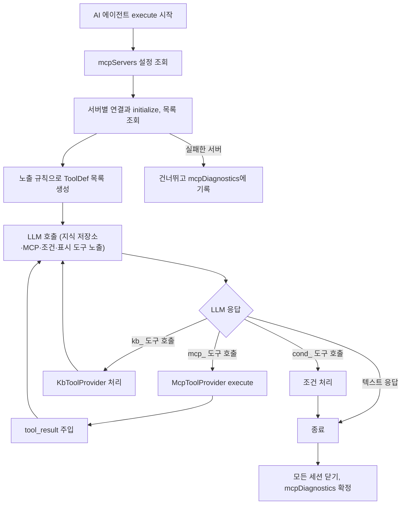

## 개요

이 문서는 [MCP 클라이언트](CLE-INT-MCP.md) 의 하위 문서로 MCP capability 를 LLM 도구로 노출하는 규칙, 도구 프로바이더 `McpToolProvider` 의 동작, 진단(`mcpDiagnostics`), `mcpServers` 통합 조회 기준, 실행 흐름을 정한다.

## 도구 노출 모델

MCP 의 세 capability(Tools·Resources·Prompts)를 모두 LLM 도구 호출 인터페이스로 평탄화해 노출한다.

- LLM 이 호출 시점과 인자를 스스로 정한다. 지식 저장소 검색과 같은 모델이다.
- AI 에이전트 핸들러의 도구 프로바이더 추상화를 그대로 다시 쓴다.
- 사용자 설정 화면이 «MCP 서버 추가 + 노출 도구 목록» 한 흐름으로 끝난다.

systemPrompt 에 prompt 를 고정하거나 Resource 를 지식 저장소처럼 정적 컨텍스트로 넣는 변형은 나중에 별도 스펙으로 들일 수 있다.

### 노출 규칙

서버가 `initialize` 응답에서 보고한 capability 에 따라 다음 도구를 자동으로 만든다.

| MCP capability | 노출하는 LLM 도구 | 종류 |
|----------------|-----------------|------|
| `tools` (서버가 보고) | tool 마다 1개, `mcp_<sid>__<toolName>` | 일반 도구 |
| `resources` (서버가 보고) | `mcp_<sid>__list_resources`, `mcp_<sid>__read_resource` | 메타 도구 |
| `prompts` (서버가 보고) | `mcp_<sid>__list_prompts`, `mcp_<sid>__get_prompt` | 메타 도구 |

서버가 capability 를 보고하지 않으면 그 분류의 도구는 만들지 않는다. LLM 에 노출되지 않는다.

### 도구 이름 규칙

MCP 도구는 모두 `mcp_` 접두어로 시작한다. AI 에이전트 노드의 다른 도구 접두어(`kb_`, `cond_`, `render_`)와 겹치지 않는다. 접두어 분류 전체는 [AI 에이전트 노드](../CLE-NODE-AI/CLE-NODE-AGENT.md#도구-이름-규칙) 가 정한다.

```text
mcp_<sid>__<toolName>
mcp_<sid>__list_resources
mcp_<sid>__read_resource
mcp_<sid>__list_prompts
mcp_<sid>__get_prompt
```

| 토큰 | 정의 |
|------|------|
| `<sid>` | `Integration.id`(UUID) 앞 8자에서 `[a-z0-9]` 가 아닌 문자를 `_` 로 바꾼 값. 워크스페이스 안에서 8자가 겹치면 12자로 늘린다(`McpToolProvider` 가 등록 시점에 정한다). 현재 구현과의 차이는 [미결 사항](CLE-INT-MCP.md#미결-사항) 참조 |
| `<toolName>` | MCP 서버가 `tools/list` 로 보고한 원래 이름. LLM API 호환을 위해 `[^a-zA-Z0-9_]` 를 `_` 로 바꾼다(sanitize) |
| `__` | 서버와 도구의 구분자. 밑줄 하나로는 sanitize 한 도구 이름과 나눌 수 없어 밑줄 두 개를 쓴다 |

**역파싱**: `McpToolProvider.matches(name)` 는 `name.startsWith('mcp_')` 만 본다. `execute` 단계에서 `__` 가 처음 나오는 위치로 나눠 `<sid>` 와 도구 식별자를 얻는다. 메타 도구는 식별자가 예약어(`list_resources`, `read_resource`, `list_prompts`, `get_prompt`)와 같은지로 가른다.

**접두어를 붙이는 곳**: 외부 서버 도구 이름은 `McpToolProvider` 가 만든다. 내부 MCP 브리지 프로바이더는 `buildTools()` 에서 접두어가 붙은 이름(`mcp_<sid>__<operation 토큰>`)을 직접 만들고, `execute()` 에 들어올 때 접두어를 벗겨 bare operation id 로 처리한다. 노출 도구 목록(`enabledTools`) 비교는 bare id 로 한다. MakeShop operationId 의 하이픈은 `_` 로 바꾼 토큰을 도구 이름에 쓰고, bare id(하이픈 형태)는 노출 도구 목록과 브리지 내부 `execute` 에서 그대로 쓴다([MakeShop operation 메타데이터](CLE-MKS-META#7-내부-mcp-브리지와의-매핑)). Cafe24 매핑은 [Cafe24 operation 메타데이터](CLE-C24-META#7-내부-mcp-브리지와의-매핑) 에 있다.

### 일반 도구 (Tools)

MCP `tools/list` 응답의 tool 을 하나씩 `ToolDef`([LLM 클라이언트](../CLE-AI/CLE-AI-LLM.md#tooldef--toolcall))로 바꾼다.

```json
{
  "name": "mcp_<sid>__<sanitized_toolName>",
  "description": "<MCP tool.description>\n\n(via MCP server: <integration.name>)",
  "parameters": "<MCP tool.inputSchema>"
}
```

- `inputSchema` 는 MCP 표준 JSON Schema 다. 바꾸지 않고 LLM 의 `parameters` 로 그대로 넘긴다.
- `description` 끝에 출처(서버 별칭)를 자동으로 붙인다. 같은 뜻의 도구가 여러 서버에 있을 때 LLM 이 출처를 구분할 수 있게 하려는 것이다.

**사용자 덮어쓰기(선택)**: `mcpServers[].toolOverrides[]`([AI 노드 공통](../CLE-NODE-AI/CLE-NODE-AI-COMMON.md#mcp-서버-연결-ai-에이전트-전용))로 도구별 description 을 바꿀 수 있다. 이름은 호환성 때문에 바꿀 수 없다.

### Resources 메타 도구

서버가 `resources` capability 를 보고할 때만 두 도구를 더한다.

```json
{
  "name": "mcp_<sid>__list_resources",
  "description": "List available resources on MCP server \"<integration.name>\".",
  "parameters": {
    "type": "object",
    "properties": {
      "cursor": { "type": "string", "description": "Pagination cursor (optional)" }
    }
  }
}
```

```json
{
  "name": "mcp_<sid>__read_resource",
  "description": "Read a resource by URI from MCP server \"<integration.name>\".",
  "parameters": {
    "type": "object",
    "properties": {
      "uri": { "type": "string", "description": "Resource URI" }
    },
    "required": ["uri"]
  }
}
```

`tool_result` 는 MCP `Resource`·`ResourceContents` 객체를 JSON 으로 직렬화해 그대로 넘긴다. 텍스트는 `content[].text`, 바이너리는 `content[].blob`(base64)이다. LLM 멀티모달 입력으로 쓰는 것은 나중에 별도 노드에서 다룬다.

### Prompts 메타 도구

서버가 `prompts` capability 를 보고할 때만 두 도구를 더한다.

```json
{
  "name": "mcp_<sid>__list_prompts",
  "description": "List available prompt templates on MCP server \"<integration.name>\".",
  "parameters": {
    "type": "object",
    "properties": {
      "cursor": { "type": "string", "description": "Pagination cursor (optional)" }
    }
  }
}
```

```json
{
  "name": "mcp_<sid>__get_prompt",
  "description": "Render a prompt template from MCP server \"<integration.name>\". Returns a list of messages you should incorporate into your reasoning.",
  "parameters": {
    "type": "object",
    "properties": {
      "name":      { "type": "string" },
      "arguments": { "type": "object", "description": "Prompt arguments (server-defined)" }
    },
    "required": ["name"]
  }
}
```

`get_prompt` 의 `tool_result` 는 MCP `GetPromptResult.messages` 배열을 JSON 으로 직렬화한 것이다. LLM 은 이 메시지를 자기 추론에 반영한다. MVP 에서는 시스템 프롬프트 자리에 고정해 넣지 않는다.

### 노출 도구 목록

AI 에이전트 설정의 노출 도구 목록(`mcpServers[].enabledTools`)으로 일반 도구를 골라 노출할 수 있다.

| 값 | 뜻 |
|----|------|
| `['*']` 또는 미설정 | 서버가 노출하는 일반 도구를 모두 LLM 에 노출한다(기본) |
| `['toolA', 'toolB']` | 적은 일반 도구만 노출한다. 서버에 없는 이름은 무시하고 경고만 남긴다 |

메타 도구는 노출 도구 목록의 영향을 받지 않고 서버 단위 on/off 로만 제어한다. resource·prompt 단위 권한은 MCP 서버 쪽 권한 모델로 제어하는 것이 자연스럽고, AI 에이전트에는 capability 단위 토글로 충분하다.

`mcpServers[].includeResources: false`·`mcpServers[].includePrompts: false` 로 capability 단위로 끌 수 있다. 기본은 모두 `true` 다(서버가 보고했으면 노출).

### 도구 호출 한도

MCP 도구 호출은 AI 에이전트의 도구 호출 한도(`maxToolCalls`)에 들어간다. 지식 저장소 도구와 같은 정책이다. 한도 값과 한도에 닿았을 때의 처리는 [AI 에이전트 노드](../CLE-NODE-AI/CLE-NODE-AGENT.md#단일-턴)가 정한다. dry-run 재실행에서 외부로 보내지 않고 건너뛴 호출도 한도에 들어간다([dry-run 재실행](CLE-INT-MCP-DRYRUN.md)).

### 도구 정의 크기 예산

MCP 서버가 노출하는 도구 정의(스키마)는 AI 에이전트의 도구 정의 크기 예산(직렬화 bytes 기준)에 더해진다([AI 에이전트 노드](../CLE-NODE-AI/CLE-NODE-AGENT.md#도구-정의-크기-예산)). [도구 호출 한도](#도구-호출-한도)(`maxToolCalls`)와는 다른 축이다. 하나는 호출 횟수, 하나는 정의 크기다.

대형 카탈로그는 노출 도구 목록 없이 전부 노출하면 도구 정의가 프롬프트를 provider transport 타임아웃 너머로 밀어 provider 와 무관하게 응답 실패(hang, 끝없는 재시도)를 일으킬 수 있다. Cafe24 Admin API 는 operation 485개, MakeShop 은 REST operation 161개다(2026-07-17 실측. 단일 기준은 저장소 `codebase/api-catalogs/<vendor>/_overview.md` §5, 사본은 [Cafe24 API 카탈로그](CLE-C24-CATALOG#5-coverage-matrix) · [MakeShop API 카탈로그](CLE-MKS-CATALOG#5-coverage-matrix)). 실제 노출 수는 허가된 권한 범위로 걸러진다. 이 카탈로그들은 bytes 예산 이전에 도구 개수만으로 `AI_AGENT_TOOL_COUNT_MAX` 기본값(128)을 늘 넘는다. 그래서 대형 서버는 `mcpServers[].enabledTools` 로 노출 도구를 좁히는 것이 사실상 필수다. 목록이 없으면 정상 설정처럼 보여도 실행 전 점검이 실패한다. 예산 초과 판정(실행 전 에러 코드 `TOOL_DEFINITION_PAYLOAD_EXCEEDED`)과 저장 시점 경고(그래프 경고 `ai_agent:tool-payload-budget`)의 단일 기준은 [AI 에이전트 노드](../CLE-NODE-AI/CLE-NODE-AGENT.md#도구-정의-크기-예산)와 [에러 코드 절](../CLE-NODE-AI/CLE-NODE-AGENT.md#에러-코드)이다.

## 도구 프로바이더 구현 (`McpToolProvider`)

도구 프로바이더 인터페이스의 두 번째 구현체다. 첫 번째는 `KbToolProvider` 다([RAG 검색](../CLE-KB/CLE-KB-SEARCH.md#확장-지점)).

### 인터페이스 매핑

| 메서드 | 동작 |
|--------|------|
| `key` | `'mcp'` |
| `matches(name)` | `name.startsWith('mcp_')` |
| `buildTools(ctx)` | `ctx.config.mcpServers` 를 돌며 서버마다 connect·initialize 하고 [도구 노출 모델](#도구-노출-모델) 규칙으로 `ToolDef[]` 를 만든다. 실패한 서버는 건너뛰고 진단 정보를 쌓는다 |
| `execute(call, ctx)` | `name` 에서 `<sid>` 를 꺼내 그 서버 세션에서 일반 도구·Resources·Prompts 분기에 따라 RPC 를 부르고, 결과를 `AgentToolResult.content` 로 직렬화한다. `ctx.dryRun` 이 참이면 일반 도구의 `tools/call` 은 보내지 않고 건너뛴 호출의 결과를 돌려준다([dry-run 재실행](CLE-INT-MCP-DRYRUN.md)) |

### 진단 누적 (`mcpDiagnostics`)

지식 저장소의 `ragDiagnostics` 와 같은 방식으로 AI 에이전트 노드의 `meta.mcpDiagnostics` 에 호출 통계를 쌓는다. `mcpDiagnostics` 는 아래 예시의 구조화 객체(`attempted`·`serverCount`·`toolCalls`·`resourceReads`·`promptGets`·`serverSummaries[]`·`errors[]`)로 내보낸다(`mcp-diagnostics.ts` 의 `finalizeMcpDiagnostics`, `ai-turn-executor.ts` 의 `buildMcpDiagnosticsMeta`). 노드 실행에서 MCP 를 한 번도 시도하지 않았으면 `mcpDiagnostics` 키 자체를 뺀다.

- `serverSummaries[]` 는 내부 MCP 브리지(`Cafe24McpToolProvider`·`MakeshopMcpToolProvider`)와 외부 `McpToolProvider` 둘 다 쌓는다. `McpToolProvider` 는 connect 와 list 가 성공하면 `connected`(`toolCount` 포함)를, `serviceType` 을 확정한 뒤 status·connect·list 에서 실패하면 `skipped`(`skipReason='error'`)를 쌓는다. `serviceType` 판정 전 조회 실패는 중복을 피하려고 쌓지 않는다.
- `errors[]` 는 격리된 부분 실패를 세분 코드와 `phase` 로 쌓는다.
  - **도구 목록 구성 단계**(connect·`tools/list`): `MCP_TIMEOUT`·`MCP_CONNECT_FAILED`·`MCP_LIST_FAILED`. 프로바이더가 `ctx.mcpDiagnosticErrors` 로 쌓는다(`McpToolProvider.openServer`, `skipped` 서버 요약과 함께 남는다). 외부 `McpToolProvider` 전용이다.
  - **호출 단계**(`tools/call`·`resources/read`·`prompts/get`·`resources/list`·`prompts/list`): 서버 쪽 실패다. 프로바이더가 `AgentToolResult.mcpErrorDelta` 로 보고하면 핸들러가 execute 한 지점에서 쌓는다. 외부 MCP 는 `MCP_TIMEOUT`·`MCP_TOOL_ERROR`·`MCP_AUTH_FAILED`·`MCP_CALL_FAILED`, 내부 MCP 브리지는 `CAFE24_*`·`MAKESHOP_*` 어휘다.
  - 클라이언트 쪽 실패(`INVALID_TOOL_ARGUMENTS`·`MCP_UNKNOWN_TOOL`·`*_MISSING_FIELDS` 등)는 `errors[]` 에 넣지 않고 `tool_result` 로만 돌려준다.
- `attempted` 는 서버 요약·에러·카운터 중 하나라도 있으면 true 다.
- `toolCalls`·`resourceReads`·`promptGets` 는 노드 실행의 도구 실행 지점에서 `mcp_*` 호출을 종류별(`tools/call`·`read_resource`·`get_prompt`)로 센다. 성공과 실패를 가리지 않고 시도 1회를 1로 센다. `list_resources`·`list_prompts` 탐색 메타 도구는 세지 않는다([활동 로그](CLE-INT-MCP-ERROR.md#활동-로그)에서 빼는 것과 같다). dry-run 재실행에서 건너뛴 호출도 시도 1회로 센다([dry-run 재실행](CLE-INT-MCP-DRYRUN.md)).

**입력 자리와 출력 모양의 구분**: 프로바이더(`AgentToolProvider.buildTools`)는 진단을 배열 자리 두 개에만 쌓는다. `ProviderBuildCtx.mcpDiagnostics`(= `serverSummaries[]`, `McpServerSummary[]`)와 `ProviderBuildCtx.mcpDiagnosticErrors`(= `errors[]`, `McpDiagnosticError[]`)다. 최종 `meta.mcpDiagnostics`(구조화 `McpDiagnostics` 객체)는 핸들러(executor)가 두 배열과 실행 카운터를 모아 만든다. 이름은 비슷해도 입력 자리(배열)와 출력(객체)은 계층과 모양이 다르다.

```json
{
  "mcpDiagnostics": {
    "attempted": true,
    "serverCount": 2,
    "toolCalls": 4,
    "resourceReads": 1,
    "promptGets": 0,
    "serverSummaries": [
      { "integrationId": "uuid-a", "serviceType": "cafe24", "status": "connected", "toolCount": 18 },
      { "integrationId": "uuid-b", "serviceType": "cafe24", "status": "skipped", "skipReason": "expired_install_timeout", "toolCount": 0 }
    ],
    "errors": [
      { "integrationId": "uuid-c", "phase": "tools/list", "code": "MCP_TIMEOUT", "message": "..." }
    ]
  }
}
```

| 필드 | 뜻 |
|------|------|
| `attempted` | MCP 도구를 한 번 이상 호출했거나 노출했는지 |
| `serverCount` | 이 노드 실행에서 연결에 성공한 서버 수(= `serverSummaries[]` 중 `status='connected'` 행 수) |
| `toolCalls` / `resourceReads` / `promptGets` | 종류별 호출 누적 |
| `serverSummaries[]` | `mcpServers` 설정에 등록된 통합마다 도구 목록 구성 결과. 사용자가 «통합이 보이지 않는» 원인을 바로 알게 하려는 것이다. 필드는 `integrationId`, `serviceType`(`mcp`·`cafe24`·…), `status`(`connected`·`skipped`), `skipReason`(skip 일 때만), `toolCount`(카탈로그에 등록된 도구 수) |
| `errors` | 서버별 부분 실패 기록(전체 실패가 아니라 격리된 실패) |

**`skipReason` 어휘**: 이 어휘는 주로 내부 MCP 브리지(Cafe24) 경로의 도구 목록 구성 단계 skip 을 정한다. 외부 MCP 의 실패는 위와 같이 요약(`skipReason='error'`)과 `errors[]` 의 세분 코드에 함께 남는다.

`skipReason` 값은 모두 `lower_snake_case` 다. 이 필드는 에러 코드가 아니라 운영 진단용 enum 이다. 그래서 [노드 출력 규약](../CLE-NODE/CLE-NODE-OUTPUT.md#principle-3-에러-계약)의 `code` UPPER_SNAKE_CASE 규칙(예: `MCP_AUTH_FAILED`, `MCP_TIMEOUT`)과 다르다. 통합 상태 사유(`Integration.status_reason`, 예: `auth_failed`, `install_timeout`)와는 일부러 표기를 맞췄다. `skipReason` 의 일부 값(`expired_install_timeout`, `expired_refresh_failed`)이 상태 사유의 뜻을 그대로 옮기기 때문이다.

| 값 | 뜻 | 적용 프로바이더 |
|----|------|---------------|
| `expired_install_timeout` | Cafe24 Private 의 `pending_install → expired` 24시간 TTL 만료. `install_token` 이 NULL 이라 갱신할 수 없다. 사용자는 이 행을 지우지 않고 같은 상점을 새로 등록하고 이름이 겹치면 다른 이름을 쓴다. 이 통합을 쓰던 AI 에이전트는 새 통합을 다시 고른다([OAuth 연결과 토큰 갱신](CLE-INT-OAUTH.md#만료된-설치-대기-행은-상점-자리를-놓는다-2026-10-29)) | cafe24 |
| `expired_refresh_failed` | `expired` 상태에서 `buildTools` 의 1회 갱신 시도가 `invalid_grant` 로 실패. worker 가 `error(auth_failed)` 로 전이한다([Cafe24 노드 §만료된 통합의 도구 목록 처리](../CLE-NODE-INT/CLE-NODE-CAFE24.md#만료된-통합의-도구-목록-처리)) | cafe24 |
| `expired_no_refresh_token` | `expired` 상태인데 `credentials.refresh_token` 이 없다. 갱신할 수 없어 통합 재인증이 필요하다 | cafe24 |
| `error` | `status='error'`(auth_failed·insufficient_scope·network 등). 정식 회복은 외부에서 하는 명시적 재인증이다([인증 실패 상태 전환](CLE-INT-MCP-ERROR.md#인증-실패-상태-전환)) | cafe24 / mcp |
| `pending_install` | Cafe24 Private 첫 설치가 끝나지 않았다 | cafe24 |
| `lookup_failed` | 통합 행 조회 실패. 통합이 없을 때, 다른 워크스페이스에 있을 때, 개인 통합인데 [개인 통합 사용 판정](CLE-INT-MANAGE.md#개인-통합-사용-판정)을 통과하지 못할 때다. 셋을 구분하지 않는다. 서버 종류별 차이는 아래 「통합 조회 기준」에 있다 | 공용 |
| `not_capable` | `mcpServers` 에 등록된 통합의 `service_type` 이 이 프로바이더가 처리할 대상이 아니다(프로바이더 라우팅이 정상인지 확인하는 용도) | 공용 |

`expired` 통합을 `buildTools` 가 스스로 되살리는지는 [Cafe24 노드](../CLE-NODE-INT/CLE-NODE-CAFE24.md#미결-사항)와 [통합 상태와 만료 알림](CLE-INT-STATUS.md#미결-사항)의 미결 사항이다.

멀티턴에서는 지식 저장소와 같이 턴 단위 delta 를 `meta.turnDebug[].mcpDiagnostics` 에도 따로 싣는다. `serverSummaries[]` 는 도구 목록 구성 결과의 정적 스냅샷이다. 턴마다 다시 계산하지 않고 노드 실행 단위로 한 번 정한다. 멀티턴 재개 때 도구 목록을 다시 만들면 스냅샷도 바뀐다.

### 통합 조회 기준

`mcpServers` 의 통합 조회는 통합 노드 핸들러와 같은 기준을 따른다.

- 개인 통합이면 [개인 통합 사용 판정](CLE-INT-MANAGE.md#개인-통합-사용-판정)의 실행 시점 조건을 모두 통과해야 한다. AI 에이전트 노드가 속한 워크플로우의 작성자가 통합 소유자이고 통합 소유자가 지금 그 워크스페이스의 멤버여야 한다. 서브 워크플로우 안의 AI 에이전트 노드는 그 서브 워크플로우의 작성자로 판정한다.
- 통과하지 못하거나 노드 ID 로 워크플로우 작성자를 구하지 못하면 그 서버를 `lookup_failed` 로 건너뛰고 나머지 서버는 그대로 쓴다. 건너뛴 서버에는 활동 로그를 남기지 않는다. 거절 이유는 서버 로그에만 남긴다([개인 통합 사용 판정](CLE-INT-MANAGE.md#개인-통합-사용-판정)).
- 도구 프로바이더는 도구 목록 구성 문맥(`ProviderBuildCtx`)의 노드 ID 와 서버마다의 표현식 여부를 조회에 넘긴다([통합 노드 공통](../CLE-NODE-INT/CLE-NODE-INT-COMMON.md#integrationsservice-api-실행-엔진용)). 외부 MCP 서버와 Cafe24 · MakeShop 내부 MCP 브리지가 같다. 브리지가 토큰 갱신 뒤 통합을 다시 읽는 조회도 같다. 표현식 여부는 서버 항목 안이 아니라 그 문맥의 평행 배열 `mcpServerFromExpression` 에서 같은 위치의 값을 읽는다. 배열이 없거나 길이가 서버 목록과 다르면 모든 서버를 표현식으로 본다([실행 상태 머신과 대기·재개 「보존 예외 `_resumeCheckpoint`」](../CLE-EXEC/CLE-EXEC-STATE.md#보존-예외-_resumecheckpoint)).
- 통합 조회는 도구 목록을 만들 때만 하고 토큰 갱신 뒤 재조회도 이 단계 안에서 일어난다. 도구 실행은 그때 얻은 통합을 쓴다(외부 MCP 서버는 그때 연 MCP 세션).
- 그래서 판정한 뒤 도구를 실행하기 전에 통합이 지워지거나 통합 소유자가 워크스페이스를 떠나도 그 노드 실행 안에서는 반영되지 않는다. 멀티턴이면 입력 대기 뒤 재개 턴에서 도구 목록을 다시 만들 때 반영된다. 받아들인 잔여다.

다만 외부 MCP 서버는 지금 통합 조회가 실패해도 `lookup_failed` 요약을 남기지 않는다. `McpToolProvider.openServer` 가 서비스 유형을 알기 전의 조회 실패를 진단에 넣지 않고 던진다. 그 서버만 빠지고 나머지 서버는 그대로 쓰인다(2026-10-24 코드 확인).

## 실행 흐름



AI 에이전트가 시작되면 `mcpServers` 설정을 읽고, 서버마다 필요할 때 연결해 도구 목록을 만든다. 실패한 서버는 건너뛰고 진단에 남긴다. LLM 에는 지식 저장소 도구·MCP 도구·조건 도구와 등록된 표시 도구를 함께 노출한다. LLM 이 `mcp_*` 도구를 부르면 `McpToolProvider` 가 실행해 결과를 다음 LLM 호출에 넣는다. 텍스트로 끝나면 모든 세션을 닫고 `meta.mcpDiagnostics` 를 확정한다. 도구 호출 분류 순서는 [AI 에이전트 노드](../CLE-NODE-AI/CLE-NODE-AGENT.md#도구-호출-분류)가 정한다.

## Rationale

### 진단 어휘를 `skipReason` 과 `errors[].code` 로 나눈다

진단 표면을 일부러 두 어휘로 나눴다. `serverSummaries[].skipReason` 은 `lower_snake_case` 운영 enum(예: `expired_install_timeout`)으로 통합 상태 사유의 뜻을 옮긴다. `errors[].code` 는 `UPPER_SNAKE_CASE` 에러 코드로 실패 단계별 세부를 담는다. 하나로 합치지 않은 이유는 두 필드가 답하는 질문이 다르기 때문이다. 앞쪽은 «이 통합이 왜 안 보이나»(도구 목록 구성 스냅샷)에, 뒤쪽은 «어느 RPC 가 어떻게 실패했나»(구성·호출 단계별)에 답한다.

프로바이더 입력 자리(배열)와 최종 출력(객체)을 이름이 아니라 타입으로 나눈 것은 소유 경계 때문이다. 프로바이더는 요약·에러 배열만 채우고 카운터 집계와 객체 조립은 핸들러가 맡는다.

### `mcpServers` 조회도 워크플로우 작성자 기준을 따른다 (2026-10-24)

NERV Task `CLE-T-MG0EQZ` 에서 개인 통합은 노드가 속한 워크플로우의 작성자가 통합 소유자일 때만 쓰도록 사용자가 정했다(2026-10-24, 근거는 [통합 관리](CLE-INT-MANAGE.md) Rationale). AI 에이전트의 `mcpServers` 는 Cafe24 · MakeShop 통합을 노드 없이 쓰는 또 하나의 경로다. 이 경로를 빼면 Cafe24 노드에서는 막힌 남의 개인 통합을 AI 에이전트 도구로는 쓸 수 있다. 그래서 같은 기준을 둔다. 걸린 서버만 건너뛰고 노드는 실패시키지 않는 것은 지금 `lookup_failed` 의 격리 원칙 그대로다. [통합 관리](CLE-INT-MANAGE.md) 의 요구사항도 MCP 서버 항목은 이 격리를 따른다고 적는다. 워크플로우 작성자 기준만이 아니라 판정 전체(통합 소유자의 현재 멤버십, 표현식 참조)를 [통합 관리 「개인 통합 사용 판정」](CLE-INT-MANAGE.md#개인-통합-사용-판정) 에 따른다.
