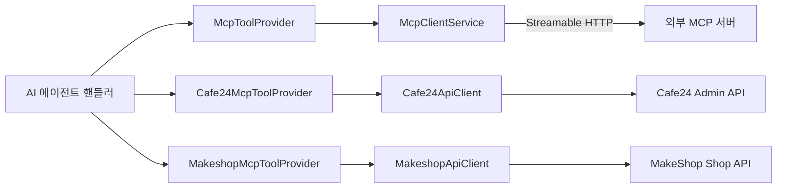

> 구현 상태: 부분 구현 (외부 MCP 도구 인자의 `inputSchema` 검증과 외부 MCP 서버의 `lookup_failed` 요약은 미구현) · 원문: `spec/5-system/11-mcp-client.md` · 용어: [용어 사전](../CLE-GLOSSARY.md)

## 개요

MCP 클라이언트(MCP client)는 AI 에이전트 노드가 외부 [Model Context Protocol](https://modelcontextprotocol.io)(MCP) 서버의 능력(Tools·Resources·Prompts)을 LLM 도구 호출 인터페이스로 쓰게 하는 추상화 계층이다.

AI 에이전트 노드 핸들러는 도구 프로바이더(`AgentToolProvider`) 구현체에서 MCP 도구를 받는다. 외부 서버용 구현체는 `McpToolProvider` 이고, 그 아래에서 `McpClientService` 모듈이 MCP 프로토콜 통신을 맡는다. 백엔드 안에서 도는 내부 MCP 브리지(Internal MCP Bridge) 구현체는 `Cafe24McpToolProvider` 와 `MakeshopMcpToolProvider` 다. 외부 프로토콜·인증·세션은 모두 이 계층 안에 숨기므로 AI 에이전트 핸들러는 지식 저장소 검색과 같은 추상화로 MCP 도구를 다룬다.

범위는 다음과 같다.

- LLM 이 스스로 도구를 호출할 때만 부른다. 지식 저장소 도구와 같고, 핸들러가 미리 채워 넣지 않는다.
- MCP 서버는 워크스페이스 공용 자원이다. 사용자 개인 MCP 서버는 범위 밖이다.
- transport 는 외부 서버용 Streamable HTTP(SSE)와 내부 모듈용 내부 MCP 브리지 두 가지다. stdio·websocket 은 지원하지 않는다.

MVP 에 넣지 않은 것은 stdio MCP 서버 spawn(멀티테넌트 SaaS 에서 프로세스·보안 격리 부담), `prompts/get` 결과를 systemPrompt 자리에 고정하는 UX, server-to-server proxy 와 응답 캐싱 계층([확장 지점](#확장-지점)), MCP 서버 헬스체크 전용 cron(만료 스캐너의 `token_expires_at` 흐름도 쓰지 않는다)이다.

다른 문서가 정하는 것은 다음과 같다.

- MCP 서버 통합의 자격 증명 필드(`url`·`default_headers`·인증 유형별 필드): [서비스별 인증 방식과 자격 증명](CLE-INT-AUTH.md#mcp-서버)
- AI 에이전트 노드의 `mcpServers` 설정 필드 구조(`McpServerRef`): [AI 노드 공통](../CLE-NODE-AI/CLE-NODE-AI-COMMON.md#mcp-서버-연결-ai-에이전트-전용)
- AI 에이전트 도구 이름 접두어 분류 전체(`kb_`·`cond_`·`mcp_`·`render_`): [AI 에이전트 노드](../CLE-NODE-AI/CLE-NODE-AGENT.md#도구-이름-규칙)
- Cafe24·MakeShop operation 메타데이터와 도구 description 조립: [Cafe24 operation 메타데이터](CLE-C24-META), [MakeShop operation 메타데이터](CLE-MKS-META)
- 통합 상태 전이 전체: [통합 상태와 만료 알림](CLE-INT-STATUS.md)
- 활동 로그 컬럼과 API 식별 채우기 규칙: [통합 데이터와 흐름](CLE-INT-DATA.md#호출-api-식별-채우기-규칙)
- 도구 프로바이더 확장 지점(첫 구현체 `KbToolProvider`): [RAG 검색](../CLE-KB/CLE-KB-SEARCH.md#확장-지점)
- dry-run 재실행 정책: [재실행](../CLE-EXEC/CLE-EXEC-RERUN.md#llm-호출), 부수효과 판정 기준: [재실행 §부수효과 판정](../CLE-EXEC/CLE-EXEC-RERUN.md#부수효과-판정). 이 문서는 MCP 도구 쪽 동작과 건너뛴 호출의 결과 형식만 정한다([dry-run 재실행](CLE-INT-MCP-DRYRUN.md))

## Transport

외부 서버용 HTTP transport 와 내부 MCP 브리지는 둘 다 도구 프로바이더 구현체로 노출되므로 AI 에이전트 핸들러는 둘의 차이를 신경 쓰지 않는다. `McpClientService` 가 MCP 프로토콜 통신을 맡는 것은 외부 HTTP transport 뿐이다.

그림의 위쪽 경로가 외부 HTTP transport 이고, 아래 두 경로가 내부 MCP 브리지다. 내부 MCP 브리지는 MCP 프로토콜 대신 각 통합의 API 클라이언트를 직접 함수로 부른다. 외부 HTTP transport 는 [연결과 URL 검증](CLE-INT-MCP-CONN.md#streamable-http-외부-서버) 이 정한다. stdio 를 지원하지 않는 이유는 [그 문서 Rationale](CLE-INT-MCP-CONN.md#stdio-transport-를-지원하지-않는다) 에 있다.

### 내부 MCP 브리지

일부 first-party 통합은 외부 MCP 서버 없이 백엔드 프로세스 안의 모듈로 MCP 인터페이스를 노출한다. 같은 통합을 워크플로우 노드와 AI 에이전트 노드 양쪽에서 쓰는 경우의 표준 패턴이다.

| 항목 | 동작 |
|------|------|
| 적용 `service_type` | 지금은 `cafe24`, `makeshop`. 앞으로 다른 first-party 통합(예: Shopify, Naver Smartstore)도 같은 패턴을 쓸 수 있다 |
| 구현 형태 | 백엔드 모듈이 도구 프로바이더 인터페이스를 직접 구현한다(`Cafe24McpToolProvider`, `MakeshopMcpToolProvider`). HTTP fetch 가 아니라 직접 함수 호출이다 |
| connect · initialize | no-op. 메모리 안에서 바로 쓸 수 있고 `capabilities`·`serverInfo` 는 정적 상수다 |
| 세션 | 노드 실행 단위 mutex 만 쓴다. `Mcp-Session-Id` 헤더가 필요 없다 |
| 인증 | 통합 자체 인증(예: Cafe24 OAuth)을 그대로 쓴다. 외부 서버용 `credentials.url`·`auth_type` 규칙은 적용하지 않는다 |
| SSRF 검증 | 적용하지 않는다. 외부 fetch 가 없다. base URL 의 안전성은 통합의 `service_type` 별 로직(예: Cafe24 의 `mall_id` 유효성 검사)이 맡는다 |
| 호출 제한(rate limit) | 통합 자체 래퍼(예: Cafe24 의 `Cafe24ApiClient`)가 처리한다. 같은 프로세스 인스턴스 안에서는 mutex 로 노드 호출과 공유한다 |

- **도구 노출**: [도구 노출 모델](CLE-INT-MCP-TOOLS.md#도구-노출-모델)의 일반 규칙을 그대로 쓴다. `Cafe24McpToolProvider.buildTools()` 는 Cafe24 메타데이터 테이블에서 자동으로 만든 도구 목록(`ToolDef[]`)을 돌려준다([Cafe24 노드](../CLE-NODE-INT/CLE-NODE-CAFE24.md#ai-에이전트-노출), [Cafe24 operation 메타데이터](CLE-C24-META)). MakeShop 도 같은 방식이다([MakeShop 노드](../CLE-NODE-INT/CLE-NODE-MAKESHOP.md#ai-에이전트-노출), [MakeShop operation 메타데이터](CLE-MKS-META)).
- **capability 보고**: 브리지마다 보고하는 capability 가 다를 수 있다. Cafe24 는 `tools` 만 보고하고 `resources`·`prompts` 는 보고하지 않는다. 그래서 AI 에이전트 노드는 [노출 규칙](CLE-INT-MCP-TOOLS.md#노출-규칙)에 따라 메타 도구를 만들지 않는다.
- **에러 처리**: [에러 처리](CLE-INT-MCP-ERROR.md)의 규칙을 그대로 쓴다. Cafe24 의 `tool_result.error.code` 는 [Cafe24 노드](../CLE-NODE-INT/CLE-NODE-CAFE24.md#에러-코드) 에러 어휘(`CAFE24_AUTH_FAILED` 등)를 그대로 쓴다. 호출 단계 실패(API 4xx·5xx, 전송 실패)는 `tool_result.error` 와 [활동 로그](CLE-INT-MCP-ERROR.md#활동-로그)에 더해 `mcpDiagnostics.errors[]` 에도 같은 어휘와 `phase='tools/call'` 로 쌓인다(`AgentToolResult.mcpErrorDelta` 경유). 도구 목록 구성 단계의 `errors[]`(connect·`tools/list`)는 외부 `McpToolProvider` 전용이다. 내부 MCP 브리지의 도구 목록 구성 실패는 `serverSummaries[]` 의 `skipped(skipReason)` 로 드러난다. 즉 내부 MCP 브리지에서 `errors[]` 는 호출 단계 표면이다.
- **인증 실패**: 내부 MCP 브리지도 [인증 실패 상태 전환](CLE-INT-MCP-ERROR.md#인증-실패-상태-전환) 정책을 따르되 refresh token 이 있는 프로바이더(예: Cafe24)의 401 에는 [Cafe24 노드](../CLE-NODE-INT/CLE-NODE-CAFE24.md#인증-실패-처리)의 «토큰 갱신 + 1회 재시도» 를 먼저 적용한다. 재시도도 401 이면 그때 격하하고, 403 은 언제나 즉시 격하한다. MakeShop 클라이언트도 같은 방식이다([통합 상태와 만료 알림](CLE-INT-STATUS.md#상태-전이)).
- **브리지별 description 접미**: 내부 MCP 브리지는 자기 `service_type` 에 특화된 정보를 도구 description 끝에 자동으로 붙일 수 있다. Cafe24 는 `(Cafe24 <method> <path>)` 한 줄과 KST 시간대 안내 `CAFE24_TIMEZONE_SUFFIX` 를 붙인다. operation 메타데이터에 `constraints?` 가 있으면 그 사이에 제약 종류별로 한 줄씩(예: `Constraint: at least one of …`) 넣는다. 조립 순서와 종류별 문구 형식은 [Cafe24 operation 메타데이터](CLE-C24-META#2-operation-메타데이터-형식) 의 `constraints` 의미 절과 [description 자동 접미 절](CLE-C24-META#53-mcp-도구-description-자동-접미)이 함께 정한다. 외부 HTTP transport 는 서버가 보고한 description 을 그대로 쓰고, 끝에 출처 한 줄만 붙인다([일반 도구](CLE-INT-MCP-TOOLS.md#일반-도구-tools)).
- **dry-run 재실행**: 내부 MCP 브리지는 operation 메타데이터의 HTTP 메서드와 상태를 바꾸는 GET 예외 목록으로 부수효과를 판정한다. 지금 예외 목록은 MakeShop `get-cart_free_config-update` 하나이고 Cafe24 목록은 비어 있다([재실행 §부수효과 판정](../CLE-EXEC/CLE-EXEC-RERUN.md#부수효과-판정)). 처리 규칙은 [dry-run 재실행](CLE-INT-MCP-DRYRUN.md) 에 있다.

## 통합 모델

MCP 서버는 새 노드가 아니라 기존 통합 엔티티의 새 `service_type` 으로 등록한다([통합 데이터와 흐름](CLE-INT-DATA.md#통합-integration)). 별도 테이블이나 컬럼을 더하지 않는다.

### service_type 과 인증 유형

이 절의 `service_type='mcp'` 와 통합 인증 유형(`auth_type`)·자격 증명 규칙은 외부 HTTP transport 에만 적용한다. 내부 MCP 브리지로 노출하는 `service_type` 은 자체 인증 모델을 쓴다.

| 필드 | 값 (외부 HTTP) |
|------|----|
| `Integration.service_type` | `mcp` |
| `Integration.auth_type` | `bearer_token` / `api_key` / `none` |
| `Integration.scope` (공개 범위) | 기본 `organization`. 개인 공개 범위 등록을 허용하는지는 정의가 갈린다. [통합 관리](CLE-INT-MANAGE.md#미결-사항) 의 미결 사항 참조 |

내부 MCP 브리지를 쓰는 `service_type` 은 지금 다음 두 가지다.

| `service_type` | 브리지 구현 | 문서 |
|---|---|---|
| `cafe24` | `Cafe24McpToolProvider` | [Cafe24 노드 §AI 에이전트 노출](../CLE-NODE-INT/CLE-NODE-CAFE24.md#ai-에이전트-노출) |
| `makeshop` | `MakeshopMcpToolProvider` | [MakeShop 노드 §AI 에이전트 노출](../CLE-NODE-INT/CLE-NODE-MAKESHOP.md#ai-에이전트-노출) |

## 하위 문서

이 문서에는 요구사항 줄이 없어 하위 문서마다 맡는 요구사항 번호도 없다. 「참조」는 하위 문서가 따르는 다른 문서의 요구사항이다.

| 하위 문서 | 맡는 내용 | 요구사항 |
|---|---|---|
| [MCP 클라이언트 — 연결과 URL 검증](CLE-INT-MCP-CONN.md) | Streamable HTTP transport, 자격 증명과 URL 검증(SSRF 차단 · 해석 주소 검사 · 우회 플래그), 환경 변수, capabilities 캐시 비채택, 연결 수명 · 타임아웃, 연결 테스트, 클라이언트 라이브러리 | 없음 |
| [MCP 클라이언트 — 도구 노출과 진단](CLE-INT-MCP-TOOLS.md) | 도구 노출 모델(노출 규칙 · 이름 규칙 · 일반 · 메타 도구 · 노출 도구 목록 · 호출 한도 · 정의 크기 예산), `McpToolProvider`, 진단 누적(`mcpDiagnostics` · `skipReason`), 통합 조회 기준, 실행 흐름 | 없음 (참조: [통합 관리](CLE-INT-MANAGE.md) REQ-INTMGMT-052) |
| [MCP 클라이언트 — 에러 처리](CLE-INT-MCP-ERROR.md) | 격리 원칙, 에러 코드, 활동 로그, 인증 실패 상태 전환 | 없음 |
| [MCP 클라이언트 — dry-run 재실행](CLE-INT-MCP-DRYRUN.md) | MCP 도구의 부수효과 판정 적용, 도구 목록 구성 단계, 건너뛴 호출의 결과 형식, 확인 순서, 기록과 집계, dry-run 여부 전달 | 없음 (참조: [재실행](../CLE-EXEC/CLE-EXEC-RERUN.md) REQ-RERUN-052 · REQ-RERUN-053 · REQ-RERUN-054, [Cafe24 노드](../CLE-NODE-INT/CLE-NODE-CAFE24.md) REQ-CAFENODE-035 · REQ-CAFENODE-039, [통합 관리](CLE-INT-MANAGE.md) REQ-INTMGMT-021) |

## 하위 문서로 옮긴 절

아래 제목은 다른 문서가 거는 이 문서의 앵커를 잇는 자리다. 본문은 각 링크가 가리키는 하위 문서에 있다.

### 자격 증명과 URL 검증

→ [연결과 URL 검증](CLE-INT-MCP-CONN.md#자격-증명과-url-검증)

### 연결 테스트

→ [연결과 URL 검증](CLE-INT-MCP-CONN.md#연결-테스트)

### 노출 규칙

→ [도구 노출과 진단](CLE-INT-MCP-TOOLS.md#노출-규칙)

### 도구 이름 규칙

→ [도구 노출과 진단](CLE-INT-MCP-TOOLS.md#도구-이름-규칙)

### 통합 조회 기준

→ [도구 노출과 진단](CLE-INT-MCP-TOOLS.md#통합-조회-기준)

### 에러 코드

→ [에러 처리](CLE-INT-MCP-ERROR.md#에러-코드)

### 활동 로그

→ [에러 처리](CLE-INT-MCP-ERROR.md#활동-로그)

### 인증 실패 상태 전환

→ [에러 처리](CLE-INT-MCP-ERROR.md#인증-실패-상태-전환)

### dry-run 재실행

→ [dry-run 재실행](CLE-INT-MCP-DRYRUN.md)

### 도구 목록 구성 단계

→ [dry-run 재실행](CLE-INT-MCP-DRYRUN.md#도구-목록-구성-단계)

### dry-run 재실행에서 건너뛴 호출의 기록 (2026-10-10)

→ [dry-run 재실행 Rationale](CLE-INT-MCP-DRYRUN.md#dry-run-재실행에서-건너뛴-호출의-기록-2026-10-10)

### dry-run 에서도 도구 목록 구성과 인증 처리는 평소처럼 한다 (2026-11-13, CLE-T-8B66BK)

→ [dry-run 재실행 Rationale](CLE-INT-MCP-DRYRUN.md#dry-run-에서도-도구-목록-구성과-인증-처리는-평소처럼-한다-2026-11-13-cle-t-8b66bk)

## 데이터 모델 영향

새 컬럼이나 새 엔티티는 없다. [통합 데이터와 흐름](CLE-INT-DATA.md#통합-integration)의 `service_type` 문자열 컬럼에 이 문서 영역의 값 `mcp`(외부 HTTP transport)와 `cafe24`·`makeshop`(내부 MCP 브리지)을 쓴다. 세 값 모두 문자열 컬럼이라 enum 마이그레이션이 필요 없다. 활동 로그 사용 방식(`tools/call` 1회당 1행)은 두 transport 에 모두 적용한다. dry-run 재실행의 건너뛴 호출은 제외한다([dry-run 재실행](CLE-INT-MCP-DRYRUN.md)).

## 확장 지점

- **stdio transport**: 데스크톱 브리지나 사내 격리 환경에 한해 들일 수 있다. 자격 증명 스키마에 `command`·`args`·`env` 를 더하고 transport 를 분기한다.
- **prompt 고정**: `mcp_<sid>__get_prompt` 결과를 systemPrompt 자리에 고정해 넣는 사용자 흐름. AI 에이전트 설정 화면의 systemPrompt 영역 옆에 «MCP Prompt 첨부» 를 더한다.
- **resource 를 정적 컨텍스트로**: 특정 resource URI 를 노드 실행 때 자동으로 읽어 `messages[].content` 앞에 넣는다. `mcpServers[].pinnedResources: string[]`.
- **OAuth 2.1(PKCE) 인증 유형**: 지금은 OAuth 계열 인증 유형이 없다(`bearer_token`·`api_key`·`none` 만). 동적 OAuth 흐름은 [OAuth 연결과 토큰 갱신](CLE-INT-OAUTH.md#oauth-콜백-엔드포인트)의 콜백 패턴을 다시 써서 더할 수 있다.
- **server-to-server proxy, 응답 캐싱**: 트래픽 분석 뒤 별도 스펙으로 다룬다.
- **내부 MCP 브리지 확장**: Shopify, Naver Smartstore 같은 first-party 이커머스 통합을 `cafe24` 와 같은 패턴으로 더할 수 있다. 백엔드에 브리지 모듈(기존 예: `Cafe24McpToolProvider`)과 메타데이터 테이블을 두고, [내부 MCP 브리지 적용 목록](#service_type-과-인증-유형)에 더한다.
- **외부 MCP 도구의 dry-run 세분 판정**: 지금은 dry-run 재실행에서 외부 MCP 서버의 `tools/call` 을 늘 모의 응답으로 대신해 읽기 전용 도구도 데이터를 받지 못한다. 신뢰하는 서버의 allow-list 같은 도구별 판정 정책은 필요해지면 따로 결정한다([재실행 Rationale](../CLE-EXEC/CLE-EXEC-RERUN.md#dry-run-에서-부수효과-도구만-모의-응답으로-대신한다-2026-10-23)).

각 항목은 [도구 노출 모델](CLE-INT-MCP-TOOLS.md#도구-노출-모델)의 평탄화 방식을 깨지 않고 더할 수 있게 설계했다.

## 미결 사항

- MCP 통합의 개인 공개 범위 허용 여부는 [통합 관리](CLE-INT-MANAGE.md#미결-사항) 의 미결 사항에서 다룬다. 이 문서 원문은 «기본 `organization`, 개인 등록 미지원» 쪽이다.
- **`<sid>` 길이 규칙과 현재 구현의 차이**: 이 문서 원문은 `<sid>` 를 `Integration.id` 앞 8자로 두고 워크스페이스 안에서 겹치면 12자로 늘린다고 적는다. 현재 구현은 외부 `McpToolProvider` 가 한 노드의 `mcpServers` 안에서만 겹침을 보고 8 → 12 → 32자 순으로 늘리며(`assignSids`, `buildTools` 시점), 내부 MCP 브리지 프로바이더는 늘 앞 16자를 쓴다(`sanitizeSid`). 문서를 구현에 맞출지, 구현을 문서에 맞출지 정해야 한다. 결정 필요.
- **외부 MCP 도구 인자의 `inputSchema` 검증**: [격리 원칙](CLE-INT-MCP-ERROR.md#격리-원칙) 표와 [에러 코드](CLE-INT-MCP-ERROR.md#에러-코드)의 `INVALID_TOOL_ARGUMENTS` 는 인자가 `inputSchema` 를 어기면 호출하지 않는다고 적는다. 현재 `McpToolProvider.execute` 는 일반 도구 인자의 JSON 파싱만 확인하고 `inputSchema` 검증은 하지 않는다. 메타 도구는 `uri`·`name` 같은 필수 인자만 확인한다. 그래서 dry-run 재실행에서는 형식이 틀린 인자도 건너뛴 호출의 결과를 받는다. 검증을 구현할지, 문서를 서버 쪽 검증에 맡기는 쪽으로 고칠지 결정 필요. 담당 NERV Task `CLE-T-RBMJP0`.
- **연결 직전 해석 주소의 DNS rebinding**: [자격 증명과 URL 검증](CLE-INT-MCP-CONN.md#자격-증명과-url-검증) 3항은 connect 직전에 해석한 주소를 검사하지만, SDK 의 fetch 는 연결할 때 DNS 를 다시 푼다. 그 사이에 응답이 바뀌면 사설 주소에 닿을 수 있다. HTTP Request 노드도 같은 한계가 있다. 검사한 주소로 연결을 고정할지 결정 필요. 담당 NERV Task `CLE-T-BS1WD1`.

## 구현 위치

- `codebase/backend/src/modules/mcp/mcp-client.service.ts` (Streamable HTTP 클라이언트, URL 검증, connect 직전 해석 주소 검사 `requireSafeResolvedHost`)
- `codebase/backend/src/common/utils/ssrf-safe-url.util.ts` (URL 검증이 쓰는 IPv6 리터럴 정규화 `normalizeIpv6Literal` 과 IPv4 를 품은 IPv6 판정 `embeddedIpv4FromIpv6`)
- `codebase/backend/src/modules/mcp/mcp-test-connection.service.ts` (연결 테스트)
- `codebase/backend/src/modules/mcp/mcp-error-codes.ts` (`MCP_ERROR_CODES`, `sanitizeMcpErrorMessage`)
- `codebase/backend/src/nodes/ai/ai-agent/tool-providers/agent-tool-provider.interface.ts` (도구 프로바이더 인터페이스, `ProviderExecCtx.dryRun`)
- `codebase/backend/src/nodes/ai/ai-agent/tool-providers/mcp-tool-provider.ts` (외부 서버 도구 프로바이더)
- `codebase/backend/src/nodes/ai/ai-agent/tool-providers/mcp-diagnostics.ts` (`finalizeMcpDiagnostics`)
- `codebase/backend/src/nodes/ai/ai-agent/tool-providers/cafe24-mcp-tool-provider.ts` (Cafe24 내부 MCP 브리지)
- `codebase/backend/src/nodes/ai/ai-agent/tool-providers/makeshop-mcp-tool-provider.ts` (MakeShop 내부 MCP 브리지)
- `codebase/backend/src/nodes/ai/ai-agent/mcp-server-ref-use.ts` (서버마다의 표현식 여부 배열 `mcpServerFromExpression` 을 정하고 통합 조회에 넘길 인자를 만든다. [통합 조회 기준](CLE-INT-MCP-TOOLS.md#통합-조회-기준))
- `codebase/backend/src/nodes/ai/ai-agent/tool-providers/dry-run-tool-result.ts` (dry-run 재실행에서 건너뛴 호출의 결과)
- `codebase/backend/src/nodes/core/dry-run.util.ts` (내부 MCP 브리지 operation 의 부수효과 판정 `isDryRunMockedOperation`)
- `codebase/backend/src/nodes/integration/makeshop/metadata/index.ts` (상태를 바꾸는 GET 예외 목록 `MAKESHOP_STATE_CHANGING_GET_OPERATION_IDS`)
- `codebase/backend/src/common/config/mcp.config.ts` (`mcp.*` 설정 namespace)

## Rationale

주제별 결정의 근거는 각 하위 문서의 Rationale 에 있다.

### 내부 MCP 브리지와 자가 회복 예외

같은 통합(예: Cafe24)을 워크플로우 노드와 AI 에이전트 양쪽에서 쓰는 경우를 위해 내부 MCP 브리지를 들였다. HTTP fetch·SSRF·세션 헤더가 모두 no-op 이 되어 표면이 단순하다.

«401 → 즉시 상태 격하» 정책은 refresh token 이 없는 외부 MCP 에만 적용한다. refresh token 이 있는 내부 MCP 브리지 프로바이더(Cafe24)의 401 은 [Cafe24 노드](../CLE-NODE-INT/CLE-NODE-CAFE24.md#인증-실패-처리)의 «토큰 갱신 + 1회 재시도» 자가 회복을 먼저 쓴다. refresh token 이 정상 토큰 수명을 보장하므로 외부 MCP 의 시각 경쟁(만료 토큰이 잠깐 되살아나는 상황)이 없고, 상태가 깜빡일 걱정도 없다. 403(권한 범위 부족)은 양쪽 모두 즉시 격하한다.
