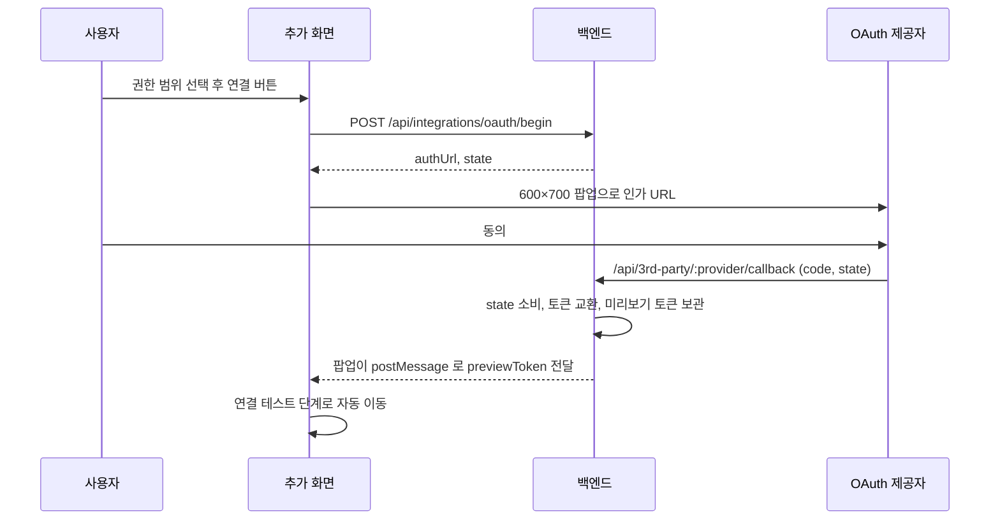

## 개요

이 문서는 [OAuth 연결과 토큰 갱신](CLE-INT-OAUTH.md) 의 하위 문서로 팝업 연결(Google·GitHub·Cafe24 Public)과 OAuth 콜백 엔드포인트의 처리 순서 · 에러 매핑을 정한다. 콜백 실패가 통합 행에 남기는 상태 · 상태 사유 · `last_error` 의 규칙은 [상태 모델 「콜백 실패 기록」](CLE-INT-STATUS-MODEL.md#콜백-실패-기록)이 정본이다.

## 팝업 연결: Google·GitHub·Cafe24 Public



1. 사용자가 권한 범위 체크박스로 권한을 고른다([서비스별 인증 방식과 자격 증명](CLE-INT-AUTH.md)).
2. `[Connect with <Service>]` 를 누르면 `POST /api/integrations/oauth/begin` 으로 state 를 받는다.
3. 새 팝업(600×700)에서 인가 URL 을 연다.
4. 팝업 콜백 페이지(`/api/3rd-party/:provider/callback`)가 토큰을 보관한 뒤 `postMessage` 로 부모 창에 알린다.
5. 부모 창은 연결 테스트 단계로 자동으로 넘어간다([통합 관리](CLE-INT-MANAGE.md) 의 추가 페이지).

Cafe24 Public 앱은 Cafe24 앱스토어에 등록(또는 심사 대기)된 앱이라 서버 환경 변수 `CAFE24_CLIENT_ID`·`CAFE24_CLIENT_SECRET` 을 쓴다. 흐름은 위와 같고 다음이 다르다.

1. 연결 버튼을 누르기 전에 `Mall ID`(예: `myshop`, `https://myshop.cafe24api.com` 의 hostname 앞부분, `/^[a-z0-9-]{3,50}$/`)와 앱 유형 `Public` 을 입력한다. `mall_id` 가 base URL 의 일부이고 인가 URL 도 상점마다 달라서다(Private 도 같다).
2. 권한 범위는 카테고리 단위 체크박스로 고른다: Product·Order·Customer·Category·Promotion·Mileage·Shipping·Translation·Notification(R/W), Salesreport(R). 그 밖의 카테고리는 «고급» 토글 아래에 있다. 체크박스마다 `mall.read_<category>`·`mall.write_<category>` 에 대응한다.
3. 별도 승인이 필요한 카테고리(Mileage·Notification·Privacy 의 R·W 전부, Store 안 일부 sub-resource)는 체크박스 옆에 ⚠ 를 보인다. 체크는 막지 않는다. 체크한 권한 중 별도 승인 대상이 하나라도 있으면 폼 아래에 인라인 안내(경고, amber 톤, [레이아웃과 내비게이션](../CLE-UI/CLE-UI-LAYOUT.md) 의 공통 패턴)를 계속 보인다. 승인 없이 진행하면 OAuth 단계의 `invalid_scope` 나 호출 때의 `INSUFFICIENT_SCOPE`(403)로 실패할 수 있다. 명단, tooltip 문구, i18n 키는 [Cafe24 별도 승인 scope](CLE-C24-SCOPES) 가 정한다.
4. `[Connect with Cafe24]` 를 누르면 begin 을 부른다.

   ```jsonc
   {
     "service": "cafe24",
     "mode": "new",
     "mall_id": "myshop",
     "app_type": "public",
     "scopes": ["mall.read_product", "mall.write_order", "..."]
   }
   ```

5. 새 팝업(600×700)에서 `https://{mall_id}.cafe24api.com/api/v2/oauth/authorize?...` 를 연다. 권한 범위는 콤마로 구분한다.
6. 팝업 콜백 페이지(`/api/3rd-party/cafe24/callback`)가 토큰을 보관하고 `postMessage` 로 알린다. 부모 창은 연결 테스트 단계로 넘어간다.

`/api/integrations/services` 응답의 cafe24 항목은 `meta.publicAppAvailable: boolean` 을 싣는다. `CAFE24_CLIENT_ID` 와 `CAFE24_CLIENT_SECRET` 이 모두 설정돼 있으면 true 다. false 면 추가 폼이 Public 선택지를 빼고 기본값을 `private` 으로 두며 안내 문구를 바꾼다. Private 은 환경 변수와 상관없이 늘 보인다.

### 팝업 복귀

- 부모 창은 `window.addEventListener('message', ...)` 로 `oauth_callback` 이벤트를 받는다.
- `mode='new'` 면 미리보기 토큰(`previewToken`, 통합을 저장하기 전의 임시 참조)을 받아 연결 테스트 단계로 자동으로 들어간다.
- 팝업이 5분 안에 돌아오지 않으면 타임아웃 에러를 보이고 사용자는 다시 시도할 수 있다.

## OAuth 콜백 엔드포인트

```
GET /api/3rd-party/:provider/callback
```

| 파라미터 | 설명 |
| --- | --- |
| `:provider` | OAuth 제공자. `google`, `github`, `cafe24`, `makeshop` |
| `code` | Authorization Code |
| `state` | CSRF 방지 토큰(서버 발급) |
| `error` | OAuth 에러 코드(거부 등) |

### 처리 순서

1. **state 검증**: `oauth/begin` 이 발급한 state 와 맞는지 본다. 맞지 않으면 팝업에 `Security validation failed` 를 보이고 끝낸다.
2. **error 파라미터 확인**: 있으면 팝업에 `Authorization denied` 를 보이고 끝낸다.
3. **토큰 교환**: 제공자별 토큰 엔드포인트에 code 와 client_secret 을 보낸다. MakeShop 은 PKCE `code_verifier` 를 함께 보낸다.
4. **모드별 처리**:
   - `new`: 아직 통합이 없다. 토큰을 미리보기 토큰(`integration_oauth_preview`, 10분)에 맡기고 `previewToken` 을 발급한다. `POST /api/integrations` 가 이 토큰을 참조해 통합을 만든다.
   - `reauthorize`: 기존 통합의 자격 증명을 새 토큰으로 바꾸고 상태를 `connected` 로, 상태 사유와 `last_error` 를 NULL 로 되돌린다. 재설치 대기 표시도 같은 트랜잭션에서 NULL 로 지운다. 통합이 설치 대기면 이때 연결됨이 된다(Cafe24 Private·MakeShop 첫 설치). 실패의 기록은 [상태 모델 「콜백 실패 기록」](CLE-INT-STATUS-MODEL.md#콜백-실패-기록)을 따른다.
   - `request_scopes`: 기존 `credentials.scopes` 에 새 권한 범위를 합치고 access token·refresh token 을 갱신한다.
   - `reauthorize`·`request_scopes` 는 커밋 직전에 요청자에게 그 통합이 보이는지, 개인 통합이면 요청자의 현재 역할이 편집자 이상인지, 조직 통합이면 관리자 이상인지 같은 트랜잭션에서 다시 판정한다. 실패하면 롤백한다. 개인 통합의 편집자 하한은 begin 의 라우트 가드와 같은 하한이다. 설치 대기 행과 유효한 재설치 대기 표시가 있는 Cafe24 Private 행은 이 판정을 건너뛴다. 조건과 받아들인 잔여 위험은 [상태 모델 「재설치 대기 표시」](CLE-INT-STATUS-MODEL.md#재설치-대기-표시)가 정한다.
5. **부모 창 알림**:

   ```javascript
   window.opener.postMessage({
     type: "oauth_callback",
     provider: "google",
     status: "success",           // "success" | "error"
     mode: "new",                  // "new" | "reauthorize" | "request_scopes"
     previewToken: "tmp_...",      // mode=new일 때만
     integrationId: "uuid",        // mode=reauthorize/request_scopes
     error: null
   }, window.location.origin);
   window.close();
   ```

6. **실패 처리**: 콜백 처리 중 예외가 나면 컨트롤러는 같은 콜백 HTML 을 `status: 'error'` 와 에러 메시지로 돌려준다. 메시지를 읽을 수 있도록 팝업은 3~5초 뒤 닫는다(성공은 바로). state 를 소비한 뒤의 예외는 `OAuthState.integrationId` 로 행을 알 수 있으므로 [상태 모델 「콜백 실패 기록」](CLE-INT-STATUS-MODEL.md#콜백-실패-기록)대로 그 행에 기록한다. 다만 커밋 직전 재판정의 `RESOURCE_NOT_FOUND` 는 행에 쓰지 않고 요청자의 콜백 응답에만 싣는다.

### 에러 매핑

| 에러 | 팝업 표시 | 통합 상태 |
| --- | --- | --- |
| state 불일치 | `Security validation failed. Please try again.` | 변경 없음. 통합을 식별하기 전 단계다 |
| 사용자 거부 | `Authorization was denied.` | 변경 없음 |
| 코드 교환 실패 (`OAUTH_TOKEN_EXCHANGE_FAILED`) | `Failed to connect to {provider}.` (3~5초 뒤 닫기) | 설치 대기는 상태 보존과 사유 `oauth_token_exchange_failed`. 연결됨은 유효한 재설치 대기 표시가 없을 때만 `error(auth_failed)`([콜백 실패 기록](CLE-INT-STATUS-MODEL.md#콜백-실패-기록)) |
| Cafe24 `invalid_scope` (인가·토큰 교환 두 단계 모두) | `Authorization rejected: invalid scope.` (안내 본문에 별도 승인 안내 분기) | 상태 보존. `last_error.code='OAUTH_INVALID_SCOPE'` 와 `last_error.details.requiresCafe24Approval` 기록. 사유는 [콜백 실패 기록](CLE-INT-STATUS-MODEL.md#콜백-실패-기록) 표대로 설치 대기·연결됨 행만 `oauth_invalid_scope` 로 남긴다 |
| state 불일치·만료 (state 소비 뒤) | `Security validation failed.` / `OAuth state has expired.` | 상태 보존. 통합을 알 수 있으면 [콜백 실패 기록](CLE-INT-STATUS-MODEL.md#콜백-실패-기록)대로 기록(설치 대기는 사유 `oauth_state_mismatch`·`oauth_state_expired`) |
| 토큰 발급 뒤 행 조회 실패 | `Integration not found.` | 변경 불가. 행이 사라져 갱신할 대상이 없다 |
| 커밋 직전 인가 재판정 실패 (`reauthorize`·`request_scopes`) | 서버 메시지 그대로(아래 목록) | 자격 증명 불변(롤백), 상태 보존. `ADMIN_REQUIRED`·`EDITOR_REQUIRED` 는 `last_error` 에 기록하고 `RESOURCE_NOT_FOUND` 는 행에 쓰지 않는다 |
| 설치 기한이 지나 만료된 설치 대기 행에 늦게 도착한 콜백 (요청자 재판정을 통과한 뒤) | `The install window for this integration has expired` | 변경 없음. 400 `INTEGRATION_INSTALL_EXPIRED` 로 거절하고 행에 아무것도 쓰지 않는다 |
| 네트워크 오류 | `Connection error.` | 통합을 알 수 있으면 [콜백 실패 기록](CLE-INT-STATUS-MODEL.md#콜백-실패-기록)대로 기록. 토큰 교환 중의 네트워크 오류와 시간 초과는 코드 교환 실패(`OAUTH_TOKEN_EXCHANGE_FAILED`)로 기록된다 |

- **코드 교환 실패**: 설치 대기 행은 외부 설정을 고친 뒤 다시 시도할 수 있다. 유효한 재설치 대기 표시가 있는 연결됨 행은 기존 토큰으로 실행이 계속되고 사용자는 «테스트 실행» 으로 다시 시도한다.
- **Cafe24 `invalid_scope`**: `requiresCafe24Approval` 은 요청 권한 범위와 [Cafe24 별도 승인 scope](CLE-C24-SCOPES) §1 명단의 교집합(`string[]`)이다. 상세 화면이 이 단서를 읽어 «이 권한은 카페24 별도 승인이 필요해요» 를 보인다. `oauth_token_exchange_failed` 와 진입 경로가 다르다. 이쪽은 Cafe24 가 권한 범위를 명시적으로 거부한 경우이고 저쪽은 그 밖의 토큰 교환 실패 전부(네트워크, 서버 오류, 알 수 없는 `invalid_grant` 등)다.
- **커밋 직전 인가 재판정 실패**: 시작과 콜백 사이에 요청자가 강등됐거나 통합이 남의 개인 통합이 된 경우다. 재판정을 건너뛰는 행(설치 대기, 유효한 재설치 대기 표시가 있는 Cafe24 Private)에는 이 실패가 없다.
  - 팝업 메시지는 `Integration not found`(`RESOURCE_NOT_FOUND`), `Organization 통합을 재인증하려면 Admin 이상의 권한이 필요합니다.`·`… scope 를 추가하려면 …`(`ADMIN_REQUIRED`)다. 개인 통합의 요청자가 뷰어로 강등됐으면 `EDITOR_REQUIRED` 다.
  - `RESOURCE_NOT_FOUND` 는 그 행이 요청자에게 보이지 않게 된 경우(남의 개인 통합이 됐거나 지워짐)라 행의 `last_error`·`status_reason` 을 쓰지 않고 요청자의 콜백 응답에만 싣는다([커밋 직전 재판정의 `RESOURCE_NOT_FOUND` 는 행에 쓰지 않는다 (2026-10-29)](#커밋-직전-재판정의-resource_not_found-는-행에-쓰지-않는다-2026-10-29)).
- **설치 기한이 지나 만료된 행**: 상태 · 상태 사유 · 상점 식별자(`mall_id`) · `last_error` 를 그대로 둔다. state 는 유효하므로 state 유효 시간이 지난 경우의 `OAUTH_STATE_EXPIRED` 와 코드가 다르다. 이 행에는 이 표의 다른 콜백 실패(재판정 실패의 `ADMIN_REQUIRED`·`EDITOR_REQUIRED` 포함)도 `last_error`·`status_reason` 을 쓰지 않는다.

상태 사유 저장값(snake_case)과 API 에러 코드(UPPER_SNAKE_CASE)의 관계는 [상태 모델 「상태 값과 상태 사유」](CLE-INT-STATUS-MODEL.md#상태-값과-상태-사유) 에 있다.

## 구현 위치

- `codebase/backend/src/modules/integrations/integration-oauth.service.ts` (콜백: `assertRequesterStillAllowed`, `markIntegrationCallbackError`. 행 잠금 안 단계 `lockAndRejudgeCallbackTarget`(행 잠금, 커밋 직전 인가 재판정, 만료 행 거절)·`replaceCallbackCredentials`·`markCallbackConnected`. 콜백 실패 기록 `handleCallbackWithErrorCapture` 는 `CallbackContext.recordable` 이 `false` 면 행에 쓰지 않는다)

## Rationale

### 설치 우선 흐름의 첫 설치에도 `mode='reauthorize'` 를 쓴다

Cafe24 Private «테스트 실행» 흐름은 설치 대기 행이 이미 있는 상태에서 OAuth state 를 새로 발급해 토큰 교환을 끝낸다. «기존 행에 토큰을 채운다» 는 점에서 `mode='reauthorize'` 와 같다. `mode='new'` 는 state 에 통합 ID 가 없고 콜백이 미리보기 토큰을 발급하는 다른 흐름이다. `mode='cafe24_private_install'` 을 새로 두는 안도 검토했지만 콜백의 처리 분기가 같고(통합 행 UPDATE) 이미 reauthorize 를 «기존 통합의 자격 증명 갱신» 으로 정의하고 있어 enum 을 넓혀 얻는 것이 없다. 상태가 설치 대기냐 연결됨이냐에 따라 콜백 후처리만 조금 다르다. reauthorize 와 나눠야 할 동작이 늘면 별도 mode 를 검토한다.

재설치 대기 표시가 있는 행도 같은 mode 를 쓴다(2026-10-10, Task CLE-T-NNENG8). App URL 이 표시를 보고 만드는 state 도 «기존 행에 새 토큰을 채운다» 는 점에서 첫 설치와 같고 콜백 분기도 같다. 그래서 새 mode 를 두지 않았다. 콜백이 표시 때문에 다르게 하는 일은 셋이다.

- 성공하면 표시를 지운다.
- 표시가 유효하면 실패해도 연결됨 행을 `error(auth_failed)` 로 바꾸지 않는다.
- 유효한 표시가 있는 Cafe24 Private 행이면 인가 재판정을 건너뛴다.

셋 모두 state 가 아니라 행의 값으로 나뉜다. 세 규칙과 24시간 유효 기간은 [상태 모델 「재설치 대기 표시」](CLE-INT-STATUS-MODEL.md#재설치-대기-표시)가 정한다.

### Cafe24 Public 앱은 환경 변수가 있을 때만 보인다

Public 흐름은 서버의 `CAFE24_CLIENT_ID`·`CAFE24_CLIENT_SECRET`(앱스토어 등록 앱의 OAuth 클라이언트) 환경 변수가 있을 때만 동작한다. 없으면 Public 을 골라도 begin 이 `OAUTH_CONFIG_MISSING` 으로 거절해 막다른 흐름이 된다. 그래서 서비스 목록 응답에 `meta.publicAppAvailable` 을 싣고 false 면 폼에서 Public 을 뺀다. 클라이언트는 서버 환경 변수를 알 수 없으므로 서버가 단일 기준이다. `meta` 객체에 담아 두면 다른 가용성 신호(예: GitHub Enterprise URL 설정 여부)도 같은 통로로 낼 수 있다. Private 은 사용자가 client_id·secret 을 직접 넣으므로 배포 환경 변수와 상관없이 늘 보인다(사용자 결정).

### Cafe24 별도 승인 권한 범위는 막지 않고 안내한다

Cafe24 Admin API 가운데 mileage·notification·privacy 의 모든 권한 범위와 store 안 일부 operation 은 카페24 본사가 따로 승인한 클라이언트만 쓸 수 있다. 사용자가 위저드에서 일반 카테고리처럼 체크했다가 `invalid_scope` 나 `INSUFFICIENT_SCOPE`(403)로 막히고 원인을 알 수 없었다. 그래서 백엔드 메타데이터의 `restrictedApproval` 과 카탈로그 `restricted` 컬럼을 기준으로 네 화면(추가 위저드, 권한 탭, Cafe24 노드 Operation 드롭다운, AI 에이전트 노출 도구 목록)이 ⚠ 배지·tooltip·경고를 자동으로 그린다. 에러 안내는 OAuth 단계(`oauth_invalid_scope`)와 호출 단계(`details.requiresCafe24Approval`)로 나눈다. 이미 승인받은 사용자를 막지 않도록 차단하지 않고 경고만 하며 새 에러 코드 없이 보강 필드로 표현해 클라이언트 호환을 지킨다. 명단, 차단하지 않는 근거, 미확인 항목(mileage 의 `credits_*`, `paymentmethods_*` 세 operation)은 [Cafe24 별도 승인 scope](CLE-C24-SCOPES) 가 기준이다.

### 커밋 직전 재판정의 `RESOURCE_NOT_FOUND` 는 행에 쓰지 않는다 (2026-10-29)

2026-10-29 에 사용자가 정했다. 통합 재인증·추가 권한 요청 콜백의 커밋 직전 인가 재판정이 `RESOURCE_NOT_FOUND` 로 실패하면 통합 행의 `last_error`·`status_reason` 을 쓰지 않고 요청자의 콜백 응답에만 싣는다. 이 코드는 시작과 콜백 사이에 그 행이 남의 개인 통합이 됐거나 지워져 요청자에게 보이지 않게 됐다는 뜻이다. 남의 개인 통합이 된 행에 쓰면 통합 소유자가 자기가 일으키지 않은 에러를 보고, 누군가 그 통합으로 시도했다는 사실도 드러난다. 지워진 행에는 쓸 곳이 없다. 요청자에게 보이는 행의 `ADMIN_REQUIRED`·`EDITOR_REQUIRED` 는 지금처럼 `last_error` 에 쓴다.

기각한 안:

- 재판정 실패는 코드와 상관없이 모두 쓰지 않는다: 관리자가 볼 수 있는 행인데도 왜 실패했는지 알 수 없다.
- 모든 재판정 실패를 쓴다: 통합 소유자가 남이 일으킨 에러를 본다.

**2026-11-13 갱신**: 응답 코드 문자열로 가르지 않는다. 재판정이 요청자가 볼 수 없는 행이라 404 를 낼 때 `CallbackContext.recordable: false` 를 붙이고 기록은 이 신호를 보고 건너뛴다. 동작은 같다.
