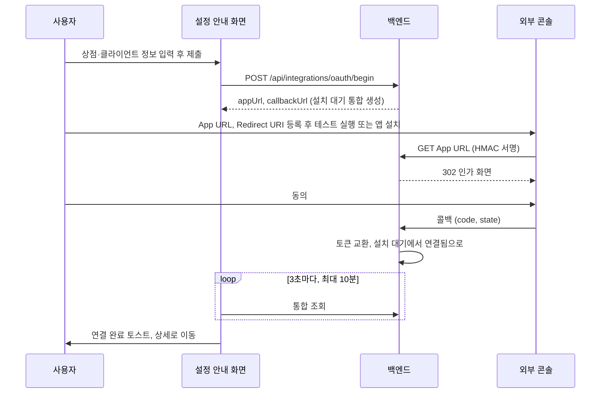

## 개요

이 문서는 [OAuth 연결과 토큰 갱신](CLE-INT-OAUTH.md) 의 하위 문서로 설치 우선 흐름(Cafe24 Private·MakeShop)의 설정 안내 화면과 App URL(설치 엔드포인트), 그 보안 계층을 정한다.

## 설치 우선 흐름: Cafe24 Private·MakeShop

Cafe24 Private 앱은 Cafe24 개발자 센터에서 만든 심사 전 앱이다. MakeShop 은 ShopStore 마켓의 앱 설치가 설치 흐름의 진입점이다. 둘 다 우리 서비스가 OAuth 를 시작할 수 없다. 외부 콘솔(Cafe24 개발자 센터의 «테스트 실행», ShopStore 앱 설치)이 먼저 우리 App URL 을 부르고 그 뒤 동의와 콜백이 이어진다.



### Cafe24 Private 앱

1. **사전 등록**(Cafe24 에서 «테스트 실행» 전에 필수): `Mall ID`, `App type = Private`, `Client ID`, `Client Secret`, 권한 범위를 입력하고 **[저장 및 설정 안내 받기]** 를 누른다. begin 본문은 다음과 같다.

   ```jsonc
   {
     "service": "cafe24",
     "mode": "new",
     "mall_id": "myshop",
     "app_type": "private",
     "client_id": "...",
     "client_secret": "...",
     "scopes": ["mall.read_product", "..."]
   }
   ```

   응답은 `{ "mode": "cafe24_private_pending", "integrationId": "...", "appUrl": "https://<host>/api/3rd-party/cafe24/install/:installToken", "callbackUrl": "https://<host>/api/3rd-party/cafe24/callback", "scope": "..." }` 다. 통합이 토큰 없이 `status=pending_install` 로 바로 생긴다. Cafe24 App URL 입력 칸의 100자 한도에 맞추려고 경로와 토큰을 모두 줄였다(아래 Rationale).
2. **설정 안내 화면**(팝업 없음): `App URL` 복사 버튼(Cafe24 개발자 센터 앱의 «앱 URL» 에 등록), `Redirect URI` 복사 버튼(앱의 «Redirect URI» 에 등록), 안내 문구 "① 위 URL 을 Cafe24 Developers → 내 앱 → 개발 정보에 등록하세요. ② 사용 권한(Scope) 이 요청한 scope 와 일치하는지 확인하세요. ③ 테스트 실행 버튼을 클릭하고 mall_id 를 입력하세요." 를 보인다.
3. **Cafe24 «테스트 실행»**: Cafe24 가 App URL(`GET /api/3rd-party/cafe24/install/:installToken`)을 부른다. 쿼리는 `mall_id`, `shop_no`, `user_id`, `user_name`, `user_type`, `lang`, `nation`, `timestamp`, `hmac`(HmacSHA256 서명, 알고리즘은 [Cafe24 노드 §HMAC 검증 알고리즘](../CLE-NODE-INT/CLE-NODE-CAFE24.md#hmac-검증-알고리즘))이다.
4. **App URL 처리**: 경로의 설치 토큰으로 통합 한 행을 찾고 그 행의 `client_secret` 으로 HMAC 을 한 번 검증한다. 통과하면 상태와 재설치 대기 표시로 나눈다. 설치 대기이거나 유효한 재설치 대기 표시(남긴 지 24시간 안)가 있으면 OAuth state(`mode='reauthorize'`)를 만들고 Cafe24 인가 URL 로 302 한다. 그 밖의 연결됨·오류·만료됨이면 `${FRONTEND_URL}/integrations/<id>` 로 302 한다. 24시간이 지난 표시는 없는 것으로 본다. Cafe24 쇼핑몰 관리자의 «앱으로 가기» 버튼이 같은 App URL 을 쓰므로 이 분기가 꼭 필요하다(아래 Rationale). 재설치 대기 표시는 통합 재인증과 추가 권한 요청이 남긴다([재설치 대기 표시](CLE-INT-OAUTH-REAUTH.md#재설치-대기-표시)).
5. 쇼핑몰 관리자가 동의 화면에서 동의한다. «앱으로 가기» 분기는 동의 화면 없이 4번에서 바로 우리 화면으로 온다.
6. Cafe24 가 콜백(`/api/3rd-party/cafe24/callback`)으로 code 와 state 를 보내면 토큰을 교환하고 `pending_install → connected` 로 바꾼다. 재설치 대기 표시가 있던 행은 자격 증명을 새 토큰으로 바꾸고 표시를 지운다. 설치 토큰은 지우지 않고 보존한다.
7. 그동안 설정 안내 화면은 그 통합을 3초마다 조회한다. «테스트 실행» 이 띄운 창의 `window.opener` 는 Cafe24 탭이라 `postMessage` 복귀를 쓸 수 없다. 연결됨을 감지하면 토스트를 띄우고 목록 쿼리를 무효화한 뒤 상세(`/integrations/<id>`)로 이동한다. 10분이 지나면 조회를 멈추고 «아직 대기 중» 안내를 보인다. 행은 백엔드에 남아 있고 페이지에 다시 들어오거나 창에 포커스가 오면 조회를 다시 시작한다. 설치 대기인 채 콜백 실패가 기록되면 `last_error`·`status_reason` 진단 단서를 같은 화면에 보인다. 통합 목록의 상태 배지로도 확인할 수 있다.

설치를 마친 통합에 통합 재인증이나 추가 권한 요청을 하면 [재설치 대기 표시](CLE-INT-OAUTH-REAUTH.md#재설치-대기-표시)를 남기고 같은 «테스트 실행» 흐름(3~6번)을 다시 탄다. 표시는 24시간 동안만 유효하므로 그 안에 «테스트 실행» 을 눌러야 한다.

### MakeShop

1. **사전 입력**: `Client ID`, `Client Secret`(파트너센터 앱 등록 때 발급). 하나라도 비어 있으면 폼 검증 에러로 막는다. `shop_uid` 는 이 단계에서 입력하지 않는다. ShopStore 설치 redirect 의 파라미터로 온다.
2. **제출**: `POST /api/integrations/oauth/begin`(본문 `{ "service": "makeshop", "mode": "new", "client_id": "...", "client_secret": "...", "scopes": [...] }`). 응답은 `{ "mode": "makeshop_pending_install", "integrationId": "...", "appUrl": "https://<host>/api/3rd-party/makeshop/install/:installToken", "callbackUrl": "...", "scope": "..." }` 이고 통합이 토큰 없이 설치 대기로 생긴다.
3. **설치 안내 화면**: Cafe24 Private 설정 안내와 같은 복사 UX(라벨, 모노스페이스 URL, 복사 버튼)로 `App URL`·`Redirect URI` 를 파트너센터 앱 설정에 등록하라고 안내한다.
4. **자동 조회**: Cafe24 Private 7번과 같다(3초 간격, 연결됨이면 토스트와 상세 이동, 10분 soft timeout).
5. 사용자가 ShopStore 에서 앱을 설치하면 MakeShop 이 App URL 을 `?shop_uid=...&timestamp=...&action_type=install&hmac=...` 로 부른다. HMAC 검증 뒤 인가, 콜백을 거쳐 `pending_install → connected` 가 된다.
6. 설치 대기가 아닌 통합의 App URL 이 다시 불리면(ShopStore 재설치 포함) 상세 화면으로 302 하고 그 통합의 자격 증명과 상태는 그대로 둔다. MakeShop 에는 재설치 대기 표시가 없다. MakeShop 통합의 복구는 삭제 후 재등록이다([MakeShop 은 삭제 후 재등록으로만 복구한다](CLE-INT-OAUTH-REAUTH.md#makeshop-은-삭제-후-재등록으로만-복구한다)).

- 설치 HMAC 은 `client_secret` 으로 만든 HMAC-SHA256 이고 ±5분 재사용 방어를 한다. Cafe24 Private 과 같은 방식이며 설치 토큰 capability 모델, rate limit, nonce 보호를 다시 쓴다. MakeShop HMAC 메시지 구성(정렬, 인코딩)은 코드에 `VERIFY` 로 표시돼 있어 운영 전에 공식 문서로 확정해야 한다([MakeShop 노드](../CLE-NODE-INT/CLE-NODE-MAKESHOP.md)).
- **설치 안내 화면의 에러 표시**: 콜백 실패로 기록된 사유 중 알려진 다섯 개(`oauth_token_exchange_failed`·`oauth_state_mismatch`·`oauth_state_expired`·`oauth_invalid_scope`·`hmac_verification_failed`)만 i18n 문구로 매핑한다. 모르는 사유는 일반 메시지로 보인다. HMAC 상세나 토큰 교환 trace 같은 백엔드 원문을 사용자에게 보이지 않는다. `hmac_verification_failed` 는 상태 사유가 아니라서 이 문구가 실제로 보이는 경우는 없다. MakeShop 설치 요청의 HMAC 검증이 실패하면 서버는 행을 쓰지 않고 403 `MAKESHOP_INSTALL_INVALID_HMAC` 으로 거절한다([HMAC 검증 실패는 상태 사유로 남기지 않는다 (2026-11-13)](CLE-INT-STATUS.md#hmac-검증-실패는-상태-사유로-남기지-않는다-2026-11-13)). 이 매핑을 지우는 일은 NERV Task `CLE-T-22PSME` 가 맡는다.
- MakeShop 에는 Cafe24 의 설치 토큰 불일치 회복(`tryRecoverByMallId`)이 없다. 조회에 실패하면 바로 404 다.

## 설치 엔드포인트 (App URL)

| 메서드 | 경로 | 설명 |
| --- | --- | --- |
| GET | `/api/3rd-party/cafe24/install/:installToken` | Cafe24 Private App URL. Cafe24 개발자 센터의 «테스트 실행» 과 쇼핑몰 관리자의 «앱으로 가기» 가 같은 주소를 부른다. 통합이 설치 대기이거나 유효한 재설치 대기 표시가 있으면 OAuth 인가로, 그 밖이면 프런트엔드 상세 화면으로 redirect 한다 |
| GET | `/api/3rd-party/makeshop/install/:installToken` | MakeShop App URL. 쿼리 `shop_uid`, `timestamp`, `action_type`, `hmac`. 통합이 설치 대기면 OAuth 인가로, 그 밖이면 프런트엔드 상세 화면으로 redirect 한다 |

- `:installToken` 은 begin 응답의 22자 설치 토큰이다. 설치 토큰은 통합이 살아 있는 동안 지속되는 식별자다. 예외는 begin 이 설치 대기 행을 다시 쓰면서 새로 발급할 때다. Cafe24 Private 은 `client_id`·`client_secret` 을 바꿔 다시 쓰거나 설치 토큰이 없는 옛 행일 때, MakeShop 은 설치 토큰이 없는 행일 때다. 조건은 [`oauth/begin` 요청과 응답](CLE-INT-OAUTH-BEGIN.md#oauthbegin-요청과-응답) 이 정한다. 콜백 성공에서 NULL 로 지우지 않는다.
- 식별 절차: 설치 토큰으로 한 행을 찾고 그 행의 `client_secret` 으로 HMAC 을 한 번 검증한다.

가드는 이 순서로 건다.

| 순서 | 검사 | 실패 응답 |
| --- | --- | --- |
| ① | IP 잠금 | 429 `CAFE24_INSTALL_RATE_LIMITED` |
| ② | 설치 토큰 형식 | 404, 실패 카운트 |
| ③ | 필수 파라미터(`mall_id`·`timestamp`·`hmac`) | 400 `CAFE24_INSTALL_MISSING_PARAMS` |
| ④ | timestamp ±5분 | 400 `CAFE24_INSTALL_REPLAY` (MakeShop 은 `MAKESHOP_INSTALL_REPLAY`) |
| ⑤ | MakeShop 만: `shop_uid` 형식(SSRF 가드) | 400 `MAKESHOP_INVALID_SHOP_UID` |
| ⑥ | 설치 토큰으로 한 행 조회(상태 무관, V043 부분 UNIQUE). Cafe24 는 실패하면 `tryRecoverByMallId` 회복 | 404 `CAFE24_INSTALL_INVALID_TOKEN` (통합 삭제, 24시간 만료로 지워짐, 회복 실패) |
| ⑦ | `mall_id`·앱 유형 일치와 HMAC(`client_secret`) timing-safe 비교 | 403 `CAFE24_INSTALL_INVALID_HMAC` |
| ⑧ | `(mall_id, timestamp, hmac)` nonce 재사용 검사(Redis, 없으면 건너뜀) | 재사용 거절 |
| ⑨ | MakeShop 설치 대기 분기만: 같은 `(워크스페이스, shop_uid)` 연결됨 행 | 409 `MAKESHOP_ALREADY_CONNECTED` |

`CAFE24_INSTALL_MISSING_PARAMS` 는 capability 토큰 가정(설치 토큰은 추측할 수 없다)과 무관한 파라미터 누락이라 404·403 합산 정책과 별개 코드다. HMAC 실패의 세 갈래(`mall_id` 불일치, `client_secret` 없음, HMAC 불일치)는 같은 403 을 돌려준다. 대신 `logger.warn` 에 갈래, URL 과 DB `mall_id` 의 일치 여부, DB 앱 유형·상태·사유, 설치 토큰 앞뒤 4자를 남긴다. `client_secret` 은 절대 로그에 남기지 않는다(`SECRET_LEAK_PATTERNS` 정책).

⑨ 는 연결됨 행만 본다. 오류·만료됨인 같은 상점 행이 남아 있으면 ⑨ 를 지난 뒤 `shop_uid` 를 `mall_id` 컬럼에 쓰는 순간 상점 식별자 UNIQUE(V072) 위반이 나고 같은 409 `MAKESHOP_ALREADY_CONNECTED` 로 바뀐다. 그래서 오류·만료됨 행이 남은 상점에 MakeShop 통합을 다시 등록해 설치하려면 기존 통합을 먼저 지워야 한다. 순서는 사용처 교체, 기존 통합 삭제, 재등록과 ShopStore 앱 설치다. 사용처가 남아 있으면 삭제가 409 `INTEGRATION_IN_USE` 로 막힌다([통합 관리](CLE-INT-MANAGE.md#사용처-추적과-삭제-차단)). 설치 기한이 지나 만료된 행(`install_timeout`)은 예외다. 만료할 때 상점 식별자를 비우므로 이 위반을 내지 않는다. 그 행을 지우지 않아도 다시 설치할 수 있다. 만료 행의 이름은 그대로라 같은 이름으로 begin 하면 409 `INTEGRATION_NAME_TAKEN` 이다.

보안 계층을 한 표로 모으면 이렇다.

| 계층 | 방법 |
| --- | --- |
| Rate limit 1층 | `@Throttle` IP 당 분당 30회(콜백은 분당 60회). 현재는 pod 마다 메모리에 센다. Redis 로 나눠 세는 전환은 후속이다 |
| Rate limit 2층 | 설치 토큰 조회·HMAC **실패**만 IP 별로 세어 임계치를 넘으면 429 로 잠근다. 성공한 설치(302)는 세지 않으므로 정상 사용자는 걸리지 않는다. Redis 로 pod 사이에 공유한다 |
| 재사용 | timestamp ±5분 창과 `(mall_id, timestamp, hmac)` Redis nonce 캐시 |
| 위조 | raw query 의 HMAC-SHA256(`client_secret`), timing-safe 비교 |
| 오래된 URL | `tryRecoverByMallId`: 같은 `mall_id` 후보의 HMAC 을 대조해 정확히 1개가 맞으면 자동 회복(Cafe24 만) |

Redis 키 구성, TTL, 임계치·창 같은 상수, Redis 가 없을 때의 동작은 [Cafe24 노드 §Private 앱 설치 엔드포인트](../CLE-NODE-INT/CLE-NODE-CAFE24.md#private-앱-설치-엔드포인트) 가 기준이다. Redis 가 없으면 nonce 캐시와 실패 카운터는 조용히 꺼진다.

**설치 토큰 불일치 회복**(Cafe24): 설치 토큰으로 행을 찾지 못하면 다음을 한다.

1. 같은 `mall_id` 의 Cafe24 행을 찾는다(`idx_integration_service_mall` 로 한 번에 조회, 보통 1~2건).
2. 행마다 `client_secret` 으로 HMAC 을 대조한다. 후보는 5개까지다. 넘으면 회복을 포기하고 404 다.
3. 정확히 1개가 맞으면 그 행의 OAuth 또는 이동 흐름으로 진행한다.
4. 0개나 2개 이상이면 404 와 HTML 안내 페이지를 돌려준다.

설치 기한이 지나 만료된 행(`install_timeout`)은 회복 후보가 아니다. 만료할 때 상점 식별자를 비우므로 1단계 조회에 잡히지 않는다. 그래서 그 행의 옛 App URL 은 상세 화면으로 가지 않고 404 안내가 된다. 같은 상점을 새로 등록한 행이 있으면 그 행이 후보가 된다.

회복 로그에서는 다른 테넌트의 통합 UUID 와 설치 토큰 prefix 를 빼고 `mall_id` 와 상태만 남긴다. 2개 이상 맞으면 `[cafe24-install-recovery] ambiguous: N rows passed HMAC` 로그를 남긴다.

**실패 응답**: 실패 본문은 에러 응답 봉투 `{ error: { code, message, requestId } }` 다. 이 엔드포인트는 응답을 직접 써서 전역 예외 필터를 거치지 않으므로 컨트롤러가 봉투를 조립하고 `requestId` 를 응답마다 새로 발급한다. ①~③ 가드는 늘 JSON 으로 답한다. 그 뒤 서비스가 거절하고 요청의 `Accept` 에 `text/html` 이 있으면 에러 코드·메시지·`requestId` 와 «통합 상세 페이지에서 현재 App URL 을 확인해 Cafe24 Developers 를 갱신하세요» 안내가 담긴 간단한 HTML 페이지를 보인다. 주로 만나는 경우는 404(회복 실패 포함)다. JSON 을 기대하는 API 클라이언트에는 JSON 응답을 준다.

**예상 밖 예외**: 설치 처리 중 에러 코드가 없는 예외가 나면 `CAFE24_INSTALL_FAILED`·`MAKESHOP_INSTALL_FAILED` 로 답한다. 코드가 없는 `HttpException` 이면 그 상태와 메시지를 싣는다. 그 밖의 예외(DB·런타임 오류 등)는 500 과 고정 문구로 답한다. 두 경우 모두 IP 실패로 세지 않는다. 500 으로 가린 예외의 메시지와 스택은 `requestId`·서비스와 함께 `logger.error` 로만 남긴다. 로그에 남기기 전에 비밀 값 모양의 문자열을 가린다(`SECRET_LEAK_PATTERNS` 정책). 설치 토큰은 이 로그에 넣지 않는다.

## 구현 위치

- `codebase/backend/src/modules/integrations/third-party-oauth.controller.ts` (`/api/3rd-party/**`, rate limit, 설치 엔드포인트 실패 응답 조립과 예상 밖 예외 가림)
- `codebase/backend/src/modules/integrations/services/install-error.template.ts` (설치 실패 HTML 페이지)
- `codebase/backend/src/modules/integrations/cafe24-install-nonce-cache.service.ts`, `cafe24-install-rate-limit.service.ts`
- `codebase/frontend/src/app/(main)/w/[slug]/integrations/new/page.tsx` (추가 흐름, 설정 안내 화면, begin 의 이름 충돌 표시)

## Rationale

### 설치 토큰을 App URL 경로의 식별 키로 올렸다

처음 설계는 `GET /oauth/install/cafe24` 가 `mall_id` 와 HMAC 만 받고 백엔드가 설치 대기 행을 메모리에서 100건 훑으며 `mall_id` 가 같은 후보의 `client_secret` 으로 HMAC 을 대조했다. 운영 위험이 두 가지였다. 같은 `mall_id` 의 설치 대기가 쌓이면 HMAC 대조가 비결정적이라 사용자가 보고 있는 행이 아닌 다른 행이 연결될 수 있었다. 설치 대기 수가 늘면 비용이 O(N) 이었다. App URL 경로에 설치 토큰을 넣으면 한 행 조회로 고정되고 토큰이 랜덤이라 추측할 수 없는 식별자 역할도 한다. 토큰 없는 옛 경로는 운영 등록자가 0명인 시점에 바로 없앴다. 설치 토큰은 App URL 경로에 공개로 들어가므로 평문으로 저장한다.

### 설치 토큰 미존재를 404 로 분리한 보안 전제

옛 정책은 설치 대기를 찾지 못한 경우도 `CAFE24_INSTALL_INVALID_HMAC`(403)으로 합쳤다. 토큰이 경로에 없던 시절 «어느 `mall_id` 에 설치 대기가 있는지» 가 응답 코드로 새지 않게 하려는 안전망이었다. 설치 토큰은 128비트 이상의 랜덤(16바이트 base64url)이라 추측할 수 없고 URL 경로 자체가 capability 토큰처럼 동작한다. 이 전제에서는 «토큰 없음» 을 `CAFE24_INSTALL_INVALID_TOKEN`(404)으로 나눠도 의미 있는 열거가 일어나지 않는다. 전제가 깨지면(96비트 미만으로 토큰 단축, PRNG 변경, 설치 토큰 노출 사고) 다시 403 으로 합쳐야 한다.

### 설치 엔드포인트 rate limit: 실패 페널티(Redis)와 IP throttle(pod 별)

capability 토큰 가정은 설치 토큰을 추측할 수 없다는 암호학적 1차 방어다. 그 위에 운영 계층 방어를 더해, 전제가 약해지거나(토큰 단축, PRNG 변경, 노출) 샌 토큰으로 대량 시도할 때의 비용을 올린다. 두 계층 모두 nonce 캐시와 같은 기존 Redis 위에 얹도록 설계했다. 1층 분산화는 아직 도입되지 않았다.

- **1층(IP throttle)**: 처음부터 `@Throttle({ limit: 30, ttl: 60_000 })` 로 IP 당 분당 30회였다. `ThrottlerModule` 기본 저장소가 pod 마다 메모리라 여러 인스턴스에서는 할당이 흩어진다. Redis 저장소로 옮기는 일은 `@nestjs/throttler` 저장소가 전역 설정이라 모든 throttle 엔드포인트가 함께 바뀌므로 따로 검증할 infra 작업으로 나눴다. 도입하면 Redis 장애 때 메모리로 내려가 제한을 유지한다.
- **2층(실패 페널티)**: 실패 요청만 IP 별로 세어 429 로 잠근다. 성공(302)은 세지 않아 정상 사용자는 카운터가 거의 0 이고 열거는 대량 실패라 빨리 걸린다. Redis 가 없으면 끈다(fail-open). 메모리 대체물이 없는 보조 강화라 끄고 ±5분 창과 capability 토큰으로 돌아가는 편이 정상 설치를 막는 것보다 안전하다. 1층과 일부러 다른 격하 경로다.
- **3층(전역 상한, 미도입)**: 한 공격자가 전체 설치를 마비시키는 부수 DoS 위험이 있어 범위 밖이다.

### Cafe24 App URL 100자 한도에 맞춰 `/api/3rd-party/<provider>/` 경로를 새로 뒀다

운영 사용자가 Cafe24 개발자 센터 앱 URL 칸에서 «허용 길이 초과» 경고를 받아 Private 앱 연결이 막혔다. 직접 시험해 보니 한도는 100자였고 host 변동까지 감안해 90자를 한계로 잡았다. 당시 `/api/integrations/oauth/install/cafe24/<64-hex>` 는 host 32자 가정으로 135자였다. 두 부분을 모두 줄였다.

- **경로**: `/api/integrations/oauth/install/cafe24/...`(39자)를 `/api/3rd-party/cafe24/install/...`(30자)로 바꿨다. 옛 경로는 사용자가 부르는 관리 API 와 외부가 부르는 콜백·설치 API 가 한 prefix 에 섞여 있었다. 외부 호출 전용 prefix 로 나누면 IP allowlist, rate limit, 웹훅 수신 같은 제공자별 처리가 하위 트리 단위로 모인다. 동작별 묶음(`/api/3rd-party/install/cafe24/:token`)도 길이는 같았지만 제공자별 묶음이 앞으로의 웹훅 수신 경로와 제공자 모듈 매핑, 미들웨어 prefix 를 한 곳에 모아 이쪽을 택했다.
- **설치 토큰**: 32바이트 hex(64자)를 16바이트 base64url(22자)로 줄였다. 128비트는 capability 토큰으로 충분하다(NIST SP 800-63B §A.7 은 96비트 이상, OWASP 는 128비트 권장).
- **Google·GitHub 콜백도 함께 옮겼다**: Cafe24 만 옮기면 콜백 경로가 제공자마다 갈린다. 배포와 함께 세 OAuth 콘솔에 새 redirect URI 를 등록했다. 소셜 로그인 redirect URI 는 따로 유지한다. 문서는 `/api/3rd-party/:provider/callback` 한 형식만 쓰고 컨트롤러를 나눌지는 구현 세부다.
- **옛 경로는 바로 없앴다**: 운영자가 OAuth 콘솔을 고쳐야 한다는 사실이 강제로 드러나는 편이 누락 없이 안전하다. 64자 토큰을 가진 설치 대기 행은 옮기지 않고 24시간 만료에 맡겼다. 보고된 사례가 «길이 초과로 등록 못 함» 이라 영향이 거의 없었다.

### App URL 재호출 흐름: 설치 토큰을 지속 식별자로 올렸다

Cafe24 개발자 센터에 등록한 App URL 은 첫 설치(«테스트 실행»)와 설치 뒤 이동(쇼핑몰 관리자의 «앱으로 가기») 두 진입점에서 불린다. 둘째는 나중에 발견한 요구사항이다. 옛 정의는 콜백 성공 때 설치 토큰을 NULL 로 지워, «앱으로 가기» 가 404 `CAFE24_INSTALL_INVALID_TOKEN` 이 됐다. 그래서 설치 토큰을 통합이 살아 있는 동안 보존하고 설치 처리가 상태로 나눠 설치 대기는 OAuth 인가로, 나머지는 `${FRONTEND_URL}/integrations/<id>` 로 보낸다. 사용자가 그 통합의 상태와 진단을 바로 볼 수 있어 `${FRONTEND_URL}/` 보다 낫다. HMAC 검증은 두 분기 모두 유지한다. 이 변경 전에 토큰이 이미 NULL 이 된 연결됨 통합은 마이그레이션하지 않았다. Private 사용자가 적고 재등록이 마이그레이션보다 싸며 토큰을 다시 발급해도 결국 «테스트 실행» 부터 다시 해야 한다. 24시간 만료에서는 사용자가 새 통합을 등록해야 하므로 토큰을 여전히 지운다.

2026-10-10(Task CLE-T-NNENG8)부터 설치 대기가 아니어도 유효한 [재설치 대기 표시](CLE-INT-OAUTH-REAUTH.md#재설치-대기-표시)가 있으면 OAuth 인가로 보낸다. 보존한 설치 토큰이 있어서 가능한 분기다. 설치 토큰이 없는 옛 행은 이 경로도 쓸 수 없어 삭제 후 재등록으로 복구한다.

### 설치 토큰 불일치 회복 흐름

운영 사용자가 새 통합을 등록하고 App URL 을 등록했는데 «테스트 실행» 에서 404 `CAFE24_INSTALL_INVALID_TOKEN` 을 받았다. 폼을 여러 번 제출하면서(예: `client_secret` 오타 수정) 멱등 begin 의 자격 증명 변경 분기가 설치 토큰을 다시 발급해, 그 사이 등록한 옛 URL 이 낡았다. 옛 동작은 단호한 404 라 사용자가 상세 화면의 App URL 을 보고 Cafe24 쪽을 직접 고쳐야 했고 운영 문의가 많았다. 그래서 [설치 엔드포인트](#설치-엔드포인트-app-url) 의 회복 분기를 두었다.

- **비용**: 회복 분기에서만 HMAC 대조가 늘고 정상 흐름은 영향이 없다. 폐기한 «100건 스캔 + HMAC 대조» 는 설치 토큰이 없던 시절 **모든 호출**의 식별 전략이었고 이 흐름은 한 행 조회가 **실패했을 때만** 동작한다. 같은 워크스페이스 안에서는 상점 식별자 UNIQUE(V072)가 같은 상점 행을 1개로 제한하고 여러 워크스페이스가 같은 상점을 쓰는 경우는 드물어 실제 후보는 1~2개다.
- **경쟁 없음**: SELECT 와 HMAC 대조만 하는 읽기 전용이다.
- **보안**: HMAC 위조에는 `client_secret` 이 필요하고 그것을 가진 사람은 정상 흐름으로도 같은 일을 한다. 권한을 더 주지 않고 capability 토큰 가정도 깨지 않는다.
- **모호한 경우**: 두 워크스페이스가 같은 상점과 같은 `client_secret` 을 쓰면 어느 행인지 정할 수 없어 포기한다.

### HMAC 검증은 raw URL-encoded 값을 그대로 쓴다

옛 구현은 HMAC 을 «Java `URLEncoder.encode` 호환(공백은 `+`)» 으로 검증했는데 운영에서 새 통합 직후 바로 HMAC 실패가 재현됐다. 진단 로그가 `reason=hmac_verify_failed` 를 가리켰고 `mall_id`·앱 유형·설치 토큰·`client_secret` 은 모두 맞았다. 알고리즘 결함이었다. Cafe24 공식 `validationCheckHmac` Java 예제는 query string 을 `&` 와 `=` 로 나눈 뒤 **raw 값 그대로** 이어 붙인다. 디코드도 재인코드도 하지 않는다. 사용자 보고 URL 의 `user_name=...%20...` 처럼 Cafe24 는 공백을 `%20` 으로 보내는데 Cafe24 가 URLEncoder 를 썼다면 자기 URL 과도 맞지 않았을 것이다. 추론과 운영 재현이 함께 확인한다.

그래서 메시지 조립은 raw query 를 직접 나눠 raw 문자열을 보존하고 `hmac` 을 뺀 key 만 정렬한다. 알고리즘과 코드는 [Cafe24 노드 §HMAC 검증 알고리즘](../CLE-NODE-INT/CLE-NODE-CAFE24.md#hmac-검증-알고리즘) 이 기준이다. 여러 인코더를 차례로 시도하는 방식은 인코더마다 차이(`%20` 과 `+`, `*` 와 `%2A` 등)가 있어 맞는다는 보장이 없다. raw 바이트 보존은 인코더와 상관없이 성립한다. HMAC 강도, capability 토큰 보호, 워크스페이스 횡단 열거 방지(SEC H-2)는 그대로다. 옛 회귀 테스트는 `John+Doe` 형식으로 계산과 검증이 같은 잘못된 알고리즘을 쓰는 자기 충족 검증이었다. 새 테스트는 Cafe24 가 보내는 `%20` 형식 그대로의 raw query 로 검증한다.

### 설치 대기 화면은 3초마다 스스로 조회한다

설치 우선 흐름에서는 OAuth 팝업 복귀(`postMessage`)가 동작하지 않는다. Cafe24 «테스트 실행» 과 MakeShop ShopStore 설치 모두 외부 사이트가 자기 창에서 흐름을 시작해 그 창의 `window.opener` 가 외부 탭이기 때문이다. 수동 확인(목록 새로고침 · 상태 배지)만 두면 «성공했는데 화면은 계속 대기 중» 인 막다른 흐름이 된다.

그래서 안내 화면이 그 통합을 3초마다 조회한다. 10분 soft timeout 은 화면 쪽 안내일 뿐 상태를 바꾸지 않는다(설치 24시간 기한보다 훨씬 짧다). 3초는 외부 콘솔 왕복(수십 초에서 수 분)에 비해 충분히 빠르면서 한 행 GET 이라 부하가 무시할 만하다. MakeShop 은 알려진 사유만 i18n 문구로 매핑해 백엔드 원문 노출을 막는다.

### 설치 엔드포인트의 예상 밖 예외는 500 으로 가린다 (2026-11-06)

설치 엔드포인트는 코드가 없는 예외를 400 `*_INSTALL_FAILED` 로 바꾸면서 예외 메시지를 그대로 실었다. 실패 본문에는 `requestId` 가 없었다. DB·런타임 오류의 원문이 Cafe24·MakeShop 콘솔에서 연 브라우저에 보였다([에러 응답과 클라이언트 처리](../CLE-API/CLE-API-ERROR.md) 규칙 2·3).

- 예외를 전역 예외 필터로 다시 던지는 안은 기각했다. 필터는 JSON 만 그려서 HTML 안내 페이지를 보일 수 없다. 열거 공격 실패 카운트도 컨트롤러가 해야 한다.
- 코드 이름은 그대로 두고 상태와 문구만 바꿨다. 이름과 상태를 정한 근거는 [에러 코드 규약과 카탈로그 「설치 엔드포인트의 예상 밖 예외를 500 으로 가리고 `requestId` 를 싣는다 (2026-11-06)」](../CLE-API/CLE-API-ERRCODES.md#설치-엔드포인트의-예상-밖-예외를-500-으로-가리고-requestid-를-싣는다-2026-11-06) 에 있다.
- HTML 페이지는 404 만이 아니라 서비스가 거절한 실패에 상태와 관계없이 보인다([에러 코드 규약과 카탈로그](../CLE-API/CLE-API-ERRCODES.md) §6.21 과 같다).
