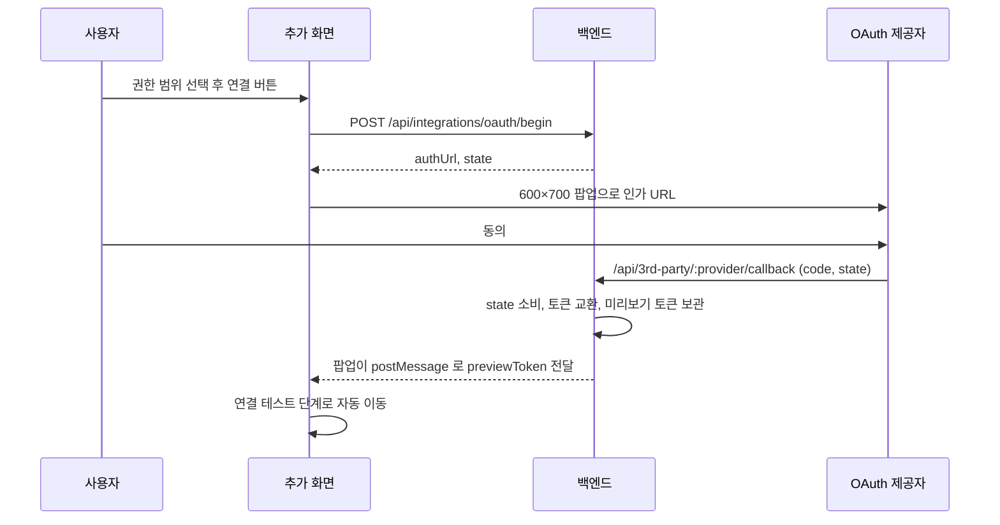
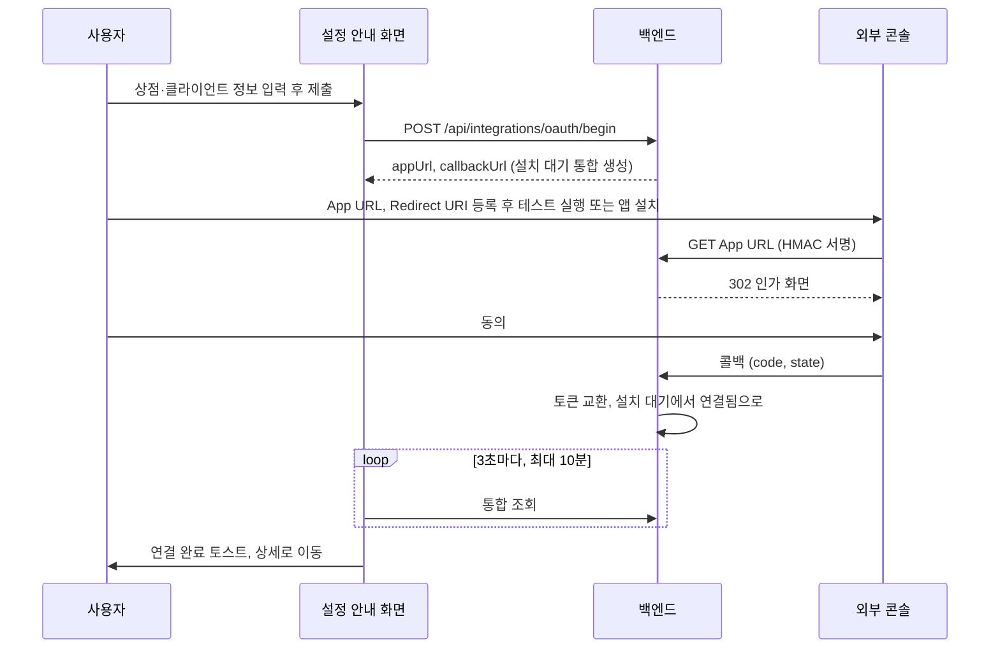

> 구현 상태: 부분 구현 · 원문: `spec/2-navigation/4-integration.md` (§3.2 OAuth 흐름, §3.5, §4.4, §9.2 OAuth·설치 행, §10, 관련 Rationale), `spec/data-flow/5-integration.md` (§1.2 진입점 표, §1.2.1 보안 계층, §2.2), `spec/4-nodes/4-integration/_product-overview.md` (INT-AU-01·04·06), `spec/2-navigation/_product-overview.md` (NAV-IN-03) · 용어: [용어 사전](../CLE-GLOSSARY.md)

## 개요

이 문서는 OAuth 통합(Integration, `integration`)이 연결되는 방법과 연결 뒤 토큰을 유지하는 방법을 정한다. 연결 방식은 두 가지다. Google·GitHub·Cafe24 Public 앱은 우리 화면의 팝업에서 OAuth 제공자(OAuth provider) 동의를 받는다. Cafe24 Private 앱과 MakeShop 은 외부 마켓의 앱 설치가 흐름을 시작하는 설치 우선 흐름(install-first)이라, 통합이 설치 대기(`pending_install`) 상태로 먼저 생기고 외부가 우리 App URL 을 부른다.

다루는 것:

- OAuth 연결 흐름(`oauth/begin` → 인가 → 콜백)과 제공자별 차이
- 설치 우선 흐름의 설정 안내 화면, App URL(설치 엔드포인트)과 보안 계층
- OAuth 콜백 엔드포인트, 팝업 복귀, 에러 매핑
- 통합 재인증(reauthorize)과 추가 권한 요청(request scopes), Cafe24 Private 의 재설치 대기 표시, 상세 화면의 권한 탭
- 토큰 자동 갱신(token refresh)과 갱신 큐

범위 밖:

- 추가 위저드의 단계 구성과 공통 필드, 관리 API 목록, 에러 코드 카탈로그는 [통합 관리](CLE-INT-MANAGE.md) 가 정한다.
- 서비스별 자격 증명 필드와 권한 범위 프리셋은 [서비스별 인증 방식과 자격 증명](CLE-INT-AUTH.md) 이 정한다.
- 통합 상태 전이와 만료 스캐너, 알림은 [통합 상태와 만료 알림](CLE-INT-STATUS.md) 이 정한다.
- 테이블 쓰기 순서와 시퀀스는 [통합 데이터와 흐름](CLE-INT-DATA.md) 이 정한다.
- Cafe24 설치 엔드포인트의 Redis 키, HMAC 알고리즘, 상수는 [Cafe24 노드 §Private 앱 설치 엔드포인트](../CLE-NODE-INT/CLE-NODE-CAFE24.md#private-앱-설치-엔드포인트) 가, Cafe24 별도 승인 명단은 [Cafe24 별도 승인 scope](CLE-C24-SCOPES) 가 정한다.
- 소셜 로그인은 다른 흐름이다([가입과 로그인](../CLE-ACCT/CLE-ACCT-SIGNIN.md)).

## 요구사항

- REQ-INTOAUTH-001 WHEN 사용자가 Google·GitHub 통합의 연결 버튼을 누르면 THE SYSTEM SHALL `oauth/begin` 으로 state 를 발급하고 600×700 팝업에서 인가 URL 을 연다. (원본: INT-AU-01, NAV-IN-03)
- REQ-INTOAUTH-002 WHEN 사용자가 OAuth 통합을 추가하면 THE SYSTEM SHALL 서비스별 권장 기본값을 체크해 둔 권한 범위 체크박스를 보인다. (원본: INT-AU-06)
- REQ-INTOAUTH-003 WHEN 사용자가 Cafe24 통합을 추가하면 THE SYSTEM SHALL OAuth 를 시작하기 전에 상점 식별자와 앱 유형을 먼저 입력받는다.
- REQ-INTOAUTH-004 WHEN Cafe24 인가 URL 을 만들면 THE SYSTEM SHALL 권한 범위를 콤마로 구분한다.
- REQ-INTOAUTH-005 IF Cafe24 Public 앱 서버 환경 변수가 설정되지 않았으면 THE SYSTEM SHALL 서비스 목록 응답에 `publicAppAvailable=false` 를 싣고 화면은 Public 선택지를 숨긴다.
- REQ-INTOAUTH-006 WHEN 사용자가 Cafe24 Private 앱 통합을 제출하면 THE SYSTEM SHALL 팝업 없이 설치 대기 통합을 만들고 App URL·Redirect URI 를 담은 설정 안내 화면을 보인다.
- REQ-INTOAUTH-007 IF MakeShop 통합 폼의 Client ID 나 Client Secret 이 비어 있으면 THE SYSTEM SHALL 제출을 막는다.
- REQ-INTOAUTH-008 WHEN 사용자가 MakeShop 통합을 제출하면 THE SYSTEM SHALL 팝업 없이 설치 대기 통합을 만들고 설치 안내 화면을 보인다.
- REQ-INTOAUTH-009 WHILE 설정·설치 안내 화면이 열려 있는 동안 THE SYSTEM SHALL 그 통합을 3초마다 조회하고 연결됨이 되면 토스트를 띄운 뒤 상세 화면으로 이동한다.
- REQ-INTOAUTH-010 WHEN 안내 화면의 조회가 10분을 넘기면 THE SYSTEM SHALL 조회를 멈추고 «아직 대기 중» 안내를 보이며 재진입하거나 창에 포커스가 오면 다시 조회한다.
- REQ-INTOAUTH-011 IF 같은 워크스페이스에 같은 상점 식별자의 연결됨 Cafe24 통합이 있고 그 통합이 `new` 가 아닌 모드의 대상 통합(`integrationId`)이 아니면 THE SYSTEM SHALL Cafe24 `oauth/begin` 을 409 `CAFE24_PRIVATE_APP_ALREADY_CONNECTED` 로 거절한다.
- REQ-INTOAUTH-012 WHEN Cafe24 Private `oauth/begin` 에 같은 상점의 Private 설치 대기 행이 있고 요청자가 그 행을 바꿀 수 있으면 THE SYSTEM SHALL 새 행을 만들지 않고 그 행을 재사용하며 `client_id`·`client_secret` 이 그대로이고 설치 토큰이 있으면 설치 토큰도 그대로 둔다.
- REQ-INTOAUTH-013 IF `oauth/begin` 이 `client_id`·`client_secret` 을 갖춘 Cafe24 Private 요청을 `new` 가 아닌 모드(`reauthorize`·`request_scopes`)로 받으면 THE SYSTEM SHALL 400 `CAFE24_PRIVATE_APP_USE_TEST_RUN` 으로 거절한다.
- REQ-INTOAUTH-014 WHEN App URL 호출의 HMAC 검증이 통과하고 통합이 설치 대기이면 THE SYSTEM SHALL OAuth state 를 만들고 인가 URL 로 302 한다.
- REQ-INTOAUTH-015 WHEN App URL 호출의 HMAC 검증이 통과하고 통합이 설치 대기가 아니며 유효한 재설치 대기 표시도 없으면 THE SYSTEM SHALL 프런트엔드 통합 상세 화면으로 302 한다.
- REQ-INTOAUTH-016 IF App URL 호출의 timestamp 가 ±5분 창 밖이면 THE SYSTEM SHALL 400 `CAFE24_INSTALL_REPLAY` 로 거절한다.
- REQ-INTOAUTH-017 IF 같은 IP 의 설치 토큰 조회·HMAC 검증 실패가 임계치를 넘으면 THE SYSTEM SHALL 429 `CAFE24_INSTALL_RATE_LIMITED` 로 거절한다.
- REQ-INTOAUTH-018 IF Cafe24 App URL 의 설치 토큰으로 행을 찾지 못하면 THE SYSTEM SHALL 같은 상점 식별자의 Cafe24 행 최대 5개 중 HMAC 이 맞는 행이 정확히 1개일 때만 그 행으로 진행한다.
- REQ-INTOAUTH-019 IF App URL 의 HMAC 검증이 실패하면 THE SYSTEM SHALL 실패 이유와 상관없이 같은 403 `CAFE24_INSTALL_INVALID_HMAC` 로 응답하고 `client_secret` 은 로그에 남기지 않는다.
- REQ-INTOAUTH-020 WHEN App URL 호출이 404 로 끝나고 요청이 `text/html` 을 받으면 THE SYSTEM SHALL 현재 App URL 을 확인하라는 안내가 담긴 HTML 페이지를 보인다.
- REQ-INTOAUTH-021 IF 콜백의 state 가 발급한 값과 맞지 않으면 THE SYSTEM SHALL 팝업에 `Security validation failed` 를 보이고 끝낸다.
- REQ-INTOAUTH-022 IF 콜백에 `error` 파라미터가 있으면 THE SYSTEM SHALL 팝업에 `Authorization denied` 를 보이고 끝낸다.
- REQ-INTOAUTH-023 WHEN 새 연결(`mode='new'`) 콜백의 토큰 교환이 성공하면 THE SYSTEM SHALL 토큰을 10분짜리 미리보기 토큰에 맡기고 `previewToken` 을 돌려준다.
- REQ-INTOAUTH-024 WHEN 통합 재인증 콜백이 성공하면 THE SYSTEM SHALL 자격 증명을 새 토큰으로 바꾸고 상태를 `connected` 로 되돌린다.
- REQ-INTOAUTH-025 WHEN 추가 권한 요청 콜백이 성공하면 THE SYSTEM SHALL 기존 권한 범위에 새 권한 범위를 합치고 토큰을 갱신한다.
- REQ-INTOAUTH-026 WHEN 통합 재인증·추가 권한 요청 콜백을 커밋하기 직전이고 통합이 설치 대기도 아니고 유효한 재설치 대기 표시가 있는 Cafe24 Private 통합도 아니면 THE SYSTEM SHALL 요청자의 가시성, 개인 통합의 편집자 하한, 조직 통합의 관리자 권한을 다시 판정하고 실패하면 롤백한다.
- REQ-INTOAUTH-027 WHEN 콜백 처리가 끝나면 THE SYSTEM SHALL `postMessage` 로 부모 창에 결과를 알리고 성공은 바로, 실패는 3~5초 뒤 팝업을 닫는다.
- REQ-INTOAUTH-028 IF OAuth 팝업이 5분 안에 돌아오지 않으면 THE SYSTEM SHALL 타임아웃 에러를 보이고 다시 시도할 수 있게 한다.
- REQ-INTOAUTH-029 IF 유효한 재설치 대기 표시가 없는 연결됨 통합의 통합 재인증 코드 교환이 실패하면 THE SYSTEM SHALL 상태를 `error(auth_failed)` 로 바꾸고 `last_error` 를 기록한다.
- REQ-INTOAUTH-030 IF Cafe24 가 `invalid_scope` 로 권한 범위를 거부하면 THE SYSTEM SHALL 상태를 보존하고 사유 `oauth_invalid_scope` 와 `last_error.details.requiresCafe24Approval` 을 기록한다.
- REQ-INTOAUTH-031 WHEN 사용자가 설치 토큰이 있는 Cafe24 Private 통합에 추가 권한 요청을 하면 THE SYSTEM SHALL OAuth 를 시작하지 않고 권한 범위를 합쳐 저장하며 통합이 설치 대기가 아니면 재설치 대기 표시를 남긴 뒤 `cafe24_private_pending` 응답을 돌려준다.
- REQ-INTOAUTH-032 WHEN 추가 권한 요청 응답이 `cafe24_private_pending` 이면 THE SYSTEM SHALL 권한 탭에 인라인 안내와 info 토스트를 보이고 통합을 다시 조회한다.
- REQ-INTOAUTH-033 WHEN 갱신 가능 통합으로 외부 API 를 부르기 직전 토큰이 만료됐거나 곧 만료되면 THE SYSTEM SHALL 토큰을 갱신한 뒤 부른다. (원본: INT-AU-04)
- REQ-INTOAUTH-034 WHEN Cafe24·MakeShop API 호출이 401 을 받으면 THE SYSTEM SHALL 토큰을 갱신하고 같은 요청을 한 번만 다시 시도한다.
- REQ-INTOAUTH-035 WHEN 토큰 갱신이 성공하면 THE SYSTEM SHALL `access_token`·`refresh_token`·`credentials.expires_at`·`token_expires_at` 네 값을 한 트랜잭션에서 함께 바꾸고 `last_rotated_at` 도 갱신한다.
- REQ-INTOAUTH-036 WHEN Cafe24 토큰 만료 시각을 정하면 THE SYSTEM SHALL JWT `exp`, `expires_in`, `expires_at` ISO, 2시간 기본값 순서로 처음 얻은 값을 쓴다.
- REQ-INTOAUTH-037 WHEN 호출 직전 갱신이나 배경 갱신을 큐에 넣으면 THE SYSTEM SHALL `jobId = integrationId` 로 같은 통합의 갱신을 클러스터에서 한 번만 실행한다.
- REQ-INTOAUTH-038 WHEN 401 뒤 갱신을 큐에 넣으면 THE SYSTEM SHALL 고유 `jobId` 로 중복 제거를 건너뛰고 DB 행 잠금으로 직렬화한다.
- REQ-INTOAUTH-039 IF 갱신 워커의 토큰 갱신이 실패하면 THE SYSTEM SHALL 작업을 실패로 남기고 큐 수준에서 다시 시도하지 않는다.
- REQ-INTOAUTH-040 IF 갱신 대상 통합이 이미 삭제됐으면 THE SYSTEM SHALL 작업을 실패로 보지 않고 아무것도 하지 않는다.
- REQ-INTOAUTH-041 WHEN MakeShop 토큰을 갱신하면 THE SYSTEM SHALL 매번 새로 받은 refresh token 을 저장한다.
- REQ-INTOAUTH-042 WHEN MakeShop 인가를 시작하면 THE SYSTEM SHALL PKCE S256 을 쓰고 권한 범위를 공백으로 구분한다.
- REQ-INTOAUTH-043 IF `oauth/begin` 이 `client_id`·`client_secret` 을 갖춘 MakeShop 요청을 `new` 가 아닌 모드(`reauthorize`·`request_scopes`)로 받으면 THE SYSTEM SHALL 400 `MAKESHOP_USE_SHOPSTORE_INSTALL` 로 거절하고 삭제 후 재등록을 안내한다.
- REQ-INTOAUTH-044 WHEN 사용자가 설치 토큰이 있고 설치 대기가 아닌 Cafe24 Private 통합에 통합 재인증을 요청하면 THE SYSTEM SHALL OAuth 를 시작하지 않고 재설치 대기 표시만 남긴 뒤 `cafe24_private_pending` 응답을 돌려준다.
- REQ-INTOAUTH-045 WHEN 통합 재인증이나 추가 권한 요청이 재설치 대기 표시를 남기면 THE SYSTEM SHALL 통합의 상태·상태 사유·토큰을 바꾸지 않는다.
- REQ-INTOAUTH-046 WHEN Cafe24 App URL 호출의 HMAC 검증이 통과하고 통합에 유효한 재설치 대기 표시가 있으면 THE SYSTEM SHALL 통합 상태와 상관없이 `mode='reauthorize'` OAuth state 를 만들고 인가 URL 로 302 한다.
- REQ-INTOAUTH-047 WHEN 재설치 대기 표시가 있는 통합의 콜백이 성공하면 THE SYSTEM SHALL 자격 증명 교체와 같은 트랜잭션에서 표시를 지운다.
- REQ-INTOAUTH-048 IF 유효한 재설치 대기 표시가 있는 통합의 콜백이 실패하면 THE SYSTEM SHALL 상태와 표시를 보존하고 `last_error` 를 기록한다.
- REQ-INTOAUTH-049 IF 설치 대기이거나 설치 토큰이 없는 Cafe24 Private 통합이나 MakeShop 통합에 통합 재인증을 요청하면 THE SYSTEM SHALL 400 으로 거절한다.
- REQ-INTOAUTH-050 IF 설치 토큰이 없는 Cafe24 Private 통합이나 MakeShop 통합에 추가 권한 요청을 하면 THE SYSTEM SHALL 400 으로 거절한다.
- REQ-INTOAUTH-051 WHEN MakeShop App URL 호출의 HMAC 검증이 통과하고 통합이 설치 대기가 아니면 THE SYSTEM SHALL 상세 화면으로 302 하고 그 통합의 자격 증명과 상태를 바꾸지 않는다.
- REQ-INTOAUTH-052 IF 통합이 MakeShop 이거나 App URL 이 없는 Cafe24 Private 이면 THE SYSTEM SHALL 권한 탭의 권한 요청 버튼을 비활성으로 두고 이유 안내를 보인다.
- REQ-INTOAUTH-053 WHEN 재설치 대기 표시를 남긴 지 24시간이 지나면 THE SYSTEM SHALL App URL 분기와 콜백 처리에서 그 표시를 없는 것으로 판정한다.
- REQ-INTOAUTH-054 WHEN 재설치 대기 표시가 이미 있는 통합에 통합 재인증이나 추가 권한 요청을 하면 THE SYSTEM SHALL 표시를 새 시각으로 덮어써 유효 기간을 다시 센다.
- REQ-INTOAUTH-055 IF 설치 토큰이 없는 Cafe24 Private 통합에 통합 재인증이나 추가 권한 요청을 하면 THE SYSTEM SHALL `oauth/begin` 처리를 거치지 않고 400 `CAFE24_PRIVATE_APP_INSTALL_TOKEN_MISSING` 으로 거절한다.
- REQ-INTOAUTH-056 IF 설치 대기이고 설치 토큰이 있는 Cafe24 Private 통합에 통합 재인증을 요청하면 THE SYSTEM SHALL `oauth/begin` 처리를 거치지 않고 400 `CAFE24_PRIVATE_APP_USE_TEST_RUN` 으로 거절한다.
- REQ-INTOAUTH-057 WHEN 사용자가 Cafe24 Public 통합에 통합 재인증이나 추가 권한 요청을 하면 THE SYSTEM SHALL 그 통합의 `credentials.mall_id`·`credentials.app_type` 을 `oauth/begin` 처리에 넘겨 그 상점의 인가 URL 을 발급한다.
- REQ-INTOAUTH-058 IF Cafe24 Private `oauth/begin` 이 다시 쓸 같은 상점의 설치 대기 행이 요청자가 통합 소유자가 아닌 개인 통합이면 THE SYSTEM SHALL 409 `CAFE24_PRIVATE_APP_INSTALL_PENDING` 으로 거절한다.
- REQ-INTOAUTH-059 WHEN MakeShop `oauth/begin` 에 같은 `client_id` 의 설치 대기 행이 있고 요청자가 그 행을 바꿀 수 있으면 THE SYSTEM SHALL 새 행을 만들지 않고 그 행을 재사용한다.
- REQ-INTOAUTH-060 IF MakeShop `oauth/begin` 이 다시 쓸 설치 대기 행이 요청자가 통합 소유자가 아닌 개인 통합이면 THE SYSTEM SHALL 409 `MAKESHOP_INSTALL_PENDING` 으로 거절한다.
- REQ-INTOAUTH-061 WHEN 설치 대기 행 때문에 `oauth/begin` 을 409 `CAFE24_PRIVATE_APP_INSTALL_PENDING`·`MAKESHOP_INSTALL_PENDING` 으로 거절하면 THE SYSTEM SHALL 그 행의 통합 ID 와 App URL(`appUrl`)을 싣지 않고 설치 기한 `details.pendingInstallExpiresAt` 만 싣는다.
- REQ-INTOAUTH-062 IF `oauth/begin` 이 다시 쓸 설치 대기 행이 조직 통합이고 요청자가 관리자 미만이면 THE SYSTEM SHALL 403 `ADMIN_REQUIRED` 로 거절한다.
- REQ-INTOAUTH-063 IF 뷰어가 `oauth/begin` 을 부르면 THE SYSTEM SHALL 서비스와 모드에 상관없이 403 `EDITOR_REQUIRED` 로 거절한다.
- REQ-INTOAUTH-064 IF 관리자 미만이 조직 공개 범위로 `oauth/begin` 을 `new` 모드로 부르면 THE SYSTEM SHALL 다시 쓸 설치 대기 행을 찾거나 새로 만들기 전에 403 `ADMIN_REQUIRED` 로 거절한다.
- REQ-INTOAUTH-065 WHEN `oauth/begin`·설치 엔드포인트가 409 `CAFE24_PRIVATE_APP_ALREADY_CONNECTED`·`MAKESHOP_ALREADY_CONNECTED` 를 내면 THE SYSTEM SHALL 겹친 행의 통합 ID 를 응답에 싣지 않는다.
- REQ-INTOAUTH-066 WHEN `oauth/begin` 이 설치 대기 행을 다시 쓰면 THE SYSTEM SHALL 그 행을 잠근 뒤 재사용 권한을 판정하고 같은 트랜잭션에서 덮어쓴다. MakeShop 은 같은 `(workspace_id, client_id)` 의 begin 을 트랜잭션 잠금으로 줄 세운다.
- REQ-INTOAUTH-067 WHEN Cafe24 Private·MakeShop `oauth/begin` 이 설치 대기 행을 만들거나 다시 쓰면 THE SYSTEM SHALL 응답에 그 행의 공개 범위 `scope` 를 싣는다.
- REQ-INTOAUTH-068 WHEN 중복 사전 감지, `oauth/begin`, 설치 엔드포인트, 설치 토큰 불일치 회복이 같은 상점의 Cafe24·MakeShop 통합을 찾으면 THE SYSTEM SHALL 설치 기한이 지나 만료된 행(`status='expired'`, `status_reason='install_timeout'`)을 빼고 찾는다. `mall_id` 컬럼이 비어 `credentials.mall_id` 로 상점을 맞추는 행도 같다. (미구현, NERV Task `CLE-T-PS7JQY`)

## OAuth 연결 흐름

통합 OAuth state(`integration_oauth_state`)의 `mode` 는 `new`·`reauthorize`·`request_scopes` 세 가지다(`OAuthStateMode`). 진입점은 셋이다.

| 진입점 | mode | 설명 |
| --- | --- | --- |
| `POST /api/integrations/oauth/begin` | 본문의 `mode` 를 그대로 쓴다. `request-scopes` 표기는 `request_scopes` 로 바꾼다 | Cafe24 Private 과 MakeShop 은 `mode='new'` 만 받는다. 본문에 `client_id`·`client_secret` 을 갖춘 요청의 그 밖의 모드는 Cafe24 Private 이 400 `CAFE24_PRIVATE_APP_USE_TEST_RUN`, MakeShop 이 400 `MAKESHOP_USE_SHOPSTORE_INSTALL` 로 거절한다. 외부 마켓이 흐름을 시작하기 때문이다. Cafe24 Private 의 재인증과 추가 권한은 아래 두 진입점이 [재설치 대기 표시](#재설치-대기-표시)로 처리한다. MakeShop 은 재인증과 추가 권한 경로가 없고 삭제 후 재등록으로 복구한다([MakeShop 은 삭제 후 재등록으로만 복구한다](#makeshop-은-삭제-후-재등록으로만-복구한다)) |
| `POST /api/integrations/:id/reauthorize` | `reauthorize` | 안에서 `begin(mode='reauthorize', integrationId)` 를 부른다. OAuth 가 아닌 통합은 OAuth 왕복 없이 바로 연결됨으로 되돌린다. 설치 토큰이 있고 설치 대기가 아닌 Cafe24 Private 통합은 begin 을 부르지 않고 재설치 대기 표시만 남긴다. 그 밖의 Cafe24 Private 통합도 begin 을 부르지 않고 400 으로 거절한다. Cafe24 Public 통합은 행의 `credentials.mall_id`·`credentials.app_type` 을 begin 에 넘긴다 |
| `POST /api/integrations/:id/request-scopes` | `request_scopes` | 기존 권한 범위와 새 권한 범위를 합친 뒤 begin 을 부른다. 설치 토큰이 있는 Cafe24 Private 은 begin 을 부르지 않고 `credentials.scopes` 만 합쳐 저장하며 설치 대기가 아니면 재설치 대기 표시를 남긴다. 설치 토큰이 없는 Cafe24 Private 은 begin 을 부르지 않고 400 으로 거절한다. Cafe24 Public 은 통합 재인증과 같게 행의 `mall_id`·`app_type` 을 넘긴다 |

설치 우선 흐름에서는 App URL 이 `mode='reauthorize'` state 를 만든다. 설치 대기 행과 유효한 재설치 대기 표시가 있는 Cafe24 행이 그 대상이다([설치 엔드포인트](#설치-엔드포인트-app-url)).

state 는 발급 뒤 10분 동안 유효하고 콜백이 한 번만 소비한다. 권한 판정은 [통합 관리](CLE-INT-MANAGE.md) 의 권한 규칙을 따른다. `oauth/begin` 의 `reauthorize`·`request_scopes` 모드(`integrationId` 지정)도 `:id/reauthorize`·`:id/request-scopes` 와 같은 판정을 받는다. `new` 모드는 통합 생성과 같은 판정을 받는다. 뷰어는 모드와 상관없이 `403 EDITOR_REQUIRED` 이고(REQ-INTOAUTH-063), 관리자 미만이 조직 공개 범위를 고르면 `403 ADMIN_REQUIRED` 다(REQ-INTOAUTH-064). 둘 다 요청 본문만 보고 다시 쓸 설치 대기 행을 찾기 전에 거절한다. 테이블 쓰기 순서는 [통합 데이터와 흐름](CLE-INT-DATA.md) 의 시퀀스 그림에 있다.

### `oauth/begin` 요청과 응답

본문은 `{ service, scopes[], mode, integrationId?, integrationName?, scope? }` 이고 서비스에 따라 필드를 더한다. `integrationName`·`scope` 는 `new` 모드에서 만들 통합의 표시 이름과 공개 범위(`personal`·`organization`, 생략하면 `personal`)다(`OAuthBeginDto`, 2026-10-24 코드 확인). 이 `scope` 는 공개 범위이고 OAuth 권한 범위 `scopes[]` 와 관계없다. 요청 본문 필드 표기는 [미결 사항](#미결-사항) 참조.

| 서비스 | 더하는 필드 | 응답 |
| --- | --- | --- |
| Google, GitHub | 없음 | `{ authUrl, state }` (팝업 흐름) |
| Cafe24 Public | `mall_id`, `app_type='public'` | `{ authUrl, state }` (팝업 흐름). `authUrl` 은 상점별 인가 URL 이다 |
| Cafe24 Private | `mall_id`, `app_type='private'`, `client_id`, `client_secret` | `{ mode:'cafe24_private_pending', integrationId, appUrl, callbackUrl, scope }`. 설치 대기 통합을 만들고 팝업은 없다 |
| MakeShop | `client_id`, `client_secret` | `{ mode:'makeshop_pending_install', integrationId, appUrl, callbackUrl, scope }`. 설치 대기 통합을 만들고 팝업은 없다. ShopStore 앱 설치가 설치 흐름의 진입점이다 |

- `appUrl` 은 Cafe24 Private 이 `${APP_URL}/api/3rd-party/cafe24/install/:installToken`, MakeShop 이 `${APP_URL}/api/3rd-party/makeshop/install/:installToken` 이다. `installToken` 은 이 begin 이 발급한 16바이트 base64url(22자, `^[A-Za-z0-9_-]{22}$`) 설치 토큰이다. 사용자는 이 주소를 외부 콘솔의 App URL 칸에 그대로 등록한다.
- Cafe24 흐름(Public·Private)에 들어오면 같은 `(workspaceId, mall_id)` 의 Cafe24 통합을 먼저 본다.
  - Public: 연결됨 행이 있으면 begin 을 409 `CAFE24_PRIVATE_APP_ALREADY_CONNECTED` 로 바로 거절한다. Public 은 begin 에서 행을 만들지 않으므로 이 사전 검사가 없으면 사용자가 OAuth 동의까지 마친 뒤에야 충돌을 알게 된다. `new` 가 아닌 모드(`reauthorize`·`request_scopes`)에서는 `integrationId` 가 가리키는 대상 통합 자신을 중복으로 보지 않는다. 대상이 아닌 연결됨 행이 있으면 같은 409 로 거절한다.
  - Private: 연결됨 행이 있으면 같은 코드로 거절한다. `app_type='private'` 인 설치 대기 행이 있으면 새 행을 만들지 않고 그 행을 재사용한다(멱등 begin). 설치 토큰과 발급 시각(`install_token_issued_at`)은 보존한다. 다만 `client_id`·`client_secret` 가운데 하나라도 바뀌었거나 설치 토큰이 없는 옛 행이면 설치 토큰을 새로 발급하고 발급 시각도 그때로 바꾼다. 설치 기한은 그때부터 다시 센다. 재사용은 요청자가 그 행을 바꿀 수 있을 때만 한다. 아래 «설치 대기 행 재사용의 권한» 을 따른다. `new` 가 아닌 모드는 이 검사에 닿지 않는다. 자격 증명을 갖춘 요청은 REQ-INTOAUTH-013 이 먼저 거절하고, `:id/reauthorize`·`:id/request-scopes` 는 REQ-INTOAUTH-055·056 대로 begin 전에 거절한다.
  - 만료됨·오류 행은 begin 의 사전 검사가 막지 않는다. 상점 식별자 UNIQUE(V072)가 마지막 방어로 같은 409 를 낸다. Public 은 최종 생성 단계에서, Private 은 begin 이 설치 대기 행을 만들 때 이 제약에 걸린다. 한 워크스페이스 안에서 같은 `(service_type, mall_id)` 통합은 최대 1행이므로 사용자는 기존 통합을 쓰거나 지우고 다시 등록한다. 설치 기한이 지나 만료된 행(`install_timeout`)은 예외다. 만료할 때 상점 식별자를 비우므로([통합 상태와 만료 알림](CLE-INT-STATUS.md#상태-전이)) 이 제약에 걸리지 않는다. 누구든 그 상점을 바로 다시 등록할 수 있다(REQ-INTOAUTH-068). 지금 코드는 만료할 때 상점 식별자를 비우지 않아 만료 행도 이 제약에 걸린다(미구현, NERV Task `CLE-T-PS7JQY`).
- `CAFE24_PRIVATE_APP_ALREADY_CONNECTED` 는 세 경로에서 같은 코드로 나온다. 첫째는 begin 의 사전 SELECT 다. 연결됨 행만 차단하고 `new` 가 아닌 모드의 대상 통합은 뺀다. 둘째는 Cafe24 Private begin 이 `23505` 뒤 판정을 한 번 더 했는데도 상점 식별자 UNIQUE 에 걸린 경우다([설치 대기 행 재사용의 권한](#설치-대기-행-재사용의-권한)). 셋째는 `POST /api/integrations` 최종 생성에서 `idx_integration_workspace_service_mall` 위반(`23505`)을 `throwIfUniqueViolation` 이 서비스 유형이 cafe24 인 분기로 바꾼 것이다. 앱 유형과 상관없이 쓴다. 이름의 `PRIVATE` 는 옛 이름이 남은 것이고 뜻은 «같은 상점의 Cafe24 통합이 이미 있다» 다. 클라이언트는 이름이 아니라 이 뜻으로 분기한다(아래 Rationale).
- MakeShop 은 begin 시점에 `shop_uid` 를 모르므로 같은 `(workspace_id, client_id)` 의 설치 대기 행을 재사용하고 상점 중복은 설치 콜백에서 `MAKESHOP_ALREADY_CONNECTED`(409)로 막는다. 재사용 조건은 Cafe24 Private 과 같다. 설치 토큰과 발급 시각은 `client_secret` 이 바뀌어도 그대로 두고 설치 토큰이 없는 행에만 새로 발급한다. Cafe24 Private 과 다른 이 조건은 [미결 사항](#미결-사항) 에 있다.
- 409 `CAFE24_PRIVATE_APP_ALREADY_CONNECTED`·`MAKESHOP_ALREADY_CONNECTED` 는 겹친 행의 통합 ID 를 싣지 않는다(REQ-INTOAUTH-065). 겹친 행이 남의 개인 통합일 수 있어서다. 예외 객체도 `code`·`message` 만 담는다(2026-10-29 코드 확인).
- Cafe24 Private·MakeShop begin 이 설치 대기 행을 만들다 이름 UNIQUE(`integration_workspace_name_unique`)에 걸리면 409 `INTEGRATION_NAME_TAKEN` 이다(REQ-INTMGMT-005). 설치 대기 행을 만드는 것도 통합 생성이라 생성과 같은 코드를 낸다. 동시 begin 이 이름 UNIQUE 에 걸렸을 때 한 번 더 판정하는 순서는 [설치 대기 행 재사용의 권한](#설치-대기-행-재사용의-권한) 에 있다. 지금 코드는 `RESOURCE_CONFLICT` 를 낸다(미구현, NERV Task `CLE-T-PS7JQY`).

#### 설치 대기 행 재사용의 권한

`oauth/begin`(`new`)이 다시 쓸 설치 대기 행(Cafe24 Private 은 같은 상점의 `app_type='private'` 행, MakeShop 은 같은 `client_id` 의 행)을 찾으면 요청자가 그 행을 바꿀 수 있는지 먼저 본다. 바꿀 수 있는 사람은 [통합 관리](CLE-INT-MANAGE.md#권한) 의 별칭 수정과 같다. 개인 행은 통합 소유자(`created_by`)이고 조직 행은 관리자 이상이다.

| 다시 쓸 행 | 요청자 | 결과 |
| --- | --- | --- |
| 개인 | 통합 소유자 | 재사용한다. 자격 증명·권한 범위를 덮는다. 설치 토큰을 새로 발급하는지는 위 서비스별 규칙을 따른다 |
| 개인 | 그 밖의 멤버 | 409. Cafe24 Private 은 `CAFE24_PRIVATE_APP_INSTALL_PENDING`, MakeShop 은 `MAKESHOP_INSTALL_PENDING` |
| 조직 | 관리자 이상 | 재사용한다 |
| 조직 | 관리자 미만 | `403 ADMIN_REQUIRED` |

- 409 응답은 그 행의 통합 ID 와 App URL(`appUrl`)을 싣지 않는다. App URL 에는 설치 토큰이 들어 있어 받은 사람이 남의 설치 흐름에 끼어들 수 있다. 대신 `details.pendingInstallExpiresAt`(ISO 8601)에 그 행의 설치 기한을 싣는다. 기한은 `COALESCE(install_token_issued_at, created_at)` 에 24시간을 더한 값이고 만료 스캐너가 쓰는 기준과 같다([통합 상태와 만료 알림](CLE-INT-STATUS.md)).
- 기한이 지났지만 만료 스캐너가 아직 만료됨으로 바꾸지 않은 행도 설치 대기 행이다. 그래서 같은 409 가 나고 지난 기한이 그대로 실린다.
- 판정 순서는 뷰어 거절(REQ-INTOAUTH-063), 관리자 미만의 조직 공개 범위 거절(REQ-INTOAUTH-064), 이 표다. 앞의 둘은 요청 본문만 보므로 다시 쓸 행이 있어도 먼저 걸린다.
- 이 표는 요청 본문의 공개 범위를 보지 않는다. 다시 쓸 행의 공개 범위와 통합 소유자만 본다. 재사용해도 그 행의 공개 범위와 통합 소유자(`created_by`)는 바뀌지 않는다. 그래서 관리자가 개인 공개 범위로 요청해도 다시 쓸 행이 조직 행이면 결과는 조직 통합이다. 응답의 `scope` 는 만들거나 다시 쓴 행의 공개 범위라서 요청과 다른지 클라이언트가 알 수 있다(REQ-INTOAUTH-067). 이때 개인으로 쓰려던 `client_secret` 이 조직 통합에 들어가지만 재사용은 그대로 한다(2026-10-29 사용자 결정). 화면은 응답 `scope` 가 요청과 다르면 설치를 기다리던 기존 통합을 이어 쓰고 공개 범위는 그 통합의 값 그대로라는 안내를 info 토스트로 띄운다.
- MakeShop 은 같은 `(workspace_id, client_id)` 의 설치 대기 행이 여럿일 수 있다. 여럿이면 요청자가 바꿀 수 있는 행을 먼저 고르고, 같은 조건 안에서는 `created_at`·`id` 가 앞선 행을 고른다. 바꿀 수 있는 행이 없으면 같은 순서의 첫 행으로 위 표의 거절을 정한다. Cafe24 Private 은 상점 식별자 UNIQUE(V072) 때문에 다시 쓸 행이 하나뿐이다.
- 판정과 덮어쓰기는 한 트랜잭션에서 한다. 다시 쓸 후보 행들의 ID 를 `status='pending_install'` 조건과 함께 `FOR UPDATE` 로 한 번에 잠근다. 잠금을 기다리는 사이 설치를 마쳤거나 만료된 행은 PostgreSQL 이 WHERE 를 다시 평가해 결과에서 빠진다(READ COMMITTED). 남은 행 안에서 위 표로 다시 골라 판정하고 그 행을 덮는다. 남은 행이 없으면 새 행을 만든다. 잠금을 기다린 뒤 다시 고르는 일은 한 트랜잭션에서 한 번이고 되풀이하지 않는다. Cafe24 Private 의 INSERT 가 동시 begin 과 부딪혀 트랜잭션을 한 번 더 여는 경우는 아래 항목이 정한다. MakeShop 은 행을 고르기 전에 같은 `(workspace_id, client_id)` 의 begin 을 트랜잭션 advisory lock 으로 줄 세운다. 잠금 키의 모양과 해시 함수는 [Redis 키 명명 규약 「Redis 키가 아닌 인접 이름」](../CLE-ENG/CLE-ENG-REDIS.md#redis-키가-아닌-인접-이름) 표가 정본이다. 이 잠금이 없으면 동시에 들어온 두 begin 이 모두 다시 쓸 행이 없다고 보고 설치 대기 행을 둘 만든다(REQ-INTOAUTH-066).
- Cafe24 Private 은 같은 상점의 설치 대기 행을 두 begin 이 동시에 만들면 늦은 쪽 INSERT 가 `23505` 로 막힌다. 걸리는 제약은 상점 식별자 UNIQUE(V072)다. 같은 화면에서 온 두 begin 은 이름도 같아서 이름 UNIQUE(`integration_workspace_name_unique`)가 먼저 걸리기도 한다. 늦은 쪽은 어느 제약에 걸렸든 트랜잭션을 한 번만 더 열어 행 선택과 판정을 다시 한다. 그때는 앞선 begin 이 만든 행이 보여서 위 표대로 재사용하거나 409 `CAFE24_PRIVATE_APP_INSTALL_PENDING` 등으로 거절한다. 다시 해도 상점 식별자 UNIQUE 에 걸리면 begin 이 다시 쓰지 않는 같은 상점의 행(만료됨·오류)이 있는 것이다. 이때는 409 `CAFE24_PRIVATE_APP_ALREADY_CONNECTED` 로 바꾼다. 코드와 문구는 `throwIfUniqueViolation` 과 같다. 다시 해도 이름 UNIQUE 에 걸리면 다른 통합이 그 이름을 쓰는 것이라 다시 판정하지 않고 409 `INTEGRATION_NAME_TAKEN` 으로 바꾼다([통합 관리](CLE-INT-MANAGE.md#에러-코드)). MakeShop 도 설치 대기 행을 만들다 이름 UNIQUE 에 걸리면 같은 코드다. 만료된 설치 대기 행은 상점 자리를 놓아도 이름은 그대로 남아서 같은 상점을 같은 이름으로 다시 등록하면 이 코드가 난다. 지금 코드는 두 서비스 모두 `RESOURCE_CONFLICT` 를 낸다(미구현, NERV Task `CLE-T-PS7JQY`). 곧바로 409 를 내지 않는 이유는 [남의 개인 설치 대기 행은 409 로 거절한다](#남의-개인-설치-대기-행은-409-로-거절한다-2026-10-24) 의 2026-10-29 보완에 있다.
- 남의 개인 설치 대기 행은 목록에 보이지 않는다. 409 는 그 행이 있다는 것을 드러낸다. Cafe24 Private 은 상점 식별자 유일성이 이미 드러내는 정도라서 받아들였다([통합 관리](CLE-INT-MANAGE.md) Rationale «개인 통합 소유자를 강제한다» 의 받아들인 잔여). MakeShop 설치 대기 행에는 상점 식별자 UNIQUE 가 없다. 대신 요청자가 그 `client_id` 를 이미 알고 입력한 같은 워크스페이스 멤버라서 받아들였다. 409 가 더 알려 주는 것은 동료가 같은 앱을 설치하는 중이라는 사실과 설치 기한뿐이다([남의 개인 설치 대기 행은 409 로 거절한다](#남의-개인-설치-대기-행은-409-로-거절한다-2026-10-24)).

### 제공자별 설정

| 제공자 | 인가 URL | 토큰 URL | 권한 범위 구분 | 기본 권한 범위 | 갱신 |
| --- | --- | --- | --- | --- | --- |
| Google | 고정 | `https://oauth2.googleapis.com/token` | 공백 | 사용자 체크박스 선택 결과 | refresh token 을 받지만 갱신 경로는 미구현 |
| GitHub | 고정 | `https://github.com/login/oauth/access_token` | 공백 | `repo`, `read:org` | 없음 |
| Cafe24 | `https://{mall_id}.cafe24api.com/api/v2/oauth/authorize?response_type=code&client_id=...&state=...&redirect_uri=...&scope=...` | `POST https://{mall_id}.cafe24api.com/api/v2/oauth/token` (Basic `client_id:client_secret`) | 콤마 | 사용자 체크박스(카테고리 R·W) 결과 | 있음. 같은 토큰 URL 에 `grant_type=refresh_token` |
| MakeShop | `https://auth.makeshop.com/oauth/authorize` (`response_type=code`, PKCE S256) | `POST https://auth.makeshop.com/oauth/token` (Basic `client_id:client_secret`) | 공백 | 사용자 체크박스 결과 | 있음. refresh token 이 매번 새 값으로 바뀐다 |

- **Cafe24 의 권한 범위는 콤마로 구분한다.** RFC 6749 §3.3 의 공백 구분이 아니라 `mall.read_product,mall.write_order` 처럼 보낸다. 공백이나 `+` 로 보내면 권한 범위가 하나여도 `invalid_scope` 로 거부된다. Cafe24 공식 예제(`developers.cafe24.com`)와 `cafe24-app/cafe24_app_sample` 의 `StoreToken.java#getCodeRedirectUrl` 이 모두 콤마를 쓴다. 다른 제공자는 공백 구분을 유지한다.
- **Cafe24 의 토큰 URL 은 `mall_id` 에 따라 바뀐다.** begin 이 사용자가 입력한 `mall_id` 를 통합 OAuth state 의 `provider_meta`(암호화, V041)에 넣어 콜백의 토큰 교환까지 가져간다. `new`·`reauthorize`·`request_scopes` 모두 같다. `reauthorize`·`request_scopes` 에서는 `:id/reauthorize`·`:id/request-scopes` 가 행의 `credentials.mall_id`·`credentials.app_type` 을 begin 에 넘긴다(`client_id`·`client_secret` 은 넘기지 않는다). 값이 없거나 형식이 틀린 옛 행은 begin 이 400 `CAFE24_INVALID_MALL_ID`·`CAFE24_INVALID_APP_TYPE` 으로 거절한다. MakeShop 은 같은 자리에 `shop_uid`, 클라이언트 자격 증명, PKCE `code_verifier` 를 넣는다. `code_verifier` 는 자격 증명에 저장하지 않는다.
- **Cafe24 토큰 응답은 `expires_in` 이 아니라 `expires_at`(ISO8601)을 준다.** 대신 `access_token` 이 JWT 라 `exp` 로도 만료 시각을 알 수 있다. 만료 시각 해석은 [토큰 자동 갱신](#토큰-자동-갱신) 의 규칙을 따른다.
- 통합용 콜백(`/api/3rd-party/:provider/callback`)은 사용자 소셜 로그인 콜백(`/api/auth/oauth/:provider/callback`)과 다르다. Google Cloud Console, GitHub OAuth App, Cafe24 개발자 센터에는 두 redirect URI 를 모두 등록한다.

## 팝업 연결: Google·GitHub·Cafe24 Public



1. 사용자가 권한 범위 체크박스로 권한을 고른다([서비스별 인증 방식과 자격 증명](CLE-INT-AUTH.md)).
2. `[Connect with <Service>]` 를 누르면 `POST /api/integrations/oauth/begin` 으로 state 를 받는다.
3. 새 팝업(600×700)에서 인가 URL 을 연다.
4. 팝업 콜백 페이지(`/api/3rd-party/:provider/callback`)가 토큰을 보관한 뒤 `postMessage` 로 부모 창에 알린다.
5. 부모 창은 연결 테스트 단계로 자동으로 넘어간다([통합 관리](CLE-INT-MANAGE.md) 의 추가 페이지).

Cafe24 Public 앱은 Cafe24 앱스토어에 등록(또는 심사 대기)된 앱이라 서버 환경 변수 `CAFE24_CLIENT_ID`·`CAFE24_CLIENT_SECRET` 을 쓴다. 흐름은 위와 같고 다음이 다르다.

1. 연결 버튼을 누르기 전에 `Mall ID`(예: `myshop`, `https://myshop.cafe24api.com` 의 hostname 앞부분, `/^[a-z0-9-]{3,50}$/`)와 앱 유형 `Public` 을 입력한다. `mall_id` 가 base URL 의 일부이고 인가 URL 도 상점마다 달라서다(Private 도 같다).
2. 권한 범위는 카테고리 단위 체크박스로 고른다: Product·Order·Customer·Category·Promotion·Mileage·Shipping·Translation·Notification(R/W), Salesreport(R). 그 밖의 카테고리는 «고급» 토글 아래에 있다. 체크박스마다 `mall.read_<category>`·`mall.write_<category>` 에 대응한다.
3. 별도 승인이 필요한 카테고리(Mileage·Notification·Privacy 의 R·W 전부, Store 안 일부 sub-resource)는 체크박스 옆에 ⚠ 를 보인다. 체크는 막지 않는다. 체크한 권한 중 별도 승인 대상이 하나라도 있으면 폼 아래에 인라인 안내(경고, amber 톤, [레이아웃과 내비게이션](../CLE-UI/CLE-UI-LAYOUT.md) 의 공통 패턴)를 계속 보인다. 승인 없이 진행하면 OAuth 단계의 `invalid_scope` 나 호출 때의 `INSUFFICIENT_SCOPE`(403)로 실패할 수 있다. 명단, tooltip 문구, i18n 키는 [Cafe24 별도 승인 scope](CLE-C24-SCOPES) 가 정한다.
4. `[Connect with Cafe24]` 를 누르면 begin 을 부른다.

   ```jsonc
   {
     "service": "cafe24",
     "mode": "new",
     "mall_id": "myshop",
     "app_type": "public",
     "scopes": ["mall.read_product", "mall.write_order", "..."]
   }
   ```

5. 새 팝업(600×700)에서 `https://{mall_id}.cafe24api.com/api/v2/oauth/authorize?...` 를 연다. 권한 범위는 콤마로 구분한다.
6. 팝업 콜백 페이지(`/api/3rd-party/cafe24/callback`)가 토큰을 보관하고 `postMessage` 로 알린다. 부모 창은 연결 테스트 단계로 넘어간다.

`/api/integrations/services` 응답의 cafe24 항목은 `meta.publicAppAvailable: boolean` 을 싣는다. `CAFE24_CLIENT_ID` 와 `CAFE24_CLIENT_SECRET` 이 모두 설정돼 있으면 true 다. false 면 추가 폼이 Public 선택지를 빼고 기본값을 `private` 으로 두며 안내 문구를 바꾼다. Private 은 환경 변수와 상관없이 늘 보인다.

### 팝업 복귀

- 부모 창은 `window.addEventListener('message', ...)` 로 `oauth_callback` 이벤트를 받는다.
- `mode='new'` 면 미리보기 토큰(`previewToken`, 통합을 저장하기 전의 임시 참조)을 받아 연결 테스트 단계로 자동으로 들어간다.
- 팝업이 5분 안에 돌아오지 않으면 타임아웃 에러를 보이고 사용자는 다시 시도할 수 있다.

## 설치 우선 흐름: Cafe24 Private·MakeShop

Cafe24 Private 앱은 Cafe24 개발자 센터에서 만든 심사 전 앱이다. MakeShop 은 ShopStore 마켓의 앱 설치가 설치 흐름의 진입점이다. 둘 다 우리 서비스가 OAuth 를 시작할 수 없다. 외부 콘솔(Cafe24 개발자 센터의 «테스트 실행», ShopStore 앱 설치)이 먼저 우리 App URL 을 부르고 그 뒤 동의와 콜백이 이어진다.



### Cafe24 Private 앱

1. **사전 등록**(Cafe24 에서 «테스트 실행» 전에 필수): `Mall ID`, `App type = Private`, `Client ID`, `Client Secret`, 권한 범위를 입력하고 **[저장 및 설정 안내 받기]** 를 누른다. begin 본문은 다음과 같다.

   ```jsonc
   {
     "service": "cafe24",
     "mode": "new",
     "mall_id": "myshop",
     "app_type": "private",
     "client_id": "...",
     "client_secret": "...",
     "scopes": ["mall.read_product", "..."]
   }
   ```

   응답은 `{ "mode": "cafe24_private_pending", "integrationId": "...", "appUrl": "https://<host>/api/3rd-party/cafe24/install/:installToken", "callbackUrl": "https://<host>/api/3rd-party/cafe24/callback", "scope": "..." }` 다. 통합이 토큰 없이 `status=pending_install` 로 바로 생긴다. Cafe24 App URL 입력 칸의 100자 한도에 맞추려고 경로와 토큰을 모두 줄였다(아래 Rationale).
2. **설정 안내 화면**(팝업 없음): `App URL` 복사 버튼(Cafe24 개발자 센터 앱의 «앱 URL» 에 등록), `Redirect URI` 복사 버튼(앱의 «Redirect URI» 에 등록), 안내 문구 "① 위 URL 을 Cafe24 Developers → 내 앱 → 개발 정보에 등록하세요. ② 사용 권한(Scope) 이 요청한 scope 와 일치하는지 확인하세요. ③ 테스트 실행 버튼을 클릭하고 mall_id 를 입력하세요." 를 보인다.
3. **Cafe24 «테스트 실행»**: Cafe24 가 App URL(`GET /api/3rd-party/cafe24/install/:installToken`)을 부른다. 쿼리는 `mall_id`, `shop_no`, `user_id`, `user_name`, `user_type`, `lang`, `nation`, `timestamp`, `hmac`(HmacSHA256 서명, 알고리즘은 [Cafe24 노드 §HMAC 검증 알고리즘](../CLE-NODE-INT/CLE-NODE-CAFE24.md#hmac-검증-알고리즘))이다.
4. **App URL 처리**: 경로의 설치 토큰으로 통합 한 행을 찾고 그 행의 `client_secret` 으로 HMAC 을 한 번 검증한다. 통과하면 상태와 재설치 대기 표시로 나눈다. 설치 대기이거나 유효한 재설치 대기 표시(남긴 지 24시간 안)가 있으면 OAuth state(`mode='reauthorize'`)를 만들고 Cafe24 인가 URL 로 302 한다. 그 밖의 연결됨·오류·만료됨이면 `${FRONTEND_URL}/integrations/<id>` 로 302 한다. 24시간이 지난 표시는 없는 것으로 본다. Cafe24 쇼핑몰 관리자의 «앱으로 가기» 버튼이 같은 App URL 을 쓰므로 이 분기가 꼭 필요하다(아래 Rationale). 재설치 대기 표시는 통합 재인증과 추가 권한 요청이 남긴다([재설치 대기 표시](#재설치-대기-표시)).
5. 쇼핑몰 관리자가 동의 화면에서 동의한다. «앱으로 가기» 분기는 동의 화면 없이 4번에서 바로 우리 화면으로 온다.
6. Cafe24 가 콜백(`/api/3rd-party/cafe24/callback`)으로 code 와 state 를 보내면 토큰을 교환하고 `pending_install → connected` 로 바꾼다. 재설치 대기 표시가 있던 행은 자격 증명을 새 토큰으로 바꾸고 표시를 지운다. 설치 토큰은 지우지 않고 보존한다.
7. 그동안 설정 안내 화면은 그 통합을 3초마다 조회한다. «테스트 실행» 이 띄운 창의 `window.opener` 는 Cafe24 탭이라 `postMessage` 복귀를 쓸 수 없다. 연결됨을 감지하면 토스트를 띄우고 목록 쿼리를 무효화한 뒤 상세(`/integrations/<id>`)로 이동한다. 10분이 지나면 조회를 멈추고 «아직 대기 중» 안내를 보인다. 행은 백엔드에 남아 있고 페이지에 다시 들어오거나 창에 포커스가 오면 조회를 다시 시작한다. 설치 대기인 채 콜백 실패가 기록되면 `last_error`·`status_reason` 진단 단서를 같은 화면에 보인다. 통합 목록의 상태 배지로도 확인할 수 있다.

설치를 마친 통합의 재인증과 추가 권한은 [재설치 대기 표시](#재설치-대기-표시)를 남긴 뒤 같은 «테스트 실행» 흐름(3~6번)을 다시 탄다. 표시는 24시간 동안만 유효하므로 그 안에 «테스트 실행» 을 눌러야 한다.

### MakeShop

1. **사전 입력**: `Client ID`, `Client Secret`(파트너센터 앱 등록 때 발급). 하나라도 비어 있으면 폼 검증 에러로 막는다. `shop_uid` 는 이 단계에서 입력하지 않는다. ShopStore 설치 redirect 의 파라미터로 온다.
2. **제출**: `POST /api/integrations/oauth/begin`(본문 `{ "service": "makeshop", "mode": "new", "client_id": "...", "client_secret": "...", "scopes": [...] }`). 응답은 `{ "mode": "makeshop_pending_install", "integrationId": "...", "appUrl": "https://<host>/api/3rd-party/makeshop/install/:installToken", "callbackUrl": "...", "scope": "..." }` 이고 통합이 토큰 없이 설치 대기로 생긴다.
3. **설치 안내 화면**: Cafe24 Private 설정 안내와 같은 복사 UX(라벨, 모노스페이스 URL, 복사 버튼)로 `App URL`·`Redirect URI` 를 파트너센터 앱 설정에 등록하라고 안내한다.
4. **자동 조회**: Cafe24 Private 7번과 같다(3초 간격, 연결됨이면 토스트와 상세 이동, 10분 soft timeout).
5. 사용자가 ShopStore 에서 앱을 설치하면 MakeShop 이 App URL 을 `?shop_uid=...&timestamp=...&action_type=install&hmac=...` 로 부른다. HMAC 검증 뒤 인가, 콜백을 거쳐 `pending_install → connected` 가 된다.
6. 설치 대기가 아닌 통합의 App URL 이 다시 불리면(ShopStore 재설치 포함) 상세 화면으로 302 하고 그 통합의 자격 증명과 상태는 그대로 둔다. MakeShop 에는 재설치 대기 표시가 없다. MakeShop 통합의 복구는 삭제 후 재등록이다([MakeShop 은 삭제 후 재등록으로만 복구한다](#makeshop-은-삭제-후-재등록으로만-복구한다)).

- 설치 HMAC 은 `client_secret` 으로 만든 HMAC-SHA256 이고 ±5분 재사용 방어를 한다. Cafe24 Private 과 같은 방식이며 설치 토큰 capability 모델, rate limit, nonce 보호를 다시 쓴다. MakeShop HMAC 메시지 구성(정렬, 인코딩)은 코드에 `VERIFY` 로 표시돼 있어 운영 전에 공식 문서로 확정해야 한다([MakeShop 노드](../CLE-NODE-INT/CLE-NODE-MAKESHOP.md)).
- **설치 안내 화면의 에러 표시**: 콜백 실패로 기록된 사유 중 알려진 다섯 개(`oauth_token_exchange_failed`·`oauth_state_mismatch`·`oauth_state_expired`·`oauth_invalid_scope`·`hmac_verification_failed`)만 i18n 문구로 매핑한다. 모르는 사유는 일반 메시지로 보인다. HMAC 상세나 토큰 교환 trace 같은 백엔드 원문을 사용자에게 보이지 않는다. `hmac_verification_failed` 가 상태 사유 union 에 없는 문제는 [통합 상태와 만료 알림](CLE-INT-STATUS.md) 의 미결 사항이다.
- MakeShop 에는 Cafe24 의 설치 토큰 불일치 회복(`tryRecoverByMallId`)이 없다. 조회에 실패하면 바로 404 다.

## 설치 엔드포인트 (App URL)

| 메서드 | 경로 | 설명 |
| --- | --- | --- |
| GET | `/api/3rd-party/cafe24/install/:installToken` | Cafe24 Private App URL. Cafe24 개발자 센터의 «테스트 실행» 과 쇼핑몰 관리자의 «앱으로 가기» 가 같은 주소를 부른다. 통합이 설치 대기이거나 유효한 재설치 대기 표시가 있으면 OAuth 인가로, 그 밖이면 프런트엔드 상세 화면으로 redirect 한다 |
| GET | `/api/3rd-party/makeshop/install/:installToken` | MakeShop App URL. 쿼리 `shop_uid`, `timestamp`, `action_type`, `hmac`. 통합이 설치 대기면 OAuth 인가로, 그 밖이면 프런트엔드 상세 화면으로 redirect 한다 |

- `:installToken` 은 begin 응답의 22자 설치 토큰이다. 설치 토큰은 통합이 살아 있는 동안 지속되는 식별자다. 예외는 begin 이 설치 대기 행을 다시 쓰면서 새로 발급할 때다. Cafe24 Private 은 `client_id`·`client_secret` 을 바꿔 다시 쓰거나 설치 토큰이 없는 옛 행일 때, MakeShop 은 설치 토큰이 없는 행일 때다. 조건은 [`oauth/begin` 요청과 응답](#oauthbegin-요청과-응답) 이 정한다. 콜백 성공에서 NULL 로 지우지 않는다.
- 식별 절차: 설치 토큰으로 한 행을 찾고 그 행의 `client_secret` 으로 HMAC 을 한 번 검증한다.

가드는 이 순서로 건다.

| 순서 | 검사 | 실패 응답 |
| --- | --- | --- |
| ① | IP 잠금 | 429 `CAFE24_INSTALL_RATE_LIMITED` |
| ② | 설치 토큰 형식 | 404, 실패 카운트 |
| ③ | 필수 파라미터(`mall_id`·`timestamp`·`hmac`) | 400 `CAFE24_INSTALL_MISSING_PARAMS` |
| ④ | timestamp ±5분 | 400 `CAFE24_INSTALL_REPLAY` (MakeShop 은 `MAKESHOP_INSTALL_REPLAY`) |
| ⑤ | MakeShop 만: `shop_uid` 형식(SSRF 가드) | 400 `MAKESHOP_INVALID_SHOP_UID` |
| ⑥ | 설치 토큰으로 한 행 조회(상태 무관, V043 부분 UNIQUE). Cafe24 는 실패하면 `tryRecoverByMallId` 회복 | 404 `CAFE24_INSTALL_INVALID_TOKEN` (통합 삭제, 24시간 만료로 지워짐, 회복 실패) |
| ⑦ | `mall_id`·앱 유형 일치와 HMAC(`client_secret`) timing-safe 비교 | 403 `CAFE24_INSTALL_INVALID_HMAC` |
| ⑧ | `(mall_id, timestamp, hmac)` nonce 재사용 검사(Redis, 없으면 건너뜀) | 재사용 거절 |
| ⑨ | MakeShop 설치 대기 분기만: 같은 `(워크스페이스, shop_uid)` 연결됨 행 | 409 `MAKESHOP_ALREADY_CONNECTED` |

`CAFE24_INSTALL_MISSING_PARAMS` 는 capability 토큰 가정(설치 토큰은 추측할 수 없다)과 무관한 파라미터 누락이라 404·403 합산 정책과 별개 코드다. HMAC 실패의 세 갈래(`mall_id` 불일치, `client_secret` 없음, HMAC 불일치)는 같은 403 을 돌려준다. 대신 `logger.warn` 에 갈래, URL 과 DB `mall_id` 의 일치 여부, DB 앱 유형·상태·사유, 설치 토큰 앞뒤 4자를 남긴다. `client_secret` 은 절대 로그에 남기지 않는다(`SECRET_LEAK_PATTERNS` 정책).

⑨ 는 연결됨 행만 본다. 오류·만료됨인 같은 상점 행이 남아 있으면 ⑨ 를 지난 뒤 `shop_uid` 를 `mall_id` 컬럼에 쓰는 순간 상점 식별자 UNIQUE(V072) 위반이 나고 같은 409 `MAKESHOP_ALREADY_CONNECTED` 로 바뀐다. 그래서 오류·만료됨 행이 남은 상점에 MakeShop 통합을 다시 등록해 설치하려면 기존 통합을 먼저 지워야 한다. 순서는 사용처 교체, 기존 통합 삭제, 재등록과 ShopStore 앱 설치다. 사용처가 남아 있으면 삭제가 409 `INTEGRATION_IN_USE` 로 막힌다([통합 관리](CLE-INT-MANAGE.md#사용처-추적과-삭제-차단)). 설치 기한이 지나 만료된 행(`install_timeout`)은 예외다. 만료할 때 상점 식별자를 비우므로 이 위반을 내지 않는다. 그 행을 지우지 않아도 다시 설치할 수 있다(REQ-INTOAUTH-068, 미구현, NERV Task `CLE-T-PS7JQY`).

보안 계층을 한 표로 모으면 이렇다.

| 계층 | 방법 |
| --- | --- |
| Rate limit 1층 | `@Throttle` IP 당 분당 30회(콜백은 분당 60회). 현재는 pod 마다 메모리에 센다. Redis 로 나눠 세는 전환은 후속이다 |
| Rate limit 2층 | 설치 토큰 조회·HMAC **실패**만 IP 별로 세어 임계치를 넘으면 429 로 잠근다. 성공한 설치(302)는 세지 않으므로 정상 사용자는 걸리지 않는다. Redis 로 pod 사이에 공유한다 |
| 재사용 | timestamp ±5분 창과 `(mall_id, timestamp, hmac)` Redis nonce 캐시 |
| 위조 | raw query 의 HMAC-SHA256(`client_secret`), timing-safe 비교 |
| 오래된 URL | `tryRecoverByMallId`: 같은 `mall_id` 후보의 HMAC 을 대조해 정확히 1개가 맞으면 자동 회복(Cafe24 만) |

Redis 키 구성, TTL, 임계치·창 같은 상수, Redis 가 없을 때의 동작은 [Cafe24 노드 §Private 앱 설치 엔드포인트](../CLE-NODE-INT/CLE-NODE-CAFE24.md#private-앱-설치-엔드포인트) 가 기준이다. Redis 가 없으면 nonce 캐시와 실패 카운터는 조용히 꺼진다.

**설치 토큰 불일치 회복**(Cafe24): 설치 토큰으로 행을 찾지 못하면 다음을 한다.

1. 같은 `mall_id` 의 Cafe24 행을 찾는다(`idx_integration_service_mall` 로 한 번에 조회, 보통 1~2건).
2. 행마다 `client_secret` 으로 HMAC 을 대조한다. 후보는 5개까지다. 넘으면 회복을 포기하고 404 다.
3. 정확히 1개가 맞으면 그 행의 OAuth 또는 이동 흐름으로 진행한다.
4. 0개나 2개 이상이면 404 와 HTML 안내 페이지를 돌려준다.

설치 기한이 지나 만료된 행(`install_timeout`)은 회복 후보가 아니다(REQ-INTOAUTH-068). 만료할 때 상점 식별자를 비우므로 1단계 조회에 잡히지 않는다. 그래서 그 행의 옛 App URL 은 상세 화면으로 가지 않고 404 안내가 된다. 같은 상점을 새로 등록한 행이 있으면 그 행이 후보가 된다.

회복 로그에서는 다른 테넌트의 통합 UUID 와 설치 토큰 prefix 를 빼고 `mall_id` 와 상태만 남긴다. 2개 이상 맞으면 `[cafe24-install-recovery] ambiguous: N rows passed HMAC` 로그를 남긴다.

**404 HTML 안내**: 404(회복 실패 포함)이고 요청의 `Accept` 가 `text/html` 이면 에러 코드·메시지와 «통합 상세 페이지에서 현재 App URL 을 확인해 Cafe24 Developers 를 갱신하세요» 안내가 담긴 간단한 HTML 페이지를 보인다. JSON 을 기대하는 API 클라이언트에는 기존 JSON 응답을 준다.

## OAuth 콜백 엔드포인트

```
GET /api/3rd-party/:provider/callback
```

| 파라미터 | 설명 |
| --- | --- |
| `:provider` | OAuth 제공자. `google`, `github`, `cafe24`, `makeshop` |
| `code` | Authorization Code |
| `state` | CSRF 방지 토큰(서버 발급) |
| `error` | OAuth 에러 코드(거부 등) |

### 처리 순서

1. **state 검증**: `oauth/begin` 이 발급한 state 와 맞는지 본다. 맞지 않으면 팝업에 `Security validation failed` 를 보이고 끝낸다.
2. **error 파라미터 확인**: 있으면 팝업에 `Authorization denied` 를 보이고 끝낸다.
3. **토큰 교환**: 제공자별 토큰 엔드포인트에 code 와 client_secret 을 보낸다. MakeShop 은 PKCE `code_verifier` 를 함께 보낸다.
4. **모드별 처리**:
   - `new`: 아직 통합이 없다. 토큰을 미리보기 토큰(`integration_oauth_preview`, 10분)에 맡기고 `previewToken` 을 발급한다. `POST /api/integrations` 가 이 토큰을 참조해 통합을 만든다.
   - `reauthorize`: 기존 통합의 자격 증명을 새 토큰으로 바꾸고 상태를 `connected` 로, 상태 사유와 `last_error` 를 NULL 로 되돌린다. 통합이 설치 대기면 성공 시 연결됨이 되고 실패 시 설치 대기를 유지하며 `last_error`·`status_reason` 만 갱신한다(Cafe24 Private·MakeShop 첫 설치). 성공하면 재설치 대기 표시도 같은 트랜잭션에서 NULL 로 지운다. 유효한 재설치 대기 표시가 있는 행은 실패해도 상태와 표시를 보존한다.
   - `request_scopes`: 기존 `credentials.scopes` 에 새 권한 범위를 합치고 access token·refresh token 을 갱신한다.
   - `reauthorize`·`request_scopes` 는 커밋 직전에 요청자에게 그 통합이 보이는지, 개인 통합이면 요청자의 현재 역할이 편집자 이상인지, 조직 통합이면 관리자 이상인지 같은 트랜잭션에서 다시 판정한다. 실패하면 롤백한다. 개인 통합의 편집자 하한은 begin 의 라우트 가드와 같은 하한이다. 설치 대기 행과 유효한 재설치 대기 표시가 있는 Cafe24 Private 행은 이 판정을 건너뛴다. Cafe24 Public 행과 MakeShop 행은 표시 값과 상관없이 판정한다. 이유는 [재설치 대기 표시](#재설치-대기-표시)에 있다.
5. **부모 창 알림**:

   ```javascript
   window.opener.postMessage({
     type: "oauth_callback",
     provider: "google",
     status: "success",           // "success" | "error"
     mode: "new",                  // "new" | "reauthorize" | "request_scopes"
     previewToken: "tmp_...",      // mode=new일 때만
     integrationId: "uuid",        // mode=reauthorize/request_scopes
     error: null
   }, window.location.origin);
   window.close();
   ```

6. **실패 처리**: 콜백 처리 중 예외가 나면 컨트롤러는 같은 콜백 HTML 을 `status: 'error'` 와 에러 메시지로 돌려준다. 메시지를 읽을 수 있도록 팝업은 3~5초 뒤 닫는다(성공은 바로). state 를 소비한 뒤의 예외는 `OAuthState.integrationId` 로 행을 알 수 있으므로 그 행의 `last_error`·`status_reason` 을 갱신한다. 다만 커밋 직전 인가 재판정이 `RESOURCE_NOT_FOUND` 로 실패하면 행을 갱신하지 않고 요청자의 콜백 응답에만 싣는다. 상태를 바꾸는지는 아래 에러 매핑 표가 정한다. 실패는 재설치 대기 표시를 지우지 않는다.

### 에러 매핑

| 에러 | 팝업 표시 | 통합 상태 |
| --- | --- | --- |
| state 불일치 | `Security validation failed. Please try again.` | 변경 없음. 통합을 식별하기 전 단계다 |
| 사용자 거부 | `Authorization was denied.` | 변경 없음 |
| 코드 교환 실패 (`mode='reauthorize'`, 상태 `connected`, 유효한 재설치 대기 표시 없음) | `Failed to connect to {provider}.` (3~5초 뒤 닫기) | `error(auth_failed)` + `last_error` 기록 |
| 코드 교환 실패 (`mode='reauthorize'`, 상태 `pending_install`) | 같음 | 상태 보존(설치 대기 유지) + `status_reason='oauth_token_exchange_failed'` + `last_error.code='OAUTH_TOKEN_EXCHANGE_FAILED'`. 외부 설정을 고친 뒤 다시 시도할 수 있다 |
| 콜백 실패 (유효한 재설치 대기 표시가 있는 연결됨·오류·만료됨 행) | 같음 | 상태와 재설치 대기 표시 보존 + `last_error` 기록. 코드 교환이 실패해도 `error(auth_failed)` 로 바꾸지 않는다. 연결됨 행은 기존 토큰으로 실행이 계속되고 사용자는 표시가 유효한 동안 «테스트 실행» 으로 다시 시도한다. 표시를 남긴 지 24시간이 지난 행은 표시가 없는 행과 같이 처리한다. Cafe24 `invalid_scope` 는 연결됨 행이면 아래 행처럼 `status_reason='oauth_invalid_scope'` 도 기록한다 |
| Cafe24 `invalid_scope` (인가·토큰 교환 두 단계 모두) | `Authorization rejected: invalid scope.` (안내 본문에 별도 승인 안내 분기) | 상태 보존 + `status_reason='oauth_invalid_scope'` + `last_error.code='OAUTH_INVALID_SCOPE'` + `last_error.details.requiresCafe24Approval: string[]`(요청 권한 범위와 [Cafe24 별도 승인 scope](CLE-C24-SCOPES) §1 명단의 교집합). 상세 화면이 이 단서를 읽어 «이 권한은 카페24 별도 승인이 필요해요» 를 보인다. `oauth_token_exchange_failed` 와 진입 경로가 다르다. 이쪽은 Cafe24 가 권한 범위를 명시적으로 거부한 경우이고 저쪽은 그 밖의 토큰 교환 실패 전부(네트워크, 서버 오류, 알 수 없는 `invalid_grant` 등)다 |
| state 불일치·만료 (state 소비 뒤) | `Security validation failed.` / `OAuth state has expired.` | 통합을 알 수 있으면 `status_reason='oauth_state_mismatch'` 또는 `oauth_state_expired` 만 기록, 상태 보존 |
| 토큰 발급 뒤 행 조회 실패 | `Integration not found.` | 변경 불가. 행이 사라져 갱신할 대상이 없다 |
| 커밋 직전 인가 재판정 실패 (`reauthorize`·`request_scopes`, 설치 대기도 아니고 유효한 재설치 대기 표시가 있는 Cafe24 Private 행도 아님. 시작과 콜백 사이에 요청자가 강등됐거나 통합이 남의 개인 통합이 됨) | 서버 메시지 그대로. `Integration not found`(`RESOURCE_NOT_FOUND`) 또는 `Organization 통합을 재인증하려면 Admin 이상의 권한이 필요합니다.`·`… scope 를 추가하려면 …`(`ADMIN_REQUIRED`). 개인 통합의 요청자가 뷰어로 강등됐으면 `EDITOR_REQUIRED` | 자격 증명 불변(롤백), 상태 보존. `ADMIN_REQUIRED`·`EDITOR_REQUIRED` 는 `last_error` 에 그 코드를 기록한다. `RESOURCE_NOT_FOUND` 는 그 행이 요청자에게 보이지 않게 된 경우(남의 개인 통합이 됐거나 지워짐)라 행의 `last_error`·`status_reason` 을 쓰지 않고 요청자의 콜백 응답에만 싣는다 |
| 네트워크 오류 | `Connection error.` | 통합을 알 수 있으면 `last_error` 만 기록, 상태 보존 |

상태 사유 저장값(snake_case)과 API 에러 코드(UPPER_SNAKE_CASE)의 관계는 [통합 상태와 만료 알림](CLE-INT-STATUS.md) 에 있다.

## 통합 재인증과 추가 권한 요청

| 메서드 | 경로 | 설명 |
| --- | --- | --- |
| POST | `/api/integrations/:id/reauthorize` | OAuth 통합 재인증용 `authUrl` 을 발급한다. OAuth 가 아닌 통합은 바로 연결됨으로 되돌린다. 설치 토큰이 있고 설치 대기가 아닌 Cafe24 Private 통합은 재설치 대기 표시를 남기고(이미 있으면 새 시각으로 덮어쓴다) `cafe24_private_pending` 을 돌려준다. 설치 대기이거나 설치 토큰이 없는 Cafe24 Private 통합과 MakeShop 통합은 400 으로 거절한다. Cafe24 Private 의 코드는 설치 토큰이 없으면 `CAFE24_PRIVATE_APP_INSTALL_TOKEN_MISSING`, 설치 대기이면 `CAFE24_PRIVATE_APP_USE_TEST_RUN` 이다([에러 코드](CLE-INT-MANAGE.md#에러-코드)) |
| POST | `/api/integrations/:id/request-scopes` | 추가 권한 요청. 본문 `{ scopes: string[] }`. 응답은 아래 두 갈래다. 설치 토큰이 없는 Cafe24 Private 통합(`CAFE24_PRIVATE_APP_INSTALL_TOKEN_MISSING`)과 MakeShop 통합은 400 으로 거절한다 |

두 엔드포인트는 가시성과 관리자 판정(404·403)을 먼저 한다. 위 400 거절은 그 판정을 통과한 요청에만 한다. 뷰어는 그보다 앞에서 라우트 가드가 `403 EDITOR_REQUIRED` 로 거절한다([통합 관리](CLE-INT-MANAGE.md) REQ-INTMGMT-035).

추가 권한 요청 응답은 백엔드가 제공자에 따라 모양을 정하고 프런트엔드는 모양만 보고 화면을 나눈다.

- **일반 OAuth 제공자(Google·GitHub·Cafe24 Public)**: `{ authUrl }`. 새 창으로 OAuth 팝업을 열고 성공 토스트("Scope request window opened" / "권한 요청 창을 열었어요")를 띄운다. 팝업이 성공으로 닫히면 부모 화면이 합쳐진 `credentials.scopes` 를 다시 조회한다.
- **Cafe24 Private**: `{ mode: 'cafe24_private_pending', integrationId, appUrl, callbackUrl, scopesAdded: string[] }`. 우리 서버가 OAuth 를 시작할 수 없어 팝업이 없다. 백엔드는 begin 을 부르지 않고 설치 토큰을 보존한 채 `credentials.scopes` 만 합쳐 저장한다. 통합이 설치 대기가 아니면 같은 저장에서 재설치 대기 표시를 남긴다(이미 있으면 새 시각으로 덮어쓴다). 사용자가 Cafe24 개발자 센터의 앱 권한에서 추가 권한을 켠 뒤 24시간 안에 «테스트 실행» 을 다시 누르면 App URL 이 표시를 보고 OAuth 로 보내 넓어진 권한의 새 토큰을 받는다. 설치 대기 행은 표시 없이도 App URL 이 OAuth 로 보낸다.

`/:id/reauthorize` 의 Cafe24 Private 응답은 `{ mode: 'cafe24_private_pending', integrationId, appUrl, callbackUrl }` 다. 추가 권한 요청의 Private 응답과 같은 모양이고 `scopesAdded` 만 없다.

### 재설치 대기 표시

Cafe24 Private 통합은 우리 서버가 OAuth 를 시작할 수 없다. 그래서 설치를 마친 통합의 재인증과 추가 권한은 행에 재설치 대기 표시(reinstall request mark)를 남기고 사용자가 Cafe24 개발자 센터에서 «테스트 실행» 을 누르게 한다. «테스트 실행» 이 부른 App URL 이 표시를 보고 OAuth 인가로 보낸다. 표시는 남긴 시각부터 24시간 동안만 유효하다. 24시간은 설치 대기 기한과 같은 길이다. 표시는 `integration.reinstall_requested_at`(TIMESTAMPTZ, NULL 이면 표시 없음) 컬럼이고 API 응답에는 `reinstallRequestedAt`(ISO 8601 또는 `null`)로 나간다. 24시간이 지난 표시는 응답에 `null` 로 나간다. 설치 대기(`pending_install`)와 다른 개념이다. 설치 대기는 통합 상태 값이고 재설치 대기 표시는 상태와 따로 두는 시각 컬럼이다. 컬럼 정의는 [통합 데이터와 흐름](CLE-INT-DATA.md), 상태 모델과의 관계는 [통합 상태와 만료 알림](CLE-INT-STATUS.md#재설치-대기-표시)이 정한다.

| 시점 | 동작 |
| --- | --- |
| `POST /:id/reauthorize` (설치 토큰 있음, 설치 대기 아님) | 판정한 행에 조건부 UPDATE 로 `reinstall_requested_at=now()` 만 쓴다. 이미 표시가 있으면 새 시각으로 덮어써 24시간을 다시 센다. 상태·상태 사유·자격 증명·토큰은 그대로다. 연결됨 행은 기존 토큰으로 계속 실행되고 오류·만료됨 행은 콜백이 성공할 때까지 노드 실행이 막힌다. 그 사이 행이 지워졌으면 404 `RESOURCE_NOT_FOUND` 다 |
| `POST /:id/request-scopes` (설치 토큰 있음) | `credentials.scopes` 에 새 권한 범위를 합쳐 저장한다. 설치 대기가 아니면 같은 저장에서 표시도 남긴다(이미 있으면 새 시각으로 덮어쓴다). 상태·상태 사유·토큰은 그대로다 |
| App URL (HMAC 통과) | 표시가 유효하면 상태(연결됨·오류·만료됨)와 상관없이 설치 대기와 같게 `mode='reauthorize'` state 를 만들고 인가 URL 로 302 한다. 새 mode 는 두지 않는다. 남긴 지 24시간이 지난 표시는 없는 것으로 보고 상세 화면으로 302 한다 |
| 콜백 성공 | 자격 증명 교체와 같은 트랜잭션에서 표시를 NULL 로 지운다. 상태는 `connected`, 상태 사유는 NULL 이 된다. 그 뒤의 «앱으로 가기» 는 다시 상세 화면으로 간다 |
| 콜백 실패 | 표시를 지우지 않는다. 표시가 유효하면 연결됨 행도 `error(auth_failed)` 로 바꾸지 않는다. 24시간이 지난 표시는 없는 것으로 보고 일반 규칙을 따른다([에러 매핑](#에러-매핑)) |
| 표시를 남긴 지 24시간 경과 | 값은 컬럼에 남지만 App URL·콜백·조회 응답이 모두 없는 것으로 본다. 응답의 `reinstallRequestedAt` 은 `null` 이다. 지우는 작업은 없다 |
| 통합 삭제 | 행과 함께 사라진다 |

- **표시는 24시간 동안만 유효하다.** 남긴 지 24시간이 지나면 서버는 표시를 없는 것으로 판정한다. App URL 은 설치를 마친 행을 상세 화면으로 보내고 콜백은 요청자를 다시 판정한다. 콜백이 실패해도 상태를 보존하지 않는다. 응답의 `reinstallRequestedAt` 은 `null` 이라 상세 화면의 안내도 사라진다. 표시를 취소하는 경로는 없고 24시간이 지나면 저절로 효력을 잃는다. 다시 하려면 통합 재인증이나 추가 권한 요청을 다시 눌러 새 시각으로 표시를 남긴다. 콜백이 성공하면 24시간이 지나기 전이라도 표시를 지운다.
- 설치 대기 24시간 만료 스캐너, 연결됨 만료 스캐너, 주의 필요 술어, 알림은 표시를 보지 않는다. 24시간이 지난 값도 지우지 않는다. 상태 사유 값도 늘리지 않는다([통합 상태와 만료 알림](CLE-INT-STATUS.md#재설치-대기-표시)).
- 설치 대기 행에는 표시를 남기지 않는다. 설치 대기 행은 표시 없이도 App URL 이 OAuth 로 보낸다. 설치 대기 Private 행의 통합 재인증은 400 으로 거절된다. 추가 권한 요청은 권한 범위만 합쳐 저장하고 `cafe24_private_pending` 을 돌려준다.
- 설치 토큰이 없는 Private 행(24시간 설치 기한을 넘긴 행, 설치 토큰 보존 전에 연결된 옛 행)은 App URL 이 없어 표시를 남겨도 쓸 곳이 없다. 이 행의 통합 재인증과 추가 권한 요청은 400 으로 거절되고 복구는 삭제 후 재등록이다. 화면은 두 버튼을 막는다.
- **유효한 표시가 있는 Cafe24 Private 행은 콜백의 인가 재판정을 건너뛴다**: App URL 이 만든 state 의 `user_id` 는 통합 소유자(`created_by`)라 «테스트 실행» 을 누른 사람을 알 수 없다. 표시는 요청 때 인가 판정을 통과한 사용자가 남겼다. 건너뛰지 않으면 통합 소유자가 강등된 조직 통합에서 관리자가 요청한 재설치가 `ADMIN_REQUIRED` 로 실패한다. 설치 대기 행을 건너뛰는 이유와 같다. 건너뛰는 기간은 표시가 유효한 24시간이고 그 뒤에는 요청자가 강등됐을 수 있어 다시 판정한다. 표시를 남기는 경로는 Cafe24 Private 뿐이라 Cafe24 Public 행과 MakeShop 행은 표시 값과 상관없이 다시 판정한다.
- 표시를 남길 때와 그 콜백이 성공할 때 감사 로그는 남지 않는다. `integration.reauthorized` 는 OAuth 가 아닌 통합의 초기화 경로에서만 남는다([통합 관리](CLE-INT-MANAGE.md#감사-로그)).
- 화면: 상세 화면 머리 아래의 재설치 대기 안내와 보안 탭 통합 재인증 버튼은 [통합 관리](CLE-INT-MANAGE.md#상세-페이지)가 정한다.

### 권한 탭 (OAuth 통합만)

상세 화면의 `Scope & Permissions` 탭이다. OAuth 가 아닌 통합에서는 숨긴다.

| 요소 | 설명 |
| --- | --- |
| 현재 권한 범위 | `credentials.scopes[]` 전체를 체크된 상태로 보인다 |
| 권장 권한 범위 | 서비스별 프리셋. 현재 권한에 없는 항목은 체크를 풀어 보인다 |
| 누락 권한 배지 | `status_reason = insufficient_scope` 면 누락 권한 범위를 빨간 배지로 강조한다 |
| 별도 승인 ⚠ 배지 | 현재·권장·누락 권한의 각 항목 옆에, 백엔드 메타데이터의 `restrictedApproval`(또는 begin 응답의 같은 정보)이 있는 권한 범위·operation 만 ⚠ 배지를 자동으로 보인다. tooltip 은 [Cafe24 별도 승인 scope](CLE-C24-SCOPES) 의 i18n 문구다. `[Request scopes]` 버튼 위에 «추가하려는 scope 중 N개는 카페24 별도 승인 필요» 보조 문구(N 은 교집합 크기)를 보인다. `status_reason='oauth_invalid_scope'` 이거나 `INSUFFICIENT_SCOPE` 응답의 `details.requiresCafe24Approval` 이 채워져 있으면 «이 권한은 카페24 별도 승인이 필요해요» 분기 메시지를 더 보인다 |
| `[Request scopes]` 버튼 | 체크한 추가 권한 범위로 `POST /api/integrations/:id/request-scopes` 를 부른다. MakeShop 통합과 App URL 이 없는 Cafe24 Private 통합에서는 비활성이고 이유 안내를 함께 보인다. 이유 값은 `makeshop`·`no_app_url` 이다(`requestScopesDisabledReason`). MakeShop 은 «권한을 추가할 수 없으니 통합을 삭제한 뒤 필요한 권한으로 다시 등록하라», Private 은 «App URL 이 없어 권한을 추가할 수 없으니 삭제한 뒤 다시 등록하라» 는 뜻이다 |

Cafe24 Private 응답(`cafe24_private_pending`)의 화면:

- 공통 인라인 안내 패턴([레이아웃과 내비게이션](../CLE-UI/CLE-UI-LAYOUT.md))의 경고(amber) 톤을 쓴다. 권한 카드 안에 계속 보이고 다음 요청 때 초기화한다.
- 제목: "Cafe24 Developers 에서 권한을 추가해 주세요" / "Grant the additional scopes in Cafe24 Developers"
- 설명: "Cafe24 Developers 의 앱 권한 설정에서 추가 scope 를 활성화한 뒤 '테스트 실행' 을 다시 누르면 새 token 으로 갱신됩니다. (Private 앱은 외부에서 OAuth 화면을 띄울 수 없어 Cafe24 측 작업이 필요해요.)" / "Enable the additional scopes in your Cafe24 Developers app permission settings, then click 'Test run' again to refresh the token with the new scopes. (Private apps cannot initiate the OAuth flow externally, so the action must happen on Cafe24.)"
- `scopesAdded` 가 비어 있지 않으면 목록을 작은 칩으로 안내 안에 보인다("Scopes added: [scope_a] [scope_b]"). 빈 배열이면 칩 영역을 보이지 않는다.
- 안내와 함께 info 토스트를 한 번 띄워 응답이 왔음을 알린다. 본문은 안내가 맡는다.
- 응답을 받으면 통합을 다시 조회한다. 서버가 합친 권한 범위와 재설치 대기 표시를 저장했으므로 상세 화면 머리 아래의 재설치 대기 안내가 바로 보인다. 토큰은 «테스트 실행» 뒤 콜백에서 바뀐다.

통합 재인증 버튼의 비활성 조건은 [통합 관리](CLE-INT-MANAGE.md) 의 상세 화면이 정한다.

## 토큰 자동 갱신

refresh token 을 갖고 제공자가 발급·갱신을 보장하는 통합은 Cafe24·MakeShop 이다. 노드가 외부 API 를 부르기 직전에 만료를 확인하고 만료됐거나 곧 만료되면 갱신한 뒤 부른다. Google 은 refresh token 을 받지만 갱신 경로가 없고 이 통합을 쓰는 노드도 없다. 서비스 레지스트리의 `supportsTokenAutoRefresh` 가 true 라 자동 갱신 표시(`autoRefresh`)는 true 로 나간다. 이 불일치는 [통합 상태와 만료 알림](CLE-INT-STATUS.md) 의 미결 사항이다. `autoRefresh` 는 상태 배지, 주의 필요 술어, 통합 재인증 hover 안내의 분기 신호다.

### 갱신 경로

| 경로 | source | 언제 |
| --- | --- | --- |
| 호출 직전 갱신 | `proactive` | API 호출 직전 `ensureFreshToken` 이 만료가 지났거나 곧 지남을 보았을 때 |
| 401 뒤 갱신 | `reactive_401` | 호출 직전 갱신이 경쟁 조건(DB `expires_at` 미동기, 여러 인스턴스, NULL 인 옛 행 등)으로 빗나가 만료 토큰으로 부른 호출이 401 을 받았을 때 |
| 배경 갱신 | `background` | Cafe24 `cafe24-background-refresh` 작업(6시간), `connected-expiry` 당일 분기, AI 에이전트 내부 MCP 브리지의 `expired` 통합 자가 회복 |

- **401 뒤 갱신**: refresh token 으로 access token 을 갱신한 뒤 같은 요청을 **한 번만** 다시 보낸다. 다시 보낸 요청이 2xx 면 상태는 계속 연결됨이다. 애초에 낮추지 않는다. 다시 보내도 401 이면 토큰 자체의 문제로 보고 `error(auth_failed)` 로 바꾼다([Cafe24 노드](../CLE-NODE-INT/CLE-NODE-CAFE24.md)). 403 은 이 대상이 아니다(갱신으로 해결되지 않는다). 재시도 횟수는 429 rate limit 재시도와 별개로 센다. 연결 테스트의 401 처리([서비스별 인증 방식과 자격 증명](CLE-INT-AUTH.md))와 같은 정책이다.
- **갱신 실패**: refresh token 자체가 무효(`invalid_grant`)면 `error(auth_failed)` 로 바꾼다. transport 실패가 3회 연속이면 `error(network)` 로 바꾼다. 이 전이에는 조치 필요 알림이 나간다([통합 상태와 만료 알림](CLE-INT-STATUS.md)).
- **갱신 성공**: `credentials.access_token`·`credentials.refresh_token`·`credentials.expires_at`·`Integration.token_expires_at` 네 값을 **한 트랜잭션의 원자 UPDATE** 로 바꾼다. 일부만 쓰면 다음 노드 실행이 어긋난 토큰 상태를 쓰게 된다. `last_rotated_at` 도 함께 갱신해 배경 갱신의 기준 시각 비교에 쓴다.
- **Cafe24 만**: 갱신 endpoint 도 `https://{credentials.mall_id}.cafe24api.com/api/v2/oauth/token` 이다. `mall_id` 가 없으면 `INTEGRATION_INCOMPLETE` 로 바로 실패한다.
- **MakeShop**: refresh token 이 매번 바뀌므로 갱신할 때마다 새 refresh token 을 저장한다. 배경 갱신 작업은 없다. 호출 직전 갱신과 401 뒤 갱신으로 충분하다.
- **Cafe24 의 `expired`**: 배경 갱신이 닿기 전에 access token 이 만료돼도 스캐너는 Cafe24 행을 `expired` 로 낮추지 않고 갱신 큐에 넣는다. 그래서 Cafe24 의 `expired` 는 사실상 `install_timeout` 하나만 남는다. refresh token 이 유효한데 access token 만 만료된 통합이 `expired` 가 되어 AI 에이전트와 노드의 자가 회복을 막던 회귀를 없앴다.

### 만료 시각의 기준

Cafe24 의 `access_token`·`refresh_token` 은 JWT 다. 그래서 JWT `exp` claim(RFC 7519, UTC 기준 Unix epoch 초)을 만료 시각의 단일 기준으로 쓴다.

- 콜백의 토큰 교환 정규화(`parseTokenExpiresAt`)와 갱신 경로(`refreshAccessToken`)는 먼저 `parseJwtExp(token)` 을 불러 그 값을 쓴다. JWT 디코드가 실패해 null 일 때만 표준 `expires_in` → Cafe24 의 `expires_at` ISO(시간대 표시가 없으면 `+09:00` KST 로 정규화) → 2시간 기본값 순서로 내려간다.
- 호출 직전 갱신과 워커의 판정(`resolveTokenExpiry`)도 JWT `exp` → `Integration.tokenExpiresAt` → `credentials.expires_at` 순서다.
- 워커의 «아직 충분히 남았다» 건너뛰기 판정은 `parseJwtExp(access_token)` 만 믿는다. JWT `exp` 가 null 이거나 지났으면 건너뛰지 않고 늘 갱신한다. `source='reactive_401'` 이면 건너뛰기 판정 자체를 하지 않는다. 호출자가 실제로 401 을 받았다는 신호라 어떤 만료 정보도 믿을 수 없다.
- JWT 서명은 검증하지 않는다. 만료 시각만 꺼내는 용도라 필요 없고 토큰 진위는 Cafe24 API 호출 때 확인된다.

### 갱신 큐

| 큐 | producer | consumer | payload | 중복 제거 |
| --- | --- | --- | --- | --- |
| `cafe24-token-refresh` | ① `Cafe24ApiClient` 호출 직전(`proactive`) ② `cafe24-background-refresh` 작업(`background`) ③ `connected-expiry` 당일 분기(`background`) ④ `Cafe24ApiClient.performAuthRefresh` 401 뒤(`reactive_401`) ⑤ `Cafe24McpToolProvider` 의 `expired` 자가 회복 `refreshTokenViaQueue(integration, 'background')` | `Cafe24TokenRefreshProcessor` (`Cafe24Module`) | `{ integrationId, source: 'background' \| 'proactive' \| 'reactive_401' }` | `proactive`·`background` 는 `jobId = integrationId` 로 같은 통합의 갱신을 워커 한 번으로 모은다. `reactive_401` 은 `jobId = ${integrationId}#reactive-${Date.now()}-${rand6}` 로 중복 제거를 건너뛰고 pod 사이 직렬화는 `refreshAccessToken` 의 PostgreSQL `pessimistic_write` 행 잠금이 맡는다. 워커는 jobId 가 아니라 `payload.integrationId` 로 통합을 찾는다 |
| `makeshop-token-refresh` | ① `MakeshopApiClient` 호출 직전(`proactive`) ② `MakeshopApiClient` 401 뒤(`reactive_401`) ③ `MakeshopMcpToolProvider` 의 `expired` 자가 회복(`background`). 배경 cron 은 없다 | `MakeshopTokenRefreshProcessor` (`MakeshopModule`) | `{ integrationId, source: 'proactive' \| 'background' \| 'reactive_401' }` | Cafe24 와 같은 방식. Cafe24 와 큐를 공유하지 않는다(토큰 endpoint 와 회전 정책이 다르다) |

- 보존: `removeOnComplete: { age: 60 }`, `removeOnFail: { age: 300 }`(모든 source 공통).
- 재시도: `attempts: 1`. 워커의 `process()` 는 갱신 실패를 삼키지 않고 다시 던져 BullMQ 가 작업을 `failed` 로 남기게 한다. `.catch(logger.error)` 로 흡수하지 않는다. 흡수하면 작업이 `completed` 로 기록돼 «갱신이 조용히 실패하는» 관측 사각지대가 생긴다. 큐 수준 재시도는 하지 않는다. 다시 시도는 호출자(다음 API 호출의 401 뒤 갱신, 다음 `cafe24-background-refresh`·`connected-expiry` 주기)가 한다. 회귀 고정은 `cafe24-token-refresh.processor.spec.ts` TEST-C2(`process()` 재던짐 단언)다.
- 삭제된 통합(행 없음)은 실패가 아니라 아무것도 하지 않고 끝낸다.
- 워커는 DB 에서 행을 다시 읽어 확인한 뒤 `refreshAccessToken` 을 부르고 네 값을 원자 UPDATE 한다. 연결됨이 아닌 행은 건너뛴다.
- 실패의 사용자 표면은 이 큐가 아니라 `error(auth_failed)` 전이와 조치 필요 알림이다. 운영 관측은 OTel 파이프라인이 받는다([비기능 요구사항](../CLE-PLAT/CLE-PLAT-NFR.md) NF-OB-02·03·07).
- 이 큐는 갱신 호출의 pod 사이 직렬화만 맡는다. Cafe24 API 호출 자체(leaky bucket)는 `Cafe24ApiClient` 의 메모리 mutex 가 같은 pod 안에서만 직렬화한다. Cafe24 bucket 은 상점 단위 할당이라 pod 사이 직렬화가 필요 없다.
- 큐가 연결되지 않은 환경(단위 테스트)에서는 프로세스 안에서 `refreshAccessToken` 을 바로 부른다. 운영 배선은 늘 큐를 거친다.
- 큐 전체 목록은 [비동기 큐와 Redis 키 목록](../CLE-PLAT/CLE-PLAT-QUEUE.md) 이 기준이다.

## 미결 사항

- **`oauth/begin` 요청 본문 필드 표기**: 이 문서의 예시와 데이터 흐름 정의는 본문 필드를 `mall_id`·`app_type`·`client_id`·`client_secret` 으로 적는다. 현재 구현(`OAuthBeginDto`)과 프런트엔드는 `mallId`·`appType`·`clientId`·`clientSecret` 을 쓰고 같은 화면 정의의 precheck 쿼리도 `mallId` 다. 문서대로 보내는 클라이언트는 필드가 무시되거나 거부될 수 있다. API 계약의 표기를 정해야 한다.
- **MakeShop 통합의 `:id/reauthorize`·`:id/request-scopes` 가 begin 에 클라이언트 자격 증명을 넘기지 않는다**: 그래서 두 요청은 `MAKESHOP_USE_SHOPSTORE_INSTALL` 이 아닌 `MAKESHOP_CREDENTIALS_REQUIRED` 로 거절된다. REQ-INTOAUTH-049·050 은 MakeShop 통합의 코드를 정하지 않고 400 만 정한다. 화면은 이 통합의 두 버튼을 막는다. [MakeShop 노드](../CLE-NODE-INT/CLE-NODE-MAKESHOP.md) Rationale 은 이 두 요청이 `MAKESHOP_USE_SHOPSTORE_INSTALL` 로 거절된다고 적어 지금 동작과 다르다. 이 항목을 정할 때 함께 맞춘다. 같은 항목에 있던 Cafe24 부분(Cafe24 Public 통합 재인증의 `CAFE24_INVALID_MALL_ID`, 설치 대기이거나 설치 토큰이 없는 Cafe24 Private 행이 받던 원인과 다른 코드)은 2026-10-15 에 정했다(Task CLE-T-WB7JPC, [begin 으로 갈 수 없는 Cafe24 Private 행은 서비스가 먼저 거절한다](#begin-으로-갈-수-없는-cafe24-private-행은-서비스가-먼저-거절한다-2026-10-15)).
- **`new` 가 아닌 모드의 `oauth/begin` 이 대상 통합과 다른 상점 식별자를 받아도 거절하지 않는다**: `oauth/begin` 을 직접 부르는 클라이언트가 `integrationId` 로 상점 A 의 통합을 가리키고 본문에 상점 B 를 실으면, 상점 B 의 연결됨 행이 없는 한 begin 이 통과하고 콜백이 상점 B 의 토큰을 상점 A 행에 쓸 수 있다. `:id/reauthorize`·`:id/request-scopes` 는 행의 값을 넘기므로 해당하지 않는다. 2026-10-15 의 대상 제외와 상관없이 전부터 있던 틈이다. 본문 값과 대상 행 값이 다르면 거절할지, 본문 값을 무시할지 정해야 한다.
- **설치 대기 행 재사용에서 설치 토큰을 다시 발급하는 조건이 서비스마다 다르다**: Cafe24 Private 은 `client_id`·`client_secret` 가운데 하나라도 바뀌면 새로 발급하고 MakeShop 은 `client_secret` 이 바뀌어도 그대로 둔다(2026-10-24 코드 확인). Cafe24 쪽 보존은 begin 을 다시 부르면 처음 등록한 App URL 이 무효가 되던 문제(2026-05-15 운영 보고) 때문에 들어갔다. MakeShop 쪽 차이를 정한 기록은 찾지 못했다. 맞출지 정해야 한다.

## 구현 위치

- `codebase/backend/migrations/V151__integration_reinstall_requested_at.sql` (재설치 대기 표시 컬럼)
- `codebase/backend/src/modules/integrations/entities/integration.entity.ts` (`reinstallRequestedAt`)
- `codebase/backend/src/modules/integrations/reinstall-request.ts` (표시의 24시간 유효 판정 `isReinstallRequestActive`, App URL 분기 `isInstallFlowRow`, `isCafe24PrivateRow`)
- `codebase/backend/src/modules/integrations/integrations.service.ts` (`reauthorize`·`requestScopes`, `isCafe24PrivateWithInstallToken`·`buildCafe24PrivatePendingResult`)
- `codebase/backend/src/modules/integrations/integration-oauth.service.ts` (begin·콜백·설치. `begin`, `handleInstall`, `assertRequesterStillAllowed`, `markIntegrationCallbackError`)
- `codebase/backend/src/modules/integrations/pending-install-reuse.ts` (설치 대기 행 재사용 판정 `pickPendingToReuse`·`assertPendingReusable`, 설치 기한 `pendingInstallExpiresAt`, MakeShop 잠금 키 `makeshopPendingLockKey`)
- `codebase/backend/src/modules/integrations/dto/responses/integration-response.dto.ts` (`reinstallRequestedAt`)
- `codebase/backend/src/modules/integrations/third-party-oauth.controller.ts` (`/api/3rd-party/**`, rate limit)
- `codebase/backend/src/modules/integrations/cafe24-install-nonce-cache.service.ts`, `cafe24-install-rate-limit.service.ts`
- `codebase/backend/src/modules/integrations/jwt-exp.ts`, `cafe24-token-utils.ts`
- `codebase/backend/src/nodes/integration/cafe24/`, `codebase/backend/src/nodes/integration/makeshop/` (API 클라이언트, 갱신 큐 워커)
- `codebase/frontend/src/app/(main)/w/[slug]/integrations/new/page.tsx` (추가 흐름, 설정 안내 화면)
- `codebase/frontend/src/lib/integrations/reauthorize.ts` (`reauthorizeDisabledReason`·`requestScopesDisabledReason`)
- `codebase/frontend/src/app/(main)/w/[slug]/integrations/[id]/scope-tab.tsx` (권한 탭), `reinstall-requested-notice.tsx` (재설치 대기 안내), `page.tsx` (상세 화면)

## Rationale

### 설치 우선 흐름의 첫 설치에도 `mode='reauthorize'` 를 쓴다

Cafe24 Private «테스트 실행» 흐름은 설치 대기 행이 이미 있는 상태에서 OAuth state 를 새로 발급해 토큰 교환을 끝낸다. «기존 행에 토큰을 채운다» 는 점에서 `mode='reauthorize'` 와 같다. `mode='new'` 는 state 에 통합 ID 가 없고 콜백이 미리보기 토큰을 발급하는 다른 흐름이다. `mode='cafe24_private_install'` 을 새로 두는 안도 검토했지만 콜백의 처리 분기가 같고(통합 행 UPDATE) 이미 reauthorize 를 «기존 통합의 자격 증명 갱신» 으로 정의하고 있어 enum 을 넓혀 얻는 것이 없다. 상태가 설치 대기냐 연결됨이냐에 따라 콜백 후처리만 조금 다르다. reauthorize 와 나눠야 할 동작이 늘면 별도 mode 를 검토한다.

재설치 대기 표시가 있는 행도 같은 mode 를 쓴다(2026-10-10, Task CLE-T-NNENG8). App URL 이 표시를 보고 만드는 state 도 «기존 행에 새 토큰을 채운다» 는 점에서 첫 설치와 같고 콜백 분기도 같다. 그래서 새 mode 를 두지 않았다. 콜백이 표시 때문에 다르게 하는 일은 셋이다.

- 성공하면 표시를 지운다.
- 표시가 유효하면 실패해도 연결됨 행을 `error(auth_failed)` 로 바꾸지 않는다.
- 유효한 표시가 있는 Cafe24 Private 행이면 인가 재판정을 건너뛴다.

셋 모두 state 가 아니라 행의 값으로 나뉜다. 표시가 유효한지는 남긴 시각에서 24시간이 지났는지로 정한다.

### 설치 토큰을 App URL 경로의 식별 키로 올렸다

처음 설계는 `GET /oauth/install/cafe24` 가 `mall_id` 와 HMAC 만 받고 백엔드가 설치 대기 행을 메모리에서 100건 훑으며 `mall_id` 가 같은 후보의 `client_secret` 으로 HMAC 을 대조했다. 운영 위험이 두 가지였다. 같은 `mall_id` 의 설치 대기가 쌓이면 HMAC 대조가 비결정적이라 사용자가 보고 있는 행이 아닌 다른 행이 연결될 수 있었다. 설치 대기 수가 늘면 비용이 O(N) 이었다. App URL 경로에 설치 토큰을 넣으면 한 행 조회로 고정되고 토큰이 랜덤이라 추측할 수 없는 식별자 역할도 한다. 토큰 없는 옛 경로는 운영 등록자가 0명인 시점에 바로 없앴다. 설치 토큰은 App URL 경로에 공개로 들어가므로 평문으로 저장한다.

### 설치 토큰 미존재를 404 로 분리한 보안 전제

옛 정책은 설치 대기를 찾지 못한 경우도 `CAFE24_INSTALL_INVALID_HMAC`(403)으로 합쳤다. 토큰이 경로에 없던 시절 «어느 `mall_id` 에 설치 대기가 있는지» 가 응답 코드로 새지 않게 하려는 안전망이었다. 설치 토큰은 128비트 이상의 랜덤(16바이트 base64url)이라 추측할 수 없고 URL 경로 자체가 capability 토큰처럼 동작한다. 이 전제에서는 «토큰 없음» 을 `CAFE24_INSTALL_INVALID_TOKEN`(404)으로 나눠도 의미 있는 열거가 일어나지 않는다. 전제가 깨지면(96비트 미만으로 토큰 단축, PRNG 변경, 설치 토큰 노출 사고) 다시 403 으로 합쳐야 한다.

### 설치 엔드포인트 rate limit: 실패 페널티(Redis)와 IP throttle(pod 별)

capability 토큰 가정은 설치 토큰을 추측할 수 없다는 암호학적 1차 방어다. 그 위에 운영 계층 방어를 더해, 전제가 약해지거나(토큰 단축, PRNG 변경, 노출) 샌 토큰으로 대량 시도할 때의 비용을 올린다. 두 계층 모두 nonce 캐시와 같은 기존 Redis 위에 얹도록 설계했다. 이 결정의 옛 제목은 «Redis 분산 throttle» 이었지만 1층 분산화는 아직 도입되지 않았다.

- **1층(IP throttle)**: 처음부터 `@Throttle({ limit: 30, ttl: 60_000 })` 로 IP 당 분당 30회였다. `ThrottlerModule` 기본 저장소가 pod 마다 메모리라 여러 인스턴스에서는 할당이 흩어진다. Redis 저장소로 옮기는 일은 `@nestjs/throttler` 저장소가 전역 설정이라 모든 throttle 엔드포인트가 함께 바뀌므로 따로 검증할 infra 작업으로 나눴다. 도입하면 Redis 장애 때 메모리로 내려가 제한을 유지한다.
- **2층(실패 페널티)**: 실패 요청만 IP 별로 세어 429 로 잠근다. 성공(302)은 세지 않아 정상 사용자는 카운터가 거의 0 이고 열거는 대량 실패라 빨리 걸린다. Redis 가 없으면 끈다(fail-open). 메모리 대체물이 없는 보조 강화라 끄고 ±5분 창과 capability 토큰으로 돌아가는 편이 정상 설치를 막는 것보다 안전하다. 1층과 일부러 다른 격하 경로다.
- **3층(전역 상한, 미도입)**: 한 공격자가 전체 설치를 마비시키는 부수 DoS 위험이 있어 범위 밖이다.

### Cafe24 App URL 100자 한도에 맞춰 `/api/3rd-party/<provider>/` 경로를 새로 뒀다

운영 사용자가 Cafe24 개발자 센터 앱 URL 칸에서 «허용 길이 초과» 경고를 받아 Private 앱 연결이 막혔다. 직접 시험해 보니 한도는 100자였고 host 변동까지 감안해 90자를 한계로 잡았다. 당시 `/api/integrations/oauth/install/cafe24/<64-hex>` 는 host 32자 가정으로 135자였다. 두 부분을 모두 줄였다.

- **경로**: `/api/integrations/oauth/install/cafe24/...`(39자)를 `/api/3rd-party/cafe24/install/...`(30자)로 바꿨다. 옛 경로는 사용자가 부르는 관리 API 와 외부가 부르는 콜백·설치 API 가 한 prefix 에 섞여 있었다. 외부 호출 전용 prefix 로 나누면 IP allowlist, rate limit, 웹훅 수신 같은 제공자별 처리가 하위 트리 단위로 모인다. 동작별 묶음(`/api/3rd-party/install/cafe24/:token`)도 길이는 같았지만 제공자별 묶음이 앞으로의 웹훅 수신 경로와 제공자 모듈 매핑, 미들웨어 prefix 를 한 곳에 모아 이쪽을 택했다.
- **설치 토큰**: 32바이트 hex(64자)를 16바이트 base64url(22자)로 줄였다. 128비트는 capability 토큰으로 충분하다(NIST SP 800-63B §A.7 은 96비트 이상, OWASP 는 128비트 권장).
- **Google·GitHub 콜백도 함께 옮겼다**: Cafe24 만 옮기면 콜백 경로가 제공자마다 갈린다. 배포와 함께 세 OAuth 콘솔에 새 redirect URI 를 등록했다. 소셜 로그인 redirect URI 는 따로 유지한다. 문서는 `/api/3rd-party/:provider/callback` 한 형식만 쓰고 컨트롤러를 나눌지는 구현 세부다.
- **옛 경로는 바로 없앴다**: 운영자가 OAuth 콘솔을 고쳐야 한다는 사실이 강제로 드러나는 편이 누락 없이 안전하다. 64자 토큰을 가진 설치 대기 행은 옮기지 않고 24시간 만료에 맡겼다. 보고된 사례가 «길이 초과로 등록 못 함» 이라 영향이 거의 없었다.

### App URL 재호출 흐름: 설치 토큰을 지속 식별자로 올렸다

Cafe24 개발자 센터에 등록한 App URL 은 첫 설치(«테스트 실행»)와 설치 뒤 이동(쇼핑몰 관리자의 «앱으로 가기») 두 진입점에서 불린다. 둘째는 나중에 발견한 요구사항이다. 옛 정의는 콜백 성공 때 설치 토큰을 NULL 로 지워, «앱으로 가기» 가 404 `CAFE24_INSTALL_INVALID_TOKEN` 이 됐다. 그래서 설치 토큰을 통합이 살아 있는 동안 보존하고 설치 처리가 상태로 나눠 설치 대기는 OAuth 인가로, 나머지는 `${FRONTEND_URL}/integrations/<id>` 로 보낸다. 사용자가 그 통합의 상태와 진단을 바로 볼 수 있어 `${FRONTEND_URL}/` 보다 낫다. HMAC 검증은 두 분기 모두 유지한다. 이 변경 전에 토큰이 이미 NULL 이 된 연결됨 통합은 마이그레이션하지 않았다. Private 사용자가 적고 재등록이 마이그레이션보다 싸며 토큰을 다시 발급해도 결국 «테스트 실행» 부터 다시 해야 한다. 24시간 만료에서는 사용자가 새 통합을 등록해야 하므로 토큰을 여전히 지운다.

2026-10-10(Task CLE-T-NNENG8)부터 분기가 하나 늘었다. 설치 대기가 아니어도 유효한 [재설치 대기 표시](#재설치-대기-표시)가 있으면 OAuth 인가로 보낸다. 표시가 없거나 남긴 지 24시간이 지난 행은 «앱으로 가기» 든 «테스트 실행» 이든 여전히 상세 화면으로 간다. 보존한 설치 토큰이 있어서 이 분기가 가능했다. 설치 토큰이 없는 옛 행은 이 경로도 쓸 수 없어 삭제 후 재등록으로 복구한다.

### Cafe24 Private 추가 권한 요청은 begin 을 우회한다

Cafe24 Private 은 우리 서버가 OAuth 를 시작할 수 없어 `reauthorize` begin 이 `CAFE24_PRIVATE_APP_USE_TEST_RUN` 으로 거절한다. 옛 `/request-scopes` 는 안에서 begin 을 불러 같은 거절에 걸렸고(겉으로는 `CAFE24_INVALID_MALL_ID` 가 보였다), `mall_id` 를 `providerMeta` 로 넘기지 않아 누락 거절도 났다.

그래서 추가 권한 요청이 Cafe24 Private 을 감지하면 begin 을 부르지 않고 설치 토큰을 보존한 채 권한 범위만 합쳐 저장하고 `cafe24_private_pending` 을 돌려준다. 사용자가 Cafe24 쪽에서 권한을 켜고 «테스트 실행» 을 누르면 넓어진 권한의 새 토큰으로 바뀐다는 것이 이 결정의 가정이다. 그 가정이 App URL 분기와 맞지 않던 문제는 아래 2026-10-10 번복에서 풀었다. 권한을 미리 합쳐 두는 것은 설치 처리가 `OAuthState.requestedScopes` 를 채울 때 그 값을 쓰기 때문이다. 당시에는 `reauthorize` 는 거절하고 `request_scopes` 만 우회했다.

화면은 모달이 아니라 인라인 안내와 info 토스트로 정했다. 사용자는 Cafe24 쪽 작업 동안 안내를 계속 봐야 하는데 모달은 닫으면 잊힌다. 토큰 갱신은 Cafe24 쪽 후속 콜백이 맡아 바로 다시 조회해도 변화가 없다. 안내와 토스트의 역할 분리, 수명, 톤 규칙은 이후 [레이아웃과 내비게이션](../CLE-UI/CLE-UI-LAYOUT.md) 의 공통 패턴으로 모았고 이 문서는 분기 콘텐츠만 다룬다.

**2026-10-10 번복(Task CLE-T-NNENG8)**: 연결됨인 Private 통합에서 권한을 더한 뒤 «테스트 실행» 을 눌러도 App URL 이 상세 화면으로 보내 새 토큰을 받을 길이 없었다. 추가 권한 요청이 행에 아무 흔적도 남기지 않았기 때문이다. 그래서 추가 권한 요청과 통합 재인증이 행에 [재설치 대기 표시](#재설치-대기-표시)를 남기고 App URL 이 표시를 보면 OAuth 로 보내게 했다(선택지 ①). 이제 두 엔드포인트 모두 설치 토큰이 있는 Private 행에서 begin 을 우회하고 같은 `cafe24_private_pending` 응답을 돌려준다. 응답 뒤 화면은 통합을 다시 조회한다. 토큰은 그대로지만 표시가 생겨 상세 화면의 재설치 대기 안내를 바로 보여야 하기 때문이다. 기각한 선택지는 둘이다.

- ② App URL 이 권한 범위 불일치를 감지해 OAuth 로 보낸다: 권한 범위가 그대로인 재인증(토큰 오류 복구)에는 불일치가 없어 OAuth 로 갈 수 없다.
- ③ 삭제 후 재등록만 둔다: 그 통합을 쓰는 노드의 참조를 모두 바꿔야 하고 사용처가 남아 있으면 삭제가 409 `INTEGRATION_IN_USE` 로 막힌다. Cafe24 개발자 센터의 «테스트 실행» 은 언제든 App URL 을 다시 부를 수 있어 우리 쪽 표시만으로 OAuth 를 다시 열 수 있다. MakeShop 은 이 전제가 맞지 않아 ③ 을 택했다([MakeShop 은 삭제 후 재등록으로만 복구한다](#makeshop-은-삭제-후-재등록으로만-복구한다)).

### Cafe24 Private 이 오류가 되면 삭제 후 재등록만 된다

일반 OAuth 제공자는 `expired` 를 통합 재인증이나 자동 갱신으로 되살린다. Cafe24 Private 앱은 통합 재인증 진입점이 없다. 갱신은 토큰 endpoint 가 상점별일 뿐 일반 흐름과 같지만 갱신이 실패해 `error(auth_failed)` 가 되면 유일한 복구 경로는 삭제 후 재등록이다. 우리 서버가 OAuth 를 시작할 수 없는 Private 앱 구조의 결과다. 그래서 «`expired`·`error` → `connected`(통합 재인증)» 전이는 Cafe24 Private 에 적용되지 않고 화면의 통합 재인증 버튼 비활성이 이를 반영한다. 추가 권한 요청 Rationale 의 «테스트 실행으로 재인증» 가정과 맞지 않던 점은 아래 번복으로 풀었다.

**2026-10-10 번복(Task CLE-T-NNENG8)**: 이 결정을 뒤집었다. 설치 토큰이 남아 있는 Cafe24 Private 통합은 오류·만료됨이어도 통합 재인증으로 복구한다. 통합 재인증이 [재설치 대기 표시](#재설치-대기-표시)를 남기고 사용자가 24시간 안에 «테스트 실행» 을 누르면 App URL 이 OAuth 로 보낸다. 그동안 상태와 토큰은 그대로라 오류·만료됨 행은 콜백이 성공할 때까지 노드 실행이 막힌다. 삭제 후 재등록만 남는 것은 설치 토큰이 없는 행(24시간 설치 기한을 넘긴 행, 설치 토큰 보존 전에 연결된 옛 행)이다. 화면의 통합 재인증 버튼도 이 행에서만 막는다. 이 제목은 다른 문서가 링크하는 앵커라 바꾸지 않는다. 이유는 위 «Cafe24 Private 추가 권한 요청은 begin 을 우회한다» 의 번복과 같다. 기각한 선택지 ②(App URL 이 권한 범위 불일치를 감지)는 권한 범위가 그대로인 오류 복구를 다루지 못한다. ③(삭제 후 재등록만)은 사용처를 모두 바꿔야 하는 비용이 크고 App URL 을 언제든 다시 부를 수 있는 Cafe24 에서는 필요하지 않다.

### MakeShop 은 삭제 후 재등록으로만 복구한다

2026-10-10(Task CLE-T-NNENG8)에 정했다. MakeShop 통합에는 재인증과 추가 권한 경로가 없다. begin 은 `new` 가 아닌 모드를 거절하고 화면은 두 버튼을 막는다. ShopStore 에서 앱을 다시 설치해도 설치 대기가 아닌 행은 App URL 이 상세 화면으로 보낼 뿐 되살아나지 않는다(테스트로 고정했다). 오류가 되거나 권한이 더 필요하면 통합을 지우고 다시 등록한다(선택지 ③).

Cafe24 Private 과 달리 재설치 대기 표시(선택지 ①)를 두지 않은 것은 Task CLE-T-NNENG8 결정이고 다음 차이에 근거한다.

- Cafe24 개발자 센터의 «테스트 실행» 은 언제든 App URL 을 다시 부를 수 있어 우리 쪽 표시만으로 OAuth 를 다시 열 수 있다. MakeShop 의 ShopStore 설치는 상점 쪽 앱 설치 이벤트다. 이미 설치된 앱을 다시 설치하려면 상점 운영자가 앱을 지우고 다시 설치해야 해 상점 운영에 부담이 된다.
- 같은 상점 행의 UNIQUE(V072)와 설치 가드 ⑨(`MAKESHOP_ALREADY_CONNECTED`)가 얽혀 있어 기존 행을 안전하게 되살리는 절차를 정하기 어렵다.

비용: 삭제 후 재등록은 그 통합을 쓰는 노드의 참조를 먼저 바꿔야 하고 사용처가 남아 있으면 삭제가 409 `INTEGRATION_IN_USE` 로 막힌다. 기존 행이 남아 있으면 새 등록의 설치가 409 `MAKESHOP_ALREADY_CONNECTED` 로 막히므로 순서는 사용처 교체, 삭제, 재등록이다([설치 엔드포인트](#설치-엔드포인트-app-url) 의 가드 ⑨ 설명). 이 결정으로 [통합 상태와 만료 알림](CLE-INT-STATUS.md) 의 MakeShop 오류 복구 미결 사항을 닫았다.

### begin 으로 갈 수 없는 Cafe24 Private 행은 서비스가 먼저 거절한다 (2026-10-15)

Task CLE-T-WB7JPC 에서 정했다. 재설치 대기 표시 경로를 타지 못하는 Cafe24 Private 행은 두 가지다. 통합 재인증을 받은 설치 대기 행과, 통합 재인증이나 추가 권한 요청을 받은 설치 토큰 없는 행이다. 이 행들은 begin 으로 넘어가 원인과 상관없는 코드로 거절됐다. `:id/reauthorize` 는 상점 식별자를 넘기지 않아 `CAFE24_INVALID_MALL_ID` 가 났다. `:id/request-scopes` 는 `client_id`·`client_secret` 을 넘기지 않아 begin 본문 누락을 뜻하는 `CAFE24_PRIVATE_APP_CREDENTIALS_REQUIRED` 가 났다.

이제 `IntegrationsService` 가 begin 을 부르기 전에 이 행들을 거절한다. 거절은 가시성과 관리자 판정(404·403)을 통과한 요청에만 하므로 남의 개인 통합의 상태가 드러나지 않는다. begin 의 Cafe24 Private 분기와 모드 검사는 바꾸지 않는다. REQ-INTOAUTH-013 의 «`client_id`·`client_secret` 을 갖춘 요청» 조건과 진입점 표의 `oauth/begin` 설명은 그대로 맞다. `:id/reauthorize` 가 begin 의 거절에 기대지 않는다는 2026-10-10 변경 이력과도 맞는다. 기각한 선택지는 둘이다.

- begin 의 Cafe24 Private 분기에서 모드 검사를 자격 증명 검사보다 앞에 둔다: `oauth/begin` 을 직접 부르는 클라이언트가 받는 코드가 바뀐다. 2026-10-10 에 REQ-INTOAUTH-013 에 넣은 조건을 Cafe24 만 다시 빼야 해서 같은 조건을 쓰는 MakeShop(REQ-INTOAUTH-043)과 어긋난다.
- 저장된 `client_id`·`client_secret` 을 begin 에 넘겨 REQ-INTOAUTH-013 의 거절로 보낸다: 거절을 받으려고 비밀값을 복호화해 넘기게 되어 비밀값이 지나가는 자리가 늘어난다. 설치 토큰이 없는 행도 «테스트 실행» 을 하라는 코드를 받게 된다.

코드는 행의 상태에 맞춰 나눈다.

- 설치 대기 행은 `CAFE24_PRIVATE_APP_USE_TEST_RUN` 이다. 이 행은 설치 토큰과 App URL 이 살아 있어 «테스트 실행» 으로 설치를 마치는 것이 정식 경로다. 코드의 뜻과 같다(REQ-INTOAUTH-056).
- 설치 토큰이 없는 행은 새 코드 `CAFE24_PRIVATE_APP_INSTALL_TOKEN_MISSING` 이다. App URL 이 없어 «테스트 실행» 이 이 행으로 돌아오지 못하고 복구는 삭제 후 재등록이다. 뜻이 다르므로 [에러 코드 규약과 카탈로그](../CLE-API/CLE-API-ERRCODES.md) 의 규칙 6 대로 새 코드를 둔다. 이름은 규칙 1 대로 조건(설치 토큰 없음)을 적는다. `USE_TEST_RUN` 같은 행동 지시형 이름은 규칙 1 에 맞지 않지만 호환 때문에 유지하는 이름이라 새 코드의 본보기로 삼지 않는다. 조건은 행에 설치 토큰이 저장돼 있지 않은 것이다. App URL 의 404 `CAFE24_INSTALL_INVALID_TOKEN`(경로의 설치 토큰으로 행을 찾지 못함)과는 다른 조건이다. 통합 재인증과 추가 권한 요청이 같은 조건에 같은 코드를 낸다(REQ-INTOAUTH-055).

MakeShop 통합은 이번 범위에서 뺐다. 화면이 두 버튼을 막고 있고, 어느 코드로 거절할지는 MakeShop 코드 정리와 함께 [미결 사항](#미결-사항) 에서 정한다.

Task 를 만들 때는 두 행 모두 `CAFE24_PRIVATE_APP_USE_TEST_RUN` 을 쓰려 했다. 구현 착수 전 일관성 검토가 설치 토큰 없는 행에는 그 코드의 정의가 맞지 않는다고 짚어 나눴다. 프런트엔드는 이 코드들로 분기하지 않고 행의 상태와 `appUrl` 유무로 버튼을 막으므로 새 코드를 두는 부담이 적다.

상태 코드는 400 으로 둔다. 입력이 아니라 행의 상태 때문에 거절하므로 [HTTP API 규약](../CLE-API/CLE-API-CONV.md) 으로는 409·422 도 맞을 수 있다. 그래도 begin 의 `*_USE_TEST_RUN` 거절과 REQ-INTOAUTH-049·050 이 이미 400 이고, 클라이언트는 상태 코드가 아니라 버튼 비활성으로 이 행들을 다룬다. 바꾸면 계약만 흔들린다. 새 코드만 422 로 두는 안도 기각했다. 같은 두 엔드포인트의 같은 종류 거절(설치 대기 · MakeShop)이 400 이라 클라이언트가 상태 코드로 나눌 수 없게 된다. [통합 관리](CLE-INT-MANAGE.md) 의 설치 대기 연결 테스트가 200 과 `success:false` 를 쓰는 것은 결과 카드를 그리려는 별개 결정이다.

### `:id/reauthorize`·`:id/request-scopes` 는 Cafe24 상점 식별자와 앱 유형을 같은 함수로 만든다 (2026-10-15)

Task CLE-T-WB7JPC 에서 정했다. `:id/reauthorize` 가 Cafe24 통합의 상점 식별자와 앱 유형을 begin 에 넘기지 않아 Cafe24 Public 통합 재인증이 400 `CAFE24_INVALID_MALL_ID` 로 거절됐다. 추가 권한 요청은 2026-05-15 사용자 보고로 같은 누락을 고쳤지만 통합 재인증은 그때 빠졌다. 같은 누락이 다시 생기지 않게 두 엔드포인트가 begin 에 넘길 상점 식별자와 앱 유형(`credentials.mall_id`·`credentials.app_type`)을 한 함수에서 만든다. 세 mode 모두 상점 식별자를 `provider_meta` 로 콜백까지 가져간다는 [제공자별 설정](#제공자별-설정) 의 내용을 지킨 것이고 새 결정은 아니다.

begin 이 `integrationId` 의 행에서 두 값을 직접 채우는 안은 기각했다. begin 은 새 연결의 `oauth/begin` 엔드포인트이기도 해서 본문이 두 값의 원천이다. `oauth/begin` 엔드포인트도 `integrationId` 의 행으로 권한을 판정하지만 두 값은 읽지 않는다. 행에서 채우게 하면 같은 값의 원천이 본문과 행 둘이 되어 어느 쪽을 믿을지 정해야 한다. `:id/*` 는 `IntegrationsService` 가 행을 이미 읽고 가시성과 관리자 권한을 판정했으므로 거기서 넘기는 편이 단순하다. 직접 `oauth/begin` 이 대상 통합과 다른 상점 식별자를 싣는 경우는 [미결 사항](#미결-사항) 에 둔다.

### 설치 토큰 불일치 회복 흐름

운영 사용자가 새 통합을 등록하고 App URL 을 등록했는데 «테스트 실행» 에서 404 `CAFE24_INSTALL_INVALID_TOKEN` 을 받았다. 폼을 여러 번 제출하면서(예: `client_secret` 오타 수정) 멱등 begin 의 자격 증명 변경 분기가 설치 토큰을 다시 발급해, 그 사이 등록한 옛 URL 이 낡았다. 옛 동작은 단호한 404 라 사용자가 상세 화면의 App URL 을 보고 Cafe24 쪽을 직접 고쳐야 했고 운영 문의가 많았다. 그래서 [설치 엔드포인트](#설치-엔드포인트-app-url) 의 회복 분기를 두었다.

- **비용**: 회복 분기에서만 HMAC 대조가 늘고 정상 흐름은 영향이 없다. 폐기한 «100건 스캔 + HMAC 대조» 는 설치 토큰이 없던 시절 **모든 호출**의 식별 전략이었고 이 흐름은 한 행 조회가 **실패했을 때만** 동작한다. 같은 워크스페이스 안에서는 상점 식별자 UNIQUE(V072)가 같은 상점 행을 1개로 제한하고 여러 워크스페이스가 같은 상점을 쓰는 경우는 드물어 실제 후보는 1~2개다.
- **경쟁 없음**: SELECT 와 HMAC 대조만 하는 읽기 전용이다.
- **보안**: HMAC 위조에는 `client_secret` 이 필요하고 그것을 가진 사람은 정상 흐름으로도 같은 일을 한다. 권한을 더 주지 않고 capability 토큰 가정도 깨지 않는다.
- **모호한 경우**: 두 워크스페이스가 같은 상점과 같은 `client_secret` 을 쓰면 어느 행인지 정할 수 없어 포기한다.

### HMAC 검증은 raw URL-encoded 값을 그대로 쓴다

옛 구현은 HMAC 을 «Java `URLEncoder.encode` 호환(공백은 `+`)» 으로 검증했는데 운영에서 새 통합 직후 바로 HMAC 실패가 재현됐다. 진단 로그가 `reason=hmac_verify_failed` 를 가리켰고 `mall_id`·앱 유형·설치 토큰·`client_secret` 은 모두 맞았다. 알고리즘 결함이었다. Cafe24 공식 `validationCheckHmac` Java 예제는 query string 을 `&` 와 `=` 로 나눈 뒤 **raw 값 그대로** 이어 붙인다. 디코드도 재인코드도 하지 않는다. 사용자 보고 URL 의 `user_name=...%20...` 처럼 Cafe24 는 공백을 `%20` 으로 보내는데 Cafe24 가 URLEncoder 를 썼다면 자기 URL 과도 맞지 않았을 것이다. 추론과 운영 재현이 함께 확인한다.

그래서 메시지 조립은 raw query 를 직접 나눠 raw 문자열을 보존하고 `hmac` 을 뺀 key 만 정렬한다. 알고리즘과 코드는 [Cafe24 노드 §HMAC 검증 알고리즘](../CLE-NODE-INT/CLE-NODE-CAFE24.md#hmac-검증-알고리즘) 이 기준이다. 여러 인코더를 차례로 시도하는 방식은 인코더마다 차이(`%20` 과 `+`, `*` 와 `%2A` 등)가 있어 맞는다는 보장이 없다. raw 바이트 보존은 인코더와 상관없이 성립한다. HMAC 강도, capability 토큰 보호, 워크스페이스 횡단 열거 방지(SEC H-2)는 그대로다. 옛 회귀 테스트는 `John+Doe` 형식으로 계산과 검증이 같은 잘못된 알고리즘을 쓰는 자기 충족 검증이었다. 새 테스트는 Cafe24 가 보내는 `%20` 형식 그대로의 raw query 로 검증한다.

### Cafe24 Public 흐름에도 begin 사전 검사를 둔다

Public 흐름은 begin 에서 통합 행을 만들지 않아, 상점 식별자 부분 UNIQUE 가 `POST /api/integrations` 최종 생성 단계에서야 발동한다. 사용자가 Cafe24 동의 페이지까지 마친 뒤에야 충돌을 알았고 `IntegrationsService.throwIfUniqueViolation` 의 옛 분기는 `integration_workspace_name_unique` 만 처리해 상점 식별자 UNIQUE 위반은 raw `QueryFailedError` 로 500 이 났다.

- **begin 사전 검사**: Public 분기에도 Private 과 같은 `(workspaceId, mall_id)` 연결됨 행 SELECT 를 더했다. `IntegrationOAuthService.findConnectedCafe24MallIntegration` 헬퍼를 두 흐름이 함께 쓴다.
- **마지막 방어 확장**: `throwIfUniqueViolation` 이 `idx_integration_workspace_service_mall`(V072) 위반을 서비스 유형별 코드로 바꾼다. 사전 검사를 통과한 뒤의 동시 INSERT 와 최종 생성 시점 충돌도 같은 409 가 된다.
- **다른 상태를 begin 에서 막지 않는 이유**: 설치 대기는 Private 의 멱등 begin(같은 행을 재사용해 설치 토큰 보존)과 맞아야 한다. Public 은 begin 에서 행을 만들지 않으므로 설치 대기가 있어도 begin 은 영향이 없고 최종 생성에서 UNIQUE 가 막는다. 만료됨·오류는 사용자의 재연결 의도를 반영해 begin 진입은 허용하되, 한 워크스페이스에 같은 상점 통합이 최대 1행이라는 불변식은 최종 생성에서 UNIQUE 가 지킨다(사용자는 기존 행을 먼저 지워야 한다). 결과적으로 연결됨이 아닌 모든 상태의 충돌은 같은 409 로 바뀌어 클라이언트 분기가 하나다.

**2026-10-15 보완(Task CLE-T-WB7JPC)**: 이 사전 검사는 새 연결을 전제로 만들어 모드를 가리지 않았다. `:id/reauthorize` 가 상점 식별자를 begin 에 넘기게 되자 연결됨 Cafe24 Public 통합의 통합 재인증이 그 통합 자신과 충돌해 409 가 났다. 추가 권한 요청은 2026-05-15 부터 상점 식별자를 넘겨 왔으므로 연결됨 Public 통합에서 이미 같은 409 를 내고 있었다. 그래서 `new` 가 아닌 모드에서는 `integrationId` 의 대상 통합을 중복 검사에서 뺀다. 대상이 아닌 연결됨 행이 있으면 여전히 409 다. 한 워크스페이스에서 같은 상점의 Cafe24 행은 UNIQUE(V072)로 하나뿐이다. 그래서 대상이 아닌 행과 충돌하는 경우는 `mall_id` 컬럼이 비어 `credentials.mall_id` 로 비교하는 전환기의 옛 행 정도다. 대상 제외는 본문의 상점 식별자가 대상 통합의 상점과 같을 때만 효과가 있다. 다른 상점을 실은 요청은 그 상점의 연결됨 행과 비교되어 전과 같다. 사전 검사를 `new` 에만 두는 안은 기각했다. 그 안에서는 대상이 아닌 연결됨 행이 있어도 통합 재인증이 콜백까지 진행된다. 콜백은 대상 행의 자격 증명만 바꾸므로 같은 상점을 가리키는 연결됨 행이 둘 남는다.

### 상점 중복 검사는 평문 `mall_id` 컬럼으로 한다

begin 은 메모리 사전 검사(연결됨이면 409, 설치 대기면 재사용)와 평문 `mall_id` 컬럼의 부분 UNIQUE(V072)를 함께 쓴다. 두 검사를 모두 통과한 동시 INSERT 는 `23505` 로 막힌다. 늦은 쪽 begin 은 행 선택과 판정을 한 번만 다시 해서 앞선 begin 이 만든 행을 재사용하거나 거절한다. 다시 해도 상점 식별자 UNIQUE 에 걸리면 begin 이 다시 쓰지 않는 같은 상점의 행(만료됨·오류)이 있는 것이라 409 `CAFE24_PRIVATE_APP_ALREADY_CONNECTED` 가 된다([설치 대기 행 재사용의 권한](#설치-대기-행-재사용의-권한)). 곧바로 409 를 내지 않는 이유는 [남의 개인 설치 대기 행은 409 로 거절한다](#남의-개인-설치-대기-행은-409-로-거절한다-2026-10-24) 의 2026-10-29 보완에 있다. V045 이전에는 `mall_id` 가 암호화 JSONB 안에만 있어 복호화 뒤 메모리 비교(O(N))를 했고 조회와 INSERT 사이에 경쟁 창이 있었다. 전환기 동안 begin 의 메모리 비교는 `credentials.mall_id` 대체를 둔다. 컬럼과 인덱스를 둔 이유는 [통합 데이터와 흐름](CLE-INT-DATA.md) 의 Rationale 에 있다.

### `CAFE24_PRIVATE_APP_ALREADY_CONNECTED` 이름을 유지한다

Public 흐름에도 이 코드를 쓰면서 `CAFE24_MALL_ALREADY_CONNECTED` 로 바꾸자는 안이 나왔지만 기각했다.

- 기존 클라이언트(프런트엔드, 통합 사용자)는 코드의 뜻(`mall_id` 기준 중복)으로 분기하므로 이름을 바꿔 얻는 가독성 이득이 없다. 바꾸면 deprecated 처리와 별칭 추가 같은 호환 부담만 생긴다.
- 중복·충돌은 409 라는 [OpenAPI 문서화](../CLE-API/CLE-API-SWAGGER.md) 정책과 `INTEGRATION_IN_USE`(409) 선례에 맞는다. 이름 토큰의 정확성보다 상태 코드와 뜻의 정확성이 먼저다.
- 에러 코드 명명 규율(뜻 기반 명명, 이름 안정성, 예외 레지스트리)의 기준은 [에러 코드 규약과 카탈로그](../CLE-API/CLE-API-ERRCODES.md) 다. 이 항목은 그 옛 이름 예외 레지스트리의 도메인 근거다. `PRIVATE` 토큰은 처음 Private 흐름 전용이던 시절의 흔적이고 지금은 앱 유형과 상관없다. 새 코드는 이 예외를 선례로 삼지 않고 처음부터 뜻이 정확한 이름을 붙인다.

나중에 이 코드를 다른 `mall_id` 충돌(예: 워크스페이스 횡단 정책 변경)과 나눠야 하면 별도 코드를 검토한다.

### `CAFE24_PRIVATE_APP_USE_TEST_RUN`·`MAKESHOP_USE_SHOPSTORE_INSTALL` 이름을 유지한다

2026-10-10(Task CLE-T-NNENG8)에 두 코드가 나오는 조건이 좁아졌다. 설치 토큰이 있는 Cafe24 Private 행의 `:id/reauthorize`·`:id/request-scopes` 는 begin 을 부르지 않고 재설치 대기 표시를 남기므로 이 거절에 닿지 않는다. MakeShop 코드의 메시지에는 재인증과 권한 추가가 안 되고 ShopStore 재설치로도 기존 통합이 되살아나지 않으니 삭제 후 재등록하라는 안내를 넣었다. 그래도 두 이름은 바꾸지 않는다.

- [에러 코드 규약과 카탈로그](../CLE-API/CLE-API-ERRCODES.md) 의 규칙 5 대로 이름을 바꾸면 호환이 깨진다.
- «이 통합은 이 요청으로 OAuth 를 시작하지 않는다» 는 뜻은 그대로이고 나오는 조건만 좁아졌다. MakeShop 의 새 등록은 여전히 ShopStore 설치로 끝나 이름의 뜻과도 맞는다.
- 통합 도메인 에러 코드는 아직 그 카탈로그 밖에 있다. 등록은 그 문서의 미결 사항에서 한다.

2026-10-15(Task CLE-T-WB7JPC)부터 `CAFE24_PRIVATE_APP_USE_TEST_RUN` 은 설치 대기 Cafe24 Private 통합의 `:id/reauthorize` 에서도 나온다. begin 이 아니라 `IntegrationsService` 가 내지만 «이 통합은 이 요청으로 OAuth 를 시작하지 않는다. 설치는 «테스트 실행» 으로 마친다» 는 뜻이 같다. 설치 토큰이 없는 행은 뜻이 달라 새 코드를 쓴다([begin 으로 갈 수 없는 Cafe24 Private 행은 서비스가 먼저 거절한다](#begin-으로-갈-수-없는-cafe24-private-행은-서비스가-먼저-거절한다-2026-10-15)).

### Cafe24 Public 앱은 환경 변수가 있을 때만 보인다

Public 흐름은 서버의 `CAFE24_CLIENT_ID`·`CAFE24_CLIENT_SECRET`(앱스토어 등록 앱의 OAuth 클라이언트) 환경 변수가 있을 때만 동작한다. 없으면 Public 을 골라도 begin 이 `OAUTH_CONFIG_MISSING` 으로 거절해 막다른 흐름이 된다. 그래서 서비스 목록 응답에 `meta.publicAppAvailable` 을 싣고 false 면 폼에서 Public 을 뺀다. 클라이언트는 서버 환경 변수를 알 수 없으므로 서버가 단일 기준이다. `meta` 객체에 담아 두면 다른 가용성 신호(예: GitHub Enterprise URL 설정 여부)도 같은 통로로 낼 수 있다. Private 은 사용자가 client_id·secret 을 직접 넣으므로 배포 환경 변수와 상관없이 늘 보인다(사용자 결정).

### Cafe24 별도 승인 권한 범위는 막지 않고 안내한다

Cafe24 Admin API 가운데 mileage·notification·privacy 의 모든 권한 범위와 store 안 일부 operation 은 카페24 본사가 따로 승인한 클라이언트만 쓸 수 있다. 사용자가 위저드에서 일반 카테고리처럼 체크했다가 `invalid_scope` 나 `INSUFFICIENT_SCOPE`(403)로 막히고 원인을 알 수 없었다. 그래서 백엔드 메타데이터의 `restrictedApproval` 과 카탈로그 `restricted` 컬럼을 기준으로 네 화면(추가 위저드, 권한 탭, Cafe24 노드 Operation 드롭다운, AI 에이전트 노출 도구 목록)이 ⚠ 배지·tooltip·경고를 자동으로 그린다. 에러 안내는 OAuth 단계(`oauth_invalid_scope`)와 호출 단계(`details.requiresCafe24Approval`)로 나눈다. 이미 승인받은 사용자를 막지 않도록 차단하지 않고 경고만 하며 새 에러 코드 없이 보강 필드로 표현해 클라이언트 호환을 지킨다. 명단, 차단하지 않는 근거, 미확인 항목(mileage 의 `credits_*`, `paymentmethods_*` 세 operation)은 [Cafe24 별도 승인 scope](CLE-C24-SCOPES) 가 기준이다.

### 여러 인스턴스의 갱신 경쟁은 BullMQ `jobId` 중복 제거로 푼다

[Cafe24 노드](../CLE-NODE-INT/CLE-NODE-CAFE24.md) 가 미뤄 둔 pod 사이 갱신 경쟁을 BullMQ 큐로 풀었다. 두 pod 가 같은 옛 refresh token 으로 동시에 갱신하면 한쪽 토큰이 고아가 되거나, Cafe24 회전 정책 때문에 한쪽이 `invalid_grant` 를 받고 잘못 `error(auth_failed)` 가 될 수 있었다. `proactive`·`background` 는 `jobId = integrationId` 중복 제거로 워커 한 번에 모이고 호출자는 `waitUntilFinished` 로 같은 결과를 받는다.

뺀 안: PostgreSQL advisory lock 은 잠금을 쥔 채 Cafe24 HTTP 요청을 트랜잭션에 묶어 커넥션 점유가 길어지고 BullMQ 가 이미 있어 별도 메커니즘 부담이 크다. Redis redlock 은 따로 잠금 메커니즘을 운영해야 한다. 메모리 mutex(`withIntegrationLock`)만 두면 여러 pod 에서 경쟁이 남는다. 이 결정은 토큰 갱신에 한한다. MakeShop 설치 대기 행 재사용은 트랜잭션 안에서 외부를 부르지 않아 advisory lock 을 쓴다([설치 대기 행 재사용의 권한](#설치-대기-행-재사용의-권한)).

### 갱신 워커는 실패를 다시 던지고 `attempts: 1` 로 둔다 (2026-07-17)

흡수하면 작업이 `completed` 로 남아 큐 메트릭과 실패 목록에서 사라지고 갱신 실패가 `error(auth_failed)` 로 사용자에게 닿기까지의 진단 경로가 끊긴다. 그래도 재시도하지 않는 이유는 갱신 실패가 거의 늘 끝난 실패(refresh token 만료, Cafe24 무효화)라 재시도가 같은 401 과 알림만 늘리기 때문이다. 다시 시도는 호출자가 자연스럽게 한다. 만료 스캐너 작업의 `attempts: 3` 은 일시적 실패로 한 주기를 잃지 않으려는 것이라 성격이 다르고 두 값이 함께 있는 것은 모순이 아니다.

이 정책은 2026-06-02 에 «관측 인프라를 한꺼번에 들일 때 명시한다» 며 미뤘다. 2026-06-14 에 OTel 파이프라인이 들어와 NF-OB-02·03·07 이 구현되면서 조건이 충족됐다. 코드는 이미 이 정책을 구현하고 있었고 남은 것은 스펙 명시뿐이었다. 번복이 아니라 예정된 재개다.

### 401 을 받으면 갱신하고 한 번 다시 보낸다

최초 연결 직후 호출은 정상인데 access token 이 만료된 뒤(refresh token 은 유효) 부르면 401 을 받고 갱신 없이 바로 `error(auth_failed)` 가 되어 사용자가 재인증을 강요당했다. 호출 직전 갱신이 경쟁 창에서 빗나간 탓이었다. `expires_at` 이 NULL 인 옛 행, 여러 인스턴스의 캐시 미동기, DB 쓰기와 시계의 미세한 어긋남이다. 그래서 연결 테스트(`pingConnection`)가 쓰던 «401 → 갱신 → 1회 재시도» 를 `Cafe24ApiClient.executeWithRateLimit()` 의 401 분기에도 적용했다. 403 은 갱신으로 해결되지 않아 바로 낮춘다.

- 호출 직전 창을 넓히면(60초 → 5분) 경쟁 창만 좁을 뿐 여러 인스턴스의 캐시 미스는 남는다.
- 여러 번 재시도하면 refresh token 이 무효일 때 알림 폭탄과 `/oauth/token` rate limit 위반을 부른다.
- 바로 낮추고 재인증하게 두면 갱신할 수 있는 경우를 거짓 실패로 만든다.

외부 MCP 서버([MCP 클라이언트](CLE-INT-MCP.md))는 refresh token 이 없어 401 이면 바로 낮추는 정책이 그대로 맞다. refresh token 을 가진 서비스의 401 뒤 갱신은 우리 서버가 명시적으로 갱신하는 정상 단계이고 낮추기 전에 일어나 상태가 오가지도 않는다. 적용 범위는 Cafe24 노드와 내부 MCP 브리지의 `call()` 경로와 `pingConnection()` 이다. 외부 MCP, 403, 갱신 자체의 401·403, 429·5xx·transport 는 대상이 아니다.

### Cafe24 토큰 만료 시각의 기준을 JWT `exp` 로 올렸다

호출 직전 갱신과 401 뒤 갱신이 모두 있는데도 같은 401 이 되풀이될 수 있었다. `Date.parse` 가 시간대 없는 ISO 를 서버 지역 시간으로 해석해(ECMA-262) UTC 컨테이너에서 `tokenExpiresAt` 이 틀리게 저장됐고 워커의 건너뛰기 판정이 그 값을 믿어 401 뒤 갱신도 실제로 갱신하지 않았다. 네 겹의 방어가 모두 같은 잘못된 값을 믿어 무력해졌다. 그래서 Cafe24 토큰이 JWT 라는 사실에 근거해 JWT `exp`(RFC 7519, UTC 절대 시각)를 단일 기준으로 올렸고 워커는 `source='reactive_401'` 이면 건너뛰기 판정을 하지 않는다. 다른 실측 신호 경로가 생기면 `reactive_<signal>` 형식으로 넓힌다.

- `parseTokenExpiresAt` 만 고치면 이미 잘못 저장된 행이 회복하지 못한다.
- 워커 판정만 없애면 정상 상태에서도 매 호출이 401 을 한 번씩 받는다.
- Cafe24 에 응답 정규화를 요청하는 것은 기한을 알 수 없는 외부 의존이다.

JWT 서명은 검증하지 않는다. Cafe24 가 토큰을 불투명 형식으로 바꾸면 대체 순서로 내려간다. `+09:00` 보정은 Cafe24 운영 시간대 기준 추정이고 JWT `exp` 가 우선이다. 이보다 앞선 결정(Cafe24 응답에 `expires_in` 이 없어 `token_expires_at` 이 NULL 로 저장되던 문제를 `expires_at` 파싱, 2시간 기본값, NULL 을 «갱신 필요» 로 해석해 고친 것)은 여기에 흡수됐다. 회귀 테스트는 `jwt-exp.spec.ts`, `integration-oauth.service.cafe24.spec.ts`, `cafe24-api.client.spec.ts`, `cafe24-token-refresh.processor.spec.ts` 에 있다.

### `reactive_401` 은 고유 jobId 로 중복 제거를 완전히 건너뛴다

JWT `exp` 결정 뒤에도 두 결함이 남았다.

- **A.** BullMQ `addStandardJob` Lua 스크립트는 같은 `jobId` 의 작업이 어떤 상태로든 Redis 에 있으면 기존 작업을 돌려주고 새 add 의 옵션을 적용하지 않는다. 그래서 `removeOnComplete: { age: 0 }` 로는 `proactive` 가 완료 뒤 60초 남아 있는 동안 들어온 `reactive_401` 이 그 완료된 작업으로 합쳐지는 것을 막지 못했다. 워커가 새로 돌지 않아 호출자는 낡은 토큰으로 두 번째 401 을 받았다.
- **B.** 워커 판정이 `resolveTokenExpiry` 의 대체 순서까지 믿어, JWT `exp` 파싱이 실패하면 틀린 미래 시각으로 건너뛰었다.

그래서 `reactive_401` jobId 를 `${integrationId}#reactive-${Date.now()}-${rand6}` 로 고유하게 만들고 pod 사이 직렬화는 `refreshAccessToken` 의 `pessimistic_write` 행 잠금에 맡긴다. 워커 판정은 `parseJwtExp(access_token)` 만 믿는다. 호출자 쪽 `ensureFreshToken` 판정은 그대로다(거짓 양성 비용은 enqueue 한 번뿐이다).

- 메모리 mutex(`withIntegrationLock`)는 `reactive_401` 의 같은 pod 안 직렬화 보조로 다시 쓰인다. 앞 결정에서 «메모리 mutex 만 유지» 를 뺀 이유는 pod 사이 경쟁이었고 이번에는 DB 행 잠금과 조합한 역할 재배치다.
- `reactive_401` 에 한해 «워커 한 번 결과를 공유한다» 는 불변식을 풀었다. 두 pod 가 모두 갱신해 한쪽이 `invalid_grant` 로 `markAuthFailed` 까지 가는 fail-safe 결과를 받아들인다. 401 뒤 갱신 자체가 드물어 실제로는 거의 없다.
- 뺀 안: add 직전 `Queue.removeJob`(진행 중 갱신을 끊는다), 큐를 건너뛴 직접 갱신(보존·관측 일관성을 잃는다).

### 설치 대기 화면은 3초마다 스스로 조회한다

설정 안내 화면은 원래 «사용자가 통합 목록에서 상태를 확인한다(새로고침 또는 상태 배지)» 로 수동 확인을 적었다. 그러나 설치 우선 흐름에서는 OAuth 팝업 복귀(`postMessage`)가 구조적으로 동작하지 않는다. Cafe24 «테스트 실행» 과 MakeShop ShopStore 설치 모두 외부 사이트가 자기 창에서 흐름을 시작하므로 그 창의 `window.opener` 는 우리 부모 창이 아니라 외부 탭이다. 사용자가 외부 작업을 마치고 돌아와도 우리 화면은 끝났는지 알 수 없어 «성공했는데 화면은 계속 대기 중» 인 막다른 흐름이 된다.

그래서 안내 화면이 그 통합을 3초마다 조회하는 상태 기계로 바꿨다. 연결됨이면 토스트, 쿼리 무효화, 상세 자동 이동을 한다. 10분 soft timeout 은 화면 쪽 안내일 뿐 상태를 바꾸지 않는다(설치 24시간 기한보다 훨씬 짧다). 행은 백엔드에 남고 재진입이나 창 포커스로 조회를 다시 시작한다. 콜백 실패가 기록되면 `last_error`·`status_reason` 진단을 보인다. 3초는 외부 콘솔 왕복(수십 초에서 수 분)에 비해 충분히 빠르면서 한 행 GET 이라 부하가 무시할 만하다. MakeShop 은 알려진 사유만 i18n 문구로 매핑하고 모르는 사유는 일반 메시지로 보여 백엔드 원문 노출을 막는다.

### 재설치 대기 표시는 24시간 동안만 유효하다 (2026-10-10)

처음 초안은 표시에 만료를 두지 않아 콜백 성공과 행 삭제로만 표시가 사라졌다. 코드 리뷰에서 24시간 유효 기간을 두기로 바꿨다(Task CLE-T-NNENG8). 이유는 둘이다.

- 요청만 하고 «테스트 실행» 을 하지 않은 행이 App URL 에서 계속 동의 화면으로 가거나 상세 화면에 안내를 계속 보이면 안 된다.
- 표시가 유효한 동안 콜백은 요청자 인가 재판정을 건너뛴다. 이 기간을 설치 대기 기한과 같은 24시간 경계에 묶는다. 그 뒤에는 요청자가 강등됐을 수 있어 다시 판정한다.

지난 값을 지우는 작업을 두지 않고 판정에서 무시하는 것은 Task CLE-T-NNENG8 결정이다. 상태 모델 쪽 설명은 [통합 상태와 만료 알림](CLE-INT-STATUS.md) 의 Rationale 에 있다.

### 남의 개인 설치 대기 행은 409 로 거절한다 (2026-10-24)

Cafe24 Private·MakeShop 의 `oauth/begin`(`new`)은 같은 상점(MakeShop 은 같은 `client_id`)의 설치 대기 행을 다시 쓴다. 같은 사용자가 설정 안내 화면을 다시 열어도 설치 토큰과 App URL 이 바뀌지 않게 하려는 멱등 처리다. 그런데 다시 쓸 행을 고를 때 통합 소유자를 보지 않았다. 그래서 다른 멤버가 남의 개인 설치 대기 행의 `client_id`·`client_secret`·권한 범위를 덮어쓰고 그 행의 `integrationId` 와 App URL 을 받았다. App URL 에는 설치 토큰이 들어 있다. 받은 사람은 그 행의 설치 흐름을 끝까지 탈 수 있다. 연결된 통합은 원래 소유자의 개인 통합으로 남는다. Cafe24 Private 은 자격 증명이 바뀌면 설치 토큰을 새로 발급하므로 원래 소유자가 외부 콘솔에 등록한 App URL 을 쓸 수 없게 된다. MakeShop 은 설치 토큰을 그대로 두므로 원래 App URL 로 들어온 설치가 덮어쓴 `client_secret` 으로 진행된다. 2026-09-25 에 개인 통합을 닫을 때 남은 구멍이다. 2026-10-24 에 사용자가 정했다(NERV Task `CLE-T-MG0EQZ`).

결정:

- 재사용은 요청자가 그 행을 바꿀 수 있을 때만 한다. 기준은 [통합 관리](CLE-INT-MANAGE.md#권한) 의 별칭 수정과 같다.
- 남의 개인 설치 대기 행이면 409 다. 코드는 서비스별로 `CAFE24_PRIVATE_APP_INSTALL_PENDING`·`MAKESHOP_INSTALL_PENDING` 이다. 이 영역의 설치 코드가 이미 서비스별 이름이라 맞췄다. 이름의 `INSTALL_PENDING` 은 통합 상태 값 `pending_install` 과 다르다. 상태 값은 통합 하나의 상태이고 이 코드는 남의 설치 대기 행 때문에 요청을 거절했다는 뜻이다. 요청자 자신의 설치 대기 행이면 같은 begin 이 재사용해 성공한다.
- 응답에는 통합 ID 와 App URL 을 싣지 않고 설치 기한만 싣는다. 요청자가 할 수 있는 일은 기다리거나 그 멤버에게 묻는 것이다. 언제까지 기다리면 되는지만 알면 된다.
- 조직 설치 대기 행에 관리자 미만이 오면 `403 ADMIN_REQUIRED` 다. 조직 행은 누구에게나 보이므로 404 나 409 로 숨길 이유가 없다. 조직 통합을 바꾸는 다른 경로와 같은 코드다.

기각한 안:

- 공용 코드 하나(`INTEGRATION_INSTALL_PENDING`): 설치 흐름의 다른 코드가 모두 서비스별 접두를 쓰는데 이것만 어긋난다.
- 404: 이 요청은 새 통합을 만드는 요청이라 «없다» 는 응답의 뜻이 맞지 않는다.
- 넘겨받기(요청자의 새 행으로 바꿔 쓰기): 원래 소유자의 설치가 알림 없이 깨진다.

받아들인 잔여:

- 409 는 같은 상점(MakeShop 은 같은 `client_id`)의 설치 대기 행이 있다는 것을 드러낸다. Cafe24 Private 은 상점 식별자 유일성이 이미 드러내는 정도다([통합 관리](CLE-INT-MANAGE.md) Rationale «개인 통합 소유자를 강제한다» 의 받아들인 잔여). MakeShop 설치 대기 행은 begin 직후에는 `shop_uid` 를 몰라 상점 식별자 UNIQUE 에 걸리지 않으므로 이 근거가 맞지 않는다. MakeShop 의 근거는 따로 있다. 요청자는 그 `client_id`(MakeShop 앱 하나에 발급된 자격 증명)를 이미 알고 입력한 같은 워크스페이스 멤버다. 그래서 409 가 더 드러내는 것은 같은 워크스페이스의 동료가 같은 앱을 설치하는 중이라는 사실과 설치 기한뿐이다. 2026-10-29 에 사용자가 이 근거로 MakeShop 도 409 와 설치 기한을 그대로 내기로 정했다. 2026-09-25 에 기각한 «403 과 새 에러 코드» 는 목록에서 숨긴 통합의 존재를 `:id` 경로가 확인해 주는 문제였다. 이 409 는 새 통합을 만드는 요청의 충돌이다. 중복 사전 감지가 이미 알리는 충돌 여부와 상태에 설치 기한만 더한다. 상태 코드는 같은 흐름의 `*_ALREADY_CONNECTED` 와 같은 409 다. 설치 기한 시각은 2026-09-25 에 «precheck 가 식별자(ID, 이름)를 싣지 않는 데서 멈춘다» 고 정한 경계보다 하나를 더 싣는다. 식별자가 아닌 시각이고 요청자가 언제까지 기다릴지 알려면 필요해서 받아들였다.
- 기한이 지났지만 만료 스캐너가 아직 돌지 않은 행에도 409 가 나고 지난 기한이 실린다. 스캐너가 돌 때까지만 생기는 일이라 받아들였다.
- 설치 기한이 지난 설치 대기 행은 만료 스캐너가 만료됨으로 바꿀 뿐 지우지 않아 상점 식별자 UNIQUE 를 계속 잡았다. 그 행은 통합 소유자만 지울 수 있어서 같은 상점을 다른 멤버가 바로 다시 등록할 수 없었다. Cafe24 Private 행과, App URL 까지 와서 `shop_uid` 를 받은 MakeShop 행이 그랬다. 2026-10-29 에 만료할 때 상점 식별자를 비우기로 정했다. 구현하면(NERV Task `CLE-T-PS7JQY`) 이 잔여가 풀린다([만료된 설치 대기 행은 상점 자리를 놓는다](#만료된-설치-대기-행은-상점-자리를-놓는다-2026-10-29)). 이 항목은 처음에 MakeShop 설치 대기 행은 `shop_uid` 를 몰라 이 제약에 걸리지 않는다고 적었는데, App URL 을 거친 행은 그때 상점 식별자를 받는다.

같은 결정에서 정한 것:

- 409 `*_ALREADY_CONNECTED` 는 겹친 행의 통합 ID 를 싣지 않는다. 결정할 때는 요청자가 볼 수 없는 행의 ID 가 응답에 실린다고 봤다. 초안을 쓰며 확인해 보니 예외 객체에만 있고 응답에는 나가지 않았다(전역 예외 필터와 설치 엔드포인트가 그 값을 옮기지 않는다, 2026-10-24 코드 확인). 그래서 볼 수 있는 행이면 싣는 규칙을 새로 두지 않고 지금 응답 모양을 요구사항으로 고정했다. 기존 통합으로 가는 링크는 중복 사전 감지(precheck)가 맡는다.
- `oauth/begin` 의 역할 판정. 뷰어 거절과 조직 공개 범위의 관리자 판정을 설치 대기 행을 만들기 전에 한다. 팝업 흐름도 최종 생성에서 막히던 것을 begin 에서 미리 막는다. 같은 요청을 동의 화면까지 보냈다가 거절하는 것보다 낫다.
- 두 역할 판정은 다시 쓸 행을 고르기 전에 한다. 다시 쓸 행이 있으면 그 행만 보고 본문의 공개 범위는 무시하는 순서도 검토했다. 그 순서에서는 조직 통합을 만들어 달라는 편집자의 요청이 자기 개인 설치 대기 행을 다시 쓰며 성공한다. 요청과 다른 개인 통합이 생기고 거절 이유도 보이지 않는다. 본문을 먼저 보면 그 요청은 `403 ADMIN_REQUIRED` 로 끝난다.

**2026-10-25 보완**: 코드 리뷰가 재사용 판정에 세 가지 빈틈을 짚었다(REQ-INTOAUTH-066·067).

- 다시 쓸 행이 여럿일 수 있다. MakeShop 설치 대기 행은 App URL 을 거치기 전에는 `mall_id` 가 NULL 이라 상점 식별자 UNIQUE(V072, `WHERE mall_id IS NOT NULL`)에 걸리지 않는다. `client_id` 는 암호화된 `credentials` 안에 있어 인덱스로 막을 수도 없다. 그때 코드(`findMakeshopPendingByClient`)는 순서 없이 읽어 첫 행을 골랐다(2026-10-25 코드 확인). 남의 개인 행이 먼저 나오면 자기 행이 있는데도 409 를 받게 된다. 그래서 요청자가 바꿀 수 있는 행을 먼저 고르게 했다.
- 판정과 쓰기 사이에 잠금이 없었다. 그때 코드는 행을 읽고 엔티티 전체를 저장했다. 판정 뒤 통합 소유자가 공개 범위를 개인으로 바꾸면 관리자가 남의 개인 행을 덮을 수 있었다. 같은 파일의 콜백 경로가 이미 `pessimistic_write` 트랜잭션을 쓰므로 같은 방식으로 잠근 뒤 판정한다. 동시 begin 이 MakeShop 행을 둘 만드는 것은 advisory lock 으로 막는다. [토큰 갱신](#여러-인스턴스의-갱신-경쟁은-bullmq-jobid-중복-제거로-푼다)에서 advisory lock 을 뺀 이유는 잠금을 쥔 채 외부 HTTP 요청을 하게 되는 것이었다. begin 의 재사용은 트랜잭션 안에서 외부를 부르지 않는다(2026-10-25 코드 확인).
- 요청 본문의 공개 범위와 다른 행을 다시 써도 요청자는 그 사실을 모른다. 응답에 그 행의 `scope` 를 싣는다. 409 로 바꾸지 않은 것은 요청자에게 그 행을 바꿀 권한이 있어서다. 개인 행이면 통합 소유자이고 조직 행이면 관리자 이상이다.

기각한 안:

- 조건부 UPDATE(`WHERE created_by = … OR scope = 'organization'`) 뒤 0행이면 다시 판정: 0행일 때 409 와 403 을 가르려면 그 행을 다시 읽어야 한다. 잠근 뒤 판정하는 것보다 단계가 많다.
- 공개 범위가 다르면 409: 권한이 있는 요청자가 자기 행을 다시 쓰지 못하고 새로 만들 수도 없다. Cafe24 Private 은 같은 상점의 행이 하나뿐이기 때문이다.
- 공개 범위가 다르면 확인 플래그를 받아야 재사용: 2026-10-29 에 다시 검토했다. 요청 DTO, 화면 흐름, 새 에러 코드가 더 필요해 기각했다.

받아들인 잔여:

- 이미 생긴 MakeShop 중복 설치 대기 행은 정리하지 않는다. 고르는 순서가 정해져 있고 남은 행은 설치 기한이 지나면 만료 스캐너가 만료됨으로 바꾼다.
- 개인 공개 범위로 시작한 begin 이 조직 설치 대기 행을 다시 쓰면 결과 통합은 조직 통합이 된다. 요청보다 공개 범위가 넓어지는 것이다. 요청자가 개인 통합에 쓰려던 `client_secret` 도 조직 통합에 들어간다. 그 행을 다시 쓸 수 있는 사람은 관리자 이상뿐이다. 응답 `scope` 와 화면의 info 토스트로 이 사실을 알린다. [통합 관리](CLE-INT-MANAGE.md) 의 위험 영역 탭은 공개 범위를 바꿀 때 확인을 거치게 한다. 이 경우는 그 확인 규칙 밖의 예외다. 2026-10-29 에 사용자가 정했다.

**2026-10-29 보완**: Cafe24 Private 의 동시 begin 처리를 바꿨다. 앞서는 두 begin 의 INSERT 가 부딪혀 `23505` 가 나면 늦은 쪽을 곧바로 409 로 거절했다. 이제 늦은 쪽은 행 선택과 판정을 한 번 다시 한다.

- Cafe24 Private 은 begin 때 상점(`mall_id`)을 안다. 그래서 상점 식별자 UNIQUE(V072, `(workspace_id, service_type, mall_id)`)가 동시 INSERT 를 막는다. 같은 화면에서 온 두 begin 은 이름도 같아서 워크스페이스 이름 UNIQUE(`integration_workspace_name_unique`)가 먼저 걸리기도 한다. 그래서 두 제약 위반을 모두 경합으로 본다.
- 늦은 쪽이 다시 고를 때는 앞선 begin 이 만든 행이 보인다. 그래서 [설치 대기 행 재사용의 권한](#설치-대기-행-재사용의-권한) 표대로 재사용하거나 409 로 끝난다. 곧바로 409 를 내면 조금만 늦게 왔어도 재사용됐을 요청을 거절하게 된다.
- 다시 고르는 일은 한 번뿐이다. 다시 판정해도 상점 식별자 UNIQUE 에 걸리면 begin 이 다시 쓰지 않는 같은 상점의 행(만료됨·오류)이 있는 것이다. 그래서 409 `CAFE24_PRIVATE_APP_ALREADY_CONNECTED` 로 바꾼다. 다시 이름 UNIQUE 에 걸리면 다른 통합이 그 이름을 쓰는 것이라 원래 에러를 그대로 냈다. 2026-10-29 에 이 에러를 409 `INTEGRATION_NAME_TAKEN` 으로 바꾸기로 했다([만료된 설치 대기 행은 상점 자리를 놓는다](#만료된-설치-대기-행은-상점-자리를-놓는다-2026-10-29)).
- MakeShop 은 begin 때 `shop_uid` 를 몰라 상점 식별자가 비어 있다. 그래서 상점 식별자 UNIQUE 가 동시 INSERT 를 막지 못하고 설치 대기 행이 둘 생긴다. MakeShop 은 다시 판정하는 대신 `(workspace_id, client_id)` 마다 트랜잭션 advisory lock 으로 begin 을 줄 세운다.
- 위에서 기각한 «조건부 UPDATE 뒤 0행이면 다시 판정» 과는 다루는 경우가 다르다. 그 안은 읽은 행이 쓰기 전에 바뀌는 경우였고 그 경우는 행을 `FOR UPDATE` 로 잠가 풀었다. 이번은 잠글 행이 아직 없는 INSERT 경합이다.

### 커밋 직전 재판정의 `RESOURCE_NOT_FOUND` 는 행에 쓰지 않는다 (2026-10-29)

2026-10-29 에 사용자가 정했다. 통합 재인증·추가 권한 요청 콜백의 커밋 직전 인가 재판정이 `RESOURCE_NOT_FOUND` 로 실패하면 통합 행의 `last_error`·`status_reason` 을 쓰지 않고 요청자의 콜백 응답에만 싣는다. 이 코드는 시작과 콜백 사이에 그 행이 남의 개인 통합이 됐거나 지워져 요청자에게 보이지 않게 됐다는 뜻이다. 남의 개인 통합이 된 행에 쓰면 통합 소유자가 자기가 일으키지 않은 에러를 보고, 누군가 그 통합으로 시도했다는 사실도 드러난다. 지워진 행에는 쓸 곳이 없다. 요청자에게 보이는 행의 `ADMIN_REQUIRED`·`EDITOR_REQUIRED` 는 지금처럼 `last_error` 에 쓴다.

기각한 안:

- 재판정 실패는 코드와 상관없이 모두 쓰지 않는다: 관리자가 볼 수 있는 행인데도 왜 실패했는지 알 수 없다.
- 모든 재판정 실패를 쓴다: 통합 소유자가 남이 일으킨 에러를 본다.

### 만료된 설치 대기 행은 상점 자리를 놓는다 (2026-10-29)

설치 기한이 지난 설치 대기 행은 만료됨(`install_timeout`)이 될 뿐 지워지지 않는다([통합 상태와 만료 알림](CLE-INT-STATUS.md#설치-대기는-24시간-뒤-만료된다)). 그런데 그 행에 상점 식별자(`mall_id`)가 그대로 남아 있어 상점 식별자 UNIQUE(V072)를 잡았다. 같은 상점을 다시 등록하려면 그 행을 지워야 했다. 남의 개인 행이면 지울 수 있는 사람은 통합 소유자뿐이었다. 2026-10-29 에 사용자가 정했다(NERV Task `CLE-T-TGZGM9`).

결정:

- 만료할 때 상점 식별자를 비운다([통합 상태와 만료 알림](CLE-INT-STATUS.md#상태-전이)). 행은 남긴다. 설치가 왜 안 됐는지 진단할 단서로 행을 남긴다는 이유는 그대로다. 이미 만료된 행은 배포 때 한 번 비운다.
- 상점 식별자를 비운 행은 상점 중복 판정의 후보가 아니다(REQ-INTOAUTH-068). 컬럼으로 찾는 경로에서는 저절로 빠진다. `mall_id` 컬럼이 빈 옛 행을 `credentials.mall_id` 로 맞추는 대체 경로는 만료 행을 따로 뺀다. 빼지 않으면 그 경로가 만료 행을 같은 상점으로 다시 찾아서 중복 사전 감지가 계속 충돌을 알린다.
- `credentials` 안의 `mall_id`·`shop_uid` 는 지우지 않는다. 어느 상점의 통합이었는지 상세 화면에 보이고 진단에 쓴다.
- 만료 행은 설치 토큰이 지워져 통합 재인증으로 되살릴 수 없다([통합 상태와 만료 알림](CLE-INT-STATUS.md#상태-전이)). 그래서 비운 상점 식별자를 다시 채울 일도 없다.
- 이름은 놓지 않는다. 같은 상점을 같은 이름으로 다시 등록하면 만료 행의 이름과 겹친다. Cafe24 Private 의 기본 이름은 상점 식별자로 만들어서 이 일이 흔하다. 그때는 409 `INTEGRATION_NAME_TAKEN` 으로 이름 칸에 알리고 사용자가 이름을 바꾼다([통합 관리](CLE-INT-MANAGE.md#에러-코드)).
- 화면 안내 문구는 «삭제한 뒤 다시 등록» 을 그대로 둔다([통합 관리](CLE-INT-MANAGE.md) 의 `install_timeout` 안내). 통합 소유자는 지우지 않고 다시 등록할 수도 있다. 다만 이름이 같으면 `INTEGRATION_NAME_TAKEN` 에 걸린다. 지우지 않은 만료 행은 주의 필요에 계속 남는다([통합 상태와 만료 알림](CLE-INT-STATUS.md)). 상점 자리를 놓는 것은 그 행을 지울 수 없는 다른 멤버를 위한 것이다.

기각한 안:

- 만료 때 행을 지우는 안: [통합 상태와 만료 알림](CLE-INT-STATUS.md#설치-대기는-24시간-뒤-만료된다) 이 행을 지우던 정의를 만료됨으로 번복한 이유(진단 단서와 감사)를 되돌린다.
- begin 이 만료 행을 다시 쓰는 안: 남의 개인 행이면 넘겨받기와 같다. 넘겨받기는 위 「남의 개인 설치 대기 행은 409 로 거절한다」 에서 기각했다.
- V072 부분 인덱스 조건에 상태를 넣는 안: 인덱스를 다시 만들어야 하고, 상점 식별자로 찾는 조회마다 같은 상태 조건을 따로 걸어야 한다. 비우면 컬럼 하나로 끝난다.

받아들인 잔여:

- 만료 행의 옛 Cafe24 App URL 은 상세 화면으로 가지 않고 404 안내가 된다. 설치 토큰 불일치 회복은 상점 식별자 컬럼으로 후보를 찾는데 그 행은 비어 있다. 만료 행에서 할 수 있는 일은 이미 삭제뿐이라 상세 화면으로 보낼 이유가 적다.
- 같은 상점을 다시 등록하는 사람이 남의 만료 행과 이름이 겹치면 `INTEGRATION_NAME_TAKEN` 이 그 행이 있다는 것을 드러낸다. 이름 유일성의 기존 잔여와 같은 정도다([통합 관리](CLE-INT-MANAGE.md) Rationale «개인 통합 소유자를 강제한다» 의 받아들인 잔여).

새 요구사항 REQ-INTOAUTH-068 을 더했다.

### 요구사항 변경 이력 (2026-10-10, Task CLE-T-NNENG8)

다음 요구사항의 뜻이 바뀌었다. 번호는 그대로 둔다.

- REQ-INTOAUTH-013: `reauthorize` 만 적던 것을 `new` 가 아닌 모드 전체로 넓히고 `client_id`·`client_secret` 을 갖춘 `oauth/begin` 요청이라는 조건과 400 을 적었다. `:id/reauthorize` 는 더 이상 이 거절에 기대지 않는다.
- REQ-INTOAUTH-015: 상세 화면 302 조건에 «유효한 재설치 대기 표시가 없음» 을 더했다.
- REQ-INTOAUTH-026: 인가 재판정에서 빼는 행(설치 대기, 유효한 재설치 대기 표시가 있는 Cafe24 Private 행)을 요구사항에 적었다. 설치 대기 제외는 전에도 본문에 있었다.
- REQ-INTOAUTH-029: 유효한 재설치 대기 표시가 있는 연결됨 행을 뺐다. 그 행은 REQ-INTOAUTH-048 을 따른다.
- REQ-INTOAUTH-031: 설치 토큰이 있는 행으로 좁히고 설치 대기가 아니면 재설치 대기 표시를 남기게 했다.
- REQ-INTOAUTH-032: «부모 화면을 다시 조회하지 않는다» 를 «통합을 다시 조회한다» 로 뒤집었다.
- REQ-INTOAUTH-043: `client_id`·`client_secret` 을 갖춘 `oauth/begin` 요청이라는 조건, 400, 삭제 후 재등록 안내를 더했다.

새 요구사항은 REQ-INTOAUTH-044 부터다.

### 요구사항 변경 이력 (2026-10-15, Task CLE-T-WB7JPC)

다음 요구사항의 뜻이 바뀌었다. 번호는 그대로 둔다.

- REQ-INTOAUTH-011: `new` 가 아닌 모드의 대상 통합(`integrationId`)을 중복 검사에서 뺐다. 대상이 아닌 연결됨 행은 그대로 409 다.

새로 더한 요구사항은 REQ-INTOAUTH-055~057 이다. REQ-INTOAUTH-049·050 은 그대로 두고 Cafe24 Private 통합의 코드를 REQ-INTOAUTH-055·056 에 정했다. MakeShop 통합의 코드는 [미결 사항](#미결-사항)에 남는다.

### 요구사항 변경 이력 (2026-10-24, Task CLE-T-MG0EQZ)

다음 요구사항의 뜻이 바뀌었다. 번호는 그대로 둔다.

- REQ-INTOAUTH-012: 재사용 조건에 «요청자가 그 행을 바꿀 수 있으면» 을 더했다. 그 밖의 경우는 REQ-INTOAUTH-058·062 를 따른다. «설치 토큰째 재사용한다» 던 것도 코드에 맞춰 고쳤다. `client_id`·`client_secret` 가운데 하나라도 바뀌면 설치 토큰을 새로 발급한다(2026-10-24 코드 확인). 보존하는 이유는 사용자가 외부 콘솔에 처음 등록한 App URL 이 begin 을 다시 불러도 유효해야 해서다(2026-05-15 운영 보고). 발급 시각(`install_token_issued_at`)도 토큰을 새로 발급할 때만 바꾼다. 보존과 재발급의 조건은 2026-05-15 커밋 `f3db9209b` 가 정했다. 그 전에는 재사용할 때마다 새로 발급했다. 그 커밋은 옛 동작의 의도가 보안을 위한 회전이었지만 운영에서 낸 효과는 사용자가 막 등록한 URL 을 무효로 만든 것뿐이었다고 적는다. 그래서 자격 증명(`mall_id`·`client_id`·`client_secret`)이 같으면 보존하고, 자격 증명이 다르거나(사용자가 `client_id` 등을 바꿔 다시 시도한 경우) 설치 토큰이 없을 때만 새로 발급하게 했다. 자격 증명이 다를 때 새로 발급하는 이유는 그 커밋에 따로 적혀 있지 않다. 요구사항 문장에는 «설치 토큰이 있으면» 을 조건으로 넣었다. 설치 토큰이 없는 옛 행은 자격 증명이 같아도 새로 발급하기 때문이다(finding 01a16e25-ca25-70ff-bba4-e76f55bd9e0d).
- REQ-INTOAUTH-026: 콜백의 커밋 직전 재판정에 개인 통합의 편집자 하한을 더했다. begin 은 라우트 가드가 뷰어를 막는데 시작과 콜백 사이에 뷰어로 강등된 요청자는 콜백에서 막히지 않았다(finding 01a16e25-6561-717a-999a-88cc990d8450).

새 요구사항은 REQ-INTOAUTH-058 부터다. REQ-INTOAUTH-059 는 본문에만 있던 MakeShop 설치 대기 행 재사용을 같은 조건으로 요구사항에 올린 것이다. REQ-INTOAUTH-066·067 은 2026-10-25 에 더했다.
