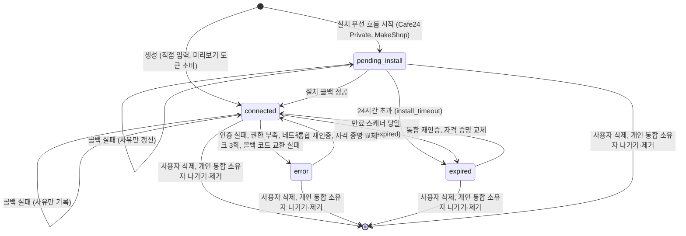

## 개요

이 문서는 [통합 상태와 만료 알림](CLE-INT-STATUS.md) 의 하위 문서로 통합 상태 값과 상태 사유, 상태 전이 규칙, OAuth 콜백 실패의 기록 규칙, Cafe24 Private 재설치 대기 표시와 상태의 관계를 정한다. 화면 표시와 주의 필요 판정은 [화면 표시와 주의 필요](CLE-INT-STATUS-DISPLAY.md), 만료 스캐너와 알림은 [만료 스캐너와 알림](CLE-INT-STATUS-SCAN.md) 이 정한다.

콜백 실패의 상태 보존 규칙([콜백 실패 기록](#콜백-실패-기록))과 재설치 대기 표시의 24시간 규칙([재설치 대기 표시](#재설치-대기-표시))은 이 문서가 정본이다. 다른 문서는 한 줄로 요약하고 이 문서를 링크한다(2026-11-14, NERV Task `CLE-T-ZCEZ46`).

## 상태 값과 상태 사유

| 상태 | 뜻 | 화면 라벨 |
| --- | --- | --- |
| `connected` | 연결됨. 노드와 AI 에이전트가 쓸 수 있다 | 연결됨(필터), `Connected`(배지) |
| `expired` | 만료됨 | 만료됨, `Expired` |
| `error` | 오류. 사유를 반드시 남긴다 | 오류, `Error` |
| `pending_install` | 설치 대기. Cafe24 Private 앱과 MakeShop ShopStore 설치 우선 흐름에서 설치가 끝나기 전 상태 | `Pending install`(배지), 필터 없음 |

설치 대기 통합은 노드와 AI 에이전트가 쓸 수 없다. 직결 노드는 `assertUsable` 의 상태 검사(`status !== 'connected'`)에 걸려 외부 호출 없이 `INTEGRATION_NOT_CONNECTED` 로 에러 포트에 가고([통합 노드 공통](../CLE-NODE-INT/CLE-NODE-INT-COMMON.md), [통합 노드 차단은 에러 포트로 보낸다](CLE-INT-STATUS.md#통합-노드-차단은-에러-포트로-보낸다-2026-11-13)), AI 에이전트는 내부 MCP 브리지가 연결되지 않은 통합의 도구를 노출하지 않아 호출도 에러 코드도 없다. 연결 테스트 endpoint 는 따로 `INTEGRATION_INCOMPLETE` 를 돌려준다([통합 관리](CLE-INT-MANAGE.md)). Cafe24 Private 은 사용자가 Cafe24 에서 «테스트 실행» 을 끝내야, MakeShop 은 상점에서 ShopStore 앱 설치가 끝나야 연결됨이 된다.

상태 사유 허용값은 코드 union `INTEGRATION_STATUS_REASONS`(`integration-status-reason.ts`) 한 곳이 기준이다. union 밖의 문자열은 `normalizeStatusReason` 이 `unknown_error` 로 바꾼다. 값은 모두 snake_case 이고 64자 이내다(`VARCHAR(64)`, V008).

| 상태 | 상태 사유 |
| --- | --- |
| `error` | `auth_failed`(401·403, 또는 토큰 갱신 `invalid_grant`), `insufficient_scope`(403 + 권한 부족 신호), `network`(transport 3회 연속 실패, `consecutive_network_failures` 카운터), `unknown_error`(분류 불가 대비값, 운영 알람 신호) |
| `expired` | `install_timeout`(설치 대기 24시간 초과, Cafe24 Private·MakeShop 공통), `token_expired`(refresh token 이 없는 통합의 만료 스캐너 당일 격하. 갱신 가능 통합은 격하하지 않는다) |
| `pending_install` | 콜백 실패 진단 단서(상태는 보존): `oauth_token_exchange_failed`, `oauth_state_invalid`, `oauth_state_mismatch`, `oauth_state_expired`, `oauth_provider_error`, `oauth_invalid_scope`(Cafe24 가 권한 범위를 거부), `oauth_preview_invalid`, `oauth_preview_expired`(union 예약값. 미리보기 토큰 소비 실패의 API 에러 코드와 같은 어휘) |
| `connected` | NULL. 예외는 콜백의 권한 범위 거부가 남기는 `oauth_invalid_scope` 하나다([콜백 실패 기록](#콜백-실패-기록)) |

- DB 저장값은 snake_case 이고, 같은 뜻의 API 에러 코드는 `OAUTH_*` UPPER_SNAKE_CASE 다. 대응은 [팝업 연결과 콜백 「에러 매핑」](CLE-INT-OAUTH-CALLBACK.md#에러-매핑) 에 있다. 설치 기한이 지나 만료된 행에 늦게 온 콜백의 `INTEGRATION_INSTALL_EXPIRED` 는 행에 사유를 남기지 않아 짝이 되는 저장값이 없다.
- `resource_not_found` 는 행 자체가 사라진 경우라 DB 를 갱신할 수 없어 허용값에 없다.
- `token_expired` 는 이 컬럼 전용이다. JWT 만료 REST 에러 `TOKEN_EXPIRED`, WebSocket 이벤트 `auth.token_expired` 와 표기가 비슷하지만 이름공간이 다르다.
- `hmac_verification_failed` 는 상태 사유가 아니다. union 에 없고 서버에는 이 값을 쓰는 경로가 없다([HMAC 검증 실패는 상태 사유로 남기지 않는다 (2026-11-13)](#hmac-검증-실패는-상태-사유로-남기지-않는다-2026-11-13)).

응답 전용 값 `credentials_unreadable`: 자격 증명을 복호화할 수 없는 행(암호화 키 교체 등)은 DB 를 바꾸지 않는다. API 응답을 만들 때(`toPublic`)만 `status='error'`, `statusReason='credentials_unreadable'`, `credentialsStatus='needs_reauth'` 로 보인다. union 에 없고 DB 에 저장하는 값이 아니다.

## 상태 전이

| 전이 | 트리거 |
| --- | --- |
| `pending_install` → `connected` | 설치 흐름의 HMAC 검증과 OAuth 콜백이 성공했다. 설치 토큰은 App URL 재호출의 식별 키라 보존한다 |
| `pending_install` → `expired` | 설치 토큰 발급 뒤 24시간 안에 콜백이 성공하지 않았다(`install_timeout`, [세부](#전이별-세부)) |
| `pending_install` → `pending_install` | OAuth 콜백 처리가 실패했다. 상태와 설치 토큰은 보존하고 사유와 `last_error` 만 갱신한다([콜백 실패 기록](#콜백-실패-기록)) |
| `connected` → `connected`(사유 기록) | 통합 재인증이나 추가 권한 요청의 콜백이 실패했고 `error(auth_failed)` 조건에 들지 않는다([콜백 실패 기록](#콜백-실패-기록)) |
| `connected` → `error(auth_failed)` | 토큰 갱신 `invalid_grant`, 외부 MCP 서버 인증 실패, 콜백 코드 교환 실패, Cafe24·MakeShop 클라이언트의 401·403([세부](#전이별-세부)) |
| `error`(다른 사유) → `error(auth_failed)` | 외부 MCP 서버 인증 실패, Cafe24·MakeShop 클라이언트의 401·403. 이미 `error(auth_failed)` 면 그대로다([MCP 클라이언트 — 에러 처리 「인증 실패 상태 전환」](CLE-INT-MCP-ERROR.md#인증-실패-상태-전환)) |
| `connected` → `error(insufficient_scope)` | 노드 실행 중 403 과 서비스별 권한 부족 신호를 받았다([세부](#전이별-세부)) |
| `connected` → `error(network)` | 노드 실행이나 토큰 갱신 중 transport 실패가 3회 연속 났다(`consecutive_network_failures`, V049) |
| `connected` → `expired(token_expired)` | refresh token 이 없는 통합의 토큰 만료 시각이 지나 만료 스캐너가 당일 임계에서 격하했다 |
| `expired`·`error` → `connected` | 통합 재인증 또는 자격 증명 교체가 성공했다(연결 테스트 통과, [세부](#전이별-세부)) |
| 모든 상태 → 삭제 | 사용자의 명시적 삭제와 개인 통합 소유자의 나가기·제거뿐이다([세부](#전이별-세부)) |

### 전이별 세부

- **설치 기한 만료**: `pending-install-ttl` 작업이 `status='expired'`, `status_reason='install_timeout'`, `install_token=NULL`, `mall_id=NULL` 로 바꾼다. 설치 토큰이 지워져 App URL 이 없으므로 Cafe24 Private·MakeShop 모두 통합 재인증으로 되살릴 수 없다. 화면은 통합 재인증 버튼을 막는다. 상점 식별자를 비우므로 사용자는 이 행을 지우지 않고 같은 상점을 새로 등록한다. 이름은 그대로라 같은 이름이면 409 `INTEGRATION_NAME_TAKEN` 이고 다른 이름으로 등록한다([만료된 설치 대기 행은 상점 자리를 놓는다](CLE-INT-OAUTH-PENDING.md#만료된-설치-대기-행은-상점-자리를-놓는다-2026-10-29)).
- **인증 실패**: `error(auth_failed)` 가 되는 경우는 다음과 같다.
  - 토큰 갱신에서 refresh token 자체가 무효(`invalid_grant`)다.
  - 외부 MCP 서버 호출이 인증 실패다.
  - 통합 재인증이나 추가 권한 요청의 콜백에서 코드 교환이 실패했고(`OAUTH_TOKEN_EXCHANGE_FAILED`) 유효한 재설치 대기 표시가 없다([콜백 실패 기록](#콜백-실패-기록)).
  - Cafe24·MakeShop 클라이언트가 401 뒤 토큰 갱신과 1회 재시도에도 401 을 받았거나 403 을 받았다(`markAuthFailed`).
  - 그 밖의 서비스(HTTP·Database·Email) 노드 실행 중 401·403 이 상태를 바꾸는지는 정의가 갈린다. [미결 사항](CLE-INT-STATUS.md#미결-사항) 참조.
- **권한 부족**: 지금 이 신호를 감지해 전이하는 실행 경로는 Cafe24(`cafe24-api.client.ts`, `cafe24-mcp-tool-provider.ts`)뿐이다. HTTP·Database·Email 핸들러로 넓히는 일은 미구현이다.
- **네트워크**: Cafe24·MakeShop 클라이언트의 `recordNetworkFailure` 가 판정한다.
- **복구**: OAuth 가 아닌 통합은 통합 재인증이 OAuth 왕복 없이 바로 연결됨으로 되돌린다. Cafe24 Private 은 설치 토큰이 있으면 통합 재인증이 [재설치 대기 표시](#재설치-대기-표시)를 남기고 사용자가 24시간 안에 «테스트 실행» 으로 OAuth 를 마쳐야 연결됨이 된다. 설치 토큰이 없는 Cafe24 Private 행과 MakeShop 통합은 통합 재인증이 없어 삭제 후 재등록으로 복구한다([MakeShop 은 삭제 후 재등록으로만 복구한다](CLE-INT-OAUTH-REAUTH.md#makeshop-은-삭제-후-재등록으로만-복구한다)). 설치 기한이 지나 만료된 행은 이 전이를 거치지 않고 지우지 않은 채 새로 등록한다. 내부 MCP 브리지가 `expired` 통합을 스스로 되살리는지는 [미결 사항](CLE-INT-STATUS.md#미결-사항) 이다.
- **삭제**: 사용자가 명시적으로 삭제했을 때와 개인 통합의 통합 소유자가 워크스페이스를 나가거나 제거됐을 때뿐이다([개인 통합 소유자의 나가기·제거는 자동 삭제의 예외다](CLE-INT-STATUS.md#개인-통합-소유자의-나가기제거는-자동-삭제의-예외다-2026-10-29)). 시간이나 상태로 지우는 자동 삭제는 없다. 설치 대기 24시간 초과도 `expired` 로만 바꾼다.

`error` 상태에서는 반드시 상태 사유를 기록한다. 토큰 갱신 실패는 `expired` 가 아니라 `error(auth_failed)` 로 바꾼다. 그래서 `expired` 가 되는 경로는 두 가지뿐이다. refresh token 이 없는 통합의 `token_expired` 와 설치 대기의 `install_timeout` 이다. Cafe24 는 refresh token 을 가지므로 Cafe24 의 `expired` 는 사실상 `install_timeout` 하나만 남는다.

## 콜백 실패 기록

OAuth 콜백 처리가 실패하면 `markIntegrationCallbackError` 가 그 행에 `last_error`(`{ code, message, at, details? }`)를 남기고 상태와 상태 사유를 행의 상태와 에러 코드에 따라 다룬다. 콜백 실패는 재설치 대기 표시를 지우지 않는다.

| 행 | 에러 코드 | 상태 | 상태 사유 |
| --- | --- | --- | --- |
| 설치 대기 | 모든 코드 | 그대로 | 에러 코드를 소문자 snake_case 로 바꾼 값. union 밖이면 `unknown_error` |
| 연결됨, 유효한 재설치 대기 표시 없음 | `OAUTH_TOKEN_EXCHANGE_FAILED` | `error` | `auth_failed` |
| 연결됨, 유효한 재설치 대기 표시 있음 | `OAUTH_TOKEN_EXCHANGE_FAILED` | 그대로 | 그대로 |
| 연결됨 | `OAUTH_INVALID_SCOPE` | 그대로 | `oauth_invalid_scope` |
| 연결됨 | 그 밖의 코드 | 그대로 | 그대로 |
| 오류·만료됨 | 모든 코드 | 그대로 | 그대로 |

- 재설치 대기 표시가 기록 결과를 바꾸는 경우는 연결됨 행의 코드 교환 실패 하나다. 표시를 남긴 지 24시간이 지났으면 표시가 없는 행과 같이 처리한다. 설치 대기의 콜백 실패가 상태를 보존하는 것과 같은 원칙이다([설치 대기의 콜백 실패는 상태를 보존한다](#설치-대기의-콜백-실패는-상태를-보존한다)).
- 토큰 교환 중의 네트워크 오류와 시간 초과도 `OAUTH_TOKEN_EXCHANGE_FAILED` 로 기록한다. 그래서 유효한 표시가 없는 연결됨 행은 transport 실패 한 번에 `error(auth_failed)` 가 되고 `error(network)` 의 3회 연속 규칙을 따르지 않는다. 콜백은 자동으로 다시 시도하지 않는 한 번의 교환이고 복구하려면 사용자가 통합 재인증을 다시 시작해야 한다. 지금 동작을 적었고 바꾸지 않았다.
- 연결됨 행이 `error(auth_failed)` 로 바뀌면 행을 저장한 뒤 조치 필요 알림을 보낸다. 상태가 바뀌지 않는 기록은 알림을 보내지 않는다([만료 스캐너와 알림](CLE-INT-STATUS-SCAN.md#알림)).
- 권한 범위 거부(`OAUTH_INVALID_SCOPE`)는 `last_error.details.requiresCafe24Approval` 을 함께 남긴다([Cafe24 별도 승인 scope](CLE-C24-SCOPES)). 주의 필요 판정은 상태만 보므로 이 연결됨 행은 주의 필요에 들어가지 않는다. 다음 콜백이 성공하면 사유와 `last_error` 가 NULL 로 돌아간다.
- 기록하지 않는 경우: state 를 소비하기 전의 실패는 통합을 알 수 없다. 설치 기한이 지나 만료된 행(`install_timeout`)과, 콜백 재판정에서 요청자가 볼 수 없는 행이라 404 로 거절한 콜백(`CallbackContext.recordable: false`)은 행에 아무것도 쓰지 않는다. 행이 사라졌으면 쓸 곳이 없다.
- 에러마다 팝업에 보이는 문구는 [팝업 연결과 콜백 「에러 매핑」](CLE-INT-OAUTH-CALLBACK.md#에러-매핑) 이 정한다.

## 재설치 대기 표시

재설치 대기 표시(reinstall request mark)는 설치를 마친 Cafe24 Private 통합이 통합 재인증이나 추가 권한 요청을 받았고 사용자가 Cafe24 개발자 센터에서 «테스트 실행» 을 마치기를 기다린다는 표시다. `integration.reinstall_requested_at`(TIMESTAMPTZ NULL, V151) 컬럼 하나로 두고 API 응답에는 `reinstallRequestedAt`(ISO 8601 또는 `null`)으로 나간다. 표시는 남긴 시각부터 24시간 동안만 유효하다. 컬럼 정의는 [엔티티와 인덱스](CLE-INT-DATA-ENTITY.md#통합-integration), 표시를 남기는 엔드포인트와 App URL 분기는 [재인증과 추가 권한 요청](CLE-INT-OAUTH-REAUTH.md#재설치-대기-표시)이 정한다.

- **상태와 따로 둔다**: 표시는 통합 상태도 상태 사유도 아니다. 표시를 남겨도 상태·상태 사유·토큰은 그대로다. 연결됨 행은 계속 연결됨이라 노드와 AI 에이전트가 기존 토큰으로 계속 쓴다. 오류·만료됨 행은 표시가 있어도 «테스트 실행» 으로 콜백이 성공하기 전까지 노드 실행이 막힌다. 상태 사유 union(`INTEGRATION_STATUS_REASONS`)에 값을 더하지 않는다.
- **설치 대기와 다르다**: 설치 대기(`pending_install`)는 아직 한 번도 연결되지 않은 행의 상태다. 재설치 대기 표시는 설치를 마친 행(연결됨·오류·만료됨)에 붙는다. 설치 대기 행에는 표시를 남기지 않는다.
- **지우는 경로는 둘이다**: 콜백 성공과 통합 삭제다. 콜백이 성공하면 자격 증명 교체와 같은 트랜잭션에서 표시를 지우고 상태는 `connected`, 사유와 `last_error` 는 NULL 이 된다. 콜백이 실패하면 표시를 지우지 않는다.
- **콜백 실패**: 기록 규칙은 [콜백 실패 기록](#콜백-실패-기록)을 따른다. 유효한 표시가 있는 연결됨 행은 코드 교환이 실패해도 `error(auth_failed)` 로 바뀌지 않는다.
- **24시간 동안만 유효하다**: 서버는 표시를 남긴 시각부터 24시간이 지나면 표시가 없는 것으로 본다. 경계는 닫혀 있어 정확히 24시간이 지난 표시도 무효다. 설치 대기의 24시간과 같은 값이다(`REINSTALL_REQUEST_TTL_HOURS`). 표시를 읽는 곳(App URL 분기, 콜백 재판정과 실패 기록, 조회 응답)은 모두 같은 판정 함수 `isReinstallRequestActive` 를 쓴다. 24시간이 지나면 App URL 은 그 행을 상세 화면으로 보내고, 콜백은 요청자 인가를 다시 판정하며, 콜백 실패도 상태를 보존하지 않는다. 응답의 `reinstallRequestedAt` 은 `null` 이다. 지난 값을 지우는 작업은 없고 컬럼에 값이 남아도 판정에서 무시한다. 표시를 취소하는 경로도 따로 없다. 사용자가 통합 재인증이나 추가 권한 요청을 다시 하면 새 시각으로 다시 남긴다.
- **콜백은 요청자를 다시 판정하지 않는다**: 유효한 표시가 있는 Cafe24 Private 행의 콜백은 커밋 직전 요청자 인가 재판정(가시성·역할)을 건너뛴다. App URL 이 만든 state 의 `user_id` 가 요청자가 아니라 통합 소유자(`created_by`)라 다시 판정할 요청자가 없다. 그래서 표시를 남긴 요청자가 그 24시간 안에 강등되거나 워크스페이스를 나가도 콜백은 자격 증명을 바꾼다. 이것은 받아들인 잔여 위험이다([재설치 대기 표시 동안의 콜백은 요청자를 다시 판정하지 않는다 (2026-11-14)](#재설치-대기-표시-동안의-콜백은-요청자를-다시-판정하지-않는다-2026-11-14)). 표시를 남기는 입구가 Cafe24 Private 뿐이라 Cafe24 Public 행과 MakeShop 행은 표시 값과 상관없이 다시 판정한다.
- **주의 필요와 알림에 넣지 않는다**: 주의 필요 술어(`attention`·`expiring`), 사이드바 배지, 만료 알림, 조치 필요 알림은 표시를 보지 않는다. 표시가 있는 오류·만료됨 행은 상태 때문에 주의 필요에 들어가고 표시가 있는 연결됨 행은 들어가지 않는다. 화면은 상세 머리 아래의 재설치 대기 안내로만 알린다([통합 관리](CLE-INT-MANAGE.md#상세-페이지)). 알림 쪽 규칙은 [만료 스캐너와 알림](CLE-INT-STATUS-SCAN.md#알림) 이 정한다.

## 구현 위치

- `codebase/backend/src/modules/integrations/integration-status-reason.ts` (상태 사유 union)
- `codebase/backend/migrations/V151__integration_reinstall_requested_at.sql`, `codebase/backend/src/modules/integrations/entities/integration.entity.ts` (재설치 대기 표시 `reinstallRequestedAt`)
- `codebase/backend/src/modules/integrations/reinstall-request.ts` (표시의 24시간 유효 판정 `isReinstallRequestActive`, `isCafe24PrivateRow`)
- `codebase/backend/src/modules/integrations/integration-oauth.service.ts` (`markIntegrationCallbackError` 콜백 실패 기록, `assertRequesterStillAllowed` 콜백 재판정, `persistReauthorizeState` App URL 의 state)
- `codebase/backend/src/modules/integrations/cafe24-store-rows.ts` (`hasReleasedStoreSlot`: 설치 기한이 지나 만료된 행 판정)
- `codebase/backend/src/nodes/integration/cafe24/`, `codebase/backend/src/nodes/integration/makeshop/` (`markAuthFailed`·`recordNetworkFailure`)

## Rationale

### 설치 대기의 콜백 실패는 상태를 보존한다

설치 대기 통합이 콜백 처리 중 토큰 교환 실패 등으로 실패하면 자연스러운 선택은 `error(auth_failed)` 다. 그러나 Cafe24 Private 앱은 통합 재인증을 할 수 없다. OAuth 재시작의 정식 진입점은 Cafe24 개발자 센터의 «테스트 실행» 뿐이고, 그 진입점은 우리가 발급한 설치 토큰을 경로에 그대로 쓴다. 상태를 `error` 로 바꾸면 화면이 효과 없는 «통합 재인증» 을 권하고, 사용자가 Cafe24 쪽 설정을 고치고 다시 «테스트 실행» 을 누르는 외부 흐름을 «오류» 로 보여 단계를 잘못 알게 한다. 그래서 콜백 실패는 사유와 `last_error` 만 채우고 상태는 설치 대기로 둔다.

사유 저장값은 콜백 에러 코드를 snake_case 로 쓴다. DB 컬럼 표기(`auth_failed`, `token_expired` 등)가 모두 snake_case 라서다. API 응답과 콜백 HTML 의 에러 코드는 HTTP 관례대로 `OAUTH_*`·`CAFE24_*` UPPER_SNAKE_CASE 로 둔다.

`last_error.code` 와 `status_reason` 이 같은 값을 중복으로 담는 이유는 `last_error` 가 JSONB 라 보존 정책(예: GDPR)에 따라 지워질 수 있어서다. `status_reason` 은 가벼운 문자열 컬럼으로 «왜 이 상태인가» 의 핵심 신호를 남긴다. 분류 코드만 담아 민감 정보가 없으므로 평문으로 둔다.

2026-10-10 부터 설치를 마친 Cafe24 Private 행은 재설치 대기 표시를 거쳐 통합 재인증을 할 수 있다. 설치 대기 행은 여전히 «테스트 실행» 이 유일한 진입점이라 이 결정은 그대로다. 유효한 재설치 대기 표시가 있는 연결됨 행의 코드 교환 실패도 같은 원칙으로 상태를 보존한다. 기존 토큰이 살아 있어 실행이 계속되고 사용자는 «테스트 실행» 으로 다시 시도하면 된다. 이 행을 `error(auth_failed)` 로 바꾸면 멀쩡히 도는 실행을 막고 다시 시도할 길을 오류로 보이게 한다. 표시가 24시간을 넘기면 이 예외도 끝난다.

### 설치 대기는 24시간 뒤 만료된다

예전 정의는 설치 시간 초과 때 행을 삭제했는데, `expired`(`install_timeout`)로 바꾸는 쪽으로 번복했다. 데이터 분석과 감사에는 보존이 낫고, 사용자가 만료된 행을 보고 «왜 설치가 안 됐는지» 진단할 단서가 남아야 한다. 만료로는 행을 지우지 않는다. 행은 사용자가 지울 때와 개인 통합의 통합 소유자가 워크스페이스를 나가거나 제거될 때 지워진다([통합 관리](CLE-INT-MANAGE.md#나간-멤버의-개인-통합은-나갈-때-지운다-2026-10-29)).

Cafe24 개발자 센터 앱 등록부터 «테스트 실행» 까지의 사용자 작업을 최대 하루로 본다. 더 길면 오래된 설치 대기 행이 쌓여 설치 토큰 조회 성능과 주의 필요 카운트에 잡음이 된다. 더 짧으면 점심, 회의, 휴일로 작업이 나뉘는 정상 흐름이 끊긴다.

만료 기준은 `created_at` 이 아니라 설치 토큰 발급 시각(`install_token_issued_at`, V044)이다. 같은 상점으로 `oauth/begin` 을 다시 부르면 요청자가 그 행을 바꿀 수 있을 때 기존 행을 재사용한다([설치 대기 행 재사용의 권한](CLE-INT-OAUTH-PENDING.md#설치-대기-행-재사용의-권한)). 이때 설치 토큰을 새로 발급하는 조건은 [연결 시작(begin) 「`oauth/begin` 요청과 응답」](CLE-INT-OAUTH-BEGIN.md#oauthbegin-요청과-응답) 이 정하고 MakeShop 쪽은 [설치 대기 행 재사용](CLE-INT-OAUTH-PENDING.md#미결-사항) 의 미결 사항에 있다. 행 생성 시각을 기준으로 하면 새 토큰이 발급되자마자 24시간이 이미 끝나 있을 수 있다. 연결 성공 뒤에도 설치 토큰과 발급 시각은 보존된다. 스캐너는 설치 대기 행만 보므로 연결 뒤의 값이 잘못된 만료 처리에 영향을 주지 않는다. NULL 은 만료 경로에서만 생긴다. V044 이전 행은 발급 시각이 NULL 이라 스캐너가 `created_at` 으로 대신 판정한다.

2026-10-29 부터 만료할 때 상점 식별자(`mall_id`)도 비운다. 행을 남겨도 상점 식별자 UNIQUE 를 계속 잡으면 같은 상점을 다시 등록할 수 없었다. 남의 개인 행이면 지울 수 있는 사람도 통합 소유자뿐이었다. 이미 만료된 행은 배포 때 V154 가 한 번 비웠다. 결정과 기각한 안은 [만료된 설치 대기 행은 상점 자리를 놓는다](CLE-INT-OAUTH-PENDING.md#만료된-설치-대기-행은-상점-자리를-놓는다-2026-10-29) 에 있다.

### 재설치 대기 표시는 상태와 따로 둔 컬럼이다

2026-10-10 에 Cafe24 Private 의 통합 재인증과 추가 권한 요청을 «테스트 실행» 으로 마치게 하면서 «이 행은 App URL 이 OAuth 로 보내야 한다» 는 사실을 어디에 둘지 정해야 했다. 상태 기계를 건드리지 않는 nullable 시각 컬럼 `reinstall_requested_at` 을 택했다. 시각이라 화면이 «요청 시각» 을 보일 수 있고 서버가 유효 기간을 판정할 수 있다. 기각한 안은 셋이다.

- **`status='pending_install'` 재사용**: `pending-install-ttl` 작업이 24시간 뒤 `install_timeout` 으로 바꾸고 설치 토큰을 지운다. 연결되지 않은 통합의 노드 실행과 AI 에이전트 도구가 막히는 규칙 때문에 기존 토큰으로 돌던 실행이 끊긴다. 상태 전이 표에도 연결됨에서 설치 대기로 가는 전이가 없다.
- **연결됨에 새 상태 사유**: `connected` 의 사유는 NULL 이라는 상태 사유 표와 닫힌 union `INTEGRATION_STATUS_REASONS` 를 넓혀야 한다. 오류·만료됨 행에 같은 방식을 쓰면 기존 사유(`auth_failed` 등)를 덮어 진단 단서가 사라진다. 2026-11-13 에 연결됨 행도 콜백 진단 사유 `oauth_invalid_scope` 를 가질 수 있다고 표를 고쳤지만 이 기각은 그대로다([연결됨 행의 콜백 실패는 사유만 남긴다 (2026-11-13)](#연결됨-행의-콜백-실패는-사유만-남긴다-2026-11-13)).
- **새 상태 값**: «DB 상태 enum 은 넓히지 않는다» 는 [주의 필요를 가상 필터 값 하나로 노출한다](CLE-INT-STATUS-DISPLAY.md#주의-필요를-가상-필터-값-하나로-노출한다) 의 원칙과 맞지 않는다. 주의 필요 술어, 만료 스캐너, 노드 실행 가드처럼 상태로 나뉘는 분기를 모두 다시 따져야 한다.

표시는 남긴 시각부터 24시간 동안만 유효하다. 요청만 하고 «테스트 실행» 을 하지 않은 행이 App URL 을 계속 동의 화면으로 보내거나 상세 화면의 안내를 계속 띄우지 않게 하려는 것이다. 표시가 유효한 동안 콜백이 요청자 인가 재판정을 건너뛰므로 그 창을 설치 대기와 같은 24시간 경계로 묶는다([재설치 대기 표시 동안의 콜백은 요청자를 다시 판정하지 않는다 (2026-11-14)](#재설치-대기-표시-동안의-콜백은-요청자를-다시-판정하지-않는다-2026-11-14)). 처음 초안은 표시에 만료를 두지 않았으나 이 두 문제 때문에 24시간으로 바꿨다(2026-10-10).

### `oauth_token_exchange_failed` 는 로그인 도메인의 `token_exchange_failed` 와 다른 신호다

소셜 로그인 흐름의 URL 파라미터 `error=token_exchange_failed` 와 통합 콜백의 `status_reason='oauth_token_exchange_failed'` 는 도메인이 다르다. 앞쪽은 사용자 인증, 뒤쪽은 통합 자격 증명이다. grep 과 색인에서 도메인이 바로 드러나도록 `oauth_` prefix 를 일부러 붙였다. 이름을 합치지 않는다.

### 토큰 갱신 실패는 `error(auth_failed)` 로 통일한다

예전 정의는 «connected → expired (refresh fail)» 로 적었지만 구현은 `error(auth_failed)` 로 바꿨다. 화면 분기, 통합 재인증 안내 문구, 알림 발사 정책이 어긋났다. `error(auth_failed)` 로 정하고 `expired (refresh_failed)` 분기는 없앴다. 이 변경은 refresh token 을 가진 서비스의 갱신 실패 경로에만 영향을 주고, `connected-expiry` 스캐너의 토큰 만료 처리는 그대로다.

- 화면이 통합 재인증을 권하기에 `error` 가 자연스럽다. `expired` 는 «자동 재발급을 해 보고 만료» 라는 뜻이 강해 사용자의 통합 재인증이 필요한 refresh token 만료와 어긋난다.
- refresh token 자체의 만료(사용자 조치 필요)와 access token 만료(갱신으로 복구 가능)를 뜻으로 구분해 둔다. 앞쪽은 `error(auth_failed)`, 뒤쪽은 refresh token 이 없는 일반 OAuth 서비스의 `expired` 다.
- transport 3회 실패 `error(network)` 와 같은 `error(*)` 영역에서 일관되게 분류된다.

데이터 모델은 바뀌지 않고 사유 값 정의만 바뀌었다. `expired` 사유에서 `refresh_failed` 를 빼고 `error` 사유에 `auth_failed`·`insufficient_scope`·`network` 를 두며, `token_expired` 는 refresh token 이 없는 서비스의 `expired` 용으로 남긴다. 알림은 수동성과 능동성으로 나눈다. `expired` 중 `token_expired` 경로에만 만료 알림을 보내고, `error(*)` 전이에는 조치 필요 알림을 보낸다. `install_timeout` 도 `expired` 전이지만 알림을 보내지 않는다([`install_timeout` 에는 알림을 보내지 않는다](CLE-INT-STATUS-SCAN.md#install_timeout-에는-알림을-보내지-않는다)).

«화면이 통합 재인증을 권한다» 는 서버가 통합 재인증을 시작할 수 있는 서비스에 한한다. MakeShop 은 `error(auth_failed)` 가 되면 삭제 후 재등록으로 복구하고 화면도 그렇게 안내한다. Cafe24 Private 은 설치 토큰이 있으면 재설치 대기 표시를 거친 통합 재인증으로 복구한다(2026-10-10). 사유 값은 그대로 `auth_failed` 다.

### 설치 기한이 지나 만료된 행은 지우지 않고 다시 등록하라고 안내한다 (2026-10-30)

MakeShop 복구 안내 요구사항은 처음에 MakeShop 통합이 오류나 만료됨이 되면 삭제 후 재등록을 안내한다고 정했다. 2026-10-29 부터 설치 기한이 지나 만료된 행은 상점 자리를 놓으므로 지우지 않아도 같은 상점을 새로 등록할 수 있다. 2026-10-30 에 화면 안내를 이 동작에 맞추면서 그 안내를 두 경우로 나눴다. 오류나 다른 사유로 만료된 MakeShop 행은 상점 자리를 잡고 있어 그대로 삭제 후 재등록이다. 화면은 설치 기한 만료를 MakeShop 여부보다 먼저 판정한다. 결정과 비용(지우지 않은 만료 행이 주의 필요에 남는 것)은 [만료된 설치 대기 행은 상점 자리를 놓는다](CLE-INT-OAUTH-PENDING.md#만료된-설치-대기-행은-상점-자리를-놓는다-2026-10-29) 의 2026-10-30 번복에 있다.

### 연결됨 행의 콜백 실패는 사유만 남긴다 (2026-11-13)

상태 사유 표는 연결됨 행의 사유를 NULL 로만 적었고 상태 전이 표에는 연결됨 행의 콜백 실패가 없었다. 구현(`markIntegrationCallbackError`)은 통합 재인증이나 추가 권한 요청의 콜백에서 Cafe24 가 권한 범위를 거부하면(`OAUTH_INVALID_SCOPE`) 상태를 그대로 두고 사유를 `oauth_invalid_scope` 로 남긴다. 2026-11-13 에 이 동작을 상태 사유 표와 상태 전이 표에 적었고 2026-11-14 에 [콜백 실패 기록](#콜백-실패-기록) 절로 모았다. 동작은 바꾸지 않았다.

- **상태를 바꾸지 않는 이유**: 권한 범위 거부는 Cafe24 의 별도 승인이 필요한 권한 범위를 요청했다는 뜻이고 기존 토큰은 그대로 살아 있다. 노드 실행을 막을 까닭이 없다. 상세 화면은 이 사유와 `last_error.details.requiresCafe24Approval` 로 별도 승인 안내를 보이고 사용자는 승인을 받은 뒤 다시 시도한다([Cafe24 별도 승인 scope](CLE-C24-SCOPES)).
- **코드 교환 실패와의 차이**: 코드 교환 실패를 `error(auth_failed)` 로 바꾸는 것은 원문 통합 화면 정의의 콜백 실패 규칙을 따른 것이다. 유효한 재설치 대기 표시가 있는 행을 빼는 것은 «설치 대기의 콜백 실패는 상태를 보존한다» 의 2026-10-10 단락이 정했다.
- **기각한 안과의 관계**: «재설치 대기 표시는 상태와 따로 둔 컬럼이다» 에서 기각한 «연결됨에 새 상태 사유» 는 재설치 대기를 사유로 나타내려고 union 을 넓히는 안이었다. `oauth_invalid_scope` 는 이미 union 에 있는 콜백 진단 값이고 재설치 대기를 뜻하지 않으므로 그 기각과 어긋나지 않는다.

### HMAC 검증 실패는 상태 사유로 남기지 않는다 (2026-11-13)

MakeShop 설치 안내 화면의 프런트엔드 훅(`use-makeshop-pending-polling.ts`)은 `hmac_verification_failed` 를 i18n 문구로 매핑하지만 이 값은 union `INTEGRATION_STATUS_REASONS` 에 없다. 2026-11-13 에 서버 동작을 확인해 이 미결 항목을 닫았다. MakeShop 설치 요청의 HMAC 검증이 실패하면 서버는 행을 쓰지 않고 403 `MAKESHOP_INSTALL_INVALID_HMAC` 으로 거절한다. 그래서 이 값을 상태 사유로 저장하는 경로가 없고 union 에 더해도 쓰는 곳이 없다. 스펙은 union 과 `normalizeStatusReason` 을 기준으로 두고 이 값을 상태 사유로 적지 않는다.

- 고치지 않은 이유: 프런트엔드 훅의 `hmac_verification_failed` 매핑은 서버가 이 값을 내보내지 않아 닿지 않는 분기라 지워도 동작이 바뀌지 않는다. 스펙만 구현에 맞추고 매핑을 지우는 일은 NERV Task `CLE-T-22PSME` 가 맡는다.

### 재설치 대기 표시 동안의 콜백은 요청자를 다시 판정하지 않는다 (2026-11-14)

유효한 재설치 대기 표시가 있는 Cafe24 Private 행의 콜백은 커밋 직전 요청자 인가 재판정을 건너뛴다(`assertRequesterStillAllowed`). App URL 이 만든 state 의 `user_id` 는 그 행의 통합 소유자(`created_by`, `persistReauthorizeState`)라서 «테스트 실행» 을 누른 사람도, 표시를 남긴 사람도 알 수 없다. 건너뛰지 않으면 통합 소유자가 강등된 조직 통합에서 관리자가 요청한 재설치가 `ADMIN_REQUIRED` 로 실패한다. 그 대가로 표시를 남긴 요청자가 그 24시간 안에 강등되거나 워크스페이스를 나가도 콜백은 자격 증명을 새 토큰으로 바꾼다. 2026-11-14 에 사람이 이 잔여 위험을 받아들이고 코드를 그대로 두기로 정했다(NERV Task `CLE-T-EMB185`).

받아들인 근거:

- 표시를 남길 때 이미 판정했다. `:id/reauthorize`·`:id/request-scopes` 는 가시성과 관리자 판정(404·403)을 통과한 요청에만 표시를 남긴다.
- 창은 24시간을 넘지 않는다. 24시간이 지나면 표시가 무효가 되고 콜백이 요청자를 다시 판정한다.
- 콜백은 앱 설치 HMAC 으로 인가된다. App URL 은 그 행의 `client_secret` 으로 HMAC 을 검증한 뒤에만 state 를 만든다. «테스트 실행» 은 Cafe24 개발자 센터에서 그 앱을 다루는 사람만 누를 수 있다.

기각한 대안: 표시를 남긴 요청자를 행에 저장하고 콜백에서 그 사람을 다시 판정하는 안. 요청자 컬럼 마이그레이션, 엔티티, `:id/reauthorize`·`:id/request-scopes` 의 저장, 콜백 재판정, 표시 해제를 모두 바꿔야 한다. 남는 위험이 24시간 창과 HMAC 인가 안에 있어 그 비용을 들이지 않는다.
