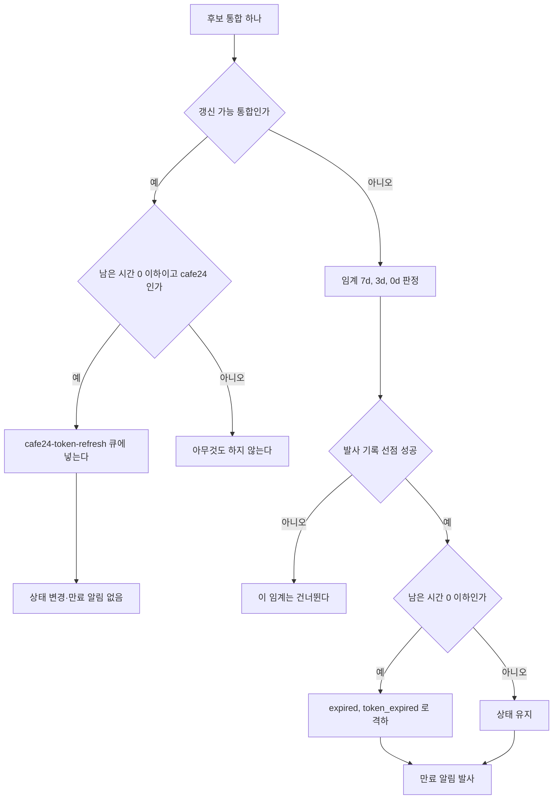

## 개요

이 문서는 [통합 상태와 만료 알림](CLE-INT-STATUS.md) 의 하위 문서로 만료 스캐너(`integration-expiry-scanner`)의 네 작업과 만료 알림(`integration_expired`) · 조치 필요 알림(`integration_action_required`)의 발사 조건 · 문구 · 수신자 · 채널을 정한다. 인앱 알림 저장, 채널 계산 헬퍼, 중복 방지 헬퍼, 알림 설정 화면은 [알림](../CLE-OBS/CLE-OBS-NOTIFY.md) 이 정한다.

## 만료 스캐너

만료 스캐너는 `integration-expiry-scanner` 큐 위의 네 독립 BullMQ 작업이다. 작업마다 재시도(`attempts: 3`, 60초 지수 backoff)와 큐 메트릭을 따로 가지므로 한 작업의 실패가 다른 작업을 막지 않는다. `process(job)` 는 `job.name` 으로 나누기만 하고 에러를 그대로 던진다. 3회를 넘긴 실패는 큐의 failed 목록에 30일 남아 알람이 가져갈 수 있다. 각 작업은 대상을 골라 처리하거나 갱신 큐에 넣기만 하고, 실제 토큰 갱신은 갱신 큐의 워커가 한다([OAuth 연결과 토큰 갱신](CLE-INT-OAUTH.md)). 옛 단일 `integration-expiry-daily` 스케줄러는 `onModuleInit` 에서 `removeJobScheduler` 로 지운다(멱등). 네 작업 모두 재설치 대기 표시를 보지도 바꾸지도 않는다. 24시간이 지난 표시도 지우지 않는다.

| 작업 | 스케줄러 ID | 주기 | 대상 | 동작 |
| --- | --- | --- | --- | --- |
| `connected-expiry` | `connected-expiry-daily` | 매일 `0 0 * * *` UTC | `status NOT IN (expired, error, pending_install) AND token_expires_at IS NOT NULL AND token_expires_at <= now+7d` | 아래 흐름 |
| `pending-install-ttl` | `pending-install-ttl-daily` | 매일 `0 0 * * *` UTC | `status='pending_install' AND COALESCE(install_token_issued_at, created_at) < now-24h`. 서비스 유형 조건이 없다(Cafe24 Private·MakeShop 공통) | `status='expired', status_reason='install_timeout', install_token=NULL, mall_id=NULL` 로 한 번의 bulk UPDATE. 알림은 보내지 않는다 |
| `usage-log-prune` | `usage-log-prune-daily` | 매일 `0 0 * * *` UTC | `integration_usage_log.at < now-90d` | 행 삭제(보존 정책) |
| `cafe24-background-refresh` | `cafe24-background-refresh-daily` (이름만 옛것, 실제 6시간) | 6시간 `0 */6 * * *` UTC | `status='connected' AND service_type='cafe24' AND (last_rotated_at < now-7d OR last_rotated_at IS NULL)` | `cafe24-token-refresh` 큐에 `jobId = integrationId` 로 넣는다(source `background`). 14일 동안 쓰지 않은 Cafe24 통합의 refresh token 도 갱신한다 |

`pending-install-ttl` 의 격리 수준은 PostgreSQL 기본 READ COMMITTED 와 UPDATE … WHERE 의 행 단위 쓰기 잠금으로 충분하다. WHERE 절이 행 단위로 맞고 `pending_install → expired` 전이는 멱등이다(이미 만료된 행은 상태 조건에서 빠진다). cron 과 수동 호출이 동시에 돌아 한 주기의 행을 나눠 처리해도 최종 상태는 같다. SERIALIZABLE 이나 advisory lock 은 필요 없다.

### `connected-expiry` 흐름

갱신 가능 통합(`isRefreshCapable`)은 `service_type ∈ {cafe24, makeshop}` 이면서 `credentials.refresh_token` 이 있는 통합이다. 이 판정은 화면용 자동 갱신 표시(`autoRefresh`)와 대상이 다르다. Google 은 자동 갱신 표시는 true 지만 갱신 가능 통합이 아니다. [미결 사항](CLE-INT-STATUS.md#미결-사항) 참조.

- 갱신 가능 통합은 상태를 낮추지 않고 만료 알림도, 발사 기록 선점도 하지 않는다. Cafe24 는 남은 시간이 0 이하면 `cafe24-token-refresh` 큐에 넣는다(`jobId` 중복 제거, `cafe24-background-refresh` 와 같은 경로의 안전망). MakeShop 은 큐에 넣지 않고 호출 직전 갱신과 401 뒤 갱신에 맡긴다. 갱신이 실패하면 갱신 워커(`Cafe24TokenRefreshProcessor`)나 호출 경로가 `error(auth_failed)`·`error(network)` 로 바꾸고, 그때 조치 필요 알림이 나간다. 이 작업은 상태를 바꾸지 않는다.
- refresh token 이 없는 통합은 임계(7d·3d·0d)마다 `integration_expiry_dispatch` 에 `INSERT … ON CONFLICT DO NOTHING` 으로 선점하고, 선점에 성공한 경우만 알림을 보낸다. 당일(0d)이면 `status='expired', status_reason='token_expired'` 로 바꾼다.
- MakeShop 에는 `cafe24-background-refresh` 같은 배경 갱신 작업이 없다. refresh token 수명이 30~90일로 충분히 길어 호출 직전 갱신과 401 뒤 갱신으로 덮인다([MakeShop 노드](../CLE-NODE-INT/CLE-NODE-MAKESHOP.md)). 그래도 갱신 가능 통합으로 취급하므로 access token 만 만료된 MakeShop 통합이 `expired` 로 잘못 바뀌거나 만료 알림을 받지 않는다.
- 외부 MCP 서버 통합은 refresh token 흐름이 아니라 `token_expires_at` 이 항상 NULL 이므로 이 작업 대상이 아니다. 인증 실패는 노드 실행 시점에 `error(auth_failed)` 로 바뀌고 사용자는 자격 증명 교체로 토큰을 바꾼다([MCP 클라이언트](CLE-INT-MCP.md)).

## 알림

두 인앱 알림 종류를 쓴다. 나누는 기준은 «사용자가 기다리면 되는가, 지금 손봐야 하는가» 다. 재설치 대기 표시를 남기거나 지울 때는 어느 알림도 보내지 않는다.

### 만료 알림 (`integration_expired`)

| 상황 | 제목 | 메시지 | 수신자 |
| --- | --- | --- | --- |
| 7일 전 | `Integration expiring soon` | `"<name>" will expire on <date>.` | 개인 통합: 통합 소유자 / 조직 통합: 관리자 전원 |
| 3일 전 | `Integration expiring in 3 days` | 같음 | 같음 |
| 당일 | `Integration expired` | `"<name>" has expired. Reauthorize to continue using it.` | 같음 |
| 통합 재인증 실패 (미구현) | `Reauthorization failed` | `Failed to reauthorize "<name>".` | 같음 |

- 발사 조건: refresh token 이 없는 통합의 토큰 만료(`status_reason='token_expired'` 경로)에서 위 7일·3일·당일 임계에만 보낸다. 갱신 가능 통합에는 보내지 않는다.
- 중복 방지: `integration_expiry_dispatch` 의 `UNIQUE (integration_id, threshold, token_expires_at)`(V009)로 임계마다 같은 만료 시각에 한 번만 보낸다. 통합 재인증으로 `token_expires_at` 이 바뀌면 새 만료 시각의 임계를 다시 보낸다. 발사 전에 `INSERT … ON CONFLICT DO NOTHING` 으로 선점하고 충돌하면 그 임계를 건너뛴다.
- 통합 재인증 실패 행은 요구사항과 표에는 있지만 발사하는 코드가 없다. 현재 구현은 7일·3일·당일 세 제목만 보낸다. 통합 재인증의 콜백이 코드 교환에 실패해 연결됨 통합이 오류가 되면 아래 조치 필요 알림이 나간다. 그 경우에 이 행도 보낼지는 정하지 않았다.

### 조치 필요 알림 (`integration_action_required`)

| 상태 사유 | 제목 | 메시지 | 수신자 |
| --- | --- | --- | --- |
| `auth_failed` (API 호출) | `Integration disconnected` | `"<name>" needs reauthorization — Cafe24 rejected the access token. Reconnect to resume.` | 개인 통합: 통합 소유자 / 조직 통합: 관리자 전원 |
| `auth_failed` (OAuth 콜백) | `Integration disconnected` | `"<name>" needs reauthorization — the authorization code could not be exchanged for an access token. Reconnect to resume.` | 같음 |
| `insufficient_scope` | `Integration missing permissions` | `"<name>" is missing required scopes — open Settings → Integrations and re-grant access.` | 같음 |
| `network` | `Integration network failure` | `"<name>" failed 3 consecutive network calls. Check Cafe24 status or retry later.` | 같음 |

- 발사 시점: 오류 전이가 일어나는 그 자리에서 보낸다. Cafe24·MakeShop 클라이언트의 `markAuthFailed`(`auth_failed`·`insufficient_scope`)와 `recordNetworkFailure`(3회 누적 뒤 `network`) 안에서 `IntegrationActionRequiredNotifier` 를 부른다. 매일 도는 스캐너가 보내는 것이 아니다. 메시지에 «Cafe24» 가 고정된 문제는 [미결 사항](CLE-INT-STATUS.md#미결-사항) 에 있다.
- OAuth 콜백: 통합 재인증이나 추가 권한 요청의 콜백이 코드 교환에 실패해(`OAUTH_TOKEN_EXCHANGE_FAILED`) 연결됨 통합을 `error(auth_failed)` 로 바꾸면 콜백 실패 기록(`markIntegrationCallbackError`)이 그 행을 저장한 뒤 같은 notifier 를 부른다. 저장이 실패하면 보내지 않는다. 이 경로는 서비스 유형을 가리지 않으므로 표의 OAuth 콜백 문구에는 서비스 이름이 없다. 제목이 API 호출의 `auth_failed` 와 같아 24시간 중복 방지를 함께 쓴다.
- 중복 방지: 정의가 갈린다. [미결 사항](CLE-INT-STATUS.md#미결-사항) 참조. 중복 방지 헬퍼 `hasRecentByResource` 는 알림 행이 있는지만 보므로 사용자가 닫은(`dismissed_at` 이 채워진) 알림도 센다. 닫기는 표시 결정일 뿐 다시 보내는 빈도와 무관하다([알림](../CLE-OBS/CLE-OBS-NOTIFY.md)).

### 채널과 이메일

- 수신자의 `notification_preferences.integrationExpiryEmail` 이 켜져 있으면 `Notification.channel='both'` 로, 아니면 `'in_app'` 으로 만든다. 조치 필요 알림도 같은 토글을 쓴다(전용 토글은 없다).
- 통합 소유자가 워크스페이스를 떠난 개인 통합은 노드에서 쓸 수 없다. 통합 소유자가 나가거나 제거되면 그 개인 통합을 지우므로([통합 관리](CLE-INT-MANAGE.md#나간-멤버의-개인-통합은-나갈-때-지운다-2026-10-29)) 그 통합의 알림과 Cafe24 백그라운드 갱신도 끝난다.
- 뷰어가 소유한 개인 통합도 같은 알림을 받는다. 뷰어는 통합 재인증과 자격 증명 교체를 할 수 없으므로 알림을 받고 할 수 있는 일은 통합 삭제와 역할 변경 요청뿐이다. 알림 문구는 역할로 나누지 않는다([통합 관리](CLE-INT-MANAGE.md) Rationale 의 받아들인 잔여).
- 이 토글은 opt-in 이고 기본값은 꺼짐이다. 저장 위치는 `User.notification_preferences` JSONB 이고 설정 화면은 [알림](../CLE-OBS/CLE-OBS-NOTIFY.md) 이 정한다.
- `channel='both'` 인 알림은 `NotificationsService.dispatchEmails`(`MailService` 주입)가 이메일을 best-effort 로 보낸다.

### 알림을 보내지 않는 경우

설치 대기가 `install_timeout` 으로 만료될 때는 인앱 알림을 보내지 않는다. 사이드바 카운트, 목록 카드 배지, 노드 에디터 경고로만 알린다. 설치 대기의 다른 콜백 실패(`oauth_token_exchange_failed`·`oauth_state_mismatch`·`oauth_state_expired`)도 알림을 보내지 않는다. 연결됨 통합의 콜백 실패 가운데 상태를 바꾸지 않는 것도 보내지 않는다. 유효한 재설치 대기 표시가 있는 행의 코드 교환 실패, Cafe24 의 권한 범위 거부(`OAUTH_INVALID_SCOPE`), 그 밖의 콜백 코드가 그렇다.

## 구현 위치

- `codebase/backend/src/modules/integrations/integration-expiry-scanner.service.ts` (만료 스캐너. `pending-install-ttl` 이 같은 갱신에서 `mall_id` 를 비운다)
- `codebase/backend/migrations/V154__integration_install_timeout_release_mall_id.sql` (이미 `install_timeout` 으로 만료된 행의 `mall_id` 를 한 번 비운다)
- `codebase/backend/src/modules/integrations/integration-action-required-notifier.service.ts` (조치 필요 알림. 계기 `api_call` · `oauth_callback` 으로 `auth_failed` 문구를 나눈다)
- `codebase/backend/src/modules/integrations/integration-oauth.service.ts` (콜백 실패 기록 `markIntegrationCallbackError`. 연결됨 통합을 `error(auth_failed)` 로 바꾸면 저장한 뒤 조치 필요 알림을 부른다)

## Rationale

### 갱신 가능 통합 판정에 MakeShop 을 넣는다

만료 스캐너의 갱신 가능 판정(`isRefreshCapable`)은 Cafe24 뿐 아니라 MakeShop 도 포함한다(`service_type ∈ {cafe24, makeshop}` 이면서 refresh token 보유).

- **거짓 격하를 막는다**: 두 서비스 모두 refresh token 을 가지므로, 수명이 짧은 access token 만 만료된 정상 통합을 당일 임계에서 `expired` 로 바꾸면 자동 갱신으로 멀쩡히 도는 통합이 불필요한 재연결 요청을 받는다.
- **MakeShop 은 배경 큐가 필요 없다**: Cafe24 는 당일 임계에서 갱신 큐로 안전망 갱신을 걸지만, MakeShop 은 호출 직전 갱신과 401 뒤 갱신으로 충분하다(refresh token 수명 30~90일).
- **기각한 안**: MakeShop 을 Cafe24 와 다르게 취급해 `expired` 격하를 유지하는 안은 정상 통합에 거짓 만료 알림과 재연결 요청을 부르므로 기각했다.

### `install_timeout` 에는 알림을 보내지 않는다

`expirePendingInstalls()`(`integration-expiry-scanner.service.ts`)는 bulk UPDATE 만 하고 알림 생성 호출이 없다. `pending_install → expired (install_timeout)` 전이에는 만료 알림을 보내지 않는다.

- 설치 대기는 사용자가 외부 흐름(Cafe24 개발자 센터 «테스트 실행»)을 직접 진행하는 상태다. 24시간 안에 끝내지 못했다면 본인이 시작점과 진행 상황을 알 가능성이 크다.
- 상세 상태 배지와 목록 주의 필요 배너로 충분히 알린다. 따로 알림을 보내면 잡음이 된다.
- 설치 대기의 다른 콜백 실패(`oauth_token_exchange_failed`, `oauth_state_mismatch`, `oauth_state_expired`)도 알림을 보내지 않는다. `install_timeout` 만 보내면 일관성이 깨진다.
- 설치 토큰을 조용히 지우는 결정과 같은 흐름이다. 외부 흐름이 끝나지 않은 것이 분명한 상태 변화는 알림 가치가 낮다.

이 결정은 만료 알림 미발사만 다룬다. 화면 배지나, 설치 토큰이 NULL 이 되어 다음 설치 시도가 404 가 되는 동작은 영향이 없다.

### 콜백 코드 교환 실패도 조치 필요 알림을 보낸다 (2026-11-14)

[통합 상태와 만료 알림](CLE-INT-STATUS.md) 의 요구사항은 통합이 `error` 로 바뀐 그 자리에서 조치 필요 알림을 보내라고 정한다. 그런데 OAuth 콜백의 코드 교환 실패로 `connected → error(auth_failed)` 가 되는 경로만 알림이 없었다(NERV Task `CLE-T-MQSRDS`). 이 전이 뒤에는 통합을 쓰는 실행이 막히지만 콜백 오류 화면은 재인증을 시작한 사람만 본다. 그래서 다른 전이와 같이 알린다.

- **문구를 나눈다**: API 가 토큰을 거부한 것과 원인이 다르다. 콜백 경로는 Cafe24 말고도 Google 같은 다른 OAuth 서비스가 지나므로 기존 문구(«Cafe24 rejected the access token»)를 쓰면 다른 서비스의 통합에도 Cafe24 를 적게 된다.
- **제목은 같게 둔다**: 사용자가 할 일(통합 재인증)이 같다. 제목이 같으면 24시간 중복 방지를 함께 써서 클라이언트의 `markAuthFailed` 알림과 콜백 알림이 겹쳐 나가지 않는다.
- **기각한 안**: 조치 필요 알림 대신 만료 알림 종류의 `Reauthorization failed` 로 보내는 안. 이 전이는 상태가 `error` 로 바뀌어 지금 손봐야 하는 경우라 조치 필요 알림의 기준에 맞는다. 재인증 실패 만료 알림의 발사 범위는 이 개정에서 정하지 않는다.
- **기각한 안**: 알림 없이 상세 화면의 `last_error` 로만 알리는 안. 조직 통합의 다른 관리자는 통합이 오류가 된 것을 실행이 막힌 뒤에야 안다.

### `cafe24-background-refresh` 는 7일 기준과 6시간 주기다

Cafe24 refresh token 은 14일 유효하고 갱신할 때마다 새 refresh token 을 준다. 주 1회 이상 쓰는 통합은 매번 호출 직전 갱신이 일어나 사실상 영구히 유효하다. 그러나 14일 넘게 쓰지 않은 통합은 refresh token 까지 만료되어 사용자가 다시 인증해야 한다. 그래서 6시간마다 마지막 갱신이 7일 넘은 연결됨 Cafe24 통합을 갱신한다.

- 7일 기준은 refresh token 14일의 50% 여유다. 6시간 주기라 한 번 빠져도 여유에 거의 영향이 없다.
- 옛 정책(10일 기준 + 24시간 주기)은 여유가 3일이었다. 한 번 빠지면 여유가 바로 2일로 줄어, BullMQ 인프라 장애(Redis AUTH 누락 등)가 24시간 쌓이면 위험했다.
- 더 짧게(예: 1시간) 잡으면 쓰지 않는 통합 전체를 읽는 쿼리 비용이 쌓이고, 기준 자체가 이미 조절 역할을 해 과하다.
- 더 길게(예: 14일 기준) 잡으면 한 번만 빠져도 refresh token 이 만료된다.

스케줄러 ID `cafe24-background-refresh-daily` 는 옛 이름을 그대로 쓴다. BullMQ `upsertJobScheduler` 는 같은 ID 의 기존 항목만 멱등으로 갱신하므로 ID 를 바꾸면 옛 Redis 항목이 고아로 남아 매일과 6시간 주기가 함께 도는 회귀 위험이 있다.

새 Cafe24 통합은 `integrations.service.create()` 가 `lastRotatedAt = new Date()` 로 채운다. 옛 행이나 다른 진입점에서 NULL 로 저장된 경우를 대비해 쿼리 조건은 `Or(LessThan(cutoff), IsNull())` 로 이중 방어한다. 이 작업은 큐에 넣기만 하고 실제 갱신은 `cafe24-token-refresh` 큐 워커가 한다. 호출 직전 갱신과 같은 `jobId` 중복 제거로 충돌 없이 함께 쓴다. 다른 세 작업은 알림, 24시간 기한, 90일 보존이라는 성격이 매일 주기와 맞아 매일 00:00 UTC 로 둔다.
