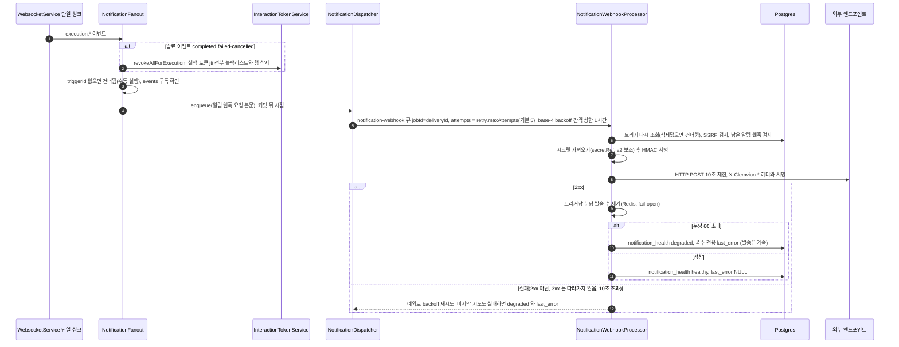
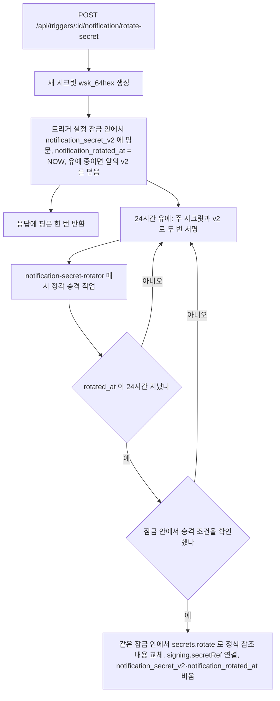
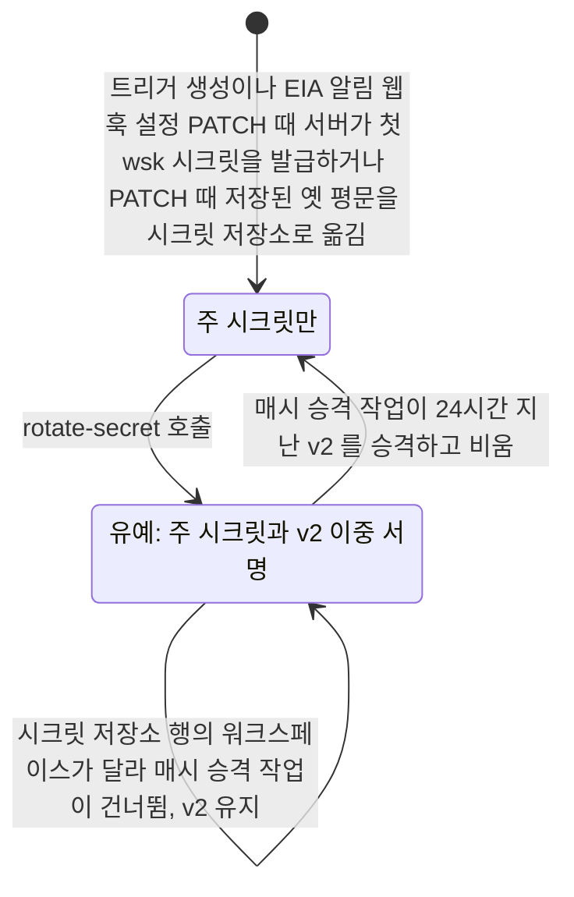

## 개요

이 문서는 [EIA 데이터와 흐름](CLE-EIA-DATA.md) 의 하위 문서로 EIA 알림 웹훅의 발송 파이프라인과 알림 서명 시크릿의 교체 · 승격 · 상태 전이 규칙을 정한다.

## 데이터 흐름

### 알림 웹훅 발송

단계별 사실(`notification-fanout.service.ts`·`notification-webhook.processor.ts`):

- **fanout 대상 이벤트 다섯 가지**: `execution.waiting_for_input`·`completed`·`failed`·`cancelled`·`ai_message`. 종료 때의 jti 폐기는 EIA 알림 웹훅 설정(`config.notification`) 유무와 관계없다. 인터랙션만 켠 트리거도 종료 때 토큰이 무효가 된다.
- **낡은 알림 웹훅 차단**: 진행 중 성격의 `waiting_for_input`·`ai_message` 는 보내기 직전 실행 상태를 다시 확인해 이미 종료면 건너뛴다(재시도해도 의미 없음).
- **SSRF**: 등록 때(`TriggersService.assertNotificationUrlSafe`)와 발송 직전(`checkSsrfSafeUrl`) 두 번 검증한다. 두 검사는 DNS 를 풀지 않고 URL 의 호스트 문자열만 본다. 발송 직전에 호스트 이름을 DNS 로 풀어 보는 검사(DNS rebinding 가드)는 운영 환경(`NODE_ENV=production`)에서 기본으로 켜져 있고 `NOTIFICATION_ENFORCE_DNS_REBIND_GUARD=0` 이면 꺼진다. 운영 밖에서는 기본으로 꺼져 있고 `1` 이면 켜진다. 범위는 [EIA 알림 웹훅 「SSRF 방지」](CLE-EIA-NOTIFY.md#ssrf-방지) 가 정한다.
- **서명**: `X-Clemvion-Signature: t=<unix>,v1=<hex>[,v1=<v2hex>]`(`notification-signature.util.ts`). 정규형 `{timestamp}.{rawBody}`, 알고리즘 `hmac-sha256`(기본)·`hmac-sha512`. 시크릿이 없거나 가져오지 못하면 서명 없이 보내지 않는다. 이때 발송 건강도를 `degraded`(저하됨)로 바꾼다. 주 시크릿이 없으면 v2 가 있어도 같다. v2 는 주 시크릿이 있을 때 보조 서명으로만 쓴다. 교체 유예 중에는 `notification_secret_v2` 로도 서명해 `v1=` 를 두 개 싣는다.
- **주 시크릿 읽기**: 발송 처리기(`resolveSigningSecret`)는 저장된 `signing.secretRef` 값으로 시크릿을 읽지 않는다. 참조(`secret://` 형식의 문자열)가 있으면 트리거 id 로 다시 만든 정식 참조(`notificationSigningSecretRef`)로 시크릿 저장소에서 읽는다. 저장값이 다시 만든 참조와 다르면 에러 로그를 남긴다. 참조가 있는데 시크릿 저장소에서 읽지 못하면 옛 평문 `signing.secret` 으로 내려가지 않는다. 그 알림 웹훅은 보내지 않고 발송 건강도를 `degraded` 로 바꾼다. 옛 평문은 참조가 없을 때만 주 시크릿으로 쓴다. 기준은 [시크릿 저장소 「규칙」](../CLE-INT/CLE-INT-SECRET.md#규칙) 24 다.
- **적재 실패**: fanout 이 트리거를 다시 읽거나 발송 큐에 적재하다 실패하면 경고 로그를 남기고 그 알림을 버린다. 다시 적재하지 않는다. 실행과 단일 싱크는 영향을 받지 않는다. Redis 연결이 끊긴 동안에는 적재가 바로 실패하지 않는다. 연결된 적이 있으면 재연결을 20번 시도한 뒤(약 4분) 실패하고, 기동 때부터 닿지 않았으면 연결될 때까지 기다린다. 근거는 [알림 적재 실패를 경고 로그로 받는다](#알림-적재-실패를-경고-로그로-받는다-2026-11-06) 에 있다.
- **실패 정책**: 실패로 보는 응답(3xx 포함)과 재시도는 [EIA 알림 웹훅 「재시도와 실패 처리」](CLE-EIA-NOTIFY.md#재시도와-실패-처리) 가 정한다. 마지막 시도가 실패해도 트리거를 끄지 않는다. `notification_health`·`notification_last_error`(500자로 자름)만 갱신한다. BullMQ `removeOnComplete` 24시간, `removeOnFail` 7일이다.
- **폭주 감지**: 발송 성공(2xx)마다 `OutboundNotificationRateLimiterService.consume`(Redis 고정 윈도우 `INCR`+`EXPIRE NX`, fail-open)이 트리거당 분당 발송 수를 센다. 60건을 넘으면 `healthy` 대신 `degraded` 와 폭주 전용 `notification_last_error` 로 표시한다. 발송 실패로 바뀐 `degraded` 와는 `notification_last_error` 로 원인을 가른다. 초과분도 계속 보낸다([EIA 알림 웹훅](CLE-EIA-NOTIFY.md)).

### 서명 시크릿 교체와 승격

- 교체 요청은 `TriggersService.rotateNotificationSecret` 이 받는다. 잠금 안에서 `notification_secret_v2` 와 `notification_rotated_at` 을 쓰는 일은 `NotificationSigningSecretService.writeRotation` 이 한다.
- 승격은 `NotificationSigningSecretService.promoteRotated` 가 한다. 매시 승격 작업은 `TriggersService.promoteRotatedNotificationSecrets` 를 거쳐 이 메서드를 부른다. `rotated_at ≤ now-24h` 인 트리거의 v2 를 시크릿 저장소 정식 참조(`secret://triggers/<id>/notification-signing`) 내용으로 바꾸고 `signing.secretRef` 를 연결한다. 정식 참조는 저장된 `signing.secretRef` 값을 읽지 않고 트리거 id 로 만든다(`notificationSigningSecretRef`).
- 승격은 평문을 설정에 쓰지 않는다. `secrets.rotate(정식 참조, 트리거의 워크스페이스 id, v2)` 로 시크릿 저장소 내용을 바꾸고, `signing.secretRef` 를 정식 참조로 맞추고, 옛 `signing.secret` 평문 키를 지운다(`migrateLegacyPlaintext` 와 같은 참조 규약). 발송 쪽 `resolveSigningSecret` 이 `secretRef` 를 먼저 보므로, 승격 즉시 새 시크릿으로 주 서명이 바뀐다.
- 교체와 승격은 같은 트리거 설정 잠금(`acquireTriggerConfigLock`)을 잡는다([트리거 관리](../CLE-TRIG/CLE-TRIG-MANAGE.md#동시-쓰기-직렬화)). 유예 중에 `rotate-secret` 을 다시 부르면 앞의 새 시크릿(v2)을 덮고 `notification_rotated_at` 을 지금 시각으로 바꾼다. 그래서 24시간 유예를 처음부터 다시 센다. 승격은 대상 트리거의 v2 를 먼저 고른다. 그 뒤 잠금 안에서 승격 조건을 확인한다. 조건이 맞을 때만 같은 잠금 안에서 v2 를 정식 참조로 옮기고 v2 와 `notification_rotated_at` 을 비운다. 확인보다 먼저 옮기면 그사이 재교체로 덮인 옛 v2 가 주 시크릿이 된다. 승격 조건은 [EIA 알림 웹훅 「시크릿 교체」](CLE-EIA-NOTIFY.md#시크릿-교체) 가 정한다.
- EIA 알림 웹훅 설정(`config.notification`)이 없는 트리거는 승격하지 않는다. 서명할 대상이 없으므로 v2 와 `notification_rotated_at` 을 비운다. 이때 경고 로그를 남긴다.
- 시크릿 저장소에 정식 참조의 행이 이미 있고 그 행의 `workspace_id` 가 트리거의 워크스페이스와 다르면 `rotate` 가 거부한다([시크릿 저장소 「규칙」](../CLE-INT/CLE-INT-SECRET.md#규칙) 25). 승격은 그 트리거만 건너뛰고 에러 로그를 남긴다. v2 와 `notification_rotated_at` 은 비우지 않는다. 그래서 매시 승격 작업이 그 트리거를 다시 고르고 다시 건너뛴다. 운영자가 정리하기 전까지 그 트리거는 주 시크릿과 v2 두 키로 서명한다. 정리 순서는 [시크릿 저장소 「교차 행 점검과 정리」](../CLE-INT/CLE-INT-SECRET.md#교차-행-점검과-정리) 에 있다. 그 밖의 실패는 다시 던져 작업 재시도에 맡긴다.

## 상태 전이

### 알림 서명 시크릿

## 구현 위치

- `codebase/backend/src/modules/external-interaction/notification-fanout.service.ts`
- `codebase/backend/src/modules/external-interaction/notification-dispatcher.service.ts`
- `codebase/backend/src/modules/external-interaction/notification-dispatcher.types.ts` (base-4 backoff 와 간격 상한)
- `codebase/backend/src/modules/external-interaction/notification-webhook.processor.ts`
- `codebase/backend/src/modules/external-interaction/notification-signature.util.ts`
- `codebase/backend/src/modules/external-interaction/outbound-notification-rate-limiter.service.ts`
- `codebase/backend/src/modules/triggers/notification-signing-secret.service.ts` (`NotificationSigningSecretService`. 첫 시크릿 판정과 시크릿 저장소 쓰기 `settle`, 저장된 옛 평문 정규화 `migrateLegacyPlaintext`, 교체 쓰기 `writeRotation`, 승격 `promoteRotated`)
- `codebase/backend/src/modules/triggers/notification-signing-secret.ts` (첫 시크릿 발급 판정 `decideNotificationSigning`, 서명 설정에 참조 얹기. 이름이 비슷한 `notification-signing-secret-ref.ts` 는 트리거 id 로 참조 문자열을 만드는 일만 한다)
- `codebase/backend/src/modules/triggers/notification-secret-rotator.service.ts` (`NotificationSecretRotatorService`. 유예가 끝난 시크릿의 승격을 매시 시작하는 스케줄러)

## Rationale

### 승격 때 시크릿 저장소 참조를 교체한다

시크릿 승격은 평문을 설정에 쓰지 않고 시크릿 저장소 정식 참조를 `secrets.rotate` 로 교체한다. 발송 쪽 `resolveSigningSecret` 은 `secretRef` 가 있으면 평문 대신 시크릿 저장소를 읽는다. 읽는 참조는 저장값이 아니라 트리거 id 로 다시 만든 정식 참조다([시크릿 저장소 「규칙」](../CLE-INT/CLE-INT-SECRET.md#규칙) 24). 그래서 평문을 설정에 쓰면 교체한 시크릿이 실제 서명에 쓰이지 않는 어긋남이 생긴다. 이 어긋남은 "교체한 시크릿이 실제로 쓰이는가" 라는 보안 운영에 직접 닿는다.

### 알림 적재 실패를 경고 로그로 받는다 (2026-11-06)

[인프라 장애에는 fail-open 한다](CLE-EIA-DATA.md#인프라-장애에는-fail-open-한다) 는 알림 적재를 기능 저하와 경고 로그로 적었다. 그런데 fanout 은 이벤트마다 처리를 기다리지 않고 띄웠고, 트리거 조회와 큐 적재의 예외를 받지 않았다. 그래서 DB 나 Redis 가 실패하면 처리되지 않은 Promise 거부가 됐다. 백엔드는 이 거부를 받는 처리기를 두지 않는다. Node 26 의 기본 동작은 그 거부로 프로세스를 끝내는 것이다(2026-11-06 확인, 종료 코드 1). 알림 하나의 적재 실패가 서버를 내릴 수 있었다.

- **어디서 받는가**: 트리거 조회 실패는 fanout 이, 큐 적재 실패는 dispatcher 가 받아 경고 로그를 남긴다. dispatcher 는 큐가 없을 때처럼 건너뛴 결과를 돌려준다. fanout 은 그 밖의 예외도 이벤트 구독에서 한 번 더 받는다.
- **Redis 장애 때 적재가 끝나는 시점**(2026-11-06 측정, BullMQ 6.4.1 · ioredis 6.0.0, 프로젝트와 같은 연결 옵션): 연결된 뒤 Redis 를 멈추자 적재는 238초 뒤 `MaxRetriesPerRequestError` 로 실패했다. ioredis 기본값대로 재연결을 20번 시도한 뒤다. 처음부터 닿지 않는 Redis 에서는 330초 동안 끝나지 않았다. 연결되기 전의 명령은 연결을 기다리기 때문이다. 기다리는 동안은 거부가 없으므로 경고 로그도 그 뒤에 남는다.
- **다시 적재하지 않는다**: 이 Task 는 재시도나 outbox 를 새로 두지 않는다. 적재 전에 사라진 발송은 [EIA 알림 웹훅 「재시도와 실패 처리」](CLE-EIA-NOTIFY.md#재시도와-실패-처리) 가 적은 대로 최소 한 번 전달의 범위 밖이다.

기각한 대안:

- **적재에 제한 시간을 둔다**: 시간이 지나도 명령은 Redis 클라이언트의 대기열에 남아 연결이 돌아오면 적재될 수 있다. 그러면 실패했다는 로그가 사실과 어긋난다. 대기열을 비우려면 연결 옵션을 바꿔야 하는데, 그 설정은 모든 BullMQ 큐가 함께 쓴다.
- **프로세스 전역에서 처리되지 않은 거부를 받는다**: 다른 모듈의 결함까지 조용히 삼킨다. 실패를 아는 곳에서 받는 쪽을 택했다.

### «낡은 알림 웹훅 차단» 으로 이름을 맞췄다 (2026-11-12)

용어 사전 기준(EIA 알림 웹훅을 단독 «알림» 으로 쓰지 않는다)에 맞춰 단계 이름 «낡은 알림 차단» 과 시퀀스 그림의 «낡은 알림 검사» 를 [EIA 알림 웹훅](CLE-EIA-NOTIFY.md) 과 같은 용어로 바꿨다. 뜻은 바뀌지 않았다.
