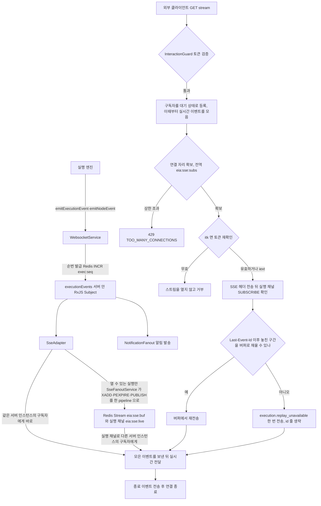

## 개요

이 문서는 [EIA 데이터와 흐름](CLE-EIA-DATA.md) 의 하위 문서로 SSE 스트림의 흐름, 구독 순서와 재전송 판정, 서버 인스턴스 사이 전달(Redis Stream · Pub/Sub)과 장애 처리 규칙을 정한다.

## SSE 스트림

원천은 실행 엔진이 내는 WebSocket 이벤트 단일 싱크(`WebsocketService`)다. SSE 는 그 흐름의 어댑터일 뿐 이벤트를 스스로 만들지 않는다. 각 서버 인스턴스는 자기 프로세스의 단일 싱크에서 받은 이벤트 가운데 EIA SSE 로 열 수 있는 실행의 이벤트를 Redis 에 올린다(아래 「Redis 에 쓰는 실행」). 같은 서버 인스턴스의 구독자에게는 Redis 를 거치지 않고 바로 보낸다. 그래서 SSE 클라이언트는 어느 서버 인스턴스에 연결해도 그 실행의 이벤트를 받는다.

- 프레임은 `event: <eventType>` / `id: <seq>` / `data: <JSON payload>` 이고 15초마다 heartbeat 주석을 보낸다. 제어 프레임(`execution.replay_unavailable`, 순번 0 이하)은 `id:` 줄을 생략한다.
- EventSource 호환을 위해 `?token=` 쿼리를 허용한다.
- 스트림은 열 때 토큰을 검증한다. 트리거 단위 토큰으로 연 스트림은 연결 자리를 잡은 뒤 SSE 헤더를 보내기 전에 토큰을 한 번 더 확인하고, 그 사이 무효가 됐으면 열지 않고 거부한다. 거부 응답은 [EIA 수신 API와 SSE](CLE-EIA-INBOUND.md) 가 정한다.
- 스트림은 그 실행의 종료 이벤트를 보낸 뒤 어댑터(`SseAdapter`)가 끝낸다. 다른 서버 인스턴스에서 실행 채널로 받은 종료 이벤트도 같다. 트리거 단위 토큰으로 연 스트림은 종료 이벤트 전이라도 그 토큰이 무효가 되면 서버가 닫는다([트리거 단위 토큰](CLE-EIA-DATA-TOKEN.md#트리거-단위-토큰)).
- 트리거 단위 토큰(`itk_*`)으로 연 스트림은 열려 있는 동안 60초마다 토큰을 다시 확인한다. 간격은 `SSE_TOKEN_RECHECK_INTERVAL_MS`(heartbeat 네 번에 한 번)이고 코드 상수라 설정으로 바꿀 수 없다. 토큰이 무효면 닫기 신호를 받았을 때처럼 따로 보내는 이벤트 없이 응답을 끝낸다. 그래서 닫기 신호가 유실돼도 이 간격 안에 닫힌다. 다시 확인하다 DB 오류가 나면 스트림을 유지하고 경고 로그를 남긴다(fail-open). 실행 단위 토큰으로 연 스트림은 토큰이 만료되거나 갱신돼도 닫지 않고 다시 확인하지도 않는다([실행 단위 토큰](CLE-EIA-DATA-TOKEN.md#실행-단위-토큰)).
- 동시 연결 상한의 수치는 [HTTP API 규약](../CLE-API/CLE-API-CONV.md#7-요청-빈도-제한) 의 요청 빈도 제한 표가 정한다. 상한은 서버 인스턴스마다 세지 않는다. 실행 하나에 대해 모든 서버 인스턴스의 연결을 합쳐 센다(`eia:sse:subs:<executionId>`). 연결 자리마다 마지막 heartbeat 시각을 둔다. 이 시각은 heartbeat(15초)마다 갱신한다. 서버 인스턴스가 죽어 자리를 돌려주지 못해도 마지막 갱신에서 45초가 지나면 그 자리는 상한에 세지 않는다. Redis 를 못 쓰면(메모리 모드) 상한을 서버 인스턴스마다 센다.
- SSE 의 `id:` 와 알림 웹훅의 `seq` 는 같은 카운터(Redis `exec:seq:<id>`)를 쓴다. 클라이언트는 SSE 와 EIA 알림 웹훅으로 받은 이벤트를 한 순서로 정렬할 수 있다.
- 서버 인스턴스 사이 전달(`sse-fanout.service.ts`): 재전송 버퍼는 실행별 Redis Stream `eia:sse:buf:<executionId>` 이다. 실시간 전달은 실행별 Pub/Sub 채널 `eia:sse:live:<executionId>` 로 한다. 다른 서버 인스턴스로 다시 연결해도 5분 재전송을 받는다. sticky-session 에 기대지 않는다. 같은 서버 인스턴스의 구독자에게는 Redis 를 거치지 않고 바로 보낸다. 실행 채널로 받은 메시지 가운데 자기 서버 인스턴스가 낸 것(`origin`)은 건너뛴다. 그래서 Redis 를 못 써도 같은 서버 인스턴스의 구독자는 이벤트를 받는다. 키와 채널의 용도 · TTL · 실패 정책은 [EIA 엔티티와 저장소](CLE-EIA-DATA-STORE.md#redis-와-bullmq) 의 「Redis 와 BullMQ」 표에 있다. 결정의 이유는 [SSE 버퍼와 실시간 전달을 Redis 에 둔다](#sse-버퍼와-실시간-전달을-redis-에-둔다-2026-10-17) 에 있다.
- 실행 채널 구독: 서버 인스턴스에 그 실행의 첫 구독자가 생기면 전용 구독 연결로 실행 채널을 `SUBSCRIBE` 한다. 마지막 구독자가 떠나면 `UNSUBSCRIBE` 한다. `SUBSCRIBE` 가 실패하거나 확인이 늦어도 스트림은 그대로 이어 간다. 그때 그 서버 인스턴스가 낸 이벤트는 받는다. 다른 서버 인스턴스의 이벤트는 구독 연결이 다시 준비되거나 늦은 확인이 온 뒤부터 받는다. 그 사이 놓친 구간은 아래 「구독이 다시 확정될 때」 로 채운다.
- 구독 순서: 새 구독자는 다음 순서로 합류한다.
  1. 구독자를 대기 상태로 등록한다. 이때부터 도착한 실시간 이벤트를 모은다.
  2. 연결 자리를 잡는다(`eia:sse:subs`). 상한이면 등록을 풀고 429 `TOO_MANY_CONNECTIONS` 로 응답한다.
  3. 트리거 단위 토큰으로 연 스트림이면 토큰을 다시 확인한다. 무효면 등록을 풀고 거부한다.
  4. SSE 헤더를 보낸다.
  5. 실행 채널 `SUBSCRIBE` 확인을 기다린다.
  6. `Last-Event-Id` 가 있으면 버퍼에서 재전송한다. Stream 항목에는 필드 `seq` 가 있어서 `seq` 가 `Last-Event-Id` 이하인 항목은 `data` 를 파싱하지 않는다. `seq` 필드가 없는 옛 항목은 파싱한다(롤링 배포 호환). 재전송 가능 여부의 판정(구간 연속성, `execution.replay_unavailable`)은 [EIA 수신 API와 SSE](CLE-EIA-INBOUND.md) 가 정한 규칙 그대로다. 버퍼로 판정할 수 없을 때는 아래 「버퍼로 판정할 수 없을 때」 를 따른다.
  7. 모은 실시간 이벤트를 보내고 실시간 상태로 바꾼다.
- 순서의 이유: 등록을 맨 앞에 두는 것은 2 · 3 단계를 기다리는 동안 온 닫기 신호도 그 구독자에게 닿게 하려는 것이다. `SUBSCRIBE` 확인은 버퍼 읽기보다 먼저 기다린다. 다른 서버 인스턴스는 `XADD` 와 `PUBLISH` 를 한 pipeline 으로 보낸다. 그래서 확인 앞에 발행된 이벤트는 버퍼에 있고 뒤에 발행된 이벤트는 실행 채널로 온다.
- 대기 중에 모으는 이벤트는 1000건(`SSE_BUFFER_MAX_EVENTS`)까지다. 이 값은 코드 상수라 설정으로 바꿀 수 없다. 넘치면 가장 오래된 것부터 버린다. 버린 것이 있으면 모은 이벤트를 보내기 전에 `execution.replay_unavailable` 을 보낸다.
- 버퍼로 판정할 수 없을 때: 재전송은 Redis 버퍼와 메모리 버퍼를 함께 읽어 `seq` 로 합친다(같은 `seq` 는 하나만 둔다). `Last-Event-Id`(아래 N) 이후 이벤트가 버퍼에 있으면 위 6 단계의 규칙으로 판정한다. 없을 때는 다음과 같다.
  - 버퍼를 다 읽었고 비어 있지 않으면 클라이언트가 마지막 이벤트까지 받은 것이다. `execution.replay_unavailable` 을 보내지 않는다.
  - 버퍼가 비었거나 읽지 못했으면 순번 카운터 `exec:seq:<executionId>` 를 읽어 견준다. 카운터 값이 없으면 `execution.replay_unavailable` 을 보낸다. 키가 없거나(이벤트를 낸 적 없음 · 종료 뒤 지움 · 만료) Redis 를 읽지 못했거나 메모리 모드인 경우다.
  - 카운터가 N 이하면 보내지 않는다. 카운터가 N 보다 크면 대기 중에 모은 실시간 이벤트가 N 다음부터 카운터까지의 `seq` 를 모두 덮을 때만 보내지 않는다. 그 밖에는 보낸다.
  - 카운터 키의 수명은 순번 발급기(`ExecutionSeqAllocator`)가 정한다. 순번을 발급할 때마다 만료를 24시간으로 다시 건다(`EXECUTION_SEQ_TTL_SECONDS` 로 바꿀 수 있다). 종료 이벤트를 보낸 뒤에는 키를 지운다. 그래서 끝난 실행이나 마지막 이벤트 뒤 24시간이 지난 실행은 카운터 값이 없다.
- 겹침 제거: 구독자마다 마지막으로 보낸 `seq` 를 기억한다. 그 값 이하의 `seq` 는 보내지 않는다. 재전송과 실시간 전달이 겹친 이벤트를 한 번만 보내기 위해서다. `seq` 가 0 이하인 제어 프레임은 이 규칙에서 뺀다.
- 구독이 다시 확정될 때: 실행 채널 구독에 공백이 있었으면 구독이 다시 확정된 뒤 그 공백에 놓친 구간을 버퍼로 채운다.
  - 계기는 둘이다. (가) 전용 구독 연결이 끊겼다가 다시 준비(`ready`)되고 재구독이 성공했을 때다. 이때는 그 서버 인스턴스가 구독 중인 모든 실행 채널이 대상이다. (나) 실행 채널 `SUBSCRIBE` 확인이 2초 상한을 넘겨 실패로 처리된 뒤 늦게 확인됐을 때다. 이때는 그 실행 채널이 대상이다.
  - 대상 실행의 실시간 상태 구독자마다 다시 모으는 상태로 바꾸고 놓친 구간을 버퍼로 채운다. 기준 순번은 그 구독자에게 마지막으로 보낸 `seq` 다. 연결 때 받은 `Last-Event-Id` 가 더 크면 그 값을 쓴다. 판정은 위 6 단계와 「버퍼로 판정할 수 없을 때」 와 같다(구간 연속성, 순번 카운터와 견주기). 신호를 보내면 그 `lastEventId` 는 이 기준 순번이다. 그다음 모은 이벤트를 보내고 실시간 상태로 돌아간다.
  - 기준 순번이 없는 구독자는 `Last-Event-Id` 없이 연결했고 순번이 1 이상인 이벤트를 아직 보내지 않은 구독자다. 이 구독자에게는 버퍼를 읽지 않고 `execution.replay_unavailable` 을 한 번 보낸다. 연결 전 이벤트와 공백 중 이벤트를 가를 근거가 없기 때문이다. 이 신호의 `lastEventId` 는 0 이다.
  - 아직 연결을 준비 중인 구독자(7 단계 전)는 표시만 해 둔다. 실시간 상태로 바꾼 직후 한 번 더 따라잡는다.
- Redis 실패: 요청 경로에서 응답을 기다리는 Redis 명령은 2초를 넘기면 실패로 본다. 실행 채널 `SUBSCRIBE`, 버퍼 `XRANGE`, 연결 자리 `EVAL`, 순번 카운터 `GET`, 닫기 신호 `PUBLISH` 가 그렇다. 실패한 명령은 그 동작만 메모리로 처리한다. 경고 로그는 동작마다 한 번 남긴다. 그 동작이 다시 성공하면 복구 로그를 남긴다. 키와 채널마다의 메모리 동작은 [EIA 엔티티와 저장소](CLE-EIA-DATA-STORE.md#redis-와-bullmq) 의 「Redis 와 BullMQ」 표에 있다. 이 규칙에는 예외 둘과 판정 하나가 더 있다.
  - 닫기 신호 `PUBLISH` 가 실패하면 호출마다 error 로그를 남긴다. 로그에는 트리거 id 와 오류를 싣는다. 그 신호가 빠지면 다른 서버 인스턴스의 스트림이 토큰 재확인 간격(60초)까지 남기 때문이다. 다시 성공하면 복구 로그는 그대로 남긴다.
  - 연결 자리 갱신은 heartbeat 마다 `ZADD` 와 `PEXPIRE` 를 한 pipeline 으로 보낸다. pipeline 전체가 실패할 때뿐 아니라 명령 하나가 실패해도 실패로 보고 경고를 남긴다. 버퍼 쓰기와 같은 기준이다.
  - 아래 「Redis 에 쓰는 실행」 의 판정에 쓰는 DB 조회가 실패하거나 2초를 넘기면 그 실행을 쓰기 대상으로 본다(fail-open). 경고는 조회가 다시 성공할 때까지 한 번 남기고 다시 성공하면 복구 로그를 남긴다.
- Redis 에 쓰는 실행: 각 서버 인스턴스는 EIA SSE 로 열 수 있는 실행의 이벤트만 Redis 의 재전송 Stream 과 실행 채널에 쓴다. 열 수 있는 실행은 트리거가 있는 실행(`executions.trigger_id` 가 있음)이거나 실행 토큰 행(`execution_token`)이 있는 실행이다. 판정은 다음 순서로 한다.
  - 이벤트의 라우팅 컨텍스트에 `triggerId` 가 있으면 바로 쓴다.
  - 없으면 그 실행에 대해 서버 인스턴스마다 한 번 DB 를 조회한다. `executions.trigger_id` 가 있으면 쓴다. 없으면 `execution_token` 행이 있는지 보고 있으면 쓴다. 실행 행이 없으면 쓴다. 놓치지 않는 쪽을 고른 것이다.
  - 조회는 2초(`SSE_ELIGIBILITY_TIMEOUT_MS`)까지 기다린다. 이 값은 코드 상수라 설정으로 바꿀 수 없다. 2초를 넘기면 조회가 실패한 것과 같이 쓰기 대상으로 본다(fail-open).
  - 조회를 기다리는 동안 온 그 실행의 이벤트는 Redis 에 쓰지 않고 순서대로 모아 둔다. 판정이 나면 모은 이벤트를 순서대로 쓰거나 버린다. 그래서 다른 서버 인스턴스의 구독자는 그 이벤트를 최대 2초 늦게 받을 수 있다. 같은 서버 인스턴스의 구독자에게는 판정을 기다리지 않고 바로 보낸다.
  - 모은 이벤트가 1000건(`SSE_BUFFER_MAX_EVENTS`)에 닿으면 판정을 더 기다리지 않고 쓰기 대상으로 정한다(fail-open). 모은 이벤트는 그때 순서대로 쓴다. 모은 이벤트가 넘쳐 버려지는 일은 없다.
  - 한 번 정한 판정은 실행마다 기억한다. 조회 실패, 2초 초과, 1000건 도달로 쓰기 대상으로 정한 판정도 같다. 그 실행의 종료 이벤트(`execution.completed` · `failed` · `cancelled`)를 받거나 5분 동안 그 실행의 이벤트가 없으면 판정을 지운다.
  - 판정한 뒤에 실행 토큰 행이 생겨 판정이 바뀌는 경우는 없다. 실행 토큰 행은 웹훅 응답(`HooksService.buildInteractionResponse`)에서만 만들고 그 실행에는 늘 트리거가 있기 때문이다.
  - 쓰지 않는 실행의 이벤트는 메모리 버퍼에도 두지 않는다. 같은 서버 인스턴스의 구독자에게 보내는 것은 Redis 와 상관없으므로 그대로다.
  - Redis 없이 부팅한 서버 인스턴스는 판정하지 않고 모든 실행의 이벤트를 메모리 버퍼에 둔다. 그 서버 인스턴스의 재전송에 쓰는 버퍼라 Redis 쓰기와 상관없다.
- 항목 크기 상한: Redis 에 올리는 메시지(JSON)가 UTF-8 로 64 KiB 를 넘으면 payload 를 Redis 에 쓰지 않는다. 상한은 `SSE_BUFFER_MAX_MESSAGE_BYTES` 이고 코드 상수라 설정으로 바꿀 수 없다. 대신 생략 표시 `{v:1, origin, omitted:{executionId, seq, eventType}}` 를 Stream 과 실행 채널에 같은 pipeline 으로 넣는다. 전체 이벤트는 그 서버 인스턴스의 메모리 버퍼에 둔다. 종료 이벤트(`execution.completed` · `failed` · `cancelled`)는 상한과 상관없이 전체를 쓴다. 스트림을 닫는 이벤트이고 실행마다 하나뿐이라 쌓이는 크기도 한정되기 때문이다.
  - 실행 채널에서 생략 표시를 받은 서버 인스턴스는 그 구독자에게 그 순번 자리에서 `execution.replay_unavailable` 을 보낸다. 그 구독자에게 이미 그 순번 이상을 보냈으면 보내지 않는다. 구독자가 연결을 준비하는 중이면 모은 순서대로 그 자리에서 보낸다. 신호의 `lastEventId` 는 그 구독자에게 마지막으로 보낸 `seq` 다. 연결 때 받은 `Last-Event-Id` 가 더 크면 그 값이고 둘 다 없으면 0 이다. 생략 표시는 받은 이벤트가 아니므로 마지막으로 보낸 `seq` 를 바꾸지 않는다.
  - 재전송 때 같은 `seq` 의 전체 이벤트가 메모리 버퍼에 있으면 그것을 쓴다. 생략 표시만 있는 순번이 재전송 범위에 있으면 구간이 끊긴 것으로 보고 신호를 보낸다. 순번 카운터와 견주는 판정에서 생략 표시는 받은 이벤트로 세지 않는다.
- 대표 소비자는 웹채팅 위젯이다(`codebase/channel-web-chat/src/lib/eia-client.ts` 가 EventSource 로 구독). 위젯 부팅과 CORS 판정(`WebChatCorsOriginResolver` 가 실행 → 임베드 허용 도메인 `workspace.settings.interactionAllowedOrigins` 를 풀고 60초 캐시)은 [웹채팅 구조](../CLE-WEBCHAT/CLE-WEBCHAT-ARCH.md)·[웹채팅 보안](../CLE-WEBCHAT/CLE-WEBCHAT-SECURITY.md) 이 다룬다.

## 구현 위치

- `codebase/backend/src/modules/external-interaction/interaction-stream.controller.ts` (SSE 응답, heartbeat, 연결 상한 초과 429, 트리거 단위 토큰 재확인, 열린 트리거 단위 토큰 스트림의 60초 재확인)
- `codebase/backend/src/modules/external-interaction/sse-adapter.service.ts` (구독자 등록과 구독 순서, 재전송 판정, 종료 이벤트 뒤 닫기, 메모리 버퍼, 쓰기 대상 판정 대기열, 구독 재확정 뒤 따라잡기)
- `codebase/backend/src/modules/external-interaction/sse-fanout.service.ts` (Redis Stream 재전송 버퍼, 실행별 실시간 채널, 전역 닫기 채널, 전역 동시 연결 상한, 순번 카운터 읽기, 항목 크기 상한과 생략 표시)
- `codebase/backend/src/modules/external-interaction/sse-stream-eligibility.service.ts` (Redis 에 쓰는 실행 판정, 조회 상한 `SSE_ELIGIBILITY_TIMEOUT_MS`)
- `codebase/backend/src/modules/external-interaction/interaction-stream-closer.ts` (트리거 단위 토큰 스트림 닫기 포트)
- `codebase/backend/src/modules/websocket/execution-seq-allocator.service.ts` (`exec:seq` 발급과 만료 · 종료 뒤 삭제)

## Rationale

### SSE 버퍼와 실시간 전달을 Redis 에 둔다 (2026-10-17)

SSE 재전송 버퍼는 실행별 Redis Stream 에 둔다. 실시간 전달은 실행별 Redis Pub/Sub 채널로 한다. 트리거 단위 토큰 스트림의 닫기 신호와 실행당 동시 연결 수도 Redis 에서 모든 서버 인스턴스가 함께 본다. 사용자 결정(2026-10-17)이다.

- **왜 바꿨나**: 이전 결정은 버퍼를 서버 인스턴스 하나의 메모리에 두고 1차 범위를 서버 인스턴스 하나로 좁혔다. 그런데 배포는 이미 백엔드 서버 인스턴스를 여럿 띄운다(`k8s/base/backend-deployment.yaml` 의 replicas 2, staging 2, prod 3). sticky-session 도 없다. sticky-session 을 둬도 실행 세그먼트와 재개는 아무 서버 인스턴스의 워커에서나 돈다([큐 워커와 동시 실행 제한](../CLE-EXEC/CLE-EXEC-WORKER.md#수평-확장) · [시스템 아키텍처](../CLE-PLAT/CLE-PLAT-ARCH.md#다중-인스턴스와-동시성-모델)). 그래서 SSE 클라이언트가 연결한 서버 인스턴스와 이벤트를 낸 서버 인스턴스가 달라 이벤트를 받지 못할 수 있었다. [시스템 아키텍처](../CLE-PLAT/CLE-PLAT-ARCH.md#배포-환경-분리) 가 SaaS 의 목표 구성으로 둔 자동 수평 확장과도 맞지 않았다.
- **재전송 버퍼는 Redis Stream 이다**: 재연결은 다른 서버 인스턴스로 갈 수 있다. 그래서 버퍼를 모든 서버 인스턴스가 읽는 곳에 둔다. Stream 항목 id 에는 Redis 서버가 매긴 시각이 들어 있다. 그래서 서버 인스턴스마다 시계가 조금 달라도 «받은 지 5분 이내» 를 한 기준으로 거른다. 개수 상한은 `MAXLEN` 으로, 보관 기간은 `PEXPIRE` 로 둔다. 끝난 실행의 버퍼도 마지막 이벤트 5분 뒤 사라진다. 이전 메모리 버퍼에서는 끝난 실행의 항목이 지워지지 않고 서버 프로세스가 끝날 때까지 남았다.
- **실시간 전달은 실행별 채널이다**: 그 실행의 구독자가 있는 서버 인스턴스만 채널을 구독한다. 그래서 서버 인스턴스는 자기 구독자가 보는 실행의 이벤트만 받는다. `PUBLISH` 는 `XADD` 와 같은 pipeline 에 넣어 Redis 왕복을 늘리지 않는다.
- **구독 순서를 정한다**: 구독 확인을 받기 전에 재전송을 읽으면 그 사이 발행된 이벤트는 재전송에도 실시간 전달에도 잡히지 않는다. 그래서 구독 확인 뒤에 재전송을 읽고 그동안 도착한 실시간 이벤트는 모아 두었다가 보낸다. 겹친 이벤트는 `seq` 로 거른다. `seq` 는 이미 Redis `INCR` 로 실행마다 단조 증가한다. 구독자 등록은 연결 자리 확보와 토큰 재확인보다 먼저 한다. 그 둘을 기다리는 동안 온 닫기 신호도 그 구독자에게 닿게 하려는 것이다.
- **버퍼 키가 없으면 순번 카운터와 견준다**: 버퍼 키는 마지막 이벤트 5분 뒤 사라진다. 그 뒤 다시 연결한 클라이언트가 이벤트를 놓쳤는지는 버퍼만으로 알 수 없다. 그래서 실행의 순번 카운터(`exec:seq`)를 읽어 클라이언트가 받은 `seq` 와 견준다. 카운터도 읽지 못하면 근거가 없으므로 놓쳤을 수 있다고 보고 `execution.replay_unavailable` 을 보낸다. 놓친 이벤트를 조용히 넘기지 않으려는 것이다. 이 신호를 둔 이유와 같다.
- **닫기 신호는 전역 채널이다**: 트리거 단위 토큰으로 연 스트림이 어느 서버 인스턴스에 붙었는지는 그 서버 인스턴스의 메모리에만 있다. 그래서 토큰을 무효로 만든 서버 인스턴스는 모든 서버 인스턴스가 듣는 채널 `eia:sse:close` 에 트리거 id 를 알린다. 형태는 채팅 채널 리스너 버스(`channel-listener.bus.ts`)를 따른다. 발신 서버 인스턴스 표시(`origin`), 발행 2초 상한, fail-open, 연결이 다시 준비되면 재구독이 같다.
- **동시 연결 상한은 전역으로 센다**: 상한은 [HTTP API 규약](../CLE-API/CLE-API-CONV.md#7-요청-빈도-제한) 이 실행 단위로 정한다. 서버 인스턴스마다 세면 실제 상한이 서버 인스턴스 수만큼 늘어난다. 연결은 ZSET 에 마지막 heartbeat 시각과 함께 둔다. 서버 인스턴스가 죽어 연결 종료를 기록하지 못해도 heartbeat 간격의 3배가 지난 항목은 다음 연결 때 지워진다. 그래서 죽은 연결이 상한을 계속 차지하지 않는다. 확인과 추가를 Lua 스크립트 하나로 하므로 동시에 연결해도 상한을 넘지 않는다.
- **요청 경로의 Redis 명령은 2초까지만 기다린다**: 공유 연결이 끊기면 Redis 클라이언트(ioredis)는 명령을 쌓아 두었다가 재연결 시도가 거듭된 뒤에야 거부한다. 상한이 없으면 그동안 SSE 연결이 열리지 않는다. 값은 채팅 채널 리스너 버스와 같다.
- **Redis 를 못 쓰면 메모리로 동작한다**: [인프라 장애에는 fail-open 한다](CLE-EIA-DATA.md#인프라-장애에는-fail-open-한다) 와 같은 원칙이다. SSE 는 실행의 부수 채널이라 Redis 장애 때문에 스트림이 끊기지 않게 한다. 메모리로 넘어가는 단위는 명령 하나다. 실패한 동작만 메모리로 처리하고 다음 명령은 다시 Redis 로 보낸다. 같은 서버 인스턴스의 구독자에게는 Redis 를 거치지 않고 보내므로 Redis 가 죽어도 그 구독자는 이벤트를 받는다. Redis 에 넣지 못한 이벤트는 메모리 버퍼에 따로 두고 재전송 때 Redis 버퍼와 `seq` 로 합친다. Redis 장애 구간의 이벤트도 같은 서버 인스턴스로 다시 연결하면 재전송을 받게 하려는 것이다. 메모리 버퍼에도 마지막 이벤트 뒤 5분 지난 버퍼를 지우는 주기 정리를 둔다.
- **단일 싱크는 그대로다**: 각 서버 인스턴스의 `SseAdapter` 는 자기 프로세스의 `WebsocketService.executionEvents$` 를 구독해 Redis 로 옮기고, 엔진은 여전히 단일 싱크만 부른다([External Interaction API](CLE-EIA.md#단일-싱크와-외부-facade)).

기각한 대안:

- **SSE 버퍼를 서버 인스턴스 하나의 메모리에 두고 서버 인스턴스 하나로 배포한다**(2026-10-09 까지의 결정): 배포가 이미 서버 인스턴스를 여럿 띄우므로 전제가 사실과 맞지 않았다. 그때의 근거는 «Redis Pub/Sub 을 거치면 직렬화와 네트워크 홉이 더해진다» 였다. 이 근거는 지금도 맞다. 실시간 전달마다 Redis 왕복이 하나 더해지는 비용은 받아들인다. 어느 서버 인스턴스에 연결해도 이벤트를 받는 쪽을 앞에 뒀다.
- **서버 인스턴스 하나나 sticky-session 로드밸런서면 충분하다**(2026-10-09 정정 전 서술): sticky-session 은 클라이언트를 서버 인스턴스 하나에 묶을 뿐 실행을 묶지 않는다. 실행 세그먼트와 재개는 아무 서버 인스턴스에서나 돈다. 2026-10-09 정정에서 이미 기각했다.
- **Redis fan-out 전까지 서버 인스턴스를 늘리지 않는다는 예외를 [시스템 아키텍처](../CLE-PLAT/CLE-PLAT-ARCH.md#다중-인스턴스와-동시성-모델) 에 적는다**(첫 단계 안): 사용자는 fan-out 을 이번에 구현하는 쪽을 골랐다. 이 예외를 지키려면 이미 여럿인 배포의 replicas 를 1로 줄여야 했다.

남은 위험:

- Redis 장애로 메모리 모드가 되면 서버 인스턴스는 다른 서버 인스턴스가 낸 이벤트를 받지 못한다. 그 구간에는 이전 결정의 한계가 그대로 돌아온다. 경고 로그로 그 구간을 알 수 있다. 메모리 모드에서는 동시 연결 상한도 서버 인스턴스마다 센다.
- EIA SSE 로 열 수 있는 실행이면 SSE 구독자가 없어도 이벤트를 Redis 에 쓴다. Redis 에 쓴 payload(64 KiB 이하이거나 종료 이벤트)는 버퍼에 5분 동안 남는다(2026-11-05).
- 실행의 첫 이벤트에 라우팅 컨텍스트의 `triggerId` 가 없으면 쓰기 대상 판정이 날 때까지 그 실행의 이벤트를 Redis 에 쓰지 않는다. 그동안 다른 서버 인스턴스의 구독자는 그 이벤트를 최대 2초 늦게 받을 수 있다. 판정 조회가 실패하거나 2초를 넘기면 열 수 없는 실행의 이벤트도 Redis 에 쓴다(2026-11-05).
- Pub/Sub 메시지가 유실되면 그 이벤트는 실시간으로 가지 않는다. 구독 연결이 끊겼다 다시 준비되면 그 사이 구간을 버퍼로 따라잡는다([SSE 스트림](#sse-스트림) 의 「구독이 다시 확정될 때」). 남는 것은 두 경우다. 기준 순번이 없는 스트림은 따라잡지 않고 `execution.replay_unavailable` 을 받는다. 놓친 이벤트가 없어도 받으므로 거짓 양성일 수 있다. 연결이 끊기지 않은 채 메시지만 빠지면 따라잡기가 일어나지 않아 그 이벤트가 그 스트림에서 빠질 수 있다(2026-11-05).
- 서버 인스턴스 사이에서 이벤트 도착 순서가 뒤집히면 늦게 온 작은 `seq` 는 겹침 제거로 버려진다. 클라이언트의 `Last-Event-Id` 는 이미 더 큰 `seq` 라서 다시 연결해도 그 이벤트는 재전송되지 않는다.
- 순번 카운터는 올렸지만 아직 버퍼에 넣지 않은 순간에 버퍼 키 없이 다시 연결하면 놓친 이벤트가 없어도 `execution.replay_unavailable` 을 받을 수 있다(거짓 양성). 그때 클라이언트는 상태 조회를 한 번 더 한다.
- 닫기 메시지가 유실되면(구독 연결이 끊긴 동안 등) 그 서버 인스턴스에 붙은 트리거 단위 토큰 스트림은 다음 재확인까지 최대 60초 남는다. DB 를 읽지 못하면 그보다 오래 남을 수 있다([인프라 장애에는 fail-open 한다](CLE-EIA-DATA.md#인프라-장애에는-fail-open-한다)). 그 토큰으로 새로 연결하거나 다시 연결하면 가드가 거부한다(2026-11-05).
- 서버 인스턴스가 죽으면 그 연결의 ZSET 항목은 heartbeat 간격의 3배(45초) 동안 남아 상한을 차지한다.
- 크기 상한을 넘은 이벤트는 그 이벤트를 낸 서버 인스턴스의 구독자만 받는다. 다른 서버 인스턴스의 구독자와 다른 서버 인스턴스로 다시 연결한 클라이언트는 `execution.replay_unavailable` 을 받고 상태 조회로 맞춘다(2026-11-05).

### SSE 의 Redis 쓰기를 줄이고 구독 공백을 메운다 (2026-11-05)

각 서버 인스턴스는 EIA SSE 로 열 수 있는 실행의 이벤트만 Redis 에 쓰고 64 KiB 를 넘는 항목은 생략 표시로 바꾼다. 구독이 다시 확정되면 놓친 구간을 버퍼로 채운다. 트리거 단위 토큰 스트림은 열려 있는 동안 60초마다 토큰을 다시 확인한다. 규칙은 [SSE 스트림](#sse-스트림) 에 있다.

- **쓰기 대상을 라우팅 컨텍스트만으로 판정하지 않는다**: 라우팅 컨텍스트의 `triggerId` 는 모든 이벤트 경로에 등록돼 있지 않다. 실행 준비가 실패해 해제한 다음 내는 실패 이벤트, 멈춘 작업의 재시도 소진, 입력 대기 중 취소, 웹채팅 유휴 회수의 취소, 부팅 때 남은 실행 정리, 재시도 구간이 그렇다. 라우팅만 보면 웹훅 실행의 종료 이벤트처럼 꼭 필요한 이벤트를 버린다. 그래서 라우팅은 빠른 경로로만 쓰고 `triggerId` 가 없으면 DB 로 판정한다.
- **더 좁은 판정은 기각했다**: 트리거 종류나 인터랙션 켜짐까지 보는 안이다. 인터랙션은 실행 도중 PATCH 로 켤 수 있다. 그러면 판정을 기억하는 동안 그 실행에서 다른 서버 인스턴스가 낸 이벤트가 알림 없이 빠진다.
- **판정을 기다리다 버리지 않는다**: 판정을 기다리며 모은 이벤트를 버리면 생략 표시도 남지 않는다. 그러면 다른 서버 인스턴스의 구독자는 이벤트를 놓친 줄 모른다. 그래서 조회가 실패하거나 2초를 넘기거나 모은 이벤트가 1000건에 닿으면 쓰는 쪽으로 정한다. 대가는 둘이다. 열 수 없는 실행의 이벤트를 Redis 에 쓸 수 있다. 판정을 기다리는 동안 다른 서버 인스턴스의 구독자는 이벤트를 늦게 받는다.
- **항목 크기 상한을 64 KiB 로 둔다**: Redis 의 pub/sub 구독 연결은 출력 버퍼 한도(`client-output-buffer-limit pubsub`, 기본 32mb 하드 · 8mb 60초 소프트)를 넘으면 끊긴다. 끊기면 그 서버 인스턴스의 모든 실행 채널 전달이 멈춘다. 항목 하나의 크기에 상한이 없으면 Stream 하나(최대 1000건)의 메모리에도 상한이 없다. 64 KiB 는 재 보고 얻은 값이 아니고 정한 값이다. 운영에서 상한에 걸리는 이벤트가 잦으면 다시 본다.
- **넘친 항목 자리에 생략 표시를 남긴다**: 아무것도 쓰지 않으면 다른 서버 인스턴스의 구독자는 그 이벤트를 놓친 줄 모른다. 표시가 있으면 `execution.replay_unavailable` 로 알린다.
- **종료 이벤트는 상한에서 뺀다**: 종료 이벤트는 스트림을 닫는 이벤트다. 생략 표시로 바꾸면 다른 서버 인스턴스는 그 스트림을 닫을 근거를 잃는다. 실행마다 하나뿐이라 쌓이는 크기도 한정된다.
- **Redis 쓰기를 끄는 환경 변수는 기각했다**: 끄면 다른 서버 인스턴스로 붙은 클라이언트가 이벤트를 받지 못한다([EIA 수신 API와 SSE](CLE-EIA-INBOUND.md) 의 «어느 서버 인스턴스에 연결해도 이벤트를 빠짐없이 보내고 다시 연결해도 5분 재전송을 한다» 요구사항). 쓰기 대상을 좁히면 낭비의 대부분이 빠진다.
- **SSE 전용 Redis 분리는 미룬다**: `eia:sse:*` 의 메모리나 명령 수가 운영 문제로 드러나면 다시 본다. 배포 체크리스트 `k8s/README.md` §9 에 확인 항목이 있다. 사용량을 재 보지 않았으므로 수치를 적지 않는다.
- **끝에서부터 페이지 단위로 읽는 안은 기각했다**: `XREVRANGE … COUNT` 로 끝에서부터 읽는 안이다. 서버 인스턴스 사이에서 도착 순서가 뒤집히면 Stream 순서와 `seq` 순서가 다르다. 그래서 «`Last-Event-Id` 이하를 만나면 멈춘다» 는 조건이 안전하지 않다. 항목에 `seq` 필드를 두고 파싱만 건너뛰면 1000건 상한의 `XRANGE` 한 번으로 충분하다.
- **자기 메시지는 접두로 알아본다**: 메시지를 만드는 쪽이 키 순서(`v`, `origin`, 그다음 `event` 나 `omitted`)를 정한다. 그래서 접두가 고정이고 자기 메시지를 파싱하지 않고 건너뛸 수 있다.
- **닫기 신호 유실은 주기 재확인으로 막는다**: 이전에는 닫기 신호가 유실되면 받지 못한 서버 인스턴스의 트리거 단위 토큰 스트림이 실행이 끝날 때까지 남았다. 재확인은 Redis 없이 DB 만 본다. 비용은 열린 트리거 단위 토큰 스트림마다 분당 조회 한 번이다. 닫기 신호를 Stream 에 남겨 재구독 때 따라잡는 안은 기각했다. 새 키와 따라잡기 규칙이 더 생긴다. Redis 를 쓸 수 없어 발행이 실패하면 신호는 여전히 빠진다.
- **닫기 신호 발행 실패만 호출마다 error 로 남긴다**: 동작마다 경고 한 번으로는 알림을 걸기 어렵다. 발행 실패 하나가 다른 서버 인스턴스에서 인가 틈이 된다.
- **구독 공백은 재확정 뒤 따라잡기로 메운다**: 구독 연결이 끊긴 동안 발행된 메시지는 그 서버 인스턴스에 오지 않는다. 그 이벤트는 Stream 에 남으므로 구독이 다시 확정되면 재전송과 같은 판정으로 채울 수 있다. 실시간 전달에서 `seq` 공백을 보고 신호를 보내는 안은 기각했다. 서버 인스턴스 사이에서 도착 순서가 뒤집히면 잠깐 공백이 생겨 거짓 신호가 난다. 공백을 얼마나 기다릴지 정할 근거도 없다.
- **연결 자리 갱신의 명령별 실패도 본다**: 놓치면 살아 있는 연결의 자리가 45초 뒤 사라진다. 그러면 동시 연결 상한(3)이 느슨해진다.
