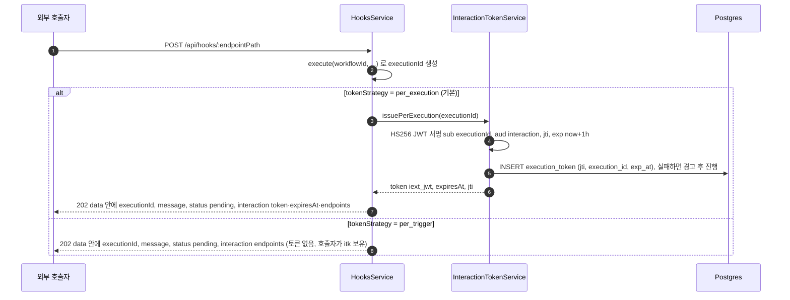
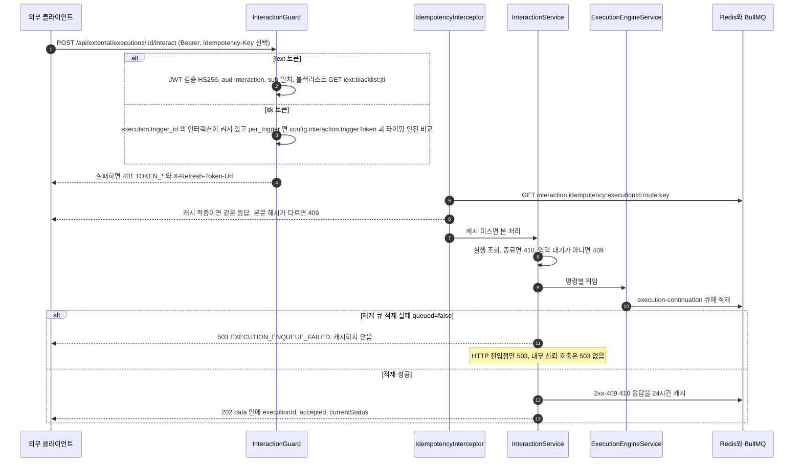
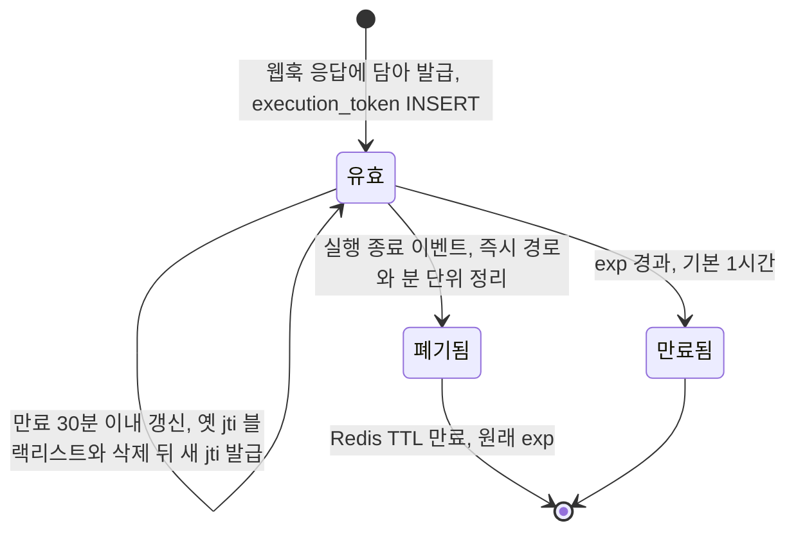

## 개요

이 문서는 [EIA 데이터와 흐름](CLE-EIA-DATA.md) 의 하위 문서로 인터랙션 토큰(`iext_*` · `itk_*`)의 발급, 인바운드 명령의 검증 · 재개 흐름, 두 토큰의 상태 전이 규칙을 정한다.

## 데이터 흐름

### 토큰 발급

`config.interaction.enabled === true` 인 웹훅 트리거가 호출되면, 웹훅 진입 흐름([트리거 데이터와 흐름](../CLE-TRIG/CLE-TRIG-DATA.md))의 끝에서 `HooksService.buildInteractionResponse` 가 응답에 인터랙션 블록을 싣는다.

- 202 응답 모양 전체는 [웹훅 「수신 API」](../CLE-TRIG/CLE-TRIG-WEBHOOK.md#수신-api) 가 정한다. 인터랙션을 켠 트리거의 응답 `data` 에는 `status: "pending"` 과 인터랙션 블록 `interaction` 이 더해진다. 인터랙션 블록의 내용은 토큰 전략마다 다르다. `per_execution` 이면 `token`(이번 실행의 `iext_*`) · `expiresAt`(그 토큰의 만료 시각) · `endpoints` 를 싣는다. `per_trigger` 면 `endpoints` 만 싣는다. 호출자에게 트리거 단위 토큰이 이미 있기 때문이다. 이때 `token` · `expiresAt` 은 키를 싣지 않는다. 부재를 키 생략으로 나타내는 근거는 [HTTP API 규약 §5.5](../CLE-API/CLE-API-CONV.md#55-부재-표현-null-과-키-생략) 의 기준 (b) 다.
- `endpoints` 는 `stream`·`submit`·`status`·`cancel`·`refresh` 다섯 개의 `/api/external/executions/:executionId/*` 경로다.
- 트리거 단위 토큰(`itk_*`, 32바이트 무작위 hex)은 서버가 발급한다. 인터랙션이 켜져 있고(`interaction.enabled === true`) 전략이 `per_trigger` 인 트리거를 만들면 생성 응답에 싣는다. PATCH 결과가 같은 조건인데 이어받을 토큰이 없으면 그 PATCH 응답에 싣는다. 두 응답 모두 평문을 `data.secrets.interactionToken` 에 한 번만 싣는다. 응답 모양은 [트리거 관리 「API」](../CLE-TRIG/CLE-TRIG-MANAGE.md#api) 가 정한다. 재발급은 트리거 단위 토큰 재발급 엔드포인트 `POST /api/triggers/:id/interaction/revoke-token`(`TriggersService.revokePerTriggerToken`)으로 한다. 새 토큰을 `trigger.config.interaction.triggerToken` 에 저장하고 평문은 그 응답에 한 번만 보인다. 가드가 요청마다 설정의 현재 값과만 비교하므로 바꾸는 즉시 옛 토큰은 새 요청에 대해 무효다. 옛 토큰으로 연 SSE 스트림은 서버가 닫는다([트리거 단위 토큰](#트리거-단위-토큰)).

### 인바운드 명령과 재개

명령별 위임(`interaction.service.ts`): 외부 호출은 `expectedNodeId`(=`dto.nodeId`)를 함께 넘겨 publisher 가 실제 대기 노드와 맞춰 본다. 내부 신뢰 호출(채팅 채널)은 `undefined` 를 넘긴다.

| 명령 | 위임 대상 | 비고 |
|---|---|---|
| `submit_form` | `ExecutionEngineService.continueExecution(executionId, data, expectedNodeId)` | `nodeId`·`data` 필수 |
| `click_button` | `ExecutionEngineService.continueButtonClick(executionId, buttonId, expectedNodeId)` | `buttonId` 필수 |
| `submit_message` | `ExecutionEngineService.continueAiConversation(executionId, message, expectedNodeId)` | 멀티턴 AI 대화 |
| `end_conversation` | `ExecutionEngineService.endAiConversation(executionId, expectedNodeId)` | 없음 |
| `cancel`(또는 `POST /:id/cancel` 별칭) | `ExecutionsService.stop(executionId)` | 입력 대기가 아니어도 된다 |

- 위 네 진입점은 엔진에 남은 얇은 위임자로, 재개 큐에 명령을 발행한다. 큐를 소비한 뒤 재개 턴 처리는 협력 서비스가 맡는다(`processAiResumeTurn` → `AiTurnOrchestrator`, `processButtonResumeTurn` → `ButtonInteractionService`, `processFormResumeTurn` → `FormInteractionService`). 엔진 분할 결정은 [실행 엔진 개요와 그래프 순회](../CLE-EXEC/CLE-EXEC-ENGINE.md) 에 있다.
- 모든 재개 명령은 영속 큐 `execution-continuation`(재개 큐)으로 들어간다. 발행자는 `ContinuationBusService` 이고, 큐와 워커는 [큐 워커와 동시 실행 제한](../CLE-EXEC/CLE-EXEC-WORKER.md)·[실행 데이터와 흐름](../CLE-EXEC/CLE-EXEC-DATA.md) 이 정한다. publisher 쪽 명령 사전 검증이 던지는 `InvalidExecutionStateError` 는 `409 STATE_MISMATCH` 로 바뀐다.
- 재개 큐 적재 실패: 발행자가 `queued:false` 를 돌려주면 명령은 503 `EXECUTION_ENQUEUE_FAILED` 로 응답한다. 네 재개 명령(`submit_form`·`click_button`·`submit_message`·`end_conversation`)과 입력 대기 실행의 `cancel` 이 모두 같다. `cancel` 은 `ExecutionsService.stop` 이 이미 이렇게 응답한다. 이 503 은 멱등 캐시에 넣지 않는다. 그래서 같은 멱등 키로 다시 보내면 새로 처리한다. 503 은 토큰으로 인증한 HTTP 진입점의 응답이다. 내부 신뢰 호출(`in_process_trusted`, 아래 항목)로 부른 재개 명령은 `queued:false` 여도 503 을 던지지 않는다. 그 웹훅 호출자에게 가는 응답은 [채팅 채널 「인바운드 HTTP 응답 계약」](../CLE-CHAT/CLE-CHAT-CORE.md#인바운드-http-응답-계약) 을 따른다. 발행 결과(`queued`)의 뜻은 [큐 워커와 동시 실행 제한](../CLE-EXEC/CLE-EXEC-WORKER.md#발행-결과와-ack-에러-표면) 이 정한다. 이 에러 코드의 적용 범위는 [에러 코드 규약과 카탈로그](../CLE-API/CLE-API-ERRCODES.md) 가 정한다.
- 내부 신뢰 호출: 채팅 채널 인바운드(`hooks.service.ts` 의 `handleChatChannelWebhook`)는 HTTP 를 거치지 않고 `scope: 'in_process_trusted'` 컨텍스트를 직접 만들어 같은 위임을 부른다. 토큰 검증을 건너뛰는 것은 서버 내부 모듈만 할 수 있다(타입 union 으로 컴파일러가 강제). 흐름은 [채팅 채널 데이터와 흐름](../CLE-CHAT/CLE-CHAT-DATA.md) 에 있다.
- 토큰 갱신: `POST /:id/refresh-token` 은 `iext_*` 만 받는다(`itk_*` 는 403). 만료 30분 이내(`IEXT_REFRESH_WINDOW_SEC`)에만 새로 발급한다. 옛 jti 를 곧바로 블랙리스트에 올리고 실행 토큰 테이블에서 지운 뒤 새 jti 를 넣는다. 종료된 실행은 410 이다.
- 종료된 실행의 응답 코드: 위 시퀀스의 410 과 토큰 갱신의 410 은 서비스가 내는 코드다. 실행이 끝나면 그 실행의 `iext_*` 를 바로 폐기한다. 그래서 `iext_*` 로 보낸 요청은 보통 가드에서 401 `TOKEN_REVOKED` 로 먼저 막힌다. 410 은 폐기가 빠졌을 때나 `itk_*` 로 보낸 명령에서 나온다. 어느 코드를 정상 경로 코드로 둘지는 [External Interaction API](CLE-EIA.md#미결-사항) 의 미결 사항이다.
- 상태 조회: `GET /:id` 는 실행 행과 대기 중인 노드 실행 출력, 영속 대화 스레드를 읽는 읽기 전용 경로다. 응답 모양은 [EIA 수신 API와 SSE](CLE-EIA-INBOUND.md) 가 정한다. `seq` 는 늘 `0` 이고 순번은 SSE `Last-Event-Id` 로 맞춘다.

## 상태 전이

### 실행 단위 토큰

- 검증 실패 사유는 401 코드로 이렇게 바뀐다(`interaction.guard.ts`). `expired` → `TOKEN_EXPIRED`, `blacklisted` → `TOKEN_REVOKED`, `scope_mismatch` → `TOKEN_SCOPE_MISMATCH`, `audience_mismatch` → `TOKEN_AUDIENCE_MISMATCH`, 그 밖 → `TOKEN_INVALID`.
- 종료 폐기는 최소 한 번이다. 즉시 경로(`NotificationFanout` 의 종료 이벤트 구독)가 프로세스 재시작·장애로 빠지면 `terminal-revoke-reconcile` 정리 작업(분 단위)이 종료된 실행에 남은 실행 토큰을 정리한다. 그래서 누락 때 최악의 폐기 지연은 토큰 수명(1시간)에서 1분 이하로 줄어든다([External Interaction API](CLE-EIA.md)).
- 다만 Redis(블랙리스트 SET·BullMQ) 전면 장애 중에는 두 경로 모두 fail-open 이라 다음 회차나 복구 시점까지 폐기가 늦어진다. 블랙리스트 조회도 fail-open 이므로 그 창에서 토큰이 통과할 수 있다. 새 요청에 대한 최종 안전망은 만료다(보안 trade-off 는 `interaction-token.service.ts` 클래스 주석).
- 실행 단위 토큰으로 연 SSE 스트림은 토큰이 스트림 도중 만료되거나 갱신돼도 닫지 않고 그 실행의 종료 이벤트까지 이어진다. 공개 웹훅(`auth_config_id IS NULL`)이 시작한 입력 대기 실행은 토큰 만료 뒤 유예 시간이 지나면 웹채팅 위젯 유휴 실행 회수(`webchat-idle-reaper`)가 취소해 종료 이벤트로 스트림도 닫힌다. 인증 설정이 연결된 웹훅이 시작한 입력 대기 실행은 기한 없이 멈춰 있을 수 있어 그 스트림에는 상한이 없다. 이 틈은 받아들인 잔여 위험이다(2026-10-17). 대응은 실행 취소(`execution.cancelled` 로 스트림이 닫힘)다. 이유와 기각한 대안은 [재검토에서 갈린 EIA 동작을 정한다](CLE-EIA-DATA.md#재검토에서-갈린-eia-동작을-정한다-2026-10-09) 에 있다.

### 트리거 단위 토큰

트리거 단위 토큰(`itk_*`)의 발급 조건과 응답은 [토큰 발급](#토큰-발급) 에 있다. 생성 때는 트리거 INSERT 와 같은 트랜잭션에서 발급하므로 실패하면 트리거 행도 남지 않는다. 이미 토큰이 있으면 새로 발급하지 않는다. 인터랙션을 껐다가 다시 켜는 경우도 같다. 발급 시점의 이유는 [트리거 단위 토큰을 생성과 PATCH 에서 발급한다](#트리거-단위-토큰을-생성과-patch-에서-발급한다-2026-10-17) 에 있다.

재발급하면 옛 토큰은 새 요청에 대해 곧바로 무효다. PATCH 가 값을 잇거나 지우는 규칙은 [엔티티와 저장소 「트리거 확장」](CLE-EIA-DATA-STORE.md#트리거-확장) 에 있다. 지운 뒤 다시 `per_trigger` 로 바꾸면 새 토큰을 발급하고 옛 토큰은 다시 살아나지 않는다. 트리거를 지우면 설정과 함께 사라진다. 수명과 갱신 개념이 없다.

가드는 설정의 `interaction.enabled` 가 `true` 이고 `tokenStrategy` 가 `per_trigger` 일 때만 이 값을 쓴다. 이때 요청마다 현재 설정 값과 타이밍 안전 비교를 한다(SHA-256 해시 뒤 `timingSafeEqual`, 길이 노출 차단). 조건이 맞지 않으면 401 `TOKEN_INVALID` 로 거부한다.

SSE 스트림의 토큰 확인 시점(열 때, 연결 자리 확보 뒤, 60초마다)은 [SSE 스트림](CLE-EIA-DATA-SSE.md#sse-스트림) 에 있다. 트리거 단위 토큰이 무효가 되면 서버는 그 토큰으로 연 SSE 스트림을 닫는다. 무효가 되는 경우는 네 가지다.

1. 재발급 엔드포인트로 새 토큰을 발급할 때
2. PATCH 가 전략을 바꾸거나 `interaction` 을 없애 값을 지울 때
3. PATCH 가 인터랙션을 끌 때. 토큰 값은 남지만 가드가 거부한다. 인터랙션을 다시 켜면 같은 토큰이 다시 통한다
4. 트리거를 지울 때

2 · 3 의 PATCH 는 top-level `interaction` 이 실린 PATCH 다. 서버는 SSE 응답을 끝내 스트림을 닫는다. 새 이벤트 이름은 만들지 않는다. 클라이언트가 옛 토큰으로 다시 연결하면 가드가 401 `TOKEN_INVALID` 로 거부한다. 닫기는 모든 서버 인스턴스에 미친다. 토큰을 무효로 만든 요청을 처리한 서버 인스턴스는 자기 구독자를 닫고 전역 채널 `eia:sse:close` 로 트리거 id 를 알린다. 다른 서버 인스턴스는 그 신호를 받아 자기 구독자를 닫는다. 그 신호가 유실되면 받지 못한 서버 인스턴스의 스트림은 다음 재확인까지 최대 60초 남는다([SSE 버퍼와 실시간 전달을 Redis 에 둔다](CLE-EIA-DATA-SSE.md#sse-버퍼와-실시간-전달을-redis-에-둔다-2026-10-17) 의 남은 위험). WebSocket 은 소켓 수명을 토큰 수명에 묶는다([WebSocket 연결과 채널 구독](../CLE-API/CLE-API-WS.md#소켓-수명을-토큰-수명에-묶는다-2026-09-02)). 두 방식의 관계는 [재검토에서 갈린 EIA 동작을 정한다](CLE-EIA-DATA.md#재검토에서-갈린-eia-동작을-정한다-2026-10-09) 에 있다.

## 구현 위치

- `codebase/backend/src/modules/external-interaction/interaction-token.service.ts` (발급·검증·`revokeAllForExecution`·`reconcileTerminalRevocations`)
- `codebase/backend/src/modules/external-interaction/terminal-revoke-reconciler.service.ts`
- `codebase/backend/src/modules/external-interaction/webchat-idle-reaper.service.ts`
- `codebase/backend/src/modules/external-interaction/interaction.guard.ts` (두 토큰 계열 검증, `itk_*` 는 인터랙션 켜짐과 `per_trigger` 일 때만, 스트림 재확인용 토큰 유효 판정)
- `codebase/backend/src/modules/external-interaction/interaction.service.ts` (명령 위임, 재개 큐 적재 실패 응답)
- `codebase/backend/src/modules/external-interaction/interaction.controller.ts` (`/api/external/executions/:executionId/*` REST: interact · cancel · refresh-token · 상태 조회)
- `codebase/backend/src/modules/external-interaction/idempotency.interceptor.ts`
- `codebase/backend/src/modules/hooks/hooks.controller.ts` (웹훅 202 응답의 `message`)
- `codebase/backend/src/modules/hooks/hooks.service.ts` (`buildInteractionResponse`, `handleChatChannelWebhook`)
- `codebase/backend/src/modules/triggers/trigger-resource-release.ts` (`cleanUpDeletedTriggersAfterCommit`, 트리거 삭제 커밋 뒤 스트림 닫기)

## Rationale

### 트리거 단위 토큰을 생성과 PATCH 에서 발급한다 (2026-10-17)

인터랙션이 켜져 있고 전략이 `per_trigger` 인 트리거를 만들면 서버가 `itk_*` 를 발급해 생성 응답 `data.secrets.interactionToken` 에 한 번 싣는다. PATCH 결과가 같은 조건인데 이어받을 토큰이 없을 때도 발급한다. 이미 토큰이 있으면 발급하지 않는다. 사용자 결정(2026-10-17)이다.

- 이전에는 생성 때 발급하는지가 [External Interaction API](CLE-EIA.md#미결-사항) 의 미결 사항이었다. 그동안 `per_trigger` 트리거는 재발급 엔드포인트(`revoke-token`)를 한 번 불러야 첫 토큰을 받았다. 전략을 바꿨다가 `per_trigger` 로 되돌릴 때도 같았다. 그 전까지 가드는 토큰이 없는 트리거의 요청을 401 로 거부한다. 그래서 인터랙션을 켜도 그 트리거는 쓸 수 없는 상태로 남았다.
- 첫 알림 서명 시크릿과 같은 모양이다. 서버가 만든 비밀은 그 비밀이 생긴 요청의 응답에 한 번 싣는다. 응답 필드도 같은 묶음(`data.secrets`)에 둔다. 발급하지 않은 응답에는 키를 싣지 않는다([HTTP API 규약 §5.5](../CLE-API/CLE-API-CONV.md#55-부재-표현-null-과-키-생략) 기준 (b)).
- 인터랙션을 껐다가 다시 켜면 발급하지 않는다. 끄는 PATCH 는 토큰을 남기므로 이어받을 토큰이 있기 때문이다. 끄는 PATCH 가 토큰을 남기는 규칙(2026-10-09 사용자 답)과 전략 변경 규칙의 관계는 [재검토에서 갈린 EIA 동작을 정한다](CLE-EIA-DATA.md#재검토에서-갈린-eia-동작을-정한다-2026-10-09) 의 첫 항목에 있다.
- 기각한 대안은 «생성 때 발급하지 않고 재발급 엔드포인트로만 받는다»(그때까지의 동작)다. 인터랙션을 켠 트리거가 첫 재발급 전까지 쓸 수 없는 상태로 남는다. 첫 알림 서명 시크릿의 처리와도 갈린다.
