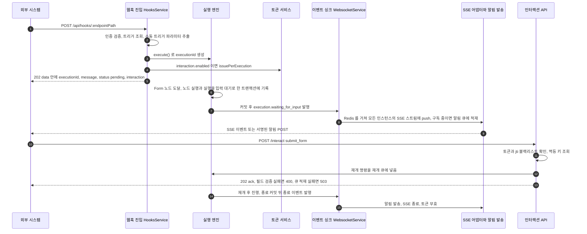

## 개요

이 문서는 [External Interaction API](CLE-EIA.md) 의 하위 문서로 실행별 레이트 리밋, CORS, 폼 입력 · AI 멀티턴 처리 흐름, 실행 종료 시 토큰 폐기, 공개 위젯의 방치된 입력 대기 회수, EIA 컨트롤러의 API 문서화를 정한다. 요구사항은 부모 문서의 [요구사항](CLE-EIA.md#요구사항) 절에 있고, 커밋 뒤 발송 규칙은 부모의 [트랜잭션과 발송 순서](CLE-EIA.md#트랜잭션과-발송-순서) 가 정한다.

## 레이트 리밋

아래 한도는 전역 스로틀 가드(`UserThrottlerGuard`, 분당 100건, `app.module.ts` 의 `APP_GUARD`) 위에 얹는 층이다. 전역 가드의 카운트 기준은 [부모 「미결 사항」](CLE-EIA.md#미결-사항) 참조. 한 클라이언트가 여러 실행을 다뤄도 실행별로 따로 세고, 두 층은 각자 넘으면 429 를 낸다.

| 대상 | 한도 | 구현 | 초과 응답 |
|---|---|---|---|
| 인바운드 명령(`/interact`, `/cancel` 합산) | 실행당 분당 60 | 구현됨. `InteractionRateLimiterService`(Redis 고정 윈도우, fail-open) + `InteractionRateLimitGuard` | `429 RATE_LIMITED` + `Retry-After`(남은 윈도우 초) |
| SSE 동시 연결 | 실행당 3. 모든 서버 인스턴스의 연결을 합해 센다 | 구현됨. `interaction-stream.controller.ts`, 전역 집계는 `sse-fanout.service.ts` | `429 TOO_MANY_CONNECTIONS` |
| 단발 상태 조회 | 실행당 분당 120 | 구현됨. 위 리미터의 별도 버킷 | `429 RATE_LIMITED` + `Retry-After` |
| EIA 알림 웹훅 발송 | 트리거당 분당 60 | 구현됨. `OutboundNotificationRateLimiterService`(Redis 고정 윈도우 `INCR`+`EXPIRE NX`) | 버리지 않고 발송한다. 넘으면 발송 건강도를 저하됨으로 표시한다([EIA 알림 웹훅](CLE-EIA-NOTIFY.md)) |

버킷마다 Redis 키가 따로 있다. 키 형태 규칙은 [Redis 키 명명 규약](../CLE-ENG/CLE-ENG-REDIS.md), 전역 목록은 [비동기 큐와 Redis 키 목록](../CLE-PLAT/CLE-PLAT-QUEUE.md) 에 있다.

| 버킷 | 키 |
|---|---|
| 인바운드 명령(`/interact`, `/cancel` 합산) | `eia:rl:interact:<executionId>` |
| 단발 상태 조회 | `eia:rl:status:<executionId>` |
| EIA 알림 웹훅 발송 | `eia:notif:rl:<triggerId>` |

SSE 동시 연결 수는 실행마다 Redis 에 모아 센다. 그 키와 Redis 를 쓸 수 없을 때의 정책은 [EIA 데이터와 흐름 「SSE 스트림」](CLE-EIA-DATA.md#sse-스트림) 이 정한다. 서버 인스턴스가 죽어 연결 종료를 기록하지 못해도 그 연결의 자리는 마지막 heartbeat 뒤 45초가 지나면 빠진다. Redis 를 쓸 수 없으면 서버 인스턴스마다 따로 센다.

`/cancel` 은 `interact` 의 `command: "cancel"` 과 같은 뜻이므로 인바운드 명령 버킷에 합산한다. 별칭 경로로 한도를 피하지 못하게 하기 위해서다. `/refresh-token` 은 명령도 조회도 아닌 토큰 관리 경로라 실행별 한도 밖이고 전역 스로틀만 받는다. 인바운드 한도의 429 는 시스템 전역 기본 코드 `RATE_LIMITED` 를 그대로 쓴다. SSE 동시 연결 초과의 `TOO_MANY_CONNECTIONS` 는 EIA 전용 코드이고 별개 경로다.

## CORS

`/api/external/executions/:id` 와 그 아래 경로(`/interact`·`/stream`·`/cancel`·`/refresh-token`, 상태 조회 `GET` 포함)는 CORS 를 허용한다. `Access-Control-Allow-Origin` 은 워크스페이스 설정 `interactionAllowedOrigins` 를 기준으로 정한다. 설정이 없으면 막으므로 브라우저에서 부르려면 사용자가 명시적으로 설정해야 한다. 설정 위치는 워크스페이스 설정 개요 탭(관리자 이상), `PATCH /api/workspaces/:id/settings` 다([워크스페이스와 멤버](../CLE-ACCT/CLE-ACCT-WS.md)).

공식 웹채팅 위젯의 배포 주소는 빌트인 상수로 모든 워크스페이스에서 항상 허용한다. `interactionAllowedOrigins` 는 그 밖의 추가 origin(고객이 직접 만든 UI 도메인 등)을 더한다. 웹훅 진입점(`/api/hooks/:endpointPath`)은 기존대로 CORS 제한이 없다.

구현은 전역 `app.enableCors` 를 `CorsOptionsDelegate` 한 층으로 바꿔 경로별로 나눈다(`main.ts`, `common/cors/web-chat-cors.ts`, `modules/web-chat-cors`). `/api/hooks/*` 는 제한 없음, `/api/external/*` 는 워크스페이스 허용 목록(`WebChatCorsOriginResolver` 가 실행 → 워크플로우 → 워크스페이스로 찾아가고 60초 캐시), 그 밖의 경로는 기존 프런트엔드 허용 목록과 credentials 를 유지한다. delegate 가 하나라 `Access-Control-Allow-Origin` 이 두 번 붙는 충돌이 없다. 경로 판정·빈 목록 처리 같은 세부 규칙은 [웹채팅 보안](../CLE-WEBCHAT/CLE-WEBCHAT-SECURITY.md) 이 정한다.

## 처리 흐름

### 실행 단위 토큰으로 폼 입력 받기

외부 시스템이 웹훅으로 실행을 시작하고, Form 노드에서 멈춘 뒤, 외부 사용자의 응답으로 이어지는 흐름이다.

1. 외부 시스템이 `POST /api/hooks/:endpointPath` 로 호출한다.
2. `HooksService` 가 인증을 검증하고 트리거를 찾아 수동 트리거 노드의 파라미터를 뽑는다.
3. `ExecutionEngineService.execute()` 가 실행을 만든다.
4. `interaction.enabled=true` 이면 `InteractionTokenService.issuePerExecution(executionId)` 가 `iext_*` 를 만든다.
5. `202 Accepted` 로 응답한다. 응답 `data` 에는 `executionId` · `message` · `status: "pending"` · `interaction` 이 있다. 모양의 기준은 [웹훅 「수신 API」](../CLE-TRIG/CLE-TRIG-WEBHOOK.md#수신-api) 다.
6. 백그라운드에서 실행이 진행되다 Form 노드에 닿는다. 엔진은 노드 실행 상태를 `WAITING_FOR_INPUT` 으로 바꾸고 같은 트랜잭션에서 실행 상태도 바꾼다.
7. 트랜잭션이 커밋된 뒤 `WebsocketService.emitToExecution(execution.waiting_for_input, payload)` 가 이벤트를 낸다. 이벤트는 내부 WS 구독자에게 전달되고 SSE 어댑터도 서버 안 구독(`executionEvents$`)으로 받는다. 이벤트를 낸 서버 인스턴스의 SSE 어댑터는 그 이벤트를 Redis 의 재전송 버퍼와 실행별 채널에 넣는다. 그 실행의 SSE 구독자가 붙은 서버 인스턴스는 채널에서 이벤트를 받아 외부 SSE 스트림에 쓴다. 키와 Redis 장애 때의 동작은 [EIA 데이터와 흐름 「SSE 스트림」](CLE-EIA-DATA.md#sse-스트림) 이 정한다.
8. `notification.events` 에 `execution.waiting_for_input` 이 있으면 `NotificationFanout` 이 `NotificationDispatcher.enqueue` 로 발송을 맡긴다. 발송 직전에 실행 상태를 다시 읽어 낡은 알림을 막고, `notification.url` 로 HMAC 서명해 POST 한다.
9. 외부 시스템은 알림을 받아 자체 UI 로 폼을 안내하거나, SSE 스트림으로 같은 이벤트를 받는다.
10. 사용자 응답을 받은 외부 시스템이 `POST /api/external/executions/:id/interact { command: "submit_form", ... }` 를 보낸다.
11. 인터랙션 API 는 `iext_*` 를 검증(jti 블랙리스트 확인)하고 멱등 키 캐시를 조회한다. 검증을 통과하면 재개 명령을 재개 큐(`execution-continuation`)에 넣는다. 내부 WS 의 `execution.submit_form` 과 같은 경로다. 필드 검증에 실패하면 `400 VALIDATION_ERROR` 와 `details[]` 를 돌려주고 실행 상태는 그대로 둔다. 재개 큐에 넣지 못하면 `503 EXECUTION_ENQUEUE_FAILED` 를 돌려준다. 이 503 은 멱등 캐시에 넣지 않는다([EIA 수신 API와 SSE 「명령 에러」](CLE-EIA-INBOUND.md#명령-에러)).
12. 엔진이 입력을 받아 재개하고 다음 노드로 간다.
13. 실행이 끝나면 트랜잭션 커밋 뒤 알림과 SSE 를 함께 보내고, SSE 를 닫고, 토큰을 무효로 만든다.

재개 큐와 명령별 위임 대상은 [EIA 데이터와 흐름](CLE-EIA-DATA.md), 재개 계약은 [실행 상태 머신과 대기·재개](../CLE-EXEC/CLE-EXEC-STATE.md) 에서 정한다.

### 트리거 단위 토큰으로 AI 멀티턴 대화

1~6단계는 위와 같다. 트리거 단위 토큰 전략이면 웹훅 응답에 토큰을 싣지 않는다. 호출자는 트리거를 만들거나 PATCH 할 때 응답으로 받은 `itk_*` 를 쓴다([인터랙션 토큰](CLE-EIA-TOKEN.md#인터랙션-토큰)).

7. AI Agent 멀티턴에 처음 들어가면 실행이 입력 대기가 되고 `conversationConfig` 를 함께 싣는다.
8. `notification.events` 에 해당 이벤트가 있으면 알림과 SSE 를 함께 보낸다.
9. 외부 시스템은 사용자 메시지마다 `itk_*` 로 `POST /interact { command: "submit_message", message }` 를 보낸다. 진행 중에는 `execution.ai_message` 가 SSE 로 흐르고, 알림 웹훅으로도 선택 구독할 수 있다. 사용자가 대화를 끝내면 `POST /interact { command: "end_conversation" }` 를 보낸다.
10. 끝나면 `execution.completed` 알림(또는 `user_ended` 포트로 이어지는 흐름)을 보내고 SSE 를 닫는다.

## 종료 시 토큰 폐기

실행이 끝날 때 토큰 무효화는 두 경로로 최소 한 번을 보장한다.

1. **즉시 경로**: 엔진이 종료 이벤트(`execution.completed`·`failed`·`cancelled`)를 단일 싱크에 내면 `NotificationFanout` 이 바로 `revokeAllForExecution` 을 부른다. 수십 ms 안에 끝나는 최선 노력 경로다. 이 싱크는 버퍼 없는 RxJS `Subject` 라서, 프로세스가 재시작하거나 죽으면 처리 중이던 종료 이벤트와 함께 폐기가 빠질 수 있다. 폐기 자체도 Redis·DB 장애 때 경고만 남기고 넘어간다(fail-open).
2. **정리 경로**: BullMQ 반복 작업(`terminal-revoke-reconcile`, 분 단위 `* * * * *`)이 실행 토큰 테이블을 종료된 실행과 조인해, 끝났는데 토큰이 남은 실행을 찾아 `revokeAllForExecution` 을 다시 부른다. 폐기는 멱등이라(블랙리스트 SET·행 DELETE 반복이 무해) 즉시 경로와 겹쳐도 안전하다. BullMQ 반복 작업은 Redis 중앙 스케줄에 한 항목으로 등록돼 여러 인스턴스에서도 전역 한 번만 돈다(로그인 이력 정리 작업과 같은 패턴).

그래서 즉시 경로가 빠져도 최악의 폐기 지연은 토큰 수명(1시간)에서 정리 간격(1분 이하)으로 줄어든다. 정리 작업 등록(`TerminalRevokeReconcilerService.onModuleInit` 의 `upsertJobScheduler`)이 실패하면 부팅을 막는다. 매 회차의 정리 실패는 삼키고 다음 회차에 다시 한다. 이 큐는 시스템 상태 모니터링 목록(`MONITORED_QUEUES`, group `system`)에 올라 있다.

## 공개 위젯의 방치된 입력 대기 회수

공개 웹채팅 위젯(`auth_config_id IS NULL`, 실행 단위 토큰)은 패널을 열 때마다 실행을 바로 시작한다. 사용자가 탭을 닫거나 "닫기"로 떠나면 그 실행은 명시적 종료 없이 입력 대기로 남는다. 위젯의 "새 대화" 최선 노력 `cancel` 은 정상 경로만 닫는다. 그래서 놓친 실행을 서버가 회수하는 backstop 으로 웹채팅 위젯 유휴 실행 회수를 둔다(구현됨, `WebChatIdleReaperService`).

- 판정: 실행 토큰 행이 하나 이상 있고 가장 늦은 `execution_token.exp_at` 뒤로 유예 시간(`WEBCHAT_IDLE_REAP_GRACE_MS`, 기본 3600000ms=1시간)이 지난 입력 대기 실행이다. 익명 위젯은 만료 뒤 토큰을 갱신할 수 없다. 만료된 JWT 는 `InteractionGuard` 가 401 로 먼저 막아 갱신 핸들러에 닿지 못한다. 살아 있는 세션은 만료 전에 미리 갱신해 유지하므로, 모든 토큰이 만료됐다는 것은 입력이 올 경로가 사라졌다는 증명이다.
- 동작: BullMQ 반복 작업(`webchat-idle-reaper`, 분 단위, 전역 한 번)이 대상을 찾아 엔진 `markWebChatIdleTimeout` 으로 조건부 UPDATE(`cancelled`, `cancelledBy='timeout'`, `error.code='WEBCHAT_IDLE_TIMEOUT'`)하고 `revokeAllForExecution` 을 부른다.
- 회수는 소프트 종료다. 행을 지우지 않고 `cancelled` 로 바꾼 뒤 토큰을 일괄 폐기한다. 이력과 상태 조회(`GET /api/external/executions/:id`)는 남는다.
- 범위는 공개 웹훅이 시작했고 실행 토큰 행이 있는 실행뿐이다. 인증 설정이 연결된 트리거의 실행은 대상이 아니다. 토큰 행이 없는 실행도 대상이 아니다. 트리거 단위 토큰을 쓰는 실행, 채팅 채널 실행, 인터랙션을 켜지 않은 웹훅 실행이 여기 든다. 노드 설정에는 입력 대기 기한이 없고([Presentation 노드 공통](../CLE-NODE-PRES/CLE-NODE-PRES-COMMON.md#규칙) 규칙 10) 이 회수는 노드 설정과 관계없다.
- 웹채팅 위젯의 재로드 `401` 도 이 규칙(만료 뒤 갱신 불가)을 따른다. 위젯 쪽 처리는 [웹채팅 인증과 세션](../CLE-WEBCHAT/CLE-WEBCHAT-SESSION.md) 이 정한다.

실행 엔진이 입력 대기 실행을 기한 없이 보존한다는 불변식은 [장애 복구와 안전 종료](../CLE-EXEC/CLE-EXEC-RECOVERY.md) 가 정한다. 이 회수는 그 불변식이 보호하는 "곧 올 입력을 기다리는" 경우와 겹치지 않는다.

## API 문서화

EIA 컨트롤러는 워크스페이스 JWT(`access-token` scheme) 대신 별도 토큰 계열(`iext_*`·`itk_*`)로 인증한다. 그래서 [OpenAPI 문서화](../CLE-API/CLE-API-SWAGGER.md) 의 기본 `@ApiBearerAuth('access-token')` 대신 다음을 쓴다.

- `main.ts` 에 Bearer scheme `interaction-token` 을 따로 등록한다.
- 컨트롤러 클래스에 `@ApiBearerAuth('interaction-token')` 을 붙인다.
- Swagger UI 의 토큰 입력란이 `access-token` 과 따로 보여야 한다.

웹훅 진입점(`/api/hooks/:endpointPath`)은 `@Public()` 으로 JWT 인증을 건너뛴다(`hooks.controller.ts`). `@ApiSecurity({})` 는 따로 붙이지 않는다. 보안 없음은 데코레이터 없이 설명으로 적고, HMAC 검증은 핸들러 안에서 한다. 응답 DTO·공용 래퍼·에러 응답 문서화는 [OpenAPI 문서화](../CLE-API/CLE-API-SWAGGER.md) 의 응답 DTO 규약을 따른다. `InteractAckDto` 같은 EIA ack DTO 도 공용 래퍼 헬퍼·새 엔드포인트 체크리스트·에러 응답 참조 규약을 따른다.

## 구현 위치

- `codebase/backend/src/modules/external-interaction/`
  - `interaction.controller.ts` (`/interact`·`/cancel`·`/refresh-token`·상태 조회, `@Controller('external/executions')` + 전역 prefix `api`)
  - `interaction-stream.controller.ts` (SSE)
  - `interaction.service.ts` (토큰 검증 뒤 명령을 내부 재개 경로로 넘김)
  - `terminal-revoke-reconciler.service.ts`, `terminal-revoke-reconciler.types.ts` (종료 토큰 정리 작업과 큐 이름 상수)
  - `webchat-idle-reaper.service.ts`, `webchat-idle-reaper.types.ts` (공개 위젯 입력 대기 회수, `WEBCHAT_IDLE_REAP_GRACE_MS`)
  - `notification-fanout.service.ts`, `notification-dispatcher.service.ts`, `notification-webhook.processor.ts`, `notification-signature.util.ts` (알림 발송)
  - `sse-adapter.service.ts` (SSE 구독자 관리와 재전송 판정)
  - `sse-fanout.service.ts` (Redis Stream 재전송 버퍼, 실행별 실시간 채널, 전역 닫기 채널, 전역 동시 연결 상한)
  - `idempotency.interceptor.ts` (멱등 키)
  - `entities/execution-token.entity.ts`
  - `dto/interact.dto.ts`, `dto/cancel.dto.ts`, `dto/responses/*-response.dto.ts` (`ExecutionStatusDto`·`InteractAckDto`·`RefreshTokenResponseDto`)
- `codebase/channel-web-chat/src/lib/eia-client.ts`, `eia-types.ts` (참조 클라이언트)

## Rationale

### 종료 토큰 폐기는 실행 토큰 테이블로 정리한다

종료 시 토큰 무효화를 즉시 경로와 실행 토큰 테이블 기반 정리 작업의 두 경로로 보장한다. 핵심 판단은 전용 outbox 테이블을 만들지 않는 것이다. 종료 전이 트랜잭션에 outbox 행을 쌓고 폴링하는 전형적인 transactional outbox 도 검토했다. 그러나 실행 토큰 테이블이 이미 발급 토큰을 실행별로 영속 추적하고 있어서 "실행은 끝났는데 토큰 행이 남아 있다" 는 사실 자체가 처리 안 된 폐기 신호다. 즉 실행 토큰 테이블이 곧 outbox 다. 따로 테이블을 두면 같은 사실을 두 번 기록하게 되고 마이그레이션과 정합 부담만 는다.

기각한 대안:

- 즉시 경로만 두기(이전 방식): 프로세스 재시작 때 처리 중이던 이벤트가 사라져 토큰이 수명(1시간)까지 남을 수 있다.
- 전용 outbox 테이블: 위의 이중 기록 때문에 기각했다.
- 토큰 수명 줄이기: 정상 클라이언트의 갱신 횟수가 늘고(UX·요청량 부작용) 근본 해결이 아니다.

남는 위험: 정리 작업도 Redis(BullMQ) 장애 중에는 다음 회차로 밀리고, 두 경로 모두 Redis 블랙리스트 SET 에 기대므로 Redis 전면 장애 중에는 폐기가 늦어진다. 블랙리스트 조회도 fail-open 이라 그 창에서 토큰이 통과할 수 있다. 토큰이 단명이고 실행 범위라 위험이 낮다는 전제로 받아들인다. 실질 개선은 최악 지연을 1시간에서 1분 이하로 줄인 것이다. 부팅 때 정리 작업 등록 실패를 부팅 차단으로 두는 것은, 등록 실패가 Redis 미연결 같은 운영 설정 오류라 부팅 시점에 드러내는 편이 안전하기 때문이다(로그인 이력 정리 작업과 같은 정책).

### 공개 위젯 회수 신호는 토큰 만료다

- 판정 신호는 토큰 영구 만료다. 일괄 유휴 타이머는 쓰지 않는다. "N일 동안 조용하면 종료" 같은 엔진 전역 정리는 며칠 뒤 입력이 올 정당한 대기를 잘못 끝낼 위험이 있다([장애 복구와 안전 종료](../CLE-EXEC/CLE-EXEC-RECOVERY.md) 의 무기한 보존). 익명 위젯 토큰은 만료 뒤 갱신할 수 없으므로 "발급한 토큰이 모두 만료됨" 은 익명 사용자가 그 실행을 영원히 이을 수 없다는 증명이다. 회수 대상과 불변식의 보호 대상이 겹치지 않으므로 보호를 약하게 만들지 않는다.
- 판정과 범위는 2026-10-17 에 지금 코드(`WebChatIdleReaperService`)에 맞춰 바로잡았다. 이 회수는 토큰 만료를 증거로 삼으므로 토큰 행이 없는 실행은 회수할 증거가 없어 뺀다.
- `cancelledBy` 닫힌 union 을 넓히지 않는다. 입력 대기 회수도 시간 한도 초과라 큐 대기 초과와 같은 `cancelledBy='timeout'` 을 쓰고, 새 `error.code='WEBCHAT_IDLE_TIMEOUT'` 으로만 나눈다(선례: `'system'`+`RESUME_*`, `'timeout'`+`EXECUTION_QUEUE_WAIT_TIMEOUT`). 코드 prefix 를 `CHANNEL_` 대신 `WEBCHAT_` 으로 둔 것은 범위에서 뺀 [채팅 채널](../CLE-CHAT/CLE-CHAT-CORE.md) 모듈과 이름이 헷갈리지 않게 하려는 것이다.
- 메커니즘은 새 구조를 만들지 않고 종료 토큰 정리 작업의 형제로 둔다. [실행 상태 머신과 대기·재개](../CLE-EXEC/CLE-EXEC-STATE.md) 의 전이표가 `waiting_for_input → cancelled` 사유로 "타임아웃" 을 이미 예약해 두었고, 이 회수가 그 사유의 첫 구현이다. EIA 층은 이미 종료 토큰 정리 작업(BullMQ 반복·실행 토큰 테이블·전역 한 번)을 운영하므로, 회수 작업은 같은 층·같은 데이터·같은 패턴의 형제다. 헷갈리지 않게 서비스·큐 이름만 나눈다. 따라서 실행 엔진의 "새 주기 스캐너 도입 안 함" 원칙(작업이 있는 RUNNING·대기 중 실행 복구 범위)과 관계없다. park 는 BullMQ 작업이 아예 없어 엔진 복구 대상이 아니다.
- 기각한 대안: 실행마다 지연 작업을 두고 토큰을 갱신할 때마다 다시 예약해 만료+유예 시점에 터뜨리는 안. 대기 실행(잠재적으로 수백만)마다 지연 작업을 추적해야 하고, 갱신마다 다시 예약하는 비용이 들며, 작업 없는 park 설계를 뒤집는다. 실행 토큰 테이블을 그대로 쓰는 전역 정리 한 번이 더 단순하고 싸다.
