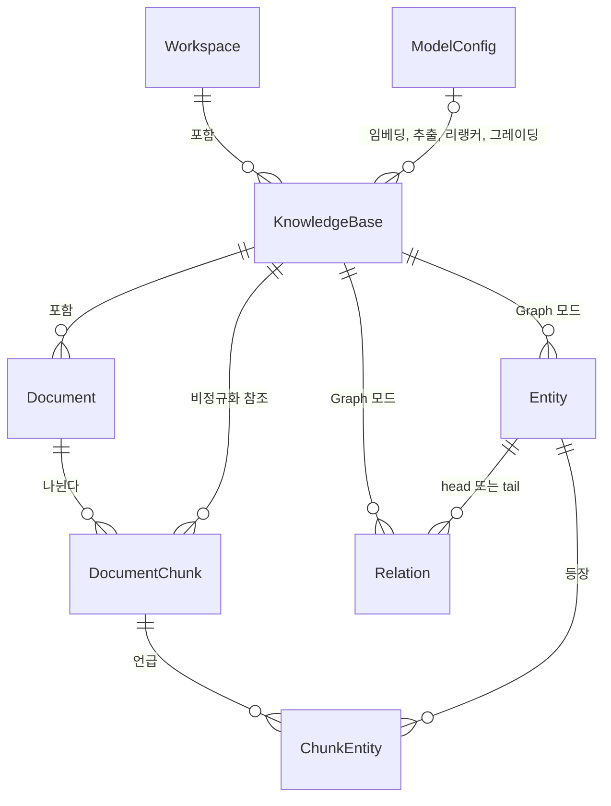
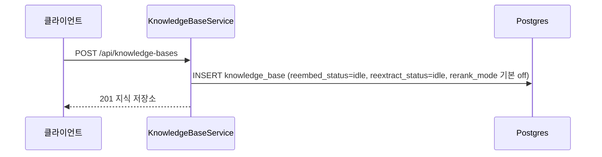
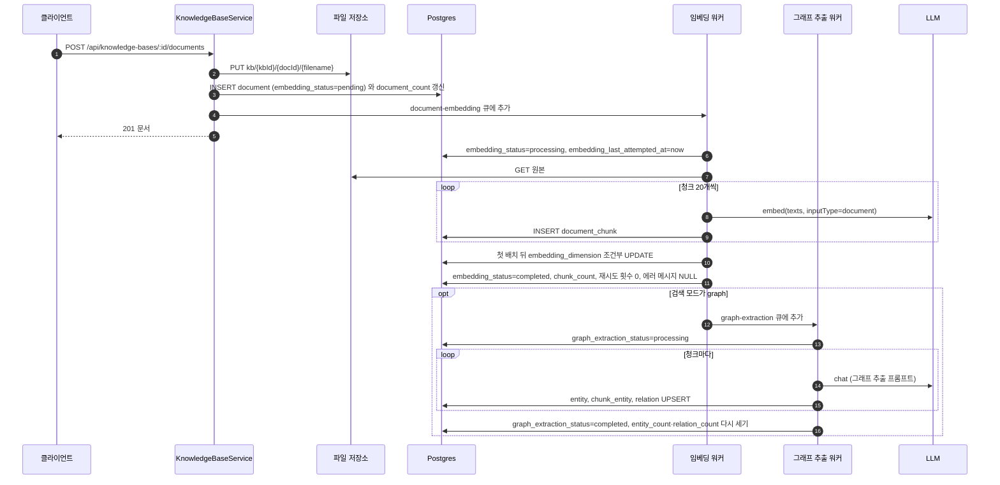

> 구현 상태: 구현됨 · 원문: `spec/data-flow/6-knowledge-base.md`, `spec/1-data-model.md` (§2.11 KnowledgeBase, §2.12 Document, §2.12.1~§2.12.4, Rationale «그래프 RAG 삭제 연쇄의 FK 인덱스 넷») · 용어: [용어 사전](../CLE-GLOSSARY.md)

## 개요

이 문서는 지식 저장소(Knowledge Base, `KnowledgeBase`) 영역의 엔티티와 데이터 흐름을 정한다. 지식 저장소, 문서(Document, `document`), 청크(chunk, `DocumentChunk`), Graph RAG 의 Entity(`GraphEntity`), Relation(`GraphRelation`), 청크-Entity 매핑(`ChunkEntity`)의 컬럼, 제약, 인덱스는 이 문서와 하위 문서 [엔티티 스키마](CLE-KB-DATA-SCHEMA.md) 가 권위 정의다. 흐름마다 어느 테이블·큐·저장소에 무엇을 쓰는지도 여기서 정한다.

지식 저장소는 AI 에이전트가 참조하는 문서 지식을 모아 청크로 나누고 임베딩해 검색하는 파이프라인이다. 검색 모드(`rag_mode`)는 Vector RAG(`rag_mode=vector`)와 Graph RAG(`rag_mode=graph`) 두 가지이고 만들 때 정한 뒤 바꾸지 않는다.

검색은 넓게 가져오기, 선택적 리랭킹(지식 저장소 하나일 때만), 동적 점수 컷의 세 단계다([RAG 검색](CLE-KB-SEARCH.md)). 저장 청크 차원(`embedding_dimension`)이 NULL 인 지식 저장소는 검색에서 통째로 빠진다.

범위 밖:

- 적재·재시도·회수 동작은 [문서 임베딩](CLE-KB-EMBED.md), 검색 규칙은 [RAG 검색](CLE-KB-SEARCH.md), 그래프 추출과 확장 검색은 [Graph RAG](CLE-KB-GRAPH.md) 에서 정한다.
- 화면과 API 목록은 [지식 저장소 관리](CLE-KB-MANAGE.md) 에서 정한다.
- 모델 설정(`ModelConfig`) 엔티티는 [LLM 사용량 기록](../CLE-AI/CLE-AI-USAGE.md), 모델 설정 화면은 [모델 설정](../CLE-AI/CLE-AI-MODELS.md) 에서 정한다.
- 전체 엔티티 지도와 인덱스 전략은 [데이터 모델 개요](../CLE-PLAT/CLE-PLAT-DATA.md), 큐 카탈로그는 [비동기 큐와 Redis 키 목록](../CLE-PLAT/CLE-PLAT-QUEUE.md), 파일 키 규칙은 [파일 저장소](../CLE-PLAT/CLE-PLAT-STORAGE.md), WebSocket 이벤트 카탈로그는 [WebSocket 이벤트와 명령](../CLE-API/CLE-API-WS-EVENTS.md) 에서 정한다.

코드 진입점:

| 파일 | 맡는 일 |
|---|---|
| `knowledge-base/knowledge-base.service.ts` | 지식 저장소·문서 CRUD, 파일 저장소 업로드·다운로드, 임베딩 테스트 |
| `knowledge-base/embedding/embedding.service.ts` | 문서를 청크로 나누고 임베딩 |
| `knowledge-base/graph/graph-extraction.service.ts` | 청크에서 Entity·Relation 추출 |
| `knowledge-base/graph/graph-query.service.ts` | 그래프 확장 |
| `knowledge-base/search/rag-search.service.ts` | Vector·Graph 검색과 리랭킹 분기 |
| `knowledge-base/search/rerank.service.ts` | cross-encoder 재점수와 LLM 그레이딩 |
| `knowledge-base/search/dynamic-cut.util.ts` | 동적 점수 컷 상수와 함수(`RAG_RECALL_K`, `applyDynamicCut`, `hnswEfSearchFor`) |
| `model-config/` | 리랭커(`kind=rerank`) 등 모델 설정 CRUD. 리랭킹 서비스는 `ModelConfigService.resolveConfig(id, ws, 'rerank')` 를 직접 부른다 |
| `knowledge-base/queues/*.ts` | BullMQ 큐(`document-embedding`, `graph-extraction`)와 부팅 시 처리 중 문서 회수 |

경로의 앞부분은 `codebase/backend/src/modules/` 다.

## 엔티티 관계

Entity · Relation · 청크-Entity 매핑은 Graph 지식 저장소에만 있다. 지식 저장소는 용도별로 모델 설정을 최대 넷 가리킨다.

## 하위 문서

| 문서 | 맡는 것 |
|---|---|
| [지식 저장소 데이터와 흐름 — 엔티티 스키마](CLE-KB-DATA-SCHEMA.md) | `knowledge_base`, `document`, `document_chunk`, `entity`, `relation`, `chunk_entity` 의 컬럼 · 제약 · 인덱스, 임베딩 차원 규칙, 재처리 잠금, 차원별 부분 HNSW 인덱스, 그래프 FK 인덱스. 요구사항 번호 없음 |

## 데이터 흐름

### 지식 저장소 생성

요청에는 이름, 청크 크기, 청크 오버랩, 검색 모드(`vector` 또는 `graph`), 그래프 추출 LLM, 임베딩 모델 설정, 리랭킹 필드 다섯(`rerank_mode`, `rerank_config_id`, `rerank_candidate_k`, `rerank_score_threshold`, `rerank_llm_config_id`)이 들어간다. 리랭킹 필드(V082)는 `PATCH /:id` 로도 바꿀 수 있다. 이유는 [리랭킹 설정을 검색할 때만 읽는 이유](#리랭킹-설정을-검색할-때만-읽는-이유) 에 있다.

### 문서 업로드, 임베딩, 그래프 추출

- 첫 배치 직후 저장 청크 차원을 채운다. 조건은 [임베딩 차원](CLE-KB-DATA-SCHEMA.md#임베딩-차원) 에 있다.
- 재시도가 예약되면 문서의 `*_retry_count` 를 늘리고 `*_status='error'`, `*_error_message` 를 쓴다. 최종 실패면 `*_status='failed'` 와 `*_error_message` 를 쓴다.
- 단계마다 보내는 WebSocket 이벤트는 [문서 임베딩](CLE-KB-EMBED.md) 과 [Graph RAG](CLE-KB-GRAPH.md) 에 있다.

### 검색

검색은 읽기만 한다. `searchWithMeta(query, knowledgeBaseIds[], workspaceId, { topK?, threshold? })` 가 지식 저장소 메타(`rag_mode`, `embedding_*`, `rerank_*`)를 한 번에 읽는다. 저장 청크 차원이 NULL 이거나 지원 차원 밖인 지식 저장소를 뺀 뒤 Vector 묶음과 Graph 지식 저장소로 나눠 검색한다. 규칙은 [RAG 검색](CLE-KB-SEARCH.md) 과 [Graph RAG](CLE-KB-GRAPH.md) 에서 정한다.

### 재처리 동작별 쓰기

| 동작 | API 또는 시점 | 쓰는 것 |
|---|---|---|
| 문서 하나 재임베딩 | `POST /api/knowledge-bases/:id/documents/:docId/re-embed` | `document-embedding` 큐에 `reEmbed=true`. 워커가 기존 청크를 지우고 처음부터 쓴다 |
| 전체 재임베딩 | `POST /api/knowledge-bases/:id/re-embed` | `reembed_status` `idle → in_progress` 와 `embedding_dimension=NULL` 을 한 UPDATE 로. 전 문서 `embedding_status='pending'` 뒤 한꺼번에 큐 추가(`isKbBatch=true`). 마무리는 `reembed_status='idle'` 만 |
| 문서 하나 재추출 | `POST /api/knowledge-bases/:id/documents/:docId/re-extract` | `graph-extraction` 큐 추가. Graph 지식 저장소만 |
| 전체 재추출 | `POST /api/knowledge-bases/:id/re-extract` | `reextract_status` 잠금. 모든 `entity`·`relation`·`chunk_entity` 를 지우고 다시 채운다 |
| 실패 문서 재시도 | `POST /api/knowledge-bases/:id/retry-failed` | `*_status='failed'` 문서를 `pending` 으로(재시도 횟수·에러 메시지 초기화) 되돌리고 100건씩 큐 추가. 큐 추가가 실패하면 그 묶음을 `failed` 로 되돌린다. 잠금은 건드리지 않는다 |
| 처리 중 문서 회수 | 백엔드 부팅 때 한 번 | 10분 넘게 `processing` 인 문서를 한 번의 `UPDATE … RETURNING` 으로 `pending` 으로 되돌리고 큐에 다시 넣는다. 그래프도 같다 |

## 저장 위치별 쓰기

### Postgres

| 테이블 | 흐름 | 쓰는 컬럼 |
|---|---|---|
| `knowledge_base` | 생성 | `workspace_id`, `name`, `chunk_size`, `chunk_overlap`, `rag_mode`, `extraction_llm_config_id`, `embedding_model_config_id`, 그래프 검색 파라미터, `rerank_*`, 두 재처리 잠금 |
| `knowledge_base` | 적재 | `embedding_dimension`(첫 배치 뒤), `document_count` |
| `knowledge_base` | 그래프 추출 | `entity_count`, `relation_count` (한 번에 다시 세기, `KbStatsHelper`) |
| `document` | 업로드 | `knowledge_base_id`, `name`, `file_type`, `file_url`, `file_size`, `embedding_status='pending'`, `tags='{}'`, `metadata={}` |
| `document` | 임베딩 | `embedding_status`, `embedding_retry_count`, `embedding_last_attempted_at`, `embedding_error_message`, `chunk_count` |
| `document` | 그래프 추출 | `graph_extraction_status`, `graph_retry_count`, `graph_last_attempted_at`, `graph_error_message` |
| `document_chunk` | 임베딩 | `document_id`, `knowledge_base_id`, `chunk_index`, `content`, `embedding`, `token_count`, `metadata` |
| `entity` | 그래프 추출 | UPSERT. 겹치면 `mention_count` 증가 |
| `relation` | 그래프 추출 | UPSERT. 겹치면 `weight` 증가 |
| `chunk_entity` | 그래프 추출 | INSERT `chunk_id`, `entity_id`, `mention_text` |
| `entity`·`relation`·`chunk_entity` | 전체 재추출 | 모두 지운 뒤 다시 채운다 |

리랭커는 `model_config` 의 `kind=rerank` 행이다. `(workspace_id, kind)` 마다 기본 설정(`is_default=TRUE`)은 하나이고 부분 유일 인덱스로 강제한다. CRUD 는 `/api/model-configs?kind=rerank` 다. 컬럼은 [LLM 사용량 기록](../CLE-AI/CLE-AI-USAGE.md) 에서 정한다.

### Redis (BullMQ)

| 큐 | 넣는 곳 | 처리하는 곳 | 작업 내용 |
|---|---|---|---|
| `document-embedding` | 문서 업로드, 재임베딩 API, 실패 문서 재시도, 부팅 시 처리 중 문서 회수 | `DocumentEmbeddingProcessor` (동시 3) | `{ documentId, reEmbed?, isKbBatch?, knowledgeBaseId?, ragMode? }` (`document-embedding.queue.ts`) |
| `graph-extraction` | 임베딩 완료 연쇄, 재추출 API, 실패 문서 재시도, 부팅 시 처리 중 문서 회수 | `GraphExtractionProcessor` (동시 2) | `{ documentId, knowledgeBaseId, isKbBatch? }` (`graph-extraction.queue.ts`) |

### 파일 저장소

원본 파일은 키 `kb/{kbId}/{documentId}/{filename}` 로 둔다. 업로드할 때 PUT, 임베딩할 때 GET, 문서를 지울 때 DELETE 한다(`knowledge-base.service.ts` `uploadDocument`). 키 규칙과 워크스페이스 ID 를 키에 넣지 않는 이유는 [파일 저장소](../CLE-PLAT/CLE-PLAT-STORAGE.md) 에서 정한다.

### 외부 호출

| 대상 | 흐름 | 비고 |
|---|---|---|
| LLM 모델 프로바이더 (embed) | 적재, 검색 질의, 임베딩 테스트 | `LlmService.embed`. [LLM 사용량 기록](../CLE-AI/CLE-AI-USAGE.md) 에 쌓지 않는다 |
| LLM 모델 프로바이더 (chat) | 그래프 추출 | `LlmService.chat`, 그래프 추출 LLM 이나 워크스페이스 기본 Chat 설정. 사용량을 쌓는다 |
| 리랭커 모델 프로바이더 | 리랭킹 후보 재점수 | `RerankClientFactory`. `tei`(셀프 호스팅, API 키 불필요), `cohere`. 엔드포인트는 `kind=rerank` 모델 설정이 정한다 |
| LLM 모델 프로바이더 (chat, 그레이딩) | `cross_encoder_llm` 의 LLM 그레이딩 한 번 | `rerank_llm_config_id` 나 워크스페이스 기본 Chat 설정. 사용량을 쌓는다 |

### WebSocket

모든 이벤트는 문서 단위 채널 `kb:${documentId}` 로 간다. `KbEventType` union 은 11개(임베딩 6, 그래프 5)다. 이벤트별 뜻과 페이로드는 [문서 임베딩](CLE-KB-EMBED.md) 과 [Graph RAG](CLE-KB-GRAPH.md), 카탈로그는 [WebSocket 이벤트와 명령](../CLE-API/CLE-API-WS-EVENTS.md) 에 있다. 지식 저장소 단위 일괄 이벤트는 없다. 발행에는 `execution:` wire 와 같은 값 마스킹(`maskWireEnvelope`)을 건다. 구독 인가가 역할을 보지 않아 뷰어도 받기 때문이다([응답 자격 증명 마스킹](../CLE-API/CLE-API-EGRESS.md) §3.11).

## 외부 의존

| 의존 | 방향 | 참고 |
|---|---|---|
| LLM 도메인 | 외부 | embed·chat 호출과 모델 설정 해석([LLM 클라이언트](../CLE-AI/CLE-AI-LLM.md)) |
| LLM 사용량 | 상호 참조 | Chat 계열 호출만 `llm_usage_log` 에 쌓는다([LLM 사용량 기록](../CLE-AI/CLE-AI-USAGE.md)) |
| 파일 저장소 | 상호 참조 | 원본 문서 파일([파일 저장소](../CLE-PLAT/CLE-PLAT-STORAGE.md)) |
| 리랭커 모델 프로바이더 | 외부 | `kind=rerank` 모델 설정이 정하는 엔드포인트(`tei`, `cohere`) |
| 실행 | 상호 참조 | AI 에이전트 노드가 지식 저장소 도구로 검색한다([RAG 검색](CLE-KB-SEARCH.md)) |
| RAG 품질 평가 | 상호 참조 | 오프라인 CLI 가 골든셋과 검색 지표로 검색 품질 회귀를 잰다([RAG 품질 평가](CLE-KB-EVAL.md)) |

## 미결 사항

- **모델 출력 차원과 저장 청크 차원이 다를 때의 기준**: 옛 데이터 모델 원문과 임베딩 파이프라인 원문, 모델 설정 원문은 `ModelConfig.dimension` 을 "차원의 단일 기준" 이라 부르고 `embedding_dimension` 을 그 값에서 채우는 파생 캐시라고 적는다. 반면 RAG 검색 원문과 데이터 흐름 원문은 `embedding_dimension` 을 적재 경로가 실제 벡터 길이로 채우는 저장 청크 차원이라고 적는다(관련: [문서 임베딩](CLE-KB-EMBED.md), [RAG 검색](CLE-KB-SEARCH.md), [모델 설정](../CLE-AI/CLE-AI-MODELS.md)). 이 문서는 [용어 사전 — AI 와 지식 저장소](../CLE-GLOSSARY-AI.md) 의 「임베딩 차원」 과 [용어 사전 — 결정이 필요한 표기](../CLE-GLOSSARY-OPEN.md) 의 「임베딩 차원이 파생 캐시인지 실측값인지」 항목(D46)에 따라 두 값을 다른 개념으로 정의했다. 현재 구현(`embedding.service.ts`)은 벡터 길이를 저장하고 적재·검색 어디서도 `ModelConfig.dimension` 과 비교하지 않는다. 자가호스팅·Azure 처럼 두 값이 어긋날 수 있을 때 적재를 막을지, 모델 출력 차원을 참고값으로만 둘지 결정 필요.

## 구현 위치

- `codebase/backend/migrations/V144__composite_fk_scope_model_config_not_valid.sql` (모델 설정 참조 넷의 복합 FK. SET NULL 은 참조 컬럼만 비운다)
- `codebase/backend/src/modules/knowledge-base/entities/*.entity.ts`
- `codebase/backend/src/modules/knowledge-base/knowledge-base.service.ts`
- `codebase/backend/src/modules/knowledge-base/queues/*.ts` (`document-embedding.queue.ts`, `graph-extraction.queue.ts`)
- `codebase/backend/migrations/V021__variable_embedding_dimension.sql`
- 차원별 임베딩 인덱스: `codebase/backend/migrations/V022__embedding_partial_hnsw_indexes.sql`, `codebase/backend/migrations/V023__halfvec_index_for_3072.sql`, `codebase/backend/migrations/V030__embedding_hnsw_384_512_1024.sql`, `codebase/backend/migrations/V031__embedding_hnsw_1536.sql`, `codebase/backend/migrations/V032__embedding_hnsw_512.sql`, `codebase/backend/migrations/V033__embedding_hnsw_1024.sql`
- 재임베딩 상태와 그래프: `codebase/backend/migrations/V024__kb_reembed_status.sql`, `codebase/backend/migrations/V025__graph_rag.sql`, `codebase/backend/migrations/V026__graph_extraction_status_nullable_index.sql`, `codebase/backend/migrations/V027__relation_head_tail_index.sql`
- 실패 재시도 상태: `codebase/backend/migrations/V037__kb_retry_failed_status.sql`, `codebase/backend/migrations/V038__kb_retry_failed_indexes.sql`, `codebase/backend/migrations/V039__drop_legacy_document_embedding_status_check.sql`
- 그래프 FK 인덱스: `codebase/backend/migrations/V117`, `codebase/backend/migrations/V118`, `codebase/backend/migrations/V119`, `codebase/backend/migrations/V120`. `knowledge_base(workspace_id)` 인덱스: `codebase/backend/migrations/V128`

## Rationale

### 검색 모드를 만들 때 정하고 바꾸지 않는 이유

Vector 와 Graph 는 같은 `document_chunk` 테이블을 쓰지만 Graph 는 `entity`, `relation`, `chunk_entity` 를 더 채운다. 모드를 나중에 바꾸게 하면(예: Vector 에서 Graph 로) 모든 청크를 다시 추출해야 하고 그동안 검색 일관성이 깨진다. P0~P2 에서는 만들 때 정하고 바꾸지 않는 것으로 단순하게 했다([Graph RAG](CLE-KB-GRAPH.md)).

### 임베딩과 그래프 추출을 큐로 잇고 나눈 이유

Graph 지식 저장소에서 새 문서가 임베딩되면 Entity·Relation 추출까지 자동으로 이어지는 것이 자연스럽다. `DocumentEmbeddingProcessor.onCompleted` 가 `graph-extraction` 큐에 자동으로 넣으므로 사용자가 API 를 더 부르지 않아도 된다. 큐를 나눈 이유는 동시성 정책이 달라야 해서다. 그래프 추출은 느리고 속도 제한이 빡빡한 LLM chat 이다. 임베딩은 빠르고 처리량이 큰 embed API 다(동시성은 임베딩 3, 그래프 2).

### 리랭킹 설정을 검색할 때만 읽는 이유

`rerank_mode` 와 관련 설정은 검색할 때만 읽는다. 청크와 임베딩은 그대로이므로 모드를 켜고 끄거나 설정을 바꿔도 재임베딩이 필요 없다. 기본값이 `off` 라 기존 지식 저장소와 필드를 비운 생성은 동작이 그대로다(V082 하위 호환).

### 리랭커를 모델 설정의 `kind=rerank` 로 합친 이유

cross-encoder 리랭커는 chat·embedding 과 API 모양이 다르다(전용 `/rerank` 호출). 하지만 모델 프로바이더 자격 증명, 엔드포인트, 마스킹, SSRF 가드라는 설정 골격은 같다. 그래서 따로 두던 `rerank_config` 테이블(V081)을 `model_config` 의 `kind=rerank` 행으로 합쳤다(V090, 옛 테이블은 V092 에서 지움). API 모양 차이는 `RerankClientFactory` 가 `kind` 로 갈라 흡수한다. 근거의 정본은 [LLM 사용량 기록](../CLE-AI/CLE-AI-USAGE.md) 과 [모델 설정](../CLE-AI/CLE-AI-MODELS.md) 이다. rerank 행은 chat·embedding 행과 두 가지가 다르다. `api_key` 가 NULL 일 수 있고(`tei` 셀프 호스팅은 키가 필요 없다), `default_params` 가 없다(호출 파라미터 프리셋이 없다).
