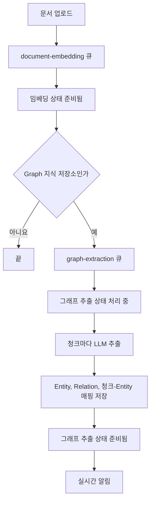

## 개요

이 문서는 [Graph RAG](CLE-KB-GRAPH.md) 의 하위 문서로 그래프 추출 파이프라인을 정한다. 큐 연결, 청크별 LLM 추출, 추출 응답 스키마와 검증, 재추출, 재시도와 회수, 실시간 알림, 추출 에러 처리를 다룬다. 임베딩과 공통인 재시도·회수 동작은 [문서 임베딩](CLE-KB-EMBED.md) 에서 정하고 여기에는 그래프에서 다른 점만 적는다.

## 그래프 추출 파이프라인

전체 흐름은 문서 임베딩 뒤에 이어진다.



### 큐 연결

`document-embedding` 워커가 임베딩을 마치고 임베딩 상태를 준비됨으로 바꾼 직후, 지식 저장소의 검색 모드가 `graph` 면 `graph-extraction` 큐에 다음 작업을 넣는다(`DocumentEmbeddingProcessor.onCompleted`).

```text
document-embedding 작업 완료
  └ kb.rag_mode === 'graph' 이면 queue('graph-extraction').add({ documentId, knowledgeBaseId, isKbBatch? })
```

### 추출 처리

`@Processor('graph-extraction', { concurrency: 2 })`. LLM 호출 비용과 속도 제한을 생각해 임베딩(3)보다 낮게 잡았다.

1. 문서의 그래프 추출 상태를 처리 중으로 바꾸고 `document:graph_started` 를 보낸다.
2. 그 문서 청크의 기존 청크-Entity 매핑을 지운다(`DELETE FROM chunk_entity WHERE chunk_id IN ...`). 그래서 다시 시도해도 중복 없이 쌓인다.
3. 문서의 모든 청크를 `chunk_index` 순서로 돈다. 다시 시도할 때 기존 Entity·Relation 은 지식 저장소 단위 중복 합치기로 자연스럽게 합쳐진다.
4. 청크마다 LLM 을 부른다. 모델은 그래프 추출 LLM 이나 워크스페이스 기본 Chat 설정이다.
   - 시스템 프롬프트: Entity 타입, Relation 형식, JSON 스키마를 강제한다.
   - 사용자 메시지: 청크 본문(최대 2000 토큰).
   - 응답: `{ entities: [{ name, displayName, type, description? }], relations: [{ head, predicate, tail }] }`
5. 결과를 지식 저장소 단위로 중복을 합쳐 저장한다. Entity 는 `(name, type)` 이 겹치면 `mention_count += 1`, Relation 은 `(head, predicate, tail)` 이 겹치면 `weight += 1` 이다.
6. 청크-Entity 매핑(`chunk_id × entity_id`, 원형 표기 `mention_text`)을 저장한다.
7. 청크를 처리할 때마다 진행률(0~100)과 늘어난 Entity·Relation 수를 `document:graph_progress` 로 보낸다.
8. 모든 청크가 끝나면 그래프 추출 상태를 준비됨으로 바꾸고 재시도 횟수를 0 으로 되돌린다. 지식 저장소의 `entity_count`, `relation_count` 를 한 번에 다시 센다(`KbStatsHelper`). `document:graph_completed` 를 보낸다.

### 추출 응답 스키마

LLM 을 부를 때 JSON 스키마를 강제한다.

```json
{
  "type": "object",
  "properties": {
    "entities": {
      "type": "array",
      "items": {
        "type": "object",
        "properties": {
          "name": { "type": "string", "description": "정규화된 이름 (소문자·trim·동의어 통합)" },
          "displayName": { "type": "string", "description": "원문에서 등장한 자연 표기" },
          "type": {
            "type": "string",
            "enum": ["person", "organization", "concept", "location", "event", "other"]
          },
          "description": { "type": "string" }
        },
        "required": ["name", "displayName", "type"]
      }
    },
    "relations": {
      "type": "array",
      "items": {
        "type": "object",
        "properties": {
          "head": { "type": "string", "description": "head entity 의 name (정규화 형)" },
          "predicate": { "type": "string", "description": "동사·관계 서술어. snake_case 권장" },
          "tail": { "type": "string", "description": "tail entity 의 name (정규화 형)" }
        },
        "required": ["head", "predicate", "tail"]
      }
    }
  },
  "required": ["entities", "relations"]
}
```

응답 검증:

- `relation.head` 와 `relation.tail` 은 같은 응답의 `entities[*].name` 에 있어야 한다. LLM 환각을 막으려는 규칙이다. 맞지 않는 Relation 은 버리고 경고를 남긴다.
- Entity 가 0개인 청크는 그래프에 영향을 주지 않고 건너뛴다.

### 재추출

엔드포인트는 [Graph RAG](CLE-KB-GRAPH.md#api) 의 API 표에 있다.

- 문서 하나: `POST /api/knowledge-bases/:id/documents/:docId/re-extract`. Graph 지식 저장소에서만 받는다. `graph-extraction` 큐에 넣는다.
- 지식 저장소 전체: `POST /api/knowledge-bases/:id/re-extract`. 재처리 잠금(`reextract_status`)을 비교 후 교체로 얻는다. 모든 Entity·Relation·청크-Entity 매핑을 지우고 모든 문서를 한꺼번에 큐에 넣는다. 이미 진행 중이면 409 `KB_REEXTRACT_IN_PROGRESS` 다. 재추출 잠금은 저장 청크 차원을 건드리지 않는다. 잠금 상태 값은 [지식 저장소 데이터와 흐름](CLE-KB-DATA.md) 에서 정한다.
- 재임베딩: Graph 지식 저장소에서 문서를 재임베딩하면 그래프 추출이 자동으로 이어진다.

### 재시도와 회수

그래프 추출은 임베딩과 같은 재시도·회수 정책을 쓴다. 상황별 처리는 아래 [에러 처리](#에러-처리) 표에 있다.

- 타임아웃: 청크 하나의 LLM `chat()` 호출에 90초(`{ timeoutMs: 90_000 }`)를 건다. 응답이 멈추면 90초 안에 실패로 처리한다.
- 재시도: 문서 단위 `retryWithBackoff(maxRetries=3, baseDelayMs=1_000)`(1초, 4초, 16초)다. 청크 단위 LLM 재시도는 따로 두지 않는다. LLM 비용과 코드 복잡도를 견줘 문서 단위로 단순하게 했다. 더 정밀한 재시도는 후속으로 검토한다.
- 부팅할 때 처리 중 문서를 회수하는 주체는 `StuckDocumentRecoveryService` 다.
- 실패 문서 재시도의 `graph` 범위는 그래프 추출 상태가 실패인 문서를 되돌려 큐에 넣는다.

## 실시간 알림

임베딩 이벤트와 같은 방식으로 같은 문서 채널 `kb:{documentId}` 에 다섯 이벤트를 보낸다. 채널 규칙과 union 권위는 [문서 임베딩](CLE-KB-EMBED.md) 과 [WebSocket 이벤트와 명령](../CLE-API/CLE-API-WS-EVENTS.md) 에 있다.

| 이벤트 | 페이로드 | 시점 |
|---|---|---|
| `document:graph_started` | `{ documentId, knowledgeBaseId }` | 추출 시작 |
| `document:graph_progress` | `{ documentId, progress: number, entityDelta: number, relationDelta: number }` | 청크를 처리할 때마다 |
| `document:graph_completed` | `{ documentId, entityCount, relationCount }` | 완료 |
| `document:graph_retry` | `{ documentId, attempt: number, maxAttempts: number, error: string }` | 일시 오류 뒤 재시도를 큐에 넣기 직전 |
| `document:graph_failed` | `{ documentId, error: string }` | 재시도를 모두 썼거나 재시도하지 않는 에러로 최종 실패 |

`document:graph_error` 이벤트는 없다. 보내는 경로가 없어 `KbEventType` union 에서 뺐다. 일시 오류는 `document:graph_retry`, 최종 실패는 `document:graph_failed` 로만 알린다. 지식 저장소 단위 통계는 `document:graph_completed` 의 `entityCount`·`relationCount` 나 `GET /:id/graph/stats` 로 읽는다.

## 에러 처리

| 상황 | 처리 |
|---|---|
| 추출 LLM 호출 일시 실패(타임아웃, 5xx, 네트워크, 429) | 그래프 추출 상태를 재시도 중(`error`)으로, `graph_retry_count` 증가, `graph_error_message` 갱신, `document:graph_retry`. 1초·4초·16초 간격으로 최대 3번 자동 재시도 |
| 추출 LLM 호출 영구 실패(재시도 소진, 4xx) | 그래프 추출 상태를 실패로, `document:graph_failed`. 사용자가 문서 하나 재추출이나 실패 문서 재시도를 할 때까지 유지 |
| 추출 응답 JSON 해석 실패 | 청크 단위로 조용히 건너뛰고 경고. 응답 형식 문제는 다시 해도 같아서 재시도하지 않는다 |
| Relation 의 head·tail 이 응답 Entity 에 없음 | 그 Relation 을 버리고 경고(LLM 환각) |
| 전체 재추출 동시 호출 | 재처리 잠금(`reextract_status`) 비교 후 교체로 막는다. 409 `KB_REEXTRACT_IN_PROGRESS` |
| 워커가 멈춰 처리 중으로 남음 | 부팅할 때 `graph_last_attempted_at < NOW() - 10분` 인 문서를 회수해 큐에 다시 넣는다 |

검색 쪽 에러 처리(빈 그래프의 Vector 폴백)는 [Graph RAG — 검색 흐름](CLE-KB-GRAPH-SEARCH.md#에러-처리) 에 있다.

## Rationale

### 전체 재추출 잠금의 판정 결함 (2026-08-14 수정)

재추출 잠금은 `UPDATE … RETURNING` 이 0행인지로 선점을 판정한다. 그런데 반환값이 행 배열이 아니라 `[rows, affectedCount]` 튜플이라 길이가 늘 2 였다. 그래서 409 `KB_REEXTRACT_IN_PROGRESS` 가 넉 달 동안 한 번도 나지 않았다. 설계는 옳았고 구현이 지키지 못했다. 전체 재임베딩 잠금도 같은 결함이었다([문서 임베딩](CLE-KB-EMBED.md)). 결과를 읽는 규칙은 [raw SQL 결과 읽기 규약](../CLE-ENG/CLE-ENG-RAWQUERY.md) 에 있다.
