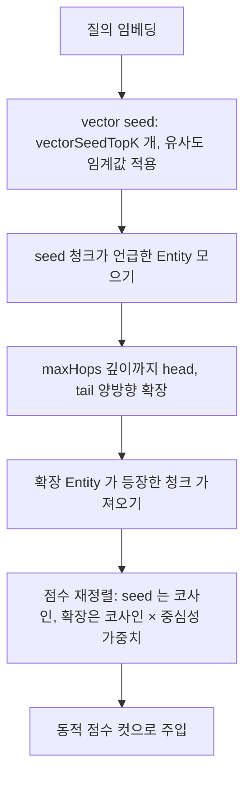

## 개요

이 문서는 [Graph RAG](CLE-KB-GRAPH.md) 의 하위 문서로 Graph 모드의 검색 흐름을 정한다. vector seed, 그래프 확장, 중심성 가중치 정렬, 그 개념 SQL, 출력 메타데이터, 검색 쪽 에러 처리를 다룬다. 동적 점수 컷, 리랭킹, `ragSources[]` 항목 스키마는 [RAG 검색](CLE-KB-SEARCH.md) 에서 정한다.

## 검색 흐름

`RagSearchService.search()` 는 검색 모드별로 갈라진다. Vector 모드는 [RAG 검색](CLE-KB-SEARCH.md) 그대로다.



1. 질의 임베딩: 지식 저장소의 `embedding_model_config_id` 가 가리키는 모델 설정의 `defaultModel` 로 임베딩한다.
2. vector seed: `vectorSeedTopK` 만큼 청크를 가져온다. Vector 검색과 같고 유사도 임계값(θ)을 적용한다.
3. seed 청크가 언급한 Entity 를 모은다(`chunk_entity` 조인).
4. 그래프 확장: 1부터 `maxHops` 깊이까지 head·tail 양방향으로 따라간다.
5. 확장한 Entity 가 등장한 청크를 더 가져온다(`chunk_entity` 역방향).
6. 합친 청크를 다시 정렬한다.
   - seed 청크: 원래 코사인 유사도.
   - 확장 청크: 코사인 유사도 × 중심성 가중치.
   - 중심성 가중치 = `log(entity.mention_count + 1) / log(MAX_MENTION + 1)`
7. 합친 결과를 동적 점수 컷(주입 토큰 예산, 주입 상한, 명시한 `top_k` 가 있으면 그 값)으로 LLM 컨텍스트에 넣는다([RAG 검색](CLE-KB-SEARCH.md)).

확장 청크 상한(`expandedChunkLimit`)은 확장으로 더 가져오는 청크 수의 상한이다. 가져오는 폭 전체는 `vectorSeedTopK + expandedChunkLimit` 이다. 최종으로 넣는 수는 동적 점수 컷이 정한다. seed 개수(기본 5)가 HNSW 기본 `ef_search` 40 보다 작아 seed 쿼리는 `ef_search` 를 올리지 않는다. 저장 청크 차원이 NULL 인 지식 저장소는 seed 쿼리를 실행하지 않고 검색 불가로 처리한다([RAG 검색](CLE-KB-SEARCH.md)).

리랭킹이 켜진 Graph 지식 저장소는 seed 와 확장 뒤 상위 후보 풀만큼 잘라 리랭킹으로 넘긴다. 리랭킹은 [RAG 검색](CLE-KB-SEARCH.md) 에서 정한다.

### SQL 개념

한 번의 SQL(재귀 CTE)로 seed, 확장, 확장 청크 회수를 처리한다.

```sql
-- 1. vector seed
WITH seed AS (
  SELECT dc.id AS chunk_id, dc.content, dc.metadata,
         d.id AS document_id, d.name AS document_name,
         1 - (dc.embedding::vector(1536) <=> $1) AS score
    FROM document_chunk dc
    JOIN document d ON d.id = dc.document_id
   WHERE d.knowledge_base_id = $2
     AND d.embedding_status = 'completed'
     AND 1 - (dc.embedding::vector(1536) <=> $1) >= $6   -- 유사도 임계값(θ)
   ORDER BY score DESC
   LIMIT $3        -- vectorSeedTopK
),
-- 2. seed Entity
seed_entities AS (
  SELECT DISTINCT ce.entity_id
    FROM chunk_entity ce
    JOIN seed s ON s.chunk_id = ce.chunk_id
),
-- 3. 그래프 확장 (재귀)
expanded_entities AS (
  SELECT entity_id, 0 AS depth FROM seed_entities
  UNION
  SELECT CASE WHEN r.head_entity_id = e.entity_id THEN r.tail_entity_id ELSE r.head_entity_id END,
         e.depth + 1
    FROM expanded_entities e
    JOIN relation r ON (r.head_entity_id = e.entity_id OR r.tail_entity_id = e.entity_id)
   WHERE e.depth < $4   -- maxHops
),
-- 4. 확장 청크
expanded_chunks AS (
  SELECT DISTINCT ce.chunk_id
    FROM chunk_entity ce
    JOIN expanded_entities e ON e.entity_id = ce.entity_id
)
-- 5. 중심성 가중치로 합쳐 정렬
SELECT chunk_id, content, score FROM (
  SELECT s.chunk_id, s.content, s.document_name, s.metadata, s.score, 'seed' AS origin
    FROM seed s
  UNION ALL
  SELECT ec.chunk_id, dc.content, d.name, dc.metadata,
         (1 - (dc.embedding::vector(1536) <=> $1)) * COALESCE(centrality_weight(ec.chunk_id), 1) AS score,
         'expanded' AS origin
    FROM expanded_chunks ec
    JOIN document_chunk dc ON dc.id = ec.chunk_id
    JOIN document d ON d.id = dc.document_id
   WHERE ec.chunk_id NOT IN (SELECT chunk_id FROM seed)
) t
ORDER BY score DESC
LIMIT $5;        -- 가져오는 폭: vectorSeedTopK + expandedChunkLimit. 최종 주입 수는 동적 점수 컷이 정한다
```

위 SQL 은 개념 정의다. 실제 구현은 차원별 부분 HNSW 인덱스(V022, V023)와 같은 캐스트 식을 쓴다.

### 출력 메타데이터

Graph 검색 결과에는 그래프 순회 요약이 더 붙는다.

```json
{
  "ragSources": [
    {
      "documentId": "uuid",
      "documentName": "Customer FAQ",
      "chunkId": "uuid",
      "content": "관련 텍스트 (앞 200자)...",
      "score": 0.92,
      "origin": "seed"
    },
    {
      "documentId": "uuid",
      "documentName": "Product Manual",
      "chunkId": "uuid",
      "content": "그래프 확장으로 회수된 텍스트...",
      "score": 0.78,
      "origin": "expanded"
    }
  ],
  "graphTraversal": {
    "mode": "graph",
    "seedChunkCount": 5,
    "traversedEntityCount": 12,
    "maxDepth": 1,
    "expandedChunkCount": 8
  }
}
```

- `graphTraversal` 은 `mode === 'vector'` 면 생략한다. 요약은 개수 값이다. ID 배열이 아니다.
- `ragSources[]` 항목 스키마의 단일 기준은 [RAG 검색](CLE-KB-SEARCH.md) 이다. Graph 모드도 같은 구조에 `origin` 을 `seed` 나 `expanded` 로 채워 같은 누적 경로와 References 화면을 쓴다. 본문 미리보기 필드는 Vector·Graph 모두 `content` 다(코드 `output-shape.ts`). Graph 전용 메타는 `ragSources` 밖의 `graphTraversal` 로 둔다.

## 에러 처리

| 상황 | 처리 |
|---|---|
| Graph 지식 저장소인데 `entity_count = 0`(추출 전이거나 실패) | Vector 흐름으로 자동으로 돌아간다. 빈 그래프 확장은 vector seed 결과와 같다 |

원칙: Graph 검색이 어떤 이유로든 빈 결과를 내면 vector seed 결과만으로 응답을 만든다.

추출 쪽 에러 처리는 [Graph RAG — 그래프 추출](CLE-KB-GRAPH-EXTRACT.md#에러-처리) 에 있다.
